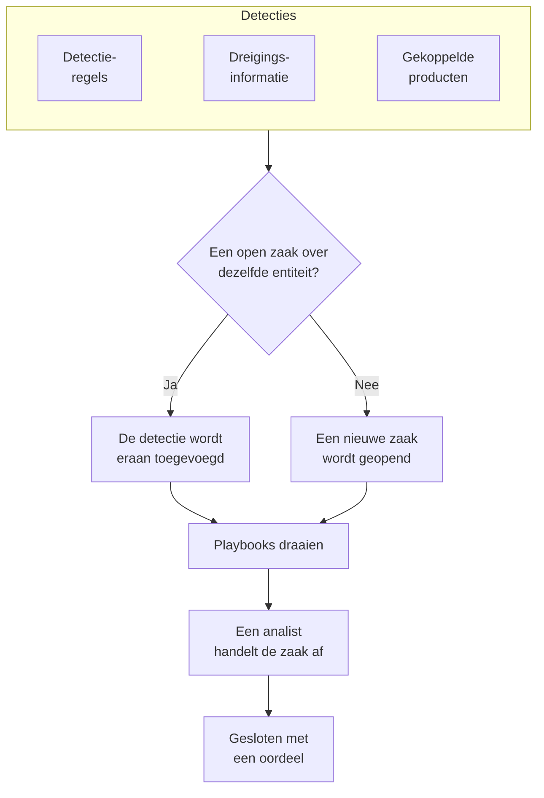

# Beveiligingszaken en playbooks (SOAR)

Security Events maakt zaken van wat je detectieregels, je threat intelligence en je gekoppelde beveiligingsproducten vinden: één zaak voor alles wat het onderzoeken waard is, waarin elke detectie over dezelfde gebruiker, dezelfde host of hetzelfde adres wordt gebundeld. Analisten handelen de zaken af in een wachtrij, en playbooks reageren erop, vanzelf of met één klik.

:::cards
- [Waar zaken vandaan komen](#waar-zaken-vandaan-komen): Detectieregels, threat intelligence, gekoppelde producten en mensen.
- [Een zaak afhandelen](#een-zaak-afhandelen): Toewijzen, de entiteiten onderzoeken en sluiten met een oordeel.
- [Playbooks](#playbooks): Stappen die op een zaak draaien, met goedkeuring waar het ertoe doet.
- [Het overzicht](#het-overzicht): Wat nu aandacht nodig heeft, en hoe snel zaken worden afgehandeld.
:::

## Hoe het werkt

Open **Producten → Security Events → Beveiligingszaken → Open zaken** voor de wachtrij. **Aan mij toegewezen**, **Niet toegewezen**, **Gesloten zaken** en **Alle zaken** zijn eigen pagina's ernaast, die elk de zaken tonen die hun naam zegt.

## Voordat je begint

Zaken en playbooks volgen de drie Security-rollen. Project Owner en Project Admin kunnen alles.

| Rol | Wat hij kan doen |
| --- | --- |
| Security Admin | Alles, inclusief zaken verwijderen en playbooks instellen |
| Security Member | Zaken openen, toewijzen, wijzigen en sluiten, notities schrijven, playbooks uitvoeren en hun stappen goedkeuren of afwijzen |
| Security Viewer | Zaken, detecties, notities, playbooks en hun uitvoeringen lezen |

Elk van deze rechten kan ook afzonderlijk worden toegekend, van het aanmaken van een zaak tot het goedkeuren van de stappen van een playbook; zie [Machtigingsreferentie](/docs/permissions/reference).

## Waar zaken vandaan komen

| Bron | Opent een zaak wanneer | Uitzetten met |
| --- | --- | --- |
| Detectieregels | Een regel matcht | **Open a Case on Match**, in de stap **Bij overeenkomst** van de regel |
| Dreigingsinformatie | Een gebeurtenis een bekende indicator noemt | **Open a Case on Match**, in de stap **Bij overeenkomst** van de feed |
| Gekoppelde producten | Een eigen waarschuwing van het product op of boven de drempel van de verbinding wordt geïmporteerd | **Open Cases From** op **Nooit** gezet, in de stap **Polling** van de verbinding |
| Mensen | Iemand er een opent vanuit **Beveiligingszaken**, of met **Open Case** in het paneel van een gebeurtenis | Niet uit te zetten |

Elke bron staat standaard aan. Een verbinding opent zaken voor **High and above**, tenzij je een ander niveau kiest; de waarschuwingen daaronder worden nog steeds als gebeurtenissen geïmporteerd.

### Hoe detecties worden gegroepeerd

Een detectie gaat over een entiteit: de waarde waarop haar regel groepeert, zoals het IP-adres bij een brute-forceregel, of de indicator die een threat-intelmatch noemt. Een detectie zonder entiteit staat op zichzelf.

- Is er al een open zaak over die entiteit, dan wordt de detectie eraan toegevoegd. De entiteiten en de ATT&CK-mapping van de zaak groeien, en haar prioriteit stijgt naar die van de detectie, maar daalt nooit.
- Is er geen, dan wordt er een nieuwe zaak geopend, vernoemd naar de detectie en met de prioriteit van de detectie.
- Een detectie die opnieuw afgaat, telt op in haar rij in plaats van er een toe te voegen.

De prioriteit van een zaak volgt uit de ernst van de detectie:

| Ernst | Prioriteit |
| --- | --- |
| Critical of Fatal | Kritiek |
| High | High |
| Medium, Unknown of Other | Medium |
| Low | Low |
| Informational | Informatief |

## Een zaak afhandelen

Een zaak doorloopt vier statussen. Ze kan er een overslaan, bijvoorbeeld een false positive die rechtstreeks vanuit Nieuw wordt gesloten, en ze kan worden heropend.

| Status | Betekenis |
| --- | --- |
| Nieuw | Nog niemand heeft ernaar gekeken |
| Onderzoeken | Iemand zoekt uit wat er is gebeurd |
| Contained | De dreiging kan geen schade meer aanrichten; het opruimen moet nog gebeuren |
| Gesloten | Klaar, met een oordeel over wat het was |

De pagina van de zaak heeft alles om haar af te handelen:

- Bovenaan: **Assign to Me**, **Run Playbook**, **Incident melden** en **Close Case**, de statusstappen, en de prioriteit onder het menu ernaast.
- **Detections**: wat afging en zo de zaak opende of eraan werd toegevoegd, hoe vaak, en de laatste overeenkomende gebeurtenis.
- **Entiteiten**: de gebruikers, hosts en adressen waar de zaak over gaat, met hun activiteit in al je beveiligingsgebeurtenissen van de afgelopen 7 dagen. Elk ervan opent in **Correleren**.
- **MITRE ATT&CK**: de tactieken en technieken waarop haar detecties zijn gemapt, elk gelinkt aan de bijbehorende pagina op attack.mitre.org.
- **Playbook-uitvoeringen**: wat elk playbook met de zaak deed, stap voor stap, en de stappen die op goedkeuring wachten.
- **Notities** en **Tijdlijn**: wat het team schreef, en alles wat er gebeurde, met wie het deed.

Om meerdere zaken tegelijk af te handelen, selecteer je ze in de wachtrij en gebruik je **Assign to Me**, **Change Status** of **Change Priority**.

### Een zaak sluiten

**Close Case** vraagt om een oordeel en een optionele afsluitende notitie:

| Oordeel | Betekenis |
| --- | --- |
| True Positive | Er vond echt kwaadaardige of ongeautoriseerde activiteit plaats |
| Benign Positive | De activiteit was echt maar verwacht, zoals een penetratietest of een beheertaak |
| False Positive | De detectie klopte niet: de regel of de gegevens zagen normale activiteit verkeerd aan |
| Undetermined | Er was niet genoeg informatie om het te bepalen |

De oordelen worden geteld in het overzicht. Een regel waarvan de zaken steeds als False Positive worden gesloten, is een regel om bij te stellen.

### Een incident melden

**Incident melden** opent een OneUptime-incident voor de zaak, met de ernst die je kiest, en koppelt de twee in beide richtingen: de beschrijving van het incident noemt de zaak, en de kop van de zaak linkt naar het incident. On-call, statuspagina's en de postmortem nemen het vanaf daar over. Daarvoor is een rol nodig die zowel zaken mag afhandelen als incidenten mag aanmaken.

## Playbooks

Een playbook is een lijst met stappen die op een zaak draaien. Maak er een aan onder **Producten → Security Events → Playbooks**, vanuit een sjabloon of leeg, en voeg de stappen toe op de pagina ervan.

### Wanneer een playbook draait

| Trigger | Wanneer het draait |
| --- | --- |
| Case Opened | Eén keer, wanneer een zaak wordt geopend |
| Detection Added | Telkens wanneer een nieuwe detectie aan een open zaak wordt toegevoegd |
| Manual | Alleen wanneer iemand het vanuit een zaak uitvoert |

Elk ingeschakeld playbook kan ook met de hand worden uitgevoerd, met **Run Playbook** op een zaak. Een playbook dat vanzelf draait, kun je beperken:

- **For Cases At Least**: alleen zaken met deze prioriteit of hoger.
- **Only For Detections From**: alleen wanneer de detectie achter de zaak uit deze bron komt.
- **Only For These Detection Rules**: alleen wanneer ze uit een van deze regels komt.

Een uitgeschakeld playbook draait niet vanzelf en ook niet met de hand.

### Stappen

| Categorie | Stap | Wat hij doet |
| --- | --- | --- |
| Zaak | Assign the case | Geeft de zaak aan een persoon, een team of beide |
| Zaak | Set the priority | Verhoogt of verlaagt de prioriteit van de zaak |
| Zaak | Set the status | Zet de zaak op Onderzoeken, Contained of Gesloten, met het oordeel dat je kiest |
| Zaak | Add a note | Schrijft een notitie bij de zaak, zoals een checklist voor de analist |
| Zaak | Add labels | Voorziet de zaak van labels |
| Onderzoeken | Check entities against threat intel | Zoekt elke entiteit op in je threat intelligence, en kan bij een match de prioriteit verhogen |
| Onderzoeken | Look up entity activity | Telt de beveiligingsgebeurtenissen van elke entiteit over een recent venster, en noteert dat bij de zaak |
| Informeren | Email people | Mailt gebruikers en teams een samenvatting van de zaak, met een link ernaartoe |
| Informeren | Post to Slack | Plaatst een samenvatting van de zaak in een Slack-kanaal |
| Informeren | Post to Microsoft Teams | Plaatst een samenvatting van de zaak in een kanaal van Microsoft Teams |
| Escaleren | Page on-call | Voert een on-callbeleid uit |
| Escaleren | Declare an incident | Opent een OneUptime-incident dat aan de zaak is gekoppeld |
| Inperken | Suspend the user in Okta | Schorst elke gebruiker van de zaak in Okta |
| Inperken | End the user's Okta sessions | Meldt elke gebruiker van de zaak af bij Okta en trekt zijn tokens in |
| Inperken | Contain the host in CrowdStrike | Isoleert elke host van de zaak van het netwerk met CrowdStrike Falcon |
| Inperken | Isolate the device in Microsoft Defender | Isoleert elke host van de zaak met Microsoft Defender for Endpoint |
| Automatiseren | Send a webhook | Post de zaak als JSON naar een URL |
| Automatiseren | Run a workflow | Start een OneUptime-workflow met de zaak als invoer |

Een playbook heeft hoogstens 25 stappen. Ze draaien op volgorde, elk zodra de vorige klaar is. Elke stap kan ook:

- **Needs Approval**: de uitvoering vóór de stap stilzetten totdat iemand hem op de zaak goedkeurt. Dit staat standaard aan voor de vier inperkingsstappen, die buiten OneUptime ingrijpen.
- **Only If Threat Intel Matched**: de stap overslaan, tenzij een eerdere stap **Check entities against threat intel** van dezelfde uitvoering een bekende indicator vond.
- **Carry On If It Fails**: de volgende stap uitvoeren, ook als deze mislukt. Staat dit uit, dan stopt een mislukte stap de uitvoering.

### Inperking

De inperkingsstappen werken via een [verbinding voor beveiligingsgebeurtenissen](/docs/telemetry/security-events#een-beveiligingsproduct-koppelen) met het product, die daarvoor meer dan leestoegang nodig heeft:

| Stap | Verbinding | Vereist |
| --- | --- | --- |
| Suspend the user in Okta, End the user's Okta sessions | Okta System Log | Een API-token dat gebruikers mag beheren |
| Contain the host in CrowdStrike | CrowdStrike Falcon | Een API-client met schrijfrechten in de scope Hosts |
| Isolate the device in Microsoft Defender | Microsoft Defender XDR | Een app met de machtiging Machine.Isolate |

Een inperkingsstap werkt op hoogstens 10 van de gebruikers of hosts van de zaak. Hij zoekt elk ervan op naam op in het product, en meldt op de zaak wat hij met elk deed: ingeperkt, al ingeperkt, niet gevonden of geweigerd.

### Berichten

Een notitie, een e-mail, een Slack-bericht en een Teams-bericht kunnen de waarden van de zaak gebruiken:

| Placeholder | Wordt |
| --- | --- |
| `{{case.number}}` | Het zaaknummer, zoals CASE-42 |
| `{{case.title}}` | De titel van de zaak |
| `{{case.priority}}` | Critical, High, Medium, Low of Informational |
| `{{case.status}}` | New, Investigating, Contained of Closed |
| `{{case.assignee}}` | Aan wie de zaak is toegewezen |
| `{{case.url}}` | Een link naar de zaak in OneUptime |
| `{{case.entities}}` | De gebruikers, hosts en adressen waar de zaak over gaat |
| `{{case.detections}}` | Hoeveel detecties de zaak bevat |

Een e-mail of bericht zonder eigen tekst stuurt een samenvatting van de zaak.

### Uitvoeringen en goedkeuringen

Elke uitvoering staat stap voor stap vermeld bij haar zaak en onder **Producten → Security Events → Playbooks → Playbook-uitvoeringen**:

| Status van de uitvoering | Betekenis |
| --- | --- |
| Queued | Wacht op een worker |
| Actief | Voert haar stappen uit |
| Waiting for Approval | Stilgezet vóór een stap die goedkeuring nodig heeft |
| Geslaagd | Elke stap is uitgevoerd of overgeslagen |
| Mislukt | Een stap mislukte en de uitvoering stopte |
| Geannuleerd | Iemand heeft haar geannuleerd, of een stap afgewezen |

Een stap die op goedkeuring wacht, toont **Approve** en **Reject** op de uitvoering, met een optionele opmerking. Goedkeuren zet de uitvoering voort vanaf die stap; afwijzen beëindigt haar. De beslissing, wie haar nam en de opmerking worden bewaard bij de stap en op de tijdlijn van de zaak. **Wacht op goedkeuring**, onder **Playbooks** in het menu, toont de uitvoeringen die op een beslissing wachten en telt ze; **Playbook-uitvoeringen** toont elke uitvoering.

Een uitvoering die niets meer van haar worker hoort, bijvoorbeeld na een herstart, wordt weer opgepakt: een uitvoering in de wachtrij wordt na 2 minuten opnieuw in de wachtrij gezet, en een uitvoering die 30 minuten niets heeft gemeld, wordt als mislukt gemarkeerd.

## Het overzicht

**Producten → Security Events → Overzicht** is de pagina waarop het product opent:

- De open zaken die aan jou zijn toegewezen, de open zaken die nog niemand heeft opgepakt, en de playbookstappen die op goedkeuring wachten; elk getal opent de pagina die ze toont.
- **Gemiddelde tijd tot bevestiging**, **Gemiddelde tijd tot indamming** en **Gemiddelde tijd tot sluiting**, over de zaken die in de afgelopen 30 dagen zijn geopend: van het openen van een zaak tot iemand haar oppakt (een persoon toewijst, of haar uit Nieuw haalt), tot Contained, en tot Gesloten. Een zaak die nog wacht, telt niet mee in een gemiddelde.
- De zaken die per dag zijn geopend, over 30 dagen, per prioriteit, en de detecties die per dag zijn opgeworpen, over 14 dagen, per bron.
- De open zaken per prioriteit en per status, de oordelen van de afgelopen 30 dagen, de ATT&CK-tactieken achter de zaken, de detecties die het vaakst afgingen, en de entiteiten die in de meeste bevindingen voorkomen.

Daarboven toont een strook hoe beveiliging is ingericht: de bronnen, detecties, zaken en playbooks, elk met hun cijfers. Een project dat het nog niet heeft ingericht, ziet daar **Aanbevolen inschakelen** en **Testaanval sturen**; zie [Aan de slag met beveiliging](/docs/telemetry/security-getting-started). Als niets iemand nodig heeft, zegt de pagina **Alles rustig**, en de grafieken verschijnen zodra er iets te tonen is.

## Dreigingen vinden

- **Entiteiten** rangschikt de gebruikers, hosts, adressen en hashes die je bevindingen het vaakst noemen, over de afgelopen dag, week of maand, en zoekt elke waarde op in 30 dagen aan gebeurtenissen.
- **Rule Library** bevat kant-en-klare detectieregels voor dreigingen rond identiteit, endpoints, cloud, netwerk, web en Kubernetes. Elke regel is een Sigma-regel, geschreven voor de velden waarnaar elke gekoppelde bron wordt genormaliseerd. **Regel toevoegen** maakt hem aan als een eigen detectieregel, ingeschakeld en zo ingesteld dat hij zaken opent in plaats van waarschuwingen; wijzig hem onder **Detection Rules** zoals elke andere. De regels die als **Aanbevolen** zijn gemarkeerd, vinden bedreigingen in gegevens die OneUptime al heeft, en één knop voegt de regels toe die u nog niet hebt.
- **ATT&CK Coverage** tekent de matrix van MITRE ATT&CK, licht de technieken op die je ingeschakelde regels dekken, en omlijnt de technieken die een regel uit de bibliotheek zou dekken.

## Automatiseren

- **Workflows**: een zaak of een notitie kan een workflow starten wanneer ze wordt aangemaakt, bijgewerkt of verwijderd. Een stap **Run a workflow** start een workflow waarvan de trigger een webhook is.
- **API**: zaken, notities, detecties, playbooks en uitvoeringen hebben dezelfde REST API als de rest van OneUptime, onder `/security-case`, `/security-case-note`, `/security-detection`, `/security-playbook` en `/security-playbook-run`. Zie [API-referentie](/docs/api-reference/api-reference).
- AI-agents: de MCP-server heeft tools voor zaken, notities, detecties en playbooks. Zie [MCP-server](/docs/ai/mcp-server).

## Probleemoplossing

:::details Een regel matcht, maar er wordt geen zaak geopend
Controleer **Open a Case on Match** in de stap **Bij overeenkomst** van de regel. Een detectie over een entiteit die al een open zaak heeft, wordt aan die zaak toegevoegd in plaats van een nieuwe te openen: zoek haar onder **Detections** in de open zaak.
:::

:::details Een playbook draaide niet
Controleer of het is ingeschakeld, of de **Trigger** klopt (Case Opened draait één keer, wanneer een zaak wordt geopend), en of de zaak voldoet aan de instellingen **For Cases At Least**, **Only For Detections From** en **Only For These Detection Rules**. Een met de hand geopende zaak heeft geen detectie, dus een playbook dat tot een bron of tot regels is beperkt, draait er niet op.
:::

:::details Een inperkingsstap is mislukt
Open de uitvoering op de zaak: de stap meldt voor elke gebruiker of host of het product de actie weigerde, hem niet vond, of niet bereikbaar was. Controleer of de referentie van de verbinding de wijziging mag doorvoeren, en gebruik **Verbinding testen** in haar rij.
:::

## Volgende stappen

:::cards
- [Beveiligingsgebeurtenissen](/docs/telemetry/security-events): Stuur gebeurtenissen, schrijf detectieregels en koppel beveiligingsproducten.
- [Dreigingsinformatie](/docs/telemetry/threat-intelligence): Vergelijk je gebeurtenissen met STIX/TAXII-feeds.
- [Machtigingsreferentie](/docs/permissions/reference): De Security-rollen, en wat elk ervan kan.
:::
