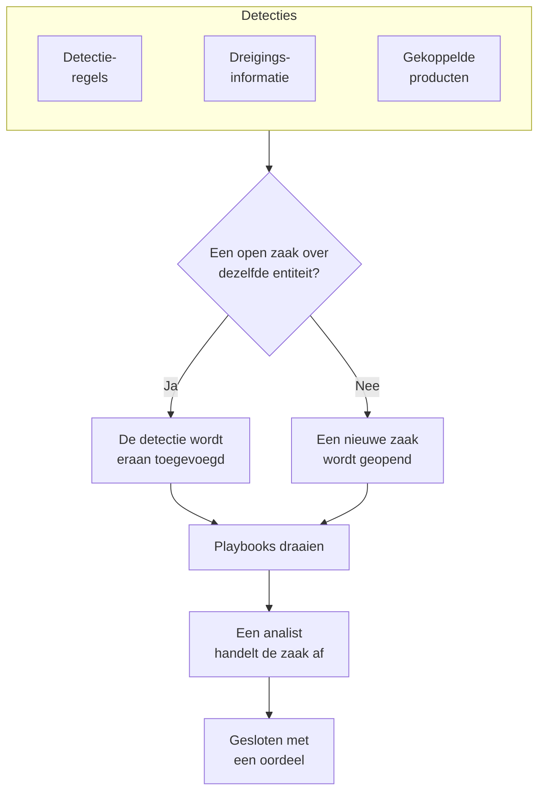

# Beveiligingszaken en playbooks (SOAR)

Beveiligingsgebeurtenissen maakt zaken van wat je detectieregels, je threat intelligence en je gekoppelde beveiligingsproducten vinden: één zaak voor alles wat het onderzoeken waard is, waarin elke detectie over dezelfde gebruiker, dezelfde host of hetzelfde adres wordt gebundeld. Analisten handelen de zaken af in een wachtrij, en playbooks reageren erop, vanzelf of met één klik.

:::cards
- [Waar zaken vandaan komen](#waar-zaken-vandaan-komen): Detectieregels, threat intelligence, gekoppelde producten, entiteitrisico en mensen.
- [Een zaak afhandelen](#een-zaak-afhandelen): Toewijzen, de entiteiten onderzoeken en sluiten met een oordeel.
- [Zaakprioriteiten en zaakstatussen](#zaakprioriteiten-en-zaakstatussen): Hernoem ze, geef ze een andere kleur en volgorde, en voeg je eigen toe.
- [Reactiedoelen](#reactiedoelen): Hoe snel een zaak van elke prioriteit moet worden opgepakt en ingedamd.
- [Meldingen](#meldingen): Wie hoort over een nieuwe zaak, een toewijzing, een reactiedoel, een taak en een stap die op goedkeuring wacht.
- [Playbooks](#playbooks): Stappen die op een zaak draaien, met goedkeuring waar het ertoe doet.
- [Het overzicht](#het-overzicht): Wat nu aandacht nodig heeft, en hoe snel zaken worden afgehandeld.
:::

## Hoe het werkt

Open **Producten → Beveiligingsgebeurtenissen → Beveiligingszaken → Open zaken** voor de wachtrij. **Mijn zaken**, **Niet toegewezen**, **Gesloten zaken** en **Alle zaken** zijn eigen pagina's ernaast, die elk de zaken tonen die hun naam zegt.

## Voordat je begint

Zaken en playbooks volgen de drie Security-rollen. Projecteigenaar en Projectbeheerder kunnen alles.

| Rol | Wat hij kan doen |
| --- | --- |
| Beveiligingsbeheerder | Alles, inclusief zaken verwijderen, bewijs verwijderen en playbooks instellen |
| Beveiligingslid | Zaken openen, toewijzen, wijzigen en sluiten, notities schrijven, taken uitvoeren, bewijs toevoegen, playbooks uitvoeren en hun stappen goedkeuren of afwijzen |
| Beveiligingskijker | Zaken, detecties, notities, taken, bewijs, playbooks en hun uitvoeringen lezen |

Elk van deze rechten kan ook afzonderlijk worden toegekend, van het aanmaken van een zaak tot het goedkeuren van de stappen van een playbook; zie [Machtigingsreferentie](/docs/permissions/reference).

## Waar zaken vandaan komen

| Bron | Opent een zaak wanneer | Uitzetten met |
| --- | --- | --- |
| Detectieregels | Een regel matcht | **Zaak openen bij overeenkomst**, in de stap **Bij overeenkomst** van de regel |
| Dreigingsinformatie | Een gebeurtenis een bekende indicator noemt | **Zaak openen bij overeenkomst**, in de stap **Bij overeenkomst** van de feed |
| Gekoppelde producten | Een eigen waarschuwing van het product op of boven de drempel van de verbinding wordt geïmporteerd | **Zaken openen vanaf** op **Nooit** gezet, in de stap **Opvragen** van de verbinding |
| Beveiligingsproducten in je logs | Een bedreiging die een firewall, IDS of endpointproduct in je logs schrijft, ligt op of boven de drempel van Uw logboeken | **Cases openen vanaf** op **Nooit** gezet, op **Uw logboeken** |
| Entiteitrisico | Het risico van een gebruiker, host of adres de drempel van het project haalt | **Risicozaken**, onder **Instellingen → Risicoscoring** |
| Mensen | Iemand er een opent vanuit **Beveiligingszaken**, of met **Zaak openen** in het paneel van een gebeurtenis | Niet uit te zetten |

Elke bron opent standaard zaken, behalve entiteitrisico in projecten die zijn aangemaakt voordat het bestond: zet daar eerst **Risicozaken** aan ([Entiteitrisico](/docs/telemetry/security-entity-risk)). Een verbinding opent zaken voor **Hoog en hoger**, tenzij je een ander niveau kiest; de waarschuwingen daaronder worden nog steeds als gebeurtenissen geïmporteerd. **Uw logboeken** doet hetzelfde voor de bedreigingen in je logs.

### Hoe detecties worden gegroepeerd

Een detectie gaat over een entiteit: de waarde waarop haar regel groepeert, zoals het IP-adres bij een brute-forceregel, of de indicator die een threat-intelmatch noemt. Een detectie zonder entiteit staat op zichzelf.

- Is er al een open zaak over die entiteit, dan wordt de detectie eraan toegevoegd. De entiteiten en de ATT&CK-mapping van de zaak groeien, en haar prioriteit stijgt naar die van de detectie, maar daalt nooit.
- Is er geen, dan wordt er een nieuwe zaak geopend, vernoemd naar de detectie en met de prioriteit van de detectie.
- Een detectie die opnieuw afgaat, telt op in haar rij in plaats van er een toe te voegen.

De prioriteit van een zaak volgt uit de ernst van de detectie, als de ingebouwde prioriteit van het project voor dat niveau, hoe je die ook hebt genoemd:

| Ernst | Prioriteit |
| --- | --- |
| Critical of Fatal | Kritiek |
| High | High |
| Medium, Unknown of Other | Medium |
| Low | Low |
| Informational | Informatief |

## Een zaak afhandelen

De zaken van een nieuw project doorlopen vier statussen, die je kunt hernoemen en aanvullen (zie [Zaakprioriteiten en zaakstatussen](#zaakprioriteiten-en-zaakstatussen)). Een zaak kan er een overslaan, bijvoorbeeld een false positive die rechtstreeks vanuit Nieuw wordt gesloten, en ze kan worden heropend.

| Status | Betekenis |
| --- | --- |
| Nieuw | Nog niemand heeft ernaar gekeken |
| Onderzoeken | Iemand zoekt uit wat er is gebeurd |
| Contained | De dreiging kan geen schade meer aanrichten; het opruimen moet nog gebeuren |
| Gesloten | Klaar, met een oordeel over wat het was |

Een zaak heeft een eigen zijmenu, zoals een incident, en elk deel van de zaak is een eigen pagina:

| Sectie van het zijmenu | Pagina's |
| --- | --- |
| **Overzicht** | **Overzicht**, **Tijdlijn** |
| **Onderzoek** | **Verloop**, **Detecties**, **Entiteiten**, **Verbonden signalen**, **Bewijs**, **Taken**, **Playbooks** |
| **Notities** | **Privénotities** |
| **Geavanceerd** | **Aangepaste velden**, **Auditlogboeken**, **Zaak verwijderen**, ingeklapt tot je op **Geavanceerd** klikt |

Elke pagina houdt bovenaan de kop van de zaak: nummer, prioriteit, status en titel, **Aan mij toewijzen**, **Playbook uitvoeren**, **Incident melden** en **Zaak sluiten**, en in het menu ⋯ ernaast **Prioriteit instellen**, **Aan iemand anders toewijzen**, **Status wijzigen**, **Zaak bewerken** en **Zaak verwijderen**. Zo handel je de zaak af vanaf elk van haar pagina's, en een link naar de zaak opent nog steeds haar **Overzicht**. Heeft de prioriteit van de zaak reactiedoelen, dan toont de kop ook wanneer het volgende verloopt ([Reactiedoelen](#reactiedoelen)).

- **Overzicht**: de beschrijving, labels en statusstappen van de zaak, wie haar heeft en wat haar opende, en haar cijfers: hoeveel detecties ze heeft, hoe lang ze al open is, en hoe lang het duurde tot ze bevestigd en ingedamd was. Onder **Tijd tot bevestiging** en **Tijd tot indamming** staat hoe de zaak ervoor staat ten opzichte van haar reactiedoelen.
- **Waarom deze zaak is geopend**, op het **Overzicht**: de detectie die de zaak opende en hoe haar regel afgaat (zijn drempel, waarop hij groepeert en het venster waarin hij telt), hoeveel gebeurtenissen ze matchte, waar die vandaan kwamen en tussen welke tijdstippen, waar de regel naar zoekt, en hoe ver de verzoeken kwamen. Onder **Treffers** staan de gebeurtenissen zelf, de oudste eerst: in elke gebeurtenis is gemarkeerd waar de regel naar zoekt, en ze toont hoe ver haar verzoek kwam en uit welke logregel of van welk product ze komt, met **Trace**, **Logboeken** en **Uitzondering** elk één klik verwijderd; de logregel waaruit ze komt, opent in de logboekverkenner op die regel. Klik op een gebeurtenis om haar volledig te zien, met de logregel waaruit ze is gelezen. **Bij deze zaak bewaren**, in haar rij of in haar paneel, bewaart de gebeurtenis op de pagina **Bewijs** van de zaak en noemt daarbij de detectie die haar matchte; een gebeurtenis die de zaak al bewaart, zegt dat en opent haar daar. Een detectie bewaart, wanneer ze afgaat, tot 25 van de gebeurtenissen die ze matchte, en toont die, ook als hun bewaartermijn voorbij is; je rol ziet die uit de bronnen die hij mag lezen. Een regel die voor veel groepen tegelijk afgaat, ook een correlatieregel, bewaart gebeurtenissen voor elk ervan: hoogstens 1.000 in totaal, dus elk bewaart er minstens 10, en tot 25 als hij opnieuw afgaat. Voor een detectie uit de tijd dat detecties nog geen gebeurtenissen bewaarden, zijn de treffers van een regel wat zijn eigen voorwaarde matchte, voor de groep van de detectie, in de vensters waarin hij afging; een threat-intelmatch toont de gebeurtenissen die zijn indicator bevatten, en een waarschuwing van een gekoppeld product de gebeurtenis waarin ze werd verzonden. **Verder kijken** opent alles over het adres of de gebruiker waar de detectie over gaat, de gebeurtenissen en logregels die deze waarde noemen, de logboeken van de services waar haar logregels vandaan kwamen en de traces van haar verzoeken, elk over het venster van de detectie, en het **Verloop** en de **Verbonden signalen** van de zaak. De andere detecties van de zaak zijn ingeklapt onder **Ook op deze zaak**.
- **Responsplan**, op het **Overzicht**: wat er nu aan de zaak moet gebeuren, het dringendste eerst, onder **Bevestigen dat het echt is**, **Indammen**, **Herstellen wat het mogelijk maakte** en **De zaak sluiten**. Elke stap gaat over deze zaak: haar adressen, gebruikers en hosts, hoe ver haar verzoeken kwamen, waarop haar regel volgens eigen zeggen ook kan afgaan, de ATT&CK-tactieken en -technieken waarop haar detecties zijn gemapt, en de playbooks die het project heeft. De eigen stappen van een detectieregel, geschreven onder **Responsstappen** in zijn formulier, komen eerst in het deel van het plan waaronder ze vallen, en de regels uit de regelbibliotheek hebben hun eigen stappen. Een stap die OneUptime kan uitvoeren, heeft zijn eigen knop: **Aan mij toewijzen**, **Uitzondering toevoegen** met de regel en het adres al ingevuld, **Playbook uitvoeren** voor het playbook dat het account opschort of de host indamt, of voor het playbook dat OneUptime AI voorstelt, **Incident melden**, **Markeren als ingedamd** en **Zaak sluiten**. De stap van een openbaar adres blokkeert het met één klik, **24 uur blokkeren**, zodra een bestemming je blokkeerlijst toepast (zie [Een adres blokkeren vanuit een zaak](#een-adres-blokkeren-vanuit-een-zaak)). Een stap die OneUptime niet kan uitvoeren, zoals een domein blokkeren in je DNS-filter, toont **Buiten OneUptime**, met de waarde één klik van je klembord. Waar een verbinding op elke machine blokkeert (zie [Blokkeerlijst](#blokkeerlijst)), is het blokkeren van het domein, het bestand of de command-and-controlserver van de zaak ook één klik: **7 dagen blokkeren**, of **Bestand blokkeren** voor 30 dagen, zet het op de blokkeerlijst, en de stap is klaar zodra Microsoft Defender of CrowdStrike Falcon de blokkering toepast. Vink een stap af als hij klaar is: hij wordt bewaard als een van de **Taken** van de zaak, afgerond, met wie het deed en wanneer. Stappen waarover de zaak zelf beslist, vinken zichzelf af: ze is toegewezen, er is een incident gemeld, een playbook heeft gedraaid, ze is ingedamd of gesloten. Zodra elke stap die de dreiging indamt, klaar is, biedt het plan **Markeren als ingedamd** aan, waarmee de tijd tot indamming van de zaak wordt vastgelegd. Als OneUptime AI de zaak heeft beoordeeld, staat zijn lezing bovenaan het plan, en de stappen die het voorstelt, zijn ingeklapt onder die van het plan zelf. De meeste stappen controleert OneUptime zelf, en het zegt naast elke stap wat het vond: zie [Hoe OneUptime een stap controleert](#hoe-oneuptime-een-stap-controleert).
- **OneUptime AI**, op het **Overzicht**: wat OneUptime AI van de zaak maakt, de prioriteit en het playbook die het voorstelt, en het bewijs erachter. Zie [OneUptime AI in beveiliging](/docs/telemetry/security-ai).
- **Impact**, op het **Overzicht**: wat de zaak in gevaar brengt: of OneUptime heeft gezien dat haar records vanaf het internet werden bereikt, wie de eigenaar is, wat er het laatst aan veranderde, en de gegevens in gevaar - de opslagen met gevoelige gegevens die de zaak noemt of waar haar gebruikers en rollen bij kunnen (zie [Integraties van Gegevensbeveiliging](/docs/data-security/integrations#security-operations)). Klap het open om te zien wat elk record aanroept en waardoor het wordt aangeroepen, welke monitors en statuspagina's het in de gaten houden en met welke machines de adressen van de zaak praatten.
- **MITRE ATT&CK**, op het **Overzicht**: de tactieken en technieken waarop haar detecties zijn gemapt, elk gelinkt aan de bijbehorende pagina op attack.mitre.org.
- **Tijdlijn**: alles wat er met de zaak gebeurde, met wie het deed.
- **Verloop**: wat er gebeurde, op volgorde, in heel OneUptime: elke detectie en de beveiligingsgebeurtenissen erachter, hoe ver hun verzoeken kwamen, de uitzonderingen die ze opwierpen, de wijzigingen aan de records die de zaak noemt, de incidenten en meldingen die daarop ontstonden, en wat het team deed. De vele sondes van een scanner zijn één regel, en elke regel opent wat hij noemt, zoals de trace van het verzoek of de uitzondering.
- **Detecties**: wat afging en zo de zaak opende of eraan werd toegevoegd, hoe vaak, en de laatste overeenkomende gebeurtenis.
- **Entiteiten**: de gebruikers, hosts en adressen waar de zaak over gaat, met hun activiteit in al je beveiligingsgebeurtenissen van de afgelopen 7 dagen. Elk ervan opent in **Correleren**.
- **Verbonden signalen**: de hosts, clusters, services en leden die de zaak noemt, zoals OneUptime ze kent, en wat er op elk ervan gebeurde rond de detecties: hun logboeken, traces en metrieken, wat erop openstaat en wat er is veranderd. Zie [Verbonden signalen](/docs/telemetry/security-connected-signals).
- **Bewijs**: de bestanden, koppelingen en beveiligingsgebeurtenissen die bij de zaak worden bewaard, elk met wie het toevoegde en wanneer. Met **Bestand toevoegen** upload je een bestand van maximaal 10 MB en wordt de SHA-256 vastgelegd van wat is geüpload, zodat wie het later downloadt kan controleren dat het is wat werd bewaard; met **Koppeling toevoegen** verwijs je naar bewijs dat ergens anders staat. Alleen een Beveiligingsbeheerder kan bewijs verwijderen, en de **Tijdlijn** van de zaak toont wat er is toegevoegd en verwijderd. Een beveiligingsgebeurtenis wordt hier bewaard zoals ze was, met **Aan zaak toevoegen** op **Gebeurtenissen** of op de pagina van een [hunt](/docs/telemetry/security-events#hunts), of met **Bij deze zaak bewaren** bij een gebeurtenis die een detectie matchte, en **Gebeurtenis bekijken** opent haar. Ook de stap **Preserve the evidence** van een playbook bewaart hier de gebeurtenissen achter de detecties van de zaak.
- **Taken**: wat er in de zaak moet gebeuren, wie het doet en of het af is. Voeg een taak toe als één regel, geef hem aan iemand en vink hem af als hij af is. Wie de taak krijgt, krijgt bericht, tenzij die hem zelf nam, en het menu toont naast **Taken** hoeveel taken open staan. Ook de stap **Taken toevoegen** van een playbook voegt taken toe en laat weg wat de zaak al heeft.
- **Playbooks**: wat elk playbook met de zaak deed, stap voor stap, en de stappen die op goedkeuring wachten. Zolang er uitvoeringen wachten, toont het menu hoeveel naast **Playbooks**.
- **Privénotities**: wat het team over de zaak schreef. Het menu **Sjablonen** van de editor zet een van de notitiesjablonen van het project in een notitie.
- **Aangepaste velden**: de eigen velden van het project, ingevuld voor deze zaak, en **Velden bewerken** om ze te wijzigen. Zodra het project een veld heeft, toont het **Overzicht** ze ook, in zijn laatste kaart. Zie [Aangepaste velden, notitiesjablonen en nummering](#aangepaste-velden-notitiesjablonen-en-nummering).
- **Auditlogboeken**: elke wijziging aan de zaak, en wie die maakte. Zie [Auditlogboeken](/docs/configuration/audit-logs).
- **Zaak verwijderen**: verwijdert de zaak voorgoed, met haar detecties, notities, tijdlijn en playbook-uitvoeringen. Wil je haar als verslag bewaren, sluit haar dan met een oordeel.

### Hoe OneUptime een stap controleert

Een vinkje zegt dat iemand een stap heeft gedaan. OneUptime controleert de stappen in het **Responsplan** van een zaak ook zelf, aan wat er echt gebeurde: elke minuut zolang de zaak open is, en meteen wanneer een stap wordt afgevinkt, een taak verandert of een playbook iets indamt. Naast elke stap die het controleerde, zegt het plan wat het vond:

| Naast de stap | Betekent |
| --- | --- |
| **Gecontroleerd door OneUptime** | OneUptime zag de stap afgerond, en hij houdt stand. Niemand hoeft hem af te vinken |
| **Lijkt afgerond** | Wat OneUptime ziet, past bij een afgeronde stap, maar bewijst het niet. **Bevestigen** vinkt hem af als de jouwe |
| **Nog niet afgerond** | OneUptime ziet dat de stap nog moet gebeuren |
| **OneUptime kan het niet zeggen** | OneUptime heeft niets om de stap aan te controleren, en zegt waarom, met **Zo laat u OneUptime dit controleren** |
| **Houdt geen stand meer** | De stap was afgerond en werkt niet meer, zoals een geblokkeerd adres dat weer doorkomt |
| **Voorlopig niet nodig** | Er is niets gebeurd dat om de stap vraagt |

**Hoe we het weten**, naast wat OneUptime vond, opent de rest: wat het nog meer zag, een link naar de traces of het product dat het las, en wanneer het controleerde. De voortgang van het plan telt de stappen die OneUptime zelf controleerde, zoals in "4 van 9 afgerond, 3 gecontroleerd door OneUptime".

| Stap | Wat OneUptime leest |
| --- | --- |
| Het adres blokkeren | Of een bestemming een blokkering van het adres op je [blokkeerlijst](#blokkeerlijst) vasthoudt en die heeft teruggelezen, en of aanvragen van het adres je app nog bereiken, in de traces en toegangslogboeken ervan. Een blokkering die een bestemming vasthoudt, is gecontroleerd; een blokkering die niets toepast, niet. Een adres dat stil wordt zonder blokkering, lijkt afgerond: het is misschien geblokkeerd, of misschien gewoon gestopt |
| Controleren dat er niets anders doorkwam | Hoe elke aanvraag van het adres sinds de eerste detectie van de zaak eindigde. Als je app ze allemaal afwees, is de stap gecontroleerd |
| Het account opschorten | Het account in Okta, Microsoft Entra ID of Google Workspace: opgeschort, of uitgeschakeld met de sessies beëindigd nadat de zaak werd geopend |
| De host van het netwerk halen | De host in CrowdStrike Falcon of Microsoft Defender for Endpoint: ingedamd of geïsoleerd |
| Het domein, het bestand of de server op elke machine blokkeren | De blokkering op de blokkeerlijst: klaar zolang Microsoft Defender of CrowdStrike Falcon die toepast, niet klaar zolang die onderweg is of geweigerd, wat de stap zegt |
| Een incident melden | Of een aanvraag door de controles van je app kwam, of een monitor van de diensten die ze bereikte uitviel, terwijl de zaak open was. Tot dan is de stap voorlopig niet nodig |
| Een fout-positief uitsluiten | Niets: alleen jij kunt het uitsluiten. De stap somt op wat OneUptime over het adres weet: of een van je records het heeft, de feeds met dreigingsinformatie die het vermelden, en de aangemelde gebruikers die het de afgelopen 30 dagen gebruikten |
| De route herstellen waarop de aanval was gericht | De aanvalsaanvragen naar de route, in de traces en logboeken van je app, voor en na een wijziging die werd uitgerold naar de service erachter: een pull request die de stap **Fix the code with AI** van een playbook opende, of elke andere deploy of nieuwe versie van de service. Zodra er sindsdien genoeg aanvragen van dezelfde aanval zijn afgewezen, of buiten de database zijn gehouden waar ze die eerder bereikten, is de stap gecontroleerd. Zonder aanval sindsdien zegt hij dat er sinds de fix geen pogingen waren, en lijkt hij afgerond |
| Het wachtwoord opnieuw instellen | Het account in Okta of Microsoft Entra ID: het wachtwoord is gewijzigd en de sessies zijn beëindigd nadat de zaak werd geopend. Google Workspace zegt niet wanneer een wachtwoord is gewijzigd, dus OneUptime kan het niet zeggen |
| Zorgen dat de accounts MFA gebruiken | Elk aangevallen account, in Okta, Microsoft Entra ID of Google Workspace: een actieve factor, een MFA-methode of verificatie in 2 stappen. Met MFA op elk account lijkt de stap afgerond: geen enkel product zegt of accounts na mislukte aanmeldingen worden geblokkeerd, dus dat bevestig je zelf |

- Een stap die buiten OneUptime is gedaan, telt ook. Blokkeer het adres op je eigen firewall, en OneUptime ziet de aanvragen ervan stoppen; schort het account op in Okta, en OneUptime leest het terug.
- Je kunt een stap nog steeds zelf afvinken, ook een die OneUptime niet afgerond ziet. Een stap die OneUptime heeft gecontroleerd, heeft geen vinkje nodig.
- Als een afgeronde stap geen stand meer houdt, zegt het plan dat bovenaan, zegt de **Tijdlijn** van de zaak wat OneUptime zag, en horen de mensen die aan de zaak werken het: zie [Meldingen](#meldingen).
- OneUptime kan de aanvragen van een adres niet zien als je app het geen traces of logboeken stuurt, als de traces niet zeggen van welk adres elke aanvraag kwam, of als ze de adressen van Cloudflare of van een load balancer voor je app dragen in plaats van die van je bezoekers. Stel het adres van de client (`client.address`) in op de serverspans van je app: vanuit `CF-Connecting-IP` achter Cloudflare, vanuit `X-Forwarded-For` achter een load balancer.
- OneUptime leest accounts en hosts via de verbindingen van het project met de producten die ze hebben, dezelfde die [Reageren via OneUptime](#reageren-via-oneuptime) gebruikt. Zonder zo'n verbinding kan het het niet zeggen.
- Een product dat niet antwoordt, of een leesactie die mislukt, telt nooit als een stap die niet is gedaan: de stap zegt dat OneUptime hem nu niet kon controleren, en OneUptime probeert het over een paar minuten opnieuw.
- Een fix van een route wordt pas gecontroleerd als de aanval zelf wordt afgewezen: een deploy alleen is geen fix. OneUptime wacht op zoveel afgewezen aanvallen sinds de fix werd uitgerold dat er, in het tempo waarin ze eerder doorkwamen, vrijwel zeker (95%) minstens één was doorgekomen als er niets was veranderd, en nooit minder dan 3. De stap zegt op hoeveel hij wacht, en volgt de route 7 dagen nadat de fix is uitgerold, zoals in "OneUptime volgt /api/search tot 27 november". Als er eerder bijna geen doorkwamen, kunnen de aanvallen niet laten zien dat een fix werkte, en blijft de stap op **Lijkt afgerond** staan, zodat je het zelf kunt bevestigen.
- OneUptime ziet een fix uitrollen wanneer het de deploys van de service ziet: stuur ze naar OneUptime, of rapporteer `service.version` in de telemetrie van je app (zie [Deploys en wijzigingen](/docs/telemetry/change-events)). Een pull request die **Fix the code with AI** opende, wordt bij de zaak bewaard, en de deploy ervan wordt aan de commit ervan gekoppeld. Aanvragen die aan je edge zijn tegengehouden, bijvoorbeeld door Cloudflare, hebben je app nooit bereikt, dus ze zeggen niets over de fix.
- Om de MFA van een account in Microsoft Entra ID te lezen, is de toepassingsmachtiging UserAuthenticationMethod.Read.All nodig, naast de machtigingen die [Inperking](#inperking) noemt.

**Zaken als ingedamd markeren wanneer geverifieerd**, onder **Producten → Beveiligingsgebeurtenissen → Instellingen → Zaakstatussen**, zet een zaak op Ingedamd zodra elke stap die hem indamt **Gecontroleerd door OneUptime** of **Voorlopig niet nodig** is. De tijd tot indamming wordt vastgelegd, en de **Tijdlijn** van de zaak zegt dat OneUptime elke stap heeft geverifieerd die de dreiging indamt. Een stap die alleen afgerond lijkt, of een vinkje, zet een zaak nooit uit zichzelf verder. De instelling staat in elk project aan, en een Projecteigenaar of Projectbeheerder kan haar uitzetten: een zaak blijft dan waar hij is totdat iemand hem als Ingedamd markeert.

Iedereen die een zaak kan zien, ziet wat OneUptime vond. Niemand bewerkt het: wie het er niet mee eens is, vinkt de stap zelf af, en daarvoor is een rol nodig die de taken van de zaak mag afhandelen.

### Een adres blokkeren vanuit een zaak

Een openbaar adres waar de zaak over gaat, heeft een eigen stap in het **Responsplan**. Zolang een bestemming je blokkeerlijst toepast, zoals Cloudflare, [AWS WAF](/docs/telemetry/cloud-aws-waf-blocklist) of een firewall die een lijst leest, noemt de stap die, zoals in "35.205.11.131 blokkeren bij Cloudflare." **24 uur blokkeren** blokkeert het adres daar, en het menu ernaast bevat **In plaats daarvan challenge**, **7 dagen blokkeren** en **Blokkeren tot opheffing**, die alleen een Beveiligingsbeheerder, een Projectbeheerder of een Projecteigenaar kan kiezen. Mensen doorstaan een challenge, scripts en API-clients niet. Op de pagina **Entiteiten** van de zaak doet **Blokkeren…** bij een adres hetzelfde, en vraagt hoe lang.

- Een blokkering loopt via de playbook-engine, zoals de blokkering van een playbook: ze wordt bewaard op de pagina **Playbooks** van de zaak, op de **Tijdlijn** ervan en in het auditlogboek. Ze wacht op goedkeuring van iemand anders, tenzij je Beveiligingsbeheerder, Projectbeheerder of Projecteigenaar bent.
- Ze wordt geweigerd, met de reden, voor een adres dat de aanvragen van de zaak alleen opgaven, voor een van je eigen adressen of een beschermd adres, en voor een adres dat al onder een blokkering valt.
- Zodra een bestemming de blokkering vasthoudt, is de stap afgerond en zegt hij waar, sinds wanneer, door wie en tot wanneer, met **Opheffen**. Zolang geen bestemming haar vasthoudt, zegt de stap dat en is hij niet afgerond.
- Zolang niets je blokkeerlijst toepast, zegt de stap hoe je Cloudflare, AWS WAF of een firewall koppelt, en **Hoe je het blokkeert** toont het adres in het Cloudflare-dashboard, de AWS CLI, nginx en nftables.
- Wie een zaak sluit als **Fout-positief** of **Onschuldig positief**, krijgt aangeboden de blokkeringen op te heffen die ze heeft gemaakt, aangevinkt en elk bij naam.

### Zaken afhandelen vanuit de wachtrij

Je hoeft een zaak niet te openen om ermee aan de slag te gaan. In de lijsten van de wachtrij heeft het menu ⋯ in de rij van een zaak **Aan mij toewijzen**, **Aan iemand anders toewijzen**, **Status wijzigen** en **Prioriteit wijzigen**. Om meerdere zaken tegelijk af te handelen, selecteer je ze en gebruik je dezelfde acties onder **Bulkacties**: die laten zien welke zaken zijn gewijzigd, welke zijn gelaten zoals ze waren, en waarom.

- Om een zaak aan iemand anders te geven, gebruik je **Aan iemand anders toewijzen** en kies je één persoon of een team. Een zaak van een team wacht onder **Niet toegewezen** tot iemand van het team hem oppakt.
- Een status die een zaak sluit, vraagt om een oordeel en een afsluitende notitie, zoals **Zaak sluiten** doet.
- Een gesloten zaak wordt aan niemand toegewezen. Om er weer mee aan de slag te gaan, heropen je hem met **Status wijzigen**.

### Een zaak sluiten

**Zaak sluiten** vraagt om een oordeel en een optionele afsluitende notitie:

| Oordeel | Betekenis |
| --- | --- |
| True Positive | Er vond echt kwaadaardige of ongeautoriseerde activiteit plaats |
| Benign Positive | De activiteit was echt maar verwacht, zoals een penetratietest of een beheertaak |
| False Positive | De detectie klopte niet: de regel of de gegevens zagen normale activiteit verkeerd aan |
| Undetermined | Er was niet genoeg informatie om het te bepalen |

De oordelen worden geteld in het overzicht. Een regel waarvan de zaken steeds als False Positive worden gesloten, is een regel om bij te stellen.

Zolang er nog taken van de zaak open staan, zegt het venster **Zaak sluiten** hoeveel.

Een zaak die uit Google SecOps-waarschuwingen is geopend, sluit die ook in Google SecOps, met het oordeel en de sluitnotitie, wanneer bij de verbinding **Waarschuwingen sluiten wanneer hun zaak sluit** aan staat: zie [Google SecOps](/docs/integrations/google-secops#waarschuwingen-sluiten-wanneer-hun-zaak-sluit).

### Een incident melden

**Incident melden** opent een OneUptime-incident voor de zaak, met de ernst die je kiest, en koppelt de twee in beide richtingen: de beschrijving van het incident noemt de zaak, en de kop van de zaak linkt naar het incident. On-call, statuspagina's en de postmortem nemen het vanaf daar over. Daarvoor is een rol nodig die zowel zaken mag afhandelen als incidenten mag aanmaken.

## Zaakprioriteiten en zaakstatussen

Elk project heeft zijn eigen zaakprioriteiten en zaakstatussen, onder **Producten → Beveiligingsgebeurtenissen → Instellingen → Zaakprioriteiten** en **Zaakstatussen**. Hernoem ze, geef ze een andere kleur, sleep ze in een andere volgorde en voeg je eigen toe, zoals een status "Triage" of een prioriteit "Noodgeval" boven **Kritiek**. Een nieuwe naam verschijnt overal tegelijk: in de wachtrij, op de zaakpagina's en het overzicht, in meldingen, in Slack, Microsoft Teams en Mattermost, en in playbookberichten.

Sommige zijn ingebouwd, omdat OneUptime leest wat ze betekenen. Je kunt ze hernoemen en een andere kleur geven, maar niet verwijderen of archiveren, en ze houden hun volgorde:

| Ingebouwd | Wat OneUptime ermee doet |
| --- | --- |
| De nieuwe status | Nieuwe zaken beginnen erin |
| De bevestigde status | Bereikt een zaak hem, dan wordt vastgelegd wanneer ze is bevestigd, en **Heropenen** zet een gesloten zaak erop terug |
| De ingeperkte status | Bereikt een zaak hem, dan wordt vastgelegd wanneer ze is ingeperkt |
| De gesloten status | **Zaak sluiten** zet een zaak erop, met een oordeel |
| De prioriteiten Kritiek, High, Medium, Low en Informatief | Een detectie opent haar zaak met de prioriteit van haar ernst, en een zaak die iemand opent, begint op Medium |

- Waar een status staat, bepaalt hoe een zaak erin telt, zoals de kolom **Telt als** laat zien: vanaf de bevestigde status omlaag als bevestigd, vanaf de ingeperkte status omlaag als ingeperkt, vanaf de gesloten status omlaag als gesloten. Een status die je toevoegt, komt net boven de gesloten status, en wie een zaak in een status zet die haar sluit, wordt eerst om een oordeel gevraagd.
- De rang van een prioriteit is hoe dringend ze is, de dringendste eerst: **Voor zaken van minstens**, de keuzes bij meldingen en de regels voor Slack, Microsoft Teams en Mattermost lezen deze volgorde. Een prioriteit die je toevoegt, komt achteraan, en de kolom **Ernst van de detectie** laat zien welke detecties hun zaken met welke ingebouwde prioriteit openen.

Wil je een eigen status of prioriteit niet meer gebruiken, gebruik dan **Archiveren** in de rij ervan. Niemand kan hem dan nog kiezen, en de API, Terraform en MCP weigeren hem, maar de zaken die hem hebben, houden hem, en je kunt er nog steeds op filteren. Gearchiveerde waarden staan in de ingeklapte sectie **Gearchiveerde zaakstatussen** of **Gearchiveerde zaakprioriteiten** onder de tabel, waar **Uit het archief halen** er een terugzet. **Verwijderen** wordt geweigerd zolang zaken de waarde hebben of een playbook vanaf de prioriteit draait.

## Reactiedoelen

Een reactiedoel bepaalt hoe snel een zaak moet worden afgehandeld: **Bevestigen binnen**, hoe lang een nieuwe zaak mag wachten tot iemand haar oppakt, en **Indammen binnen**, hoe lang het mag duren tot ze is ingedamd of gesloten. Elke zaakprioriteit heeft haar eigen doelen, onder **Producten → Beveiligingsgebeurtenissen → Instellingen → Reactiedoelen**: met **Bewerken** op de rij van een prioriteit stel je haar twee doelen in, in minuten, uren of dagen, tot een jaar, en een leeg doel betekent geen doel. De prioriteiten van een nieuw project beginnen met deze:

| Prioriteit | Bevestigen binnen | Indammen binnen |
| --- | --- | --- |
| Kritiek | 15 minuten | 4 uur |
| High | 1 uur | 1 dag |
| Medium | 12 uur | 3 dagen |
| Low | 1 dag | 7 dagen |
| Informatief | Geen doel | Geen doel |

Een project van vóór de reactiedoelen heeft er geen tot iemand ze instelt.

- De termijnen van een zaak worden bij het openen vastgesteld, uit de doelen van haar prioriteit. Een doel dat later verandert, geldt voor de zaken die daarna worden geopend.
- Een zaak is bevestigd zodra iemand haar oppakt: een persoon wordt toegewezen, of ze gaat naar een status die als bevestigd telt. Ze is ingedamd zodra ze een status bereikt die als ingedamd telt, of wordt gesloten.
- Als de prioriteit van een zaak verandert, blijft een doel dat ze heeft gehaald of gemist zoals het was. Een hogere prioriteit brengt een termijn dichterbij: het nieuwe doel telt vanaf de wijziging, tenzij de oude termijn eerder komt. Een lagere prioriteit schuift hem op, nooit naar voren: het nieuwe doel telt vanaf het openen van de zaak. Een prioriteit zonder doel houdt de termijn van een verhoogde zaak en wist die van een verlaagde.
- Een gesloten zaak die opnieuw wordt geopend voordat ze ooit was ingedamd, krijgt een nieuwe termijn voor indamming, geteld vanaf het heropenen.
- In het laatste vijfde van een doel staat de zaak op het punt het te missen: wie eraan werkt krijgt bericht, en nog eens als het doel is gemist. Zie [Meldingen](#meldingen).

Waar de doelen te zien zijn:

- De kop van de zaak noemt het volgende doel en hoeveel tijd er nog is, of hoe lang het al is verlopen: grijs zolang er tijd is, amber in het laatste vijfde, rood zodra het is gemist.
- In het **Overzicht** van de zaak, onder **Tijd tot bevestiging** en **Tijd tot indamming**: hoe de zaak ervoor staat ten opzichte van elk doel, of hoe ver ze erover ging.
- In de lijsten van de wachtrij: de regel onder de prioriteit van elke zaak, en een kolom **Termijn** die je kunt inschakelen en waarop je kunt sorteren. Zolang de kolom aan staat, vervalt de regel onder de prioriteit. De lijsten tonen ze alleen als een prioriteit van het project een doel heeft.

## Aangepaste velden, notitiesjablonen en nummering

Nog drie instellingen maken zaken eigen aan je project, onder **Producten → Beveiligingsgebeurtenissen → Instellingen**:

- **Aangepaste velden**: de velden die je team bij elke zaak invult, zoals de bedrijfseenheid waar die over gaat of het ticket in een andere tool. Een veld bevat tekst, een getal, een datum, een ja of nee, een keuze uit een lijst of een bestand. De pagina **Aangepaste velden** van een zaak, onder **Geavanceerd**, toont elk veld met de waarde van de zaak, en **Velden bewerken** wijzigt ze. In de lijsten van de wachtrij is elk veld een kolom die je aanzet via **Kolommen**.
- **Notitie-sjablonen**: kant-en-klare tekst voor de notities die je team zaak na zaak schrijft, zoals een checklist voor indamming of een overdracht aan de volgende dienst. Bij de **Privénotities** van een zaak zet het menu **Sjablonen** van de editor er een in de notitie, om aan te passen voordat je plaatst, en **Sjablonen beheren** opent de lijst.
- **Nummering**: de tekst voor de zaaknummers, `CASE-` in `CASE-42` tenzij je je eigen kiest, en het nummer dat de volgende zaak krijgt. Overgestapt van een andere tool? Begin na het laatste zaaknummer daarvan, zodat een nummer nooit voor twee zaken staat. Een nieuw voorvoegsel of begin geldt alleen voor nieuwe zaken, en een begin moet hoger zijn dan het hoogste nummer tot nu toe.

Een Beveiligingsbeheerder beheert de aangepaste velden en notitiesjablonen, en een Beveiligingslid vult de velden van een zaak in; op OneUptime Cloud vragen ze het Growth-abonnement of hoger. De nummering stelt een Projecteigenaar of Projectbeheerder in, net als bij incidenten en waarschuwingen.

## Meldingen

OneUptime brengt mensen op de hoogte van zeven dingen op een zaak. Niemand hoeft iets in te stellen: een project dat alleen op **Aanbevolen inschakelen** heeft geklikt, hoort per e-mail en push over zijn zaken met prioriteit High en Kritiek.

| Melding | Wie het hoort | Standaard |
| --- | --- | --- |
| Nieuwe beveiligingszaak | Iedereen die de zaken van het project kan zien, wanneer een zaak wordt geopend of in prioriteit stijgt, op de prioriteit die hij koos of hoger | E-mail en push, voor zaken met High en Kritiek |
| Beveiligingszaak aan mij toegewezen | De persoon aan wie de zaak is toegewezen, en de leden van het team waaraan ze is toegewezen | E-mail en push |
| Playbookstap wacht op mijn goedkeuring | De mensen van de zaak die de stap mogen goedkeuren: de persoon aan wie ze is toegewezen en de leden van haar team. Mag geen van hen goedkeuren, dan iedereen in het project die het mag | E-mail en push |
| Reactiedoel van een beveiligingszaak | De mensen die aan de zaak werken: de persoon aan wie ze is toegewezen en de leden van haar team. Werkt niemand eraan, dan de mensen die over nieuwe zaken met haar prioriteit horen | E-mail en push |
| Aan mij toegewezen taak van een beveiligingszaak | De persoon die een taak van de zaak krijgt, tenzij die hem zelf nam | E-mail en push |
| Stap van een beveiligingszaak houdt geen stand meer | De mensen die aan de zaak werken, wanneer een stap die OneUptime afgerond zag geen stand meer houdt: de persoon aan wie ze is toegewezen en de leden van haar team. Werkt niemand eraan, dan de mensen die over nieuwe zaken met haar prioriteit horen | E-mail en push |
| OneUptime AI heeft een beveiligingszaak aan mensen overgedragen | De mensen die aan de zaak werken, wanneer OneUptime AI stopt met het behandelen ervan en zegt waarom: de persoon aan wie ze is toegewezen en de leden van haar team. Werkt niemand eraan, dan de mensen die over nieuwe zaken met haar prioriteit horen | E-mail en push |

- Alleen mensen die de zaak kunnen zien, horen erover: Projecteigenaren, Projectbeheerders en de rollen Beveiligingsbeheerder, Beveiligingslid en Beveiligingskijker. Een rol die tot bepaalde labels is beperkt, hoort alleen over de zaken met die labels.
- Niemand hoort over wat hij zelf deed: wie een zaak met de hand opent, haar toewijst of een uitvoering start, krijgt daar geen melding van.
- Ieder hoort één keer over een zaak. Een zaak die op Medium wordt geopend en later naar Kritiek stijgt, bereikt bij die stijging de mensen die High of Kritiek kozen, en niet opnieuw de mensen die Medium kozen, want die hoorden erover toen ze werd geopend.
- De testaanval van **Testaanval sturen** opent een zaak die niemand een melding geeft.
- Een zaak met Kritiek en een stap die op goedkeuring wacht, worden meteen verstuurd en nooit vastgehouden in een [e-mailbundeling](/docs/emails/notification-rollup). Dat geldt ook voor een reactiedoel dat bijna wordt gemist, of is gemist, voor een stap die geen stand meer houdt en voor een zaak die OneUptime AI aan mensen heeft overgedragen.
- De **Tijdlijn** van de zaak laat zien wie het hoorde, en wanneer.

### Kiezen wat je hoort

Ieder kiest dat voor zichzelf, onder **Gebruikersinstellingen → Meldingsinstellingen → Beveiliging**: de kanalen voor elke melding (e-mail, sms, oproep, push, Telegram, Slack, Microsoft Teams, Mattermost of webhook), en onder **Nieuwe beveiligingszaak** de prioriteit die hem een melding geeft:

| Keuze | Meldt zaken met |
| --- | --- |
| Alleen Kritiek | Kritiek |
| Hoog en hoger | Kritiek en High (de standaard) |
| Gemiddeld en hoger | Kritiek, High en Medium |
| Laag en hoger | Elke prioriteit behalve Informatief |
| Elke zaak | Elke prioriteit |

De keuzes volgen de zaakprioriteiten van het project, onder hun eigen namen: dit zijn die van een nieuw project.

Voor beveiligingszaken worden geen WhatsApp-berichten verstuurd. Een pushmelding opent de zaak in de app OneUptime On-Call (1.7.0 of nieuwer), waar u een wachtende playbookstap kunt goedkeuren of afwijzen, de zaak kunt oppakken en sluiten. De link erin opent de zaak in de browser. Een pushmelding over een stap die op uw goedkeuring wacht, opent die goedkeuring zelf, met het bewijs; heeft iemand er intussen over beslist, dan zegt de zaak wie, wanneer en hoe de stap verliep.

Een stap die op uw goedkeuring wacht, bereikt u in Slack of Microsoft Teams als een bericht waaruit u hem kunt goedkeuren, en de e-mail ervan zegt wat de stap gaat doen en waarom: zie [Goedkeuren vanuit Slack en Microsoft Teams](#goedkeuren-vanuit-slack-en-microsoft-teams).

### Plaatsen in kanalen van Slack, Microsoft Teams en Mattermost

Om in een kanaal te plaatsen, voeg je een regel toe onder **Producten → Beveiligingsgebeurtenissen → Werkruimte → Slack** (of **Microsoft Teams** of **Mattermost**). Is er geen gekoppeld, dan is de enige vermelding in dat onderdeel **Werkruimte koppelen**. Een regel noemt de kanalen waarin hij plaatst (en, in Microsoft Teams, de chats) en, als je wilt, de zaken waarvoor hij geldt:

| Voorwaarde | Matcht op |
| --- | --- |
| Prioriteit van beveiligingszaak | Een van de zaakprioriteiten van het project, zoals Kritiek of High |
| Titel van beveiligingszaak, Beschrijving van beveiligingszaak | Tekst die de titel of de beschrijving van de zaak bevat, waarmee die begint of waarmee die eindigt |
| Status van beveiligingszaak | Een van de zaakstatussen van het project, zoals Nieuw of Gesloten |
| Bron van beveiligingszaak | Detection Rule, Threat Intel, Connected Product, Entiteitrisico, Gegevensbeveiliging of Manual |
| Labels van beveiligingszaak | De labels van de zaak |

Elke melding behalve die van een taak wordt geplaatst in de kanalen van elke regel waaraan de zaak op dat moment voldoet. Een regel waarin **Prioriteit van beveiligingszaak** een van **Kritiek** en **Hoog** bevat, plaatst zaken met High en Kritiek zodra ze worden geopend, en een zaak met Medium wanneer die naar High stijgt. Een beveiligingszaak krijgt nooit een eigen kanaal.

De stap **Updates** van een regel kiest welke van deze meldingen hij plaatst: **Nieuwe zaken en verhoogde prioriteiten**, **Toewijzingen**, **Benodigde goedkeuringen**, **Reactiedoelen** en **Door OneUptime AI aan mensen overgedragen**, elk een vakje onder **Updates kiezen**. **Alleen belangrijke updates** plaatst ze allemaal behalve de toewijzingen, voor een kanaal dat alleen moet horen waar iemand iets mee moet. Een regel die vóór de stap is opgeslagen, en een nieuwe regel, plaatst elke melding.

## Playbooks

Een playbook is een lijst met stappen die op een zaak draaien. Maak er een aan onder **Producten → Beveiligingsgebeurtenissen → Playbooks**, vanuit een sjabloon of leeg, en voeg de stappen toe op de pagina ervan. Een project zonder playbooks ziet de sjablonen in plaats van een lege lijst; zodra er playbooks zijn, opent **Maken op basis van sjabloon** bij de lijst ze, met **Toegevoegd** bij de sjablonen die het project al heeft.

### Wanneer een playbook draait

| Trigger | Wanneer het draait |
| --- | --- |
| Case Opened | Eén keer, wanneer een zaak wordt geopend |
| Detection Added | Telkens wanneer een nieuwe detectie aan een open zaak wordt toegevoegd |
| Beoordeeld als waarschijnlijk kwaadaardig | Eén keer, wanneer de beoordeling van OneUptime AI de zaak als Waarschijnlijk kwaadaardig leest |
| Manual | Alleen wanneer iemand het vanuit een zaak uitvoert |

Elk ingeschakeld playbook kan ook met de hand worden uitgevoerd, met **Playbook uitvoeren** op een zaak. Een playbook dat vanzelf draait, kun je beperken:

- **Voor zaken van minstens**: alleen zaken met deze prioriteit of hoger.
- **Alleen voor detecties uit**: alleen wanneer de detectie achter de zaak uit deze bron komt.
- **Alleen voor deze detectieregels**: alleen wanneer ze uit een van deze regels komt.

Een uitgeschakeld playbook draait niet vanzelf en ook niet met de hand.

### Stappen

| Categorie | Stap | Wat hij doet |
| --- | --- | --- |
| Zaak | Assign the case | Geeft de zaak aan een persoon, een team of beide |
| Zaak | Set the priority | Verhoogt of verlaagt de prioriteit van de zaak |
| Zaak | Set the status | Zet de zaak op een andere status van het project, met het oordeel dat je kiest als die status haar sluit |
| Zaak | Add a note | Schrijft een notitie bij de zaak, zoals context voor de analist |
| Zaak | Add labels | Voorziet de zaak van labels |
| Zaak | Add tasks | Voegt taken toe aan de checklist van de zaak, voor een persoon of voor wie de zaak behandelt |
| Onderzoeken | Check entities against threat intel | Zoekt elke entiteit op in je threat intelligence, en kan bij een match de prioriteit verhogen |
| Onderzoeken | Look up entity activity | Telt de beveiligingsgebeurtenissen van elke entiteit over een recent venster, en noteert dat bij de zaak |
| Onderzoeken | Preserve the evidence | Bewaart de gebeurtenissen achter de detecties van de zaak en de sessie-opnames van haar verzoeken, en noteert hun traces en exceptions bij de zaak |
| Informeren | Email people | Mailt gebruikers en teams een samenvatting van de zaak, met een link ernaartoe |
| Informeren | Notify data store owners | Mailt de eigenaars van elke gegevensopslag waar de zaak over gaat, met een link naar de zaak |
| Informeren | Post to Slack | Plaatst een samenvatting van de zaak in een Slack-kanaal |
| Informeren | Post to Microsoft Teams | Plaatst een samenvatting van de zaak in een kanaal van Microsoft Teams |
| Informeren | Post a status page announcement | Plaatst een aankondiging die u schreef op de statuspagina's die u kiest |
| Escaleren | Page on-call | Voert een on-callbeleid uit |
| Escaleren | Declare an incident | Opent een OneUptime-incident dat aan de zaak is gekoppeld |
| Inperken | Suspend the user in Okta | Schorst in Okta de gebruiker waar de zaak over gaat |
| Inperken | End the user's Okta sessions | Meldt de gebruiker waar de zaak over gaat af bij Okta en trekt zijn tokens in |
| Inperken | Contain the host in CrowdStrike | Isoleert de host waar de zaak over gaat van het netwerk met CrowdStrike Falcon |
| Inperken | Isolate the device in Microsoft Defender | Isoleert de host waar de zaak over gaat met Microsoft Defender for Endpoint |
| Inperken | Disable the user in Microsoft Entra ID | Schakelt in Microsoft Entra ID het account uit van de gebruiker waar de zaak over gaat |
| Inperken | Sign the user out of Microsoft Entra ID | Meldt de gebruiker waar de zaak over gaat overal af bij Microsoft Entra ID en trekt de vernieuwingstokens in |
| Inperken | Suspend the user in Google Workspace | Schort in Google Workspace de gebruiker op waar de zaak over gaat |
| Inperken | Sign the user out of Google Workspace | Meldt de gebruiker waar de zaak over gaat af bij Google Workspace, in elke browser en op elk apparaat |
| Inperken | Unsuspend the user in Okta | Heft in Okta de schorsing op van de gebruiker waar de zaak over gaat |
| Inperken | Lift containment in CrowdStrike | Heft voor de host waar de zaak over gaat de netwerkisolatie van CrowdStrike Falcon op |
| Inperken | Release the device in Microsoft Defender | Haalt in Microsoft Defender for Endpoint de host waar de zaak over gaat uit isolatie |
| Inperken | Enable the user in Microsoft Entra ID | Schakelt in Microsoft Entra ID het account weer in van de gebruiker waar de zaak over gaat |
| Inperken | Unsuspend the user in Google Workspace | Heft in Google Workspace de opschorting op van de gebruiker waar de zaak over gaat |
| Inperken | Openbare toegang tot gegevensopslagen blokkeren | Blokkeert de openbare toegang tot elke bucket of elk opslagaccount waar de zaak over gaat, via de cloudkoppeling ervan |
| Inperken | Delen van gegevensopslag intrekken | Stopt het delen buiten je accounts van de snapshots van elke database waar de zaak over gaat, via de cloudkoppeling ervan |
| Inperken | Adres blokkeren | Blokkeert het adres waar de zaak over gaat, of stelt er een challenge voor, bij elke bestemming die je blokkeerlijst toepast |
| Inperken | Blokkering van het adres opheffen | Heft de blokkering op van het adres waar de zaak over gaat |
| Automatiseren | Send a webhook | Post de zaak als JSON naar een URL |
| Automatiseren | Run a workflow | Start een OneUptime-workflow met de zaak als invoer |
| Automatiseren | Run a runbook | Start een van uw OneUptime-runbooks met de zaak als invoer |
| Automatiseren | Fix the code with AI | Vraagt OneUptime AI om een pull request die de exceptions oplost die de verzoeken van de zaak veroorzaakten |
| Verloopbesturing | De uitvoering stoppen | Beëindigt de uitvoering daar als voltooid: de stappen erna worden niet uitgevoerd |

Een playbook heeft hoogstens 25 stappen. Ze draaien op volgorde, elk zodra de vorige klaar is. Elke stap kan ook:

- **Goedkeuring nodig**: de uitvoering vóór de stap stilzetten totdat iemand hem op de zaak goedkeurt. De negen stappen die iemand de toegang ontnemen, zetten de uitvoering altijd stil, tenzij een Beveiligingsbeheerder dit uitzet. **Run a runbook**, **Post a status page announcement** en de twee stappen voor gegevensopslagen beginnen met goedkeuring aan, omdat ze opdrachten op uw systemen uitvoeren, uw klanten toespreken of de instellingen van een cloud wijzigen; wie de stap toevoegt, kan het uitzetten.
- **Deze stap uitvoeren**: **Altijd**, of alleen na resultaten van stappen ervoor, zoals **Entiteiten controleren in dreigingsinformatie** die een bekende kwaadaardige entiteit vindt; zie [Vertakken op het resultaat van een stap](#vertakken-op-het-resultaat-van-een-stap).
- **Doorgaan bij fout**: de volgende stap uitvoeren, ook als deze mislukt. Staat dit uit, dan stopt een mislukte stap de uitvoering. Dit staat onder **Meer velden**, samen met **Deze stap uitvoeren**.

### Vertakken op het resultaat van een stap

**Deze stap uitvoeren** laat een stap wachten op hoe een stap ervoor eindigde. Elke stap ervoor biedt zijn resultaten aan:

| Een stap ervoor | Zijn resultaten |
| --- | --- |
| Entiteiten controleren in dreigingsinformatie | Vond een bekende kwaadaardige entiteit, of vond niets bekend kwaadaardigs |
| Activiteit van entiteiten opzoeken | Vond activiteit, of vond geen activiteit |
| Elke andere stap | Geslaagd, en mislukt als **Doorgaan bij fout** erbij aan staat |

Twee stappen die op tegengestelde resultaten van dezelfde stap wachten, zijn een als en een anders: een gebruiker alleen opschorten als dreigingsinformatie hem kent, en anders een taak toevoegen om de aanmelding met hem te bevestigen. Als de stap waarop gewacht wordt anders eindigt, wordt de wachtende stap overgeslagen, en de uitvoering zegt eronder waarom; hetzelfde geldt voor een stap die wacht op een overgeslagen stap. De kaart van een stap zegt waarop hij wacht, en een stap waarop een andere wacht, kan niet onder die andere worden gezet of verwijderd totdat die andere anders wordt uitgevoerd. De sjabloon **Bekende kwaadaardige indicatoren escaleren** verhoogt de prioriteit en status van een zaak alleen bij een treffer in dreigingsinformatie, en een stap die met de oude schakelaar voor dreigingsinformatie is opgeslagen, houdt die als **Alleen als een eerdere controle in dreigingsinformatie een bekende kwaadaardige entiteit vond**.

Een stap kan op maximaal vijf resultaten wachten: kies elk in **Deze stap uitvoeren**, en **Uitvoeren wanneer** vraagt hoe ze gelezen worden, **Als ze allemaal zijn gebeurd** of **Als er minstens één is gebeurd**. Schort een gebruiker alleen op als dreigingsinformatie hem kent en zijn activiteit is gevonden, of roep de dienstdoende op als een van beide opzoekingen iets vond. Een stap die op al zijn resultaten wacht, kan niet op twee resultaten van dezelfde stap wachten, zoals gevonden en niets gevonden, omdat geen uitvoering beide heeft.

### De uitvoering stoppen

**De uitvoering stoppen**, onder **Verloopbesturing**, beëindigt de uitvoering waar die is, als voltooid: de stappen erna worden overgeslagen en zeggen elk waar de uitvoering stopte, en de uitvoering slaagt. Met **Deze stap uitvoeren** stopt hij alleen na een resultaat: stoppen als dreigingsinformatie niets bekend kwaadaardigs vond, en anders de inperkingsstappen eronder laten draaien. Wat je bij **Reden van de stop** schrijft, wordt op de tijdlijn van de zaak vermeld als de uitvoering daar stopt. Hij heeft niets om goed te keuren en mislukt nooit, dus hij heeft geen **Goedkeuring nodig** en geen **Doorgaan bij fout**, en geen stap kan op hem wachten. Een die altijd draait, beëindigt elke uitvoering en kan dus alleen de laatste stap zijn.

### Een webhook versturen

**Een webhook versturen** stuurt de zaak als JSON naar de **Webhook-URL** van de stap, ondertekend zodat de ontvanger kan controleren dat hij van OneUptime komt. Een ontvanger waarvan het certificaat door hemzelf of door je eigen CA is ondertekend, wordt geweigerd totdat de stap hem vertrouwt: er wordt niets verzonden, en de stap mislukt en zegt wat je moet wijzigen. Plak onder **Meer velden** het certificaat dat het heeft ondertekend in **CA-certificaat**: dat van de CA, of dat van de ontvanger zelf als het zelfondertekend is. De stap controleert het certificaat van de ontvanger dan daartegen, hostnaam en geldigheidsdatums inbegrepen, zodat een server die zich alleen voordoet als de ontvanger nog steeds wordt geweigerd. Zet **Zelfondertekende certificaten toestaan** alleen aan als je er geen kunt plakken: de stap controleert dan helemaal geen certificaat, zodat iedereen op het netwerkpad de zaak kan lezen en het antwoord kan wijzigen. Beide staan standaard uit, en beide gelden alleen voor het verzoek van deze stap, nooit voor een andere stap, een ander verzoek van OneUptime of de verbinding met een uitgaande proxy. Een ontvanger met zo'n certificaat staat meestal in je eigen netwerk, dat een playbook alleen bereikt als een beheerder van een zelf gehoste installatie privénetwerkadressen voor webhooks toestaat: zie [Webhooks en workflows](/docs/self-hosted/private-network-access#webhooks-en-workflows).

### Reageren via OneUptime

Vier stappen werken via de rest van OneUptime in plaats van via een verbonden product:

- **Run a runbook** start een van uw [runbooks](/docs/runbooks/index) met de zaak als invoer, die een Bash-stap als omgevingsvariabelen leest (zie [De webhook aanroepen](/docs/runbooks/triggers#de-webhook-aanroepen)). `ONEUPTIME_INPUT_IP`, `ONEUPTIME_INPUT_USER` en `ONEUPTIME_INPUT_HOST` zijn het adres, de gebruiker en de host waar de zaak over gaat, gekozen volgens dezelfde regel als bij een inperkingsstap, en leeg als het over geen ervan gaat. `ONEUPTIME_INPUT_IPS`, `ONEUPTIME_INPUT_USERS` en `ONEUPTIME_INPUT_HOSTS` geven als JSON alle adressen, gebruikers en hosts die de zaak noemt, en `ONEUPTIME_INPUT_CASE_NUMBER`, `ONEUPTIME_INPUT_CASE_TITLE` en `ONEUPTIME_INPUT_CASE_URL` zeggen om welke zaak het gaat. Een beschermde gebruiker of host zit er nooit bij. De uitvoering van het runbook vermeldt dat **Security playbook** haar voor de zaak heeft gestart.
- **Preserve the evidence** bewaart de nieuwste gebeurtenis van elke detectie van de zaak, tot 100, zoals ze nu is, op de pagina **Bewijs** van de zaak, bewaart de sessie-opnames van de verzoeken achter de zaak langer dan hun bewaartermijn, en schrijft een notitie bij de zaak die naar de trace van elk verzoek, elke opname en elke exception linkt. Logs en traces kunnen niet langer worden bewaard dan het project telemetrie bewaart, dus exporteer vóór die tijd wat u nodig hebt.
- **Post a status page announcement** plaatst wat u schreef, zoals u het schreef, op de statuspagina's die u kiest. Er wordt niets uit de zaak aan toegevoegd. Hun abonnees worden alleen ingelicht als **Abonnees op de hoogte stellen** aan staat.
- **Fix the code with AI** vraagt OneUptime AI om voor elke exception die de verzoeken van de zaak veroorzaakten, tot drie, een pull request die haar oplost. De stap vereist dat OneUptime AI aan staat, een repository met de code die via de GitHub App is verbonden, en een runner. Zonder deze wordt de stap overgeslagen en zegt hij wat er ontbreekt. Elke pull request wordt bij de zaak bewaard, en de herstelstap van het Responsplan leest of hij is uitgerold en de aanval afweert: zie [Hoe OneUptime een stap controleert](#hoe-oneuptime-een-stap-controleert).

### Inperking

De inperkingsstappen werken via een verbinding die meer dan leestoegang nodig heeft: een [verbinding voor beveiligingsgebeurtenissen](/docs/telemetry/security-events#een-beveiligingsproduct-koppelen) met het product, of de [cloudkoppeling](/docs/telemetry/cloud-accounts) van de gegevensopslag:

| Stap | Verbinding | Vereist |
| --- | --- | --- |
| Suspend the user in Okta, End the user's Okta sessions, Unsuspend the user in Okta | Okta System Log | Een API-token dat gebruikers mag beheren |
| Contain the host in CrowdStrike, Lift containment in CrowdStrike | CrowdStrike Falcon | Een API-client met schrijfrechten in de scope Hosts |
| Isolate the device in Microsoft Defender, Release the device in Microsoft Defender | Microsoft Defender XDR | Een app met de machtiging Machine.Isolate |
| Disable the user in Microsoft Entra ID, Sign the user out of Microsoft Entra ID, Enable the user in Microsoft Entra ID | Microsoft Entra ID | Een app met de toepassingsmachtigingen User.Read.All, User.EnableDisableAccount.All en User.RevokeSessions.All |
| Suspend the user in Google Workspace, Sign the user out of Google Workspace, Unsuspend the user in Google Workspace | Google Workspace | Domeinbrede delegatie met de scopes admin.directory.user en admin.directory.user.security, voor een beheerder die de gebruiker beheert |
| Openbare toegang tot gegevensopslagen blokkeren, Delen van gegevensopslag intrekken | De cloudkoppeling van de opslag | **Gegevensbeveiligingsrespons** aangezet, en de installatieopdracht ervan opnieuw uitgevoerd |

Een stap voor gebruikers of hosts werkt alleen op de gebruikers of hosts waar de zaak over gaat, nooit op alle gebruikers en hosts die ze noemt:

- De waarde waarop een detectie van de zaak is gegroepeerd, zoals het account waarop een regel voor onmogelijke reizen groepeert, of de host die de waarschuwing van een gekoppeld product noemt.
- Een gebruiker of host van de zaak die je threat intelligence als indicator kent.

Een zaak die op een adres is gegroepeerd, zoals een brute-forceaanval op je VPN, gaat over geen van beide: haar inperkingsstappen worden overgeslagen, en het geprobeerde account en de geraakte gateway blijven ongemoeid. Een stap werkt op hoogstens 10 gebruikers of hosts. Hij zoekt elk ervan op naam op in het product, en meldt op de uitvoering wat hij met elk deed: uitgevoerd, al uitgevoerd, niet gevonden, geweigerd of beschermd. Microsoft Entra ID vindt een gebruiker op aanmeldnaam of e-mailadres, en wijzigt het account van een beheerder alleen voor een app die ook de rol Privileged Authentication Administrator heeft; Google Workspace vindt hem op primair adres of alias.

**Adres blokkeren** en **Blokkering van het adres opheffen** werken via je [blokkeerlijst](#blokkeerlijst), die de bestemmingen ervan toepassen, dus ze hebben geen eigen koppeling nodig. Ze werken op de openbare adressen van de zaak waarop een detectie haar groepeerde of die je dreigingsinformatie kent, hoogstens 10, nooit op een adres dat de aanvragen alleen opgaven. Een van je eigen adressen, zoals dat van een host of een load balancer, is beschermd en blijft onaangeroerd, met de vermelding wat het is. De blokkering van een playbook verloopt: na 24 uur, tenzij de stap 1 uur, 7 dagen of 30 dagen zegt. Een blokkering die niets toepast, laat de stap mislukken: "Not enforced anywhere: connect Cloudflare, AWS WAF or a firewall."

De twee stappen voor gegevensopslagen werken op de gegevensopslagen waar de zaak over gaat, hoogstens 10: die van de problemen van Gegevensbeveiliging die ze opnam, en elke opslag waarop een detectie haar groepeerde. Ze laten een opslag die als **Bewust openbaar** is gemarkeerd ongemoeid, wijzigen hoe een opslag wordt gedeeld maar nooit de gegevens ervan, en melden op de uitvoering wat ze met elke opslag deden (zie [Een blootstelling sluiten](/docs/data-security/integrations#een-blootstelling-sluiten)).

#### Beschermde entiteiten

**Beschermde entiteiten**, onder **Playbooks** in het menu, toont de gebruikers, hosts, IP-adressen, domeinen en bestanden die geen enkel playbook inperkt en de blokkeerlijst nooit blokkeert, zoals noodaccounts, domeincontrollers, VPN-gateways, kantooradressen, je domeinen en je builds. Een waarde matcht ongeacht hoofdletters, en `*` staat voor elke reeks tekens: `svc-*` beschermt elk serviceaccount. Een adresvermelding is een adres of een bereik, zoals `203.0.113.0/24`, dat elk adres erin beschermt. Een domeinvermelding, zoals `status.acme.com`, wordt nooit geblokkeerd, en een domein erboven evenmin, omdat de blokkering ervan haar mee zou blokkeren; schrijf `*.` voor een domein, zoals `*.acme.com`, om ook elke naam eronder te beschermen. Een bestandshashvermelding, MD5, SHA-1 of SHA-256, beschermt dat bestand: zet de hashes van de software die je levert in de lijst. Een stap meldt een beschermde gebruiker of host als beschermd en laat hem ongemoeid. Beveiligingsbeheerders houden de lijst bij.

#### Goedkeuring

De negen stappen die iemand de toegang ontnemen, wachten op goedkeuring. Alleen een Beveiligingsbeheerder kan **Goedkeuring nodig** voor een ervan uitzetten, en OneUptime legt vast wie dat deed. De goedkeuring toont onder **Toepassen op** de gebruikers of hosts waarop de stap zou werken, allemaal aangevinkt: vink uit wat hij ongemoeid moet laten. Beschermde gebruikers en hosts staan er niet tussen. Wie een uitvoering heeft gestart, kan haar stappen niet goedkeuren: dat doet iemand anders, maar afwijzen kan die persoon nog wel.

#### Goedkeuren vanuit Slack en Microsoft Teams

Een stap die op goedkeuring wacht, is een bericht met **Goedkeuren**, **Afwijzen** en **Zaak openen**; als hij op meer dan één gebruiker of host werkt, kunt u ook maar een deel ervan goedkeuren. Het gaat naar de kanalen en chats van elke regel voor beveiligingszaken waarvan de **Updates** **Benodigde goedkeuringen** posten, en naar elke goedkeurder die Slack of Microsoft Teams heeft gekozen voor **Playbookstap wacht op mijn goedkeuring**, in de taal van zijn account. Het zegt wat de stap gaat doen en via welke verbinding, op welke gebruikers of hosts hij werkt en waarom, welke beschermde hij met rust laat, wie of wat erom vroeg, het bewijs achter de zaak (hoe ver de verzoeken erachter kwamen, wat threat intelligence weet, dat niets waarop hij werkt beschermd is) en of hij ongedaan kan worden gemaakt. De e-mail die om de goedkeuring vraagt, zegt hetzelfde; de knop erin opent de goedkeuring op de zaak en beslist nooit iets, omdat mailscanners links volgen.

- Wie maar een deel goedkeurt, ziet de gebruikers of hosts waarop de stap zou werken, allemaal aangevinkt: vink uit wat hij met rust moet laten. Er blijft er minstens één over, anders wijst u de stap af.
- Op een knop drukken beslist als u, via het Slack- of Microsoft Teams-account dat u aan OneUptime hebt gekoppeld. Nog niet gekoppeld? Dan wordt u gevraagd te koppelen en daarna opnieuw te drukken. U hebt een rol nodig die playbooks mag uitvoeren, en u moet de zaak kunnen zien; wie de uitvoering startte, kan die niet goedkeuren, maar wel afwijzen. Een weigering zegt waarom: in Slack ziet alleen u die.
- OneUptime controleert dat elke druk uit Slack of Microsoft Teams kwam, en beslist één keer: een druk die wordt herhaald, opnieuw wordt verzonden of op een bericht over een andere stap staat, beslist niets, en een druk nadat iemand heeft beslist, zegt wie en wanneer.
- Zodra iemand beslist, in Slack, in Microsoft Teams, op de zaak of in de app, zegt elke kopie van het bericht wie het goedkeurde of afwees en wanneer, daarna hoe de stap verliep en wat er met elke gebruiker of host gebeurde, zonder andere knoppen dan **Zaak openen**. De beslissing wordt bewaard op de tijdlijn van de zaak, met de vermelding dat ze uit Slack of Microsoft Teams kwam, en in het auditlogboek van het project.

Mattermost krijgt de goedkeuring als tekst, zonder knoppen.

#### Ongedaan maken

De herstelstappen werken op de gebruikers of hosts waar de zaak over gaat, net als de stappen die ze terugdraaien. Zodra de uitvoering is gestopt, heeft een ingeperkte gebruiker of host ook een eigen knop op zijn stap: **Opschorting opheffen**, **Indamming opheffen**, **Vrijgeven**, **Inschakelen** of **Opheffen**. Een afmelding kan niet ongedaan worden gemaakt. Elke herstelactie wordt bewaard op de tijdlijn van de zaak en in het auditlogboek van het project. In de app OneUptime On-Call toont de zaak wat de playbooks ervan hebben ingeperkt, en elk daarvan kan daar ongedaan worden gemaakt.

### Blokkeerlijst

**Blokkeerlijst**, onder **Playbooks** in het menu, toont wat je project blokkeert, op een tabblad per soort, **Adressen**, **Domeinen en URL's** en **Bestanden**: waarom, tot wanneer, de zaak en wie of wat het heeft toegevoegd. **Adres blokkeren** blokkeert een adres of een bereik voor 24 uur, tenzij je 1 uur, 7 dagen of 30 dagen kiest. Alleen een Beveiligingsbeheerder, een Projectbeheerder of een Projecteigenaar kan een blokkering behouden tot iemand ze opheft, of een bereik blokkeren dat breder is dan een /24 (een /48 bij IPv6), en niemand blokkeert een bereik dat breder is dan een /8 (een /16 bij IPv6). **Opheffen** beëindigt een blokkering, op één rij of op meerdere tegelijk, en **Verlengen** verschuift het einde ervan.

**Domein of URL blokkeren** en **Bestand blokkeren** blokkeren op elke machine, via een [Microsoft Defender](/docs/integrations/microsoft-defender-xdr)- of [CrowdStrike Falcon](/docs/integrations/crowdstrike-falcon)-verbinding waarop blokkeren aanstaat: een domein met elke naam eronder, een URL, of een bestand op basis van de MD5-, SHA-1- of SHA-256-hash, dat ook in quarantaine gaat tenzij je **In quarantaine plaatsen** uitzet. Een domein of URL wordt 7 dagen geblokkeerd en een bestand 30, tenzij je iets anders kiest. **Ook op elke machine blokkeren**, in **Adres blokkeren**, blokkeert een adres aan de rand en op elke machine, voor een command-and-controlserver waar je machines contact mee zoeken. Een blokkering die niets van wat je hebt gekoppeld kan toepassen, wordt geweigerd, met wat je moet aanzetten.

De eigen adressen van je project worden nooit geblokkeerd: de vermeldingen in **Beschermde entiteiten**, je hosts, Kubernetes-nodes, cloud-resources, netwerkapparaten en -eindpunten, je adresnamen en sondes, de sondes van OneUptime Cloud, de bereiken die niet op internet liggen, en het edge-netwerk vóór je app. Een blokkering die er een zou raken, wordt geweigerd met de melding wat het adres is, en **Beschermde entiteiten** toont ze onder **Automatisch beschermd**. Ook de eigen domeinen van het project worden nooit geblokkeerd: die van OneUptime, Microsoft Defender en CrowdStrike Falcon, de hosts die je monitors controleren, de domeinen van je statuspagina's, je geverifieerde domeinen en de DNS-namen en zones van je cloudresources, en evenmin de hash van een leeg bestand. Een blokkering daarvan wordt net zo geweigerd. Als OneUptime niet kan bepalen of een adres, een domein of een bestand beschermd is, blokkeert het dat niet.

**Toegepast bij** toont elke plek waar een blokkering wordt toegepast, en of die daar standhoudt. Een firewall of een proxy past een blokkering toe door een [blokkeerlijstfeed](/docs/telemetry/blocklist-feeds) te lezen, een geheime URL die hij om de paar minuten ophaalt. AWS WAF past een blokkering toe in de web-ACL's die je kiest, zodra je het aanzet voor een AWS-cloudverbinding: [Adressen blokkeren in AWS WAF](/docs/telemetry/cloud-aws-waf-blocklist). Zolang niets de blokkeerlijst toepast, meldt de pagina dat, en wordt een blokkering vastgelegd maar blokkeert ze niets. Elke blokkering, opheffing en verloop wordt bewaard in het auditlogboek van het project, en op de tijdlijn van de zaak als er een zaak is. Een blokkering van het adres van een zaak staat ook in het **Responsplan** ervan, waar **Opheffen** haar beëindigt, en **Adres blokkeren** op een rij van **Campagnes** blokkeert het adres van die campagne.

### Berichten

Een notitie, een e-mail, een Slack-bericht en een Teams-bericht kunnen de waarden van de zaak gebruiken:

| Placeholder | Wordt |
| --- | --- |
| `{{case.number}}` | Het zaaknummer, zoals CASE-42 |
| `{{case.title}}` | De titel van de zaak |
| `{{case.priority}}` | De prioriteit van de zaak, zoals je project die noemt, bijvoorbeeld High |
| `{{case.status}}` | De status van de zaak, zoals je project die noemt, bijvoorbeeld Investigating |
| `{{case.assignee}}` | Aan wie de zaak is toegewezen |
| `{{case.url}}` | Een link naar de zaak in OneUptime |
| `{{case.entities}}` | De gebruikers, hosts en adressen waar de zaak over gaat |
| `{{case.detections}}` | Hoeveel detecties de zaak bevat |

Een e-mail of bericht zonder eigen tekst stuurt een samenvatting van de zaak.

### Uitvoeringen en goedkeuringen

Elke uitvoering staat stap voor stap vermeld bij haar zaak en onder **Producten → Beveiligingsgebeurtenissen → Playbooks → Uitvoeringen**:

| Status van de uitvoering | Betekenis |
| --- | --- |
| Queued | Wacht op een worker |
| Actief | Voert haar stappen uit |
| Waiting for Approval | Stilgezet vóór een stap die goedkeuring nodig heeft |
| Geslaagd | Elke stap is uitgevoerd of overgeslagen, of een stap **De uitvoering stoppen** heeft haar beëindigd |
| Mislukt | Een stap mislukte en de uitvoering stopte |
| Geannuleerd | Iemand heeft haar geannuleerd, of een stap afgewezen |

Een stap die op goedkeuring wacht, toont **Goedkeuren** en **Afwijzen** op de uitvoering, met een optionele opmerking. Goedkeuren zet de uitvoering voort vanaf die stap; afwijzen beëindigt haar. De beslissing, wie haar nam en de opmerking worden bewaard bij de stap, op de tijdlijn van de zaak en in het auditlogboek van het project. De pagina **Goedkeuringen**, onder **Playbooks** in het menu, toont de uitvoeringen die op een beslissing wachten en telt ze; **Uitvoeringen** toont elke uitvoering. Op **Uitvoeringen**, op de pagina van een playbook en onder **Playbooks** van een zaak is elke uitvoering één regel die zegt hoe ver ze kwam, of bij welke stap ze stopte; **Stappen tonen** opent haar stappen. Een uitvoering die op goedkeuring wacht, gaat vanzelf open, net als de nieuwste uitvoering van een zaak.

Een uitvoering die niets meer van haar worker hoort, bijvoorbeeld na een herstart, wordt weer opgepakt: een uitvoering in de wachtrij wordt na 2 minuten opnieuw in de wachtrij gezet, en een uitvoering die 30 minuten niets heeft gemeld, wordt als mislukt gemarkeerd.

## Het overzicht

**Producten → Beveiligingsgebeurtenissen → Overzicht** is de pagina waarop het product opent:

- De open zaken die aan jou zijn toegewezen, de open zaken die nog niemand heeft opgepakt, en de playbookstappen die op goedkeuring wachten; elk getal opent de pagina die ze toont.
- **Gemiddelde tijd tot bevestiging**, **Gemiddelde tijd tot indamming** en **Gemiddelde tijd tot sluiting**, over de zaken die in de afgelopen 30 dagen zijn geopend: van het openen van een zaak tot iemand haar oppakt (een persoon toewijst, of haar in een status zet die als bevestigd telt), tot een status die als ingeperkt telt, en tot een die als gesloten telt. Een zaak die nog wacht, telt niet mee in een gemiddelde.
- De zaken die per dag zijn geopend, over 30 dagen, per prioriteit, en de detecties die per dag zijn opgeworpen, over 14 dagen, per bron.
- De open zaken per prioriteit en per status, de riskantste entiteiten op hun risicoscore, de detecties die het vaakst afgingen, de ATT&CK-tactieken achter de zaken en de oordelen van de afgelopen 30 dagen.

Daarboven toont een strook hoe beveiliging is ingericht: de bronnen, detecties, zaken en playbooks, elk met hun cijfers. Een project dat het nog niet heeft ingericht, ziet daar **Aanbevolen inschakelen** en **Testaanval sturen**; zie [Aan de slag met beveiliging](/docs/telemetry/security-getting-started). Als niets iemand nodig heeft, zegt de pagina **Alles rustig**, en de grafieken verschijnen zodra er iets te tonen is.

## Dreigingen vinden

- **Entiteitrisico** rangschikt de gebruikers, hosts en adressen op hun risicoscore, de riskantste eerst, en **Riskantste entiteiten** op het overzicht toont de top van diezelfde lijst. Selecteer een entiteit om te zien waarom ze riskant is. Onder de lijst zoekt **Een entiteit opzoeken** elke waarde op in 30 dagen aan gebeurtenissen, ook een domein of een bestandshash, en opent die in **Correleren**.
- **Regelbibliotheek** bevat kant-en-klare detectieregels voor dreigingen rond identiteit, endpoints, cloud, netwerk, web en Kubernetes. Elke regel is een Sigma-regel, geschreven voor de velden waarnaar elke gekoppelde bron wordt genormaliseerd. De rij van een regel toont wat hij vindt, de MITRE ATT&CK-tactieken en -technieken waarmee hij is gelabeld, de gebeurtenissen die hij leest en of daarvan in de afgelopen 7 dagen iets is binnengekomen (**Ontvangen** of **Niet ontvangen**), en zijn ernst. Beperk de lijst op categorie, op de gegevens die de regels lezen en op of u ze hebt toegevoegd, of doorzoek hem op naam, ATT&CK-techniek of ernst; het adres van de pagina bewaart de filters. Selecteer een regel voor de details: hoe u begint met het verzenden van de gebeurtenissen die hij leest, hoe hij draait en zijn Sigma-regel. **Toevoegen** maakt hem aan als een eigen detectieregel, ingeschakeld en zo ingesteld dat hij zaken opent in plaats van waarschuwingen; wijzig hem onder **Detectieregels** zoals elke andere. De regels die als **Aanbevolen** zijn gemarkeerd, vinden bedreigingen in gegevens die OneUptime al heeft, en één knop voegt de regels toe die u nog niet hebt.
- **ATT&CK-dekking** toont de tactieken van MITRE ATT&CK, elk met hoeveel van haar technieken je ingeschakelde regels dekken en voor hoeveel meer de **Regelbibliotheek** regels heeft. Open een tactiek voor haar technieken, of schakel over naar **Matrix** voor de hele matrix. Selecteer een techniek om de regels uit de bibliotheek te zien die hem dekken, en open de **Regelbibliotheek** op die regels.

## Automatiseren

- **Workflows**: een zaak of een notitie kan een workflow starten wanneer ze wordt aangemaakt, bijgewerkt of verwijderd. Een stap **Een workflow uitvoeren** start een workflow waarvan de trigger een webhook is.
- **API**: zaken, notities, taken, bewijs, detecties, playbooks, uitvoeringen, beschermde entiteiten, blokkeringen en zaakprioriteiten en zaakstatussen hebben dezelfde REST API als de rest van OneUptime, onder `/security-case`, `/security-case-note`, `/security-case-task`, `/security-case-evidence`, `/security-detection`, `/security-playbook`, `/security-playbook-run`, `/security-protected-entity`, `/security-block`, `/security-case-priority` en `/security-case-status`. Zie [API-referentie](/docs/api-reference/api-reference).
- AI-agents: de MCP-server heeft tools voor zaken, notities, taken, bewijs, detecties, playbooks en zaakprioriteiten en zaakstatussen. Zie [MCP-server](/docs/ai/mcp-server).
- Terraform: de resources `oneuptime_security_case_priority` en `oneuptime_security_case_status` leggen de prioriteiten en statussen van een project vast als code.

## Probleemoplossing

:::details Een regel matcht, maar er wordt geen zaak geopend
Controleer **Zaak openen bij overeenkomst** in de stap **Bij overeenkomst** van de regel. Een detectie over een entiteit die al een open zaak heeft, wordt aan die zaak toegevoegd in plaats van een nieuwe te openen: zoek haar onder **Detecties** in de open zaak.
:::

:::details Niemand hoorde over een zaak
Kijk op de **Tijdlijn** van de zaak, die laat zien wie een melding kreeg. Een melding **Nieuwe beveiligingszaak** gaat naar de mensen van wie de zaak de gekozen prioriteit haalt, dus een zaak met Medium geeft geen melding aan wie de standaard, **Hoog en hoger**, heeft gehouden. Controleer of de mensen die het zouden moeten horen beveiligingszaken kunnen zien (een Security-rol, of Projecteigenaar of Projectbeheerder), en of de melding voor hen aanstaat onder **Gebruikersinstellingen → Meldingsinstellingen → Beveiliging**.
:::

:::details Een zaak toont geen termijn
Haar prioriteit heeft geen reactiedoel, of kreeg er pas een nadat de zaak was geopend: de termijnen van een zaak worden bij het openen vastgesteld. De zaak van de testaanval heeft er geen. Zie [Reactiedoelen](#reactiedoelen).
:::

:::details Een stap zegt "OneUptime kan het niet zeggen"
De stap zegt ernaast waarom. Meestal stuurt je app OneUptime geen traces of logboeken, dragen de traces het adres van de client niet, of heeft het project geen verbinding met het product dat het account of de host heeft. Zie [Hoe OneUptime een stap controleert](#hoe-oneuptime-een-stap-controleert).
:::

:::details Een playbook draaide niet
Controleer of het is ingeschakeld, of de **Trigger** klopt (Case Opened draait één keer, wanneer een zaak wordt geopend), en of de zaak voldoet aan de instellingen **Voor zaken van minstens**, **Alleen voor detecties uit** en **Alleen voor deze detectieregels**. Een met de hand geopende zaak heeft geen detectie, dus een playbook dat tot een bron of tot regels is beperkt, draait er niet op.
:::

:::details Een inperkingsstap is mislukt
Open de uitvoering op de zaak: de stap meldt voor elke gebruiker of host of het product de actie weigerde, hem niet vond, of niet bereikbaar was. Controleer of de referentie van de verbinding de wijziging mag doorvoeren, en gebruik **Verbinding testen** in haar rij.
:::

:::details Een inperkingsstap is overgeslagen
De zaak gaat over geen enkele gebruiker of host, bijvoorbeeld alleen over een adres, of elke gebruiker of host waar ze over gaat, is beschermd. Open de uitvoering op de zaak: de stap meldt welke van de twee.
:::

:::details Een stap die pas na een andere draait, werd overgeslagen
De stap waarop hij wacht, eindigde anders of werd zelf overgeslagen: hij vond bijvoorbeeld niets bekend kwaadaardigs, terwijl de stap op een bekende kwaadaardige entiteit wacht. Open de uitvoering op de zaak: de overgeslagen stap zegt op welke stap hij wachtte, en op welk resultaat. Om dat te veranderen, bewerk je de stap en open je **Meer velden**.
:::

:::details Een uitvoering eindigde voor haar laatste stappen
Een stap **De uitvoering stoppen** draaide: het resultaat waarop hij wacht, kwam, of hij draait altijd. Open de uitvoering op de zaak: de stappen erna zeggen waar de uitvoering stopte, en de stopstap zegt waarom als je hem een reden gaf. Om te veranderen wanneer hij stopt, bewerk je de stap en open je **Meer velden**.
:::

:::details Een status of prioriteit kan niet worden verwijderd of gearchiveerd
Een ingebouwde kun je hernoemen en een andere kleur geven, maar nooit verwijderen of archiveren: het **Archiveren** ervan is vergrendeld, met de reden. Een eigen kun je niet verwijderen zolang zaken hem hebben of een playbook vanaf hem draait: zet de zaken eerst op een andere, of archiveer hem.
:::

## Volgende stappen

:::cards
- [Beveiligingsgebeurtenissen](/docs/telemetry/security-events): Stuur gebeurtenissen, schrijf detectieregels en koppel beveiligingsproducten.
- [Dreigingsinformatie](/docs/telemetry/threat-intelligence): Vergelijk je gebeurtenissen met STIX/TAXII-feeds.
- [OneUptime AI in beveiliging](/docs/telemetry/security-ai): Zaken beoordelen, detectieregels laten opstellen en vragen stellen over beveiliging, met AI.
- [Machtigingsreferentie](/docs/permissions/reference): De Security-rollen, en wat elk ervan kan.
:::
