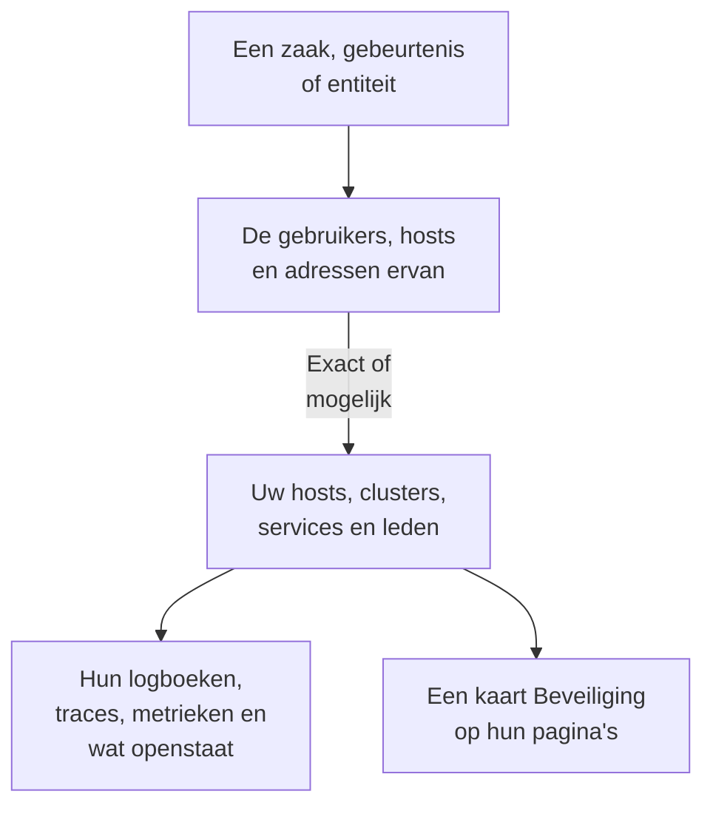

# Verbonden signalen

Een beveiligingszaak zegt over welke gebruikers, hosts en adressen ze gaat. Verbonden signalen zegt welke daarvan OneUptime al kent - uw hosts, containerhosts, Kubernetes-clusters, netwerkapparaten, services en leden - en wat er op elk ervan gebeurde rond de zaak: de logboeken, traces en metrieken, de incidenten en waarschuwingen die erop openstaan, de monitoren die het bewaken en wat er is veranderd. Andersom zegt de pagina van een host, een cluster, een service of een lid wat Security Events erover heeft gevonden.

:::cards
- [Waar u het ziet](#waar-u-het-ziet): De pagina van een zaak, het tabblad van een gebeurtenis, de pagina van een entiteit en de pagina's van wat ze noemen.
- [Hoe een waarde wordt gekoppeld](#hoe-een-waarde-wordt-gekoppeld): Wat telt als hetzelfde record, en wat alleen mogelijk.
- [Wat elk record toont](#wat-elk-record-toont): De signalen rond de zaak, en wat erop openstaat.
- [Wie wat ziet](#wie-wat-ziet): Elk record wordt gelezen met de eigen rol van de lezer.
:::

## Hoe het werkt

OneUptime zoekt elke waarde op tussen de records van het project, zegt hoe zeker elke overeenkomst is en toont wat er rond de zaak op elk record gebeurde.

## Voordat u begint

- Binnenkomende beveiligingsgebeurtenissen, en hosts, Kubernetes-clusters, services of leden in het project die ze kunnen noemen. Zie [Aan de slag met beveiliging](/docs/telemetry/security-getting-started).
- Een rol die beveiligingsgebeurtenissen mag lezen, en de soorten records die u wilt zien.

## Waar u het ziet

- **Verbonden signalen**, een pagina van elke beveiligingszaak: open een zaak onder **Producten → Security Events → Beveiligingszaken → Open zaken** en daarna **Verbonden signalen** na **Entiteiten** in het menu ervan.
- **Verbonden**, een tabblad van elke beveiligingsgebeurtenis: open een gebeurtenis onder **Producten → Security Events → Gebeurtenissen**. Het toont wat de gebeurtenis noemt, in het uur eromheen.
- De pagina van een entiteit, onder **Producten → Security Events → Entiteitrisico**: waar OneUptime de gebruiker, de host of het adres kent, rond de laatste beveiligingsgebeurtenis.
- Een kaart **Beveiliging** op de pagina van elke host, Docker-host, Podman-host, Kubernetes-cluster, elk netwerkapparaat, elke service, elk lid en elk inventarisitem: de open beveiligingszaken die het noemen, hoeveel beveiligingsgebeurtenissen en bevindingen het in de afgelopen 7 dagen noemden, de ernstigste daarvan en het risico. **Openen in Security Events** opent het daar.
- Een kaart **Beveiliging** op de pagina van een incident, wanneer een beveiligingszaak het incident heeft gemeld (**Gemeld vanuit**) of open zaken een host of cluster noemen die het raakt (**Open zaken die noemen wat het raakt**).

## Hoe een waarde wordt gekoppeld

Elke gebruiker, host en elk adres dat een zaak of een gebeurtenis noemt, wordt opgezocht tussen de records van het project:

| Wat de zaak of gebeurtenis noemt | Gekoppeld aan | Hoe zeker |
| --- | --- | --- |
| Een host- of domeinnaam die gelijk is aan de naam die een host, een containerhost, een cluster of een netwerkapparaat meldt | Dat record | Exact |
| Dezelfde naam, gegeven zonder te zeggen dat het een host is | Dat record | Mogelijk |
| Een korte of volledige vorm van de naam van een record, zoals `web-1` en `web-1.acme.internal` | Dat record | Mogelijk |
| Een openbaar IP-adres dat maar één record heeft | Dat record | Exact |
| Een privé-IP-adres, of een dat meer dan één record heeft | Elk record dat het heeft | Mogelijk |
| Het e-mailadres van een lid | Dat lid | Exact |
| Het record waaronder een logregel is verzonden, voor de gebeurtenissen gelezen uit uw logboeken | Die host, dat cluster of die service | Exact |
| Een kale gebruikersnaam, een URL, een bestandshash of een proces | Niets: geen record wordt erop geïndexeerd | - |

- Een mogelijke overeenkomst toont **Mogelijke overeenkomst** naast de naam en zegt waarom. Ze wordt nooit meegeteld op de pagina van het record, en een incident dat de zaak meldt, wordt er nooit aan gekoppeld.
- Wat is gezocht en geen record van het project is, staat onder **Niet in OneUptime**. Een waarde staat daar nooit als een soort record dat ze zou kunnen zijn niet kon worden gelezen.
- Voor een zaak worden hoogstens 10 records getoond, de exacte eerst.

## Wat elk record toont

- De signalen, elk geopend op het record en de periode van de zaak: **Logboeken**, **Traces** en **Metrieken**, de **Uitzonderingen** van een service, de **Kubernetes-gebeurtenissen** van een cluster, de **Topologie** van het record en het item in **Inventory** als de inventaris er een heeft.
- De incidenten en waarschuwingen die er nu openstaan, en de monitoren die het bewaken, elk met een eigen pagina.
- Wat er in de periode is veranderd: de deploys van een service, de rollouts van een cluster en de oplossingen van een host.

| Waar | Periode |
| --- | --- |
| Een zaak | Van 30 minuten voor de eerste detectie tot 30 minuten na de laatste, hoogstens de laatste 24 uur ervan |
| Een gebeurtenis | 30 minuten ervoor en erna |
| De pagina van een entiteit | 30 minuten voor en na de laatste beveiligingsgebeurtenis |
| De kaart **Beveiliging** van een record | De afgelopen 7 dagen |

## Wie wat ziet

- Verbonden signalen en de kaart **Beveiliging** van een record vereisen een rol die beveiligingsgebeurtenissen mag lezen: Security Admin, Security Member, Security Viewer, Project Owner of Project Admin. Niemand anders ziet op enige pagina beveiligingsgegevens. Zie [Rollen](/docs/permissions/reference#rollen).
- De kaart **Beveiliging** van een incident vereist een rol die beveiligingszaken mag lezen.
- Elk record wordt gelezen met uw eigen rol. Een soort record dat uw rol niet mag lezen, wordt weggelaten en de pagina zegt dat; een soort dat zojuist niet kon worden gelezen, zegt dat ook, met **Opnieuw proberen**.
- De pagina van een record toont de kaart **Beveiliging** alleen in een project dat Security Events gebruikt: een project dat in de afgelopen 7 dagen een beveiligingsgebeurtenis heeft ontvangen.

## Incidenten die een zaak meldt

**Incident melden** op een zaak, of de stap van een playbook die er een meldt, koppelt het incident aan de hosts, Docker- en Podman-hosts, Kubernetes-clusters en services waarmee de zaak exact verbonden is. Het incident verschijnt op hun pagina's, de regels van hun eigenaren gelden ervoor, en de feed ervan noemt de zaak en waaraan het is gekoppeld. Een mogelijke overeenkomst wordt nooit gekoppeld.

## OneUptime AI

De triage van een zaak door OneUptime AI leest de verbonden signalen ervan: wat openstaat en wat er is veranderd op de hosts, services en leden die de zaak noemt. Het onderzoek van een incident leest de beveiligingszaak die het meldde en de open zaken die noemen wat het raakt. Zie [OneUptime AI in beveiliging](/docs/telemetry/security-ai).

## Problemen oplossen

:::details Een host die de zaak noemt, staat er niet bij
Controleer of de zaak de host noemt zoals de host zichzelf noemt, of een openbaar adres noemt dat alleen die host heeft. Een korte naam, zoals `web-1` voor `web-1.acme.internal`, staat erbij als mogelijke overeenkomst, en een kale gebruikersnaam, een URL, een bestandshash of een proces wordt helemaal niet opgezocht.
:::

:::details De juiste host staat erbij als mogelijke overeenkomst
Een mogelijke overeenkomst wordt nooit meegeteld of gekoppeld, zodat een naam die twee machines delen u nooit iets over de verkeerde vertelt. Laat uw logboeken en detecties de host noemen met de naam die hij meldt.
:::

:::details De pagina van een host heeft geen kaart Beveiliging
De kaart wordt getoond aan een rol die beveiligingsgebeurtenissen mag lezen, in een project dat in de afgelopen 7 dagen een beveiligingsgebeurtenis heeft ontvangen. Een host die in die tijd door niets is genoemd, toont één regel die dat zegt.
:::

:::details De pagina zegt dat uw rol een soort record niet kan zien
Elk record wordt gelezen met uw eigen rol. Vraag een Project Owner of Project Admin om een rol die dat soort record mag lezen.
:::

## Volgende stappen

:::cards
- [Beveiligingszaken en playbooks](/docs/telemetry/security-cases): Een zaak behandelen en er een incident uit melden.
- [Beveiligingsgebeurtenissen (SIEM)](/docs/telemetry/security-events): De gebeurtenissen achter een zaak en de logboeken waaruit ze worden gelezen.
- [Entiteitrisico (risicogebaseerde meldingen)](/docs/telemetry/security-entity-risk): De pagina van een entiteit, het risico ervan en waar OneUptime haar kent.
- [OneUptime AI in beveiliging](/docs/telemetry/security-ai): Hoe een triage leest wat een zaak noemt.
:::
