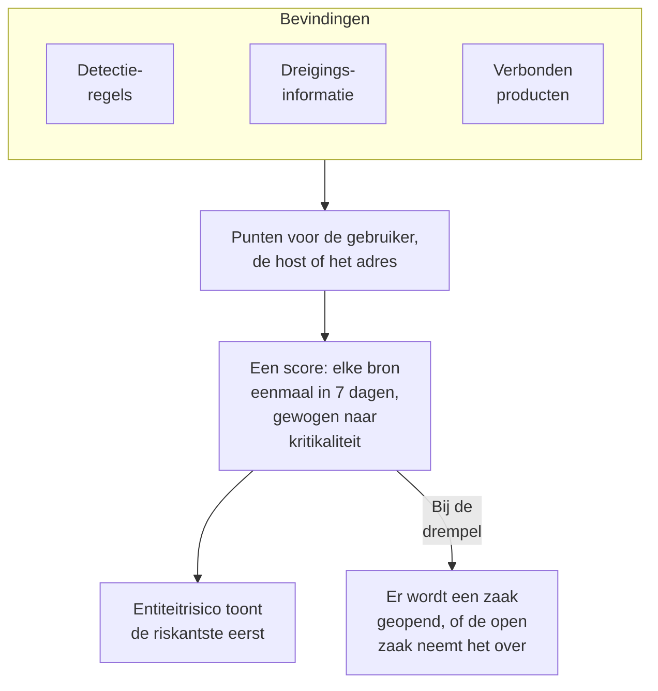

# Entiteitrisico (risicogebaseerde meldingen)

Eén bevinding zegt zelden veel. Een reeks mislukte aanmeldingen, een eerste sudo op een host en een aanmelding vanuit een nieuw land zijn elk een blik waard; hetzelfde account in alle drie binnen een week is een zaak waard. Entiteitrisico telt op wat uw detectieregels, dreigingsinformatie, verbonden producten en Data Security vinden over elke gebruiker, host, elk IP-adres en elke gegevensopslag, toont de riskantste eerst en opent een zaak over degene wiens risico de drempel van het project haalt.

:::cards
- [Zo wordt een score geteld](#zo-wordt-een-score-geteld): Punten naar ernst, en elke bron eenmaal per week.
- [Risiconiveaus en zaken](#risiconiveaus-en-zaken): Hoe een score wordt gelezen, en wanneer een zaak wordt geopend.
- [Entiteitkritikaliteit](#entiteitkritikaliteit): Meer laten tellen wat zwaarder weegt, en minder wat lichter weegt.
- [De pagina van een entiteit](#de-pagina-van-een-entiteit): Waarom die riskant is, de maand ervan en de zaken erover.
- [Risicopunten op een detectieregel](#risicopunten-op-een-detectieregel): Het eigen gewicht van een regel in de score.
:::

## Hoe het werkt

Open **Producten → Security Events → Entiteitrisico**: elke gebruiker, host, elk IP-adres en elke gegevensopslag met nu een risico, de riskantste eerst, met het niveau, hoe zwaar het weegt, wat het vond en wanneer. Elk opent op een eigen pagina. **Riskantste entiteiten** op het overzicht toont de top van deze lijst, en **Een entiteit opzoeken**, eronder, zoekt elke waarde op in 30 dagen aan gebeurtenissen, ook een domein of een bestandshash.

## Voordat u begint

- Binnenkomende beveiligingsgebeurtenissen, en detectieregels, dreigingsinformatie of verbonden producten die er iets in vinden. Zie [Aan de slag met beveiliging](/docs/telemetry/security-getting-started).
- Detectieregels die groeperen op een veld dat iemand noemt: **Groeperingsveld**, zoals `principalUser`, `principalHost` of `principalIp`, of de velden waarop een correlatie groepeert. Een regel die op niets groepeert, voegt geen risico toe.
- Om **Risicoscoring** te wijzigen: Project Owner of Project Admin voor de schakelaar en de drempel, en een rol die detectieregels mag maken voor de lijst met entiteiten. Security Viewer leest alles. Zie [Rollen](/docs/permissions/reference#rollen).

## Zo wordt een score geteld

Elke bevinding geeft risicopunten aan de gebruiker, host, het IP-adres of de gegevensopslag waarover het gaat:

| Een bevinding met ernst | Voegt toe |
| --- | --- |
| Laag | 10 punten |
| Gemiddeld | 25 punten |
| Hoog | 50 punten |
| Kritiek | 75 punten |

- Een informatieve bevinding voegt niets toe, en een bevinding met onbekende ernst telt als Gemiddeld.
- De punten van een detectieregel gaan naar de waarde waarop die groepeert. Een treffer in dreigingsinformatie telt voor het IP-adres dat de indicator noemt. De melding van een verbonden product telt voor de gebruiker en de host die ze noemt, anders voor het IP-adres. Een probleem van Data Security telt voor de gegevensopslag waarin het werd gevonden.
- Elke bron telt eenmaal. Een detectieregel, een feed met dreigingsinformatie, de regel van een verbonden product of een controle van Data Security telt eenmaal in 7 dagen, met het meeste dat die toevoegde, hoe vaak die ook afgaat: één luidruchtige regel kan een entiteit nooit erger laten lijken dan drie verschillende.
- Een bron die 7 dagen niets heeft gevonden, telt niet meer mee, en de score daalt. De scores worden elke 15 minuten gecontroleerd, zodat een score op tijd daalt, ook zonder nieuwe bevinding.

De score van een entiteit is de som van haar bronnen, gewogen naar haar kritikaliteit. De testaanval van **Testaanval sturen**, en een zaak die iemand met de hand opent, voegen geen risico toe.

## Risiconiveaus en zaken

Elke score wordt gelezen als een niveau ten opzichte van de drempel van het project, 100 tenzij u die wijzigt:

| Risicoscore | Geldt als | Wat er gebeurt |
| --- | --- | --- |
| 1 tot 49 | Laag | Vermeld onder Entiteitrisico |
| 50 tot 99 | Gemiddeld | Vermeld onder Entiteitrisico |
| 100 tot 199 | Hoog | Er wordt een zaak geopend, op Hoog |
| 200 of meer | Kritiek | Er wordt een zaak geopend, op Kritiek |

Haalt het risico van een entiteit de drempel, dan wordt er een detectie met de bron Entiteitrisico over gemaakt. Die voegt zich bij de open zaak over de entiteit, of opent er een die naar haar is genoemd, zoals `High risk — k.morgan@acme-commerce.example`, en somt de bronnen op die het meest aan het risico bijdroegen, tot 10, met hun punten, hoe vaak elk afging en wanneer voor het laatst.

Zodra er een zaak over het risico van een entiteit is geopend, wordt wat erachter zat niet opnieuw geteld: een volgende zaak wordt pas geopend als bronnen die sindsdien nieuw zijn, de drempel opnieuw halen. Een zaak die als afgehandeld is gesloten, wordt door dezelfde bevindingen niet heropend.

Wijzig de drempel onder **Producten → Security Events → Instellingen → Risicoscoring → Risicodrempel**: een geheel getal van 10 tot 10000. Gemiddeld begint bij de helft en Kritiek bij het dubbele, op elke pagina.

### Risicozaken aan- of uitzetten

**Risicozaken**, onder **Instellingen → Risicoscoring**, bepaalt of risico zaken opent, en wordt opgeslagen zodra u omschakelt. Nieuwe projecten beginnen met de schakelaar aan. Een project dat vóór Entiteitrisico is gemaakt, houdt hem uit tot iemand hem aanzet, en **Entiteitrisico** zegt dat boven de lijst. Risico wordt hoe dan ook gescoord en vermeld.

## Entiteitkritikaliteit

Sommige entiteiten wegen zwaarder dan andere: een domeincontroller, het account van een bestuurder, een betaalserver. Andere wegen lichter, zoals een kwetsbaarheidsscanner waarvan de scans worden verwacht. Zet ze onder **Instellingen → Risicoscoring → Entiteitkritikaliteit** met **Entiteit toevoegen**:

| Kritikaliteit | Telt het risico |
| --- | --- |
| Laag | ×0.5 |
| Niet vermeld | ×1 |
| Hoog | ×1.5 |
| Extreem | ×2 |

Een vermelding is een waarde of een `*`-patroon, ongeacht hoofdletters: `dc-*` noemt elke domeincontroller, en `*@contractors.example` elke externe medewerker. **Type** beperkt die tot gebruikers, hosts, IP-adressen of gegevensopslagen; leeg past op alle. Noemen meerdere vermeldingen een entiteit, dan telt de meest specifieke: een uitgeschreven waarde vóór een patroon, en een langer patroon vóór een korter. Een wijziging bereikt de score van elke entiteit binnen enkele minuten. Data Security vermeldt zelf de gegevensopslagen die het gevoelig vindt, vertrouwelijke als Hoog en beperkte als Extreem; wijzigt u zo'n vermelding, dan is die van u en laat Data Security die met rust.

## De pagina van een entiteit

Klik op **Bekijken** in een rij van **Entiteitrisico**, of op het risico naast een entiteit op de pagina **Entiteiten** van een zaak:

| Deel | Wat het toont |
| --- | --- |
| De koptekst | Het soort en de kritikaliteit, de score en het niveau, en hoe de score tot stand komt |
| **Activiteit** | De beveiligingsgebeurtenissen en bevindingen van de afgelopen 7 dagen |
| **Wat bijdraagt aan het risico** | Elke bron, de ernst, de punten die die toevoegt, hoe vaak die afging en wanneer voor het laatst |
| **Risico in de afgelopen 30 dagen** | De score aan het eind van elke dag, gekleurd naar niveau |
| **Zaken hierover** | De beveiligingszaken die erover zijn geopend, de nieuwste eerst |

**Openen in Correleren** tekent een grafiek van de gebeurtenissen, en **Gebeurtenissen doorzoeken** opent **Gebeurtenissen** op de week ervan. **Risico resetten** wist de score en de bronnen, bijvoorbeeld na een geplande test: wat daarna wordt gevonden, telt vanaf nul, en de zaken veranderen niet. Resetten vraagt een rol die beveiligingsgegevens mag verwijderen, en het [auditlogboek](/docs/configuration/audit-logs) legt het vast.

OneUptime AI leest het risico van de entiteiten van een zaak wanneer het de zaak beoordeelt. Zie [OneUptime AI in beveiliging](/docs/telemetry/security-ai).

## Risicopunten op een detectieregel

Een detectieregel voegt de punten van haar niveau toe, uit haar Sigma-`level`. Om haar een eigen gewicht te geven, opent u het formulier van de regel, gaat u naar **Bij overeenkomst**, opent u **Meer velden** en stelt u **Risicopunten** in, van 0, dat geen risico toevoegt, tot 100. Laat het leeg voor de punten van haar niveau.

## Problemen oplossen

:::details Een entiteit staat niet onder Entiteitrisico
Controleer of een detectieregel, een feed met dreigingsinformatie of een verbonden product in de afgelopen 7 dagen iets over haar vond, en of de regel groepeert op een veld dat haar noemt. Informatieve bevindingen voegen niets toe, en een bron die 7 dagen niets vond, telt niet meer mee.
:::

:::details Het risico van een entiteit haalde de drempel, en er werd geen zaak geopend
Controleer of **Risicozaken** aan staat onder **Instellingen → Risicoscoring**. Is er al een zaak over het risico van de entiteit geopend, dan tellen voor de volgende alleen bronnen die sindsdien nieuw zijn.
:::

:::details Een regel gaat steeds weer af, en de score van de entiteit stijgt niet
Zo wordt er geteld: een bron telt eenmaal in 7 dagen, met het meeste dat die toevoegde. Verlaag de **Risicopunten** van een luidruchtige regel, of geef een entiteit waarvan de bevindingen worden verwacht een lage kritikaliteit.
:::

:::details Een score is niet de som van de bronnen
De kritikaliteit weegt hem. De pagina van de entiteit toont de som van de bronnen en het gewicht, zoals 100 uit de bronnen × 2 = 200.
:::

## Volgende stappen

:::cards
- [Beveiligingszaken en playbooks](/docs/telemetry/security-cases): De zaken behandelen die risico opent, en ze sluiten met een oordeel.
- [Beveiligingsgebeurtenissen (SIEM)](/docs/telemetry/security-events): Detectieregels, Correleren en de gebeurtenissen achter elke bevinding.
- [Dreigingsinformatie (STIX/TAXII)](/docs/telemetry/threat-intelligence): De treffers die bijdragen aan het risico van een adres.
- [OneUptime AI in beveiliging](/docs/telemetry/security-ai): Hoe een beoordeling het risico van de entiteiten van een zaak leest.
:::
