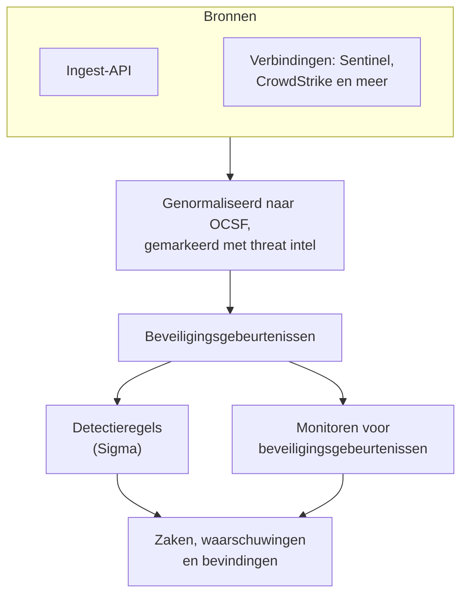
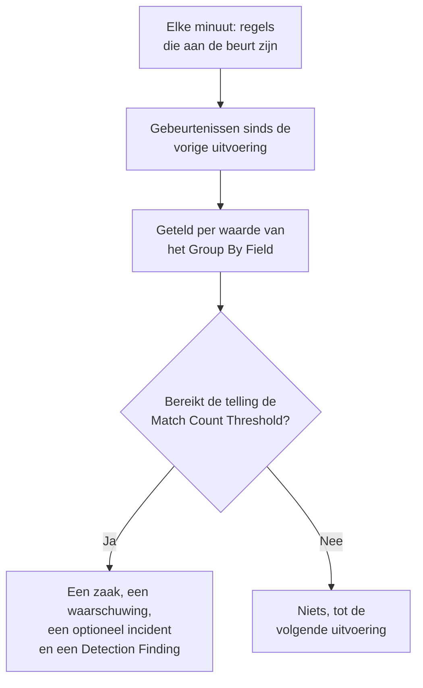

# Beveiligingsgebeurtenissen (SIEM)

OneUptime bewaart beveiligingsgebeurtenissen naast je logs, traces en metrics, en geeft ze allemaal dezelfde vorm, [OCSF](https://schema.ocsf.io/) (het Open Cybersecurity Schema Framework), in welk formaat ze ook binnenkwamen. Stuur gebeurtenissen vanuit elke bron, doorzoek ze, en vind de belangrijke met Sigma-detectieregels, threat intelligence en monitoren. Wat die vinden, wordt [zaken](/docs/telemetry/security-cases) om af te handelen, en playbooks reageren erop.

:::cards
- [Gebeurtenissen sturen](#beveiligingsgebeurtenissen-sturen): Een HTTPS-POST, een Fluent Bit-output of een verbinding met een beveiligingsproduct.
- [Zoeken en correleren](#beveiligingsgebeurtenissen-verkennen): De verkenner Gebeurtenissen en de grafiek Correleren.
- [Hunts](#hunts): Opgeslagen zoekopdrachten die volgens een schema draaien en mensen laten weten wanneer ze iets vinden.
- [Detectieregels](#detectieregels): Sigma-regels die zaken en waarschuwingen openen.
- [Monitoren](#monitoren-voor-beveiligingsgebeurtenissen): Tellingen over een glijdend venster, met een status die herstelt.
:::

## Hoe het werkt



Open **Producten → Beveiligingsgebeurtenissen**, onder **Beveiliging**. Het menu heeft een sectie voor elk deel van beveiliging, en een eigen pagina voor alles daarin:

| Pagina | Sectie | Waarvoor het dient |
| --- | --- | --- |
| **Overzicht** | Overzicht | Hoe beveiliging is ingericht, wat er nu iemand nodig heeft en hoe snel zaken worden afgehandeld |
| **Open zaken** | Beveiligingszaken | De wachtrij: elke zaak die nog niet gesloten is, gegroepeerd naar waar het over gaat |
| **Mijn zaken** | Beveiligingszaken | De open zaken die aan jou zijn toegewezen |
| **Niet toegewezen** | Beveiligingszaken | De open zaken die nog niemand heeft opgepakt |
| **Gesloten zaken** | Beveiligingszaken | De zaken die met een oordeel zijn gesloten, de nieuwste eerst |
| **Alle zaken** | Beveiligingszaken | Elke zaak, open of gesloten |
| **Gebeurtenissen** | Gebeurtenissen | Elke gebeurtenis zoeken en filteren, en er een openen om al haar velden te zien |
| **Hunts** | Gebeurtenissen | Zoekopdrachten opgeslagen vanuit Gebeurtenissen, met één klik weer geopend of volgens een schema uitgevoerd dat mensen laat weten wanneer ze iets vinden |
| **Huntbibliotheek** | Gebeurtenissen | Kant-en-klare hunts om op Gebeurtenissen te proberen of aan je hunts toe te voegen, elk met de gebeurtenissen die hij leest en of die binnenkomen |
| **Campagnes** | Gebeurtenissen | Elk adres dat aanvalsverzoeken stuurde, en of een van zijn verzoeken erdoor kwam |
| **Entiteitrisico** | Gebeurtenissen | Elke gebruiker, host en elk adres, gescoord op wat er deze week over werd gevonden, de riskantste eerst |
| **Correleren** | Gebeurtenissen | Een grafiek van de gebeurtenissen die een host, een gebruiker of een IP-adres delen |
| **Detectieregels** | Detections | Sigma-regels die volgens een schema draaien en zaken openen |
| **Regeluitzonderingen** | Detections | Wat je regels bewust overslaan, zoals een scanner of een geplande test, elk met wie het heeft toegevoegd en waarom |
| **Volglijsten** | Detections | De lijsten waartegen je regels vergelijken, zoals VIP-gebruikers, kritieke hosts, bekende kwaadaardige bestandshashes en de adressen waarvandaan beheerders mogen inloggen |
| **Regelbibliotheek** | Detections | Kant-en-klare detectieregels om toe te voegen, elk met de gebeurtenissen die hij leest en of die binnenkomen, met de aanbevolen regels gemarkeerd |
| **Dreigingsinformatie** | Detections | STIX/TAXII-feeds van bekende kwaadaardige indicatoren |
| **ATT&CK-dekking** | Detections | De technieken van MITRE ATT&CK die je regels dekken |
| **Playbooks** | Playbooks | Stappen die op zaken draaien, vanzelf of met de hand |
| **Goedkeuringen** | Playbooks | De playbookstappen die wachten tot iemand ze goedkeurt of afwijst |
| **Uitvoeringen** | Playbooks | Wat elk playbook deed, stap voor stap |
| **Automatische reactie** | Playbooks | De beleidsregels die een aanvallend adres een challenge geven of blokkeren zodra de detectie er is, elk met een proefperiode en vangrails |
| **Blokkeerlijst** | Playbooks | De adressen die je project blokkeert, tot wanneer, en waar elke blokkering wordt toegepast |
| **Blokkeerlijstfeeds** | Playbooks | De geheime URL's waarvan je firewalls en proxy's de blokkeerlijst lezen, en hun ophaalacties |
| **Beschermde entiteiten** | Playbooks | De gebruikers, hosts en adressen die geen enkel playbook inperkt en geen blokkering raakt |
| **Instellingen** | AI | Of OneUptime AI elke nieuwe zaak beoordeelt |
| **Verbindingen** | Connections | Uw logs, de beveiligingsproducten die OneUptime opvraagt en de SIEM's waarnaar het verstuurt |
| **Installatiegids** | Connections | Snippets om gebeurtenissen te sturen, ingevuld met je ingestiesleutel |
| **Zaakprioriteiten** | Instellingen | Hoe dringend een zaak is: de eigen prioriteiten van het project, de dringendste eerst |
| **Reactiedoelen** | Instellingen | Hoe snel een zaak van elke prioriteit moet worden opgepakt en ingedamd |
| **Zaakstatussen** | Instellingen | De stappen die een zaak doorloopt, en hoe een zaak in elke stap telt |
| **Aangepaste velden** | Instellingen | De velden die je team bij elke zaak invult, zoals de bedrijfseenheid waar die over gaat |
| **Notitie-sjablonen** | Instellingen | Kant-en-klare tekst voor de notities die je team bij zijn zaken schrijft |
| **Nummering** | Instellingen | De tekst voor de zaaknummers, en het nummer dat de volgende zaak krijgt |
| **Risicoscoring** | Instellingen | Of het risico van een entiteit een zaak opent, bij welk risico, en hoe zwaar elke entiteit weegt |
| **Wisverzoeken** | Instellingen | Personen die op verzoek zijn gewist, en wat elke wissing veranderde |

**Detecties**, **AI**, **Verbindingen** en **Instellingen**, die je één keer instelt, blijven ingeklapt tot je ze opent. Nieuw met beveiliging? [Aan de slag met beveiliging](/docs/telemetry/security-getting-started) richt het in met twee klikken.

## Voordat je begint

Beveiligingsgegevens zijn alleen leesbaar voor de rollen Projecteigenaar en Projectbeheerder en voor de drie Security-rollen; andere rollen zien niets in Security Events. Zie [Rollen](/docs/permissions/reference#rollen).

| Rol | Wat hij kan doen |
| --- | --- |
| Beveiligingsbeheerder | Alles: gebeurtenissen, zaken, playbooks, detectieregels, threat-intelfeeds en verbindingen |
| Beveiligingslid | Gebeurtenissen en threat intel lezen, zaken afhandelen, playbooks uitvoeren en hun stappen goedkeuren, adressen blokkeren, en detectieregels en feeds aanmaken, wijzigen en verwijderen. Hij kan geen playbooks of verbindingen instellen en geen beveiligingsgegevens verwijderen. |
| Beveiligingskijker | Gebeurtenissen, zaken, playbooks, de blokkeerlijst, regels, feeds, indicatoren en verbindingen lezen |

## Beveiligingsgebeurtenissen sturen

:::steps
### Maak een ingestiesleutel aan

Open **Projectinstellingen → Telemetrie & APM → Ingestiesleutels** en klik op **Ingestiesleutel aanmaken**. Beveiligingsgebeurtenissen gebruiken dezelfde sleutels als de rest van je telemetrie.

### Post je gebeurtenissen

Stuur JSON naar `/security-events/v1/ingest`, met de sleutel in `x-oneuptime-token`:

:::tabs
@tab OCSF
```bash
curl -X POST "https://oneuptime.com/security-events/v1/ingest?format=ocsf" \
  -H "Content-Type: application/json" \
  -H "x-oneuptime-token: YOUR_INGESTION_TOKEN" \
  -H "x-oneuptime-service-name: my-security-source" \
  -d '{ "events": [ { "class_uid": 3002, "severity_id": 4, "status": "Failure", "message": "Failed logon for alice", "actor": { "user": { "name": "alice" } }, "src_endpoint": { "ip": "203.0.113.7", "hostname": "laptop-alice" } } ] }'
```
@tab Google UDM
```bash
curl -X POST "https://oneuptime.com/security-events/v1/ingest?format=udm" \
  -H "Content-Type: application/json" \
  -H "x-oneuptime-token: YOUR_INGESTION_TOKEN" \
  -d '{ "events": [ { "metadata": { "event_type": "USER_LOGIN" }, "principal": { "hostname": "laptop-alice", "user": { "userid": "alice" }, "ip": ["203.0.113.7"] }, "security_result": [{ "severity": "HIGH", "action": ["BLOCK"] }] } ] }'
```
@tab Generic JSON
```bash
curl -X POST "https://oneuptime.com/security-events/v1/ingest" \
  -H "Content-Type: application/json" \
  -H "x-oneuptime-token: YOUR_INGESTION_TOKEN" \
  -d '{ "events": [ { "severity": "high", "event_type": "ssh_brute_force", "message": "12 failed SSH logins in 60s", "username": "root", "hostname": "web-01", "src_ip": "203.0.113.7" } ] }'
```
:::

Het endpoint antwoordt `200` zodra de gebeurtenissen in de wachtrij staan. Een gebeurtenis zonder tijd, zoals deze, komt te staan op het moment dat ze binnenkomt.

### Vind ze in Gebeurtenissen

Open **Producten → Beveiligingsgebeurtenissen → Gebeurtenissen**. De gebeurtenissen verschijnen binnen een paar seconden, met hun ernst, klasse, gebruiker, host en IP-adressen ingevuld.
:::

### Formaten

| `format` | Wat het leest | Ook geaccepteerd |
| --- | --- | --- |
| `ocsf` | OCSF-gebeurtenis-JSON (`class_uid`, `severity_id` enzovoort) | Geen |
| `udm` | UDM-gebeurtenissen van Google SecOps (Chronicle) (`metadata.event_type` enzovoort) | `chronicle`, `google-secops` |
| `google-secops-alert` | Detecties en waarschuwingen van Google SecOps: SOAR-webhooks en de detectiestroom | `secops-alert`, `detection` |
| `crowdsec` | Waarschuwingen van CrowdSec, zoals de `http`-meldingsplug-in ze verstuurt (zie [CrowdSec](/docs/integrations/crowdsec)) | `crowdsec-alert` |
| `generic` | Elke andere JSON, gelezen op gangbare veldnamen | Geen |

Geef het formaat op met `?format=`, met de header `x-oneuptime-security-event-format`, of met een veld `"format"` op het hoogste niveau. Laat je het weg, dan wordt het formaat van elke gebeurtenis apart bepaald, zodat één webhook detecties en ruwe gebeurtenissen kan mengen.

- De body kan één gebeurtenis zijn, een array van gebeurtenissen, of `{ "events": [...] }`.
- Een batch kan met gzip gecomprimeerd zijn en met `Content-Encoding: gzip` worden verstuurd: hij wordt gelezen als dezelfde batch zonder compressie. De `http`-output van Fluent Bit comprimeert met `compress gzip`, de `http`-sink van Vector met `compression = "gzip"`, en de `http`-output van Logstash met `http_compression => true`. Gecomprimeerd wordt alleen JSON gelezen: een gecomprimeerde body van een ander type wordt geweigerd met `400`.
- De header `x-oneuptime-service-name` noemt de telemetrieservice waartoe de gebeurtenissen behoren. Zonder die header behoren ze tot de service die is genoemd naar het product of de leverancier van de eerste gebeurtenis, of tot `Security Events`.
- Er wordt niets weggegooid omdat het niet te koppelen was: elk veld van de bron komt terecht in de attributen van de gebeurtenis.

### Velden van generieke JSON

Een generieke gebeurtenis wordt gelezen op gangbare veldnamen:

| Veld van de gebeurtenis | Gelezen uit de eerste van |
| --- | --- |
| `message` | `message`, `msg`, `summary`, `description`, `title` |
| `severityName` | `severity`, `severity_name`, `level`, `priority`, `risk_level` |
| `time` | `timestamp`, `time`, `@timestamp`, `event_time`, `created_at` |
| `principalUser` | `user`, `username`, `user_name`, `account`, `actor` |
| `principalHost` | `host`, `hostname`, `computer`, `device`, `machine` |
| `principalIp` | `source_ip`, `src_ip`, `client_ip`, `ip` |
| `targetIp` | `destination_ip`, `dest_ip`, `dst_ip`, `target_ip` |
| `className` | `event_type`, `category`, `type`, `action` |
| `ruleName` | `rule`, `rule_name`, `signature`, `detection` |
| `productName` | `product`, `product_name`, `source`, `log_source` |
| `processName` | `process_name`, `process.name`, `proc.name`, `comm` |
| `processPath` | `process_path`, `Image`, `NewProcessName`, `exe`, `process.executable` |
| `processCommandLine` | `command_line`, `CommandLine`, `cmdline`, `process.command_line`, `proc.cmdline`, `process` |
| `parentProcessName` | `parent_process_name`, `process.parent.name`, `proc.pname` |
| `parentProcessPath` | `parent_process_path`, `ParentImage`, `ParentProcessName`, `process.parent.executable` |
| `parentProcessCommandLine` | `parent_command_line`, `ParentCommandLine`, `process.parent.command_line`, `proc.pcmdline` |

Een woord voor de ernst wordt een OCSF-niveau: `info` wordt gelezen als Informational, `warning` als Low, `error` als Medium, `alert` als Critical en `emergency` als Fatal.

### Doorsturen met Fluent Bit

Om beveiligingslogs te sturen die je al verzamelt, zoals auditd, syslog of Falco, voeg je een `http`-output toe aan Fluent Bit:

```ini title="fluent-bit.conf"
[OUTPUT]
    Name             http
    Match            security.*
    Host             oneuptime.com
    Port             443
    tls              On
    URI              /security-events/v1/ingest
    Format           json
    compress         gzip
    Json_date_key    timestamp
    Json_date_format iso8601
    Header           x-oneuptime-token YOUR_INGESTION_TOKEN
    Header           x-oneuptime-service-name my-security-source
    Retry_Limit      5
```

De pagina **Installatiegids**, onder **Verbindingen**, bevat deze snippets, met je eigen host en sleutel ingevuld.

### Beveiligingsgebeurtenissen in uw logs vinden

De kaart **Uw logboeken**, boven aan **Verbindingen**, maakt van de logs die u al naar OneUptime stuurt een bron. Met **Beveiligingsgebeurtenissen in uw logboeken vinden** aan worden de nieuwe logs van het project elke minuut gelezen, en elke SSH- of Windows-aanmelding, sudo-opdracht, auditregel van een cloud, CEF- of LEEF-record van een beveiligingsproduct, record van een firewall van Palo Alto Networks, FortiGate of Cisco ASA, Kubernetes-auditregel, webaanval en verzoek om een gevoelig bestand daarin wordt opgeslagen als beveiligingsgebeurtenis. Zie [Aan de slag met beveiliging](/docs/telemetry/security-getting-started#beveiligingsgebeurtenissen-in-uw-logs-vinden) voor wat elke soort omvat.

Elke soort bereikt OneUptime als gewone logs:

| Soort | Stuur het vanuit |
| --- | --- |
| SSH-aanmeldingen, sudo | De journal of het authenticatielog van een Linux-machine, met de [OpenTelemetry Collector](/docs/telemetry/host-otel-collector) |
| Windows-gebeurtenissen | De `windowseventlog`-receiver van de collector op de machine, of een forwarder die elke gebeurtenis als JSON schrijft, zoals NXLog of Winlogbeat. Een aan OneUptime toegevoegde [host](/docs/telemetry/hosts) leest ook Sysmon, Microsoft Defender en PowerShell waar hij ze heeft |
| AWS CloudTrail | Een trail die aan CloudWatch Logs wordt geleverd, gelezen door de `awscloudwatch`-receiver van de collector, of, voor een account dat onder **Cloud** is gekoppeld, [Cloud-auditlogboeken](#de-auditlogs-van-uw-cloudaccounts-lezen) |
| Google Cloud-auditlogs | Een log-sink naar Pub/Sub, gelezen door de `googlecloudpubsub`-receiver van de collector met `encoding: raw_text`, of, voor een project dat onder **Cloud** is gekoppeld, de [stream](/docs/telemetry/cloud-streaming-google-cloud) ervan of [Cloud-auditlogboeken](#de-auditlogs-van-uw-cloudaccounts-lezen) |
| Azure-activiteitslogs en Entra ID-logs | Een diagnostische instelling die naar een Event Hub streamt, gelezen door de `azureeventhub`-receiver van de collector met `format: raw`, of naar de Event Hub van de [stream](/docs/telemetry/cloud-streaming-azure) van een gekoppeld abonnement, of, voor het activiteitenlogboek van een abonnement dat onder **Cloud** is gekoppeld, [Cloud-auditlogboeken](#de-auditlogs-van-uw-cloudaccounts-lezen) |
| Azure Key Vault-, Storage- en SQL-logboeken | De diagnostische instelling van een resource die naar een Event Hub streamt, gelezen door de `azureeventhub`-receiver van de collector met `format: raw`, of de diagnostische instellingen van de [stream](/docs/telemetry/cloud-streaming-azure) van een gekoppeld abonnement, met logs. Zie [Eigen auditlogs van Azure-resources](#eigen-auditlogs-van-azure-resources) |
| OpenStack-audittrail | De notificaties en het auditfilter van een cloud, met `driver = log` naar de logs gestuurd en gelezen door het [logprofiel](/docs/telemetry/openstack#wie-deed-wat) van de agent |
| CEF, LEEF | De syslog van het product, doorgestuurd door [rsyslog](/docs/telemetry/syslog) |
| Palo Alto Networks, FortiGate, Cisco ASA | De eigen syslog van de firewall, doorgestuurd door [rsyslog](/docs/telemetry/syslog) |
| Kubernetes-auditlogs | Het auditlogbestand van de API-server, gelezen door de `filelog`-receiver van de collector |
| Webaanvallen | Het toegangslog van een webserver, gelezen door de `filelog`-receiver van de collector |

Op **Uw logboeken** zegt elke soort wanneer ze voor het laatst is gevonden, en **Een logboekregel controleren** laat zien wat een regel die u plakt wordt, nog voordat er een binnenkomt. OneUptime leest de regel zoals de scans je logs lezen, met je [vertrouwde proxy's](#vertrouwde-proxys) en de instellingen van je toegangslogs, dus noemt hij de client die de opgeslagen gebeurtenis zal noemen, en slaat hij niets op.

Een bedreiging die een beveiligingsproduct in uw logs schrijft, zoals een CEF- of LEEF-bevinding of een bedreiging van Palo Alto Networks, FortiGate of Cisco ASA, opent een [zaak](/docs/telemetry/security-cases) zoals de waarschuwing van een gekoppeld product dat doet, en verhoogt het risico van de gebruiker, de host of het adres dat ze noemt. **Cases openen vanaf**, op **Uw logboeken**, bepaalt vanaf welke ernst: **Hoog en hoger**, tenzij u een andere kiest, of **Nooit**. De aanmeldingen en geblokkeerde verbindingen van het product blijven gebeurtenissen, die uw regels lezen.

Een record dat OneUptime langs twee wegen bereikt, wordt één keer opgeslagen: een aanmelding bij Microsoft Entra ID die de verbinding leest en die Azure ook naar uw logs exporteert, een CloudTrail-record in uw logs en in het auditlog van een gekoppeld AWS-account, of een auditrecord dat de stream van een cloudaccount stuurt en dat **Cloud-auditlogboeken** ook leest.

#### Eigen auditlogs van Azure-resources

Een Key Vault, een opslagaccount en een Azure SQL-database houden elk een eigen auditlog bij, dat elk verzoek vastlegt. Alleen wat een beveiligingsteam bekijkt, wordt een beveiligingsgebeurtenis:

| Resource | Wat een beveiligingsgebeurtenis wordt |
| --- | --- |
| Key Vault (`AuditEvent`) | Een verzoek dat de vault weigerde; een geheim dat werd uitgegeven; een geheim, sleutel of certificaat of de vault zelf die werd verwijderd, permanent verwijderd of geback-upt; een gewijzigd toegangsbeleid; en een wijziging in wat de vault bevat. Niet de 401 die elke Azure SDK-client bij zijn eerste aanroep krijgt, gedaan zonder token om de tenant te achterhalen: Key Vault logt die onder zijn bewerking `Authentication` |
| Opslagaccount (`StorageRead`, `StorageWrite`, `StorageDelete`) | Een verzoek dat werd geweigerd bij gebrek aan een recht; een verzoek dat zonder enige referentie werd bediend, behalve de pagina's van een statische website en een CORS-preflight; een gewijzigde toegangslijst van een container, bestandsshare, wachtrij of tabel, of een ervan die in zijn geheel werd verwijderd; en een schrijf- of verwijderactie die met een Shared Access Signature (SAS) is ondertekend. Niet een geslaagde leesactie, ook niet een met een SAS |
| Azure SQL (`SQLSecurityAuditEvents`) | Een mislukte aanmelding; een aanmelding op een nieuwe verbinding, niet het hergebruik van een verbinding uit een pool; een toegekende, geweigerde of ingetrokken machtiging, een gewijzigd rollidmaatschap of wachtwoord, een imitatie, en een aangemaakte, gewijzigde of verwijderde login, gebruiker of rol; en een actie waarvan de machtigingscontrole mislukte. Niet een batch, het grootste deel van een audit |

De geslaagde leesacties van een opslagaccount zijn het grootste deel van wat het logt: met een SAS geven de meeste apps bestanden aan browsers. Ze blijven in Logboeken, in hun geheel, op het tabblad **Logboeken** van het account: zoek daar naar `"type":"SAS"` om te zien wat een Shared Access Signature heeft gelezen. Elke gebeurtenis noemt haar resource bij de ID, die van een opslagservice ook het account, zodat ze op de pagina **Beveiligingsgebeurtenissen** van die resource staat, en een record dat twee keer binnenkomt, wordt één keer opgeslagen.

### De auditlogs van uw cloudaccounts lezen

Een AWS-account, Google Cloud-project of Azure-abonnement dat [onder **Cloud** is gekoppeld](/docs/telemetry/cloud-accounts), heeft geen logpijplijn nodig. Zet **Cloud-auditlogboeken** aan, onder **Uw OneUptime-gegevens** op **Verbindingen**, en elke leesbeurt van het account bewaart het auditlog als beveiligingsgebeurtenissen:

| Cloud | Wat er wordt gelezen |
| --- | --- |
| AWS | De beheergebeurtenissen van CloudTrail die iets wijzigen, in elke regio die het account gebruikt: aanmeldingen bij de console, wijzigingen en aanroepen die AWS weigerde |
| Google Cloud | Het auditlog Admin Activity: wijzigingen aan resources en aan wie ze mag bereiken, en aanroepen die Google weigerde |
| Azure | Het activiteitenlogboek: wijzigingen in het abonnement, mislukte bewerkingen, weigeringen door Azure Policy en waarschuwingen van Defender for Cloud |

- Elk record wordt gelezen zoals **Uw logboeken** het uit een pijplijn leest, zodat de CloudTrail-, Google Cloud- en Azure-regels van de regelbibliotheek erop matchen.
- Een gebeurtenis krijgt het tijdstip waarop ze wordt opgeslagen, met de eigen tijd van het record in `oneuptime.cloud.record_time`: een auditlog bereikt OneUptime minuten te laat, en een regel leest gebeurtenissen op hun tijd.
- De leesbeurt van het account zelf levert niets meer op: data-events, Data Access-logs en de logs van Microsoft Entra ID hebben nog steeds **Uw logboeken** of een [verbinding](/docs/integrations/microsoft-entra-id) nodig.
- Elke gebeurtenis noemt de cloud-resources waar de record over gaat bij hun eigen ID's - een ARN, een Azure-resource-ID, een resourcenaam van Google Cloud - en staat dus op de pagina **Beveiligingsgebeurtenissen** van elk ervan, en op die van een serverless functie zodra de telemetrie ervan `cloud.account.id` en `cloud.region` instelt.

### De eigen sondes van OneUptime in uw netwerkflows

Zet **Netwerkflows** aan, onder **Uw OneUptime-gegevens** op **Verbindingen**, en de flows die uw netwerkapparaten exporteren worden gelezen op poortscans, netwerksweeps, verkeer met bekende kwaadaardige adressen en grote overdrachten naar buiten. Het eigen werk van een sonde lijkt daar op een scan: wie 40 apparaten via SNMP pollt, bereikt elke vijf minuten poort 161 op 40 hosts. Daarom wordt verkeer van een van de eigen sondes van OneUptime dat precies is waarvoor de sonde is ingesteld, apart gezet:

- de netwerkapparaten die ze pollt, gepingd en via SNMP gevraagd op hun poort;
- het bereik van elke detectie van de sonde, zolang de scan loopt;
- de hosts en poorten die haar monitoren controleren.

Het wordt bewaard als informatieve gebeurtenis, `oneuptime-probe-traffic`, die de sonde noemt, en geen regel leest het. **Netwerkflows** zegt hoeveel er de afgelopen dag apart is gezet, met **Bekijk ze**. Al het andere vanaf het adres van een sonde telt als ieders verkeer, en een sweep of scan buiten het werk van de sonde wordt gemeld, met de naam van de sonde. Een sonde wordt herkend aan het adres waarvandaan ze zich meldt en aan de adressen van haar eigen netwerkinterfaces, die ze bij elke melding opsomt. Een aangepaste sonde zonder hostnetwerk, zoals een Kubernetes-pod of een container op een Docker-bridgenetwerk, wordt ook herkend aan de adressen van haar host, die `PROBE_HOST_IP_ADDRESSES` haar doorgeeft: zolang ze die niet heeft, vertrekken haar polls vanaf een adres waaraan ze niet wordt herkend en worden ze als sweeps gemeld. Zie [Wat een sonde stuurt wanneer ze zich meldt](/docs/probe/custom-probe#wat-een-sonde-stuurt-wanneer-ze-zich-meldt).

### Een beveiligingsproduct koppelen

**Verbindingen** bevraagt een beveiligingsproduct voor je en importeert zijn nieuwe records als beveiligingsgebeurtenissen. Een verbinding bevat de instellingen van het product en een versleutelde referentie; een worker bevraagt haar met het interval dat je instelt en slaat records over die hij al importeerde.

| Product | Importeert | Installatiegids |
| --- | --- | --- |
| Google SecOps (Chronicle) | Regeldetecties, gecureerde detecties en waarschuwingen, als Detection Findings | [Google SecOps](/docs/integrations/google-secops) |
| Microsoft Sentinel | Incidenten, als Incident Findings | [Microsoft Sentinel](/docs/integrations/microsoft-sentinel) |
| Microsoft Defender XDR | Waarschuwingen, als Detection Findings | [Microsoft Defender XDR](/docs/integrations/microsoft-defender-xdr) |
| CrowdStrike Falcon | Waarschuwingen, als Detection Findings | [CrowdStrike Falcon](/docs/integrations/crowdstrike-falcon) |
| Splunk Enterprise Security | Notable events, of elke zoekopdracht, als Detection Findings | [Splunk Enterprise Security](/docs/integrations/splunk) |
| Elastic Security | Detectiewaarschuwingen, als Detection Findings | [Elastic Security](/docs/integrations/elastic-security) |
| AWS Security Hub | Findings, als Detection en Compliance Findings | [AWS Security Hub](/docs/integrations/aws-security-hub) |
| Okta System Log | Gebeurtenissen over aanmeldingen, MFA, accounts en beleid | [Okta System Log](/docs/integrations/okta) |
| Microsoft Entra ID | Aanmeldingen, directorywijzigingen en risicodetecties, desgewenst mislukte achtergrond- en app-aanmeldingen, en uit het Microsoft 365-auditlogboek het doorsturen van e-mail, delen en phishingoordelen | [Microsoft Entra ID](/docs/integrations/microsoft-entra-id) |
| Google Workspace | Aanmeldingen, de eigen detecties van Google, beheerwijzigingen en app-toegang, en delen in Drive | [Google Workspace](/docs/integrations/google-workspace) |
| Cloudflare | Wat de firewall aan de edge heeft geblokkeerd, uitgedaagd en vastgelegd, als HTTP Activity | [Cloudflare](/docs/integrations/cloudflare) |
| CrowdSec | De waarschuwingen die de meldingsplug-in verstuurt, als Detection Findings, en bans van de adressen die je blokkeert | [CrowdSec](/docs/integrations/crowdsec) |

- De eigen waarschuwingen van het product vanaf het niveau dat in **Zaken openen vanaf** is ingesteld (**Hoog en hoger**, tenzij je een ander niveau kiest, of **Nooit**), openen [zaken](/docs/telemetry/security-cases), gegroepeerd op de gebruiker, de host of het adres waar ze over gaan.
- Een verbinding leest records op het tijdstip waarop het product ze aanmaakte, niet op het tijdstip van de activiteit die ze beschrijven. Een SIEM-regel die elk uur draait, maakt detecties lang na de gebeurtenissen waarop hij matchte, en die worden toch geïmporteerd.
- De eerste bevraging kijkt 24 uur terug, zodat een nieuwe verbinding meteen recente records toont.
- Een CrowdSec-verbinding wordt nooit bevraagd: CrowdSec stuurt elke waarschuwing zodra het die genereert, via de melding die **Waarschuwingen verzenden** in de rij van de verbinding geeft.
- **Verbinding testen**, in de rij van de verbinding, controleert de toegang tot het product en of de eigen workers van OneUptime draaien, en importeert niets. **Nu uitvoeren** bevraagt meteen.

## Wat een gebeurtenis bevat

Elke gebeurtenis wordt opgeslagen met getypeerde velden en de payload van de bron:

| Groep | Velden |
| --- | --- |
| Classificatie | `categoryName`, `className`, `activityName`, `statusName`, met hun OCSF-ID's (`categoryUid`, `classUid`) |
| Ernst | `severityName`, een van Unknown, Informational, Low, Medium, High, Critical, Fatal of Other, en `severityId` |
| Wie het deed | `principalUser`, `principalHost`, `principalIp`, `principalProcess` |
| Wat het raakte | `targetUser`, `targetHost`, `targetIp`, `targetPort`, `targetResource` |
| Het proces | `processName`, `processPath` en `processCommandLine`: bij procesactiviteit het proces dat werd gestart, geopend, geïnjecteerd of beëindigd, anders het proces dat handelde. `parentProcessName`, `parentProcessPath` en `parentProcessCommandLine`: het proces dat het startte |
| Bron | `productName`, `vendorName`, `ruleId`, `ruleName`, `eventUid` |
| Inhoud | `message`, `mitreTactics`, `mitreTechniques` en `observables`: elke gebruiker, host, elk IP-adres, domein en elke hash uit de gebeurtenis |
| Attributen | De hele payload van de bron, afgevlakt tot sleutels met punten |

Gebeurtenissen die vóór OneUptime 14.0.84 zijn opgeslagen, laten de procesvelden leeg en noemen hun proces alleen als `principalProcess`, het proces dat handelde. Ze worden achteraf niet aangevuld: ze houden waarmee ze zijn opgeslagen tot hun bewaartermijn afloopt.

### Welk adres een gebeurtenis noemt

Een gebeurtenis noemt het adres waar een aanvraag vandaan kwam alleen als de afzender van de aanvraag het niet zelf kan hebben geschreven. Dat adres is geverifieerd en wordt het **Bron-IP** van de gebeurtenis: detectieregels tellen het, threat intelligence vergelijkt het, en het **Responsplan** van een zaak biedt aan het te blokkeren. Elk ander adres dat een aanvraag noemt, is alleen opgegeven: de gebeurtenis bewaart het als **Opgegeven IP**, en niets telt of blokkeert het.

- Het eigen adres van de verbinding is geverifieerd: de `network.peer.address` van een serverspan, of het eerste veld van een regel in het toegangslog van een webserver. Niemand kan het in een aanvraag schrijven.
- Achter een proxy die je vertrouwt, is het adres van de verbinding dat van de proxy, en is de client het adres dat de proxy in `X-Forwarded-For` doorgaf. Elke proxy voegt het adres toe waarvan hij de verbinding aannam, dus leest OneUptime de header van rechts en neemt het eerste adres dat geen proxy is die je vertrouwt. Wat een afzender in de header schrijft, komt links daarvan terecht en blijft een bewering.
- Een adres dat een aanvraag over zichzelf noemt, is opgegeven: `client.address`, dat instrumentatie vult vanaf de linkerkant van de header, de rest van `X-Forwarded-For`, en `Forwarded`.

Een opgegeven adres wordt nooit vanuit een zaak geblokkeerd: iedereen kan `X-Forwarded-For: 192.0.2.44` sturen, en een blokkade zou afsnijden wie 192.0.2.44 ook is. Een gebeurtenis met alleen een opgegeven adres heeft een **Responsplan** dat je zegt het echte adres te zoeken in de logs van je load balancer of firewall.

Een gebeurtenis waarvan een proxy die je vertrouwt de client heeft doorgestuurd, zegt via welke proxy's ze kwam, als **Doorgestuurd door**: in de volgorde waarin `X-Forwarded-For` ze opsomt, het eigen adres van de verbinding als laatste. Ze staan in `oneuptime.request.forwarded_by`, en **Een logboekregel controleren** zegt waarom elk ervan wordt vertrouwd.

Leg twee dingen vast op de serverspans van je app, zodat de adressen geverifieerd zijn: het eigen adres van de verbinding, `network.peer.address`, dat de HTTP-instrumentaties van OpenTelemetry instellen, en, achter een proxy, de header `X-Forwarded-For`, die ze vastleggen als `http.request.header.x-forwarded-for` zodra je hem opneemt in `OTEL_INSTRUMENTATION_HTTP_CAPTURE_HEADERS_SERVER_REQUEST`. Een JSON-toegangslog wordt op dezelfde manier gelezen: het clientveld, zoals `remote_addr`, is het adres van de verbinding, en het veld `http_x_forwarded_for` is de header.

#### Vertrouwde proxy's

Beveiligingsgebeurtenissen gelooft een proxy over wie zijn client was, als zijn adres een van de volgende is:

| Vertrouwd | Waarom |
| --- | --- |
| Opgenomen in **Vertrouwde proxy's** | Je hebt het opgenomen |
| In de gepubliceerde bereiken van een edge die je hebt verbonden, zoals [Cloudflare](/docs/integrations/cloudflare) | Zolang de verbinding bestaat |
| Een van je eigen application load balancers, of een Google Cloud-subnet met alleen proxy's van waaruit alleen je Application Load Balancers verbinding maken | Tenzij je **Uw loadbalancers** uitzet |
| Een van de front-ends van Google, achter je Google Cloud Application Load Balancer | Met je load balancers, tenzij ook een TCP- of SSL-proxy-load-balancer van jou vanaf die front-ends verbinding maakt |
| Privé, loopback of link-local, zoals `10.0.0.5` | Zolang **Privéadressen** aan staat |

De adressen van waaruit een van je load balancers die op TCP-niveau werken verbinding maakt, worden nooit vertrouwd, ook niet in de lijst: zie [Proxy's die op TCP-niveau werken](#proxys-die-op-tcp-niveau-werken).

**Beveiligingsgebeurtenissen → Verbindingen → Meer instellingen** bevat **Vertrouwde proxy's**, de lijst die je zelf schrijft, en **Automatisch vertrouwd**, dat de rest laat zien en waarom. Neem een proxy op in **Vertrouwde proxy's**, één adres of bereik per regel, als niets anders hem vertrouwt: een CDN dat je niet hebt verbonden, een load balancer die je app via internet bereikt, een reverse proxy zoals nginx op een server met een openbaar adres voor je app, of, zolang **Privéadressen** uit staat, een HTTP-proxy binnen je netwerk, zoals je ingress. Tot je dat doet, wordt elke aanval via hem aan de proxy toegeschreven. Een bereik dat breder is dan dat van een proxy, zoals `0.0.0.0/0`, wordt geweigerd: het zou elk adres vertrouwen, zodat iedereen het adres zou kunnen kiezen waaraan een aanval wordt toegeschreven. Een Projecteigenaar, Projectbeheerder of Beveiligingsbeheerder bewerkt de lijst, en elke wijziging staat in het [auditlogboek](/docs/configuration/audit-logs) van het project.

Je eigen application load balancers zijn de load balancers die je [verbonden cloudaccounts](/docs/telemetry/cloud-accounts) opsommen: AWS Application Load Balancers, AWS Classic Load Balancers waarvan elke listener HTTP of HTTPS is, Google Cloud Application Load Balancers en Azure Application Gateways, met hun openbare adressen. Elk voegt de client die hij doorstuurt toe aan `X-Forwarded-For`. Een load balancer van Google Cloud voegt zijn eigen adres toe na dat van de client, en een Application Gateway bereikt een openbare backend vanaf zijn eigen adres, dus zonder hen zou elke aanval via een ervan aan de load balancer worden toegeschreven. **Uw loadbalancers**, op **Automatisch vertrouwd**, somt ze op, en een Projecteigenaar, Projectbeheerder of Beveiligingsbeheerder kan het uitzetten.

Achter een globale externe Application Load Balancer van Google Cloud, of een klassieke, komen de verbindingen van je app van de front-ends van Google, niet van het eigen adres van de load balancer. Zolang een verbonden Google Cloud-project er een heeft, vertrouwt Beveiligingsgebeurtenissen daarom ook de bereiken van de front-ends: `35.191.0.0/16`, `130.211.0.0/22` en `2600:2d00:1:1::/64`, zoals de [firewallregels voor load balancing](https://cloud.google.com/load-balancing/docs/firewall-rules) van Google ze opsommen. **Uw loadbalancers** toont ze op de laatste regel van de lijst, met de load balancers die ze meebrengen, en zijn schakelaar zet ook hen uit. Niemand buiten Google maakt verbinding vanaf deze bereiken, en ze vertrouwen laat nooit iemand een client noemen: een aanvraag via de load balancer van iemand anders eindigt haar `X-Forwarded-For` met het adres van die load balancer, die niet van jou is, dus noemt de gebeurtenis dat adres. Maar de TCP- en SSL-proxy-load-balancers van Google maken verbinding vanaf dezelfde bereiken en geven een aanvraag door zoals de client haar stuurde, dus zolang er een van jou bestaat, of niet elke load balancer kon worden opgesomd, worden de bereiken niet vertrouwd, en zegt de regel waarom. Staat zo'n load balancer in een Google Cloud-project dat je niet hebt verbonden, verbind het dan, of zet **Uw loadbalancers** uit. Oudere versies van deze documentatie zeiden dat je `35.191.0.0/16` en `130.211.0.0/22` in **Vertrouwde proxy's** moest opnemen: zolang een TCP- of SSL-proxy-load-balancer van jou vanaf die bereiken verbinding maakt, worden ze ook in de lijst niet vertrouwd, en **Vertrouwde proxy's** waarschuwt bij elk bereik van jou dat ze bevat. Je kunt ze uit de lijst halen: **Uw loadbalancers** vertrouwt ze wanneer dat veilig is.

Niets anders van jou wordt automatisch vertrouwd: niet je hosts, Kubernetes-nodes, sondes of virtuele machines, geen NAT-gateway, en geen Network, Gateway of Azure load balancer. Ze sturen niemand door, of geven een aanvraag door zoals die binnenkwam, dus wat erop draait, kan elke willekeurige client noemen: een aanvraag die een monitor met eigen headers stuurt, een pod, een laptop achter de gateway. Is een ervan je proxy, voeg hem dan toe aan **Vertrouwde proxy's**. Een Kubernetes-ingress wordt vertrouwd als de load balancer die hij is: een GKE-ingress is een Google Cloud Application Load Balancer, een AKS-ingress voor Application Gateway een Application Gateway, en een EKS-ingress van klasse `alb` een AWS Application Load Balancer. Een ingresscontroller binnen je cluster stuurt door vanaf een privéadres, dat vertrouwd wordt zolang **Privéadressen** aan staat; zolang het uit staat, neem je zijn adressen op.

Een wijziging aan een van deze werkt binnen een minuut, en een nieuwe load balancer wordt binnen vijf minuten vertrouwd.

#### Proxy's die op TCP-niveau werken

Een proxy die op TCP-niveau werkt, voegt niets toe aan `X-Forwarded-For`: hij geeft de header door die de client schreef, en je app ziet de verbinding van de proxy komen. Vertrouwd zou hij een client laten kiezen aan welk adres een aanval wordt toegeschreven, en het adres van iemand anders laten blokkeren. Voorbeelden zijn een AWS Network Load Balancer zonder behoud van het client-IP, de proxy Network Load Balancers van Google Cloud, HAProxy in `mode tcp`, de `stream`-module van nginx en een Kubernetes-Service met `externalTrafficPolicy: Cluster`, die je ingress elke verbinding vanaf het adres van een node geeft.

OneUptime vindt de exemplaren die je [verbonden cloudaccounts](/docs/telemetry/cloud-accounts) opsommen, en vertrouwt de adressen van waaruit ze verbinding maken nooit, ook niet als **Vertrouwde proxy's** ze opneemt:

- Een regionale of regio-overschrijdende proxy Network Load Balancer van Google Cloud: het subnet met alleen proxy's van zijn regio en VPC-netwerk, dat alle load balancers daar delen. Zolang alleen je Application Load Balancers een subnet met alleen proxy's gebruiken, kan er niets anders in zitten, en wordt het als het hunne vertrouwd.
- Een globale externe of klassieke proxy Network Load Balancer van Google Cloud: de front-ends van Google.
- Een AWS Network Load Balancer die het eigen adres van de client niet behoudt, vanuit de subnets waarin hij staat: een met een doelgroep van instances of IP-adressen, over TCP of TLS, waarvan het behoud van het client-IP uit staat (IP-doelen hebben het uit tenzij je het aanzet); een dual-stack exemplaar, dat een IPv6-client vanaf zijn eigen adres aan IPv4-doelen doorgeeft; of een waarvan OneUptime de doelgroepen niet kon lezen.
- Een AWS Classic Load Balancer met een TCP- of SSL-listener, vanuit de subnets waarin hij staat.

**Automatisch vertrouwd** somt ze op onder **Niet vertrouwd, ook niet in de lijst**, elk met de reden. Houd erachter het eigen adres van de client op de verbinding: zet het behoud van het client-IP aan, of zet er een Application Load Balancer voor. AWS-load-balancers worden gelezen wanneer de inventaris van je cloudaccount wordt gelezen, dus een wijziging is te zien na de volgende keer lezen.

Voor een proxy die OneUptime niet kan zien, zet je **Privéadressen** uit, op **Automatisch vertrouwd**. Uitgezet wordt een privéadres alleen vertrouwd als het in **Vertrouwde proxy's** staat of van een van je load balancers is, dus neem eerst je HTTP-proxy's binnen je netwerk op: tot je dat doet, wordt elke aanval via een ervan aan die proxy toegeschreven. Een AWS Application Load Balancer en een Azure Application Gateway bereiken je app vanaf privéadressen in hun subnetten, die OneUptime nog niet opneemt: neem die subnetten ook op. Een nieuw project begint met **Privéadressen** uit. Een project van daarvoor blijft privéadressen vertrouwen zoals voorheen, en **Automatisch vertrouwd** zegt wat dat riskeert. Een Projecteigenaar, Projectbeheerder of Beveiligingsbeheerder zet het om, en elke wijziging staat in het auditlogboek van het project.

Wat je ook kiest, een adres wordt nooit automatisch geblokkeerd als het via een privéadres kwam dat niet in de lijst staat en niet van een van je load balancers is: de [automatische reactie](/docs/telemetry/security-automatic-response) laat het aan een persoon over, en de stap **Adres blokkeren** van een playbook wacht op goedkeuring, ook een stap waarvan de goedkeuring uit staat, en noemt de proxy waar het via kwam. Iemand die het adres blokkeert vanuit het **Responsplan** van een zaak, beslist zelf. Staat er een eigen privé-HTTP-proxy voor, neem hem dan op in **Vertrouwde proxy's**, en de automatische reactie handelt naar wat hij doorstuurt.

#### Toegangslogs die eindigen op X-Forwarded-For

Achter een load balancer loggen veel webservers het doorgestuurde adres als laatste, zoals het eigen formaat `main` van nginx doet:

```nginx
log_format main '$remote_addr - $remote_user [$time_local] "$request" '
                '$status $body_bytes_sent "$http_referer" '
                '"$http_user_agent" "$http_x_forwarded_for"';
```

Een logregel zegt nooit wat zijn velden zijn, dus het laatste veld wordt pas als `X-Forwarded-For` gelezen zodra je **Logboeken eindigen op X-Forwarded-For** aanzet, op **Toegangslogboeken** onder **Meer instellingen**, en dan alleen:

- als het eerste veld van de logregel een proxy is die je vertrouwt: een logregel van een client die je webserver rechtstreeks bereikte, is van die client;
- in het combined-formaat, met precies één veld tussen aanhalingstekens na de user agent en niets daarna;
- als dat veld `-` is of een lijst adressen waarvan het laatste geen poort heeft.

Laat het uit als je formaat eindigt op een andere header die een adres bevat, zoals `X-Real-IP`, of als je webserver headers schrijft zonder hun aanhalingstekens te escapen, zoals `morgan` van Express doet: de eigen user agent van een aanvraag zou dan een veld kunnen toevoegen. Een JSON-toegangslog heeft geen schakelaar nodig, omdat de velden een naam hebben.

#### Je eigen logformaat

Als je webservers `X-Forwarded-For` ergens anders dan als laatste zetten, geef dan hun formaat op: **Logformaat**, op **Toegangslogboeken** onder **Meer instellingen**. Plak je `log_format` van nginx zoals je `nginx.conf` het schrijft, of begin met een bekend formaat, `main` van nginx of `upstreaminfo` van ingress-nginx. Bijvoorbeeld een formaat dat na de header logt hoe lang elke aanvraag duurde:

```nginx
log_format timed '$remote_addr - $remote_user [$time_local] "$request" '
                 '$status $body_bytes_sent "$http_referer" '
                 '"$http_user_agent" "$http_x_forwarded_for" $request_time';
```

Elke regel in je formaat wordt veld voor veld gelezen: het adres dat verbinding maakte uit `$remote_addr`, en `X-Forwarded-For` uit `$http_x_forwarded_for`, waar het formaat het ook zet. Het wordt gelezen zoals elke `X-Forwarded-For`: alleen als `$remote_addr` een proxy is die je vertrouwt, en van rechts. Geen ander veld wordt ooit voor een van beide genomen, en een regel die niet in je formaat is, wordt gelezen zoals voorheen, waarbij **Logboeken eindigen op X-Forwarded-For** over het laatste veld beslist.

- nginx escapet de aanhalingstekens die een client stuurt, als `\x22`, dus elk aanhalingsteken in een regel hoort bij je formaat. Een regel met meer aanhalingstekens dan je formaat, zoals een server schrijft die ze niet escapet (`escape=none`, `morgan` van Express), is geen regel van je formaat, en niets erin wordt als zodanig gelezen.
- **Logformaat** weigert een formaat waarvan `X-Forwarded-For` of `$remote_addr` niet te onderscheiden is van de velden ernaast, zoals een header zonder aanhalingstekens tussen twee velden die een client schrijft, en zegt dat je het tussen aanhalingstekens moet zetten, als `"$http_x_forwarded_for"`.
- `upstreaminfo` van ingress-nginx logt geen `X-Forwarded-For`, dus de client van elke regel is zijn `$remote_addr`. Staat er een Application Load Balancer of een andere HTTP-proxy voor, voeg dan `"$http_x_forwarded_for"` toe aan je `log-format-upstream` om de client te lezen die hij doorstuurde. Achter een Network Load Balancer, die de header doorgeeft die de client schreef, doe je dat niet.
- Als nginx `$remote_addr` zelf uit `X-Forwarded-For` haalt, met zijn realip-module of met `use-forwarded-headers` van ingress-nginx, gelooft het iedereen die `set_real_ip_from` of `proxy-real-ip-cidr` noemt, en de standaard van ingress-nginx noemt iedereen. Log het adres dat echt verbinding maakte, `$realip_remote_addr`, naast `$http_x_forwarded_for`: Beveiligingsgebeurtenissen leest dan `$realip_remote_addr` als de verbinding, `$remote_addr` alleen als een bewering, en beslist met je vertrouwde proxy's.

Een Projecteigenaar, Projectbeheerder of Beveiligingsbeheerder geeft het op, en elke wijziging staat in het auditlogboek van het project.

### Verborgen door een opschoonregel

Een IP-adresregel die je logs of traces wist of maskeert, verbergt het adres waar een aanval vandaan kwam voordat Beveiligingsgebeurtenissen ze leest. De gebeurtenis wordt toch opgeslagen, zonder adres, en overal waar ze het adres zou noemen, zegt ze dat een scrub-regel het verborg:

- **Bron-IP** in het paneel van de gebeurtenis noemt de regel die het verborg wanneer dat kan, als link naar de **Scrub-regels** van de logs of de traces. Het filter ernaast toont elke gebeurtenis waarvan een scrub-regel het adres verborg.
- **Doel-IP** zegt hetzelfde wanneer een regel verborg waar een verbinding naartoe ging: de bestemming van een firewall, of waar gegevens naartoe werden gestuurd. Het filter ernaast toont elke gebeurtenis waarvan een scrub-regel het doeladres verborg.
- **Wat er daarna gebeurde** zegt dat het verzoek kwam van een adres dat een scrub-regel verborg, en **Campagnes** brengt zulke verzoeken samen in één eigen rij.
- Een zaak waarvan alle gebeurtenissen hun adres kwijt zijn, zegt dat in haar **Responsplan**: in plaats van het adres te blokkeren, zegt het plan je het te zoeken in de logs van je load balancer of firewall en het daar te blokkeren, met **Scrub-regels openen**.
- **Overzicht** noemt de regel die de adressen verbergt die Beveiligingsgebeurtenissen leest, ook met **Scrub-regels openen**.

Een regel die hasht, bewaart het adres voor Beveiligingsgebeurtenissen, zodat de gebeurtenis het noemt, tenzij het token ouder is dan 30 dagen of gemaakt is voordat tokens een sleutel hadden: zie [Gevoelige gegevens opschonen](/docs/telemetry/drop-filters-and-scrub-rules#gevoelige-gegevens-opschonen). Zoek `@oneuptime.request.client_address_hidden:scrub-rule` om deze gebeurtenissen te vinden. Wat de regel op de plaats van het adres achterliet, zoals `[REDACTED]`, staat in `oneuptime.request.client_address_scrubbed`. Zoek voor een bestemming `@oneuptime.target_address_hidden:scrub-rule`.

Een detectieregel die per adres telt, kan het beste per `principalIp` of `targetIp` tellen, zoals de regels van de regelbibliotheek doen: die velden noemen het adres achter het token van een regel die hasht. Het eigen adresveld van een formaat, zoals `openstack.audit.initiator_address` of `asa.src_ip`, bevat alleen een adres dat in het log stond, dus het blijft leeg overal waar een scrub-regel er een verborg.

Een regel die een gebruiker wist of maskeert, verbergt die op dezelfde manier: waar de gebeurtenis de gebruiker zou noemen, zegt **Brongebruiker** of **Doelgebruiker** dat een scrub-regel die verborg. Waar Beveiligingsgebeurtenissen een gebruiker leest, bewaart een regel die hasht de gebruiker ervoor: de `enduser.id` of `user.id` van een verzoek, de gebruiker van een AI-aanroep en een gebruiker die een logregel noemt, zoals de principal van een cloud-auditlog. Zo noemt de gebeurtenis de gebruiker achter het token, noemt een zaak over die gebruiker het account, en kan een playbook erop handelen zoals op elke andere gebruiker. Wat de regel achterliet, staat in `oneuptime.principal_user_hashed_as` of `oneuptime.target_user_hashed_as`, zodat je de gebruiker kunt vinden in je logs en traces, die alleen het token bevatten. Een token waarvoor geen gebruiker bewaard is, zoals een token dat gemaakt is voordat tokens een sleutel hadden, blijft de gebruiker van de gebeurtenis: regels tellen het als één account, en geen playbook handelt erop.

Het paneel van het event zegt dat onder de gebruiker die het noemt in **Brongebruiker** en **Doelgebruiker**: “Gehasht in uw logboeken als …”, of “Gehasht in uw traces als …” bij een gebruiker die uit uw traces is gelezen, waarbij … het token is. Het token is een link die uw logs of traces erop doorzoekt, van een dag vóór het event tot een dag erna, in het veld waaruit de gebruiker is gelezen: de body van een logregel of een van haar attributen, of een attribuut van een span, zoals `user.id` of de gebruiker van een AI-aanroep. Dat veld staat in `oneuptime.principal_user_hashed_field` of `oneuptime.target_user_hashed_field`. Bij een gebruiker die op verzoek is gewist, staat in plaats daarvan **Op verzoek gewist**, en het event toont het token: zie [Een persoon wissen](#een-persoon-wissen).

## Beveiligingsgebeurtenissen verkennen

**Gebeurtenissen** is een telemetrieverkenner zoals de verkenners voor logs en traces: een grafiek van de gebeurtenissen in het venster per ernst, een zijbalk met facetten, de lijst, en een paneel met elk veld en attribuut van de gebeurtenis die je opent. Het venster, de filters en de zoekopdracht staan allemaal in de URL, zodat een gefilterde weergave te delen is en een vernieuwing overleeft.

### Zoeken

De zoekbalk spreekt dezelfde taal als de andere telemetrieverkenners (zie [Zoeksyntaxis](/docs/telemetry/search-syntax)):

| Syntaxis | Betekent | Voorbeeld |
| --- | --- | --- |
| vrije tekst | Het bericht bevat het | `failed logon` |
| `"quoted phrase"` | Houd de woorden bij elkaar | `"brute force"` |
| `<field>:<value>` | Een getypeerd veld | `severity:Critical` |
| `@<attribute>:<value>` | Een bronattribuut | `@threat.matched:true` |
| `-<filter>` | Niet dit | `-severity:Informational` |
| `<field>:(a OR b)` | Een van deze waarden | `severity:(High OR Critical)` |
| `<field>:a*` | `*` is willekeurige tekst, `?` één teken | `host:web-*` |
| `@<attribute>:*` | Het attribuut is aanwezig | `@threat.indicator_id:*` |
| `@<attribute>:~text` | Het attribuut bevat de tekst | `@finding_info.title:~ransom` |
| `<field>:%<watchlist>%` | Het veld staat op een [volglijst](#volglijsten) | `user:%vip_users%` |

Een veld is ofwel een korte naam (`severity`, `class`, `category`, `activity`, `status`, `vendor`, `product`, `rule`, `user`, `host`, `ip`, `targetuser`, `targethost`, `targetip`, `processname`, `commandline`, `parentprocessname`, `observable`, `tactic`, `technique`, `requestoutcome`, `trace`, `session`) ofwel de eigen naam van het veld, zoals `severityName` of `principalHost`. Elke andere naam wordt gelezen als bronattribuut. `observable:<value>` vindt elke gebeurtenis die een waarde noemt, aan welke kant van de activiteit die ook stond.

### Facetten

De zijbalk telt de gebeurtenissen in het venster per **Bron**, **Ernst**, **Resultaat van verzoek**, **Gebeurtenisklasse**, **Categorie**, **Activiteit**, **Status**, **Leverancier**, **Product**, **Detectieregel**, **Brongebruiker**, **Bronhost**, **Proces** en **Bovenliggend proces**. Klik op een waarde om alleen haar gebeurtenissen te houden, of op het minteken ernaast om ze weg te laten. Klik nog eens om dat ongedaan te maken. De grafiek en elke telling beschrijven precies de gebeurtenissen in de lijst.

### Wat er daarna gebeurde

Een gebeurtenis uit een logregel die binnen een getracet verzoek is geschreven, wordt in dat verzoek gevolgd. Het paneel zegt hoe ver het verzoek kwam (**Afgewezen**, **App bereikt**, **Fout** of **Database bereikt**), wie het stuurde, en linkt naar de trace, de uitzondering, de sessieherhaling en de logregel zelf. Een logregel, een trace en een uitzondering die deel zijn van een aanval zeggen dat ook op hun eigen pagina's.

### Een gevoelig bestand dat je site leverde

Een verzoek om een bestand met geheimen, zoals `/.env`, `/.git/config`, `/.aws/credentials` of een kopie van `wp-config.php`, is een lek als je site het met het bestand zelf beantwoordde: wie erom vroeg, heeft nu de wachtwoorden, sleutels en tokens die erin staan. Een single-page-app beantwoordt elk pad dat hij niet heeft met zijn eigen pagina en status 200, dus status 200 alleen zegt dat nooit. OneUptime leest wat het antwoord bevatte:

- Een type dat geen webpagina is, zoals `text/plain` of `application/octet-stream`: het bestand zelf.
- Een webpagina, of JSON voor een bestand dat geen JSON is: de eigen pagina van je site.
- Niets erin: er is niets meegenomen.
- Een grootte en geen type, zoals het toegangslog van een webserver het vastlegt: het bestand zelf als geen ander pad die grootte kreeg en je site 404 antwoordt voor de paden die hij niet heeft, en de eigen pagina van je site als dezelfde grootte twee verschillende paden beantwoordde. Een verzoek met niets ernaast, zoals de losse `/.env` van een scanner, wordt beoordeeld op wat je site de afgelopen dag antwoordde. Als niets het uitwijst, is het verzoek geen gebeurtenis.

Een geleverd bestand heeft de ernst Kritiek, en de regel **Sensitive file served** uit de regelbibliotheek opent er een zaak over, met stappen om het bestand offline te halen en te roteren wat erin staat. Elk van deze verzoeken telt ook mee voor **Scanning for sensitive files**, die van een single-page-app inbegrepen. Een beheerpagina die je site levert, zoals die van WordPress, is er nooit een, en een `wp-config.php` die WordPress uitvoerde, is de eigen pagina van je site. De firewallgebeurtenissen van Cloudflare zeggen niet wat je oorsprong stuurde, dus een verzoek dat Cloudflare doorliet, telt alleen mee voor het scannen. Het paneel van een gebeurtenis zegt onder **Wat er daarna gebeurde** wat je site stuurde. Een project dat de aanbevolen regels aanzette voordat **Sensitive file served** er een van was, en alle andere uitvoert, kreeg hem bij de upgrade, en **Overzicht** zegt dat.

### Campaigns

**Campagnes** toont elk adres dat aanvalsverzoeken stuurde als één rij, met de soorten aanval, de tools en de verzoeken die het stuurde, en hoeveel erdoor kwamen. De adressen waarvan verzoeken je app bereikten, staan bovenaan. Een rij die je blokkeerlijst al bevat, zegt tot wanneer het adres geblokkeerd is of een challenge heeft, en noemt het bereik of netwerk dat het bevat.

Om meerdere aanvallers tegelijk te blokkeren, selecteer je hun rijen en druk je op **Adressen blokkeren**. Eén dialoogvenster toont elk adres dat het blokkeert en elk adres dat het weglaat, met de reden: al geblokkeerd, een van je eigen adressen of een beschermd adres, een adres dat een aangemelde gebruiker in de laatste 30 dagen heeft gebruikt, of een adres dat OneUptime niet kon controleren. Het blokkeert voor 24 uur, tenzij je een andere duur kiest, of geeft een challenge met **In plaats daarvan challenge**, en elke blokkering komt als de jouwe op je [blokkeerlijst](/docs/telemetry/security-cases#blokkeerlijst).

**Groeperen op netwerk** zet de adressen van één netwerk op één rij: op zijn ASN waar de gebeurtenissen van je [Cloudflare](/docs/integrations/cloudflare)-verbinding er een noemen, en anders op zijn /24 bij IPv4 of zijn /48 bij IPv6. De rij van een ASN toont de bereiken van waaruit zijn adressen stuurden. **Dit netwerk een challenge geven** zegt wat het gaat doen, waar en hoe lang, voordat het dat doet: 24 uur, tenzij je een andere duur kiest, en de volgende trede van de ladder voor een netwerk dat al eerder een challenge kreeg. Cloudflare houdt een bereik in zijn challengelijst, en een ASN als IP Access Rule, die elk abonnement heeft. **Aanvragen bekijken** bij een netwerk opent in **Gebeurtenissen** wat het stuurde: bij een ASN op de ASN die de Cloudflare-gebeurtenissen ervan noemen, en bij een bereik als zoekopdracht naar de adressen ervan, zoals `ip:203.0.113.*`, die je kunt aanpassen.

- Een netwerk met een adres dat een aangemelde gebruiker in de laatste 30 dagen heeft gebruikt, of met een van je eigen adressen, krijgt nooit een challenge, en het dialoogvenster noemt wie of wat.
- Een bereik dat breder is dan een /24 (een /48 bij IPv6), en een hele ASN, vragen een Beveiligingsbeheerder, een Projectbeheerder of een Projecteigenaar. De rij van een ASN biedt ook elk van zijn bereiken aan, die iedereen die mag blokkeren een challenge kan geven.
- Als OneUptime niet kan zien wie een netwerk gebruikt, omdat het een hele ASN is of omdat een scrub-regel clientadressen verbergt, kan alleen een Beveiligingsbeheerder, een Projectbeheerder of een Projecteigenaar het een challenge geven, nadat die heeft aangevinkt dat hij dat weet.
- Er wordt niets geblokkeerd of een challenge gegeven zolang Beveiligingsgebeurtenissen op de server uitgeschakeld is.

### Correleren

**Correleren** tekent de gebeurtenissen rond een host, een gebruiker of een IP-adres: hun gebeurtenisklassen rond wat je zocht, gemarkeerd met hun ergste ernst, en de andere waarden uit dezelfde gebeurtenissen op de buitenste ring. Klik op een klasse om haar gebeurtenissen te tonen, of op een waarde om daarna daarop te correleren. Elke observable in het paneel van een gebeurtenis op **Gebeurtenissen** opent **Correleren** erop.

## Hunts

Een hunt is een zoekopdracht in je beveiligingsgebeurtenissen die onder een naam is opgeslagen: de tekst van de zoekbalk, de filters van de zijbalk en hoe ver hij terugkijkt. Open hem met één klik opnieuw, laat hem volgens een schema draaien dat mensen laat weten wanneer hij iets vindt, en bewaar de gebeurtenissen die hij vindt bij een zaak.

### Een zoekopdracht opslaan als hunt

Zoek en filter op **Gebeurtenissen** tot de lijst laat zien wat je zoekt, open dan **Hunts** in de werkbalk en kies **Opslaan als hunt**. Geef hem een naam, kies of hij volgens een schema draait, en zijn pagina opent. **Gebeurtenissen → Hunts** toont de hunts van het project, elk met zijn zoekopdracht, hoe vaak hij draait, wie hij op de hoogte stelt en wat zijn laatste run vond; **Hunt aanmaken** neemt daar de zoekopdracht zoals je die op **Gebeurtenissen** zou typen. Een project bewaart tot 200 hunts. Een zoekopdracht kan een [volglijst](#volglijsten) lezen, zoals `user:%vip_users%` doet, en een hunt die een lijst leest die het project niet heeft, wordt bij het opslaan geweigerd.

De pagina van een hunt is zijn zoekopdracht, geopend in de verkenner Gebeurtenissen. Wijzig daar de zoekopdracht of de filters, en de kop van de hunt biedt **Wijzigingen opslaan** en **Wijzigingen verwerpen**. **Bewerken** wijzigt zijn naam, zijn zoekopdracht, hoe ver hij terugkijkt, zijn schema en wie hij op de hoogte stelt, en **Hunt verwijderen** staat in zijn menu. Vanaf Beveiligingslid kun je hunts opslaan, wijzigen en verwijderen, en een Beveiligingskijker kan ze openen.

Een hunt die is opgeslagen met filters uit de zijbalk van Gebeurtenissen, toont ze in **Bewerken** onder **Filters**, zoals Gebeurtenissen ze tekent, elk met een x om het weg te halen. Voeg filters toe op de pagina van de hunt, vanuit de zijbalk.

### Begin vanuit de Huntbibliotheek

**Gebeurtenissen → Huntbibliotheek** toont kant-en-klare hunts voor waar beveiligingsteams het vaakst naar zoeken, zoals mislukte aanmeldingen, gecodeerde PowerShell, het AWS-rootaccount en shells die in Kubernetes-pods zijn geopend. Elke hunt toont wat hij vindt, zijn zoekopdracht zoals je die op **Gebeurtenissen** zou typen, en of de gebeurtenissen die hij leest binnenkomen, zoals de **Regelbibliotheek** dat voor haar regels doet. Verfijn ze op **Huntcategorie**, **Gegevens** en **Status**, of doorzoek ze.

**Uitproberen** opent de zoekopdracht op **Gebeurtenissen**, over het tijdvenster van de hunt, en slaat niets op. **Toevoegen** slaat hem meteen op als een van de hunts van het project, benoemd en beschreven in jouw taal en zonder schema, zoals elke nieuwe hunt. Daarna staat er **Toegevoegd**, en **Openen** opent hem, waar je hem een schema kunt geven.

### Een hunt volgens een schema uitvoeren

| Schema | Draait |
| --- | --- |
| **Niet gepland** | Alleen wanneer je hem opent |
| **Elk uur**, **Elke 6 uur**, **Elke dag**, **Elke week** | Vanzelf, zo vaak |

Een geplande hunt stelt de mensen en teams op de hoogte die je kiest onder **Op de hoogte stellen**: minstens één, en in totaal hooguit 50. Elke run:

- leest de gebeurtenissen die na de vorige run binnenkwamen, tot twee minuten geleden, wanneer ze ook plaatsvonden, zodat elke gebeurtenis één keer wordt doorzocht, ook een die laat binnenkomt. De eerste run leest vanaf het moment dat het schema werd ingesteld of de zoekopdracht voor het laatst werd gewijzigd, en na een storing haalt een run hooguit een dag meer in dan zijn interval. Een gebeurtenis die meer dan een dag nadat ze plaatsvond binnenkomt, wordt bewaard en is doorzoekbaar, maar geen run telt haar.
- telt de gebeurtenissen die zijn zoekopdracht daar vindt, precies zoals **Gebeurtenissen** ze zou tonen, en leest alleen wat de persoon onder wie hij draait mag lezen.
- stelt, als hij gebeurtenissen vindt, de mensen op de hoogte die de hunt noemt, en de leden van de teams die hij noemt, die hunts en beveiligingsgebeurtenissen mogen lezen.

Een run opent geen zaak en geeft geen waarschuwing: schrijf wat zaken moet openen als een [detectieregel](#detectieregels). Een run waarvan de zoekopdracht te lang duurt, of die de gebeurtenissen niet kan lezen, zegt waarom bij de hunt en wordt binnen het uur opnieuw geprobeerd, vanaf waar hij stopte.

Een geplande hunt draait onder de persoon die als laatste zijn schema instelde, zijn zoekopdracht wijzigde of hem opsloeg met **Bewerken**. Een API-sleutel kan geen schema instellen. Als die persoon het project verlaat of geen beveiligingsgebeurtenissen meer mag lezen, zegt de hunt dat: open **Bewerken** en sla hem op om hem onder jou te laten draaien.

### Runhistorie

Elke geplande run wordt 90 dagen bewaard. **Runhistorie**, aan het eind van de regel die zegt wat de runs van een hunt vonden, toont ze met de nieuwste eerst: wanneer elke run draaide en wanneer de gebeurtenissen binnenkwamen die hij doorzocht, dan hoeveel hij vond, met **Tonen** om precies die gebeurtenissen op de pagina van de hunt te openen; dat hij niets vond; of waarom hij niet kon draaien. Wie een hunt kan openen, kan zijn runs lezen.

### Wie op de hoogte wordt gesteld

De melding **Hunt heeft beveiligingsgebeurtenissen gevonden** noemt de hunt en zijn zoekopdracht, hoeveel gebeurtenissen zijn run vond en wanneer ze binnenkwamen, en linkt naar de pagina van de hunt op precies die gebeurtenissen: het filter **Binnengekomen** over de dag ervoor, dat u kunt weghalen om al het andere uit die tijd te zien; er staat geen woord van een gebeurtenis zelf in. Iedereen krijgt hem per e-mail en push, en kiest de kanalen onder **Gebruikersinstellingen → Meldingsinstellingen**. Net als andere routine-e-mails kan hij worden vastgehouden in een [e-mailoverzicht](/docs/emails/notification-rollup).

Om wat hunts vinden in Slack, Microsoft Teams of Mattermost te plaatsen, voeg je een regel toe aan **Regels voor hunts** onder **Producten → Beveiligingsgebeurtenissen → Werkruimte → Slack** (of **Microsoft Teams** of **Mattermost**), onder de regels die [beveiligingszaken](/docs/telemetry/security-cases#plaatsen-in-kanalen-van-slack-microsoft-teams-en-mattermost) plaatsen. Een regel noemt de kanalen waarin geplaatst wordt (en in Microsoft Teams de chats) en, als je wilt, de hunts waarvoor hij geldt, op **Naam van hunt**: een naam die jouw tekst is, die bevat, ermee begint of ermee eindigt. Telkens wanneer een geplande run gebeurtenissen vindt, plaatst hij de hunt, zijn zoekopdracht, hoeveel gebeurtenissen en wanneer, met een link ernaar, en geen van de eigen woorden van een gebeurtenis. Een huntregel wordt ingesteld door een rol die beveiligingsplaybooks mag instellen, zoals Projecteigenaar, Projectbeheerder of Beveiligingsbeheerder.

### Gebeurtenissen bij een zaak bewaren

Selecteer gebeurtenissen op **Gebeurtenissen** of op de pagina van een hunt en kies **Bulkacties → Aan zaak toevoegen**, of open één gebeurtenis en kies **Aan zaak toevoegen**. Kies een open zaak op nummer of titel. Er gaan maximaal 100 gebeurtenissen tegelijk.

OneUptime leest elke gebeurtenis opnieuw namens jou en bewaart haar zoals ze was op de pagina **Bewijs** van de zaak, zodat de zaak haar nog toont als de bewaartermijn van de gebeurtenis voorbij is. Een gebeurtenis die je niet mag lezen, wordt niet bewaard, en een die de zaak al bewaart, blijft zoals ze is. Een gebeurtenis die via een hunt is gevonden, noemt de hunt, en **Gebeurtenis bekijken** opent haar zoals ze werd bewaard.

Hunts hebben dezelfde REST API als de rest van OneUptime, onder `/security-hunt`, en `POST /security-case-evidence/add-events` bewaart gebeurtenissen bij een zaak. De runs van een hunt worden gelezen onder `/security-hunt-run`. Zie [API-referentie](/docs/api-reference/api-reference).

## Detectieregels

Een detectieregel is een [Sigma](https://sigmahq.io/)-regel, een open YAML-formaat om verdachte activiteit te beschrijven, die OneUptime volgens een schema op je gebeurtenissen loslaat, of op elke gebeurtenis zodra die binnenkomt. Als hij matcht, opent hij een [zaak](/docs/telemetry/security-cases) of vult hij een open zaak aan, opent hij een waarschuwing, eventueel een incident, en schrijft hij een Detection Finding terug in de gebeurtenissen. De **Regelbibliotheek** heeft kant-en-klare regels om mee te beginnen.



### Een regel aanmaken

:::steps
1. Open **Producten → Beveiligingsgebeurtenissen → Detecties → Detectieregels** en klik op **Detectieregel aanmaken**.
2. Plak in **Sigma-regel** de YAML van de regel in **Sigma-regel (YAML)**. Die wordt bij het opslaan geparst, dus een fout verschijnt in het formulier.
3. De **Naam** vult zich met de `title` van de regel: typ eroverheen om de regel anders te noemen. Een nieuwe regel draait; **Ingeschakeld** staat in zijn bewerkformulier.
4. Laat in **Bij overeenkomst** de optie **Zaak openen bij overeenkomst** aan staan om de matches van de regel te bundelen tot zaken, op de waarde waarop de regel groepeert.
5. Kies onder **Waarschuwingen en incidenten** wat een match verder oplevert: **Een waarschuwing maken** (standaard), **Een incident melden**, **Beide** of **Geen van beide**, met een optionele **Ernst van waarschuwing** of **Ernst van incident**.
6. **Meer velden** bevat de **Beschrijving**, **Detection Finding schrijven bij overeenkomst** (aan), **In realtime uitvoeren** (uit), hoe matches worden geteld, en **Responsstappen**: wat er moet gebeuren als de regel een zaak opent, elke stap onder het deel van het Responsplan van de zaak dat je kiest, hoogstens 10. Sleep een stap aan zijn greep, of gebruik **Omhoog** en **Omlaag**: het plan van de zaak toont de stappen van elk deel in de volgorde die je ze geeft. Zie [Evaluatie-instellingen](#evaluatie-instellingen).
:::

Een eerste regel, die matcht op mislukte aanmeldingen van buiten `10.x.x.x`:

```yaml title="failed-logon-burst.yml"
title: Failed logon burst
description: Repeated authentication failures from one source.
level: high
tags:
  - attack.t1110
  - attack.ta0006
detection:
  selection:
    className: Authentication
    statusName: Failure
  filter_internal:
    principalIp|startswith: '10.'
  condition: selection and not filter_internal
```

### Wat een regel kan uitdrukken

OneUptime voert de booleaanse kern van Sigma uit:

- Selecties zijn veldmaps (elk veld moet matchen; een lijst met waarden matcht op elk ervan) of trefwoordlijsten, die overal in het bericht matchen.
- Voorwaarden combineren selecties met `and`, `or`, `not` en haakjes, of met `1 of selection_*`, `all of selection_*`, `any of them` en `all of them`.
- Veldmodifiers: `contains`, `startswith`, `endswith`, `all`, `re`, `cased`, `gt`, `gte`, `lt`, `lte`, `cidr`, `exists`, `windash` en `expand`, dat een [volglijst](#volglijsten) leest. Tekst wordt vergeleken zonder op hoofdletters te letten, tenzij je `cased` toevoegt.
- Een veld is een getypeerd veld (`principalUser`), een gangbare Sigma-spelling ervan (`CommandLine`, `src_ip`, `Hostname`), of elke attribuutsleutel, gespeld zoals in de gebeurtenis (`threat.matched`).
- `Image` en `CommandLine` lezen het proces waar de gebeurtenis over gaat, bij het starten van een proces het proces dat startte (`processPath`, `processCommandLine`), en `ParentImage` en `ParentCommandLine` het proces dat het startte (`parentProcessPath`, `parentProcessCommandLine`). `principalProcess` is het proces dat handelde, bij het starten dus het bovenliggende proces.
- `level` bepaalt de ernst: `informational`, `low`, `medium`, `high` of `critical`, en `medium` als het ontbreekt. ATT&CK-ID's in `tags` (`attack.t1110`, `attack.ta0006`) vullen de MITRE-velden van de bevinding.

Aggregaties zoals `| count() by principalIp > 5` worden bij het opslaan geweigerd: gebruik in plaats daarvan een [correlatieregel](#correlatieregels), of **Groeperingsveld** en **Drempel voor aantal treffers**. `logsource` is alleen informatief en beperkt niets: zet dat filter in een selectie, zoals `className: Authentication`. Een `timeframe` wordt genegeerd, omdat het interval van de regel zijn venster bepaalt.

### Correlatieregels

Een [Sigma-correlatie](https://sigmahq.io/docs/meta/correlations.html) slaat aan op meerdere gebeurtenissen samen in plaats van op één. Plak haar in **Sigma-regel (YAML)** met de regels die ze leest, als YAML-documenten gescheiden door `---`, of noem regels die het project al heeft bij hun Sigma-`name` of -`id`. De **Regelbibliotheek** heeft kant-en-klare, zoals mislukte aanmeldingen gevolgd door een geslaagde.

| Type | Slaat aan wanneer | Getoond als |
| --- | --- | --- |
| `event_count` | Eén groep binnen de `timespan` een aantal gebeurtenissen bereikt | Aantal gebeurtenissen |
| `value_count` | Eén groep binnen de `timespan` een aantal verschillende waarden van een veld toont | Verschillende waarden |
| `temporal` | Elke regel binnen de `timespan` voor dezelfde groep matcht, in willekeurige volgorde | Gebeurtenissen samen |
| `temporal_ordered` | De regels binnen de `timespan` in hun volgorde voor dezelfde groep matchen | Sequence |
| `new_value` | Een groep een waarde van een veld toont die ze binnen de `timespan` niet heeft getoond | First seen |

```yaml title="failed-then-success.yml"
title: Failed sign-ins, then a success from the same address
level: high
correlation:
  type: temporal_ordered
  rules:
    - failed_sign_ins
    - successful_sign_in
  group-by:
    - principalIp
  timespan: 10m
---
title: Five failed sign-ins
name: failed_sign_ins
correlation:
  type: event_count
  rules:
    - failed_sign_in
  group-by:
    - principalIp
  timespan: 10m
  condition:
    gte: 5
---
title: Failed sign-in
name: failed_sign_in
detection:
  selection:
    className: Authentication
    statusName: Failure
  condition: selection
---
title: Successful sign-in
name: successful_sign_in
detection:
  selection:
    className: Authentication
    statusName: Success
  condition: selection
```

- Een groep is de waarde van de velden in `group-by`, zoals één adres. Tellingen zijn rollend: een uitbarsting die twee runs verdelen, telt binnen haar `timespan` toch volledig mee, en die is hooguit 24 uur.
- `new_value` is een eigen type van OneUptime, omdat Sigma geen correlatie "voor het eerst gezien" kent: het vergelijkt met maximaal 30 dagen geschiedenis. `value_sum`, `value_avg`, `value_percentile` en `value_median` worden bij het opslaan geweigerd.
- De kolom **Type** van **Detectieregels** noemt het soort van elke regel, en het formulier zegt in één zin waar de regel naar zoekt.

### Evaluatie-instellingen

| Veld | Wat het doet |
| --- | --- |
| **Evaluatie-interval (minuten)** | Hoe vaak de regel draait: hele minuten, 1 tot 1440. Het formulier van een nieuwe regel begint op 5. In realtime de lengte van de vensters die een tellende regel leest. |
| **In realtime uitvoeren** | Uit bij een nieuwe regel. Staat het aan, dan controleert de regel elke gebeurtenis zodra die binnenkomt in plaats van elk interval; zie [Realtimeregels](#realtimeregels). |
| **Groeperingsveld** | Optioneel. Matches die de waarde van dit veld delen, zoals `principalHost`, worden samen geteld, gemeld en ontdubbeld: één waarschuwing per host in plaats van honderden. |
| **Veld voor unieke telling** | Optioneel. Tel de verschillende waarden van dit veld in plaats van de matchende gebeurtenissen. Lege waarden tellen niet mee. |
| **Drempel voor aantal treffers** | Een groep gaat alleen af als zijn telling dit getal binnen één venster van het interval van de regel bereikt: 1 tot 1000000, en 1 gaat af bij elke match. |

Group By en Distinct Count nemen dezelfde veldnamen als de regel. Daarmee zegt de drempel "zoveel, van hetzelfde ding, in één venster", zonder monitor erbovenop:

| Doel | Group By Field | Distinct Count Field | Drempel |
| --- | --- | --- | --- |
| Waarschuwen bij elke match | Leeg | Leeg | 1 |
| Eén waarschuwing per host | `principalHost` | Leeg | 1 |
| Brute force: 5 mislukte aanmeldingen vanaf één IP | `principalIp` | Leeg | 5 |
| Password spraying: één IP dat faalt tegen 5 verschillende accounts | `principalIp` | `principalUser` | 5 |
| Poortscan: één IP dat 20 verschillende poorten bereikt | `principalIp` | `targetPort` | 20 |

Een regel met een **Groeperingsveld** die meer dan één gebeurtenis in een groep nodig heeft, via een drempel boven 1 of een **Veld voor unieke telling**, laat de gebeurtenissen weg die geen waarde voor zijn veld hebben: geteld zouden ze allemaal optellen als één waarde, elke mislukte aanmelding zonder adres als één IP-adres. Een regel die bij elke gebeurtenis afgaat, blijft voor hen afgaan. **Detectieregels** zegt onder de naam van een regel hoeveel van de overeenkomende gebeurtenissen van de afgelopen dag hij niet kon tellen, en die tekst opent waarom: hoeveel er geen waarde hadden, en hoeveel daarvan een scrub-regel verborg, met **Scrub-regels openen**. Een regel die niets kon tellen van wat met hem overeenkwam, kan niet afgaan, en zijn **Status** zegt **Vraagt aandacht**. **Uitvoeren op eerdere gebeurtenissen** zegt hetzelfde voor de periode die het leest.

### Wanneer een regel draait

OneUptime controleert elke minuut op ingeschakelde regels waarvan het interval sinds hun laatste uitvoering is verstreken. Elke uitvoering leest de gebeurtenissen die tussen de vorige uitvoering en twee minuten geleden bij OneUptime zijn binnengekomen, ongeacht wanneer ze gebeurden, en gaat dan verder. Die twee minuten geven gebeurtenissen die nog worden geschreven ruimte:

- Een tellende regel en een correlatie tellen in vensters zo lang als het interval, aaneengesloten op de klok: met een interval van 10 minuten vallen mislukkingen om 09:58 en 10:01 in verschillende vensters en worden ze apart geteld, dus houd marge aan als je een drempel kiest.
- Na een onderbreking, zoals een storing van een worker of een regel die weer is aangezet, dekt de volgende uitvoering de hele onderbreking, tot hoogstens de laatste 24 uur.
- Een run die mislukt, bijvoorbeeld een die te lang duurt, laat de regel waar hij was: zijn **Status** zegt **Uitvoering mislukt**, en hij wordt bij het volgende interval opnieuw geprobeerd, of binnen het uur als zijn interval langer is. De run die slaagt, leest alles wat binnenkwam sinds de laatste geslaagde, hoe lang geleden ook, een dag tegelijk. Een run die stopte nadat hij op zijn treffers had gereageerd, wordt opnieuw gedaan zonder ze twee keer aan hun zaak toe te voegen.
- Een gebeurtenis die te laat binnenkomt, leest de volgende uitvoering toch, één keer, en telt die in het venster waarin ze gebeurde: een groep gaat af als zijn venster de telling bereikt, en hoogstens één keer per venster. Een gebeurtenis die meer dan een dag nadat ze gebeurde binnenkomt, wordt opgeslagen en is doorzoekbaar, maar de uitvoeringen van de regel lezen haar niet; **Uitvoeren op eerdere gebeurtenissen** wel. Dat is met opzet, zodat het inladen van historie geen waarschuwingen over het verleden opent: als er in de laatste 7 dagen zo laat iets binnenkwam, zegt een melding boven de regels hoeveel, uit welke bronnen en wanneer ze gebeurden, en opent **Uitvoeren op eerdere gebeurtenissen** over die tijd.
- Elke groep die de drempel haalt, wordt een Detection Finding, tot 10.000 per uitvoering. Waarschuwingen, incidenten en zaken openen voor de 100 met de hoogste tellingen; de rest deelt één zaak over de regel, en de **Laatste fout** van de regel zegt hoeveel groepen matchten.

### Realtimeregels

Elke regel behalve een met de modifier `re` kan in realtime draaien in plaats van op zijn interval: zet **In realtime uitvoeren** aan, onder **Meer velden** in de stap **Bij overeenkomst**. Elke gebeurtenis die OneUptime ontvangt, uit welke bron ook, wordt dan bij aankomst tegen de regel gecontroleerd:

- Een regel die op één gebeurtenis afgaat, met een **Drempel voor aantal treffers** van 1 en zonder **Veld voor unieke telling**, opent bij elke match binnen seconden zijn zaak, waarschuwing en finding, en heeft geen interval.
- Een tellende regel en een correlatie tellen in de vensters die hun schema leest: aaneengesloten op de klok, elk zo lang als het **Evaluatie-interval (minuten)**. Een groep gaat af zodra zijn venster de telling bereikt, ook als de gebeurtenis die dat doet te laat binnenkomt, en hoogstens één keer per venster, zodat een salvo dat doorgaat in het volgende opnieuw afgaat. De `timespan` van een correlatie schuift nog steeds over vensters heen.
- Een project draait hoogstens 50 regels in realtime, omdat elke gebeurtenis tegen elke regel wordt gecontroleerd.
- In **Detectieregels** toont de **Status** van een realtimeregel **Realtime**, en ook de kolom met het interval, na het interval bij een tellende regel. Een controle die mislukt, verschijnt in **Laatste fout**, zoals bij een run.
- Ingeschakeld leest de regel eerst wat er sinds zijn laatste run is binnengekomen, zodat er niets tussen schema en realtime valt. Uitgeschakeld gaat hij terug naar zijn interval, vanaf twee minuten ervoor.
- Uitgeschakeld en weer ingeschakeld leest een realtimeregel eerst de tijd dat hij uit stond, tot de laatste 24 uur, zoals een geplande regel doet.
- Uitzonderingen en volglijsten gelden voor hem zoals voor elke regel, en **Uitvoeren op eerdere gebeurtenissen** leest hem zoals elke andere.

### Ernst

Het `level` van een regel is de ernst van zijn bevindingen: `informational`, `low`, `medium`, `high` en `critical` worden Informational, Low, Medium, High en Critical. Zijn waarschuwingen en incidenten krijgen een van de ernstniveaus van je project, in deze volgorde:

1. De **Ernst van waarschuwing** (of **Ernst van incident**) van de regel, als die is ingesteld.
2. Je ernstniveau dat naar het level is genoemd, zoals High, ongeacht hoofdletters.
3. Op rang: regels met `critical` en `high` krijgen je zwaarste ernstniveau, de andere je lichtste.

> [!TIP]
> Noem je ernstniveaus voor waarschuwingen naar de Sigma-levels (Critical, High, Medium, Low, Informational), en elke regel komt op het juiste niveau terecht zonder instelling per regel.

### Waarschuwingen en bevindingen

Elke groep die afgaat, opent een waarschuwing met de titel `[Detection] <rule name> — <group value>`, of `[Detection] <rule name>` voor een regel zonder Group By Field. Zolang die openstaat, openen meer matches voor die groep geen nieuwe. Een regel ziet alleen matches en kan niet zien dat een aanval is gestopt, dus zijn waarschuwingen blijven open tot iemand ze oplost.

Een Detection Finding is een beveiligingsgebeurtenis van de klasse `Detection Finding` (OCSF-klasse 2004) van het product `OneUptime Detections`, met de MITRE-tags van de regel, de groepswaarde als eerste in `observables`, en deze attributen:

| Attribuut | Waarde |
| --- | --- |
| `oneuptime.detection.rule_id` | De ID van de regel die afging |
| `oneuptime.detection.rule_name` | De naam van de regel |
| `oneuptime.detection.match_count` | Hoeveel gebeurtenissen achter de bevinding zitten |
| `oneuptime.detection.distinct_count` | Hoeveel verschillende waarden erachter zitten, voor een regel met een Distinct Count Field |
| `oneuptime.detection.group_value` | De waarde van de groep, voor een regel met een Group By Field |
| `oneuptime.detection.sigma_id` | De eigen `id` van de Sigma-regel |

Bevindingen zijn gewone gebeurtenissen: doorzoek ze in **Gebeurtenissen** en draai erop in **Correleren**. Om een nieuwe regel stil uit te proberen, zet je elke actie behalve de bevinding uit tot je hem vertrouwt.

### Uitzonderingen

Een uitzondering is iets dat een regel overslaat omdat je het verwacht, zoals een kwetsbaarheidsscanner, een nachtelijke back-uptaak of een geplande penetratietest. Ze maakt de regel stil voor dat ene ding zonder hem uit te zetten, en de andere treffers van de regel gaan nog steeds af. Elke uitzondering staat onder **Producten → Beveiligingsgebeurtenissen → Detecties → Regeluitzonderingen**: voeg er daar een toe met **Regeluitzondering toevoegen**, met **Uitzondering toevoegen** in de rij van een regel, of met **Uitzondering toevoegen** in de rij van een detectie op een zaak, die begint met de regel van de detectie en waarvoor die afging.

| Wat de regel overslaat | Waarmee het overeenkomt |
| --- | --- |
| **Een entiteit** | Een gebruiker, host of IP-adres, waar een gebeurtenis die ook noemt: als wie handelde (`principalUser`, `principalHost`, `principalIp`), als op wie gehandeld werd (`targetUser`, `targetHost`, `targetIp`), of tussen haar `observables` |
| **Een waarde** | De waarde van één veld, het veld genoemd zoals een regel het noemt: `processName`, `principalUser` of een attribuutsleutel zoals `http.user_agent` |
| **Een tijdvenster** | Elke gebeurtenis van **Begint op** tot **Eindigt op**, hoogstens 30 dagen uit elkaar |

- Waarden komen overeen ongeacht hoofdletters, en `*` staat voor elke reeks tekens: `svc-*` slaat elk serviceaccount over, en `*.lab.example.com` elke host van een domein. Een IP-adres kan een bereik zijn, zoals `10.20.0.0/16`. Een waarde van alleen `*` wordt geweigerd: zet een regel uit om hem te stoppen.
- Gebeurtenissen uit het eigen auditlogboek van OneUptime noemen een API-sleutel van het project in `principalUser` als `api-key:` gevolgd door zijn ID, dus twee sleutels met dezelfde naam zijn twee actoren, en geen playbook biedt een sleutel aan als gebruiker om te schorsen. De naam van de sleutel blijft in het bericht van de gebeurtenis en in `audit.api_key_name`. Een uitzondering voor de naam van een sleutel, als gebruiker of als waarde van `principalUser`, slaat nog steeds elke sleutel met die naam over, en een uitzondering voor `api-key:` gevolgd door de ID van de sleutel slaat alleen die sleutel over.
- Elke uitzondering zegt waarom in haar **Reden**, die iedereen ziet die de lijst leest, en bewaart wie haar toevoegde en wanneer. Een entiteit of waarde kan een **Verloopt om** hebben, waarna de regel haar weer ziet; een tijdvenster eindigt vanzelf.
- **Status** zegt waar elke uitzondering staat: **Actief**, **Aankomend** voor een venster dat nog niet begonnen is, **Verlopen** of **Beëindigd**. Onder de naam van een regel in **Detectieregels** telt een regel tekst haar actieve uitzonderingen, en **Uitzonderingen bekijken** in de rij van de regel opent de lijst gefilterd op die regel.
- Overgeslagen gebeurtenissen worden weggelaten voordat de regel iets telt, dus ze tellen nooit mee voor haar **Drempel voor aantal treffers** en openen geen zaak, waarschuwing, incident of bevinding. Uitzonderingen gelden voor elke run van de regel, correlaties inbegrepen, en voor **Uitvoeren op eerdere gebeurtenissen**, maar nooit voor een testaanval, die controleert of gebeurtenissen doorkomen.
- Een regel heeft hoogstens 100 uitzonderingen. Wie detectieregels mag bewerken, voegt ze toe, wijzigt en verwijdert ze, elke Security-rol kan ze lezen, en elke wijziging staat in het auditlogboek van het project.

### Volglijsten

Een volglijst is een lijst die je team één keer bijhoudt en die elke regel kan lezen, zoals VIP-gebruikers, kritieke hosts, bekende kwaadaardige bestandshashes of de adressen waarvandaan beheerders mogen inloggen. Elke lijst staat onder **Producten → Beveiligingsgebeurtenissen → Detecties → Volglijsten**: maak er daar een met **Volglijst aanmaken**, dat om de naam en de inhoud vraagt, of voeg een veelgebruikte toe via **Begin met een veelgebruikte lijst**. De pagina van een lijst toont de waarden, en **Deze lijst gebruiken** geeft een selectie die de lijst leest, om in een regel te kopiëren, en de zoekopdracht die haar leest op **Gebeurtenissen** of in een hunt.

Een regel leest een lijst met `expand` en de naam van de lijst tussen twee `%`-tekens. Deze regel gaat af wanneer een beheerder inlogt vanaf een adres dat niet op de toegestane lijst staat:

```yaml title="admin-sign-in-from-outside.yml"
title: Admin sign-in from outside the allowed addresses
detection:
  admin_sign_in:
    className: Authentication
    principalUser|expand: '%admins%'
  allowed:
    principalIp|expand: '%admin_addresses%'
  condition: admin_sign_in and not allowed
level: high
```

- Een lijst bevat gebruikers, hosts, IP-adressen, bestandshashes, domeinen, URL's, processen of andere waarden, gekozen bij het aanmaken. Een waarde komt overeen ongeacht hoofdletters, en `*` staat voor elke reeks tekens: `svc-*` past op elk serviceaccount. Een lijst met IP-adressen neemt ook bereiken, zoals `10.20.0.0/16`, en een lijst met bestandshashes MD5-, SHA-1-, SHA-256- en SHA-512-hashes.
- Voeg waarden een voor een toe met **Waarde toevoegen**, of veel tegelijk met **Waarden importeren**: plak ze, of kies een `.txt`- of `.csv`-bestand, één waarde per regel, met een optionele notitie na een komma. **Aan de lijst toevoegen** houdt de waarden die er al op staan, en **De lijst vervangen** verwijdert de waarden die niet in de import staan.
- Een waarde kan een **Verloopt om** hebben: vanaf dan leest geen regel, monitor, hunt of zoekopdracht haar nog, en OneUptime haalt haar binnen een minuut van de lijst. Leeg gelaten blijft ze tot iemand haar weghaalt.
- **Waarden exporteren** downloadt de waarden van een lijst als een CSV-bestand met de kolommen `value`, `note` en `expires`, dat **Waarden importeren** weer inleest. Een bestand waarvan de eerste regel deze kolommen noemt, geeft elke waarde haar notitie en wanneer ze verloopt: een datum zoals `2026-12-31`, of een datum en tijd in UTC.
- Een lijst kan in plaats daarvan worden gelezen uit een bestand op een https-adres, opnieuw **Elk uur**, **Elke 6 uur** of **Elke dag**: kies **Een bestand op een adres** onder **Meer velden** wanneer je haar aanmaakt. Elke leesactie maakt de lijst tot wat het bestand bevat, gelezen zoals een import het leest. Een mislukte leesactie verandert geen enkele waarde en de pagina van de lijst zegt waarom, en **Nu lezen** leest haar meteen.
- In plaats van waarden bij te houden kan een lijst met IP-adressen, bestandshashes, domeinen of URL's een feed met dreigingsinformatie volgen: de waarden zijn dan de actieve indicatoren van de feed van de soort van de lijst, actueel gehouden terwijl de feed wordt gelezen.
- `expand` gebruik je alleen, omdat de waarden van de lijst bepalen hoe ze overeenkomen. Een veld met meerdere waarden, zoals `observables`, komt overeen wanneer een ervan op de lijst staat. **Gelezen door** noemt de regels, Beveiligingsgebeurtenissen-monitors en hunts die elke lijst lezen, en onder de YAML van een regel noemt het formulier de lijsten die de regel leest.
- Een regel noemt een lijst ongeacht hoofdletters. Een regel, een monitor of een hunt die een lijst noemt die het project niet heeft, wordt bij het opslaan geweigerd, en een lijst die een van hen leest kan pas worden hernoemd of verwijderd als niets haar nog leest.
- Een wijziging aan een lijst bereikt elke regel die haar leest bij de volgende run van die regel. Ook correlatieregels en **Uitvoeren op eerdere gebeurtenissen** lezen lijsten.
- Een Beveiligingsgebeurtenissen-monitor leest lijsten in zijn **Filteren op volglijsten**, en een zoekopdracht op **Gebeurtenissen** of in een hunt leest er een als `user:%vip_users%`. Een minteken ervoor, zoals in `-ip:%admin_addresses%`, houdt de gebeurtenissen waarvan het veld niet op de lijst staat.
- Een lijst bevat hoogstens 5.000 waarden, waarvan hoogstens 100 met `*` en 100 bereiken, en een project heeft hoogstens 200 lijsten: volg voor een langere lijst een feed met dreigingsinformatie. Wie detectieregels mag aanmaken, bewerken of verwijderen, mag hetzelfde doen met lijsten, en wie detectieregels mag bewerken, voegt hun waarden toe, wijzigt en verwijdert ze. Elke Security-rol kan ze lezen, en elke wijziging staat in het auditlogboek van het project.

### Uitvoeren op eerdere gebeurtenissen

**Uitvoeren op eerdere gebeurtenissen** toont wat een regel gevonden zou hebben als hij had gedraaid, zonder iets te openen, te verzenden of te schrijven. Het staat in de rij van een regel, voor de regel zoals die is opgeslagen, en onder **Sigma-regel (YAML)** in het formulier van de regel, voor de regel zoals die daar staat, voordat je hem opslaat. Kies **Laatste 24 uur**, **Laatste 7 dagen** of **Laatste 30 dagen**.

- Een regel wordt geteld zoals zijn runs hem tellen: in vensters zo lang als zijn **Evaluatie-interval (minuten)**, waarbij een groep in een venster afgaat wanneer haar telling daar de **Drempel voor aantal treffers** bereikt. Een correlatie wordt over de hele periode gelezen, en somt de groepen op waarmee ze overeen zou zijn gekomen, elk met wat er gebeurde.
- Het antwoord zegt hoe vaak de regel zou zijn afgegaan, hoe vaak per dag, voor hoeveel gebruikers, hosts of adressen, en hoeveel gebeurtenissen overeenkwamen. De 50 groepen die het vaakst afgingen worden opgesomd, elk met haar gebeurtenissen en wanneer ze het laatst afging.
- De uitzonderingen van een opgeslagen regel gelden, en het antwoord zegt hoeveel gebeurtenissen ze oversloegen en hoeveel keer afgaan ze voorkwamen. Een regel die niet zou zijn afgegaan, zegt hoe dicht hij erbij kwam: hoeveel gebeurtenissen overeenkwamen, en de drempel die geen groep in één venster haalde.
- Een regel die meer dan 20 keer per dag zou afgaan, gaat vaker af dan een mens kan bekijken, en het antwoord zegt dat, met manieren om hem stiller te maken.
- Het leest alleen de bronnen die je mag lezen. Een run die langer dan 45 seconden duurt, wordt gestopt en zegt dat: kies een kortere periode.

## Monitoren voor beveiligingsgebeurtenissen

Een monitor voor beveiligingsgebeurtenissen telt de gebeurtenissen die aan zijn filters voldoen over een glijdend venster en past de gebruikelijke monitorcriteria toe op de telling: hij wijzigt de status van de monitor, opent waarschuwingen of incidenten, en roept de dienstdoende op. Maak er een aan onder **Monitoren → Monitor maken**, met **Beveiligingsgebeurtenissen** als type; daar staat hij tussen uw andere monitoren.

Het formulier toont **Monitor events that include this text**, **Monitor Security Events for (time)**, **Event Severity** en **Gebeurtenisklasse**. **Filteren op service**, **Filteren op attributen** en **Filteren op volglijsten** wachten onder **Meer velden**, waarvan de kop toont welke een monitor gebruikt. **Filteren op volglijsten** houdt de gebeurtenissen waarvan het veld wel of niet op een van je [volglijsten](#volglijsten) staat. De criteria controleren **Aantal beveiligingsgebeurtenissen**.

| | Detectieregel | Monitor voor beveiligingsgebeurtenissen |
| --- | --- | --- |
| Matcht | Een Sigma-regel | Filters op ernst, klasse, bericht, service, attributen en volglijsten |
| Venster | Aansluitend, één per uitvoering | Glijdend: de laatste 5 seconden tot 24 uur |
| Telt per groep | Ja, met **Groeperingsveld** | Nee: één telling voor alles wat matcht |
| Opent | Waarschuwingen, incidenten en bevindingen | Een status, waarschuwingen en incidenten |
| Herstelt | Nee: waarschuwingen blijven open tot ze zijn opgelost | Ja: de status keert terug als de telling dat doet |

Schrijf de detectie zelf als regel, met haar drempel. Gebruik een monitor als je een glijdend venster wilt, een status die vanzelf herstelt, een statuspagina, of per criterium een ander on-callbeleid.

### Houd je detecties in de gaten

Bevindingen zijn gebeurtenissen, dus een monitor kan de regels zelf bewaken:

- Stormen: een monitor op de klasse `Detection Finding`, die elke bevinding telt. Twintig verschillende regels die binnen een uur afgaan, zijn een signaal dat geen enkele regel alleen kan zien.
- Veranderingen in tempo: filter op de `oneuptime.detection.rule_id` van één regel. Een regel die wekelijks afgaat en ineens vijftig keer per uur afgaat, vraagt om een andere reactie.
- Stilte: bevindingen die naar nul zakken, terwijl je er normaal een paar ziet, betekenen meestal dat een bron is gestopt met sturen. Gebruik een criterium dat controleert op een telling onder een getal.

De actie **Monitor maken** in de rij van een regel opent een nieuwe monitor die al zo is ingesteld: de klasse `Detection Finding`, de ID van de regel (nooit zijn naam, die bij een hernoeming zou veranderen), en het laatste uur. Zo'n monitor telt bevindingen, één per groep per uitvoering, niet de gebeurtenissen erachter. Om een aantal gebeurtenissen te vereisen voordat er iets afgaat, gebruik je de **Drempel voor aantal treffers** van de regel.

## Dreigingsinformatie

**Dreigingsinformatie** neemt abonnementen op STIX/TAXII-feeds van bekende kwaadaardige IP-adressen, domeinen, URL's, e-mailadressen en bestandshashes. Gebeurtenissen die er een noemen, krijgen bij binnenkomst `threat.*`-attributen, waarop regels en monitoren kunnen filteren, en elke minuut worden recente gebeurtenissen met de feeds vergeleken, wat waarschuwingen en bevindingen opent zoals een regel dat doet. Zie [Dreigingsinformatie](/docs/telemetry/threat-intelligence).

## Bewaring en facturering

Beveiligingsgebeurtenissen worden per ingenomen GB gefactureerd, net als de rest van je telemetrie, en bewaard volgens je telemetriebewaring: de **Standaardbewaring (dagen)** van het project, onder **Projectinstellingen → Telemetrie & APM → Gegevensbewaring**, of een bewaartermijn die is ingesteld op de telemetrieservice waartoe ze behoren. Als de bewaartermijn van een gebeurtenis afloopt, wordt ze verwijderd.

Alles in Beveiligingsgebeurtenissen dat eerdere gebeurtenissen leest, leest alleen de gebeurtenissen die nog bewaard worden, en zegt wanneer het meer nodig zou hebben:

- Een regel **Voor het eerst gezien** waarvan de tijdspanne langer is dan gebeurtenissen worden bewaard, bepaalt aan de bewaarde dagen of een waarde nieuw is: met een tijdspanne van 30 dagen en 15 bewaarde dagen zeggen zijn alerts en cases `First awsRegion in 15 days`, en een waarde die het laatst 20 dagen geleden is gezien, geldt als nieuw. Zijn rij toont **Vraagt aandacht**, en **Fout bekijken** zegt wat er moet veranderen. Het regelformulier en de details van een regel in de regelbibliotheek zeggen het voordat hij wordt opgeslagen of toegevoegd. Een telling of een reeks waarvan het venster langer is dan gebeurtenissen worden bewaard, telt alleen die.
- **Uitvoeren op eerdere gebeurtenissen** over een periode die vóór de bewaarde gebeurtenissen begint, zegt dat beveiligingsgebeurtenissen 15 dagen worden bewaard, dus dat het 15 dagen terugkeek, en wat het niet vond, geldt alleen voor die dagen. Een gebeurtenis die eerder plaatsvond maar te laat binnenkwam, blijft bewaard en wordt nog gelezen. Een regel **Voor het eerst gezien** zegt hoeveel van de 30 dagen vóór de periode hij kon zien.
- Een hunt waarvan het **Tijdsbereik** langer is dan gebeurtenissen worden bewaard, vindt niets ouder, en het formulier zegt dat.

**Projectinstellingen → Telemetrie & APM → Gegevensbewaring** toont de ingeschakelde regels die verder terugkijken dan de **Standaardbewaring (dagen)**. Om ze te dekken, bewaar je gebeurtenissen langer, met **Bewaartermijn wijzigen** onder een regel, of maak je de tijdspanne van een regel korter tot wat bewaard wordt. OneUptime bewaart 15 dagen tenzij je dat wijzigt, omdat de bewaartermijn bepaalt wat je telemetrie kost en hoe lang persoonsgegevens in gebeurtenissen, zoals adressen en gebruikersnamen, worden bewaard. Een nieuwe bewaartermijn geldt voor gebeurtenissen die vanaf dan binnenkomen, dus regels kijken verder terug naarmate die gebeurtenissen ouder worden.

## Een persoon wissen

Als iemand u vraagt zijn gegevens te wissen, bijvoorbeeld op grond van artikel 17 AVG, wist u hem in **Beveiligingsgebeurtenissen → Instellingen → Wisverzoeken**. Kies **Persoon wissen** en voer zijn gebruikers-ID of e-mailadres in zoals uw logs het bevatten voordat uw Hash-opschoonregel het verborg, of het token dat een event op die plaats toont. Een e-mailadres wordt ook in kleine letters gewist. Vul bij **Referentie** uw eigen referentie in, zoals het ticketnummer van het verzoek, nooit de naam van de persoon.

Wat het verzoek doet:

- Binnen een minuut wordt de persoon niet meer genoemd. De gebruikerskluis weigert vanaf dan de tokens, zodat geen event, case of playbook de persoon nog noemt, ook niet als een later event hetzelfde token bevat: dat event houdt het token als gebruiker, zoals bij elk token zonder bewaarde gebruiker. Een token dat terugkomt bewaren zou de persoon opnieuw noemen, en dat is precies wat u op hun verzoek moet stoppen.
- Binnen een paar minuten verwijdert het de items van de kluis over de persoon en zet het token terug op hun plaats in de events die hen via de kluis noemden: **Brongebruiker**, **Doelgebruiker**, de observables en de attributen. Hetzelfde doet het in de Detection Findings die een detectieregel of een threat-intelfeed over de persoon schreef, in hun bericht, observables en attributen, en het markeert elk van die findings met `oneuptime.finding_user_erased`. Het haalt de persoon uit de titels, entiteiten en bewaarde events van cases en detecties, en uit het entiteitsrisico, ook waar een correlatie hen aan een andere waarde koppelt, zoals `alice@example.com / 203.0.113.7`.
- Ook de vingerafdrukken van wat hen noemde, veranderen. Een detectieregel of een threat-intelfeed maakt een vingerafdruk van de waarde waarop hij groepeert, zoals een gebruiker, met een sleutel van uw project, zodat niemand een vingerafdruk uit een gissing kan afleiden. De vingerafdrukken van de persoon, in het event-ID van een Detection Finding, in detecties en in de waarschuwingen en incidenten die een detectie opende, worden die van het token: de vingerafdruk die een regel maakt wanneer hij de persoon de volgende keer matcht, zodat een openstaande waarschuwing die matches blijft bundelen. Dat geldt ook voor een correlatie die geen Detection Findings schrijft en geen cases opent: het wissen leest de waarden ervan uit de titels van de waarschuwingen en incidenten die ze opende, en uit het risico van de andere entiteiten in haar groep, en houdt alleen de waarden over die door hun vingerafdrukken worden bevestigd.
- Wanneer een threat-intelfeed hun e-mailadres vermeldt, verwijst niets wat OneUptime over de match schreef nog naar de indicator van de feed. In de Detection Finding, de events die bij de feed pasten, de detectie en de case, en de waarschuwing of het incident dat de match opende, wordt het ID van de indicator `[INDICATOR:…]`, een vingerafdruk van het token, en verdwijnen de naam en de confidence van de indicator: `(email-addr, confidence 80)` wordt `(email-addr)`. In een kleine feed waarvan de paar adressen elk een eigen confidence hebben, kan de confidence alleen al naar één adres terugwijzen, en een bereik ervan ook, dus blijft er geen bewaard. Om dezelfde reden krijgen de Detection Finding en de detectie de ernst die een match op een indicator zonder confidence heeft, **Gemiddeld**, wat de confidence van de indicator er ook van maakte. De feed en het type van de indicator blijven. De events verliezen ook het adres dat bij de feed paste, `threat.indicator_value`, dat het token krijgt.
- Een playbookrun of een actie van OneUptime AI die op goedkeuring wacht om op de persoon te handelen, wordt ingetrokken en zegt waarom.

Elk verzoek toont zijn status, **In de wachtrij**, **Wordt gewist**, **Gewist** of **Mislukt**, en wat het veranderde: de verwijderde kluisitems, de events en cases die de persoon niet meer noemen en de ingetrokken voorstellen. Zolang het **Wordt gewist** toont, zegt een regel eronder hoe ver het is: de persoon uit cases en events halen, wachten tot die wijzigingen zijn toegepast, de Detection Findings lezen (welke ronde, en tot de tijd van welke finding), wanneer de eindcontrole begint, en de eindcontrole zelf. Het wissen begint twee minuten nadat het verzoek is ingediend, zodra geen enkele OneUptime-server de persoon nog noemt, en een verzoek toont pas **Gewist** als elke wijziging is toegepast en een laatste leesronde door de Detection Findings van het project niets meer vindt om te veranderen. Die leesronde wacht tot geen enkele detectie die de naam van de persoon las nog bezig kan zijn, dus een verzoek toont meestal ongeveer 15 minuten nadat het is ingediend **Gewist**. Een project met meer Detection Findings dan één run kan lezen, wordt over meerdere runs gelezen, die elk verdergaan waar de vorige stopte. Een verzoek dat mislukt, wordt opnieuw geprobeerd; na vijf pogingen toont het **Mislukt** met de reden, en de eigenaren van het project krijgen een e-mail. De persoon wordt nog steeds niet genoemd, en het verzoek opnieuw indienen probeert het nogmaals.

Wat het laat staan:

- Wat mensen schreven: notities, afsluitnotities, taken, bewijs, aangepaste velden en wat OneUptime AI over een case schreef.
- Events die de persoon noemden omdat uw logs, of een product dat u hebt verbonden, hen leesbaar bevatten, en uw logs en traces zelf, die alleen het token bevatten.
- Al verzonden meldingen, de titels en beschrijvingen van incidenten en waarschuwingen die een detectie opende (behalve het indicator-ID en de confidence van een threat-intelfeed), de activiteit van een case, exports, back-ups en het auditlog.
- De prioriteit van een case, en de ernst van een waarschuwing of incident die een threat-intelmatch opende: mensen werden erop opgeroepen en hebben erop getrieerd, en ze zijn sindsdien misschien gewijzigd.
- De eigen indicatoren van een threat-intelfeed. De feed blijft het adres vermelden, en zijn indicatoren blijven zoals de feed ze heeft. Welke feed overeenkwam, het type van de indicator en wanneer blijven ook, dus een feed die één e-mailadres vermeldt, of elk van zijn paar adressen op een ander moment, kan nog steeds naar de persoon wijzen.
- Het risico dat een correlatie aan de andere entiteiten in haar groep toerekende, wanneer de correlatie ook groepeert op een waarde die geen risico draagt, zoals een proces, en geen waarschuwing, incident of case opent. Niets wat overblijft zegt wat die waarde was, dus de vingerafdruk van de groep blijft zoals hij was.
- Bij een zelf gehoste OneUptime waarvan de `ENCRYPTION_SECRET` veranderde, tokens van vóór de wijziging: wis elk ervan via het token dat een event toont.

Het verzoek bewaart wie het indiende en wanneer, uw referentie en de tokens van de persoon, waarmee de kluis hen blijft weigeren. Het gebruikers-ID of e-mailadres, en de namen waaronder het wissen de persoon vindt, worden versleuteld opgeslagen, waar geen pagina, export of API ze kan lezen, en gewist zodra het wissen klaar is; ClickHouse krijgt alleen ooit de tokens. Verzoeken kunnen niet worden bewerkt of verwijderd: ze zijn uw vastlegging van het wissen.

Projecteigenaren, Projectbeheerders, Beveiligingsbeheerders en iedereen met Create Security Erasure Request, zoals uw functionaris voor gegevensbescherming, kunnen een verzoek indienen, op de pagina of via `/security-user-erasure-request` van de API. Elke beveiligingsrol kan ze lezen.

## Probleemoplossing

:::details Gebeurtenissen verschijnen niet
Controleer de sleutel in `x-oneuptime-token` en het pad, `/security-events/v1/ingest`. Controleer daarna het venster in **Gebeurtenissen**, de afgelopen dag tenzij je het wijzigt: een gebeurtenis wordt op haar eigen tijd geplaatst, dus een gebeurtenis met een oudere tijdstempel valt erbuiten.
:::

:::details Een regel matcht nooit
Controleer de **Status**: bij **Uitgeschakeld** wordt de regel niet uitgevoerd, en bij **Uitvoering mislukt** toont **Fout bekijken** in zijn rij waarom. Open een gebeurtenis waarvan je een match verwachtte en vergelijk die veld voor veld met de regel: een gewone waarde moet gelijk zijn aan het hele veld, dus gebruik `contains` of `*` voor een deel ervan. Een attribuut wordt genoemd zoals in de gebeurtenis (`threat.matched`, niet `attributes.threat.matched`). Met een drempel boven 1 moeten de matches in één uitvoering vallen, of in één venster bij een regel in realtime.
:::

:::details In realtime uitvoeren gaat niet aan
De regel leest een reguliere expressie, zelf of in een regel die zijn correlatie leest, en het formulier zegt dat: gebruik `contains`, `startswith` of `endswith` in plaats van `re`. Een project draait hoogstens 50 regels in realtime: zet het eerst bij een andere regel uit.
:::

:::details Een tellende realtimeregel ging bij een lang salvo maar één keer af
Hij gaat af zodra een groep in een venster zijn telling bereikt, en hoogstens één keer per venster: de gebeurtenissen daarna in hetzelfde venster leveren geen nieuwe detectie op. Gaat het salvo door, dan gaat het volgende venster opnieuw af. Op zijn schema was hij voor dat venster ook één keer afgegaan, minuten later.
:::

:::details Een regel matchte, maar er ging geen waarschuwing open
**Waarschuwingen en incidenten** staat op **Een incident melden** of **Geen van beide**, of een waarschuwing voor dezelfde regel en groepswaarde staat nog open, en latere matches worden daarin opgenomen. Een project heeft minstens één ernstniveau voor waarschuwingen nodig voordat regels waarschuwingen kunnen openen.
:::

:::details Een regel opent te veel waarschuwingen
Elke waarde van het **Groeperingsveld** krijgt een eigen waarschuwing: groepeer op iets grovers, verhoog de drempel, of voeg een Distinct Count Field toe. Gaat het je om het tempo in plaats van om elke match, zet dan **Waarschuwingen en incidenten** op **Geen van beide** en zet een monitor op de bevindingen van de regel.
:::

:::details Een regel gaat af op iets dat je verwacht
Voeg er een uitzondering voor toe in plaats van de regel uit te zetten: **Uitzondering toevoegen** in de rij van de detectie op haar zaak begint met de regel en waarvoor die afging. Om de regel zelf te wijzigen, toont **Uitvoeren op eerdere gebeurtenissen** onder zijn YAML wat de wijziging gevonden zou hebben, voordat je opslaat.
:::

:::details Een uitzondering slaat niet over wat ze zou moeten
Controleer haar **Status** in **Regeluitzonderingen**: een uitzondering met de status **Verlopen** slaat niets over, en een tijdvenster slaat alleen de gebeurtenissen tussen zijn twee tijden over. Een entiteit wordt gezocht als wie handelde, als op wie gehandeld werd en tussen de `observables` van de gebeurtenis; om een waarde van een ander veld over te slaan, voeg je een uitzondering **Een waarde** toe die dat veld noemt. Zonder `*` moet een waarde gelijk zijn aan het hele veld: `svc-*` slaat `svc-backup` over, en `svc-` niet.
:::

:::details Een regel die een volglijst leest, komt niet overeen
Open de lijst en controleer de waarden: een waarde zonder `*` moet gelijk zijn aan het hele veld, ongeacht hoofdletters, en een lijst die een feed met dreigingsinformatie volgt, bevat alleen de actieve indicatoren van de feed van haar soort. Controleer of de regel het veld leest dat je gebeurtenissen vullen: **Deze lijst gebruiken** begint met het veld waarin een lijst van haar soort meestal staat. Een wijziging aan een lijst bereikt een regel bij de volgende run.
:::

:::details Een volglijst kan niet worden hernoemd of verwijderd
Regels, monitors of hunts lezen haar nog via haar naam, en de melding noemt ze. Wijzig de naam daarin, of haal de lijst eruit, en hernoem of verwijder haar daarna.
:::

:::details Een lijst die van een adres wordt gelezen, toont een fout
De pagina zegt waarom onder **Gelezen van een adres**, met wat het adres antwoordde, en de lijst behoudt de waarden van haar laatste geslaagde leesactie. Het adres moet beginnen met `https`, vanaf internet antwoorden zonder aanmelding en een tekst- of CSV-bestand van hoogstens 4 MB downloaden, geen webpagina. Corrigeer het in **Bewerken** en kies daarna **Nu lezen**.
:::

:::details Een regel uitvoeren op eerdere gebeurtenissen vindt niets
Het leest alleen de periode die je kiest en de bronnen die je mag lezen. Als er gebeurtenissen overeenkwamen maar geen groep de **Drempel voor aantal treffers** in één venster haalde, zegt het antwoord hoeveel er overeenkwamen: verlaag de drempel, of tel over een langer **Evaluatie-interval (minuten)**.
:::

## Volgende stappen

:::cards
- [Dreigingsinformatie](/docs/telemetry/threat-intelligence): Vergelijk je gebeurtenissen met STIX/TAXII-feeds.
- [Beveiligingszaken en playbooks](/docs/telemetry/security-cases): Handel af wat je regels vinden, en reageer met playbooks.
- [Google SecOps](/docs/integrations/google-secops): Haal de detecties en gebeurtenissen van Chronicle binnen.
- [Zoeksyntaxis](/docs/telemetry/search-syntax): Alles wat de zoekbalk begrijpt.
- [Machtigingsreferentie](/docs/permissions/reference): De Security-rollen, en wat elk ervan kan.
:::
