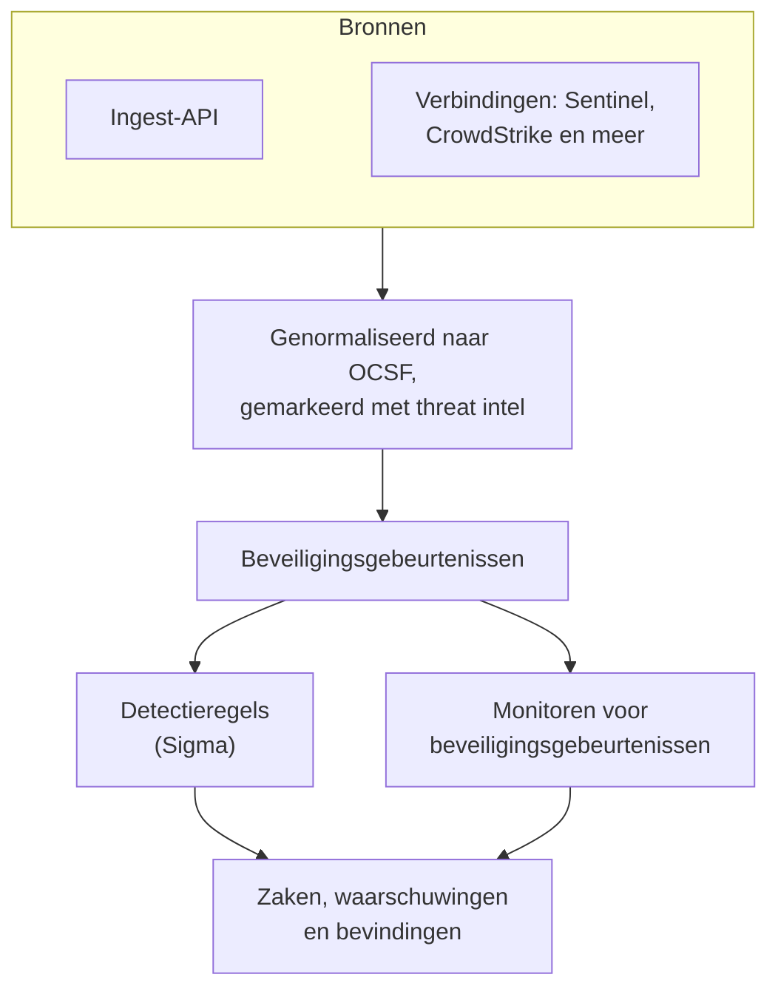
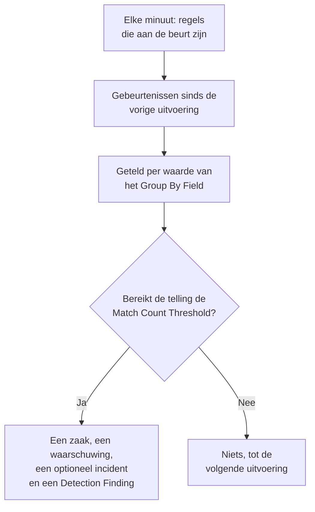

# Beveiligingsgebeurtenissen (SIEM)

OneUptime bewaart beveiligingsgebeurtenissen naast je logs, traces en metrics, en geeft ze allemaal dezelfde vorm, [OCSF](https://schema.ocsf.io/) (het Open Cybersecurity Schema Framework), in welk formaat ze ook binnenkwamen. Stuur gebeurtenissen vanuit elke bron, doorzoek ze, en vind de belangrijke met Sigma-detectieregels, threat intelligence en monitoren. Wat die vinden, wordt [zaken](/docs/telemetry/security-cases) om af te handelen, en playbooks reageren erop.

:::cards
- [Gebeurtenissen sturen](#beveiligingsgebeurtenissen-sturen): Een HTTPS-POST, een Fluent Bit-output of een verbinding met een beveiligingsproduct.
- [Zoeken en correleren](#beveiligingsgebeurtenissen-verkennen): De verkenner Gebeurtenissen en de grafiek Correleren.
- [Hunts](#hunts): Opgeslagen zoekopdrachten die volgens een schema draaien en mensen laten weten wanneer ze iets vinden.
- [Detectieregels](#detectieregels): Sigma-regels die zaken en waarschuwingen openen.
- [Monitoren](#monitoren-voor-beveiligingsgebeurtenissen): Tellingen over een glijdend venster, met een status die herstelt.
:::

## Hoe het werkt



Open **Producten → Security Events**, onder **Observability**. Het menu heeft een sectie voor elk deel van beveiliging, en een eigen pagina voor alles daarin:

| Pagina | Sectie | Waarvoor het dient |
| --- | --- | --- |
| **Overzicht** | Overzicht | Hoe beveiliging is ingericht, wat er nu iemand nodig heeft en hoe snel zaken worden afgehandeld |
| **Open zaken** | Beveiligingszaken | De wachtrij: elke zaak die nog niet gesloten is, gegroepeerd naar waar het over gaat |
| **Mijn zaken** | Beveiligingszaken | De open zaken die aan jou zijn toegewezen |
| **Niet toegewezen** | Beveiligingszaken | De open zaken die nog niemand heeft opgepakt |
| **Gesloten zaken** | Beveiligingszaken | De zaken die met een oordeel zijn gesloten, de nieuwste eerst |
| **Alle zaken** | Beveiligingszaken | Elke zaak, open of gesloten |
| **Gebeurtenissen** | Gebeurtenissen | Elke gebeurtenis zoeken en filteren, en er een openen om al haar velden te zien |
| **Hunts** | Gebeurtenissen | Zoekopdrachten opgeslagen vanuit Gebeurtenissen, met één klik weer geopend of volgens een schema uitgevoerd dat mensen laat weten wanneer ze iets vinden |
| **Campaigns** | Gebeurtenissen | Elk adres dat aanvalsverzoeken stuurde, en of een van zijn verzoeken erdoor kwam |
| **Entiteitrisico** | Gebeurtenissen | Elke gebruiker, host en elk adres, gescoord op wat er deze week over werd gevonden, de riskantste eerst |
| **Correleren** | Gebeurtenissen | Een grafiek van de gebeurtenissen die een host, een gebruiker of een IP-adres delen |
| **Detectieregels** | Detections | Sigma-regels die volgens een schema draaien en zaken openen |
| **Regeluitzonderingen** | Detections | Wat je regels bewust overslaan, zoals een scanner of een geplande test, elk met wie het heeft toegevoegd en waarom |
| **Volglijsten** | Detections | De lijsten waartegen je regels vergelijken, zoals VIP-gebruikers, kritieke hosts, bekende kwaadaardige bestandshashes en de adressen waarvandaan beheerders mogen inloggen |
| **Regelbibliotheek** | Detections | Kant-en-klare detectieregels om toe te voegen, elk met de gebeurtenissen die hij leest en of die binnenkomen, met de aanbevolen regels gemarkeerd |
| **Dreigingsinformatie** | Detections | STIX/TAXII-feeds van bekende kwaadaardige indicatoren |
| **ATT&CK-dekking** | Detections | De technieken van MITRE ATT&CK die je regels dekken |
| **Playbooks** | Playbooks | Stappen die op zaken draaien, vanzelf of met de hand |
| **Goedkeuringen** | Playbooks | De playbookstappen die wachten tot iemand ze goedkeurt of afwijst |
| **Uitvoeringen** | Playbooks | Wat elk playbook deed, stap voor stap |
| **Beschermde entiteiten** | Playbooks | De gebruikers en hosts die geen enkel playbook inperkt |
| **Instellingen** | AI | Of OneUptime AI elke nieuwe zaak beoordeelt |
| **Verbindingen** | Connections | Uw logs, de beveiligingsproducten die OneUptime opvraagt en de SIEM's waarnaar het verstuurt |
| **Installatiegids** | Connections | Snippets om gebeurtenissen te sturen, ingevuld met je ingestiesleutel |
| **Zaakprioriteiten** | Instellingen | Hoe dringend een zaak is: de eigen prioriteiten van het project, de dringendste eerst |
| **Reactiedoelen** | Instellingen | Hoe snel een zaak van elke prioriteit moet worden opgepakt en ingedamd |
| **Zaakstatussen** | Instellingen | De stappen die een zaak doorloopt, en hoe een zaak in elke stap telt |
| **Risicoscoring** | Instellingen | Of het risico van een entiteit een zaak opent, bij welk risico, en hoe zwaar elke entiteit weegt |

**Detecties**, **AI**, **Verbindingen** en **Instellingen**, die je één keer instelt, blijven ingeklapt tot je ze opent. Nieuw met beveiliging? [Aan de slag met beveiliging](/docs/telemetry/security-getting-started) richt het in met twee klikken.

## Voordat je begint

Beveiligingsgegevens zijn alleen leesbaar voor de rollen Project Owner en Project Admin en voor de drie Security-rollen; andere rollen zien niets in Security Events. Zie [Rollen](/docs/permissions/reference#rollen).

| Rol | Wat hij kan doen |
| --- | --- |
| Security Admin | Alles: gebeurtenissen, zaken, playbooks, detectieregels, threat-intelfeeds en verbindingen |
| Security Member | Gebeurtenissen en threat intel lezen, zaken afhandelen, playbooks uitvoeren en hun stappen goedkeuren, en detectieregels en feeds aanmaken, wijzigen en verwijderen. Hij kan geen playbooks of verbindingen instellen en geen beveiligingsgegevens verwijderen. |
| Security Viewer | Gebeurtenissen, zaken, playbooks, regels, feeds, indicatoren en verbindingen lezen |

## Beveiligingsgebeurtenissen sturen

:::steps
### Maak een ingestiesleutel aan

Open **Projectinstellingen → Telemetrie & APM → Ingestiesleutels** en klik op **Inname-sleutel aanmaken**. Beveiligingsgebeurtenissen gebruiken dezelfde sleutels als de rest van je telemetrie.

### Post je gebeurtenissen

Stuur JSON naar `/security-events/v1/ingest`, met de sleutel in `x-oneuptime-token`:

:::tabs
@tab OCSF
```bash
curl -X POST "https://oneuptime.com/security-events/v1/ingest?format=ocsf" \
  -H "Content-Type: application/json" \
  -H "x-oneuptime-token: YOUR_INGESTION_TOKEN" \
  -H "x-oneuptime-service-name: my-security-source" \
  -d '{ "events": [ { "class_uid": 3002, "severity_id": 4, "status": "Failure", "message": "Failed logon for alice", "actor": { "user": { "name": "alice" } }, "src_endpoint": { "ip": "203.0.113.7", "hostname": "laptop-alice" } } ] }'
```
@tab Google UDM
```bash
curl -X POST "https://oneuptime.com/security-events/v1/ingest?format=udm" \
  -H "Content-Type: application/json" \
  -H "x-oneuptime-token: YOUR_INGESTION_TOKEN" \
  -d '{ "events": [ { "metadata": { "event_type": "USER_LOGIN" }, "principal": { "hostname": "laptop-alice", "user": { "userid": "alice" }, "ip": ["203.0.113.7"] }, "security_result": [{ "severity": "HIGH", "action": ["BLOCK"] }] } ] }'
```
@tab Generic JSON
```bash
curl -X POST "https://oneuptime.com/security-events/v1/ingest" \
  -H "Content-Type: application/json" \
  -H "x-oneuptime-token: YOUR_INGESTION_TOKEN" \
  -d '{ "events": [ { "severity": "high", "event_type": "ssh_brute_force", "message": "12 failed SSH logins in 60s", "username": "root", "hostname": "web-01", "src_ip": "203.0.113.7" } ] }'
```
:::

Het endpoint antwoordt `200` zodra de gebeurtenissen in de wachtrij staan. Een gebeurtenis zonder tijd, zoals deze, komt te staan op het moment dat ze binnenkomt.

### Vind ze in Gebeurtenissen

Open **Producten → Security Events → Gebeurtenissen**. De gebeurtenissen verschijnen binnen een paar seconden, met hun ernst, klasse, gebruiker, host en IP-adressen ingevuld.
:::

### Formaten

| `format` | Wat het leest | Ook geaccepteerd |
| --- | --- | --- |
| `ocsf` | OCSF-gebeurtenis-JSON (`class_uid`, `severity_id` enzovoort) | Geen |
| `udm` | UDM-gebeurtenissen van Google SecOps (Chronicle) (`metadata.event_type` enzovoort) | `chronicle`, `google-secops` |
| `google-secops-alert` | Detecties en waarschuwingen van Google SecOps: SOAR-webhooks en de detectiestroom | `secops-alert`, `detection` |
| `generic` | Elke andere JSON, gelezen op gangbare veldnamen | Geen |

Geef het formaat op met `?format=`, met de header `x-oneuptime-security-event-format`, of met een veld `"format"` op het hoogste niveau. Laat je het weg, dan wordt het formaat van elke gebeurtenis apart bepaald, zodat één webhook detecties en ruwe gebeurtenissen kan mengen.

- De body kan één gebeurtenis zijn, een array van gebeurtenissen, of `{ "events": [...] }`.
- De header `x-oneuptime-service-name` noemt de telemetrieservice waartoe de gebeurtenissen behoren. Zonder die header behoren ze tot de service die is genoemd naar het product of de leverancier van de eerste gebeurtenis, of tot `Security Events`.
- Er wordt niets weggegooid omdat het niet te koppelen was: elk veld van de bron komt terecht in de attributen van de gebeurtenis.

### Velden van generieke JSON

Een generieke gebeurtenis wordt gelezen op gangbare veldnamen:

| Veld van de gebeurtenis | Gelezen uit de eerste van |
| --- | --- |
| `message` | `message`, `msg`, `summary`, `description`, `title` |
| `severityName` | `severity`, `severity_name`, `level`, `priority`, `risk_level` |
| `time` | `timestamp`, `time`, `@timestamp`, `event_time`, `created_at` |
| `principalUser` | `user`, `username`, `user_name`, `account`, `actor` |
| `principalHost` | `host`, `hostname`, `computer`, `device`, `machine` |
| `principalIp` | `source_ip`, `src_ip`, `client_ip`, `ip` |
| `targetIp` | `destination_ip`, `dest_ip`, `dst_ip`, `target_ip` |
| `className` | `event_type`, `category`, `type`, `action` |
| `ruleName` | `rule`, `rule_name`, `signature`, `detection` |
| `productName` | `product`, `product_name`, `source`, `log_source` |
| `processName` | `process_name`, `process.name`, `proc.name`, `comm` |
| `processPath` | `process_path`, `Image`, `NewProcessName`, `exe`, `process.executable` |
| `processCommandLine` | `command_line`, `CommandLine`, `cmdline`, `process.command_line`, `proc.cmdline`, `process` |
| `parentProcessName` | `parent_process_name`, `process.parent.name`, `proc.pname` |
| `parentProcessPath` | `parent_process_path`, `ParentImage`, `ParentProcessName`, `process.parent.executable` |
| `parentProcessCommandLine` | `parent_command_line`, `ParentCommandLine`, `process.parent.command_line`, `proc.pcmdline` |

Een woord voor de ernst wordt een OCSF-niveau: `info` wordt gelezen als Informational, `warning` als Low, `error` als Medium, `alert` als Critical en `emergency` als Fatal.

### Doorsturen met Fluent Bit

Om beveiligingslogs te sturen die je al verzamelt, zoals auditd, syslog of Falco, voeg je een `http`-output toe aan Fluent Bit:

```ini title="fluent-bit.conf"
[OUTPUT]
    Name             http
    Match            security.*
    Host             oneuptime.com
    Port             443
    tls              On
    URI              /security-events/v1/ingest
    Format           json
    Json_date_key    timestamp
    Json_date_format iso8601
    Header           x-oneuptime-token YOUR_INGESTION_TOKEN
    Header           x-oneuptime-service-name my-security-source
    Retry_Limit      5
```

De pagina **Installatiegids**, onder **Verbindingen**, bevat deze snippets, met je eigen host en sleutel ingevuld.

### Beveiligingsgebeurtenissen in uw logs vinden

De kaart **Uw logboeken**, boven aan **Verbindingen**, maakt van de logs die u al naar OneUptime stuurt een bron. Met **Beveiligingsgebeurtenissen in uw logboeken vinden** aan worden de nieuwe logs van het project elke minuut gelezen, en elke SSH- of Windows-aanmelding, sudo-opdracht, auditregel van een cloud, CEF- of LEEF-record van een beveiligingsproduct, Kubernetes-auditregel en webaanval daarin wordt opgeslagen als beveiligingsgebeurtenis. Zie [Aan de slag met beveiliging](/docs/telemetry/security-getting-started#beveiligingsgebeurtenissen-in-uw-logs-vinden) voor wat elke soort omvat.

Elke soort bereikt OneUptime als gewone logs:

| Soort | Stuur het vanuit |
| --- | --- |
| SSH-aanmeldingen, sudo | De journal of het authenticatielog van een Linux-machine, met de [OpenTelemetry Collector](/docs/telemetry/host-otel-collector) |
| Windows-gebeurtenissen | De `windowseventlog`-receiver van de collector op de machine, of een forwarder die elke gebeurtenis als JSON schrijft, zoals NXLog of Winlogbeat |
| AWS CloudTrail | Een trail die aan CloudWatch Logs wordt geleverd, gelezen door de `awscloudwatch`-receiver van de collector |
| Google Cloud-auditlogs | Een log-sink naar Pub/Sub, gelezen door de `googlecloudpubsub`-receiver van de collector met `encoding: raw_text` |
| Azure-activiteitslogs en Entra ID-logs | Een diagnostische instelling die naar een Event Hub streamt, gelezen door de `azureeventhub`-receiver van de collector met `format: raw` |
| CEF, LEEF | De syslog van het product, doorgestuurd door [rsyslog](/docs/telemetry/syslog) |
| Kubernetes-auditlogs | Het auditlogbestand van de API-server, gelezen door de `filelog`-receiver van de collector |
| Webaanvallen | Het toegangslog van een webserver, gelezen door de `filelog`-receiver van de collector |

Op **Uw logboeken** zegt elke soort wanneer ze voor het laatst is gevonden, en **Een logboekregel controleren** laat zien wat een regel die u plakt wordt, nog voordat er een binnenkomt.

### Een beveiligingsproduct koppelen

**Verbindingen** bevraagt een beveiligingsproduct voor je en importeert zijn nieuwe records als beveiligingsgebeurtenissen. Een verbinding bevat de instellingen van het product en een versleutelde referentie; een worker bevraagt haar met het interval dat je instelt en slaat records over die hij al importeerde.

| Product | Importeert | Installatiegids |
| --- | --- | --- |
| Google SecOps (Chronicle) | Regeldetecties, gecureerde detecties en waarschuwingen, als Detection Findings | [Google SecOps](/docs/integrations/google-secops) |
| Microsoft Sentinel | Incidenten, als Incident Findings | [Microsoft Sentinel](/docs/integrations/microsoft-sentinel) |
| Microsoft Defender XDR | Waarschuwingen, als Detection Findings | [Microsoft Defender XDR](/docs/integrations/microsoft-defender-xdr) |
| CrowdStrike Falcon | Waarschuwingen, als Detection Findings | [CrowdStrike Falcon](/docs/integrations/crowdstrike-falcon) |
| Splunk Enterprise Security | Notable events, of elke zoekopdracht, als Detection Findings | [Splunk Enterprise Security](/docs/integrations/splunk) |
| Elastic Security | Detectiewaarschuwingen, als Detection Findings | [Elastic Security](/docs/integrations/elastic-security) |
| AWS Security Hub | Findings, als Detection en Compliance Findings | [AWS Security Hub](/docs/integrations/aws-security-hub) |
| Okta System Log | Gebeurtenissen over aanmeldingen, MFA, accounts en beleid | [Okta System Log](/docs/integrations/okta) |
| Microsoft Entra ID | Aanmeldingen en directorywijzigingen, en uit het Microsoft 365-auditlogboek het doorsturen van e-mail, delen en phishingoordelen | [Microsoft Entra ID](/docs/integrations/microsoft-entra-id) |
| Google Workspace | Aanmeldingen, de eigen detecties van Google, beheerwijzigingen en app-toegang, en delen in Drive | [Google Workspace](/docs/integrations/google-workspace) |

- De eigen waarschuwingen van het product vanaf het niveau dat in **Open Cases From** is ingesteld (**Hoog en hoger**, tenzij je een ander niveau kiest, of **Nooit**), openen [zaken](/docs/telemetry/security-cases), gegroepeerd op de gebruiker, de host of het adres waar ze over gaan.
- Een verbinding leest records op het tijdstip waarop het product ze aanmaakte, niet op het tijdstip van de activiteit die ze beschrijven. Een SIEM-regel die elk uur draait, maakt detecties lang na de gebeurtenissen waarop hij matchte, en die worden toch geïmporteerd.
- De eerste bevraging kijkt 24 uur terug, zodat een nieuwe verbinding meteen recente records toont.
- **Verbinding testen**, in de rij van de verbinding, controleert de toegang tot het product en of de eigen workers van OneUptime draaien, en importeert niets. **Nu uitvoeren** bevraagt meteen.

## Wat een gebeurtenis bevat

Elke gebeurtenis wordt opgeslagen met getypeerde velden en de payload van de bron:

| Groep | Velden |
| --- | --- |
| Classificatie | `categoryName`, `className`, `activityName`, `statusName`, met hun OCSF-ID's (`categoryUid`, `classUid`) |
| Ernst | `severityName`, een van Unknown, Informational, Low, Medium, High, Critical, Fatal of Other, en `severityId` |
| Wie het deed | `principalUser`, `principalHost`, `principalIp`, `principalProcess` |
| Wat het raakte | `targetUser`, `targetHost`, `targetIp`, `targetPort`, `targetResource` |
| Het proces | `processName`, `processPath` en `processCommandLine`: bij procesactiviteit het proces dat werd gestart, geopend, geïnjecteerd of beëindigd, anders het proces dat handelde. `parentProcessName`, `parentProcessPath` en `parentProcessCommandLine`: het proces dat het startte |
| Bron | `productName`, `vendorName`, `ruleId`, `ruleName`, `eventUid` |
| Inhoud | `message`, `mitreTactics`, `mitreTechniques` en `observables`: elke gebruiker, host, elk IP-adres, domein en elke hash uit de gebeurtenis |
| Attributen | De hele payload van de bron, afgevlakt tot sleutels met punten |

Gebeurtenissen die vóór OneUptime 14.0.84 zijn opgeslagen, laten de procesvelden leeg en noemen hun proces alleen als `principalProcess`, het proces dat handelde. Ze worden achteraf niet aangevuld: ze houden waarmee ze zijn opgeslagen tot hun bewaartermijn afloopt.

## Beveiligingsgebeurtenissen verkennen

**Gebeurtenissen** is een telemetrieverkenner zoals de verkenners voor logs en traces: een grafiek van de gebeurtenissen in het venster per ernst, een zijbalk met facetten, de lijst, en een paneel met elk veld en attribuut van de gebeurtenis die je opent. Het venster, de filters en de zoekopdracht staan allemaal in de URL, zodat een gefilterde weergave te delen is en een vernieuwing overleeft.

### Zoeken

De zoekbalk spreekt dezelfde taal als de andere telemetrieverkenners (zie [Zoeksyntaxis](/docs/telemetry/search-syntax)):

| Syntaxis | Betekent | Voorbeeld |
| --- | --- | --- |
| vrije tekst | Het bericht bevat het | `failed logon` |
| `"quoted phrase"` | Houd de woorden bij elkaar | `"brute force"` |
| `<field>:<value>` | Een getypeerd veld | `severity:Critical` |
| `@<attribute>:<value>` | Een bronattribuut | `@threat.matched:true` |
| `-<filter>` | Niet dit | `-severity:Informational` |
| `<field>:(a OR b)` | Een van deze waarden | `severity:(High OR Critical)` |
| `<field>:a*` | `*` is willekeurige tekst, `?` één teken | `host:web-*` |
| `@<attribute>:*` | Het attribuut is aanwezig | `@threat.indicator_id:*` |
| `@<attribute>:~text` | Het attribuut bevat de tekst | `@finding_info.title:~ransom` |

Een veld is ofwel een korte naam (`severity`, `class`, `category`, `activity`, `status`, `vendor`, `product`, `rule`, `user`, `host`, `ip`, `targetuser`, `targethost`, `targetip`, `processname`, `commandline`, `parentprocessname`, `observable`, `tactic`, `technique`, `requestoutcome`, `trace`, `session`) ofwel de eigen naam van het veld, zoals `severityName` of `principalHost`. Elke andere naam wordt gelezen als bronattribuut. `observable:<value>` vindt elke gebeurtenis die een waarde noemt, aan welke kant van de activiteit die ook stond.

### Facetten

De zijbalk telt de gebeurtenissen in het venster per **Bron**, **Ernst**, **Request Outcome**, **Gebeurtenisklasse**, **Categorie**, **Activiteit**, **Status**, **Leverancier**, **Product**, **Detectieregel**, **Brongebruiker**, **Bronhost**, **Proces** en **Bovenliggend proces**. Klik op een waarde om alleen haar gebeurtenissen te houden, of op het minteken ernaast om ze weg te laten. Klik nog eens om dat ongedaan te maken. De grafiek en elke telling beschrijven precies de gebeurtenissen in de lijst.

### Wat er daarna gebeurde

Een gebeurtenis uit een logregel die binnen een getracet verzoek is geschreven, wordt in dat verzoek gevolgd. Het paneel zegt hoe ver het verzoek kwam (**Afgewezen**, **Reached App**, **Errored** of **Reached Database**), wie het stuurde, en linkt naar de trace, de uitzondering, de sessieherhaling en de logregel zelf. Een logregel, een trace en een uitzondering die deel zijn van een aanval zeggen dat ook op hun eigen pagina's.

### Campaigns

**Campaigns** toont elk adres dat aanvalsverzoeken stuurde als één rij, met de soorten aanval, de tools en de verzoeken die het stuurde, en hoeveel erdoor kwamen. De adressen waarvan verzoeken je app bereikten, staan bovenaan.

### Correleren

**Correleren** tekent de gebeurtenissen rond een host, een gebruiker of een IP-adres: hun gebeurtenisklassen rond wat je zocht, gemarkeerd met hun ergste ernst, en de andere waarden uit dezelfde gebeurtenissen op de buitenste ring. Klik op een klasse om haar gebeurtenissen te tonen, of op een waarde om daarna daarop te correleren. Elke observable in het paneel van een gebeurtenis op **Gebeurtenissen** opent **Correleren** erop.

## Hunts

Een hunt is een zoekopdracht in je beveiligingsgebeurtenissen die onder een naam is opgeslagen: de tekst van de zoekbalk, de filters van de zijbalk en hoe ver hij terugkijkt. Open hem met één klik opnieuw, laat hem volgens een schema draaien dat mensen laat weten wanneer hij iets vindt, en bewaar de gebeurtenissen die hij vindt bij een zaak.

### Een zoekopdracht opslaan als hunt

Zoek en filter op **Gebeurtenissen** tot de lijst laat zien wat je zoekt, open dan **Hunts** in de werkbalk en kies **Opslaan als hunt**. Geef hem een naam, kies of hij volgens een schema draait, en zijn pagina opent. **Gebeurtenissen → Hunts** toont de hunts van het project, elk met zijn zoekopdracht, hoe vaak hij draait, wie hij op de hoogte stelt en wat zijn laatste run vond; **Hunt aanmaken** neemt daar de zoekopdracht zoals je die op **Gebeurtenissen** zou typen. Een project bewaart tot 200 hunts.

De pagina van een hunt is zijn zoekopdracht, geopend in de verkenner Gebeurtenissen. Wijzig daar de zoekopdracht of de filters, en de kop van de hunt biedt **Wijzigingen opslaan** en **Wijzigingen verwerpen**. **Bewerken** wijzigt zijn naam, zijn zoekopdracht, hoe ver hij terugkijkt, zijn schema en wie hij op de hoogte stelt, en **Hunt verwijderen** staat in zijn menu. Vanaf Security Member kun je hunts opslaan, wijzigen en verwijderen, en een Security Viewer kan ze openen.

### Een hunt volgens een schema uitvoeren

| Schema | Draait |
| --- | --- |
| **Niet gepland** | Alleen wanneer je hem opent |
| **Elk uur**, **Elke 6 uur**, **Elke dag**, **Elke week** | Vanzelf, zo vaak |

Een geplande hunt stelt de mensen en teams op de hoogte die je kiest onder **Op de hoogte stellen**: minstens één, en in totaal hooguit 50. Elke run:

- leest de gebeurtenissen waarvan de tijd na de vorige run ligt, tot twee minuten geleden, zodat elke gebeurtenis één keer wordt doorzocht. De eerste run leest vanaf het moment dat het schema werd ingesteld of de zoekopdracht voor het laatst werd gewijzigd, en na een storing haalt een run hooguit een dag meer in dan zijn interval.
- telt de gebeurtenissen die zijn zoekopdracht daar vindt, precies zoals **Gebeurtenissen** ze zou tonen, en leest alleen wat de persoon onder wie hij draait mag lezen.
- stelt, als hij gebeurtenissen vindt, de mensen op de hoogte die de hunt noemt, en de leden van de teams die hij noemt, die hunts en beveiligingsgebeurtenissen mogen lezen.

Een run opent geen zaak en geeft geen waarschuwing: schrijf wat zaken moet openen als een [detectieregel](#detectieregels). Een run waarvan de zoekopdracht te lang duurt, of die de gebeurtenissen niet kan lezen, zegt waarom bij de hunt en wordt binnen het uur opnieuw geprobeerd, vanaf waar hij stopte.

Een geplande hunt draait onder de persoon die als laatste zijn schema instelde, zijn zoekopdracht wijzigde of hem opsloeg met **Bewerken**. Een API-sleutel kan geen schema instellen. Als die persoon het project verlaat of geen beveiligingsgebeurtenissen meer mag lezen, zegt de hunt dat: open **Bewerken** en sla hem op om hem onder jou te laten draaien.

### Wie op de hoogte wordt gesteld

De melding **Hunt heeft beveiligingsgebeurtenissen gevonden** noemt de hunt en zijn zoekopdracht, hoeveel gebeurtenissen zijn run vond en welk venster die las, en linkt naar de pagina van de hunt op die gebeurtenissen; er staat geen woord van een gebeurtenis zelf in. Iedereen krijgt hem per e-mail en push, en kiest de kanalen onder **Gebruikersinstellingen → Meldingsinstellingen**. Net als andere routine-e-mails kan hij worden vastgehouden in een [e-mailoverzicht](/docs/emails/notification-rollup).

### Gebeurtenissen bij een zaak bewaren

Selecteer gebeurtenissen op **Gebeurtenissen** of op de pagina van een hunt en kies **Bulkacties → Aan zaak toevoegen**, of open één gebeurtenis en kies **Aan zaak toevoegen**. Kies een open zaak op nummer of titel. Er gaan maximaal 100 gebeurtenissen tegelijk.

OneUptime leest elke gebeurtenis opnieuw namens jou en bewaart haar zoals ze was op de pagina **Bewijs** van de zaak, zodat de zaak haar nog toont als de bewaartermijn van de gebeurtenis voorbij is. Een gebeurtenis die je niet mag lezen, wordt niet bewaard, en een die de zaak al bewaart, blijft zoals ze is. Een gebeurtenis die via een hunt is gevonden, noemt de hunt, en **Gebeurtenis bekijken** opent haar zoals ze werd bewaard.

Hunts hebben dezelfde REST API als de rest van OneUptime, onder `/security-hunt`, en `POST /security-case-evidence/add-events` bewaart gebeurtenissen bij een zaak. Zie [API-referentie](/docs/api-reference/api-reference).

## Detectieregels

Een detectieregel is een [Sigma](https://sigmahq.io/)-regel, een open YAML-formaat om verdachte activiteit te beschrijven, die OneUptime volgens een schema op je gebeurtenissen loslaat. Als hij matcht, opent hij een [zaak](/docs/telemetry/security-cases) of vult hij een open zaak aan, opent hij een waarschuwing, eventueel een incident, en schrijft hij een Detection Finding terug in de gebeurtenissen. De **Regelbibliotheek** heeft kant-en-klare regels om mee te beginnen.



### Een regel aanmaken

:::steps
1. Open **Producten → Security Events → Detecties → Detectieregels** en klik op **Detectieregel aanmaken**.
2. Plak in **Sigma-regel** de YAML van de regel in **Sigma-regel (YAML)**. Die wordt bij het opslaan geparst, dus een fout verschijnt in het formulier.
3. De **Naam** vult zich met de `title` van de regel: typ eroverheen om de regel anders te noemen. Een nieuwe regel draait; **Ingeschakeld** staat in zijn bewerkformulier.
4. Laat in **Bij overeenkomst** de optie **Zaak openen bij overeenkomst** aan staan om de matches van de regel te bundelen tot zaken, op de waarde waarop de regel groepeert.
5. Kies onder **Waarschuwingen en incidenten** wat een match verder oplevert: **Een waarschuwing maken** (standaard), **Een incident melden**, **Beide** of **Geen van beide**, met een optionele **Ernst van waarschuwing** of **Ernst van incident**.
6. **Meer velden** bevat de **Beschrijving**, **Detection Finding schrijven bij overeenkomst** (aan) en hoe matches worden geteld; zie [Evaluatie-instellingen](#evaluatie-instellingen).
:::

Een eerste regel, die matcht op mislukte aanmeldingen van buiten `10.x.x.x`:

```yaml title="failed-logon-burst.yml"
title: Failed logon burst
description: Repeated authentication failures from one source.
level: high
tags:
  - attack.t1110
  - attack.ta0006
detection:
  selection:
    className: Authentication
    statusName: Failure
  filter_internal:
    principalIp|startswith: '10.'
  condition: selection and not filter_internal
```

### Wat een regel kan uitdrukken

OneUptime voert de booleaanse kern van Sigma uit:

- Selecties zijn veldmaps (elk veld moet matchen; een lijst met waarden matcht op elk ervan) of trefwoordlijsten, die overal in het bericht matchen.
- Voorwaarden combineren selecties met `and`, `or`, `not` en haakjes, of met `1 of selection_*`, `all of selection_*`, `any of them` en `all of them`.
- Veldmodifiers: `contains`, `startswith`, `endswith`, `all`, `re`, `cased`, `gt`, `gte`, `lt`, `lte`, `cidr`, `exists`, `windash` en `expand`, dat een [volglijst](#volglijsten) leest. Tekst wordt vergeleken zonder op hoofdletters te letten, tenzij je `cased` toevoegt.
- Een veld is een getypeerd veld (`principalUser`), een gangbare Sigma-spelling ervan (`CommandLine`, `src_ip`, `Hostname`), of elke attribuutsleutel, gespeld zoals in de gebeurtenis (`threat.matched`).
- `Image` en `CommandLine` lezen het proces waar de gebeurtenis over gaat, bij het starten van een proces het proces dat startte (`processPath`, `processCommandLine`), en `ParentImage` en `ParentCommandLine` het proces dat het startte (`parentProcessPath`, `parentProcessCommandLine`). `principalProcess` is het proces dat handelde, bij het starten dus het bovenliggende proces.
- `level` bepaalt de ernst: `informational`, `low`, `medium`, `high` of `critical`, en `medium` als het ontbreekt. ATT&CK-ID's in `tags` (`attack.t1110`, `attack.ta0006`) vullen de MITRE-velden van de bevinding.

Aggregaties zoals `| count() by principalIp > 5` worden bij het opslaan geweigerd: gebruik in plaats daarvan een [correlatieregel](#correlatieregels), of **Groeperingsveld** en **Drempel voor aantal treffers**. `logsource` is alleen informatief en beperkt niets: zet dat filter in een selectie, zoals `className: Authentication`. Een `timeframe` wordt genegeerd, omdat het interval van de regel zijn venster bepaalt.

### Correlatieregels

Een [Sigma-correlatie](https://sigmahq.io/docs/meta/correlations.html) slaat aan op meerdere gebeurtenissen samen in plaats van op één. Plak haar in **Sigma-regel (YAML)** met de regels die ze leest, als YAML-documenten gescheiden door `---`, of noem regels die het project al heeft bij hun Sigma-`name` of -`id`. De **Regelbibliotheek** heeft kant-en-klare, zoals mislukte aanmeldingen gevolgd door een geslaagde.

| Type | Slaat aan wanneer | Getoond als |
| --- | --- | --- |
| `event_count` | Eén groep binnen de `timespan` een aantal gebeurtenissen bereikt | Aantal gebeurtenissen |
| `value_count` | Eén groep binnen de `timespan` een aantal verschillende waarden van een veld toont | Verschillende waarden |
| `temporal` | Elke regel binnen de `timespan` voor dezelfde groep matcht, in willekeurige volgorde | Gebeurtenissen samen |
| `temporal_ordered` | De regels binnen de `timespan` in hun volgorde voor dezelfde groep matchen | Sequence |
| `new_value` | Een groep een waarde van een veld toont die ze binnen de `timespan` niet heeft getoond | First seen |

```yaml title="failed-then-success.yml"
title: Failed sign-ins, then a success from the same address
level: high
correlation:
  type: temporal_ordered
  rules:
    - failed_sign_ins
    - successful_sign_in
  group-by:
    - principalIp
  timespan: 10m
---
title: Five failed sign-ins
name: failed_sign_ins
correlation:
  type: event_count
  rules:
    - failed_sign_in
  group-by:
    - principalIp
  timespan: 10m
  condition:
    gte: 5
---
title: Failed sign-in
name: failed_sign_in
detection:
  selection:
    className: Authentication
    statusName: Failure
  condition: selection
---
title: Successful sign-in
name: successful_sign_in
detection:
  selection:
    className: Authentication
    statusName: Success
  condition: selection
```

- Een groep is de waarde van de velden in `group-by`, zoals één adres. Tellingen zijn rollend: een uitbarsting die twee runs verdelen, telt binnen haar `timespan` toch volledig mee, en die is hooguit 24 uur.
- `new_value` is een eigen type van OneUptime, omdat Sigma geen correlatie "voor het eerst gezien" kent: het vergelijkt met maximaal 30 dagen geschiedenis. `value_sum`, `value_avg`, `value_percentile` en `value_median` worden bij het opslaan geweigerd.
- De kolom **Type** van **Detectieregels** noemt het soort van elke regel, en het formulier zegt in één zin waar de regel naar zoekt.

### Evaluatie-instellingen

| Veld | Wat het doet |
| --- | --- |
| **Evaluatie-interval (minuten)** | Hoe vaak de regel draait: hele minuten, 1 tot 1440. Het formulier van een nieuwe regel begint op 5. |
| **Groeperingsveld** | Optioneel. Matches die de waarde van dit veld delen, zoals `principalHost`, worden samen geteld, gemeld en ontdubbeld: één waarschuwing per host in plaats van honderden. |
| **Veld voor unieke telling** | Optioneel. Tel de verschillende waarden van dit veld in plaats van de matchende gebeurtenissen. Lege waarden tellen niet mee. |
| **Drempel voor aantal treffers** | Een groep gaat alleen af als zijn telling dit getal binnen één uitvoering bereikt: 1 tot 1000000, en 1 gaat af bij elke match. |

Group By en Distinct Count nemen dezelfde veldnamen als de regel. Daarmee zegt de drempel "zoveel, van hetzelfde ding, in één uitvoering", zonder monitor erbovenop:

| Doel | Group By Field | Distinct Count Field | Drempel |
| --- | --- | --- | --- |
| Waarschuwen bij elke match | Leeg | Leeg | 1 |
| Eén waarschuwing per host | `principalHost` | Leeg | 1 |
| Brute force: 5 mislukte aanmeldingen vanaf één IP | `principalIp` | Leeg | 5 |
| Password spraying: één IP dat faalt tegen 5 verschillende accounts | `principalIp` | `principalUser` | 5 |
| Poortscan: één IP dat 20 verschillende poorten bereikt | `principalIp` | `targetPort` | 20 |

### Wanneer een regel draait

OneUptime controleert elke minuut op ingeschakelde regels waarvan het interval sinds hun laatste uitvoering is verstreken. Elke uitvoering leest de gebeurtenissen waarvan de gebeurtenistijd tussen de vorige uitvoering en twee minuten geleden valt, en gaat dan verder. Die twee minuten geven gebeurtenissen die nog onderweg zijn ruimte, zoals een logregel die een minuut na het schrijven wordt gelezen:

- Vensters sluiten op elkaar aan en glijden niet. Met een interval van 10 minuten kunnen mislukkingen om 09:58 en 10:01 in verschillende uitvoeringen vallen en worden ze apart geteld, dus houd marge aan als je een drempel kiest.
- Na een onderbreking, zoals een storing van een worker of een regel die weer is aangezet, dekt de volgende uitvoering de hele onderbreking, tot hoogstens de laatste 24 uur.
- Een gebeurtenis die meer dan twee minuten te laat binnenkomt, nadat een uitvoering haar tijd al heeft gedekt, wordt opgeslagen en is doorzoekbaar, maar die regel leest haar nooit.
- Elke groep die de drempel haalt, wordt een Detection Finding, tot 10.000 per uitvoering. Waarschuwingen, incidenten en zaken openen voor de 100 met de hoogste tellingen; de rest deelt één zaak over de regel, en de **Laatste fout** van de regel zegt hoeveel groepen matchten.

### Ernst

Het `level` van een regel is de ernst van zijn bevindingen: `informational`, `low`, `medium`, `high` en `critical` worden Informational, Low, Medium, High en Critical. Zijn waarschuwingen en incidenten krijgen een van de ernstniveaus van je project, in deze volgorde:

1. De **Ernst van waarschuwing** (of **Ernst van incident**) van de regel, als die is ingesteld.
2. Je ernstniveau dat naar het level is genoemd, zoals High, ongeacht hoofdletters.
3. Op rang: regels met `critical` en `high` krijgen je zwaarste ernstniveau, de andere je lichtste.

> [!TIP]
> Noem je ernstniveaus voor waarschuwingen naar de Sigma-levels (Critical, High, Medium, Low, Informational), en elke regel komt op het juiste niveau terecht zonder instelling per regel.

### Waarschuwingen en bevindingen

Elke groep die afgaat, opent een waarschuwing met de titel `[Detection] <rule name> — <group value>`, of `[Detection] <rule name>` voor een regel zonder Group By Field. Zolang die openstaat, openen meer matches voor die groep geen nieuwe. Een regel ziet alleen matches en kan niet zien dat een aanval is gestopt, dus zijn waarschuwingen blijven open tot iemand ze oplost.

Een Detection Finding is een beveiligingsgebeurtenis van de klasse `Detection Finding` (OCSF-klasse 2004) van het product `OneUptime Detections`, met de MITRE-tags van de regel, de groepswaarde als eerste in `observables`, en deze attributen:

| Attribuut | Waarde |
| --- | --- |
| `oneuptime.detection.rule_id` | De ID van de regel die afging |
| `oneuptime.detection.rule_name` | De naam van de regel |
| `oneuptime.detection.match_count` | Hoeveel gebeurtenissen achter de bevinding zitten |
| `oneuptime.detection.distinct_count` | Hoeveel verschillende waarden erachter zitten, voor een regel met een Distinct Count Field |
| `oneuptime.detection.group_value` | De waarde van de groep, voor een regel met een Group By Field |
| `oneuptime.detection.sigma_id` | De eigen `id` van de Sigma-regel |

Bevindingen zijn gewone gebeurtenissen: doorzoek ze in **Gebeurtenissen** en draai erop in **Correleren**. Om een nieuwe regel stil uit te proberen, zet je elke actie behalve de bevinding uit tot je hem vertrouwt.

### Uitzonderingen

Een uitzondering is iets dat een regel overslaat omdat je het verwacht, zoals een kwetsbaarheidsscanner, een nachtelijke back-uptaak of een geplande penetratietest. Ze maakt de regel stil voor dat ene ding zonder hem uit te zetten, en de andere treffers van de regel gaan nog steeds af. Elke uitzondering staat onder **Producten → Security Events → Detecties → Regeluitzonderingen**: voeg er daar een toe met **Regeluitzondering toevoegen**, met **Uitzondering toevoegen** in de rij van een regel, of met **Uitzondering toevoegen** in de rij van een detectie op een zaak, die begint met de regel van de detectie en waarvoor die afging.

| Wat de regel overslaat | Waarmee het overeenkomt |
| --- | --- |
| **Een entiteit** | Een gebruiker, host of IP-adres, waar een gebeurtenis die ook noemt: als wie handelde (`principalUser`, `principalHost`, `principalIp`), als op wie gehandeld werd (`targetUser`, `targetHost`, `targetIp`), of tussen haar `observables` |
| **Een waarde** | De waarde van één veld, het veld genoemd zoals een regel het noemt: `processName`, `principalUser` of een attribuutsleutel zoals `http.user_agent` |
| **Een tijdvenster** | Elke gebeurtenis van **Begint op** tot **Eindigt op**, hoogstens 30 dagen uit elkaar |

- Waarden komen overeen ongeacht hoofdletters, en `*` staat voor elke reeks tekens: `svc-*` slaat elk serviceaccount over, en `*.lab.example.com` elke host van een domein. Een IP-adres kan een bereik zijn, zoals `10.20.0.0/16`. Een waarde van alleen `*` wordt geweigerd: zet een regel uit om hem te stoppen.
- Elke uitzondering zegt waarom in haar **Reden**, die iedereen ziet die de lijst leest, en bewaart wie haar toevoegde en wanneer. Een entiteit of waarde kan een **Verloopt om** hebben, waarna de regel haar weer ziet; een tijdvenster eindigt vanzelf.
- **Status** zegt waar elke uitzondering staat: **Actief**, **Aankomend** voor een venster dat nog niet begonnen is, **Verlopen** of **Beëindigd**. Onder de naam van een regel in **Detectieregels** telt een regel tekst haar actieve uitzonderingen, en **Uitzonderingen bekijken** in de rij van de regel opent de lijst gefilterd op die regel.
- Overgeslagen gebeurtenissen worden weggelaten voordat de regel iets telt, dus ze tellen nooit mee voor haar **Drempel voor aantal treffers** en openen geen zaak, waarschuwing, incident of bevinding. Uitzonderingen gelden voor elke run van de regel, correlaties inbegrepen, en voor **Uitvoeren op eerdere gebeurtenissen**, maar nooit voor een testaanval, die controleert of gebeurtenissen doorkomen.
- Een regel heeft hoogstens 100 uitzonderingen. Wie detectieregels mag bewerken, voegt ze toe, wijzigt en verwijdert ze, elke Security-rol kan ze lezen, en elke wijziging staat in het auditlogboek van het project.

### Volglijsten

Een volglijst is een lijst die je team één keer bijhoudt en die elke regel kan lezen, zoals VIP-gebruikers, kritieke hosts, bekende kwaadaardige bestandshashes of de adressen waarvandaan beheerders mogen inloggen. Elke lijst staat onder **Producten → Security Events → Detecties → Volglijsten**: maak er daar een met **Volglijst aanmaken**, dat om de naam en de inhoud vraagt, of voeg een veelgebruikte toe via **Begin met een veelgebruikte lijst**. De pagina van een lijst toont de waarden, en **Gebruiken in een regel** geeft een selectie die de lijst leest, om in een regel te kopiëren.

Een regel leest een lijst met `expand` en de naam van de lijst tussen twee `%`-tekens. Deze regel gaat af wanneer een beheerder inlogt vanaf een adres dat niet op de toegestane lijst staat:

```yaml title="admin-sign-in-from-outside.yml"
title: Admin sign-in from outside the allowed addresses
detection:
  admin_sign_in:
    className: Authentication
    principalUser|expand: '%admins%'
  allowed:
    principalIp|expand: '%admin_addresses%'
  condition: admin_sign_in and not allowed
level: high
```

- Een lijst bevat gebruikers, hosts, IP-adressen, bestandshashes, domeinen, URL's, processen of andere waarden, gekozen bij het aanmaken. Een waarde komt overeen ongeacht hoofdletters, en `*` staat voor elke reeks tekens: `svc-*` past op elk serviceaccount. Een lijst met IP-adressen neemt ook bereiken, zoals `10.20.0.0/16`, en een lijst met bestandshashes MD5-, SHA-1-, SHA-256- en SHA-512-hashes.
- Voeg waarden een voor een toe met **Waarde toevoegen**, of veel tegelijk met **Waarden importeren**: plak ze, of kies een `.txt`- of `.csv`-bestand, één waarde per regel, met een optionele notitie na een komma. **Aan de lijst toevoegen** houdt de waarden die er al op staan, en **De lijst vervangen** verwijdert de waarden die niet in de import staan.
- In plaats van waarden bij te houden kan een lijst met IP-adressen, bestandshashes, domeinen of URL's een feed met dreigingsinformatie volgen: de waarden zijn dan de actieve indicatoren van de feed van de soort van de lijst, actueel gehouden terwijl de feed wordt gelezen.
- `expand` gebruik je alleen, omdat de waarden van de lijst bepalen hoe ze overeenkomen. Een veld met meerdere waarden, zoals `observables`, komt overeen wanneer een ervan op de lijst staat. **Gelezen door** noemt de regels die elke lijst lezen, en onder de YAML van een regel noemt het formulier de lijsten die de regel leest.
- Een regel noemt een lijst ongeacht hoofdletters. Een regel die een lijst noemt die het project niet heeft, wordt bij het opslaan geweigerd, en een lijst die regels lezen kan pas worden hernoemd of verwijderd als geen regel haar nog leest.
- Een wijziging aan een lijst bereikt elke regel die haar leest bij de volgende run van die regel. Ook correlatieregels en **Uitvoeren op eerdere gebeurtenissen** lezen lijsten.
- Een lijst bevat hoogstens 5.000 waarden, waarvan hoogstens 100 met `*` en 100 bereiken, en een project heeft hoogstens 200 lijsten: volg voor een langere lijst een feed met dreigingsinformatie. Wie detectieregels mag aanmaken, bewerken of verwijderen, mag hetzelfde doen met lijsten, en wie detectieregels mag bewerken, voegt hun waarden toe, wijzigt en verwijdert ze. Elke Security-rol kan ze lezen, en elke wijziging staat in het auditlogboek van het project.

### Uitvoeren op eerdere gebeurtenissen

**Uitvoeren op eerdere gebeurtenissen** toont wat een regel gevonden zou hebben als hij had gedraaid, zonder iets te openen, te verzenden of te schrijven. Het staat in de rij van een regel, voor de regel zoals die is opgeslagen, en onder **Sigma-regel (YAML)** in het formulier van de regel, voor de regel zoals die daar staat, voordat je hem opslaat. Kies **Laatste 24 uur**, **Laatste 7 dagen** of **Laatste 30 dagen**.

- Een regel wordt geteld zoals zijn runs hem tellen: in vensters zo lang als zijn **Evaluatie-interval (minuten)**, waarbij een groep in een venster afgaat wanneer haar telling daar de **Drempel voor aantal treffers** bereikt. Een correlatie wordt over de hele periode gelezen, en somt de groepen op waarmee ze overeen zou zijn gekomen, elk met wat er gebeurde.
- Het antwoord zegt hoe vaak de regel zou zijn afgegaan, hoe vaak per dag, voor hoeveel gebruikers, hosts of adressen, en hoeveel gebeurtenissen overeenkwamen. De 50 groepen die het vaakst afgingen worden opgesomd, elk met haar gebeurtenissen en wanneer ze het laatst afging.
- De uitzonderingen van een opgeslagen regel gelden, en het antwoord zegt hoeveel gebeurtenissen ze oversloegen en hoeveel keer afgaan ze voorkwamen. Een regel die niet zou zijn afgegaan, zegt hoe dicht hij erbij kwam: hoeveel gebeurtenissen overeenkwamen, en de drempel die geen groep in één venster haalde.
- Een regel die meer dan 20 keer per dag zou afgaan, gaat vaker af dan een mens kan bekijken, en het antwoord zegt dat, met manieren om hem stiller te maken.
- Het leest alleen de bronnen die je mag lezen. Een run die langer dan 45 seconden duurt, wordt gestopt en zegt dat: kies een kortere periode.

## Monitoren voor beveiligingsgebeurtenissen

Een monitor voor beveiligingsgebeurtenissen telt de gebeurtenissen die aan zijn filters voldoen over een glijdend venster en past de gebruikelijke monitorcriteria toe op de telling: hij wijzigt de status van de monitor, opent waarschuwingen of incidenten, en roept de dienstdoende op. Maak er een aan onder **Monitoren → Monitor maken**, met **Beveiligingsgebeurtenissen** als type; daar staat hij tussen uw andere monitoren.

Het formulier toont **Monitor events that include this text**, **Monitor Security Events for (time)**, **Event Severity** en **Gebeurtenisklasse**. **Filteren op telemetrieservice** en **Filteren op attributen** wachten onder **Meer velden**, waarvan de kop toont welke een monitor gebruikt. De criteria controleren **Security Event Count**.

| | Detectieregel | Monitor voor beveiligingsgebeurtenissen |
| --- | --- | --- |
| Matcht | Een Sigma-regel | Filters op ernst, klasse, bericht, service en attributen |
| Venster | Aansluitend, één per uitvoering | Glijdend: de laatste 5 seconden tot 24 uur |
| Telt per groep | Ja, met **Groeperingsveld** | Nee: één telling voor alles wat matcht |
| Opent | Waarschuwingen, incidenten en bevindingen | Een status, waarschuwingen en incidenten |
| Herstelt | Nee: waarschuwingen blijven open tot ze zijn opgelost | Ja: de status keert terug als de telling dat doet |

Schrijf de detectie zelf als regel, met haar drempel. Gebruik een monitor als je een glijdend venster wilt, een status die vanzelf herstelt, een statuspagina, of per criterium een ander on-callbeleid.

### Houd je detecties in de gaten

Bevindingen zijn gebeurtenissen, dus een monitor kan de regels zelf bewaken:

- Stormen: een monitor op de klasse `Detection Finding`, die elke bevinding telt. Twintig verschillende regels die binnen een uur afgaan, zijn een signaal dat geen enkele regel alleen kan zien.
- Veranderingen in tempo: filter op de `oneuptime.detection.rule_id` van één regel. Een regel die wekelijks afgaat en ineens vijftig keer per uur afgaat, vraagt om een andere reactie.
- Stilte: bevindingen die naar nul zakken, terwijl je er normaal een paar ziet, betekenen meestal dat een bron is gestopt met sturen. Gebruik een criterium dat controleert op een telling onder een getal.

De actie **Monitor maken** in de rij van een regel opent een nieuwe monitor die al zo is ingesteld: de klasse `Detection Finding`, de ID van de regel (nooit zijn naam, die bij een hernoeming zou veranderen), en het laatste uur. Zo'n monitor telt bevindingen, één per groep per uitvoering, niet de gebeurtenissen erachter. Om een aantal gebeurtenissen te vereisen voordat er iets afgaat, gebruik je de **Drempel voor aantal treffers** van de regel.

## Dreigingsinformatie

**Dreigingsinformatie** neemt abonnementen op STIX/TAXII-feeds van bekende kwaadaardige IP-adressen, domeinen, URL's, e-mailadressen en bestandshashes. Gebeurtenissen die er een noemen, krijgen bij binnenkomst `threat.*`-attributen, waarop regels en monitoren kunnen filteren, en elke minuut worden recente gebeurtenissen met de feeds vergeleken, wat waarschuwingen en bevindingen opent zoals een regel dat doet. Zie [Dreigingsinformatie](/docs/telemetry/threat-intelligence).

## Bewaring en facturering

Beveiligingsgebeurtenissen worden per ingenomen GB gefactureerd, net als de rest van je telemetrie, en bewaard volgens je telemetriebewaring: de **Standaardbewaring (dagen)** van het project, onder **Projectinstellingen → Telemetrie & APM → Gegevensbewaring**, of een bewaartermijn die is ingesteld op de telemetrieservice waartoe ze behoren. Als de bewaartermijn van een gebeurtenis afloopt, wordt ze verwijderd.

## Probleemoplossing

:::details Gebeurtenissen verschijnen niet
Controleer de sleutel in `x-oneuptime-token` en het pad, `/security-events/v1/ingest`. Controleer daarna het venster in **Gebeurtenissen**, de afgelopen dag tenzij je het wijzigt: een gebeurtenis wordt op haar eigen tijd geplaatst, dus een gebeurtenis met een oudere tijdstempel valt erbuiten.
:::

:::details Een regel matcht nooit
Controleer de **Status**: bij **Uitgeschakeld** wordt de regel niet uitgevoerd, en bij **Uitvoering mislukt** toont **Fout bekijken** in zijn rij waarom. Open een gebeurtenis waarvan je een match verwachtte en vergelijk die veld voor veld met de regel: een gewone waarde moet gelijk zijn aan het hele veld, dus gebruik `contains` of `*` voor een deel ervan. Een attribuut wordt genoemd zoals in de gebeurtenis (`threat.matched`, niet `attributes.threat.matched`). Met een drempel boven 1 moeten de matches in één uitvoering vallen.
:::

:::details Een regel matchte, maar er ging geen waarschuwing open
**Waarschuwingen en incidenten** staat op **Een incident melden** of **Geen van beide**, of een waarschuwing voor dezelfde regel en groepswaarde staat nog open, en latere matches worden daarin opgenomen. Een project heeft minstens één ernstniveau voor waarschuwingen nodig voordat regels waarschuwingen kunnen openen.
:::

:::details Een regel opent te veel waarschuwingen
Elke waarde van het **Groeperingsveld** krijgt een eigen waarschuwing: groepeer op iets grovers, verhoog de drempel, of voeg een Distinct Count Field toe. Gaat het je om het tempo in plaats van om elke match, zet dan **Waarschuwingen en incidenten** op **Geen van beide** en zet een monitor op de bevindingen van de regel.
:::

:::details Een regel gaat af op iets dat je verwacht
Voeg er een uitzondering voor toe in plaats van de regel uit te zetten: **Uitzondering toevoegen** in de rij van de detectie op haar zaak begint met de regel en waarvoor die afging. Om de regel zelf te wijzigen, toont **Uitvoeren op eerdere gebeurtenissen** onder zijn YAML wat de wijziging gevonden zou hebben, voordat je opslaat.
:::

:::details Een uitzondering slaat niet over wat ze zou moeten
Controleer haar **Status** in **Regeluitzonderingen**: een uitzondering met de status **Verlopen** slaat niets over, en een tijdvenster slaat alleen de gebeurtenissen tussen zijn twee tijden over. Een entiteit wordt gezocht als wie handelde, als op wie gehandeld werd en tussen de `observables` van de gebeurtenis; om een waarde van een ander veld over te slaan, voeg je een uitzondering **Een waarde** toe die dat veld noemt. Zonder `*` moet een waarde gelijk zijn aan het hele veld: `svc-*` slaat `svc-backup` over, en `svc-` niet.
:::

:::details Een regel die een volglijst leest, komt niet overeen
Open de lijst en controleer de waarden: een waarde zonder `*` moet gelijk zijn aan het hele veld, ongeacht hoofdletters, en een lijst die een feed met dreigingsinformatie volgt, bevat alleen de actieve indicatoren van de feed van haar soort. Controleer of de regel het veld leest dat je gebeurtenissen vullen: **Gebruiken in een regel** begint met het veld waarin een lijst van haar soort meestal staat. Een wijziging aan een lijst bereikt een regel bij de volgende run.
:::

:::details Een volglijst kan niet worden hernoemd of verwijderd
Regels lezen haar nog via haar naam, en de melding noemt ze. Wijzig de naam in die regels, of haal de lijst eruit, en hernoem of verwijder haar daarna.
:::

:::details Een regel uitvoeren op eerdere gebeurtenissen vindt niets
Het leest alleen de periode die je kiest en de bronnen die je mag lezen. Als er gebeurtenissen overeenkwamen maar geen groep de **Drempel voor aantal treffers** in één venster haalde, zegt het antwoord hoeveel er overeenkwamen: verlaag de drempel, of tel over een langer **Evaluatie-interval (minuten)**.
:::

## Volgende stappen

:::cards
- [Dreigingsinformatie](/docs/telemetry/threat-intelligence): Vergelijk je gebeurtenissen met STIX/TAXII-feeds.
- [Beveiligingszaken en playbooks](/docs/telemetry/security-cases): Handel af wat je regels vinden, en reageer met playbooks.
- [Google SecOps](/docs/integrations/google-secops): Haal de detecties en gebeurtenissen van Chronicle binnen.
- [Zoeksyntaxis](/docs/telemetry/search-syntax): Alles wat de zoekbalk begrijpt.
- [Machtigingsreferentie](/docs/permissions/reference): De Security-rollen, en wat elk ervan kan.
:::
