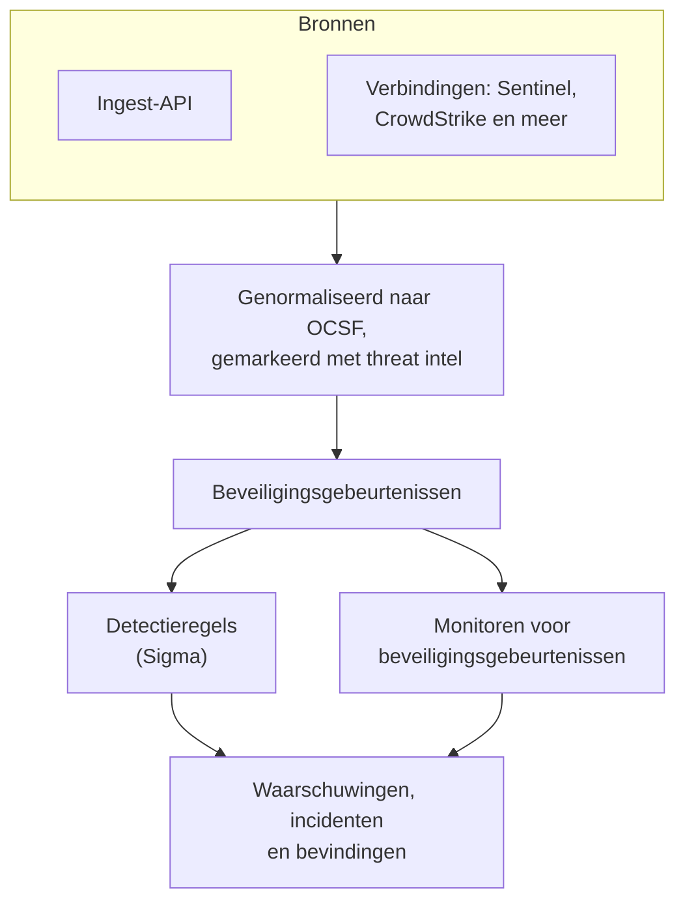
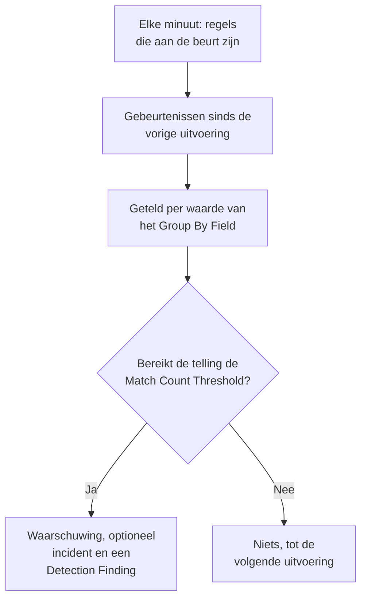

# Beveiligingsgebeurtenissen (SIEM)

OneUptime bewaart beveiligingsgebeurtenissen naast je logs, traces en metrics, en geeft ze allemaal dezelfde vorm, [OCSF](https://schema.ocsf.io/) (het Open Cybersecurity Schema Framework), in welk formaat ze ook binnenkwamen. Stuur gebeurtenissen vanuit elke bron, doorzoek ze, en maak van de belangrijke waarschuwingen met Sigma-detectieregels, threat intelligence en monitoren.

:::cards
- [Gebeurtenissen sturen](#beveiligingsgebeurtenissen-sturen): Een HTTPS-POST, een Fluent Bit-output of een verbinding met een beveiligingsproduct.
- [Zoeken en correleren](#beveiligingsgebeurtenissen-verkennen): De verkenner Gebeurtenissen en de grafiek Correleren.
- [Detectieregels](#detectieregels): Sigma-regels die waarschuwingen openen.
- [Monitoren](#monitoren-voor-beveiligingsgebeurtenissen): Tellingen over een glijdend venster, met een status die herstelt.
:::

## Hoe het werkt



Open **Producten → Security Events**, onder **Observability**. De tabbladen:

| Tabblad | Waarvoor het dient |
| --- | --- |
| **Gebeurtenissen** | Elke gebeurtenis zoeken en filteren, en er een openen om al haar velden te zien |
| **Correleren** | Een grafiek van de gebeurtenissen die een host, een gebruiker of een IP-adres delen |
| **Detection Rules** | Sigma-regels die volgens een schema draaien en waarschuwingen openen |
| **Threat Intel** | STIX/TAXII-feeds van bekende kwaadaardige indicatoren |
| **Monitoren** | De monitoren voor beveiligingsgebeurtenissen van het project |
| **Connections** | Beveiligingsproducten die OneUptime op nieuwe records bevraagt |
| **Installatiegids** | Snippets om gebeurtenissen te sturen, ingevuld met je ingestiesleutel |

## Voordat je begint

Beveiligingsgegevens zijn alleen leesbaar voor de rollen Project Owner en Project Admin en voor de drie Security-rollen; andere rollen zien niets in Security Events. Zie [Rollen](/docs/permissions/reference#rollen).

| Rol | Wat hij kan doen |
| --- | --- |
| Security Admin | Alles: gebeurtenissen, detectieregels, threat-intelfeeds en verbindingen |
| Security Member | Gebeurtenissen en threat intel lezen, en detectieregels en feeds aanmaken, wijzigen en verwijderen. Hij kan geen verbindingen instellen en geen beveiligingsgegevens verwijderen. |
| Security Viewer | Gebeurtenissen, regels, feeds, indicatoren en verbindingen lezen |

## Beveiligingsgebeurtenissen sturen

:::steps
### Maak een ingestiesleutel aan

Open **Projectinstellingen → Telemetrie & APM → Ingestiesleutels** en klik op **Inname-sleutel aanmaken**. Beveiligingsgebeurtenissen gebruiken dezelfde sleutels als de rest van je telemetrie.

### Post je gebeurtenissen

Stuur JSON naar `/security-events/v1/ingest`, met de sleutel in `x-oneuptime-token`:

:::tabs
@tab OCSF
```bash
curl -X POST "https://oneuptime.com/security-events/v1/ingest?format=ocsf" \
  -H "Content-Type: application/json" \
  -H "x-oneuptime-token: YOUR_INGESTION_TOKEN" \
  -H "x-oneuptime-service-name: my-security-source" \
  -d '{ "events": [ { "class_uid": 3002, "severity_id": 4, "status": "Failure", "message": "Failed logon for alice", "actor": { "user": { "name": "alice" } }, "src_endpoint": { "ip": "203.0.113.7", "hostname": "laptop-alice" } } ] }'
```
@tab Google UDM
```bash
curl -X POST "https://oneuptime.com/security-events/v1/ingest?format=udm" \
  -H "Content-Type: application/json" \
  -H "x-oneuptime-token: YOUR_INGESTION_TOKEN" \
  -d '{ "events": [ { "metadata": { "event_type": "USER_LOGIN" }, "principal": { "hostname": "laptop-alice", "user": { "userid": "alice" }, "ip": ["203.0.113.7"] }, "security_result": [{ "severity": "HIGH", "action": ["BLOCK"] }] } ] }'
```
@tab Generic JSON
```bash
curl -X POST "https://oneuptime.com/security-events/v1/ingest" \
  -H "Content-Type: application/json" \
  -H "x-oneuptime-token: YOUR_INGESTION_TOKEN" \
  -d '{ "events": [ { "severity": "high", "event_type": "ssh_brute_force", "message": "12 failed SSH logins in 60s", "username": "root", "hostname": "web-01", "src_ip": "203.0.113.7" } ] }'
```
:::

Het endpoint antwoordt `200` zodra de gebeurtenissen in de wachtrij staan. Een gebeurtenis zonder tijd, zoals deze, komt te staan op het moment dat ze binnenkomt.

### Vind ze in Gebeurtenissen

Open **Producten → Security Events → Gebeurtenissen**. De gebeurtenissen verschijnen binnen een paar seconden, met hun ernst, klasse, gebruiker, host en IP-adressen ingevuld.
:::

### Formaten

| `format` | Wat het leest | Ook geaccepteerd |
| --- | --- | --- |
| `ocsf` | OCSF-gebeurtenis-JSON (`class_uid`, `severity_id` enzovoort) | Geen |
| `udm` | UDM-gebeurtenissen van Google SecOps (Chronicle) (`metadata.event_type` enzovoort) | `chronicle`, `google-secops` |
| `google-secops-alert` | Detecties en waarschuwingen van Google SecOps: SOAR-webhooks en de detectiestroom | `secops-alert`, `detection` |
| `generic` | Elke andere JSON, gelezen op gangbare veldnamen | Geen |

Geef het formaat op met `?format=`, met de header `x-oneuptime-security-event-format`, of met een veld `"format"` op het hoogste niveau. Laat je het weg, dan wordt het formaat van elke gebeurtenis apart bepaald, zodat één webhook detecties en ruwe gebeurtenissen kan mengen.

- De body kan één gebeurtenis zijn, een array van gebeurtenissen, of `{ "events": [...] }`.
- De header `x-oneuptime-service-name` noemt de telemetrieservice waartoe de gebeurtenissen behoren. Zonder die header behoren ze tot de service die is genoemd naar het product of de leverancier van de eerste gebeurtenis, of tot `Security Events`.
- Er wordt niets weggegooid omdat het niet te koppelen was: elk veld van de bron komt terecht in de attributen van de gebeurtenis.

### Velden van generieke JSON

Een generieke gebeurtenis wordt gelezen op gangbare veldnamen:

| Veld van de gebeurtenis | Gelezen uit de eerste van |
| --- | --- |
| `message` | `message`, `msg`, `summary`, `description`, `title` |
| `severityName` | `severity`, `severity_name`, `level`, `priority`, `risk_level` |
| `time` | `timestamp`, `time`, `@timestamp`, `event_time`, `created_at` |
| `principalUser` | `user`, `username`, `user_name`, `account`, `actor` |
| `principalHost` | `host`, `hostname`, `computer`, `device`, `machine` |
| `principalIp` | `source_ip`, `src_ip`, `client_ip`, `ip` |
| `targetIp` | `destination_ip`, `dest_ip`, `dst_ip`, `target_ip` |
| `className` | `event_type`, `category`, `type`, `action` |
| `ruleName` | `rule`, `rule_name`, `signature`, `detection` |
| `productName` | `product`, `product_name`, `source`, `log_source` |

Een woord voor de ernst wordt een OCSF-niveau: `info` wordt gelezen als Informational, `warning` als Low, `error` als Medium, `alert` als Critical en `emergency` als Fatal.

### Doorsturen met Fluent Bit

Om beveiligingslogs te sturen die je al verzamelt, zoals auditd, syslog of Falco, voeg je een `http`-output toe aan Fluent Bit:

```ini title="fluent-bit.conf"
[OUTPUT]
    Name             http
    Match            security.*
    Host             oneuptime.com
    Port             443
    tls              On
    URI              /security-events/v1/ingest
    Format           json
    Json_date_key    timestamp
    Json_date_format iso8601
    Header           x-oneuptime-token YOUR_INGESTION_TOKEN
    Header           x-oneuptime-service-name my-security-source
    Retry_Limit      5
```

Het tabblad **Installatiegids** bevat deze snippets, met je eigen host en sleutel ingevuld.

### Een beveiligingsproduct koppelen

**Connections** bevraagt een beveiligingsproduct voor je en importeert zijn nieuwe records als beveiligingsgebeurtenissen. Een verbinding bevat de instellingen van het product en een versleutelde referentie; een worker bevraagt haar met het interval dat je instelt en slaat records over die hij al importeerde.

| Product | Importeert | Installatiegids |
| --- | --- | --- |
| Google SecOps (Chronicle) | Regeldetecties, gecureerde detecties en waarschuwingen, als Detection Findings | [Google SecOps](/docs/integrations/google-secops) |
| Microsoft Sentinel | Incidenten, als Incident Findings | [Microsoft Sentinel](/docs/integrations/microsoft-sentinel) |
| Microsoft Defender XDR | Waarschuwingen, als Detection Findings | [Microsoft Defender XDR](/docs/integrations/microsoft-defender-xdr) |
| CrowdStrike Falcon | Waarschuwingen, als Detection Findings | [CrowdStrike Falcon](/docs/integrations/crowdstrike-falcon) |
| Splunk Enterprise Security | Notable events, of elke zoekopdracht, als Detection Findings | [Splunk Enterprise Security](/docs/integrations/splunk) |
| Elastic Security | Detectiewaarschuwingen, als Detection Findings | [Elastic Security](/docs/integrations/elastic-security) |
| AWS Security Hub | Findings, als Detection en Compliance Findings | [AWS Security Hub](/docs/integrations/aws-security-hub) |
| Okta System Log | Gebeurtenissen over aanmeldingen, MFA, accounts en beleid | [Okta System Log](/docs/integrations/okta) |

- Een verbinding leest records op het tijdstip waarop het product ze aanmaakte, niet op het tijdstip van de activiteit die ze beschrijven. Een SIEM-regel die elk uur draait, maakt detecties lang na de gebeurtenissen waarop hij matchte, en die worden toch geïmporteerd.
- De eerste bevraging kijkt 24 uur terug, zodat een nieuwe verbinding meteen recente records toont.
- **Verbinding testen**, in de rij van de verbinding, controleert de toegang tot het product en of de eigen workers van OneUptime draaien, en importeert niets. **Run now** bevraagt meteen.

## Wat een gebeurtenis bevat

Elke gebeurtenis wordt opgeslagen met getypeerde velden en de payload van de bron:

| Groep | Velden |
| --- | --- |
| Classificatie | `categoryName`, `className`, `activityName`, `statusName`, met hun OCSF-ID's (`categoryUid`, `classUid`) |
| Ernst | `severityName`, een van Unknown, Informational, Low, Medium, High, Critical, Fatal of Other, en `severityId` |
| Wie het deed | `principalUser`, `principalHost`, `principalIp`, `principalProcess` |
| Wat het raakte | `targetUser`, `targetHost`, `targetIp`, `targetPort`, `targetResource` |
| Bron | `productName`, `vendorName`, `ruleId`, `ruleName`, `eventUid` |
| Inhoud | `message`, `mitreTactics`, `mitreTechniques` en `observables`: elke gebruiker, host, elk IP-adres, domein en elke hash uit de gebeurtenis |
| Attributen | De hele payload van de bron, afgevlakt tot sleutels met punten |

## Beveiligingsgebeurtenissen verkennen

**Gebeurtenissen** is een telemetrieverkenner zoals de verkenners voor logs en traces: een grafiek van de gebeurtenissen in het venster per ernst, een zijbalk met facetten, de lijst, en een paneel met elk veld en attribuut van de gebeurtenis die je opent. Het venster, de filters en de zoekopdracht staan allemaal in de URL, zodat een gefilterde weergave te delen is en een vernieuwing overleeft.

### Zoeken

De zoekbalk spreekt dezelfde taal als de andere telemetrieverkenners (zie [Zoeksyntaxis](/docs/telemetry/search-syntax)):

| Syntaxis | Betekent | Voorbeeld |
| --- | --- | --- |
| vrije tekst | Het bericht bevat het | `failed logon` |
| `"quoted phrase"` | Houd de woorden bij elkaar | `"brute force"` |
| `<field>:<value>` | Een getypeerd veld | `severity:Critical` |
| `@<attribute>:<value>` | Een bronattribuut | `@threat.matched:true` |
| `-<filter>` | Niet dit | `-severity:Informational` |
| `<field>:(a OR b)` | Een van deze waarden | `severity:(High OR Critical)` |
| `<field>:a*` | `*` is willekeurige tekst, `?` één teken | `host:web-*` |
| `@<attribute>:*` | Het attribuut is aanwezig | `@threat.indicator_id:*` |
| `@<attribute>:~text` | Het attribuut bevat de tekst | `@finding_info.title:~ransom` |

Een veld is ofwel een korte naam (`severity`, `class`, `category`, `activity`, `status`, `vendor`, `product`, `rule`, `user`, `host`, `ip`, `targetuser`, `targethost`, `targetip`, `observable`, `tactic`, `technique`) ofwel de eigen naam van het veld, zoals `severityName` of `principalHost`. Elke andere naam wordt gelezen als bronattribuut. `observable:<value>` vindt elke gebeurtenis die een waarde noemt, aan welke kant van de activiteit die ook stond.

### Facetten

De zijbalk telt de gebeurtenissen in het venster per **Bron**, **Ernst**, **Gebeurtenisklasse**, **Category**, **Activiteit**, **Status**, **Leverancier**, **Product**, **Detection Rule**, **Brongebruiker** en **Bronhost**. Klik op een waarde om alleen haar gebeurtenissen te houden, of op het minteken ernaast om ze weg te laten. De grafiek en elke telling beschrijven precies de gebeurtenissen in de lijst.

### Correleren

**Correleren** tekent de gebeurtenissen rond een host, een gebruiker of een IP-adres: hun gebeurtenisklassen rond wat je zocht, gemarkeerd met hun ergste ernst, en de andere waarden uit dezelfde gebeurtenissen op de buitenste ring. Klik op een klasse om haar gebeurtenissen te tonen, of op een waarde om daarna daarop te correleren. Elke observable in het paneel van een gebeurtenis op **Gebeurtenissen** opent **Correleren** erop.

## Detectieregels

Een detectieregel is een [Sigma](https://sigmahq.io/)-regel, een open YAML-formaat om verdachte activiteit te beschrijven, die OneUptime volgens een schema op je gebeurtenissen loslaat. Als hij matcht, opent hij een waarschuwing, eventueel een incident, en schrijft hij een Detection Finding terug in de gebeurtenissen.



### Een regel aanmaken

:::steps
1. Open **Producten → Security Events → Detection Rules** en klik op **Detection Rule aanmaken**.
2. Geef de regel in **Basisinformatie** een **Naam**, en laat **Ingeschakeld** aan.
3. Plak in **Sigma Rule** de YAML van de regel in **Sigma Rule (YAML)**. Die wordt bij het opslaan geparst, dus een fout verschijnt in het formulier.
4. Stel in **Evaluatie** in hoe vaak hij draait en hoeveel matches hij nodig heeft; zie [Evaluatie-instellingen](#evaluatie-instellingen).
5. Kies in **Bij overeenkomst** wat een match doet: **Create Alert on Match** (aan), **Create Incident on Match** (uit) en **Write Detection Finding on Match** (aan), met een optionele **Ernst van waarschuwing** en **Ernst van incident**.
:::

Een eerste regel, die matcht op mislukte aanmeldingen van buiten `10.x.x.x`:

```yaml title="failed-logon-burst.yml"
title: Failed logon burst
description: Repeated authentication failures from one source.
level: high
tags:
  - attack.t1110
  - attack.ta0006
detection:
  selection:
    className: Authentication
    statusName: Failure
  filter_internal:
    principalIp|startswith: '10.'
  condition: selection and not filter_internal
```

### Wat een regel kan uitdrukken

OneUptime voert de booleaanse kern van Sigma uit:

- Selecties zijn veldmaps (elk veld moet matchen; een lijst met waarden matcht op elk ervan) of trefwoordlijsten, die overal in het bericht matchen.
- Voorwaarden combineren selecties met `and`, `or`, `not` en haakjes, of met `1 of selection_*`, `all of selection_*`, `any of them` en `all of them`.
- Veldmodifiers: `contains`, `startswith`, `endswith`, `all`, `re`, `cased`, `gt`, `gte`, `lt`, `lte`, `cidr`, `exists` en `windash`. Tekst wordt vergeleken zonder op hoofdletters te letten, tenzij je `cased` toevoegt.
- Een veld is een getypeerd veld (`principalUser`), een gangbare Sigma-spelling ervan (`CommandLine`, `src_ip`, `Hostname`), of elke attribuutsleutel, gespeld zoals in de gebeurtenis (`threat.matched`).
- `level` bepaalt de ernst: `informational`, `low`, `medium`, `high` of `critical`, en `medium` als het ontbreekt. ATT&CK-ID's in `tags` (`attack.t1110`, `attack.ta0006`) vullen de MITRE-velden van de bevinding.

Aggregaties zoals `| count() by principalIp > 5` worden bij het opslaan geweigerd: gebruik in plaats daarvan **Group By Field** en **Match Count Threshold**. `logsource` is alleen informatief en beperkt niets: zet dat filter in een selectie, zoals `className: Authentication`. Een `timeframe` wordt genegeerd, omdat het interval van de regel zijn venster bepaalt.

### Evaluatie-instellingen

| Veld | Wat het doet |
| --- | --- |
| **Evaluation Interval (Minutes)** | Hoe vaak de regel draait: hele minuten, 1 tot 1440. Het formulier van een nieuwe regel begint op 5. |
| **Group By Field** | Optioneel. Matches die de waarde van dit veld delen, zoals `principalHost`, worden samen geteld, gemeld en ontdubbeld: één waarschuwing per host in plaats van honderden. |
| **Distinct Count Field** | Optioneel. Tel de verschillende waarden van dit veld in plaats van de matchende gebeurtenissen. Lege waarden tellen niet mee. |
| **Match Count Threshold** | Een groep gaat alleen af als zijn telling dit getal binnen één uitvoering bereikt: 1 tot 1000000, en 1 gaat af bij elke match. |

Group By en Distinct Count nemen dezelfde veldnamen als de regel. Daarmee zegt de drempel "zoveel, van hetzelfde ding, in één uitvoering", zonder monitor erbovenop:

| Doel | Group By Field | Distinct Count Field | Drempel |
| --- | --- | --- | --- |
| Waarschuwen bij elke match | Leeg | Leeg | 1 |
| Eén waarschuwing per host | `principalHost` | Leeg | 1 |
| Brute force: 5 mislukte aanmeldingen vanaf één IP | `principalIp` | Leeg | 5 |
| Password spraying: één IP dat faalt tegen 5 verschillende accounts | `principalIp` | `principalUser` | 5 |
| Poortscan: één IP dat 20 verschillende poorten bereikt | `principalIp` | `targetPort` | 20 |

### Wanneer een regel draait

OneUptime controleert elke minuut op ingeschakelde regels waarvan het interval sinds hun laatste uitvoering is verstreken. Elke uitvoering leest de gebeurtenissen waarvan de gebeurtenistijd tussen de vorige uitvoering en nu valt, en gaat dan verder:

- Vensters sluiten op elkaar aan en glijden niet. Met een interval van 10 minuten kunnen mislukkingen om 09:58 en 10:01 in verschillende uitvoeringen vallen en worden ze apart geteld, dus houd marge aan als je een drempel kiest.
- Na een onderbreking, zoals een storing van een worker of een regel die weer is aangezet, dekt de volgende uitvoering de hele onderbreking, tot hoogstens de laatste 24 uur.
- Een gebeurtenis die te laat binnenkomt, met een tijd van vóór de laatste uitvoering van de regel, wordt opgeslagen en is doorzoekbaar, maar die regel leest haar nooit.
- Per uitvoering gaan hoogstens 100 groepen af: die met de hoogste tellingen.

### Ernst

Het `level` van een regel is de ernst van zijn bevindingen: `informational`, `low`, `medium`, `high` en `critical` worden Informational, Low, Medium, High en Critical. Zijn waarschuwingen en incidenten krijgen een van de ernstniveaus van je project, in deze volgorde:

1. De **Ernst van waarschuwing** (of **Ernst van incident**) van de regel, als die is ingesteld.
2. Je ernstniveau dat naar het level is genoemd, zoals High, ongeacht hoofdletters.
3. Op rang: regels met `critical` en `high` krijgen je zwaarste ernstniveau, de andere je lichtste.

> [!TIP]
> Noem je ernstniveaus voor waarschuwingen naar de Sigma-levels (Critical, High, Medium, Low, Informational), en elke regel komt op het juiste niveau terecht zonder instelling per regel.

### Waarschuwingen en bevindingen

Elke groep die afgaat, opent een waarschuwing met de titel `[Detection] <rule name> — <group value>`, of `[Detection] <rule name>` voor een regel zonder Group By Field. Zolang die openstaat, openen meer matches voor die groep geen nieuwe. Een regel ziet alleen matches en kan niet zien dat een aanval is gestopt, dus zijn waarschuwingen blijven open tot iemand ze oplost.

Een Detection Finding is een beveiligingsgebeurtenis van de klasse `Detection Finding` (OCSF-klasse 2004) van het product `OneUptime Detections`, met de MITRE-tags van de regel, de groepswaarde als eerste in `observables`, en deze attributen:

| Attribuut | Waarde |
| --- | --- |
| `oneuptime.detection.rule_id` | De ID van de regel die afging |
| `oneuptime.detection.rule_name` | De naam van de regel |
| `oneuptime.detection.match_count` | Hoeveel gebeurtenissen achter de bevinding zitten |
| `oneuptime.detection.distinct_count` | Hoeveel verschillende waarden erachter zitten, voor een regel met een Distinct Count Field |
| `oneuptime.detection.group_value` | De waarde van de groep, voor een regel met een Group By Field |
| `oneuptime.detection.sigma_id` | De eigen `id` van de Sigma-regel |

Bevindingen zijn gewone gebeurtenissen: doorzoek ze in **Gebeurtenissen** en draai erop in **Correleren**. Om een nieuwe regel stil uit te proberen, zet je elke actie behalve de bevinding uit tot je hem vertrouwt.

## Monitoren voor beveiligingsgebeurtenissen

Een monitor voor beveiligingsgebeurtenissen telt de gebeurtenissen die aan zijn filters voldoen over een glijdend venster en past de gebruikelijke monitorcriteria toe op de telling: hij wijzigt de status van de monitor, opent waarschuwingen of incidenten, en roept de dienstdoende op. Maak er een aan onder **Monitoren → Monitor maken**, met **Security Events** als type; **Security Events → Monitoren** toont ze allemaal.

Het formulier toont **Monitor events that include this text**, **Monitor Security Events for (time)**, **Event Severity** en **Gebeurtenisklasse**. **Filteren op telemetrieservice** en **Filteren op attributen** wachten onder **Meer velden**, waarvan de kop toont welke een monitor gebruikt. De criteria controleren **Security Event Count**.

| | Detectieregel | Monitor voor beveiligingsgebeurtenissen |
| --- | --- | --- |
| Matcht | Een Sigma-regel | Filters op ernst, klasse, bericht, service en attributen |
| Venster | Aansluitend, één per uitvoering | Glijdend: de laatste 5 seconden tot 24 uur |
| Telt per groep | Ja, met **Group By Field** | Nee: één telling voor alles wat matcht |
| Opent | Waarschuwingen, incidenten en bevindingen | Een status, waarschuwingen en incidenten |
| Herstelt | Nee: waarschuwingen blijven open tot ze zijn opgelost | Ja: de status keert terug als de telling dat doet |

Schrijf de detectie zelf als regel, met haar drempel. Gebruik een monitor als je een glijdend venster wilt, een status die vanzelf herstelt, een statuspagina, of per criterium een ander on-callbeleid.

### Houd je detecties in de gaten

Bevindingen zijn gebeurtenissen, dus een monitor kan de regels zelf bewaken:

- Stormen: een monitor op de klasse `Detection Finding`, die elke bevinding telt. Twintig verschillende regels die binnen een uur afgaan, zijn een signaal dat geen enkele regel alleen kan zien.
- Veranderingen in tempo: filter op de `oneuptime.detection.rule_id` van één regel. Een regel die wekelijks afgaat en ineens vijftig keer per uur afgaat, vraagt om een andere reactie.
- Stilte: bevindingen die naar nul zakken, terwijl je er normaal een paar ziet, betekenen meestal dat een bron is gestopt met sturen. Gebruik een criterium dat controleert op een telling onder een getal.

De actie **Monitor maken** in de rij van een regel opent een nieuwe monitor die al zo is ingesteld: de klasse `Detection Finding`, de ID van de regel (nooit zijn naam, die bij een hernoeming zou veranderen), en het laatste uur. Zo'n monitor telt bevindingen, één per groep per uitvoering, niet de gebeurtenissen erachter. Om een aantal gebeurtenissen te vereisen voordat er iets afgaat, gebruik je de **Match Count Threshold** van de regel.

## Dreigingsinformatie

**Threat Intel** neemt abonnementen op STIX/TAXII-feeds van bekende kwaadaardige IP-adressen, domeinen, URL's, e-mailadressen en bestandshashes. Gebeurtenissen die er een noemen, krijgen bij binnenkomst `threat.*`-attributen, waarop regels en monitoren kunnen filteren, en elke minuut worden recente gebeurtenissen met de feeds vergeleken, wat waarschuwingen en bevindingen opent zoals een regel dat doet. Zie [Dreigingsinformatie](/docs/telemetry/threat-intelligence).

## Bewaring en facturering

Beveiligingsgebeurtenissen worden per ingenomen GB gefactureerd, net als de rest van je telemetrie, en bewaard volgens je telemetriebewaring: de **Standaardbewaring (dagen)** van het project, onder **Projectinstellingen → Telemetrie & APM → Gegevensbewaring**, of een bewaartermijn die is ingesteld op de telemetrieservice waartoe ze behoren. Als de bewaartermijn van een gebeurtenis afloopt, wordt ze verwijderd.

## Probleemoplossing

:::details Gebeurtenissen verschijnen niet
Controleer de sleutel in `x-oneuptime-token` en het pad, `/security-events/v1/ingest`. Controleer daarna het venster in **Gebeurtenissen**, de afgelopen dag tenzij je het wijzigt: een gebeurtenis wordt op haar eigen tijd geplaatst, dus een gebeurtenis met een oudere tijdstempel valt erbuiten.
:::

:::details Een regel matcht nooit
Controleer of hij **Ingeschakeld** is, en lees **Last Evaluated** en **Last Error** in zijn rij. Open een gebeurtenis waarvan je een match verwachtte en vergelijk die veld voor veld met de regel: een gewone waarde moet gelijk zijn aan het hele veld, dus gebruik `contains` of `*` voor een deel ervan. Een attribuut wordt genoemd zoals in de gebeurtenis (`threat.matched`, niet `attributes.threat.matched`). Met een drempel boven 1 moeten de matches in één uitvoering vallen.
:::

:::details Een regel matchte, maar er ging geen waarschuwing open
**Create Alert on Match** staat uit, of een waarschuwing voor dezelfde regel en groepswaarde staat nog open, en latere matches worden daarin opgenomen. Een project heeft minstens één ernstniveau voor waarschuwingen nodig voordat regels waarschuwingen kunnen openen.
:::

:::details Een regel opent te veel waarschuwingen
Elke waarde van het **Group By Field** krijgt een eigen waarschuwing: groepeer op iets grovers, verhoog de drempel, of voeg een Distinct Count Field toe. Gaat het je om het tempo in plaats van om elke match, zet dan **Create Alert on Match** uit en zet een monitor op de bevindingen van de regel.
:::

## Volgende stappen

:::cards
- [Dreigingsinformatie](/docs/telemetry/threat-intelligence): Vergelijk je gebeurtenissen met STIX/TAXII-feeds.
- [Google SecOps](/docs/integrations/google-secops): Haal de detecties en gebeurtenissen van Chronicle binnen.
- [Zoeksyntaxis](/docs/telemetry/search-syntax): Alles wat de zoekbalk begrijpt.
- [Machtigingsreferentie](/docs/permissions/reference): De Security-rollen, en wat elk ervan kan.
:::
