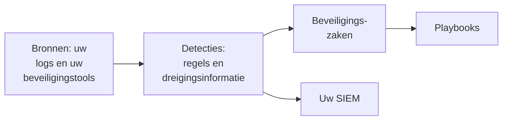

# Aan de slag met beveiliging

OneUptime vindt bedreigingen in gegevens die u al hebt - uw logs, de beveiligingstools die u gebruikt en alles wat u stuurt -, bundelt wat het vindt in zaken en reageert met playbooks. Twee klikken zetten het op, en er hoeft niets geïnstalleerd te worden.

:::cards
- [Instellen](#instellen): Schakel in wat de meeste teams nodig hebben en zie hoe een testaanval een zaak opent.
- [Hoe het werkt](#hoe-het-werkt): Bronnen, detecties, zaken en playbooks, en wat elk ervan doet.
- [Uw logs](#beveiligingsgebeurtenissen-in-uw-logs-vinden): De beveiligingsgebeurtenissen die al in de logs zitten die u naar OneUptime stuurt.
- [Uw SIEM](#wat-oneuptime-vindt-naar-uw-siem-sturen): Stuur wat OneUptime vindt naar Google SecOps.
:::

## Voordat u begint

Voor het instellen van beveiliging is de rol Project Owner, Project Admin of Security Admin nodig. De rollen Security Member en Security Viewer lezen wat er gevonden wordt; zie [Rollen](/docs/permissions/reference#rollen).

## Instellen

:::steps
### Inschakelen wat de meeste teams nodig hebben

Open **Producten → Security Events**. Klik op **Overzicht** op **Aanbevolen inschakelen**. Daarmee gaan drie dingen tegelijk aan: **Beveiligingsgebeurtenissen in uw logboeken vinden**, de aanbevolen detectieregels en **Nieuwe zaken verrijken**, een playbook dat elke nieuwe zaak vergelijkt met dreigingsinformatie en er een checklist voor de beoordeling in achterlaat.

### Een testaanval versturen

Klik op **Testaanval sturen**. Een dozijn mislukte aanmeldingen vanaf een documentatieadres gaat door de echte verwerking: ze worden opgeslagen, de brute-forceregel herkent ze en er wordt een zaak geopend. Niemand wordt opgeroepen en geen enkele SIEM ontvangt ze.

### De zaak openen

Klik op **Zaak openen**. Zo ziet een echte bevinding eruit: de gebeurtenissen erachter, het adres waar het om gaat en wat **Nieuwe zaken verrijken** heeft gevonden. Sluit de zaak als test wanneer u klaar bent.
:::

Vanaf dan opent **Overzicht** met wat iemand nodig heeft, onder **Vraagt aandacht**: uw open zaken, de zaken die niemand heeft opgepakt en de playbookstappen die op goedkeuring wachten. Als die er niet zijn, staat er **Alles rustig**.

## Hoe het werkt

| Onderdeel | Waar | Wat het doet |
| --- | --- | --- |
| **Bronnen** | **Verbindingen** | Uw logs, de beveiligingsproducten die OneUptime opvraagt en alles wat u stuurt |
| **Detecties** | **Detecties** | Sigma-regels en feeds met dreigingsinformatie die in elke gebeurtenis naar bedreigingen zoeken |
| **Beveiligingszaken** | **Beveiligingszaken** | Wat er gevonden is, gegroepeerd per gebruiker, host of adres waar het om gaat |
| **Playbooks** | **Playbooks** | Stappen die op nieuwe zaken draaien: ze verrijken, waarschuwen, een incident openen of indammen |

Boven aan **Overzicht**, onder wat iemand nodig heeft, toont elk onderdeel zijn cijfers: de bronnen en hun gebeurtenissen van de afgelopen 24 uur, de regels die aanstaan, de open zaken en de playbooks die reageren. Een onderdeel dat niet is ingesteld, zegt dat en opent de pagina waar u het instelt.

## Beveiligingsgebeurtenissen in uw logs vinden

De kaart **Uw logboeken**, boven aan **Verbindingen**, hoeft niet geïnstalleerd te worden. Met **Beveiligingsgebeurtenissen in uw logboeken vinden** aan leest OneUptime elke minuut de nieuwe logs van het project en maakt van de regels die het herkent beveiligingsgebeurtenissen:

| Logs | Wat een beveiligingsgebeurtenis wordt |
| --- | --- |
| SSH-aanmeldingen | Mislukte en geslaagde SSH-aanmeldingen uit het authenticatielog, de journal of de syslog van een server |
| sudo | Opdrachten die als een andere gebruiker draaien, verkeerde sudo-wachtwoorden en mensen die sudo niet mogen gebruiken |
| Windows-gebeurtenissen | Aanmeldingen, nieuwe processen, gewijzigde accounts en groepen, geïnstalleerde services en gewiste logboeken, uit Windows, Sysmon en Microsoft Defender |
| AWS CloudTrail | Aanmeldingen bij de console, wijzigingen in uw AWS-accounts en aanroepen die AWS weigerde |
| Google Cloud-auditlogs | Wijzigingen in uw Google Cloud-projecten, aanroepen die Google weigerde en aanmeldingen bij Google Workspace die met Google Cloud worden gedeeld |
| Azure-activiteitslogs en Entra ID-logs | Wijzigingen in uw Azure-abonnementen, waarschuwingen van Defender for Cloud, en aanmeldingen en directorywijzigingen van Microsoft Entra ID |
| CEF | Bedreigingen, geblokkeerde verbindingen en aanmeldingen van firewalls, IDS, WAF's en andere beveiligingsproducten die Common Event Format sturen |
| LEEF | Hetzelfde van producten die Log Event Extended Format sturen, zoals veel producten voor IBM QRadar doen |
| Kubernetes-auditlogs | Wijzigingen aan het cluster, shells die in pods worden geopend, gelezen secrets en geweigerde verzoeken |
| Webaanvallen | Verzoeken in het toegangslog van een webserver die SQL-injectie, path traversal of Log4Shell proberen |

Uw logs blijven zoals ze zijn. Alleen de regels die voor beveiliging tellen, worden gebeurtenissen: nooit elke pagina die een webserver heeft geleverd, of elke leesactie op een API.

## Wat OneUptime vindt naar uw SIEM sturen

Werkt uw team al in een SIEM, dan stuurt OneUptime wat het vindt ook daarheen. Klik onder **Verbindingen → Naar uw SIEM sturen** op **Bestemming toevoegen**, vul de regio, de instantie en de serviceaccountsleutel van uw Google SecOps in en klik vóór het opslaan op **Testgebeurtenis verzenden**. Zie [Beveiligingsgebeurtenissen naar Google SecOps sturen](/docs/integrations/google-secops#beveiligingsgebeurtenissen-naar-google-secops-sturen).

## Problemen oplossen

:::details Turn on recommended is grijs
Uw rol mag geen detectieregels, playbooks of de logbron toevoegen. Vraag het een Project Owner, een Project Admin of een Security Admin, of laat hen u de rol Security Admin geven.
:::

:::details Turn on recommended kon niet alles inschakelen
De kaart noemt alles wat niet kon worden ingeschakeld, en waarom: uw rol, uw abonnement of een fout aan de kant van OneUptime. Al het andere staat aan. Los op wat de kaart noemt en klik daarna op **Opnieuw proberen**: alleen wat nog ontbreekt wordt ingeschakeld, en niets wordt twee keer toegevoegd.
:::

:::details De testaanval heeft geen zaak geopend
Meestal is de zaak al open voordat de knop antwoordt; loopt de regel nog achter, dan meldt hij dat en opent de zaak binnen een minuut. Kijk opnieuw bij **Beveiligingszaken** en controleer onder **Detecties** of de brute-forceregel aanstaat.
:::

:::details Uit mijn logs komt geen beveiligingsgebeurtenis
Controleer of **Beveiligingsgebeurtenissen in uw logboeken vinden** aanstaat en of de kaart **Uw logboeken** laat zien wanneer er voor het laatst is gecontroleerd. Alleen de soorten regels uit de tabel hierboven worden gebeurtenissen: een server die geen SSH-, sudo-, Windows-, audit-, CEF-, LEEF- of toegangslogs stuurt, heeft niets te vinden. Plak een van zijn regels in **Een logboekregel controleren**, op **Uw logboeken**, om te zien of OneUptime hem leest.
:::

:::details Overzicht zegt dat de laatste beveiligingsgebeurtenis dagen geleden binnenkwam
Sindsdien heeft niets Security bereikt. Open **Verbindingen** en controleer of **Uw logboeken** en elke verbinding nog aanstaan, en wanneer elk voor het laatst controleerde.
:::

:::details De kaart die Security inschakelt is weg
Iemand heeft hem weggezet met **Sluiten**. Zolang er nog niets op dreigingen wordt bewaakt, biedt **Overzicht** **Security instellen** aan, waarmee hij terugkomt.
:::

## Volgende stappen

:::cards
- [Beveiligingsgebeurtenissen (SIEM)](/docs/telemetry/security-events): Gebeurtenissen sturen, doorzoeken en detectieregels schrijven.
- [Beveiligingszaken en playbooks (SOAR)](/docs/telemetry/security-cases): De zaken behandelen en met playbooks reageren.
- [Dreigingsinformatie (STIX/TAXII)](/docs/telemetry/threat-intelligence): Uw gebeurtenissen vergelijken met bekende kwaadaardige indicatoren.
- [Google SecOps](/docs/integrations/google-secops): Detecties uit Google SecOps binnenhalen en wat OneUptime vindt daarheen sturen.
:::
