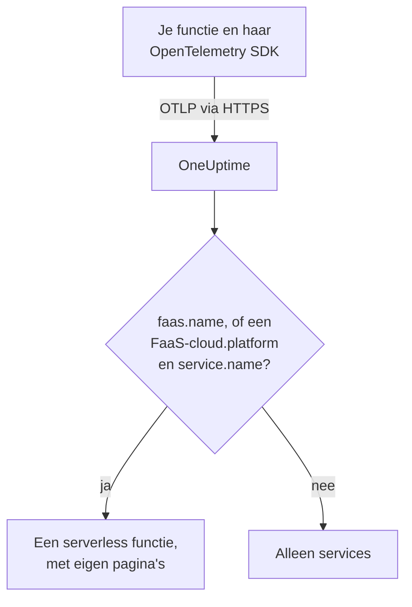

# Serverless functies

OneUptime herkent een serverless functie op het moment dat het OpenTelemetry-gegevens van die functie ontvangt, en toont haar onder **Serverless functies** met haar traces, logs en metrics. Dit werkt voor AWS Lambda, Google Cloud Functions, Azure Functions, Cloudflare Workers en elke andere FaaS-runtime die OpenTelemetry kan versturen. Je hoeft niets met de hand aan te maken: instrumenteer de functie met de OpenTelemetry SDK voor haar runtime en richt haar OTLP-exporter op OneUptime.

:::cards
- [Hoe OneUptime een functie herkent](#hoe-oneuptime-een-functie-herkent): `faas.name`, of een FaaS-`cloud.platform` met een `service.name`.
- [De telemetrie van een functie versturen](#de-telemetrie-van-een-functie-versturen): De exporterinstellingen en de Lambda-layer.
- [Azure Functions](#azure-functions): Eén functie per Function App, vanuit de Functions-host.
- [Problemen oplossen](#problemen-oplossen): Een functie die niet verschijnt, of waarvan de pagina's leeg zijn.
:::

## Hoe het werkt

OneUptime leest de resource-attributen van elke batch zodra die binnenkomt. Een resource met een `faas.name`, of met een FaaS-`cloud.platform` zoals `aws_lambda` of `azure_functions` samen met een `service.name`, is een serverless functie: OneUptime maakt haar aan met haar eerste gegevens en ordent de telemetrie eronder.



## Voordat je begint

- Een ingestiesleutel. Maak er een aan onder **Projectinstellingen → Telemetrie & APM → Ingestiesleutels** en kopieer de waarde.
- De OpenTelemetry SDK, of een auto-instrumentatielayer, voor de taal van je functie.

## Hoe OneUptime een functie herkent

OneUptime identificeert elke functie aan de hand van het resource-attribuut `faas.name`. De resourcedetectors van sommige platforms stellen het nooit in ([Azure Functions](#azure-functions) is het gangbare geval). Heeft een resource dus geen `faas.name` maar is haar `cloud.platform` een FaaS-platform, dan gebruikt OneUptime in plaats daarvan haar `service.name` als identiteit van de functie, en vult het die waarde als `faas.name` in op elke span, elk log, elke metric en elk profiel dat het opslaat, zodat de pagina's van de functie al haar telemetrie vinden:

| Attribuut | Vereist | Doel |
| --- | --- | --- |
| `faas.name` | **ja**, tenzij de volgende twee zijn ingesteld | Identiteit van de functie (zoals `checkout-handler`) |
| `cloud.platform` | met `service.name`, als er geen `faas.name` is | `aws_lambda`, `gcp_cloud_functions`, `azure_functions`, `tencent_cloud_scf` of `alibaba_cloud_fc` |
| `service.name` | op een FaaS-`cloud.platform` zonder `faas.name` | Identiteit van de functie, als `faas.name` in de telemetrie geschreven |
| `faas.version` | nee | Getoond op het overzicht |
| `faas.instance` | nee | Per instantie bijgehouden op de pagina **Instanties** |
| `cloud.provider` / `cloud.region` / `cloud.account.id` | nee | Getoond op het overzicht |
| `process.runtime.name` / `process.runtime.version` | nee | Getoond als de runtime op het overzicht |

Een `faas.name` dat je zelf instelt, wordt nooit vervangen. De waarde van `cloud.platform` moet geschreven zijn zoals vermeld (de variant met punt, `azure.functions`, die sommige Azure-detectors sturen, wordt ook geaccepteerd), en `service.name` moet een resource-attribuut zijn: de header `x-oneuptime-service-name` benoemt een service, geen functie.

> [!NOTE]
> Een functie die ook `service.name` instelt, verschijnt daarnaast nog steeds onder **Services**. **Serverless functies** is de weergave die voor functies is gebouwd, afgebakend door `faas.name`.

## De telemetrie van een functie versturen

:::steps
### De omgevingsvariabelen van de OTLP-exporter instellen

De meeste auto-instrumentaties voor talen lezen de standaard omgevingsvariabelen van OpenTelemetry:

```bash
OTEL_EXPORTER_OTLP_ENDPOINT="https://oneuptime.com/otlp"
OTEL_EXPORTER_OTLP_HEADERS="x-oneuptime-token=YOUR_TELEMETRY_INGESTION_TOKEN"
OTEL_RESOURCE_ATTRIBUTES="faas.name=checkout-handler,faas.version=1.4.2"
```

Host je OneUptime zelf, vervang dan het endpoint door `https://YOUR-ONEUPTIME-HOST/otlp`. Laat `faas.name` bij Azure Functions weg uit `OTEL_RESOURCE_ATTRIBUTES` — zie [Azure Functions](#azure-functions).

> [!WARNING]
> De ingestiesleutel is een geheim. Gebruik een ingestiesleutel van het type **Server**, ingesteld als omgevingsvariabele van de functie. Een sleutel die een browser bereikt, kan worden gelezen door iedereen die de broncode van de pagina bekijkt.

### De OpenTelemetry Lambda-layer toevoegen (AWS Lambda)

Op AWS Lambda is de [OpenTelemetry Lambda-layer](https://opentelemetry.io/docs/faas/lambda-auto/) de eenvoudigste weg. Koppel de layer voor de runtime van je functie en stel in:

```bash
AWS_LAMBDA_EXEC_WRAPPER=/opt/otel-handler
OTEL_EXPORTER_OTLP_ENDPOINT=https://oneuptime.com/otlp
OTEL_EXPORTER_OTLP_HEADERS=x-oneuptime-token=YOUR_TELEMETRY_INGESTION_TOKEN
```

De layer stelt `faas.name` in op basis van de naam van de functie, en zijn resourcedetector vult `cloud.platform`, `cloud.region` en `cloud.account.id` in. Op een ander platform sla je deze stap over.

### De functie aanroepen en controleren of ze binnenkomt

Controleer of OneUptime de sleutel accepteert:

```bash
curl -i https://oneuptime.com/otlp/v1/validate \
  -H "x-oneuptime-token: YOUR_TELEMETRY_INGESTION_TOKEN"
```

`200` met `"valid": true` betekent dat OneUptime de sleutel accepteert; `401` betekent dat hij onbekend, ingetrokken, uitgeschakeld of verlopen is. Roep daarna de functie aan. Zodra ze een span, een log of een metric verstuurt, verschijnt ze onder **Producten → Infrastructuur → Serverless → Alle functies**.
:::

## Azure Functions

De Azure Functions-host kan zelf OpenTelemetry versturen, zodat een Function App haar aanroepen (traces, logs en metrics) zonder codewijzigingen rapporteert, in welke taal ze ook geschreven is. De handleiding van Microsoft is [Use OpenTelemetry with Azure Functions](https://learn.microsoft.com/en-us/azure/azure-functions/opentelemetry-howto).

### Hoe een Function App verschijnt

De resourcedetectors van Azure (die van de Functions-host zelf, die van de geïsoleerde .NET-worker in `Microsoft.Azure.Functions.Worker.OpenTelemetry` en die voor Node.js in `@opentelemetry/resource-detector-azure`) beschrijven de **Function App**, niet één functie, en geen van hen stelt `faas.name` in:

| Attribuut | Waarde |
| --- | --- |
| `service.name` | De naam van de Function App, uit `WEBSITE_SITE_NAME` |
| `cloud.provider` | `azure` |
| `cloud.platform` | `azure_functions`; de Node.js-detector schrijft `azure.functions`, wat OneUptime herschrijft |
| `cloud.region` | De regio van de app, uit `REGION_NAME` |
| `cloud.resource_id` | `/subscriptions/<subscription>/resourceGroups/<group>/providers/Microsoft.Web/sites/<app>` |
| `faas.instance` | De instantie, uit `WEBSITE_INSTANCE_ID`: alleen de Node.js-detector |

OneUptime identificeert de functie dus aan de hand van `service.name`, vult `faas.name` in met de naam van de Function App en toont **één serverless functie per Function App**. De resource beschrijft de app, niet een van haar functies: elke instantie rapporteert dezelfde attributen op app-niveau, welke functie van de app ze ook uitvoert, en in het Flex Consumption-abonnement schalen sommige functies zelfs uit op eigen instanties. De afzonderlijke functies zitten in de telemetrie zelf:

- De host start voor elke aanroep een span, genoemd naar de functie die hij uitvoerde: zoek op die naam op de pagina **Traces** van de functie.
- De host registreert `faas.invoke_duration`, een histogram in seconden, met de naam van de functie in het datapuntattribuut `faas.name`: groepeer de metric daarop op de pagina **Metrieken** of in een dashboard voor de latentie van elke functie.

Voeg `faas.name` op een Function App niet toe aan `OTEL_RESOURCE_ATTRIBUTES`, zoals het algemene voorbeeld in de [eerste stap](#de-omgevingsvariabelen-van-de-otlp-exporter-instellen) doet. Toepassingsinstellingen bereiken elk proces van de app, dus de telemetrie van al haar functies zou die ene naam dragen, en OneUptime vervangt nooit een `faas.name` dat het meekrijgt. De handleiding van Microsoft zegt hetzelfde: zet geen functiespecifieke waarden op de resource. Laat het leeg, dan wordt de functie naar de app genoemd.

De host en de geïsoleerde .NET-worker gebruiken `OTEL_SERVICE_NAME` in plaats van de naam van de app als het is ingesteld. Houd elk proces van één app op dezelfde `service.name`: de host en de taalworker versturen allebei telemetrie, en een worker die een tweede naam rapporteert, maakt een tweede serverless functie. Een worker waarvan de resource geen FaaS-`cloud.platform` heeft, hoort bij geen enkele serverless functie — zie [Je functiecode instrumenteren](#je-functiecode-instrumenteren-optioneel).

:::steps
### OpenTelemetry inschakelen in de Functions-host

Voeg `"telemetryMode": "OpenTelemetry"` toe aan de root van de `host.json` van de app:

```json title="host.json"
{
  "version": "2.0",
  "telemetryMode": "OpenTelemetry"
}
```

De host verstuurt dan, ongeacht de taal van de app, zijn eigen traces (een span per aanroep, plus de processorspans van Service Bus en Event Hubs achter getriggerde functies), zijn logs en metrics, waaronder `faas.invoke_duration`.

### De host op OneUptime richten

Stel de exporter in als toepassingsinstellingen:

```bash
az functionapp config appsettings set \
  --name my-function-app \
  --resource-group my-rg \
  --settings \
    OTEL_EXPORTER_OTLP_ENDPOINT=https://oneuptime.com/otlp \
    OTEL_EXPORTER_OTLP_PROTOCOL=http/protobuf \
    "OTEL_EXPORTER_OTLP_HEADERS=x-oneuptime-token=YOUR_TELEMETRY_INGESTION_TOKEN"
```

Host je OneUptime zelf, vervang dan het endpoint door `https://YOUR-ONEUPTIME-HOST/otlp`. `OTEL_EXPORTER_OTLP_PROTOCOL=http/protobuf` doet ertoe: de .NET-exporter van de host gebruikt standaard gRPC, en met `http/protobuf` post hij naar `/otlp/v1/traces`, `/otlp/v1/metrics` en `/otlp/v1/logs` onder het endpoint. De host verstuurt alleen OTLP zolang `OTEL_EXPORTER_OTLP_ENDPOINT` is ingesteld.

> [!WARNING]
> Dit token is een geheim: gebruik een ingestiesleutel van het type **Server**. Toepassingsinstellingen worden in rust versleuteld; wil je het token liever in Key Vault bewaren, stel `OTEL_EXPORTER_OTLP_HEADERS` dan in op een Key Vault-verwijzing zoals `@Microsoft.KeyVault(SecretUri=https://my-vault.vault.azure.net/secrets/oneuptime-otlp-headers/)` en geef de beheerde identiteit van de app de rol **Key Vault Secrets User** op de vault. De verwijzing wordt omgezet in de waarde van het geheim zoals die is opgeslagen, dus sla de hele header op, `x-oneuptime-token=YOUR_TELEMETRY_INGESTION_TOKEN`, niet alleen het token.

Behoud `APPLICATIONINSIGHTS_CONNECTION_STRING` als je Application Insights nog wilt: met beide ingesteld verstuurt de host dezelfde OpenTelemetry-gegevens naar Application Insights en naar OneUptime. Verwijder het om alleen naar OneUptime te versturen.

### Je functiecode instrumenteren (optioneel)

De host traceert elke aanroep al. Om spans en logs uit je eigen code toe te voegen, verbonden met die van de host, schakel je OpenTelemetry ook in de taalworker in. Die verstuurt met dezelfde instellingen `OTEL_EXPORTER_OTLP_*`:

- **C# (isolated worker)**: voeg de NuGet-pakketten `Microsoft.Azure.Functions.Worker.OpenTelemetry`, `OpenTelemetry.Extensions.Hosting` en `OpenTelemetry.Exporter.OpenTelemetryProtocol` toe, en vervolgens in `Program.cs`: `builder.Services.AddOpenTelemetry().UseFunctionsWorkerDefaults().UseOtlpExporter();`
- **JavaScript / TypeScript**: `npm install @azure/functions-opentelemetry-instrumentation` naast de OpenTelemetry Node.js SDK en zijn OTLP-exporters, en registreer `AzureFunctionsInstrumentation` in een bestand dat het veld `main` van `package.json` bevat.
- **Java**: voeg de Maven-afhankelijkheid `com.microsoft.azure.functions:azure-functions-java-opentelemetry` toe.
- **Python**: stel de toepassingsinstelling `PYTHON_ENABLE_OPENTELEMETRY=true` in, voeg de OpenTelemetry-pakketten die Microsoft noemt (waaronder `opentelemetry-sdk` en `opentelemetry-exporter-otlp`) toe aan `requirements.txt` en configureer de exporters in `function_app.py`.
- **PowerShell**: stel de toepassingsinstelling `OTEL_FUNCTIONS_WORKER_ENABLED=True` in en laad de module `AzureFunctions.PowerShell.OpenTelemetry.SDK` vanuit `profile.ps1`.

De handleiding van Microsoft bevat de volledige code voor elke taal. De .NET-worker (via `UseFunctionsWorkerDefaults()`) en de Python-worker (via `PYTHON_ENABLE_OPENTELEMETRY`) vragen de host hun logs aan hen over te laten, zodat die logs niet twee keer worden verstuurd.

De spans en logs van een worker bereiken de pagina's van de functie alleen als zijn resource de app beschrijft zoals die van de host: dezelfde `service.name` en een FaaS-`cloud.platform`. De geïsoleerde .NET-worker (via `UseFunctionsWorkerDefaults()`) en het Node.js-voorbeeld van Microsoft (via de Azure-detectors die `getResourceDetectors()` bevat) rapporteren beide. Het Python-voorbeeld van Microsoft bouwt zijn resource zonder Azure-detector, dus standaard rapporteert het geen van beide en bereikt zijn telemetrie de functie nooit. Voeg voor Python, of elke worker die zonder Azure Functions-resourcedetector is opgezet, nog twee toepassingsinstellingen toe. Elk proces van de app leest ze, de host inbegrepen, zodat ze allemaal dezelfde identiteit rapporteren:

```bash
az functionapp config appsettings set \
  --name my-function-app \
  --resource-group my-rg \
  --settings \
    OTEL_SERVICE_NAME=my-function-app \
    "OTEL_RESOURCE_ATTRIBUTES=cloud.provider=azure,cloud.platform=azure_functions"
```

Stel `OTEL_SERVICE_NAME` in op de eigen naam van de Function App. Het is de naam die de host en de Node.js-detector zonder deze instelling rapporteren, zodat de functie de identiteit houdt die ze al heeft.
:::

### Beperkingen

- **C# in-process-apps** kunnen OpenTelemetry niet gebruiken: zet ze eerst over naar het model met geïsoleerde worker.
- **Logstreaming** in de Azure-portal werkt niet zolang de host in OpenTelemetry-modus staat, en de lijst _Recent function invocations_ van de portal heeft de telemetrie in Application Insights nodig. Gebruik in plaats daarvan de pagina's **Logboeken** en **Traces** van de functie in OneUptime.
- De sectie `logging.applicationInsights` van `host.json` geldt niet meer zodra `telemetryMode` op `OpenTelemetry` staat.
- **Instanties** toont `faas.instance`-waarden. Van de detectors hierboven stelt alleen die voor Node.js het in, dus de pagina blijft leeg voor telemetrie van de host en de .NET-worker.

## Wat je krijgt

Zodra de functie een span, een log of een metric verstuurt, verschijnt ze onder **Serverless functies**. Haar **Overzicht** toont:

- **Aanroepen**, **foutpercentage** en **p95-duur**, berekend uit je traces over een tijdsbereik dat je kiest, met trendgrafieken.
- **Instanties**: een live lijst van de `faas.instance`-waarden die de functie rapporteert.
- Volledige pagina's **Logboeken**, **Traces** en **Metrieken**, afgebakend tot deze functie.

## Functies labelen en eigenaren toewijzen

Een resource-attribuut dat begint met `oneuptime.label.` wordt een projectlabel op de functie: `oneuptime.label.team=payments` voegt het label `team:payments` toe. Voeg de attributen toe aan `OTEL_RESOURCE_ATTRIBUTES`:

```bash
OTEL_RESOURCE_ATTRIBUTES="faas.name=checkout-handler,oneuptime.label.team=payments,oneuptime.label.env=production"
```

Om functies in plaats daarvan op hun naam te labelen of eigenaren toe te wijzen, open je **Producten → Infrastructuur → Serverless** en gebruik je **Labelregels** en **Eigenaarsregels** in het zijmenu. Regels lopen wanneer een functie wordt aangemaakt, automatisch ontdekte inbegrepen. Om een regel toe te passen op de functies die je al hebt, gebruik je de knop **Run Now** ervan (zie [Regels uitvoeren op bestaande resources](/docs/configuration/run-rules-now)).

## Problemen oplossen

:::details De functie verschijnt niet onder Serverless functies
Controleer, in deze volgorde:

1. De functie is aangeroepen sinds je de variabelen hebt ingesteld: ze verstuurt alleen telemetrie terwijl ze draait.
2. Op AWS Lambda is de layer gekoppeld voor de runtime van de functie, en `AWS_LAMBDA_EXEC_WRAPPER` is `/opt/otel-handler`: zonder de wrapper start de instrumentatie van de layer nooit.
3. Elders laadt de code van de functie de OpenTelemetry SDK of auto-instrumentatie: de variabelen alleen versturen niets.
4. De resource draagt `faas.name`, of een FaaS-`cloud.platform` en een `service.name`. Zonder die attributen wordt de telemetrie in plaats daarvan onder **Services** geordend, als een service.
5. De functie kan je OneUptime-URL bereiken. Een functie in een privénetwerk heeft een uitgaande route ernaartoe nodig, zoals een NAT-gateway.
:::

:::details De functie staat in de lijst, maar haar pagina's zijn leeg
**Overzicht**, **Logboeken**, **Traces** en **Metrieken** van de functie tonen telemetrie waarvan de `faas.name` precies gelijk is aan de naam van de functie, inclusief hoofdletters. Een functie die haar naam krijgt via een FaaS-`cloud.platform` en haar `service.name`, heeft geen eigen `faas.name` nodig: OneUptime schrijft de `service.name` bij binnenkomst als `faas.name` in de telemetrie. Telemetrie die is opgeslagen voordat OneUptime `faas.name` begon in te vullen, wordt niet bijgewerkt en blijft buiten de pagina's: roep de functie aan om nieuwe telemetrie te versturen. Controleer ook het tijdsbereik bovenaan de pagina.
:::

:::details De functie wordt als verbroken weergegeven
Een functie krijgt de status verbroken zodra OneUptime er 15 minuten niets van heeft ontvangen; OneUptime controleert elke 5 minuten, en tijd waarin het zelf geen gegevens ontving, telt niet mee. Een functie die alleen af en toe draait, is tussen de runs verbroken: met haar volgende telemetrie krijgt ze weer de status verbonden.
:::

## Volgende stappen

:::cards
- [OpenTelemetry](/docs/telemetry/open-telemetry): Verstuur traces, logs en metrics vanuit elke applicatie.
- [Wachtrijen](/docs/telemetry/queues): De wachtrijen en topics waarin je functies publiceren en waaruit ze consumeren.
- [Traces-monitor](/docs/monitor/traces-monitor): Krijg een melding bij mislukte of trage aanroepen van een functie.
:::
