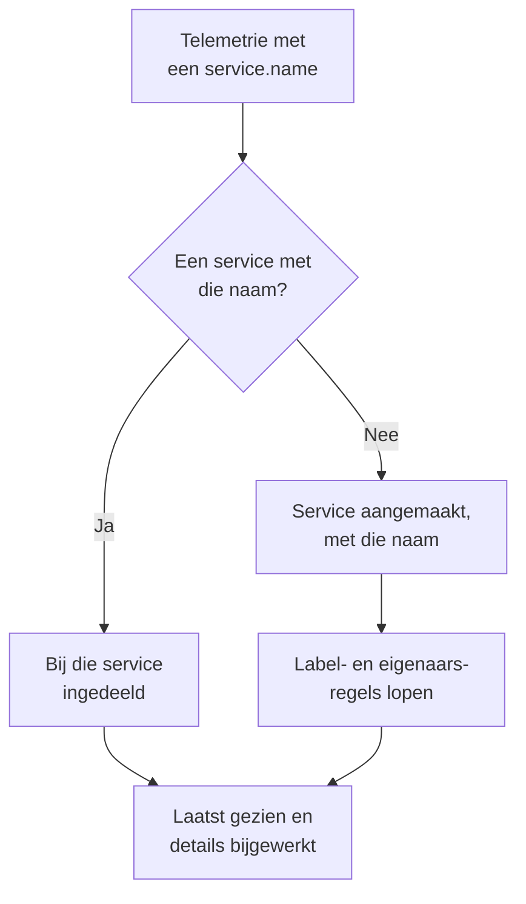

# Servicecatalogus

De servicecatalogus toont de applicaties en microservices die u draait. OneUptime voegt een service toe zodra de telemetrie ervan voor het eerst binnenkomt, en brengt daarna de logboeken, traces, metrieken, uitzonderingen, incidenten en eigenaren van die service samen op één pagina, zodat iedereen ziet wat een service doet, van wie hij is en hoe het ermee gaat.

:::cards
- [Hoe een service in de catalogus komt](#hoe-een-service-in-de-catalogus-komt): Zijn `service.name`, bij zijn eerste telemetrie.
- [Een service vinden](#een-service-vinden): De lijst, de filters en de kolommen.
- [De pagina's van een service](#de-paginas-van-een-service): Alles over één service.
- [Een service archiveren of verwijderen](#een-service-archiveren-of-verwijderen): De geschiedenis bewaren, of hem weghalen.
:::

## Hoe een service in de catalogus komt

U hoeft geen services aan te maken. Elke batch telemetrie noemt de service die hem stuurde in het resource-attribuut `service.name`. OneUptime zet de batch onder de service met die naam, en maakt de service aan als het project er nog geen heeft.

- **De naam is de identiteit van de service.** Hoofdletters en kleine letters tellen niet mee bij de vergelijking, dus `Checkout-API` en `checkout-api` zijn één service. Een nieuwe `service.name` begint een nieuwe service.
- **Containers geven zichzelf een naam.** Telemetrie van de Docker- en Podman-agents geeft een service de naam van zijn container als er geen `service.name` is.
- **Een ingestiesleutel kan de service vastleggen.** OpenTelemetry-gegevens die worden verzonden met een sleutel met een **Pinned Service Name** komen onder die naam terecht, wat hun `service.name` ook zegt. Zie [Ingestiesleutels](/docs/telemetry/ingestion-keys#een-browsersleutel-afschermen).
- **Browsers en telefoons zijn geen services.** Telemetrie uit een browser of een mobiele app hoort in plaats daarvan bij een [RUM-applicatie](/docs/rum/applications).
- **Labels kunnen met de telemetrie meekomen.** Een resource-attribuut met de naam `oneuptime.label.<name>` geeft de service het label `<name>:<value>`, zoals `oneuptime.label.team=payments` voor `team:payments`.

Telkens als er telemetrie binnenkomt, schuift **Laatst gezien** van de service op, en worden de details ververst uit de resource-attributen die meekomen:

| Detail | Uit het attribuut |
| --- | --- |
| Serviceversie | `service.version` |
| Implementatieomgeving | `deployment.environment.name`, of `deployment.environment` |
| Service-namespace | `service.namespace` |
| Runtime | `process.runtime.name` en `process.runtime.version` |
| Technologie | `telemetry.sdk.language`, of de runtime |
| Cloud | `cloud.provider`, `cloud.platform`, `cloud.region` en `cloud.account.id` |

## Voordat u begint

- **Binnenkomende telemetrie** met een `service.name`. Zie [OpenTelemetry](/docs/telemetry/open-telemetry): `OTEL_SERVICE_NAME` stelt hem in.
- **Een rol die services mag lezen.** Project Owner, Project Admin, Project Member, Viewer, Settings Admin, Settings Member of Settings Viewer, of een aangepaste rol met de machtiging Read Service. Services aanmaken, wijzigen en verwijderen vraagt Project Owner, Project Admin, Project Member, Settings Admin of Settings Member, of de bijbehorende servicemachtigingen.

## Een service vinden

Ga naar **Producten → Bronnen → Services**. **Alle services** toont elke service met **Naam**, **Beschrijving**, **Technology**, **Laatst gezien**, **Labels** en **Eigenaren**.

- Zoek op naam of beschrijving, en filter op eigenaar of label met de balk boven de lijst.
- Selecteer meerdere services om ze allemaal tegelijk labels of eigenaren te geven, of om ze te archiveren.
- Klik op een service om de pagina's ervan te openen.

Om een service toe te voegen voordat de telemetrie ervan binnenkomt, bijvoorbeeld om eerst de eigenaren vast te leggen, klikt u op **Service aanmaken** en vult u de **Naam** precies zo in als de `service.name` straks wordt. Label- en eigenaarsregels lopen erop zoals op een ontdekte service. Zodra de service is opgeslagen, gaat de installatiegids voor OpenTelemetry open met die naam in elk fragment, en de laatste stap ervan, **Wachten op verbinding**, meldt wanneer de eerste gegevens van de service binnenkomen.

## De pagina's van een service

Het zijmenu van een service heeft vijf secties:

| Sectie | Pagina's |
| --- | --- |
| **Basis** | **Overzicht**: verzoeken, foutpercentage en p95-latentie uit de spans, grafieken en de details. **Recommendations**: kant-en-klare monitors voor de service, gekozen op basis van de taal. **Eigenaren**: de mensen en teams die verantwoordelijk zijn. **Feed**: alles wat er met de service gebeurd is, van hoe hij is aangemaakt tot elke wijziging sindsdien. |
| **Telemetrie** | De **Logboeken**, **Traces**, **Metrieken**, **Prestatieprofielen**, **Uitzonderingen** en **Source Maps**, al gefilterd op deze service. |
| **Activiteit** | De **Incidenten**, **Waarschuwingen** en gebeurtenissen van **Geplande onderhoud** die de service raken. |
| **Ontwikkelaars** | **Terraform**, **API** en **AI-assistenten**: de service vanuit code beheerd. Deze sectie is eerst ingeklapt. |
| **Geavanceerd** | **Instellingen**, **Auditlogboeken** en **Service verwijderen**. **Geavanceerd** is eerst ingeklapt: klap het eerst uit. |

Eigenaren tellen ook buiten de pagina: een rol met het bereik Owned leest de telemetrie van de services die van u of uw teams zijn. Zie [Telemetrie](/docs/permissions/index#telemetrie).

## Een service wijzigen

:::steps
### De instellingen openen

Open de service, klap **Geavanceerd** uit in het zijmenu en klik op **Instellingen**.

### Hernoemen of beschrijven

Klik bij **Servicegegevens** op **Details bewerken** om de **Naam**, de **Beschrijving** of de **Labels** te wijzigen. De naam moet blijven overeenkomen met de `service.name` die de telemetrie meldt: wijzig hem ook in uw OpenTelemetry-configuratie, anders maakt de volgende telemetrie een nieuwe service aan.

### Kleur en technologiestack kiezen

Klik bij **Service-instellingen** op **Instellingen bewerken**. De **Servicekleur** markeert de service in grafieken en lijsten; een nieuwe service krijgt een eigen kleur. **Technologiestack** is optioneel: laat het leeg om de taal te tonen die uit de telemetrie is herkend.
:::

Op dezelfde pagina staat de bewaartermijn van de service. De kaarten **Bewaartermijn telemetriegegevens** en **Bewaring per telemetrietype** bewaren de telemetrie korter of langer dan de standaardbewaartermijn van het project. Ze horen bij de [Enterprise Edition](/docs/self-hosted/enterprise), en bij het Scale-abonnement op OneUptime Cloud; zonder die kaarten toont de pagina wat ze toevoegen, en houdt de service de bewaartermijn van het project.

## Labels en eigenaren automatisch toekennen

Regels geven nieuwe services hun labels en eigenaren bij het aanmaken, ook ontdekte services. U vindt ze onder **Services → Instellingen → Eigenaarsregels** en **Services → Instellingen → Labelregels**; **Instellingen** is eerst ingeklapt in het zijmenu. Zie [Label- en eigenaarsregels](/docs/configuration/label-and-owner-rules).

## Een service archiveren of verwijderen

Archiveer een service die u niet meer volgt maar waarvan u de geschiedenis wilt bewaren. Een gearchiveerde service is verborgen in **Alle services**, maar blijft telemetrie verzamelen. Archiveer hem vanaf zijn pagina **Instellingen**, of selecteer er meerdere in de lijst. Om er een terug te halen, opent u **Services → Geavanceerd → Gearchiveerd**.

> [!WARNING]
> Een service verwijderen verwijdert ook de source maps ervan, en de pipelineregels voor metrieken en de LLM-kostenbudgetten die ervoor zijn ingesteld. Als OneUptime de telemetrie ervan nog ontvangt, wordt de service opnieuw aangemaakt, zonder de labels, eigenaren en instellingen die u hem gaf. Om hem van de lijst te halen en alles te bewaren, archiveert u hem in plaats daarvan.

## Problemen oplossen

:::details Een service verschijnt twee keer
Twee waarden van `service.name` hebben OneUptime bereikt, bijvoorbeeld uit twee versies van uw configuratie, of na een hernoeming aan maar één kant. Telemetrie wordt op naam gekoppeld: laat elke instantie dezelfde `service.name` melden, en archiveer of verwijder daarna de service die u niet meer nodig hebt.
:::

:::details Mijn service staat niet in de catalogus
Controleer of de telemetrie ervan een `service.name` bevat. Telemetrie uit een browser of een mobiele app gaat naar Real User Monitoring, en een host of cluster zonder servicenaam komt onder die host of dat cluster terecht.
:::

:::details Laatst gezien loopt achter
**Laatst gezien** wordt ongeveer één keer per minuut bijgewerkt, niet bij elke batch, dus het kan ongeveer een minuut achterlopen op de live telemetrie.
:::

## Volgende stappen

:::cards
- [Logboekverkenner](/docs/telemetry/logs-explorer): De logboeken van een service doorzoeken.
- [Traceverkenner](/docs/telemetry/traces-explorer): De verzoeken ervan volgen.
- [Uitzonderingen volgen](/docs/telemetry/exceptions): De fouten die hij gooit beoordelen.
- [Label- en eigenaarsregels](/docs/configuration/label-and-owner-rules): Nieuwe services labels en eigenaren geven.
:::
