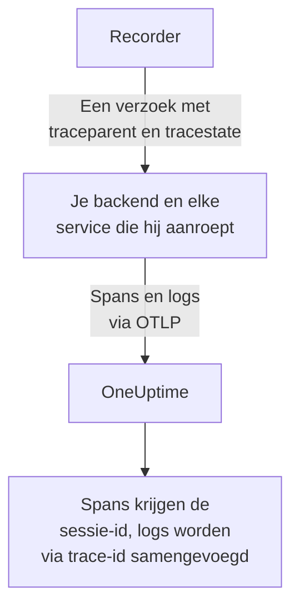
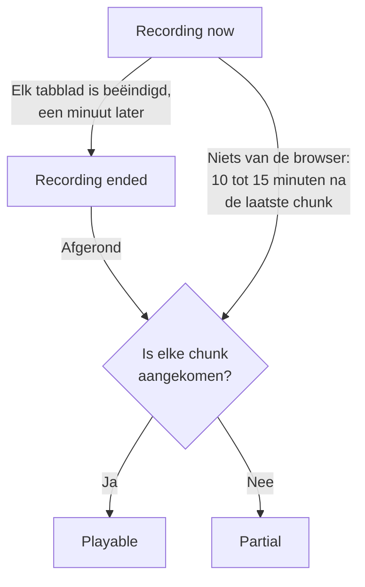
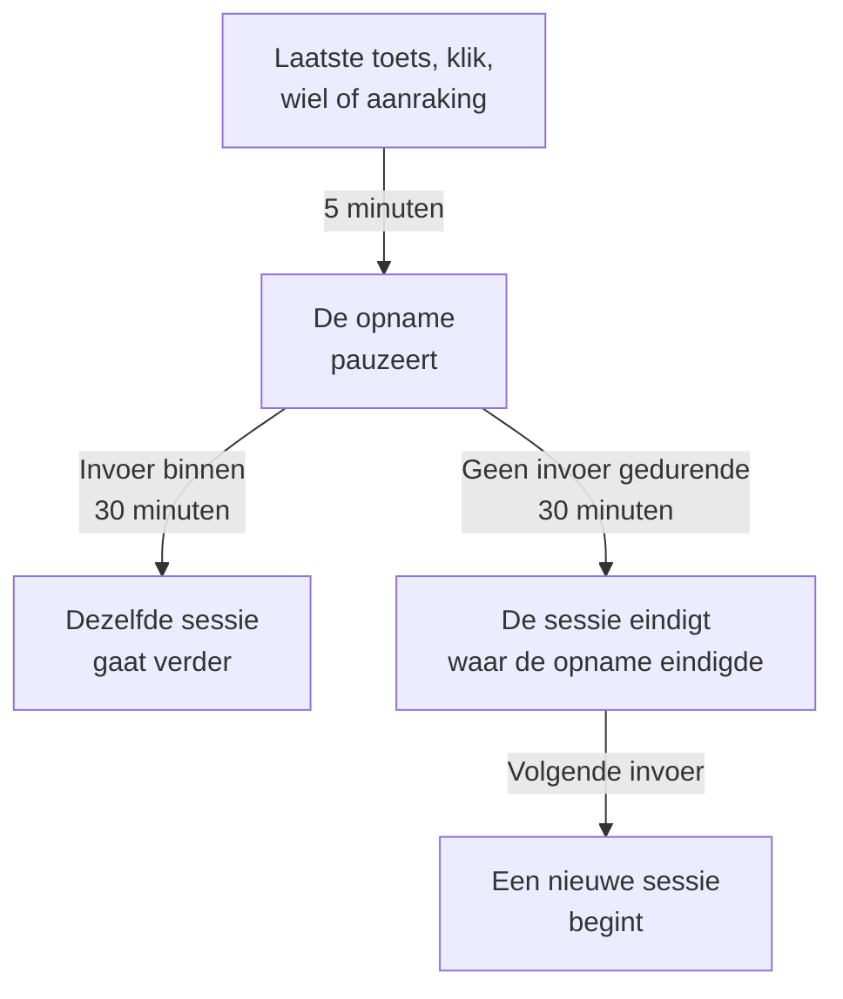

# Sessieherhaling

Sessieherhaling neemt op wat echte gebruikers in je web- of React Native-app zagen, en speelt dat af naast de fouten, traces en logs van dezelfde sessie. Je voegt één scripttag toe, kiest wat er gemaskeerd wordt en bekijkt elke sessie vanuit haar RUM-applicatie.

:::cards
- [Zo werkt het](#zo-werkt-het): Een loader, een beleid en een recorder die gaandeweg uploadt.
- [Installeren](#installeren): Eén scripttag op elke pagina, of de React Native-SDK.
- [Privacy](#privacy): Wat er gemaskeerd wordt, toestemming en wie opnamen mag versturen.
- [Correleren met de rest van je telemetrie](#correleren-met-de-rest-van-je-telemetrie): Backend-traces, -logs en -fouten, gekoppeld zonder code.
- [Een sessie bekijken](#een-sessie-bekijken): De sessielijst, de pagina Gebruikers, gebruikersstromen en de speler.
- [Opnamestatus](#opnamestatus): Waarom er niets binnenkomt, en waarschuwingen voordat een budget op is.
:::

## Zo werkt het

Het script op je pagina is een kleine loader. Hij controleert de privacysignalen van de browser, haalt het beleid van de applicatie op bij OneUptime en laadt pas daarna de recorder, die de pagina maskeert terwijl hij haar opneemt en haar in chunks uploadt zolang de gebruiker actief is.

```mermaid title="Van een paginalading naar een opname die je kunt bekijken"
flowchart TB
    page["Je pagina laadt<br/>de scripttag"] --> dnt{"Do Not Track-<br/>of GPC-signaal?"}
    dnt -->|"Ja"| none["Er wordt niets<br/>opgenomen"]
    dnt -->|"Nee"| policy["De loader haalt<br/>het beleid op"]
    policy --> recorder["De recorder maskeert<br/>en neemt de pagina op"]
    recorder -->|"Chunks zolang de<br/>gebruiker actief is"| ingest["OneUptime"]
    ingest --> player["Sessielijst<br/>en speler"]
```

Standaard wordt elke sessie opgenomen en geüpload terwijl ze plaatsvindt, niet alleen de sessies die misgingen. In de sessies waarin niets misging vind je de checkout die niemand afrondde, het formulier dat iedereen liet liggen en de pagina die er volgens een klant «raar uitzag».

Om minder op te slaan werken twee instellingen in het beleid van de applicatie samen:

| Instelling | Standaard | Wat het verandert |
| --- | --- | --- |
| **Steekproefpercentage** | 100 | Hoeveel sessies in aanmerking komen. Halveer het en je halveert zowel de opgeslagen bytes als de opgeslagen gegevens van eindgebruikers. De beslissing wordt één keer per sessie genomen op basis van een hash van de sessie-id, dus een sessie wordt nooit half opgenomen. |
| **Wanneer een opname uploaden** | _Always_ | Met _On error or frustration_ houdt de recorder een ringbuffer in het geheugen bij en uploadt hij alleen als er iets misgaat. Er bestaat dan een opname van bijna elke mislukte sessie, tegen kosten die ongeveer 15 keer lager zijn dan wanneer je iedereen opneemt, maar je kunt geen sessie bekijken die niet misging. |

## Voordat je begint

- Een RUM-applicatie. Maak er een aan onder **Producten → Bronnen → Real User Monitoring**, of laat je telemetrie er een aanmaken: zie [Applicaties beheren](/docs/rum/applications).
- Een **Browser**-ingestiesleutel, uit **Projectinstellingen → Telemetrie & APM → Ingestiesleutels**. Een Browser-sleutel werkt alleen vanaf de origins die je erop opgeeft: zie [Stel je toegestane origins in productie in](#stel-je-toegestane-origins-in-productie-in).

Sessieherhaling staat standaard aan. De instellingen staan op drie plekken:

| Waar | Wat er staat |
| --- | --- |
| De pagina **Replay Policy** van de applicatie | Het beleid (opname, maskering, toestemming, tracing en limieten), een samenvatting van **Opnamestatus**, de kaart **Wat een opname bevat**, het paneel **Test your installation** en **Record a specific user's next session**. |
| De pagina **Gezondheid** van de applicatie | Of opnamen binnenkomen, en waarom niet als ze dat niet doen. Zie [Opnamestatus](#opnamestatus). |
| **Real User Monitoring → Instellingen → Sessieherhaling** | De schakelaar voor het hele project die alle applicaties tegelijk stopt, en een alleen-lezenlijst van het beleid van elke applicatie. |

## Installeren

Voeg één scripttag toe aan elke pagina die je wilt opnemen.

:::steps
### Een Browser-sleutel aanmaken

Klik onder **Projectinstellingen → Telemetrie & APM → Ingestiesleutels** op **Inname-sleutel aanmaken**, kies **Browser** als **Sleuteltype** en geef de origins van je site op onder **Toegestane origins**. Kopieer daarna de **Geheime sleutel** van de sleutel. [Browserconfiguratie](/docs/rum/browser-setup#instellen) toont elk scherm.

### De scripttag toevoegen

Zet de tag op elke pagina, met je sleutel en de identifier van je applicatie:

```html
<script
  src="https://oneuptime.com/telemetry/session-replay/v1/recorder.js"
  data-oneuptime-token="YOUR_TELEMETRY_INGESTION_KEY"
  data-oneuptime-app-identifier="storefront-web"
  crossorigin="anonymous"
  async
></script>
```

`data-oneuptime-app-identifier` moet overeenkomen met de identifier van de RUM-applicatie, dezelfde waarde die je voor `service.name` gebruikt. De pagina **Documentatie** van de applicatie, in de sectie **Sessieherhaling** van het zijmenu, toont deze snippet met beide waarden al ingevuld, samen met de versies ervan voor Next.js / React en Google Tag Manager.

### Controleren of opnamen binnenkomen

Open een van je pagina's en klik een paar seconden rond. Binnen ongeveer een minuut verschijnt de sessie op de pagina **Sessieherhaling** van de applicatie, gemarkeerd als **Wordt nu opgenomen**. Gebeurt dat niet, dan zegt de pagina **Gezondheid** van de applicatie waarom: zie [Opnamestatus](#opnamestatus).
:::

Het script op `/v1/recorder.js` is een kleine loader. Hij controleert Do Not Track, haalt het beleid van je applicatie op en laadt pas daarna `/latest/recorder.js`. Het beleid en de recorder worden met `no-store` geleverd, dus een wijziging in een van beide bereikt de volgende paginalading zonder te wachten tot een browsercache verloopt.

### Attributen van de scripttag

| Attribuut | Verplicht | Wat het doet |
| --- | --- | --- |
| `data-oneuptime-token` | Ja | Je telemetrie-ingestietoken. |
| `data-oneuptime-app-identifier` | Ja | De identifier van de RUM-applicatie. |
| `data-oneuptime-host` | Nee | De OneUptime-origin. Weggelaten wordt hij afgeleid uit de eigen `src` van het script, dus je hebt hem alleen nodig als je het script via je eigen domein levert. |
| `data-oneuptime-user-ref` | Nee | De referentie van de eindgebruiker die bij het laden van de pagina bekend is (een gebruikers-id, nooit een e-mailadres dat je niet wilt opslaan). Hetzelfde als wat `identify()` later instelt; het is de enige vorm die werkt voor [De volgende sessie van een specifieke gebruiker opnemen](#de-volgende-sessie-van-een-specifieke-gebruiker-opnemen). |
| `data-oneuptime-respect-do-not-track` | Nee | Respecteert standaard Do Not Track en Global Privacy Control. Zet het op `"false"` om ongeacht het signaal op te nemen; zie [Do Not Track](#do-not-track). |
| `data-oneuptime-debug` | Nee | `"true"` drukt de beslissingen van de recorder af in de console. Zie [Probleemoplossing voor sessieherhaling](/docs/rum/session-replay-troubleshooting). |
| `data-oneuptime-offline-storage` | Nee | Zet het op `"false"` om chunks die worden opgenomen terwijl de bezoeker offline is alleen in het geheugen te houden, in plaats van ze ook in de IndexedDB van de browser op te slaan. Zie [Offlinemodus](#offlinemodus). |

Dezelfde opties kunnen in een global worden meegegeven in plaats van op de tag, en dat gebruiken tagmanagers en gebundelde installaties:

```js
window.__ONEUPTIME_SESSION_REPLAY__ = {
  host: "https://oneuptime.com",
  token: "YOUR_TELEMETRY_INGESTION_KEY",
  appIdentifier: "storefront-web",
  userRef: "user-123", // optional
  respectDoNotTrack: true, // optional
  debug: false, // optional
  offlineStorage: true, // optional; false keeps offline chunks in memory only
};
```

### Zo ziet een gezonde installatie eruit

Open DevTools → Network en filter op `session-replay`. Een werkende pagina produceert:

1. **Eén `GET .../session-replay/v1/config`** per paginalading — het ophalen van het beleid.
2. **Ongeveer elke 15 seconden een `POST .../session-replay/v1/chunk` zolang de gebruiker iets doet**, of eerder wanneer er 256 KB aan gebeurtenissen is verzameld. Een inactief tabblad produceert geen gebeurtenissen en dus geen POST's: beweeg de muis of klik voordat je een installatie beoordeelt vanaf het tabblad Network.
3. Wanneer het tabblad wordt verborgen, en nog eens wanneer de pagina weggaat, een `POST` die met `keepalive` wordt verstuurd. Het verlaten van de pagina — het tabblad gesloten, herladen of naar een andere pagina gestuurd, of de pagina in de back/forward-cache van de browser gezet (elke `pagehide`) — markeert hem als laatste, wat OneUptime vertelt dat de opname van dat tabblad klaar is; een pagina die de gebruiker uit de back/forward-cache terughaalt, blijft opnemen als een nieuw tabblad van dezelfde sessie. Een tabblad dat alleen wordt verborgen blijft open, dus de opname gaat verder wanneer de gebruiker terugkomt. De hele body blijft onder 56 KB — het aandeel van de recorder in het keepalive-quotum van 64 KB per origin van de browser — en kan meerdere chunks meenemen als frames van dat ene verzoek: de afsluitende chunk, de stukken waarin een grote afsluitende chunk is gesplitst (elk hooguit 48 KB aan gebeurtenissen, zodat de frameheader nog past) en elke chunk die nog op een nieuwe poging wachtte. Een chunk die al groter is dan dat budget wanneer het tabblad alleen wordt verborgen, gaat in plaats daarvan via de gewone weg, terwijl de pagina nog leeft om hem te versturen.

Met de trigger _On error or frustration_ gebeurt stap 2 pas wanneer een trigger afgaat — zie [Probleemoplossing](#probleemoplossing).

## Installeren in React Native

De React Native-SDK neemt de hiërarchie van native views op als synthetische, met rrweb compatibele gebeurtenissen, dus mobiele opnamen openen in dezelfde sessielijst en dezelfde speler als webopnamen. Hij maakt geen schermafbeeldingen. De speler markeert elke opname als een React Native-app, en het tabblad **Fidelity** ervan legt de native oppervlakken uit die niet konden worden weergegeven.

:::steps
### De SDK installeren

De SDK ondersteunt React Native-apps voor iOS en Android. Installeer hem met zijn peer dependency voor de persistente outbox:

```bash
npm install @oneuptime/react-native-replay @react-native-async-storage/async-storage
```

Voer in een iOS-project zonder Expo je gebruikelijke CocoaPods-installatie uit nadat je de pakketten hebt toegevoegd; huidige versies van React Native koppelen Android automatisch, zonder handmatige registratie. De recorder heeft naast Async Storage een eigen native module voor de view-boom, dus Expo-projecten moeten een aangepaste ontwikkel- of productiebuild gebruiken (bijvoorbeeld EAS Build of een prebuild). Expo Go kan deze SDK niet draaien, omdat geen van beide native modules aan het vaste binaire bestand van Expo Go kan worden toegevoegd.

### De recorder starten en je app omhullen

Start de singleton één keer en zet de provider boven het deel van de app dat je wilt opnemen:

```tsx
import {
  OneUptimeReplay,
  OneUptimeReplayProvider,
} from "@oneuptime/react-native-replay";

OneUptimeReplay.start({
  host: "https://oneuptime.com",
  token: "YOUR_TELEMETRY_INGESTION_KEY",
  appIdentifier: "storefront-mobile",
  mobileAppIdentifier: "com.example.storefront",
  appName: "Storefront", // optional, shown in session details
  appVersion: "4.2.0", // optional, shown in session details
});

export default function App() {
  return (
    <OneUptimeReplayProvider>
      <Navigation />
    </OneUptimeReplayProvider>
  );
}
```

`appIdentifier` is de identifier van de RUM-applicatie. `mobileAppIdentifier` is de Android-application-id of de iOS-bundle-identifier die in het binaire bestand wordt geleverd, geen weergavenaam. Gebruik dezelfde waarde in de [`app://`-lijsten met toegestane origins](#stel-je-toegestane-origins-in-productie-in). De SDK haalt het herhalingsbeleid van de applicatie op bij `host`; sampling, trigger, toestemming, bewaring en uploadbudgetten blijven door de server bepaald.
:::

De provider heeft een niet-inklapbare native root en neemt zijn view-boom en de begin-, beweeg- en eindgebeurtenissen van aanrakingen op. Als je recorderinstanties al zelf bouwt, geef er dan een mee met `<OneUptimeReplayProvider recorder={recorder}>`. `MobileReplayRecorder` wordt ook geëxporteerd voor geïsoleerde integraties of integraties met meerdere clients; de meeste apps horen de singleton te gebruiken.

### React Native-API

Importeer `OneUptimeReplay` rechtstreeks, of roep `useOneUptimeReplay()` aan onder de provider. De singleton biedt:

| Methode | Wat het doet |
| --- | --- |
| `start(options)` | Haalt het beleid op en start de vastlegging. Verplichte opties zijn `host`, `token`, `appIdentifier` en `mobileAppIdentifier`; `appName` en `appVersion` zijn optionele weergavemetadata, en `connectivity` is een optionele bron van netwerkstatus voor de [offlinemodus](#offlinemodus). |
| `stop()` | Leegt wat kan worden verstuurd, stopt de vastlegging en koppelt de lifecycle-handlers los. |
| `identify(userRef, traits?)` | Koppelt de aangemelde gebruiker en optionele kenmerken, afhankelijk van **Identiteit van eindgebruiker vastleggen**. |
| `setTags(tags)` / `addTag(key, value)` | Vervangt alle doorzoekbare tags van de sessie, of voegt één tag toe zonder de andere te vervangen. |
| `track(name, properties?)` | Zet een app-gebeurtenis op de tijdlijn van de herhaling. |
| `setRoute(route)` | Neemt na een navigatie een opgeschoond logisch scherm of route op. Roep het aan vanuit de route-wijzigingscallback van je navigator. |
| `captureSession(reason?)` | Uploadt met _On error or frustration_ de ringbuffer om een reden die de app bepaalt, zoals een gebruiker die op «Een probleem melden» tikt. |
| `captureError(error)` | Neemt een afgehandelde JavaScript-fout op en activeert foutgestuurde vastlegging. |
| `grantConsent()` / `revokeConsent()` | Staat uploads toe, of wist meteen de buffer in het geheugen, de opgeslagen outbox, de sessie en de bezoekers-id. Latere toestemming begint met nieuwe identifiers. |
| `getSessionId()` / `onSessionChange(listener)` | Leest de huidige herhalingssessie-id met toestemming, of abonneert zich erop, om traces en logs te correleren. De luisteraar krijgt ook `null` wanneer de vastlegging of de toestemming eindigt. |
| `getDiagnostics()` | Geeft de status van de recorder en zijn recente beslissingen terug, zonder de inhoud van vastgelegde views terug te geven. |

De SDK luistert naar `AppState` van React Native: naar de achtergrond gaan sluit en leegt gebeurtenissen met toestemming, terwijl opname van vóór de toestemming alleen in het geheugen blijft. Voordat de vastlegging op de voorgrond hervat, ververst de SDK het beleid zonder een gecachet antwoord te gebruiken. Hij ververst het beleid ook periodiek zolang hij actief is, zodat uitschakelen, toestemming, sampling, targeting en identiteitswijzigingen effect hebben in een app die lang openblijft. Roep `stop()` aan wanneer je integratie definitief wordt ontkoppeld; gewone navigatie tussen schermen hoort `setRoute()` te gebruiken in plaats van de recorder te stoppen en opnieuw te starten.

**Wanneer een mobiele sessie door inactiviteit eindigt.** Vijf minuten zonder invoer pauzeren de vastlegging al (zie [Inactieve tijd](#inactieve-tijd)). Dertig minuten zonder aanraking en zonder opgenomen SDK-aanroep (`track()`, `setTags()`, `identify()` en dergelijke, gedaan terwijl de vastlegging liep) beëindigen de sessie. Ze eindigt bij die laatste activiteit, of voor een gepauzeerde sessie bij de pauze, waar haar opname eindigde — niet wanneer de app terugkomt of de recorder het merkt — dus tijd op de achtergrond of in pauze wordt nooit aan het einde van een sessie toegevoegd. Een app die op de voorgrond open blijft staan, start niet elk half uur een nieuwe sessie. De volgende sessie begint wanneer de gebruiker terugkomt: zijn eerste aanraking, het schermtoetsenbord dat verschijnt of verdwijnt, de app die naar de voorgrond terugkeert, of een aanroep van `captureSession()`. Ze opent met een nieuwe snapshot van het scherm. Tot dan geeft `getSessionId()` `null` terug en wordt `onSessionChange()` aangeroepen met `null`. Fouten, navigatie en `track()`-aanroepen in de tussentijd worden niet opgenomen.

Om mobiele telemetrie met een herhaling te correleren, abonneer je je met `onSessionChange()` en zet je de teruggegeven waarde als het attribuut `session.id` in je OpenTelemetry-instrumentatie. Vervang dat attribuut elke keer dat de callback afgaat, en wis het ook wanneer de waarde `null` is. De herhalings-SDK past het native netwerk niet aan en verandert zelf geen OpenTelemetry-provider.

### Privacy en maskering in React Native

Mobiele vastlegging is bewust strenger dan de webmaskeringsmodi. Native UI-tekst, toegankelijkheidswaarden, invoerwaarden en afbeeldingspixels worden nooit geserialiseerd; de server krijgt een wireframe-structuur, ook wanneer de webmaskeringsmodus van de applicatie leesbare tekst zou toestaan. Metadata die de aanroeper aanlevert, zoals gebruikersreferenties, gebeurtenisnamen, routes en doorzoekbare tags, volgen het API-contract, dus zet geen geheimen in die velden. Omhul een bijzonder gevoelige subboom met `<ReplayMask>` om dat gebied te vervangen door een privacyplaatshouder en de omliggende lay-out te behouden.

Toestemming wordt niet afgeleid uit een machtiging van het besturingssysteem of uit je toestemmingsbanner. Roep met _Require explicit_ `grantConsent()` alleen aan wanneer je app de vereiste toestemming heeft. Het aanroepen van `revokeConsent()` gooit zowel niet-verstuurde gegevens in de wachtrij en opgeslagen gegevens weg als de identifiers die een latere sessie aan de ingetrokken sessie zouden kunnen koppelen.

De mobiele recorder legt de grenzen en types van views vast, aanraakposities, logische routes, aangepaste gebeurtenissen en JavaScript-fouten. Deze beperkingen worden altijd gemeld op het tabblad Fidelity van de speler:

- Pixels van native `Image` zijn ondoorzichtig; alleen het kader wordt weergegeven.
- De inhoud van `WebView` valt buiten de React Native-boom. Installeer de webrecorder binnen de gehoste pagina als die een eigen opname nodig heeft.
- Canvas, Skia, OpenGL, kaarten, cameravoorbeelden, video en andere op maat getekende oppervlakken zijn ondoorzichtig.
- Aanraakpaden binnen `ReplayMask` of een ondoorzichtig oppervlak worden niet opgenomen. De native bridge controleert het echte doel van de aanraking en de voorouders ervan, en onderdrukt het gebaar als die privacycontrole niet kan worden afgerond.
- Animaties van Reanimated, native-driver en de UI-thread worden gesampled bij snapshots van de view-boom, niet frame voor frame nagebootst.
- Native crashes die JavaScript beëindigen voordat het kan legen, vereisen een native crash-SDK; `captureError()` dekt afgehandelde JavaScript-fouten, geen crashdumps op procesniveau.

## Je gebruikers identificeren

Elke sessie is anoniem totdat je pagina zegt van wie ze is. Zonder dat kan de lijst de sessies van één browser nog wel groeperen onder een anonieme bezoekers-id (zie [Anonieme bezoekers](#anonieme-bezoekers) hieronder), maar niets noemt de persoon of koppelt diens tweede browser aan de eerste. Roep `identify()` aan zodra je het weet, of zet het in de wachtrij voordat het script laadt — in beide gevallen wordt het toegepast voordat de eerste chunk wordt geüpload, dus de sessie is doorzoekbaar op gebruiker vanaf het moment dat ze verschijnt:

```js
// After the script has loaded:
OneUptimeReplay.identify("user-123", { plan: "pro", tenant: "acme" });

// Or at any time, whether or not the script has loaded yet:
(window.OneUptimeReplayQueue = window.OneUptimeReplayQueue || []).push([
  "identify",
  "user-123",
  { plan: "pro", tenant: "acme" },
]);
```

- De referentie is wat de sessielijst toont en waarop `user:`-zoekopdrachten overeenkomen. Kenmerken worden getoond in de header van de speler en in het detailpaneel van de sessie.
- **Identiteit hoort bij de sessie, niet alleen bij de pagina.** Een sessie omvat elke paginalading en elk tabblad van het bezoek, en zodra een van haar pagina's `identify()` aanroept, is de hele sessie van die gebruiker — ook de pagina's van vóór het aanmelden, want dat is hetzelfde bezoek. Elke latere pagina en elk later tabblad van de sessie noemt de gebruiker ook, zelfs een die `identify()` zelf nooit aanroept: de bestemmingspagina van de omleiding na het aanmelden, een link die in een nieuw tabblad is geopend. Zolang **Identiteit van eindgebruiker vastleggen** aanstaat, onthoudt de recorder van wie de huidige sessie is in `localStorage` onder `oneuptime.replay.user` — de sessie-id en de referentie, verder niets, en met _Require explicit_-toestemming pas nadat toestemming is gegeven — en alleen voor die sessie: de volgende sessie (na 30 minuten inactiviteit of de limiet van 4 uur) begint anoniem totdat een pagina haar identificeert, tenzij de pagina die haar startte de gebruiker zelf al had geïdentificeerd. Roep `identify()` dus aan bij elke paginalading waarop je app de gebruiker kent, niet alleen vlak na het aanmelden.
- **Een andere gebruiker krijgt een eigen sessie.** Wanneer `identify()` iemand anders noemt dan de gebruiker van wie de sessie al is — de ene persoon heeft zich afgemeld en een ander heeft zich in dezelfde browser aangemeld, in dit tabblad of een ander —, eindigt de huidige sessie, nog steeds gearchiveerd onder de eerste gebruiker, en begint er een nieuwe voor de tweede. Luisteraars van `onSessionChange` krijgen een melding, en de speler toont de wissel als het einde van de ene opname en het begin van de volgende. Dezelfde gebruiker opnieuw identificeren verandert niets; referenties worden vergeleken nadat spaties aan de randen zijn weggehaald en hoofdlettergevoelig, precies zoals de server ze vergelijkt.
- Wat `identify()` aan de recorder geeft, wordt alleen met de opname geüpload zolang **Identiteit van eindgebruiker vastleggen** voor de applicatie aanstaat (de standaard). Staat het uit, dan laat de recorder de referentie en de kenmerken uit de chunk weg, en slaat de server **helemaal niets** over de persoon op — geen referentie, geen hash met sleutel ervan, geen kenmerken. Die sessies zijn echt pseudoniem, en de prijs is dat ze niet _per gebruiker_ kunnen worden gewist: een wisverzoek heeft niets om op te matchen, dus gebruik in plaats daarvan `BySessionId`, `ByDateRange` of `ByRumApplication` (zie [Sessies wissen](#sessies-wissen)). Als het kunnen honoreren van een verwijderverzoek per gebruiker voor jou zwaarder weegt dan geen enkele identifier opslaan, laat de schakelaar dan aan — de opgeslagen sleutel is een eenrichtings-hash met sleutel, die vergeleken maar niet gelezen kan worden, en alleen het aparte label draagt de referentie zelf.
- Eén referentie verlaat de browser wel, hoe die schakelaar ook staat, met opzet: de referentie die je pagina **bij het laden** aanlevert via `data-oneuptime-user-ref` of `userRef` op de init-global, reist als verzoekheader mee bij het ophalen van het beleid bij elke paginalading, want zo herkent [De volgende sessie van een specifieke gebruiker opnemen](#de-volgende-sessie-van-een-specifieke-gebruiker-opnemen) een bezoeker voordat er een recorder bestaat. De server vergelijkt haar met het geactiveerde doel en gooit haar weg; ze wordt niet in de sessie geschreven, tenzij identiteitsvastlegging aanstaat en de recorder haar opnieuw met de opname meestuurt. Een referentie die aan `identify()` wordt doorgegeven, wordt nooit op deze manier verstuurd.
- Kenmerken zijn beperkt tot 20 sleutels, 40 tekens per sleutel en 200 per waarde, worden omgezet naar strings en gaan door de maskeringsmodus van de applicatie: onder _Mask all text_ worden ze vóór het uploaden gemaskeerd.
- De identiteit terug lezen in het dashboard vereist dezelfde machtiging als de opname bekijken (zie [Wie een opname kan bekijken](#wie-een-opname-kan-bekijken)); andere rollen zien «Identity hidden».

### Anonieme bezoekers

Een pagina die nooit `identify()` aanroept, moet haar sessies nog steeds kunnen groeperen, anders vertelt een lijst van veertig _Anonymous_-rijen je niet of één persoon veertig keer dezelfde fout had of veertig mensen er elk één keer last van hadden. Daarom maakt de recorder een willekeurige bezoekers-id per browserprofiel en per origin — 32 hexadecimale tekens in kleine letters, opgeslagen in `localStorage` onder `oneuptime.replay.visitor`, naast het sessierecord, zodat een site die vanaf twee hostnamen of poorten wordt geleverd als twee bezoekers verschijnt en alleen `identify()` ze samenbrengt — en stuurt hem als `meta.visitorId` mee op elke chunk die metadata draagt: de eerste chunk, de afsluitende chunk en de chunk na een aanroep van `identify()` of `setTags()`. De server controleert de vorm en slaat hem op bij de sessie, met dezelfde toegangsregels als de rest van de sessieheader. Hij overleeft de sessie-id met opzet: de wissel na 30 minuten inactiviteit en de limiet van 4 uur starten een nieuwe sessie, en de nieuwe sessie draagt dezelfde bezoekers-id, dus twee bezoeken vanuit dezelfde browser met een week ertussen verschijnen samen op de [pagina Gebruikers](#de-pagina-gebruikers) en in het menu met andere sessies van de speler (zie [De speler](#de-speler)).

Wees precies over wat het niet is:

- **Het is geen identiteit.** Het is willekeurig, wordt in de browser aangemaakt en is niet afgeleid van iets wat je pagina aanleverde of van iets van het apparaat. Twee browsers op één laptop, of dezelfde persoon op een telefoon en een desktop, zijn twee bezoekers; alleen `identify()` brengt ze samen. Een privévenster krijgt een nieuwe id die met het venster verdwijnt, en waar niets in de opslag kan worden geschreven (privémodus van Safari, geblokkeerde sitegegevens) gaat de id één paginalading mee.
- **Het hangt niet af van Capture end-user identity.** Die schakelaar bepaalt of de referentie en de kenmerken de browser verlaten; de bezoekers-id wordt hoe dan ook verstuurd, omdat hij niemand noemt. Als je wilt dat er helemaal geen id wordt aangemaakt, is het antwoord geen recorder: schakel sessieherhaling uit voor de applicatie, of laat [Do Not Track](#do-not-track) respecteren.
- **Het volgt de toestemmingsregels van de sessie-id.** `revokeConsent()` verwijdert hem samen met de sessie uit de opslag, er wordt niets geschreven zolang de toestemming is ingetrokken, en een latere `grantConsent()` maakt een nieuwe aan — dus een gebruiker die toestemming intrekt en terugkomt, wordt niet opnieuw gekoppeld aan de sessies die hij je vroeg te vergeten. Onder Do Not Track of Global Privacy Control draait er geen recorder, dus wordt er geen id aangemaakt.
- **Het reist nooit mee op je eigen verzoeken.** De tracecontext die de recorder toevoegt aan de verzoeken van je pagina naar haar eigen origin noemt de sessie, nooit de bezoeker (zie [Wat je eigen verzoeken meedragen](#wat-je-eigen-verzoeken-meedragen)); de bezoekers-id gaat alleen naar OneUptime, met de opname.
- **Het kan niet het doel van een wisverzoek zijn.** De verzoektypen zijn niet veranderd (zie [Sessies wissen](#sessies-wissen)); een `visitor:`-zoekopdracht beperkt de lijst tot de sessies van één browser, waaruit je de sessie-id's haalt die je wilt wissen.

`OneUptimeReplay.getVisitorId()` geeft de huidige id terug, of een lege string voordat de recorder start, na `stop()` en tussen een `revokeConsent()` en de volgende `grantConsent()`. Recorders die zijn gebouwd voordat dit bestond, stuurden er geen, dus de sessies die ze opnamen hebben een lege `visitorId`: de lijst toont ze als _Anonymous_ en de pagina Gebruikers archiveert ze onder **Unlinked sessions**. Een recorder die er een aanmaakt, noemt `visitor-id` bij zijn `capabilities` in `getDiagnostics()` en op de pagina **Gezondheid**.

## JavaScript-API

De recorder publiceert `window.OneUptimeReplay`. Omdat hij asynchroon laadt, moet alles wat je pagina aanroept voordat hij er is via de commandowachtrij — `window.OneUptimeReplayQueue` is een gewone array van `[command, ...arguments]`-items die de recorder leegt zodra hij start, en accepteert elk commando hieronder op naam:

```js
(window.OneUptimeReplayQueue = window.OneUptimeReplayQueue || []).push(
  ["grantConsent"],
  ["identify", "user-123", { plan: "pro" }],
  ["setTags", { build: "1.4.2" }],
  ["onSessionChange", (sessionId, tabId) => console.log(sessionId)],
);
```

`grantConsent`, `revokeConsent`, `stop`, `identify`, `setTags` en `addTag` worden toegepast voordat de recorder start, dus een toestemmingsbeslissing in de wachtrij bepaalt of er iets wordt geüpload, en een identiteit in de wachtrij reist al mee op de eerste chunk. `track`, `captureSession` en `onSessionChange` worden direct na de start uitgevoerd.

| Methode | Wat het doet |
| --- | --- |
| `identify(userRef, traits?)` | Koppelt de eindgebruiker aan de sessie — aan elke pagina en elk tabblad ervan, vanaf het begin (zie [Je gebruikers identificeren](#je-gebruikers-identificeren)). `traits` is een object met string-, getal- of booleanwaarden (≤ 20 sleutels, sleutel ≤ 40 tekens, waarde ≤ 200 tekens), gemaskeerd onder _Mask all text_ en alleen geüpload wanneer **Identiteit van eindgebruiker vastleggen** aanstaat. Opnieuw aanroepen voor dezelfde gebruiker verstuurt de identiteit (en eventuele nieuwe kenmerken) opnieuw op de volgende chunk; een andere gebruiker noemen beëindigt de sessie en start een nieuwe voor hem. |
| `track(name, properties?)` | Neemt een zakelijke gebeurtenis (`"checkout_failed"`) op in de tijdlijn. `name` ≤ 64 tekens, ≤ 20 eigenschapssleutels met dezelfde waardelimieten als kenmerken. Tot 50 per chunk van 15 seconden; daarboven draagt de chunk één markering «events dropped» met het aantal. |
| `setTags(tags)` / `addTag(key, value)` | Tags per sessie (`{ build: "1.4.2", experiment: "new-checkout" }`), ≤ 20 tags, sleutel ≤ 32 tekens, waarde ≤ 128. Doorzoekbaar vanuit de sessielijst met `tag:key=value` en getoond in de sessiedetails. `setTags` **vervangt** de hele map, dus een tweede `setTags({ experiment })` verwijdert een tag `build` die de eerste had ingesteld; `addTag` stelt één sleutel in en houdt de rest. Bouw de map in één `setTags`-aanroep op, of gebruik `addTag` naarmate je elke waarde leert kennen. |
| `captureSession(reason?)` | Dwingt deze sessie met _On error or frustration_ om vanaf haar ringbuffer te uploaden; met _Always_ verandert er niets aan het uploaden, maar de `reason` (≤ 80 tekens) wordt toch op de tijdlijn gemarkeerd. Gebruik het vanuit je eigen knop «een probleem melden». |
| `onSessionChange(listener)` | `listener(sessionId, tabId)` wordt meteen aangeroepen als er een sessie bestaat en opnieuw telkens wanneer de id verandert — wanneer de gebruiker na 30 minuten inactiviteit terugkomt, bij de limiet van 4 uur, wanneer `identify()` een andere gebruiker noemt, of wanneer een ander tabblad van dezelfde bezoeker eerder van sessie wisselde. Geeft een functie terug om het abonnement op te zeggen. **Optioneel**: verzoeken naar je eigen origin koppelen de spans, logs en uitzonderingen van je backend ook zonder deze aanroep aan de opname (zie [Correleren met de rest van je telemetrie](#correleren-met-de-rest-van-je-telemetrie)). Gebruik het om `session.id` te zetten op telemetrie die de pagina zelf produceert, zoals spans van de OpenTelemetry-browser-SDK; zie [De browsertelemetrie van je eigen pagina](#de-browsertelemetrie-van-je-eigen-pagina). |
| `grantConsent()` | Staat uploads toe in de toestemmingsmodus _Require explicit_. Daarvóór wordt niets geüpload. |
| `revokeConsent()` | Gooit alles in de buffer weg en stopt het uploaden. De recorder blijft alleen in het geheugen draaien, dus een latere `grantConsent()` gaat verder met een nieuwe sessie-id. |
| `getSessionId()` | De huidige sessie-id, of `null` wanneer er niets wordt opgenomen. Gebruik liever `onSessionChange()`, dat ook sessiewissels volgt. |
| `getVisitorId()` | De [anonieme bezoekers-id](#anonieme-bezoekers) — 32 hexadecimale tekens, één per browserprofiel, gelijk over sessiewissels heen — of `""` voordat de recorder start, na `stop()` en zolang de toestemming is ingetrokken. Willekeurig en geen identiteit; hangt niet af van **Identiteit van eindgebruiker vastleggen**. |
| `stop()` | Uploadt de laatste chunk, sluit de sessie af en stopt voor de rest van het leven van de pagina. |
| `setDebug(enabled)` | Drukt vanaf nu de beslissingen van de recorder af in de console. |
| `getDiagnostics()` | Alles wat de recorder besliste, of diagnostiek nu aanstond of niet. Zie hieronder. |

### `getDiagnostics()`

Het eerste wat je in een supportticket plakt. Het bevat door de opbouw geen pagina-inhoud (zie [Wat de diagnostiek nooit bevat](/docs/rum/session-replay-troubleshooting#wat-de-diagnostiek-nooit-bevat)).

```js
copy(JSON.stringify(OneUptimeReplay.getDiagnostics(), null, 2));
```

| Veld | Betekenis |
| --- | --- |
| `state` | `none` (er is geen recorder opgebouwd), `not-started`, `recording` (alleen in het geheugen), `uploading`, `paused` (niemand heeft de pagina vijf minuten aangeraakt, dus er wordt niets vastgelegd tot de volgende invoer — zie [Inactieve tijd](#inactieve-tijd)), `not-sampled` of `stopped`. |
| `stopReason` | Waarom hij stopte, als dat zo is: `api` (je `stop()`), `server-directive`, `transport-failure` of `chunk-cap`. |
| `bootstrapDecision` | Waarom het artefact wel of geen recorder opbouwde: `started`, `privacy-signal`, `directive-stop`, `already-started`, `cancelled-before-start` (een `revokeConsent`/`stop` in de wachtrij) of `not-started`. |
| `decisions` | Het antwoord van elke poort: `isSampled`, `captureTrigger`, `consentMode`, `consentState`, `uploadsAllowed`, `uploadBlockedBy` (`consent`, `transport` of `null`), `lastDirective` en de reden ervan, en `startDecision` (`recording-and-uploading`, `recording-into-memory`, `not-sampled`, `not-started`). |
| `capabilities` | Wat deze build van de recorder vastlegt: `click-events`, `web-vitals`, `custom-events`, `traits`, `tags`, `visibility`, `visitor-id`. De pagina **Gezondheid** in het dashboard toont dezelfde lijst voor de meest recente sessie, dus een opname van een oude, lang openstaande pagina valt makkelijk op. |
| `tags`, `hasTraits`, `triggerReason`, `isRecording`, `isUploading`, `sessionId`, `tabId`, `visitorId`, `version` | De huidige sessiestatus. `isRecording` is alleen true zolang de recorder echt opneemt. `visitorId` is `null` totdat er een recorder bestaat en `""` zolang de toestemming is ingetrokken. |
| `records` | De laatste 250 beslissingen met stabiele codes — inclusief die van de loader, van voordat het artefact bestond. Elke code wordt uitgelegd in [Probleemoplossing voor sessieherhaling](/docs/rum/session-replay-troubleshooting#codes). |

## Privacy

**Maskering gebeurt bij het vastleggen, op het apparaat van de eindgebruiker, voordat er iets wordt geüpload.** De server ontvangt nooit wat is gemaskeerd, dus een maskeringsbeslissing kan achteraf niet worden teruggedraaid, en ook niet met terugwerkende kracht worden toegepast. Op het web hangt wat er gemaskeerd wordt af van de modus; React Native stuurt altijd de strengere wireframe-structuur die wordt beschreven in [Privacy en maskering in React Native](#privacy-en-maskering-in-react-native). De kaart **Wat een opname bevat** op de pagina **Replay Policy** van de applicatie herformuleert deze beslissingen in gewone zinnen voor wat je hebt ingesteld.

De privacyinstellingen van het beleid, met de naam die **Beleid bewerken** ze geeft:

| Instelling | Standaard | Wat het doet |
| --- | --- | --- |
| **Sessies voor deze applicatie opnemen** | Aan | De eigen schakelaar van de applicatie. Zet hem uit om deze applicatie niet meer op te nemen. |
| **Maskeermodus** | _Mask sensitive inputs only_ | Wachtwoorden, kaartvelden en velden voor eenmalige codes worden gemaskeerd. De rest van de pagina, de statische tekst en gewone invoerwaarden, wordt opgenomen zoals die eruitzag. Zie [Kies bewust een maskeringsmodus](#kies-bewust-een-maskeringsmodus). |
| **Toestemming** | _Not required_ | Uploads beginnen meteen. Kies _Require explicit_ als je voor elke sessie een toestemmingsuitwisseling nodig hebt, wat de meeste deployments in de EU nodig hebben. |
| **Wanneer een opname uploaden** | _Always_ | Elke gesamplede sessie wordt vanaf haar eerste gebeurtenis geüpload. Kies _On error or frustration_ om alleen te uploaden als er iets misgaat. |
| **Steekproefpercentage** | 100% | Het aandeel van de sessies dat voor opname in aanmerking komt, en de kostenknop. 0% samen met _Always_ neemt helemaal niets op, en de beleidspagina waarschuwt wanneer je dat instelt. |
| **Toegestane origins** | Leeg: elke origin | Geef je domeinen op om te beperken wie opnamen mag versturen. Zie [Stel je toegestane origins in productie in](#stel-je-toegestane-origins-in-productie-in). |
| **Identiteit van eindgebruiker vastleggen** | Aan | De referentie en kenmerken van de eindgebruiker die je pagina aanlevert worden opgeslagen, zodat je de sessie van een klant met naam kunt vinden. Zet het uit om opnamen pseudoniem te houden: uitgeschakeld wordt er niets over de persoon opgeslagen, zelfs niet de sleutel waarop een wisverzoek per gebruiker zou moeten matchen ([Je gebruikers identificeren](#je-gebruikers-identificeren)). Heeft geen invloed op de [anonieme bezoekers-id](#anonieme-bezoekers), die willekeurig is, niemand noemt en hoe dan ook wordt verstuurd. |
| **Trace-doorgifte binnen dezelfde origin** | Aan | Zolang een sessie uploadt, dragen de verzoeken van je pagina naar haar eigen origin een W3C-`traceparent` en een `tracestate` die de sessie noemt, dus de telemetrie van je backend koppelt zich zonder code aan de opname. De OpenTelemetry van je backend stuurt beide door naar elke service die hij aanroept. Zie [Wat je eigen verzoeken meedragen](#wat-je-eigen-verzoeken-meedragen). |
| **Land vastleggen** | Aan | Alleen het land, nooit een IP-adres. |
| **Canvasinhoud opnemen** | Uit | Canvas en WebGL worden niet opgenomen. |
| **Bewaartermijn** | 7 dagen | Korter dan de rest van je telemetrie, met opzet. 1, 14, 30 en 90 dagen zijn ook beschikbaar. |
| **Maandbudget (GB)** | Leeg | Een optionele limiet op geüploade bytes per kalendermaand voor deze applicatie. Leeg of 0 betekent geen limiet. |

### Kies bewust een maskeringsmodus

> [!WARNING]
> De standaard neemt een leesbare pagina op, omdat een wireframe zelden genoeg is om te debuggen. Alles wat op je pagina wordt getoond staat in de opname: een ordernummer, een e-mailadres in een header, een foutbanner die gebruikersgegevens citeert. En ook alles wat wordt getypt in een veld dat je markup niet als gevoelig aanmerkt. Maskering gebeurt in de browser vóór het uploaden, dus later een strengere modus kiezen schoont al gemaakte opnamen niet op.

De drie modi, van minst naar meest privé:

| Modus | Statische paginatekst | Gewone invoerwaarden | Wachtwoord-, kaart- en OTP-velden |
| --- | --- | --- | --- |
| Mask sensitive inputs only *(standaard)* | opgenomen | opgenomen | gemaskeerd |
| Mask inputs only | opgenomen | gemaskeerd | gemaskeerd |
| Mask all text | gemaskeerd | gemaskeerd | gemaskeerd |

Onder _Mask all text_ is de herhaling een wireframe: tekstknooppunten, de labels die de recorder aan klikken koppelt, kenmerken van `identify()` en eigenschappen van `track()` worden vóór het uploaden gemaskeerd, en de speler laadt geen van de afbeeldingen of weblettertypen van de pagina vanaf hun adressen. De opname bewaart die adressen wel, en een sessie die in deze modus is opgenomen speelt zonder ze af, met één uitzondering: een afbeelding die de pagina als `data:`-URL had, hoort bij de opname zelf en wordt nog steeds getoond. Blokkeer elementen die op die manier een persoonlijke afbeelding kunnen tonen, zoals het voorbeeld van een document dat de gebruiker uploadt. Stylesheets laden nog wel, dus de lay-out behoudt haar vorm (zie [Afbeeldingen, stijlen en lettertypen tijdens het afspelen](#afbeeldingen-stijlen-en-lettertypen-tijdens-het-afspelen)).

Als je pagina's persoonsgegevens tonen, verhoog dan de modus of voeg maskerings- of blokkeerselectors toe voor de specifieke elementen: zie [Je eigen inhoud markeren](#je-eigen-inhoud-markeren). Selectors zijn het juiste middel als maar een paar gebieden gevoelig zijn; een strengere modus is het juiste middel als je ze niet kunt opsommen.

### Stel je toegestane origins in productie in

Sessieherhaling werkt meteen met een lege lijst met toegestane origins, die opnamen van elke origin accepteert. Dat is handig om mee te beginnen en verkeerd voor productie.

Je ingestietoken wordt aan de client meegegeven — in het JavaScript van de pagina of in het binaire bestand van de mobiele app — dus er zijn twee poorten, en die vullen elkaar aan:

- **Op de sleutel.** Maak de ingestiesleutel aan met **Browser** als **Sleuteltype**. Geef voor het web de **Toegestane origins** op (`https://app.example.com`, of `https://*.example.com` voor één subdomeinniveau). Voeg voor React Native de exacte app-identiteit toe als `app://com.example.storefront`. Geef de sleutel ook een **Verloopt om**: zo werkt een gekopieerd token niet meer op een datum die jij kiest, in plaats van nooit.
- **Op de applicatie.** **Replay Policy → Toegestane origins** beperkt wie opnamen naar deze applicatie mag schrijven, welke sleutel er ook wordt gebruikt. Voeg hier dezelfde web-origins en de exacte mobiele `app://`-identiteiten toe.

Een `app://`-item is het letterlijke voorvoegsel plus de genormaliseerde Android-application-id of iOS-bundle-identifier die als `mobileAppIdentifier` wordt aangeleverd. De vergelijking is niet hoofdlettergevoelig, na het weghalen van spaties en het omzetten van een geldige reverse-DNS-identifier naar kleine letters. Mobiele identiteiten accepteren **geen** jokertekens: `app://*.example.com` is ongeldig. De mobiele SDK stuurt geen browser-`Origin`; hij stuurt zijn recordertype en de app-identiteit in eigen headers. Draagt een verzoek wel een echte `Origin`, dan gaat die origin altijd voor — de mobiele headers kunnen nooit worden gebruikt om de origincontrole van de browser te omzeilen.

Die mobiele identiteit is zelf opgegeven HTTP-metadata, geen platformattestatie van Apple/Google en geen bewijs dat het verzoek van je ondertekende binaire bestand kwam. Wie het token uit de client haalt, kan een niet-browserverzoek sturen met dezelfde app-identiteitsheader. Exacte `app://`-items voorkomen nog steeds onbedoeld gebruik tussen apps en scheiden de mobiele identiteiten die je wilt accepteren, maar noem ze geen authenticiteitsgrens. Stel een vervaldatum in, roteer blootgestelde sleutels en laat de snelheids- en bytebudgetten aanstaan om misbruik te beperken; zet nooit een servergeheim in de app als bescherming, want het kan eruit worden gehaald.

Een verzoek moet door beide lijsten met toegestane origins komen. Bij webverzoeken voorkomt de door de browser gecontroleerde `Origin`-controle dat een website de sleutel van een andere site hergebruikt; bij native verzoeken beperken en scheiden de maatregelen hierboven een zelf opgegeven identiteit. Stel beide lijsten in voordat je echt verkeer naar een van beide recorders stuurt; geweigerde uploads verschijnen op de pagina **Gezondheid** als `origin-not-allowed`.

### Altijd gemaskeerd

Altijd gemaskeerd, ongeacht de modus, en niet instelbaar:

- **Wachtwoorden**, ook na een knop «wachtwoord tonen». Een veld dat ooit een wachtwoordveld was, blijft gemaskeerd, en de typewissel zelf wordt onderdrukt.
- **Kaartvelden**, herkend via `autocomplete` (`cc-number`, `cc-csc`, `cc-exp`), omdat kaartinvoer `type="text"` is en anders onzichtbaar zou zijn voor maskering op basis van type.
- **Eenmalige codes** (`autocomplete="one-time-code"`).
- **Waarden van bestandsinvoer** — de browser geeft de echte bestandsnaam prijs, en bestandsnamen zijn vaak persoonlijk.
- **Querystrings en fragmenten**: verwijderd uit de pagina-URL's die de opname bewaart en uit de URL van elk netwerkverzoek, en padsegmenten die op een identifier lijken (UUID's, e-mailadressen, lange reeksen cijfers, lange ondoorzichtige tokens) worden vervangen. Dit is het ene kanaal dat tekstmaskering niet dekt: anders zou een link voor het resetten van een wachtwoord in de sessielijst belanden. Adressen binnen de pagina zijn een ander verhaal. De bestemming van een link wordt alleen onder _Mask all text_ zo opgeschoond; in de andere twee modi wordt ze opgenomen zoals de rest van de pagina. Adressen van afbeeldingen, stylesheets en lettertypen blijven in elke modus bewaard zoals de pagina ze schreef, querystring inbegrepen, omdat de herhaling ze daarvandaan laadt (onder _Mask all text_ alleen stylesheets; zie [Afbeeldingen, stijlen en lettertypen tijdens het afspelen](#afbeeldingen-stijlen-en-lettertypen-tijdens-het-afspelen)). Blokkeer een element waarvan het afbeeldingsadres iets gevoeligs bevat, zoals een ondertekend token.
- **Klembordgebeurtenissen**: nooit opgenomen.
- **Het tempo van toetsaanslagen** wordt gekwantiseerd, omdat de tijd tussen toetsaanslagen getypte inhoud prijsgeeft, ook wanneer de waarde gemaskeerd is.
- **Bodies en headers van verzoeken en antwoorden**: nooit opgenomen. Een netwerkrij van de speler bevat de methode, de URL, de status, de timing, het aantal bytes en de trace-id — verder niets. (De recorder _voegt_ wel tracecontext toe aan verzoeken naar je eigen origin; zie [Wat je eigen verzoeken meedragen](#wat-je-eigen-verzoeken-meedragen).)
- **Kliklabels**: afkomstig van de `aria-label` of de zichtbare tekst van een element, nooit van de waarde van een formulierelement, en binnen gemaskeerde gebieden volledig weggelaten.

Gemaskeerde waarden behouden hun lengte niet. Een gemaskeerd veld is een plaatshouder met een vaste breedte, dus je kunt er de lengte van een wachtwoord of kaartnummer niet uit afleiden.

### Je eigen inhoud markeren

```html
<!-- Not recorded at all: the element and its subtree are omitted. -->
<div class="oneuptime-block">...</div>

<!-- Recorded, but all text inside is masked. -->
<div class="oneuptime-mask">...</div>

<!-- Recorded, but input events inside are dropped. -->
<div class="oneuptime-ignore">...</div>
```

Je kunt ook **Extra maskeerselectors** en **Blokkeerselectors** toevoegen op de pagina **Replay Policy** van je applicatie, zonder je markup te wijzigen. Met de standaardmaskeringsmodus zijn ze het belangrijkste middel om inhoud te beschermen die je markup niet als gevoelig aanmerkt.

### Wat je eigen verzoeken meedragen

De recorder neemt nooit de headers of de body van een verzoek op, maar **voegt** wel tracecontext toe aan sommige verzoeken van je eigen pagina, en dat gaat naar je backend in plaats van naar OneUptime. Dat koppelt backend-telemetrie aan een opname (zie [Correleren met de rest van je telemetrie](#correleren-met-de-rest-van-je-telemetrie)):

```text
traceparent: 00-<32 hex trace id>-<16 hex parent id>-01
tracestate:  oneuptime=sid:<32 hex session id>;p:<16 hex parent id>
```

- **Welke verzoeken.** `fetch`- en `XMLHttpRequest`-aanroepen naar de **eigen origin** van de pagina, gedaan terwijl de sessie **uploadt**, behalve de eigen OpenTelemetry-exports van de pagina (`POST`-verzoeken naar paden die eindigen op `/v1/traces`, `/v1/logs` of `/v1/metrics`). Er wordt niets toegevoegd vóór toestemming onder _Require explicit_, na `revokeConsent()`, onder _On error or frustration_ totdat een trigger afgaat, in een niet-gesamplede sessie, terwijl de opname [gepauzeerd is omdat er niemand op de pagina is](#inactieve-tijd), of na `stop()`. Een `traceparent` of `tracestate` die het verzoek al draagt, wordt nooit vervangen: het houdt het zijne, en de recorder voegt alleen toe wat ontbreekt. `;p:` verschijnt alleen wanneer de recorder de `traceparent` zelf heeft aangemaakt. Verzoeken naar andere origins krijgen niets, tenzij je de origin opgeeft in **Origins voor trace-doorgifte**, en dan alleen een `traceparent`, dat geen sessie-id draagt.
- **Wat de sessie-id is.** Dezelfde willekeurige id van 32 hexadecimale tekens waaronder de opname wordt gearchiveerd. Hij zegt niets over de persoon en blijft het hele bezoek gelijk, totdat 30 minuten inactiviteit of de limiet van 4 uur de sessie beëindigen, `identify()` een andere gebruiker noemt, of een `revokeConsent()` gevolgd door `grantConsent()` een nieuwe aanmaakt. Een sessie die door inactiviteit is geëindigd, verstuurt geen id totdat de gebruiker terugkomt, wat de volgende sessie start. De [anonieme bezoekers-id](#anonieme-bezoekers), de gebruikersreferentie en de kenmerken reizen nooit op deze manier mee.
- **Waar het heen gaat.** De OpenTelemetry van je backend houdt `tracestate` bij de trace en stuurt het door bij elke aanroep die hij doet, naar je andere services en naar elke externe API die hij met tracecontext aanroept, precies zoals de trace-id. OneUptime leest het lid op elke span bij de ingestie, slaat de sessie-id op in de sessie-id-kolom van de span en haalt het lid weg uit de trace state die het opslaat.
- **Wat het koppelt.** Een backend-span, -log of -uitzondering die de gebruiker noemt (een attribuut `enduser.id`, een e-mailadres in een logregel) is nu één klik van de opname verwijderd, zelfs met **Identiteit van eindgebruiker vastleggen** uit: die schakelaar bepaalt wat de opname bewaart, niet wat je backend logt. Als opnamen niet te koppelen mogen zijn aan wie de gebruiker was, zet dan ook **Trace-doorgifte binnen dezelfde origin** uit.
- **Wie het kan beweren.** Zoals elke tracecontext wordt het lid door de client geschreven. Iemand die een sessie-id kende, kon die naar je API sturen en de spans van zijn eigen verzoeken onder die sessie laten archiveren. Sessie-id's zijn willekeurige waarden van 128 bits, dus hij zou eerst de id nodig hebben. Hetzelfde geldt voor de trace die een client noemt: een verzoek dat een `traceparent` van een trace die het kent verstuurt, samen met het lid van zijn eigen sessie, haalt de backend-rijen van die trace in het paneel van zijn sessie en binnen het bereik van het wissen van die sessie. Wissen verwijdert een hele trace alleen als die uitsluitend bij de gewiste sessies hoort; van een trace die met andere sessies wordt gedeeld, verwijdert het alleen de rijen die met de gewiste id's zijn gemarkeerd (zie [Sessies wissen](#sessies-wissen)).

Zet het per applicatie uit met **Trace-doorgifte binnen dezelfde origin** op de pagina **Replay Policy**; zie [Automatisch koppelen uitschakelen](#automatisch-koppelen-uitschakelen).

### Toestemming

```js
// After the user accepts. Nothing is uploaded before this.
window.OneUptimeReplay.grantConsent();

// Drops everything buffered and stops uploading. A later grantConsent()
// continues on a fresh session.
window.OneUptimeReplay.revokeConsent();
```

Je banner wordt meestal afgehandeld voordat het recorderscript laadt, dus zet de beslissing in de wachtrij in plaats van op de global te wachten:

```js
(window.OneUptimeReplayQueue = window.OneUptimeReplayQueue || []).push(["grantConsent"]);
```

Onder _Require explicit_ neemt de recorder vanaf de eerste gebeurtenis in het geheugen op en uploadt hij de hele buffer zodra toestemming binnenkomt, dus de seconden voordat de banner werd geaccepteerd gaan niet verloren. Totdat die binnenkomt, zegt de pagina **Gezondheid** «waiting for consent», wat een antwoord van het beleid is en geen storing.

`revokeConsent()` vergeet drie dingen, en een latere `grantConsent()` maakt de eerste twee opnieuw aan:

- De sessie-id, zodat een gebruiker die toestemming intrekt en terugkomt niet opnieuw aan dezelfde sessie wordt gekoppeld.
- De [anonieme bezoekers-id](#anonieme-bezoekers), samen met de sessie uit de opslag verwijderd. Er wordt niets geschreven zolang de toestemming is ingetrokken, en `getVisitorId()` antwoordt `""` tot de volgende toestemming — dus sessies die na hernieuwde toestemming worden opgenomen, groeperen zich met elkaar, nooit met de sessies die de gebruiker je vroeg te vergeten.
- Van wie de sessie was (`oneuptime.replay.user`), samen met de sessie uit de opslag verwijderd. Een pagina die `identify()` heeft aangeroepen, houdt de referentie in het geheugen, en de sessie die een latere toestemming start, hoort weer bij die gebruiker; er blijft niets over van de gebruiker van de ingetrokken sessie dat een latere pagina kan oppikken.

Dezelfde poort bepaalt de [tracecontext die de recorder aan je eigen verzoeken toevoegt](#wat-je-eigen-verzoeken-meedragen): er wordt geen sessie-id verstuurd vóór `grantConsent()` of na `revokeConsent()`, en na hernieuwde toestemming dragen verzoeken de id van de nieuwe sessie, nooit de ingetrokken.

### Do Not Track

`navigator.doNotTrack` en `navigator.globalPrivacyControl` worden gerespecteerd voordat het configuratieverzoek wordt gedaan: een pagina die op haar scripttag niets zegt, trekt zich terug voor een gebruiker die een van beide signalen verstuurt, zonder dat er een verzoek over die gebruiker wordt gedaan alleen om uit te zoeken of hij zou zijn opgenomen. De loader logt `privacy-signal` en verder gebeurt er niets.

De regel heeft één uitzondering. Stel `data-oneuptime-respect-do-not-track="false"` in (of `respectDoNotTrack: false` op de init-global) om ongeacht het signaal op te nemen, als je juridische grondslag er echt niet van afhangt. Alleen de eigen markup van de pagina kan dat zeggen: niets in het dashboardbeleid versoepelt het, en een pagina die niets zegt, respecteert het signaal.

## Content Security Policy

> [!IMPORTANT]
> Als je site een Content Security Policy verstuurt, faalt de recorder stil totdat je hem toestaat. Vanuit de browsers van je gebruikers bereikt geen enkele fout OneUptime, dus dit is het eerste wat je controleert wanneer er geen opnamen verschijnen.

Voeg de OneUptime-origin toe aan de richtlijnen die je al hebt. Vervang ze niet, anders sluit je je eigen scripts van je pagina uit:

```text
script-src  'self' https://oneuptime.com;
connect-src 'self' https://oneuptime.com;
```

Als je OneUptime zelf host, gebruik dan in plaats daarvan je eigen host.

Nog één punt rond CSP, over stylesheets in plaats van over je beleid: de recorder kan alleen een stylesheet bewaren die hij kan lezen. Een stylesheet van een andere origin is alleen leesbaar wanneer de server ervan een header `Access-Control-Allow-Origin` stuurt die je site toestaat **en** je `<link>` `crossorigin="anonymous"` draagt. Anders bewaart de opname alleen het adres ervan, en laadt de herhaling haar daarvandaan in de browser van wie kijkt; zie [Afbeeldingen, stijlen en lettertypen tijdens het afspelen](#afbeeldingen-stijlen-en-lettertypen-tijdens-het-afspelen). Voeg het attribuut pas toe als de header er is: `crossorigin` zonder de header laat je eigen pagina de stylesheet weigeren.

Gebruik het paneel **Test your installation** op de pagina **Replay Policy** van de applicatie om vanaf de serverkant het token, de beleidsschakelaars en de lijsten met toegestane origins te bevestigen. Het kan je CSP niet controleren: een CSP is een header die je eigen site naar je eigen bezoekers stuurt, en niets aan de serverkant ziet hem ooit. Een CSP-blokkade is daar alleen indirect te zien: `script-src` blokkeert de recorder, dus de rij _Recorder loaded on your site_ van het paneel blijft wachten; `connect-src` blokkeert de upload, dus die rij slaagt terwijl de rij voor de ontvangen opname eronder blijft wachten. In beide gevallen logt de browserconsole op de geblokkeerde pagina de weigering, en dat is het enige positieve bewijs.

## Correleren met de rest van je telemetrie

Het installeren van de recorder is genoeg om een opname te koppelen aan de traces, logs en uitzonderingen van je backend. Er hoeft geen code aan de pagina of aan je services te worden toegevoegd.



Zolang een sessie uploadt, draagt elke `fetch` en `XMLHttpRequest` die je pagina **naar haar eigen origin** doet de W3C-tracecontext van de sessie:

- een `traceparent`, aangemaakt door de recorder, tenzij het verzoek er al een heeft of een andere tracing-agent op de pagina is ingesteld om het te tracen, in welk geval de recorder het aan de agent overlaat;
- een `tracestate`-lid, `oneuptime=sid:<session id>`, tenzij het verzoek al een `tracestate` draagt.

De recorder laat de `traceparent` alleen aan een andere agent over wanneer die agent is ingesteld om het verzoek te tracen: de fetch- of XMLHttpRequest-instrumentatie van de OpenTelemetry-browser-SDK; Datadog RUM, zodra het is gestart en de sessie volgt, wanneer het eerste item van zijn `allowedTracingUrls` dat overeenkomt met de URL van het verzoek de propagator `tracecontext` gebruikt (een item zonder `propagatorTypes` gebruikt die); een actieve Elastic APM RUM-agent met distributed tracing aan en zijn standaardheadernaam `traceparent` (`distributedTracingHeaderName`); of New Relic met distributed tracing aan. Het `tracestate`-lid voegt hij nog steeds toe. Bij de eerste drie wordt het verzoek alleen gekoppeld als die agent er echt een W3C-`traceparent` mee verstuurt, en Datadog verstuurt er alleen een in een gevolgde Datadog-sessie die voor traces is gesampled. New Relic stuurt zijn eigen `tracestate` met zijn `traceparent` mee, en die neemt de plaats van het lid in, dus New Relic-verzoeken worden nooit met de sessie gemarkeerd en alleen via trace-id gekoppeld (zie [Wat niet automatisch wordt gekoppeld](#wat-niet-automatisch-wordt-gekoppeld)). Een agent die alleen maar geladen is, weerhoudt de recorder er niet van er een aan te maken: Datadog RUM zonder `allowedTracingUrls`-item voor je origin, voordat het is gestart of zijn `trackingConsent` is verleend, of in een sessie die het niet volgt.

Verzoeken naar dezelfde origin doen geen CORS-preflight, dus deze headers activeren de CORS-regels van je API niet; de enige uitzondering is een [omleiding naar een andere origin](#omleidingen-naar-een-andere-origin).

De OpenTelemetry-SDK van je backend haalt beide headers op, elke span die hij voor het verzoek vastlegt erft de trace state, en elke aanroep die hij naar een andere service doet stuurt die door. Zo markeert OneUptime bij de ingestie de spans van **elke service die de W3C-tracecontext voortzet** met de sessie-id, en ook de uitzonderingen die op die spans zijn vastgelegd. OTLP-logrecords dragen geen trace state, dus backendlogs, en uitzonderingen die via logs worden gemeld, worden **via trace-id** aan de opname gekoppeld wanneer je die opent. Wanneer de recorder de `traceparent` heeft aangemaakt, draagt het lid ook de bovenliggende id ervan (`;p:<parent id>`): die browserspan wordt nooit geëxporteerd, en de ingestie gebruikt de id om de inkomende span van je backend als rootspan te houden in plaats van als een span waarvan de ouder ontbreekt. Een span die zowel het lid als een attribuut `session.id` draagt, wordt onder de id van het lid gearchiveerd, omdat `session.id` ook de gesprekssleutel van verschillende LLM-SDK's is.

De tabbladen **Logboeken**, **Traces** en **Fouten** van de speler tonen die rijen dan op de klok van de opname, en de rij van elk verzoek op het tabblad **Netwerk** linkt naar de backend-trace ervan. Wat deze headers voor privacy betekenen, staat in [Wat je eigen verzoeken meedragen](#wat-je-eigen-verzoeken-meedragen).

### API's op een andere origin

Een verzoek naar een andere origin krijgt standaard niets: elke header toevoegen maakt van een eenvoudig cross-origin-verzoek een verzoek met preflight, en een API die de header niet toestaat zou beginnen te falen omdat je een recorder hebt geïnstalleerd. Om er een te koppelen, voeg je de origin toe aan **Origins voor trace-doorgifte** op de pagina **Replay Policy**, in de stap **Prestaties en tracing** van **Beleid bewerken**. Geef alleen een origin op waarvan de API `traceparent` toestaat in `Access-Control-Allow-Headers`; dat is precies de reden dat het een expliciete lijst is.

Verzoeken naar een origin op de lijst krijgen alleen een `traceparent`, geen `tracestate` en dus geen sessie-id, en de backend-telemetrie ervan wordt **via trace-id** aan de opname gekoppeld, via de trace-id's die de opname heeft waargenomen. Verzoeken die al een `traceparent` dragen, en `fetch`-aanroepen met een `Request`-object in plaats van een URL, worden op dit pad niet aangeraakt.

### Sampling van in de browser gestarte traces

De recorder maakt zijn `traceparent` aan met de samplingvlag aan (`-01`), omdat een backend die de beslissing van zijn ouder volgt anders elke span van het verzoek zou weggooien. De keerzijde is dat de standaard `ParentBased`-samplers elke trace bewaren die de recorder start, ook als je backend zijn eigen roottraces op bijvoorbeeld 10% samplet: de verzoeken naar dezelfde origin van elke sessie die uploadt, en de verzoeken naar de origins in **Origins voor trace-doorgifte** van elke sessie waarin de recorder draait, opgenomen of niet. Tracevolume en ingestiekosten kunnen stijgen wanneer je pagina's de recorder draaien. `OTEL_TRACES_SAMPLER=parentbased_traceidratio` gedraagt zich hetzelfde: de verhouding ervan geldt alleen voor rootspans.

Om ratiosampling op in de browser gestarte traces te behouden, geef je **alleen aan de service of services die je pagina's rechtstreeks aanroepen** een ratiosampler voor gesamplede remote parents. Laat de standaard `ParentBased`-sampler op elke service die zij aanroepen, zodat die de beslissing van de eerste hop volgen:

:::tabs
@tab Node.js
```js
import {
  ParentBasedSampler,
  TraceIdRatioBasedSampler,
} from "@opentelemetry/sdk-trace-base";

const sampler = new ParentBasedSampler({
  root: new TraceIdRatioBasedSampler(0.1),
  remoteParentSampled: new TraceIdRatioBasedSampler(0.1),
});
```
@tab Java
```java
Sampler sampler = Sampler.parentBasedBuilder(Sampler.traceIdRatioBased(0.1))
    .setRemoteParentSampled(Sampler.traceIdRatioBased(0.1))
    .build();
```
@tab Python
```python
from opentelemetry.sdk.trace.sampling import ParentBased, TraceIdRatioBased

sampler = ParentBased(
    root=TraceIdRatioBased(0.1),
    remote_parent_sampled=TraceIdRatioBased(0.1),
)
```
@tab Go
```go
sampler := sdktrace.ParentBased(
    sdktrace.TraceIDRatioBased(0.1),
    sdktrace.WithRemoteParentSampled(sdktrace.TraceIDRatioBased(0.1)),
)
```
:::

Zet deze delegate niet op services verder stroomafwaarts. `TraceIdRatioBased` hasht de trace-id in de SDK van elke taal anders: JavaScript doet een XOR van zijn woorden van 32 bits, Go en Python gebruiken de lage 64 bits, en Java gebruikt de absolute waarde van de lage 64 bits met teken. Een stroomafwaartse service in een andere taal zou spans weggooien van traces die de eerste hop bewaarde, en zou ook traces die in je backend beginnen opnieuw samplen. De OpenTelemetry-specificatie raadt deze sampler alleen voor rootspans aan. Gebruik voor een consistente samplingratio over services heen in plaats daarvan tail sampling in een OpenTelemetry Collector.

Een trace die je backend vervolgens weggooit, bereikt OneUptime nooit en wordt dus ook niet gekoppeld. Of schakel [automatisch koppelen](#automatisch-koppelen-uitschakelen) uit. Een `traceparent` die de eigen instrumentatie van de pagina instelt, draagt de beslissing van die instrumentatie, niet die van de recorder.

### Automatisch koppelen uitschakelen

**Trace-doorgifte binnen dezelfde origin**, op de pagina **Replay Policy** naast **Origins voor trace-doorgifte**, staat standaard aan voor elke applicatie. Uitgeschakeld voegt de recorder vanaf de volgende paginalading niets meer toe aan verzoeken naar dezelfde origin, en **Origins voor trace-doorgifte** blijft werken zoals voorheen, voor elke origin die erin staat. Als je je eigen origin daar hebt gezet (eerdere versies van deze pagina zeiden dat te doen), haal hem daar dan ook weg, anders krijgen je eigen verzoeken nog steeds een `traceparent`. Met diagnostiek aan zegt de recorder bij het starten welke van toepassing is: `same-origin-propagation`, met `enabled` en een `reason` (zie [Probleemoplossing voor sessieherhaling](/docs/rum/session-replay-troubleshooting#codes)).

### Omleidingen naar een andere origin

Een verzoek naar dezelfde origin dat je server naar een andere origin omleidt (een download die wordt omgeleid naar een vooraf ondertekende URL van S3, GCS of Azure Blob, een avatar die van een CDN komt) neemt de toegevoegde headers mee, en de browser moet die origin dan eerst om toestemming vragen met een CORS-preflight. Als die origin `traceparent` en `tracestate` niet toestaat, mislukt het verzoek.

De recorder merkt het. Wanneer een verzoek waaraan hij headers heeft toegevoegd op netwerkniveau mislukt, stopt hij met het toevoegen ervan voor de rest van de paginalading en logt hij `same-origin-propagation-tripped`. Een `fetch` `GET` of `HEAD` zonder body wordt één keer opnieuw geprobeerd, precies zoals je pagina het deed, en je pagina krijgt het resultaat van de nieuwe poging. Niets anders wordt opnieuw geprobeerd: een `XMLHttpRequest` kan niet opnieuw worden geprobeerd, en een `fetch` met een andere methode of met een body ook niet, dus dat verzoek mislukt. Om het blijvend op te lossen, sta je `traceparent` en `tracestate` toe in de CORS-configuratie van de andere origin (de `AllowedHeaders` van de bucket op S3), of zet je **Trace-doorgifte binnen dezelfde origin** uit en haal je je eigen origin uit **Origins voor trace-doorgifte** als je die daar had gezet.

### Wat niet automatisch wordt gekoppeld

- **Verzoeken die de recorder niet ziet:** documentnavigaties en formulierinzendingen, het server-side renderen van een pagina, WebSocket en server-sent events, `navigator.sendBeacon`, en verzoeken die vanuit Web Workers of Service Workers worden gedaan.
- **Verzoeken die worden gedaan voordat de recorder start** bij elke paginalading. De recorder laadt asynchroon, vaak nadat de eerste verzoeken van de pagina al zijn vertrokken.
- **Verzoeken die worden gedaan terwijl de sessie niet uploadt:** vóór toestemming onder _Require explicit_, na `revokeConsent()`, vóór een trigger onder _On error or frustration_ (de gebufferde seconden vóór de trigger worden alleen gekoppeld via een `traceparent` die je eigen pagina instelde), en in een niet-gesamplede sessie.
- **Verzoeken die al een `tracestate` dragen**, van Datadog RUM, Elastic RUM of je eigen instrumentatie, en elk verzoek dat New Relic traceert. De recorder schrijft niet in de header van een andere leverancier. Deze verzoeken worden nog steeds via trace-id gekoppeld wanneer de opname hun `traceparent` heeft waargenomen. New Relic stuurt met distributed tracing aan bij elke `traceparent` die het toevoegt zijn eigen `tracestate` mee, in plaats van het lid, dus geen van zijn verzoeken wordt met de sessie gemarkeerd. Zijn `XMLHttpRequest`-aanroepen en zijn `fetch`-aanroepen met een `Request`-object worden nog steeds via trace-id gekoppeld. Een `fetch` die met een URL wordt aangeroepen, wordt helemaal niet gekoppeld wanneer New Relic eerst laadt (de snippet staat in de `<head>` van de pagina), omdat New Relic zijn headers dan toevoegt aan een kopie van de verzoekopties die de recorder nooit ziet.
- **Verzoeken zonder `traceparent`.** Trace state reist alleen mee met een trace, dus een verzoek dat je eigen instrumentatie bewust niet traceert (een URL in de `ignoreUrls` ervan), wordt niet gekoppeld.
- **Verzoeken die een andere tracing-agent zou tracen maar zonder W3C-`traceparent` verstuurde.** Wanneer Datadog RUM de sessie volgt en de URL in `allowedTracingUrls` opneemt, of een Elastic APM RUM-agent actief is met distributed tracing aan, laat de recorder de `traceparent` aan die agent over en voegt hij alleen zijn `tracestate`-lid toe. Als de agent dan geen `traceparent` verstuurt, gooit je backend de losse `tracestate` weg en wordt er niets gekoppeld. Datadog verstuurt er alleen een in sessies die het voor traces samplet: met een `traceSampleRate` onder 100 en de standaard `traceContextInjection: "sampled"` worden de verzoeken in zijn andere sessies niet gekoppeld. `traceSampleRate: 100` koppelt elke sessie die Datadog volgt. `traceContextInjection: "all"` laat Datadog ook in die andere sessies een `traceparent` versturen, maar gemarkeerd als niet gesampled, dus ze worden alleen gekoppeld als je backend die traces bewaart (de standaard `ParentBased`-sampler gooit ze weg). Met diagnostiek aan noemt `same-origin-propagation` met `reason: "agent-stand-down"` de agent, de eerste keer dat de recorder in een paginalading terugtreedt. Heeft de agent het verzoek om een andere reden overgeslagen (bij Elastic `fetch` of `xmlhttprequest` in zijn `disableInstrumentations`), stel hem dan zo in dat hij een W3C-`traceparent` naar je eigen origin stuurt.
- **De eigen OpenTelemetry-exports van je pagina.** Een `POST` naar dezelfde origin waarvan het pad eindigt op `/v1/traces`, `/v1/logs` of `/v1/metrics` (de browserexporter die via een proxy op je eigen origin verstuurt) krijgt niets van het same-origin-pad van de recorder, dus het exporteren van je browsertelemetrie voegt niet per batch een backend-trace aan de opname toe. Andere verzoeken naar zulke paden, zoals een `GET /api/v1/logs` op je eigen API, worden zoals altijd gekoppeld. Als je eigen origin ook in **Origins voor trace-doorgifte** staat (eerdere versies van deze pagina zeiden hem daar te zetten), krijgen die exports nog steeds de `traceparent` van die lijst, dus haal je origin uit de lijst.
- **Backends die de W3C-tracecontext niet voortzetten:** een service waarvan de propagators de W3C-`tracecontext` weglaten (de OpenTelemetry-SDK voor Go geeft niets door totdat je `otel.SetTextMapPropagator(propagation.TraceContext{})` aanroept; configuraties met alleen B3 of alleen X-Ray), en proxy's of CDN's die `traceparent` en `tracestate` verwijderen voordat je backend ze ziet.
- **API's op een andere origin** die je niet in [Trace propagation origins](#apis-op-een-andere-origin) hebt opgenomen.
- **Pagina's zonder echte eigen origin:** iframes in een sandbox, `about:blank`, `srcdoc` en `file:`-pagina's.
- **React Native.** De SDK instrumenteert het netwerk niet, dus koppel mobiele telemetrie zelf met `onSessionChange()` (zie [React Native-API](#react-native-api)).

### De browsertelemetrie van je eigen pagina

Backend-telemetrie heeft hier niets van nodig. Als de pagina ook de [OpenTelemetry-browser-SDK](/docs/rum/browser-setup) draait, zijn de eigen spans daarvan (documentladingen, routewijzigingen, de fouten die je meldt) aparte telemetrie die de headers niet raken. Om die ook onder de opname te archiveren, markeer je elke span bij de start met `session.id`, met `onSessionChange`, dat meteen afgaat als er een sessie bestaat en opnieuw bij elke sessiewissel:

```js
let replaySessionId = null;

(window.OneUptimeReplayQueue = window.OneUptimeReplayQueue || []).push([
  "onSessionChange",
  (sessionId) => {
    replaySessionId = sessionId;
  },
]);

// Add to the spanProcessors of your WebTracerProvider.
const replaySessionSpanProcessor = {
  onStart: (span) => {
    if (replaySessionId) {
      span.setAttribute("session.id", replaySessionId);
    }
  },
  onEnd: () => {},
  forceFlush: () => Promise.resolve(),
  shutdown: () => Promise.resolve(),
};
```

Een spanprocessor markeert elke span met de id die gold toen de span begon. De id in plaats daarvan in `resource.attributes` schrijven zou spans die nog in de exportbatch wachten opnieuw labelen wanneer de sessie wisselt. Anders dan bij de automatische headers krijgt de luisteraar de id zodra de recorder start, vóór toestemming of een trigger, dus maak het markeren afhankelijk van je eigen toestemmingsstatus als dat ertoe doet. [Browserconfiguratie](/docs/rum/browser-setup#traces-koppelen-aan-de-sessieherhaling) toont waar dit in een volledige configuratie hoort.

### Waar de koppelingen zitten

Een uitzondering in het dashboard toont een kaart **Watch what the user saw** wanneer er een opname bestaat van een sessie die die fout had, en opent de speler tien seconden vóór de uitzondering met het tabblad Errors geselecteerd. De details van een span bieden **Watch session at this span**; de details van een logrij bieden **View session replay** op het moment van de regel wanneer de log zelf de sessie-id draagt, en een log die via trace-id is gekoppeld, bereikt de opname via zijn trace. In de andere richting linkt elke netwerk-, log-, trace- en foutrij van de speler naar de traceweergave, de logverkenner beperkt tot de sessie op dat moment, of de uitzonderingsgroep.

## Een sessie bekijken

### De sessielijst

De pagina **Sessieherhaling** van de applicatie toont de sessies in het gekozen tijdsbereik (standaard de laatste 24 uur), van nieuw naar oud. Of er op dit moment opnamen binnenkomen, en waarom niet als dat niet zo is, staat op de pagina **Gezondheid** van de applicatie (zie [Opnamestatus](#opnamestatus)); als de lijst leeg is, noemt de lege toestand dezelfde oorzaak.

Elke rij toont:

| Kolom | Wat ze toont |
| --- | --- |
| **Sessie** | Het instappad en daaronder tot drie van de pagina's die daarna werden bezocht («→ /cart → /checkout → /pay +2»), dan wanneer de sessie begon en, waar er ruimte is, de korte sessie-id. Een pulserende stip markeert een sessie die nog wordt opgenomen. |
| **User & device** | Een avatar en een naam: de referentie van de geïdentificeerde gebruiker; _Visitor a1b2c3_ (de eerste zes tekens van de [anonieme bezoekers-id](#anonieme-bezoekers)) voor een niet-geïdentificeerde sessie van een actuele recorder; _Anonymous_ als de sessie geen van beide draagt; of _Hidden_ als je rol de identiteit niet mag lezen. Daarna browser, besturingssysteem, apparaattype en land. Klik op de naam om de lijst tot die persoon te beperken: een `user:`-token voor een geïdentificeerde gebruiker (die in het zoekvak verschijnt), een `visitor:`-token voor een bezoeker, en een filter op pseudonieme sleutel als het label voor jou verborgen is. |
| **Duur** | Duur, pagina's, klikken en het inactieve aandeel («idle 40%»). Aantallen verschijnen pas als ze gemeten zijn; een sessie die nog niet is afgerond zegt «counting». |
| **Signalen** | Fouten, rage-, dead- en error-klikken, rage-herladen, traces, uitzonderingsgroepen en _Slow_ (een prestatiebudget ging af). Elke badge opent de speler op het bijbehorende tabblad van het gebeurtenissenpaneel. Een afgeronde sessie zonder iets te melden zegt _Clean_; een sessie die nog niet is afgerond, _Not counted yet_. |
| **Opname** | Een badge die eerlijk zegt of er een opname te bekijken is, plus de triggerreden («Always-on», «Sampled (25%)», «Error», «Frustration», «Slow page», «Manual»). |
| **Acties** | **Watch** is de knop van de rij. Het menu **⋯** van de rij heeft **ID weergeven**, de hele ID van de sessie om te kopiëren, en, als de sessie een fout had, **Watch from first error**, dat de speler opent bij de eerste fout met het tabblad Errors geselecteerd. **Watch** wordt alleen aangeboden waar een opname bestaat; anders zegt de rij _Signals only_. Klik ergens op een rij om haar te openen; Cmd/Ctrl-klik opent een nieuw tabblad. |

De toestanden van de badge Opname:

| Badge | Betekenis |
| --- | --- |
| **Wordt nu opgenomen** | De sessie wordt mogelijk nog opgenomen; de opname speelt af terwijl ze binnenkomt en de speler ververst elke 30 seconden. Gaat ongeveer een minuut nadat elk tabblad van de sessie is beëindigd over naar _Recording ended_. Duur, pagina's en signalen worden geteld wanneer de sessie wordt afgerond (zie hieronder). |
| **Opname beëindigd** — finalizing | Elk tabblad van de sessie is beëindigd, dus er wordt niets meer opgenomen. De opname speelt al af; duur, pagina's en signalen worden kort daarna geteld, wanneer de sessie wordt afgerond en de rij overgaat naar _Playable_ of _Partial_. |
| **Afspeelbaar** — expires in 6d | De opname is opgeslagen, met de datum waarop ze uit de bewaring valt. |
| **Gedeeltelijk** — about 45s missing | Sommige chunks zijn nooit aangekomen. De speler slaat de gaten over en markeert ze op de tijdlijn. |
| **Alleen metagegevens** | Alleen de metadata van de sessie zijn over — de signalen, het apparaat en de paginalijst — en de opname is niet meer opgeslagen. |
| **Opname verloren** | Er is een sessie geopend, maar haar opname is nooit aangekomen, of verliep voordat ze kon worden verwerkt. Signalen en aantallen kloppen nog; er is niets af te spelen. |



**Wanneer een sessie door inactiviteit eindigt.** Dertig minuten zonder toetsaanslag, klik, muisbeweging, scrollwiel of aanraking in welk tabblad van de sessie dan ook beëindigen haar — waar haar opname eindigde, niet wanneer de recorder het merkte —, dus een pagina die op een desktop open blijft staan, staat in de lijst met de tijd die iemand er echt mee bezig was, en haar duur komt overeen met de opname die je kunt afspelen. De opname was al gedurende 25 van die minuten [gepauzeerd](#inactieve-tijd), dus daarvan is niets vastgelegd of opgeslagen. Daarna neemt het tabblad niets op totdat de gebruiker terugkomt; zijn eerste klik, scroll of toetsaanslag start een nieuwe sessie op een nieuwe snapshot, met dezelfde bezoekers-id. Een tabblad dat de hele nacht openstaat, levert dus één sessie op, niet één per half uur.

**Wanneer een sessie wordt afgerond.** Duur, pagina's en signalen van een sessie worden geteld, en haar badge komt tot rust op _Playable_ of _Partial_, zodra er niets meer voor haar zal binnenkomen. Een tabblad is beëindigd wanneer zijn pagina wegging — gesloten, herladen, verlaten voor een andere pagina of in de back/forward-cache gezet — of wanneer het de chunklimiet bereikte (480 chunks, ongeveer twee uur doorlopende opname), waarna OneUptime er niets meer van accepteert. Wanneer elk tabblad van een sessie is beëindigd, wacht OneUptime ongeveer een minuut voor het geval de volgende pagina van dezelfde app de sessie oppakt; doet geen enkele dat, dan zegt de rij **Opname beëindigd**, en wordt de sessie meestal binnen nog ongeveer een minuut afgerond. Wanneer de browser nooit zegt dat het tabblad is beëindigd — een mobiele browser die is weggeveegd, een browser die is gecrasht of een achtergrondtabblad heeft weggegooid —, wordt de sessie in plaats daarvan 10 tot 15 minuten na haar laatste chunk afgerond, en zegt ze tot dan **Wordt nu opgenomen**. Hetzelfde geldt voor een pagina die nog een recorder draait die ouder is dan de recorder van deze OneUptime-versie wanneer ze de back/forward-cache in gaat: oudere recorders markeerden dat niet als einde.

Zolang de lijstpagina waarop je zit een niet-afgeronde sessie toont, ververst de lijst zichzelf elke 30 seconden, met behoud van je filters en je pagina — alleen zolang het browsertabblad zichtbaar is, en tot 10 minuten nadat je de lijst voor het laatst laadde of naar het tabblad terugkeerde; daarna leest **Vernieuwen** in het menu **⋯** haar opnieuw en begint de 10 minuten opnieuw. Een verversing wacht zolang je aanwijzer boven de lijst staat of een rij de focus heeft, zodat de rij die je op het punt staat te openen niet onder je hand verschuift.

Een rij chips boven de lijst beperkt die, elke chip op één veld. **Signaal** houdt één soort sessie over: Errors, Frustration, Identified (de pagina riep `identify()` aan), Playable, Slow (prestatietrigger), Live (nog niet afgerond: nog aan het opnemen, of beëindigd en nog aan het tellen) of Traced (draagt minstens één backend-trace-id). **Browser**, **Besturingssysteem**, **Apparaat**, **Land**, **Trigger** en **Duur** houden elk één waarde over; **Alles wissen** aan het eind van de rij maakt ze allemaal leeg. De sectie **Sorteren** van het menu **⋯** naast het zoekvak ordent de lijst op Nieuwste, Langste, Meeste fouten of Meeste frustratie. De paginagrootte is 20, 50 of 100.

**Zoeken.** Het zoekvak is het veld **Zoeken…** in de kop van de lijst; `/` opent het vanaf elke plek op de pagina, en zolang het leeg is, somt het de tokens op die het accepteert. Het accepteert vrije tekst en tokens, die worden gecombineerd:

| Token | Komt overeen met |
| --- | --- |
| `user:jane@acme.com` | De referentie van de geïdentificeerde gebruiker. Wordt nooit in de URL geschreven. |
| `visitor:<id>` | Elke sessie van één browser, via de volledige [anonieme bezoekers-id](#anonieme-bezoekers). Klikken op een _Visitor_-naam, of op **Sessies** in een rij van de pagina Gebruikers, stelt het voor je in; het wordt in de URL geschreven als `visitor`. |
| `url:/checkout` of `page:/checkout` | Sessies waarvan de instap-URL of een bezochte route met dat pad begint (een volledige `https://`-URL werkt ook). |
| `tag:build=1.4.2` | Een tag die is ingesteld met `setTags()` / `addTag()`. Herhaal het token voor meerdere tags. |
| `browser:Chrome` `os:macOS` `device:mobile` `country:DE` | Apparaatgegevens. `device:` is `desktop`, `mobile` of `tablet`. |
| `trigger:error` | De triggerreden: `error`, `frustration` (of `rage`), `slow` (of `performance`), `sampled` (of `always`), `manual`. |
| `min:2m` | Minimale duur: `90`, `90s`, `2m`, `1h30m` of `1:30`. |
| `id:<sessionId>` | Beperkt de lijst tot id's met dat voorvoegsel; op `Enter` drukken opent de sessie direct. |

Tekst zonder token wordt naar zijn vorm gelezen: alles wat met `/` of `http` begint, is een URL-voorvoegsel, alles met een `@` is een gebruikersreferentie, en de rest is een zoekopdracht in vrije tekst in het voorvoegsel van de sessie-id, de instap- en uitstap-URL's, bezochte routes, exacte trace-id's en — als je rol het mag lezen — het gebruikerslabel. Vrije tekst is beperkt tot 200 tekens en een venster van 30 dagen; een groter bereik antwoordt «narrow the range» in plaats van met een lege lijst. Zet een waarde met spaties tussen aanhalingstekens. Het vak houdt vast waarop je zoekt en de chips tonen de rest: een token `browser:`, `os:`, `device:`, `country:`, `trigger:` of `min:` beperkt de lijst al terwijl je typt, en `Enter` verplaatst het naar zijn chip. **Filter** in het menu **⋯** opent dezelfde velden als formulier, plus een filter op exacte route dat het vak niet dekt.

De URL van de lijst draagt alle toestand — `signal`, `browser`, `os`, `device`, `country`, `route`, `urlPrefix`, `tag` (herhaalbaar), `minDuration`, `trigger`, `sort`, `q`, `visitor`, `userKey`, `range` of een absoluut paar `startTime`/`endTime`, en `page` —, dus een gefilterde weergave kan vanuit een incident worden gelinkt. De gebruikersreferentie is het enige filter dat nooit in de URL wordt geschreven. De twee persoonsfilters die er wel in komen, noemen op zichzelf niemand: `visitor` is de willekeurige id van de recorder, en `userKey` is de pseudonieme sleutel waaronder de server een geïdentificeerde gebruiker opslaat — het filter dat de lijst toepast wanneer je klikt op een naam die je rol als _Hidden_ ziet. De ruwe sleutel wordt nooit getoond; het label van het filter zegt «pseudonymous key».

Als je rol de identiteit van de eindgebruiker niet mag lezen, laat de server een `user:`-filter vallen en toont de lijst een melding **User filter ignored** in plaats van stilletjes voor iedereen te antwoorden. Filters op `visitor:` en op pseudonieme sleutel hebben die poort niet, omdat geen van die tokens zegt wie de persoon is.

**Wanneer elke sessie anoniem is.** Als elke rij op de pagina niet geïdentificeerd is, zegt een rustige notitie boven de lijst dat — _No session here is linked to a signed-in user_ — en legt ze uit dat het aanroepen van `OneUptimeReplay.identify()` zodra je pagina weet wie er is aangemeld, sessies hier en in de speler per persoon groepeert, en dat sessies uit dezelfde browser tot die tijd per bezoekers-id worden gegroepeerd. Ze linkt naar de installatiehandleiding en naar de pagina Gebruikers, en wegklikken dempt haar voor dat tabblad. Ze heeft minstens drie rijen nodig om te verschijnen, en verschijnt niet wanneer de identiteit van een rij alleen voor je rol verborgen is, want die rij kan best een geïdentificeerde persoon zijn.

### De pagina Gebruikers

De pagina Gebruikers is een eigen pagina naast de sessielijst: **Replay Users** in de sectie **Sessieherhaling** van het zijmenu van de applicatie, op `.../session-replay-users`, en bereikbaar via de `identify()`-banner boven de sessielijst. Ze toont hetzelfde tijdsbereik, gegroepeerd per persoon. Waar de sessielijst «wat gebeurde er» beantwoordt, beantwoordt de pagina Gebruikers «wie had problemen, en hoe vaak»: één rij per geïdentificeerde gebruiker, één per [anonieme bezoeker](#anonieme-bezoekers), en hooguit één rij **Unlinked sessions** voor opnamen van een recorder die geen bezoekers-id verstuurde. Rijen zijn gesorteerd op wanneer de persoon het laatst is gezien. De pagina heeft geen zoek-, sorteer- of filteropties, omdat de groepering die niet ondersteunt; alleen het tijdsbereik geldt, en dat is het enige wat de twee pagina's delen — de URL draagt het met dezelfde sleutels `range` of `startTime`/`endTime`, dus een link naar een van beide pagina's opent de andere op hetzelfde venster.

Een bezoekersrij telt alleen de sessies waarin niemand werd geïdentificeerd; het openen van haar sessies toont elke sessie van die browser, ook de sessies die werden opgenomen nadat de persoon zich had aangemeld, dus de lijst kan meer rijen hebben dan het aantal.

| Kolom | Wat ze toont |
| --- | --- |
| **Gebruiker** | De avatar en de naam volgens dezelfde regels als in de sessielijst — de referentie, _Visitor a1b2c3_ of _Hidden_ —, met browser, besturingssysteem en land van de meest recente sessie van de persoon en, voor een geïdentificeerde gebruiker, hoeveel kenmerken die had. |
| **Sessies** | Hoeveel sessies er in het bereik zijn, en hoeveel er nog worden opgenomen («2 live») of, als dat er geen zijn, wanneer de persoon voor het eerst is gezien. |
| **Laatst gezien** | Wanneer de meest recente sessie begon. |
| **Tijd** | De opgenomen tijd opgeteld over de sessies, en het totale aantal pagina's. |
| **Signalen** | De totalen van fouten en frustratie over de sessies (de foutbadge zegt in hoeveel sessies ze voorkwamen); _Clean_ als er geen zijn. |
| **Acties** | **Sessies** opent de sessielijst gefilterd op die persoon, met hetzelfde bereik — voor een geïdentificeerde gebruiker toont de lijst `user:<reference>` in het zoekvak, voor een bezoeker `visitor:`, en de pseudonieme sleutel als het label voor jou verborgen is. De referentie zelf reist nooit mee in de URL: de link draagt alleen de pseudonieme sleutel, en de lijst zoekt de naam op vanuit je eigen browsertabblad. **Watch latest** opent de meest recente sessie in de speler — vanuit het menu **⋯** van de rij wanneer **Sessies** wordt aangeboden, of als de eigen link van de rij wanneer dat niet zo is. |

Geïdentificeerde gebruikers worden gegroepeerd op de pseudonieme sleutel waaronder de server de referentie opslaat, dus de groepering werkt voor rollen die de identiteit niet mogen lezen; het label en de kenmerken worden alleen naar rollen gestuurd die dat wel mogen, en anders zegt de rij _Hidden_. Bezoekers worden op bezoekers-id gegroepeerd. Dat is ook de eerlijke grens van de pagina: iemand die anoniem rondkeek en zich daarna in dezelfde browser aanmeldde, wordt voor de sessies vóór `identify()` in zijn bezoekersrij geteld en daarna in zijn gebruikersrij. Het menu met andere sessies van de speler voegt beide samen; de groepering niet. De rij **Unlinked sessions** biedt het filter **Sessies** niet aan — niets in die sessies laat ze als groep selecteren —, hoewel **Watch latest** nog steeds de nieuwste opent.

De groepering wordt op de server berekend (`POST /telemetry/rum/session-replay/users`, met dezelfde machtigingen als de lijst) in plaats van door de sessielijst in de browser te groeperen, omdat de lijst met keyset-paginering werkt: een pagina van 20 sessies zou «3 sessions» zeggen voor iemand die er 30 had, met de andere 27 op pagina's die je niet had opgehaald. De server groepeert het hele bereik en pagineert in plaats daarvan de personen.

### Gebruikersstromen

**User Flows** staat in de sectie **Sessieherhaling** van het zijmenu van de applicatie, op `.../user-flows`. Ze tekent hoe mensen van pagina naar pagina door je app bewegen, op basis van de opnamen in het gekozen tijdsbereik (standaard een week): waar ze binnenkomen, naar welke pagina ze daarna gaan, waar ze vertrekken en waar ze rondjes lopen.

De stroomkaart heeft één kolom per stap. Een pagina is een blok waarvan de hoogte het aantal sessies in die stap is, en een band tussen twee blokken is zo dik als het aantal sessies dat die beweging maakte. Een rood stompje dat uit een blok komt, zijn de sessies die de app daar verlieten; een grijze vervaging betekent dat het pad voorbij de laatste kolom doorgaat. Een band in amber is er een waarin de meeste sessies teruggingen naar een pagina die ze al hadden gezien. Een rode stip op een blok betekent dat sessies op die pagina een fout hadden. Beweeg over een blok of band om het verkeer ervan door de kaart te volgen; klik voor het detailpaneel.

| Bediening | Wat het doet |
| --- | --- |
| **From session start** | Stap 1 is de landingspagina van elke sessie. |
| **After a page** | Verankert de kaart aan één pagina en volgt sessies vanaf het eerste moment dat ze die bereikten — «waar gaan mensen heen na `/pricing`?» |
| **Before a page** | Volgt sessies terug vanaf het eerste moment dat ze een pagina bereikten — «hoe komen mensen bij `/checkout`?» Het anker wordt rechts getekend. |
| **Stappen** / **Pages per step** | Hoeveel kolommen er worden getekend en hoeveel pagina's een kolom noemt voordat de rest wordt samengevoegd tot **Other pages** (klik erop om te zien wat erin zit). |
| **Sessies** | Alle sessies, alleen sessies met fouten, of alleen sessies met frustratiesignalen (rage-klikken, dead-klikken, error-klikken, rage-herladen). |
| **Apparaat** | Alleen desktop-, mobiele of tabletsessies. |
| **Group IDs in URLs** | Standaard aan: `/orders/1042` en `/orders/1043` zijn één pagina, `/orders/:id`. Getallen, hexadecimale id's en lange tokens van letters en cijfers worden gegroepeerd, net als elk segment dat de recorder al door `[redacted]` heeft vervangen. |
| **Hide this page** | In het detailpaneel van een pagina. Haalt de pagina uit elk pad, zodat een tussenpagina voor aanmelden of toestemming paden niet meer in tweeën knipt; verborgen pagina's staan boven de kaart en kunnen weer worden getoond. |

Het detailpaneel van een pagina toont hoeveel sessies haar in die stap bereikten, hoeveel daar vertrokken, hoeveel daar een fout hadden, waar bezoekers vandaan kwamen en waar ze daarna heen gingen over het hele bereik, tot vijf sessies om te bekijken, en een link naar de sessielijst gefilterd op elke sessie die de pagina bezocht. Voor een band toont het het aandeel van elke kant en de sessies die precies die beweging maakten.

Boven de kaart noemen een paar bevindingen de pagina's om eerst naar te kijken: de pagina waar het grootste deel van de bezoekers een fout had, de pagina waar de meeste paden eindigen die ergens heen gingen (pagina's waar bijna niemand vandaan verder gaat, zoals een orderbevestiging, gelden als natuurlijk einde en worden nooit genoemd), de pagina met de meeste frustratie, en het paar pagina's waartussen mensen heen en weer gaan (A → B → A). Elke bevinding heeft minstens drie sessies nodig. Klik op een bevinding om de kaart op die pagina te richten. Onder de kaart toont **Top paths** volledige paden op basis van het aantal sessies dat ze aflegde, heeft **Pages** de instappen, uitstappen, het uitstappercentage, de fouten en de frustratie van elke pagina, en toont **Back and forth** de lussen.

Elke bediening blijft in de URL, dus een kaart is een link die je kunt delen.

Waar de kaart van is gemaakt: elke opnamechunk draagt, in volgorde, de pagina's die werden bezocht terwijl hij open was, en chunks worden over tabbladen heen op tijd gesorteerd (de recorder begint bij elke volledige paginalading een nieuw tabblad). Een pagina die direct herhaald wordt — een herlaadbeurt, of twee chunks op één pagina — telt één keer, en twee bezoeken aan dezelfde pagina binnen één chunk tellen ook één keer, dus de kaart toont paden in plaats van exacte aantallen paginaweergaven. Fouten en frustratie worden toegeschreven aan de pagina vanwaar een chunk werd geleegd. De pagina leest de 5000 meest recente opgenomen sessies in het bereik, en zegt het als het bereik er meer had; alleen opgenomen sessies verschijnen, dus sampling en vastleggingstriggers geven haar vorm zoals ze de sessielijst vorm geven. De pagina wordt geleverd door `POST /telemetry/rum/session-replay/user-flow` met dezelfde machtigingen en hetzelfde abonnement als de sessielijst.

### De speler

De speler opent standaard in brede modus — het RUM-zijmenu gaat opzij zodat het podium en het gebeurtenissenpaneel de breedte krijgen; druk op `W` of gebruik **Wide** in de header om het terug te halen. De header is een compacte balk in plaats van een samenvattingskaart, omdat elke rij die hij niet inneemt een rij is die de opname krijgt. De eerste regel bevat **All recordings** (terug naar de lijst met je filters intact), de gebruiker (of _Visitor a1b2c3_ voor een anonieme sessie met een [bezoekers-id](#anonieme-bezoekers), _Anonymous_ als die er niet is, _Identity hidden_ als je rol de identiteit niet mag lezen), de andere sessies van deze persoon, en de knoppen **Link kopiëren**, **Sessiedetails**, **Wide** en **Theater**. De tweede regel bevat browser, besturingssysteem, viewport en land, wanneer de sessie werd opgenomen, de korte sessie-id en de afspeelkop als offset en als echte tijd, zodat je panelen in één oogopslag kunt vergelijken.

Vanaf 1280px breed past de speler zich aan het venster aan: het podium neemt elke pixel die de header, de tijdlijn en de bediening niet innemen, dus de opname wordt zo groot getekend als het scherm toelaat in plaats van in een vaste box. Hij is nooit lager dan 720px, dus in een laag laptopvenster scrollt de pagina een beetje in plaats van de opname in te knijpen tot de strook die na de rand overblijft — het verbergen van de signaalbanen van de tijdlijn via het bedieningsmenu geeft het beeld nog zo'n 90px terug. Onder die breedte valt de pagina terug op een gewone flow — het podium houdt de beeldverhouding van de opname aan, met een maximum van 70% van de vensterhoogte, en het gebeurtenissenpaneel gaat eronder staan.

**De andere sessies van deze persoon.** Naast de identiteit zegt de header hoeveel sessies er zijn, bijvoorbeeld _3 sessions_: elke sessie van dezelfde persoon in de 30 dagen vóór deze, tot nu — gekoppeld via de pseudonieme gebruikerssleutel voor een geïdentificeerde gebruiker, anders via de bezoekers-id, en via beide wanneer de sessie beide draagt, dus sessies die een gebruiker opnam voordat hij zich in dezelfde browser aanmeldde, horen erbij. Dertig dagen is een vast venster dat het opzoeken goedkoop houdt; bewaring kan oplopen tot 90 dagen, en oudere sessies blijven bereikbaar via de filters `user:` en `visitor:` van de lijst. Het aantal opent een vervolgkeuzelijst die ze van nieuw naar oud toont — wanneer, de instappagina, browser en apparaat, duur, een foutaantal, een rode stip voor de sessie die nog wordt opgenomen en _Watching_ op de sessie die op het scherm staat —, en de knoppen **Older** / **Newer** ernaast lopen erdoorheen; `{` en `}` doen hetzelfde vanaf het toetsenbord en staan op het sneltoetsoverzicht `?`. Een sessie zonder andere sessies in het venster zegt _Only session in 30 days_. Een sessie die geen gebruikerssleutel en geen bezoekers-id draagt — opgenomen door een oudere recorder voor een pagina die nooit iemand identificeerde — zegt _Not linked to other sessions_, omdat er niets is om haar andere sessies mee op te zoeken. Wanneer een opname is afgespeeld en dezelfde persoon een nieuwere sessie heeft, biedt de eindkaart over het podium **Next session by this user** naast **Watch again**, en dat opent dezelfde opname die `}` zou openen.

Boven het podium toont een URL-balk de pagina waarop de gebruiker zich bij de afspeelkop bevond, met knoppen om te kopiëren en te openen, en een label toont de opgenomen viewport en de schaal waarop die wordt getekend. Daarnaast heeft de podiumpassing drie keuzes: **Fit** schaalt de hele pagina naar het podium, **Breedte** vult de breedte van het podium en scrollt de opname verticaal — zo lees je een lange pagina in detail in plaats van als miniatuur — en **1:1** tekent haar in opgenomen pixels en scrollt in beide richtingen (het label laat daar het percentage weg, want 1:1 is per definitie 100%). `Z` wisselt tussen de drie, en de keuze wordt onthouden voor de volgende opname die je opent. Mobiele opnamen worden in een telefoonvormig kader getekend.

Gebruik **Select text** in die balk om het afspelen te pauzeren en zichtbare tekst van de opgenomen pagina te kopiëren naar een bugrapport, een zoekopdracht of een terminal. De pagina blijft alleen-lezen: links navigeren niet, bedieningselementen en media werken niet, en bewerken, plakken, knippen, slepen en formulieren versturen zijn geblokkeerd. Elke scroll tijdens de inspectie wordt bij het verlaten hersteld; het afspelen starten, in de tijd springen of van opgenomen tabblad wisselen verlaat eerst de selectiemodus. Kopiëren kan geen inhoud onthullen die bij het vastleggen is gemaskeerd of geblokkeerd; opnamen met _Mask all text_ bevatten nog steeds plaatshouders in plaats van de oorspronkelijke woorden.

Zolang het afspelen gepauzeerd is, biedt een screenshotdock in de rechteronderhoek van het podium **Copy image** en **Downloaden**. Beide nemen het podiumbeeld als PNG — op de grootte van de opgenomen viewport, of tot het dubbele op een scherm met hoge dichtheid, met de aanwijzer waar het podium hem tekent — en een miniatuur bevestigt wat er is vastgelegd. **Copy image** zet het op het klembord, klaar om in een issue of een chat te plakken; **Downloaden** slaat het op als `session-replay-<session>-<offset>.png`, met de naam van de sessie en de afspeelkop (en het tabblad, als de sessie er meer dan één heeft). Het beeld wordt in je browser opnieuw getekend vanuit de herhaling zelf en er wordt niets voor opgehaald, dus het kan eenvoudiger zijn dan het podium: de meeste afbeeldingen die het podium van andere sites laadde, worden als grijze vakken van dezelfde grootte getekend, omdat de browser een pagina hun pixels niet laat lezen; CSS-achtergrondafbeeldingen en weblettertypen worden weggelaten, dus tekst wordt in een terugvallettertype getekend; en de regels van een stylesheet van een andere site die de browser de pagina niet laat lezen, worden weggelaten, behalve dat wat hij met `display: none` of `visibility` verbergt, verborgen blijft. Zo kan tekst die alleen voor schermlezers is bedoeld, en al het andere dat zo'n stylesheet afknipt, transformeert of buiten beeld plaatst, in het beeld verschijnen ook al toont het podium het niet. Een afbeelding die het podium niet kon laden, wordt kapot getekend; een afbeelding die nog laadt, blijft leeg, ook een afbeelding waarvan het adres net is veranderd terwijl het podium nog de vorige toont; en inhoud die bij het vastleggen is gemaskeerd of geblokkeerd, blijft gemaskeerd. Browsers laten alleen een beveiligde (`https`) pagina afbeeldingen kopiëren; op een installatie via gewoon http zegt **Copy image** dat en biedt het in plaats daarvan **Downloaden** aan. Het dock gaat opzij zolang **Select text** aanstaat.

De bediening onder het podium staat op één rij: afspelen/pauzeren, de huidige tijd en de duur, −10s / +10s, een snelheidsmenu (0,25× tot 8×), **Skip idle**, vorige / volgende fout, volgende frustratie, een knop **?** die alle sneltoetsen toont, en een menu voor het muisspoor, het volgen van het gebeurtenissenpaneel, de signaalbanen van de tijdlijn en of het afspelen over tabbladen heen doorgaat.

**De tijdlijn** toont welke opname er bestaat en wat er in gebeurde:

- Het spoor is gekleurd op basis van wat geladen is en wat nog op de server staat. **Gaps** — stukken die de recorder nooit heeft afgeleverd — zijn amber gearceerd en gelabeld («18s missing»); het afspelen springt eroverheen met een melding van twee seconden in plaats van mutaties over een gat heen af te spelen. **Inactief**-stukken (vijf seconden of langer zonder muis, scroll, invoer of klik) zijn grijs gearceerd en gelabeld; **Skip idle** slaat ze over, en een label boven het podium biedt dezelfde sprong aan zodra de afspeelkop in zo'n stuk staat. Een stuk waarin het tabblad op de achtergrond stond (de gebruiker wisselde van tabblad) wordt gestippeld getekend. Een stuk **Recording paused**, waarin de recorder stopte omdat niemand de pagina aanraakte (zie [Inactieve tijd](#inactieve-tijd)), wordt getekend met verticale balken en een gestippelde rand. Het afspelen springt er altijd overheen, met een melding zoals _Skipped 23m: recording paused while the page was idle_, omdat daar niets is opgenomen, en het gebeurtenissenpaneel markeert waar de opname pauzeerde en waar ze verderging.
- De activiteitsbaan toont hoeveel er in elk segment gebeurde. Drie markeringsbanen tonen Errors (clientfouten, serveruitzonderingen en foutlogs), Network / Traces (4xx-, 5xx- en mislukte verzoeken, trage verzoeken, foutieve spans) en Navigation / Frustration (routewijzigingen, rage-, dead- en error-klikken, rage-herladen). Overlappende markeringen worden samengevoegd tot een pil met een aantal. Hol getekende markeringen zijn bij benadering — het segment waartoe ze horen, is nog niet gedecodeerd — en vullen zich zodra het laadt. **Hide signal lanes** in het bedieningsmenu haalt de drie banen en de legenda weg en geeft die hoogte terug aan de opname; het spoor houdt zijn kleuren en de markeringen die waarschuwen dat een stuk niet kan worden afgespeeld, en de keuze wordt onthouden.
- Beweeg erover voor een voorbeeld van de tijd, de dichtstbijzijnde route en de signalen binnen twee seconden; klik op een markering om naar een seconde ervoor te springen en haar in het gebeurtenissenpaneel te selecteren; sleep om te scrubben; gebruik het scrollwiel om per seconde te stappen.

**Tabbladen.** Een sessie heeft één opname per tabblad, en de recorder begint bij elke paginalading een nieuwe tabblad-id — dus een bezoeker die vier pagina's afliep, komt binnen als vier «tabbladen» van één sessie, en een bezoeker met twee vensters open voegt er meer toe. De kiezer in de header toont eerst de tabbladen die nog open zijn, elk met een groene stip die aangeeft dat het nog opneemt, en daarna de gesloten; elke pil noemt de pagina waarop het tabblad stond en hoelang het duurde («Tab 3 · /checkout · 30s»), en een regel erboven telt ze («3 tabs · 1 open · 2 closed»). Van tabblad wisselen houdt de afspeelkop waar hij op de klok van de sessie staat. De pillen lopen door op extra regels in plaats van horizontaal te scrollen, en een tabblad zonder opgeslagen opname is uitgeschakeld en zegt dat.

Boven zes tabbladen groeit de strook niet meer: ze toont de open tabbladen en het tabblad dat je bekijkt, en _All 11 tabs_ opent een kiezer met alle tabbladen. De kiezer groepeert ze in open, gesloten of zonder opname, met een aantal bij elke kop, filtert terwijl je een pagina of een tabbladnummer typt, en geeft elke rij de pagina, wanneer het tabblad werd geopend, hoelang het duurde, de fouten en frustratiesignalen ervan, een balk die het tabblad op de klok van de sessie plaatst zodat «het tabblad dat open was toen het misging» op positie te vinden is, en **Watching** op het tabblad dat op het scherm staat. Zodra een sessie is beëindigd, is er niets meer open, dus vallen de koppen samen tot één lijst.

**Een heel bezoek afspelen.** Omdat elke paginalading een ander tabblad is, zou het afspelen anders bij elke pagina van een bezoek stoppen. Dat doet het niet: wanneer het tabblad dat je bekijkt afloopt en een ander tabblad een latere opname heeft, gaat de speler naar dat tabblad en speelt hij verder, met de vermelding naar welk tabblad hij ging. Zo speelt een bezoek van vier pagina's van begin tot eind af met één klik op Afspelen. De doorloop volgt de klok van de sessie, gaat elk tabblad hooguit één keer binnen en stopt wanneer er niets meer na komt — waar de eindkaart **Watch again** biedt en, als dezelfde persoon er een heeft, **Next session by this user**.

Hij dringt zich nooit op. Een tabblad dat je aan het eind hebt gepauzeerd, blijft gepauzeerd, en zelf een tabblad kiezen in de kiezer geeft je voor dat stuk de controle over de doorloop terug. Om één paginalading tegelijk te bekijken, zet je het uit met **Stop at the end of each tab** in de vervolgkeuzelijst van de bediening; de keuze wordt onthouden, en het label _Continue in Tab 2_ in de header en op de eindkaart is dan de manier om verder te gaan — één klik wisselt van tabblad en speelt verder. Dat label krijg je ook overal waar de doorloop weigert je te verplaatsen — de gepauzeerde stop hierboven, en een tabblad dat hij al een keer binnenging. Een pagina waarnaar de gebruiker terugkeerde via de back/forward-cache van de browser, verschijnt als een eigen tabblad.

**Livesessies.** Zolang een sessie nog wordt opgenomen, toont de header een rode pil **Live** en haalt de speler elke 30 seconden nieuwe opname op zonder extra items in het toegangslogboek te schrijven. De pil gaat ongeveer een minuut nadat elk tabblad van de sessie is beëindigd uit; de speler blijft elke 30 seconden controleren tot de sessie is afgerond, zodat haar aantallen zonder herladen verschijnen.

**Theatermodus en links.** `F` of **Theater** gaat naar volledig scherm met het gebeurtenissenpaneel aan de zijkant; `Esc` sluit af. **Link kopiëren** (of `C`) kopieert een URL naar het huidige moment, inclusief de geselecteerde rij en het geselecteerde tabblad van het gebeurtenissenpaneel, zodat een collega precies opent wat jij ziet. De URL-parameters zijn `t` (seconden vanaf het begin), `at` (een absolute tijd in Unix-milliseconden — wat links vanuit logs en uitzonderingen gebruiken; gaat voor op `t`), `tab`, `rail`, `signal` en `q` (een zoekopdracht in het gebeurtenissenpaneel).

**Sessiedetails** (`I`) opent een zijpaneel met drie tabbladen: **Sessie** (de gegevens, de waargenomen trace-id's en uitzonderingsgroepen, de tags en de kenmerken van de sessie), **Privacy** (de maskeringsmodus, de toestemmingsstatus en de recorderversie waarmee de sessie is vastgelegd) en **Fidelity** (elke melding over wat de opname niet kon vastleggen — een stylesheet van een andere origin, een canvas, een iframe, een snapshot die te groot was om op te slaan, recorderfouten —, met wat elk ervan voor het afspelen betekent, en onder **Missing assets** de afbeeldingen en stylesheets die niet in je browser laadden terwijl je keek).

### Het gebeurtenissenpaneel

Naast het podium toont het paneel alles wat er gebeurde, op de klok van de opname, met een vaste scheidingslijn «now» die de afspeelkop volgt. Klik op een rij om naar een seconde ervoor te springen; klap haar uit voor het detail. Elk tabblad toont een aantal zodra het is opgehaald — nooit een aangenomen nul. `R` verbergt het paneel en toont het weer, op elke breedte; verborgen laat het aan de rand een smalle strook **Gebeurtenissen** achter die het weer opent. (De inklapknop in de header van het paneel zelf is een desktopoptie, dus op een smal scherm gebruik je `R`.)

| Tabblad | Wat het toont |
| --- | --- |
| **Alle** | Alles hieronder, samengevoegd. |
| **Console** | Uitvoer van `console.error` en `console.warn`, met argumenten die oppervlakkig zijn geserialiseerd en gemaskeerd. |
| **Netwerk** | Elke `fetch` en XHR: methode, URL, status, duur, bytes van verzoek en antwoord, initiator. Als er een backend-trace voor het verzoek bestaat, toont de rij die inline: rootspan, service, duur, status, aantal spans en eventuele foutlogs uit die trace. De recorder legt maximaal 500 verzoeken per sessie vast. |
| **Nav** | Routewijzigingen, volledige paginaladingen en herstel uit de back/forward-cache, met de LCP van de pagina als die is gemeten. |
| **Interacties** | Klikken met de selector en het label van het element, plus rage-, dead- en error-klikken, en rage-herladen. Opnamen van voordat kliklabels bestonden, tonen alleen coördinaten. |
| **Prestaties** | Web vitals (LCP, CLS, INP, FCP, TTFB met hun beoordelingen) en de prestatiebudgetgebeurtenissen die afgingen. |
| **Fouten** | De fouten aan de clientkant van de opname samengevoegd met de uitzonderingen aan de serverkant die aan de sessie gekoppeld zijn, gemarkeerd met haar id of in een van haar traces; een clientfout en een serveruitzondering met dezelfde melding binnen twee seconden van elkaar worden aan elkaar gerelateerd, nooit samengevoegd. |
| **Logboeken** | De logs van je backend in de traces van deze sessie, samengevoegd via trace-id, plus elke log die zelf de sessie-id draagt, uit de logverkenner. Zie [Correleren met de rest van je telemetrie](#correleren-met-de-rest-van-je-telemetrie). |
| **Traces** | De traces van je backend die aan deze sessie gekoppeld zijn: de spans die bij de ingestie met haar id zijn gemarkeerd, en de traces die haar verzoeken droegen. Eén rij per trace met een kleine waterval in het detail. |

Logs, Traces en de serverhelft van Errors worden gelezen met dezelfde machtigingen als de pagina's Logs, Traces en Exceptions; een rol zonder die machtigingen ziet een vergrendeld tabblad dat de machtiging noemt. Door de server gemarkeerde rijen worden op de klok van de opname geplaatst door ze te verankeren aan traces die de opname zelf heeft waargenomen; het paneel zegt of die verankering lukte («server times anchored via 6 traces») of dat de tijd van de rij bij benadering is.

Het zoekvak van het paneel (`/`) accepteert vrije tekst en tokens: `status:500`, `status:>=400`, `status:5xx`, `status:failed`, `level:error`, `kind:network`, `trace:<id>`, `method:post`, `url:/api/orders`, `service:payment`. Een bereikkiezer beperkt elk tabblad tot ±30 seconden rond de afspeelkop. Het paneel volgt de afspeelkop totdat je het scrolt; een label **Resume following** (of `M`) zet het volgen weer aan.

### Sneltoetsen

Druk op `?` in de speler voor deze lijst. Sneltoetsen werken nooit terwijl je in een veld typt.

| Toetsen | Actie |
| --- | --- |
| `Space`, `K` | Afspelen of pauzeren |
| `J` / `L` | 10 seconden terug / vooruit |
| `ArrowLeft` / `ArrowRight` | 5 seconden terug / vooruit |
| `Shift + ArrowLeft` / `Shift + ArrowRight` | 30 seconden terug / vooruit |
| `,` / `.` | 1 seconde terug / vooruit |
| `0` … `9` | Naar 0% tot 90% van de sessie springen |
| `Home` / `End` | Naar het begin / het einde springen |
| `<` / `>` | Langzamer / sneller |
| `S` | Het huidige inactieve stuk overslaan |
| `Shift + S` | Inactieve tijd overslaan aan- of uitzetten |
| `E` / `Shift + E` | Volgende / vorige fout |
| `N` | Volgende frustratie |
| `[` / `]` | Vorige / volgende rij in het huidige tabblad van het paneel |
| `{` / `}` | Vorige / nieuwere sessie van deze gebruiker |
| `J` / `K` (paneel met focus) | Volgende / vorige rij in het paneel |
| `Enter` (paneel met focus) | Naar de geselecteerde rij in het paneel springen |
| `Escape` | De selectie wissen, of een venster sluiten |
| `F` | Theatermodus |
| `W` | Brede lay-out |
| `M` | De afspeelkop volgen in het paneel |
| `R` | Het gebeurtenissenpaneel tonen of verbergen |
| `Z` | De podiumpassing wisselen (Fit, Width, 1:1) |
| `/` | Zoeken in het paneel |
| `C` | Een link naar dit moment kopiëren |
| `I` | Sessiedetails |
| `?` | Sneltoetsoverzicht |

## Opnamestatus

De pagina **Gezondheid** van de applicatie, in de sectie **Sessieherhaling** van het zijmenu, beantwoordt vanaf de serverkant de vraag «wordt er iets opgenomen, en zo niet, waarom niet?», en de pagina **Replay Policy** herhaalt de diagnose van één regel boven het beleid. De diagnose noemt één oorzaak, kwantificeert die en biedt één actie; ze zegt nooit «disconnected» zonder reden. De toestanden, in de volgorde waarin ze worden gecontroleerd:

| Toestand | Wat het betekent | Wat je doet |
| --- | --- | --- |
| `disabled-project` | De hoofdschakelaar voor het hele project staat uit. | Zet hem aan onder **Real User Monitoring → Instellingen → Sessieherhaling**. |
| `disabled-app` | Sessieherhaling staat uit voor deze applicatie. | Zet het aan onder **Replay Policy**. |
| `budget-paused` | Het maandbudget van de applicatie of de dagelijkse bytelimiet van de deployment is op; actieve recorders hebben opdracht gekregen te stoppen. | Verhoog het budget, of wacht op de volgende dag / maand. Stel [waarschuwingen voor het opslagbudget](#waarschuwingen-voor-het-opslagbudget) in om het te horen voordat het gebeurt. |
| `refusing` | Er komen uploads binnen die worden geweigerd — de diagnose noemt de belangrijkste reden en het aantal in de afgelopen 24 uur, bijvoorbeeld `origin-not-allowed` (212 uploads vanaf een origin die niet in je toegestane origins staat) of `not-sampled`. | Volg de reden: pas de toegestane origins aan, verhoog het samplepercentage, enzovoort. |
| `never-loaded` | Geen enkele browser heeft ooit het beleid van deze applicatie opgehaald. De scripttag staat niet op de pagina, of de identifier komt niet overeen. | De installatiehandleiding op de pagina **Documentatie** van de applicatie, in de sectie **Sessieherhaling**, loopt het met je door. |
| `loaded-never-uploaded` | De recorder heeft onlangs zijn beleid opgehaald, maar er is nooit een chunk aangekomen. Het detail verklaart het vanuit het beleid: sampling staat op 0%, de toestemmingsmodus is _Require explicit_ en de pagina heeft die niet gegeven, de trigger is _On error or frustration_ en er is niets afgegaan — of, bij een gezond beleid, weigert een CSP of een adblocker de ingestie-URL. | De actie hoort bij de oorzaak. |
| `stale` | Recorders halen het beleid nog steeds op, maar er is al meer dan zes uur geen chunk aangekomen. | Dezelfde oorzaken als hierboven, op een pagina die eerder werkte: controleer wat er is veranderd. |
| `healthy-quiet` | Al meer dan zes uur geen chunk **en** ook geen pagina die in de afgelopen 24 uur het beleid heeft opgehaald, terwijl niets is uitgeschakeld, boven budget zit of wordt geweigerd. Er draait op dit moment geen recorder op deze applicatie — een app met weinig verkeer of een stagingapp, of een snippet die niet meer op de pagina staat. De pagina kwantificeert beide stiltes. | Als je pagina's worden geleverd, controleer dan of de scripttag er nog op staat; anders niets. |
| `healthy` | Er komen chunks binnen: de diagnose toont de leeftijd van de laatste chunk, de sessies van vandaag en het samplepercentage. | Niets. |
| `unknown` | Het statusendpoint kon niet worden gelezen. | Probeer het opnieuw; controleer de machtigingsfout die de pagina toont. |

Onder de diagnose zet de pagina een opname uiteen in vier fasen — **Recorder loaded**, **Recording allowed**, **Chunks received** en **Sessions in 24h** —, elk groen, amber of rood gemarkeerd naar wat de server erover weet, dus de eerste amber of rode fase is waar opnamen stoppen. Daaronder toont ze per reden de uploads die bij de poort zijn geweigerd en de chunks die na acceptatie zijn weggegooid, de bytes die vandaag en deze maand zijn gebruikt tegenover hun limieten, het beleid zoals de recorder het ontvangt, het label van het gepubliceerde recorderartefact en de mogelijkheden van de nieuwste recorder die rapporteerde. Tellers die uit Valkey komen, tonen **onbekend** — nooit 0 — als Valkey onbereikbaar is. Onderaan neemt **Ask the browser** de uitvoer van `getDiagnostics()` en legt elke code erin uit.

### Waarschuwingen voor het opslagbudget

De twee opslagbudgetten — de dagelijkse uploadlimiet van het project en het optionele **Maandbudget (GB)** van een applicatie — worden stil afgedwongen: zodra er een op is, krijgen recorders opdracht te stoppen en komen opnamen gewoon niet meer binnen. Zodat iemand ervan hoort, liefst voordat het gebeurt, schrijft OneUptime elke 5 minuten als metrieken weg hoeveel er van elk is gebruikt, en gewone [Metrics-monitors](/docs/monitor/metrics-monitor) waarschuwen daarop.

**Ze instellen.** Vier kant-en-klare waarschuwingen bewaken deze budgetten, op het tabblad **Aanbevelingen** van de applicatie onder **Sessieherhaling**:

| Aanbeveling | Ernst | Waarschuwt wanneer |
| --- | --- | --- |
| **Session Replay Daily Budget Nearly Spent** | Waarschuwing | Het project heeft 80% van de limiet van vandaag gebruikt. |
| **Session Replay Daily Budget Spent** | Kritiek | De daglimiet van het project is op: elke recorder in het project heeft opdracht gekregen te stoppen tot 00:00 UTC. |
| **Session Replay Monthly Budget Nearly Spent** | Waarschuwing | De applicatie heeft 80% van haar maandbudget gebruikt. |
| **Session Replay Monthly Budget Spent** | Kritiek | Het maandbudget van de applicatie is op: haar recorders hebben opdracht gekregen te stoppen tot de 1e van de volgende maand (UTC) of totdat het budget wordt verhoogd. |

Zolang sessieherhaling aanstaat voor de applicatie, wordt het dagpaar aangeboden zodra ze een herhaling heeft opgenomen, en het maandpaar zodra ze ook een **Maandbudget (GB)** heeft op haar pagina **Replay Policy**; ontbreekt er een op een applicatie waarop je sessieherhaling gebruikt, dan zegt het tabblad waarom. Zodra het dagpaar wordt aangeboden, opent **Waarschuwingen instellen** in het paneel **Storage budget** van de pagina **Gezondheid** het tabblad gefilterd op de budgetwaarschuwingen, inclusief de waarschuwingen die je al hebt gemaakt. Elke waarschuwing die je maakt, is een gewone Metrics-monitor op de applicatie, en het incident en de waarschuwing die ze opent, zeggen wat je moet doen. Om een budget langer te laten meegaan, verlaag je het **Steekproefpercentage**, upload je alleen _On error or frustration_ of beperk je de **Toegestane origins** op **Replay Policy** — elk daarvan houdt een upload tegen voordat die wordt geteld — of verhoog je het **Maandbudget (GB)**. De daglimiet kan niet vanuit het dashboard worden verhoogd; op een zelf gehoste installatie is het `SESSION_REPLAY_MAX_BYTES_PER_PROJECT_PER_DAY` (zie [Opmerkingen voor zelfhosting](#opmerkingen-voor-zelfhosting)).

**Eén dagmonitor dekt het project.** De daglimiet hoort bij het project, niet bij een applicatie: al zijn applicaties verbruiken haar samen, en elke applicatie die opneemt, draagt het cijfer van het project, dus het dagpaar wordt op elk van hen aangeboden, en een dagmonitor op één ervan dekt ze allemaal. Maak het dagpaar op één applicatie, een die sessieherhaling aan laat staan (de monitor ervan ziet alleen de punten die voor die applicatie zijn geschreven), en negeer de dagkaarten op de andere; anders geeft één opgebruikte dag één waarschuwing per applicatie. Het maandpaar is van elke applicatie zelf: maak het overal waar je een budget instelt.

**De metrieken.**

| Metriek | Eenheid | Aggregatie | Wat ze bevat |
| --- | --- | --- | --- |
| `oneuptime.rum.session.replay.budget.project.daily.used.bytes` | `By` | Max | De uploadbytes van sessieherhaling die sinds 00:00 UTC tegen de daglimiet van het project zijn geteld, al zijn applicaties samen, zoals de recorders ze verstuurden (meestal gecomprimeerd). |
| `oneuptime.rum.session.replay.budget.project.daily.used.percent` | `%` | Max | Hetzelfde, als percentage van de daglimiet. Bij 100 of meer krijgt elke recorder in het project opdracht te stoppen tot 00:00 UTC. |
| `oneuptime.rum.session.replay.budget.application.monthly.used.bytes` | `By` | Max | De uploadbytes van sessieherhaling die sinds de 1e van de maand (UTC) tegen het maandbudget van de applicatie zijn geteld. |
| `oneuptime.rum.session.replay.budget.application.monthly.used.percent` | `%` | Max | Hetzelfde, als percentage van haar **Maandbudget (GB)**. Bij 100 of meer krijgen haar recorders opdracht te stoppen tot de 1e van de volgende maand (UTC) of totdat het budget wordt verhoogd. |

De percentages worden naar beneden afgerond op 0,01, dus 100 of meer betekent precies wat de uploadpoort onder op verstaat. Ze hebben geen plafond: de upload die een limiet overschrijdt, wordt geweigerd maar blijft meegeteld, dus een opgebruikt budget kan iets boven 100 uitkomen, en een maandbudget dat onder het al gebruikte is verlaagd, ruim erboven.

Elk punt wordt gearchiveerd onder de RUM-applicatie waarvoor het is geschreven, en zo bewaakt een monitor die uit een aanbeveling is gemaakt alleen zijn eigen applicatie. Het dagcijfer van het project wordt daarom één keer geschreven voor elke applicatie die opneemt, met op elk dezelfde waarde: aggregeer het met Max, tel het nooit op.

| Attribuut | Op | Waarde |
| --- | --- | --- |
| `projectId` | Alle vier | ID van het project. |
| `rumApplicationId` | Het maandpaar | ID van de applicatie. Filter hierop: het verandert nooit. |
| `rumApplicationName` | Het maandpaar | Naam van de applicatie toen het punt werd geschreven; weggelaten als die leeg is. |

Het dagpaar draagt alleen `projectId`: het cijfer is dat van het project, en niets in een dagpunt zegt welke applicatie het verbruikte.

**Wanneer er geen punt wordt geschreven.** Een ontbrekend punt is een gat in de grafiek, nooit een 0:

- Er is vandaag nog geen upload geteld, of deze maand voor het maandpaar — bijvoorbeeld tussen 00:00 UTC en de eerste upload van de dag.
- De gebruikstellers kunnen niet uit Valkey worden gelezen. Een onbekend cijfer wordt nooit als 0 geschreven, net zoals de pagina Health **onbekend** toont in plaats van 0. Open waarschuwingen worden opgelost zodra hun venster geen punt meer bevat, en gaan weer open, met een nieuwe melding, wanneer de tellers weer leesbaar zijn en het budget nog boven de drempel zit.
- Sessieherhaling staat uit voor de applicatie (**Replay Policy**) of voor het hele project (**Real User Monitoring → Instellingen → Sessieherhaling**).
- De applicatie heeft nog nooit een herhaling opgenomen.
- De applicatie heeft geen maandbudget: er wordt niets geteld tegen een budget dat niet is ingesteld, dus er is helemaal geen maandpaar. Het budget verwijderen dempt de maandmonitors ervan, en het maandcijfer telt alleen uploads die worden gedaan terwijl er een budget is ingesteld: een budget dat midden in de maand voor het eerst wordt ingesteld, telt vanaf dat moment, niet vanaf de 1e, terwijl een budget dat in dezelfde maand wordt verwijderd en opnieuw ingesteld de eerdere telling van die maand oppakt.

**Je eigen monitor maken.** Een [Metrics-monitor](/docs/monitor/metrics-monitor) die je zelf maakt, heeft dezelfde instellingen nodig als de aanbevelingen:

- Vind de metrieken in de metriekverkenner van het project (**Metrieken** in de hoofdnavigatie), en in de metriekkiezer van een monitor, zodra hun eerste punt is geschreven. Ze staan niet op het eigen tabblad **Metrieken** van de applicatie.
- Stel het [rollende tijdvenster](/docs/monitor/metrics-monitor#voortschrijdend-tijdvenster) in op 15 minuten of meer. Er komt elke 5 minuten een punt, dus een korter venster kan één punt of geen bevatten, en een leeg venster lost de waarschuwing op: één late ronde zou haar laten flapperen.
- Stel de aggregatie van de query in op **Max.** en die van het criterium op **Maximum Value**. **Som** telt metingen op — de kopieën van het dagcijfer, één per applicatie die opneemt, en in het criterium elke meting in het venster — en **Aantal** telt de metingen in plaats van hun waarden te gebruiken.
- Filter het maandpaar op `rumApplicationId` om één applicatie te bewaken, of [groepeer erop](/docs/monitor/metrics-monitor#waarschuwingen-per-reeks-group-by) voor één waarschuwing per applicatie. Het dagpaar heeft geen filter nodig: één monitor dekt het project.
- Laat **Als geen gegevens** (onder **Meer velden** van het criterium) op **Ignore** staan. Gaten zijn hier normaal — er wordt niets geschreven vóór de eerste upload van de dag of de maand, of zolang de tellers niet leesbaar zijn — en **Trigger** zou bij elk ervan waarschuwen.
- Waarschuw op het percentage, niet op de bytes. De limieten worden in binaire eenheden geteld — de «GB» van de pagina Health is 1024³ bytes — terwijl grafieken bytes in decimale eenheden schalen, dus een dag die de standaardlimiet van 1 GB opmaakt, staat in de grafiek als ongeveer 1,07 GB.

**Wanneer waarschuwingen openen en worden opgelost.** Een overschrijding wordt bij de volgende ronde van 5 minuten geschreven, dus een waarschuwing gaat binnen ongeveer 6 minuten open. Ze wordt 10 tot 15 minuten nadat de waarde weer onder de drempel zakt opgelost, zodra de laatste meting op of boven de drempel het venster van 15 minuten heeft verlaten: de dagwaarschuwingen vanzelf rond 00:10–00:15 UTC, de maandwaarschuwingen op hetzelfde tijdstip op de 1e van de maand, of 10 tot 15 minuten nadat het budget is verhoogd. Een daglimiet die in de laatste minuten vóór 00:00 UTC opraakt, geeft misschien helemaal geen waarschuwing: de dag eindigt voordat de volgende ronde het kan schrijven.

**Bewaring en gebruik.** Deze reeksen worden even lang bewaard als monitormetrieken: standaard **30 dagen**, op een zelf gehoste installatie ingesteld via **Metriekbewaring van monitor (dagen)** in de instellingen **Gegevensbewaring** van het Admin Dashboard. Ze tellen niet als telemetriegebruik. Metrieknamen die beginnen met `oneuptime.rum.session.replay.`, in welke combinatie van hoofd- en kleine letters dan ook, zijn voor hen gereserveerd: metrieken die je eigen applicaties onder zo'n naam versturen, of met een regel in een metriekpijplijn naar zo'n naam hernoemen, worden bij de ingestie weggegooid, en een opnameregel kan niet worden opgeslagen met zo'n naam als uitvoer.

## Prestatietriggers voor opname

Onder de standaardtrigger _Always_ wordt elke gesamplede sessie geüpload, dus deze budgetten veranderen niets aan wat er wordt opgenomen — ze markeren alleen de gebeurtenissen die ze overschreden op de tijdlijn en op het tabblad **Prestaties**. Wanneer de trigger _On error or frustration_ is, breiden ze de triggers uit naar sessies die alleen maar *traag* waren. Stel ze in op de pagina **Replay Policy**, in de stap **Prestaties en tracing** van **Beleid bewerken**:

| Budget | Gaat af wanneer | Voorgesteld startpunt |
| --- | --- | --- |
| **Budget voor Largest Contentful Paint (ms)** | De LCP van de pagina het budget overschrijdt | 4000 — de grens van een «poor» LCP |
| **Budget voor lange taken (ms)** | Eén taak op de hoofdthread minstens het budget lang blokkeert | 200+ — browsers melden alleen taken van meer dan 50 ms |
| **Budget voor trage verzoeken (ms)** | Een `fetch`/XHR slaagt maar minstens het budget duurt | De time-outverwachtingen van je API |

Elk budget staat uit bij `0` (de standaard). Sessies die op deze manier worden vastgelegd, verschijnen met de triggerreden `performance` (_Slow_ in de lijst). Mislukte en geannuleerde verzoeken worden hier niet geteld — een 5xx of een netwerkfout activeert al via het foutpad.

Los van de budgetten meldt de recorder de Core Web Vitals van elke pagina — LCP, CLS, INP, FCP en TTFB met hun beoordeling good / needs-improvement / poor — als **Prestaties**-rijen. Vitals activeren nooit op zichzelf een upload. CLS en INP beslaan het hele leven van de pagina: groeit een van beide nadat de bezoeker naar het tabblad is teruggekeerd, dan wordt die opnieuw gemeld als een nieuwe rij, en de details van de twee rijen verwijzen naar elkaar.

De recorder meet elke vital zoals Googles bibliotheek `web-vitals` dat doet, zodat een opname voor hetzelfde bezoek dezelfde cijfers geeft als je eigen web-vitals-telemetrie. Drie soorten paginalading worden anders gemeten dan een gewone:

- Een pagina die de browser vooraf heeft weergegeven voordat de bezoeker hem opende, zoals Chrome doet met een pagina die naar verwachting vanuit de adresbalk wordt geopend, wordt gemeten vanaf het moment dat hij werd geopend: de FCP, LCP en TTFB laten de tijd weg dat hij ongezien wachtte, en het LCP-budget ook. Elk van zijn vitals zegt dat in zijn details.
- Een pagina die in een achtergrondtabblad is geopend, meldt geen FCP, LCP of CLS. De browser tekent een verborgen pagina pas wanneer die wordt getoond, dus die cijfers zouden het tabblad meten, niet de pagina.
- Een pagina die uit de back/forward-cache is hersteld, meldt een eigen set: TTFB 0, FCP en LCP tot het eerste frame waarmee hij weer op het scherm staat, daarna CLS en INP voor dat bezoek. Elk ervan zegt dat in zijn details.

INP wordt per weergave gemeld, niet per paginalading. In een single-page-app sluit elke routewijziging (`pushState`, `replaceState`, terug/vooruit, of een hashroute `#/`) de huidige weergave af en begint een nieuwe, dus een bezoek door vijf routes krijgt tot vijf INP-rijen, elk gelabeld met hun route. Een interactie hoort bij de weergave waarin ze begon: de klik die van `/products` naar `/cart` navigeerde, telt mee voor `/products`, de pagina die traag reageerde. Elke INP-rij zegt ook wat de trage interactie was — aanwijzer of toetsenbord, het element (een structurele selector zoals `div#checkout > button.pay`, opgebouwd zoals die van een klik en zonder ooit tekst of attribuutwaarden te bevatten), en hoe de tijd zich verdeelde over invoervertraging, verwerking en presentatie. Een weergave wordt ongeveer een seconde nadat de gebruiker haar verlaat gemeld, of wanneer het tabblad wordt verborgen.

Fouten kunnen een te luidruchtige trigger zijn: een script van derden dat op elke pagina een fout gooit, zou elke sessie uploaden. Zet hun meldingen in **Patronen voor genegeerde fouten**, in de stap **Opname** van **Beleid bewerken**, die het alleen toont bij _On error or frustration_, de enige trigger waarop het werkt: een JSON-array van maximaal 20 reguliere expressies, van maximaal 200 tekens elk, die worden vergeleken met de melding en de bron-URL van een niet-afgevangen fout, zoals `["ResizeObserver loop"]`. Een overeenkomende fout wordt nog steeds in de sessie opgenomen; ze start alleen geen upload meer. Ruis van `Script error.` zonder stack van andere origins wordt automatisch genegeerd.

## De volgende sessie van een specifieke gebruiker opnemen

Wanneer een bekende klant een probleem meldt dat je niet kunt reproduceren, activeer je een eenmalig doel in plaats van op een fout te wachten.

:::steps
### Het beleid openen

Open de pagina **Replay Policy** van de applicatie en zoek **Record a specific user's next session**.

### Het doel activeren

Vul dezelfde eindgebruikersreferentie in die je pagina aanlevert, en klik op **Record next session**.

### Op het bezoek wachten

Het volgende bezoek van die gebruiker wordt vanaf de eerste gebeurtenis opgenomen, met de triggerreden `manual`.
:::

De grenzen ervan, zodat «geactiveerd» niet wordt gelezen als «gegarandeerd»:

- Je pagina moet de referentie **bij het laden** aanleveren — het attribuut `data-oneuptime-user-ref` of `userRef` op de init-global —, omdat het doel wordt vergeleken wanneer het beleid wordt opgehaald, voordat het recorderartefact bestaat. Een referentie die later via `identify()` wordt ingesteld, komt te laat voor die paginalading, al maakt ze de sessie nog wel doorzoekbaar met `user:`.
- Toestemming blijft gelden. Een doelsessie in de modus _Require explicit_ uploadt niets totdat je pagina toestemming geeft.
- Het doel verloopt na 24 uur, wordt verbruikt door de eerste overeenkomende paginalading, en aan de serverkant wordt alleen een hash met sleutel van de referentie opgeslagen.

## Inactieve tijd

Een tabblad dat niemand gebruikt, kost na vijf minuten niets meer.



- **Wat telt als iemand die er is.** Een toetsaanslag, een muisknop, een bewegende muis, het scrollwiel of een aanraking op de pagina. Wat de pagina zelf doet, telt niet, hoeveel het de pagina ook verandert: een dashboard dat na elke poll opnieuw rendert, een tikkende klok, een carrousel die zelf scrolt, een framework dat in een invoerveld schrijft, een animatie, een video die speelt.
- **De eerste vijf minuten worden zoals gewoonlijk opgenomen.** Niemand kan weten dat een gebruiker weg is voordat die al een tijdje weg is, dus tot dan wordt de pagina opgenomen zoals op elk ander moment. Een pagina die niet verandert, uploadt in die tijd niets, omdat de recorder alleen verstuurt wat veranderde; een pagina die vanzelf verandert, uploadt die wijzigingen.
- **Na vijf minuten zonder invoer pauzeert de opname.** De recorder zet een markering _Recording paused_ aan het einde van de opname, verstuurt wat hij vasthield en stopt met het observeren van de pagina: geen DOM-wijzigingen, geen snapshots, geen vastlegging van console, netwerk of fouten, geen uploads, niets opgeslagen en geen werk op je pagina. Verzoeken die je pagina naar haar eigen origin doet, dragen tijdens de pauze geen sessie-id. Een fout of een 5xx op de achtergrond telt niet mee voor de sessie en start, onder _On error or frustration_, ook geen upload, en een aanroep van `track()` wordt genegeerd. Voordat hij pauzeert, meldt de recorder de web vitals van de pagina zoals hij zou doen wanneer het tabblad wordt verborgen, dus een tabblad dat later wordt gesloten door iemand die wegliep, heeft ze nog.
- **De volgende invoer hervat dezelfde sessie.** Binnen 30 minuten na de laatste invoer hervat de volgende toets, klik, scroll of aanraking van de gebruiker de opname in dezelfde sessie en hetzelfde tabblad, op een nieuwe snapshot van de pagina zoals die dan is, gevolgd door een markering _Recording resumed_. Na 30 minuten is de sessie beëindigd, aan het einde van haar opname, en start die invoer een nieuwe sessie onder dezelfde bezoekers-id. In beide gevallen toont de eerste snapshot na de pauze de pagina zoals de gebruiker haar aantrof toen hij terugkwam. Wat er veranderde terwijl er niemand was, wordt niet opgenomen.
- **De duur telt opname, geen afwezigheid.** Een sessie die tijdens de pauze eindigt, eindigt bij haar markering _Recording paused_, of het tabblad nu wordt gesloten, `stop()` wordt aangeroepen of de 30 minuten verstrijken, dus een tabblad dat tijdens de lunch openstaat, staat niet als een uur lang in de lijst. Een sessie die verdergaat, staat in de lijst van haar eerste tot haar laatste opname, met het gepauzeerde stuk erin, en het inactieve aandeel in de lijst telt dat stuk als inactief.
- **Het afspelen slaat het gepauzeerde stuk over.** De speler tekent het op de tijdlijn als _Recording paused_ en springt er zelf overheen, met een melding, hoe **Skip idle** ook is ingesteld, omdat er niets opgenomen is om te bekijken. Gewone inactieve stukken, opname waarin niets gebeurde, volgen **Skip idle** zoals voorheen.
- **Opslag en kosten.** Tijdens de pauze wordt niets geüpload, dus inactieve tijd na de eerste vijf minuten voegt niets toe aan de opgeslagen bytes, aan je dag- en maandbudget of aan de gegevens die de browsers van je gebruikers versturen. Bewaring loopt vanaf het begin van de sessie en hangt niet af van inactieve tijd.
- **Geen instelling.** De vijf minuten en de 30 minuten liggen vast. Vijf minuten is ruim langer dan iemand ooit één scherm leest zonder te scrollen of de muis te bewegen, en wat een pagina daarna doet, zonder dat iemand kijkt, is niet waar een herhaling voor is. Om een moment op te nemen terwijl er niemand bij de pagina is, roep je `OneUptimeReplay.captureSession()` aan. Dat hervat de opname meteen, en de opname pauzeert bij de volgende controle opnieuw als er nog steeds niemand is.
- **React Native** pauzeert op dezelfde manier. Na vijf minuten zonder aanraking stopt het samplen van de view-boom (`getDiagnostics().status` toont `paused`), totdat de volgende aanraking, het schermtoetsenbord dat verschijnt of verdwijnt, of de terugkeer van de app naar de voorgrond het in dezelfde sessie hervat. Het pauzeert nooit zolang het schermtoetsenbord open is, omdat typen daarop geen view bereikt die de SDK kan zien.

Pagina's nemen dit over wanneer ze de volgende keer laden. Een tabblad dat al openstond voordat je OneUptime werd bijgewerkt, blijft inactieve tijd opnemen totdat het wordt herladen.

## Offlinemodus

Beide recorders blijven opnemen wanneer het apparaat zijn verbinding verliest, en uploaden alles wat ze hebben opgenomen, in volgorde en in dezelfde sessie, zodra die terugkomt. Er hoeft niets te worden ingesteld.

- **Een onderbreking is geen fout.** Een verzoek dat OneUptime nooit bereikt, telt niet mee voor de stroomonderbreker van de recorder of voor de chunk, hoelang de onderbreking ook duurt. Op beperkingen van de server wordt op dezelfde manier gewacht. (De browserrecorder telt wel een fout vóór zijn allereerste geslaagde upload, omdat een adblocker die de upload-URL weigert er ook zo uitziet.)
- **Hij uploadt zodra hij kan.** De browserrecorder verstuurt niets zolang de browser zich offline meldt en leegt de achterstand bij de `online`-gebeurtenis van de browser; de React Native-SDK probeert het opnieuw met een rustige backoff, opnieuw wanneer de app naar de voorgrond terugkeert, en meteen als je een `connectivity`-bron zoals NetInfo meegeeft: `connectivity: { subscribe: (listener) => NetInfo.addEventListener((state) => listener(state.isConnected)) }`.
- **Een gesloten tabblad of een afgesloten app verliest niets.** De browserrecorder schrijft wat hij in de wachtrij heeft ook naar de IndexedDB van de browser (database `oneuptime-session-replay`), inclusief de laatste seconden van een tabblad dat offline werd gesloten, en de volgende pagina van je app die met een verbinding laadt, uploadt het. De React Native-SDK houdt zijn wachtrij gecomprimeerd in AsyncStorage bij en uploadt die bij de volgende start. Een app die zonder verbinding start, neemt op met het laatste beleid dat hij kreeg (hooguit drie dagen oud) en haalt een nieuw beleid op zodra hij kan.
- **Opnamen houden hun echte tijd.** Een sessie die tijdens een vlucht is opgenomen en bij de landing is geüpload, verschijnt in de sessielijst op het moment waarop ze plaatsvond, niet op het moment waarop ze binnenkwam.
- **Begrensd en privé.** De browserwachtrij bevat tot 240 chunks of 4 MB, de mobiele outbox 240 chunks of 3 MB gecomprimeerd; daarboven worden de oudste chunks weggegooid en toont de speler het gat. Wat wordt opgeslagen, is dezelfde gemaskeerde inhoud die zou zijn geüpload, wordt na drie dagen verwijderd als het nooit is verstuurd, en wordt meteen verwijderd door `revokeConsent()`. Een pagina die geen toestemming heeft gekregen, uploadt niets van wat een eerdere pagina heeft opgeslagen. Stel `data-oneuptime-offline-storage="false"` in om chunks in de wachtrij alleen in het geheugen te houden.

Een webpagina die offline wordt _geladen_, neemt niet op: de recorder moet het beleid van je applicatie bij OneUptime ophalen voordat hij start.

## Wat niet wordt opgenomen

De meeste van deze worden op het tabblad **Fidelity** van de speler genoemd in plaats van stilletjes leeg te blijven, en de lijst **Missing assets** op hetzelfde tabblad noemt de afbeeldingen en stylesheets die niet laadden terwijl je keek:

| Niet vastgelegd | Waarom |
| --- | --- |
| Canvas / WebGL | Standaard uit. Per applicatie in te schakelen; het is duur en kan getekende gebruikersgegevens vastleggen. |
| Iframes van andere origins | Betaaliframes blijven zwarte dozen. Dat is bewust. |
| Gesloten shadow roots | Niet te doorlopen, dus niet opgenomen in plaats van ongemaskeerd opgenomen. |
| Afbeeldingen | Bewaard als adressen in plaats van bestanden, en vanaf de oorspronkelijke site geladen terwijl je kijkt — nooit onder _Mask all text_. Een afbeelding die als `data:`-URL is ingesloten, hoort bij de opname en wordt in elke modus getoond. Zie [Afbeeldingen, stijlen en lettertypen tijdens het afspelen](#afbeeldingen-stijlen-en-lettertypen-tijdens-het-afspelen). |
| Weblettertypen | Te groot om op te nemen. Het afspelen laadt ze vanaf hun oorspronkelijke adressen als de server van het lettertype dat toestaat — nooit onder _Mask all text_ — en valt terug op een systeemlettertype als dat niet zo is. Zie [Afbeeldingen, stijlen en lettertypen tijdens het afspelen](#afbeeldingen-stijlen-en-lettertypen-tijdens-het-afspelen). |
| `<video>` / `<audio>` | Ze spelen niet af in de herhaling: hun bronnen zijn vaak ondertekende URL's die verlopen, en de afspeelpositie kan niet worden gesynchroniseerd. Een posterafbeelding wordt getoond waar de pagina er een instelde (niet onder _Mask all text_); een posteradres dat de pagina relatief schreef, wordt eerst opgelost tegen het adres van de opgenomen pagina, dus het wordt bij je site opgevraagd, nooit bij OneUptime. |
| Stylesheets van andere origins | Niet opgenomen, tenzij ze met `Access-Control-Allow-Origin` worden geleverd en met `crossorigin` worden gelinkt. Het afspelen laadt ze in plaats daarvan vanaf hun oorspronkelijke adressen, en een melding zegt dat. Zie [Een stylesheet van een andere origin opnemen](#een-stylesheet-van-een-andere-origin-opnemen). |
| Een heel grote DOM-snapshot | Een snapshot die de recorder niet kon opslaan, wordt gemeld, en het afspelen begint bij de volgende. |
| Signalen boven een limiet | Console-uitvoer, netwerkverzoeken en klikken hebben een limiet per sessie of per chunk; het gebeurtenissenpaneel markeert waar de vastlegging stopte. |
| Een vooraf weergegeven pagina voordat hij wordt geopend | Chrome kan een pagina die naar verwachting als volgende wordt geopend, laden en uitvoeren voordat iemand hem opent, en de speculation rules van een site kunnen dat ook. De opname begint wanneer de bezoeker de pagina opent, vanaf wat hij dan ziet, en een pagina die nooit wordt geopend, neemt niets op. |
| Afbeeldingspixels in React Native | Het kader van de afbeelding blijft behouden als ondoorzichtige plaatshouder; foto's van gebruikers en gedownloade pixels worden niet gekopieerd. |
| WebViews in React Native | Buiten de native view-boom. Neem de gehoste pagina zo nodig apart op met de webrecorder. |
| Canvas en eigen tekenwerk in React Native | Skia, OpenGL, kaarten, camera- en videovoorbeelden en vergelijkbare oppervlakken zijn ondoorzichtige plaatshouders. |
| Animatieframes in React Native | Native beweging en beweging op de UI-thread worden bij snapshots gesampled in plaats van frame voor frame nagebootst. |

## Afbeeldingen, stijlen en lettertypen tijdens het afspelen

Een opname bewaart de structuur, de tekst en de stijlen van de pagina, maar niet de bestanden die de pagina laadde. Van een afbeelding bewaart ze het adres — `src`, `srcset`, de `poster` van een video, een `url()` in de CSS van de pagina — en nooit de afbeelding zelf. Een stylesheet die de recorder kan lezen, wordt volledig in de opname gekopieerd; een stylesheet die hij niet kan lezen, een stylesheet van een andere origin die niet via CORS met je pagina wordt gedeeld, wordt alleen als adres bewaard. Weblettertypen worden bewaard als de adressen die hun `@font-face`-regels noemen. De recorder downloadt nooit een afbeelding of lettertype om het op te slaan (een afbeelding die je pagina als `data:`-URL insluit, hoort bij de markup en wordt ermee opgenomen).

**Het afspelen laadt die bestanden vanaf hun oorspronkelijke adressen, in je browser, terwijl je kijkt.** Afbeeldingen (inclusief `srcset`-kandidaten, videoposters en CSS-achtergrondafbeeldingen), de stylesheets die de recorder niet kon lezen en weblettertypen worden opgevraagd bij de sites waarvandaan je pagina ze laadde, zoals de browser van je gebruiker ze opvroeg, alleen komt het verzoek van jouw browser en van de OneUptime-origin. Een videoposter waarvan je pagina het adres relatief schreef (`poster="/media/hero.jpg"`), wordt zo opgenomen, dus vóór het afspelen lost de speler het op tegen het adres van de opgenomen pagina, zoals de opname dat bewaart (origin en pad): ook dat gaat naar je site, nooit naar OneUptime, en waar de speler geen paginaadres heeft om het tegen op te lossen, wordt de poster weggelaten. Dit werkt voor de opnamen die je al hebt, ook voor opnamen die zijn gemaakt voordat OneUptime deze bestanden tijdens het afspelen laadde: aan een opname hoeft niets te veranderen, omdat de speler degene is die ze laadt.

Al het andere blijft binnen de herhaling geblokkeerd: scripts, `fetch`-, XHR- en WebSocket-verbindingen, een pagina in een frame laden, `<object>` en `<embed>`, video en audio, en formulieren versturen. Een opgenomen pagina kan geen code uitvoeren, geen verbinding openen, geen andere pagina insluiten en geen formulier versturen terwijl je ernaar kijkt.

Onder _Mask all text_ laadt de speler afbeeldingen noch weblettertypen vanaf hun adressen. De opname bewaart die adressen, maar de herhaling blijft het wireframe dat die modus belooft, en een vastleggingsnotitie onder de speler zegt _Images and web fonts are not loaded_. Stylesheets laden nog wel, zodat de lay-out haar vorm houdt, en je browser neemt nog steeds contact op met de sites waar ze vandaan komen (zie [Wat het bekijken van een herhaling prijsgeeft](#wat-het-bekijken-van-een-herhaling-prijsgeeft)). Een afbeelding die je pagina als `data:`-URL had, is de uitzondering: die hoort bij de opname in plaats van een adres te zijn, dus ze wordt nog steeds getoond, in deze modus net als in de andere. Blokkeer een element dat op die manier een persoonlijke afbeelding kan tonen, zoals het voorbeeld van een document dat de gebruiker uploadt (zie [Je eigen inhoud markeren](#je-eigen-inhoud-markeren)).

Een sessie waarvan de maskeringsmodus niet is gemeld, of niet een is die dit dashboard herkent, speelt voor de zekerheid ook zonder haar afbeeldingen en weblettertypen af; haar tekst speelt af zoals die is opgenomen. De speler gaat uit van de maskeringsmodus die de sessie meldt, en dat is de modus van haar meest recente paginalading: een sessie waarvan het beleid tijdens het opnemen werd versoepeld, speelt af onder de versoepelde modus en laadt haar afbeeldingen.

### Wat een bestand nodig heeft om in de herhaling te verschijnen

Omdat het verzoek van jouw browser komt in plaats van die van je gebruiker, en van de OneUptime-origin in plaats van die van je site, verschijnt een bestand alleen wanneer:

- **Er geen aanmelding nodig is.** Je browser heeft niets van de sessie van je gebruiker, dus een bestand dat alleen een aangemelde gebruiker kan ophalen — een privéavatar, een bijlage, een afbeelding achter een login — laadt niet.
- **Het geen `Referer` van je site eist.** Verzoeken om afbeeldingen en stylesheets vanuit de herhaling dragen geen `Referer`, en verzoeken die de CSS van de pagina doet (achtergrondafbeeldingen, lettertypen) dragen in Chrome en Edge je OneUptime-origin, dus een hotlinkbeveiliging die alleen het adres van je eigen site accepteert, weigert ze. Laat haar verzoeken zonder `Referer` accepteren, en verzoeken waarvan de `Referer` je OneUptime-origin is.
- **De server andere sites het laat gebruiken.** `Cross-Origin-Resource-Policy: same-origin` of `same-site` weigert elke andere site, ook de herhaling; stuur `cross-origin` op statische bestanden, of helemaal geen zo'n header. Weblettertypen, en afbeeldingen die je pagina met een attribuut `crossorigin` laadt, hebben ook `Access-Control-Allow-Origin` nodig, ingesteld op `*` of op je OneUptime-origin.
- **Het nog bestaat.** De herhaling vraagt het bestand op zoals het nu is. Een uitrol die zijn gehashte bestanden hernoemde, een verwijderde afbeelding of een verlopen ondertekende link laat een gat achter waar je gebruiker het bestand zag. Door de bestanden van de vorige uitrol online te houden zolang je opnamen bewaart, voorkom je dat.
- **Je browser het kan bereiken.** Bestanden op een intranet, achter een VPN of achter een lijst met toegestane IP-adressen laden alleen op een netwerk dat ze kan bereiken.
- **Het via `https` wordt geleverd wanneer het dashboard dat ook doet.** Op een `https`-dashboard blokkeert de browser `http://`-stylesheets, -lettertypen, -`srcset`-kandidaten en -afbeeldingen binnen `<picture>` als gemengde inhoud, en zet hij andere `http://`-afbeeldingen (een gewone ``, een videoposter, een CSS-achtergrond) om naar `https://`, wat mislukt waar de host niet op `https` antwoordt.
- **Niets in je eigen browser het weigert.** Een advertentie- of trackerblokker, of een andere extensie, weigert de bestanden van de hosts op haar lijsten in een herhaling net als overal elders, ook waar je gebruiker ze wel zag.

Pictogrammen die vanuit een SVG-spritebestand worden getekend (`<use href="/icons.svg#close">`), worden nooit weergegeven. Browsers laten `<use>` alleen naar een bestand op de eigen origin van de pagina wijzen, en de origin van de herhaling is die van OneUptime, dus ook een sprite op je eigen domein is buiten bereik. Een sprite die inline in de pagina staat (`<use href="#close">`), werkt wel.

**Zelfhosting:** als een reverse proxy voor OneUptime een header `Content-Security-Policy` aan het dashboard toevoegt, geldt dat beleid ook binnen de herhaling. De `img-src`, `style-src` en `font-src` ervan moeten de sites toestaan waarvandaan je opgenomen pagina's bestanden laden (`https:` dekt ze), anders verschijnen die bestanden niet.

### Een stylesheet van een andere origin opnemen

Een stylesheet die de recorder kon lezen, hoort bij de opname, dus de regels ervan spelen af ongeacht wat de browser van de kijker kan bereiken (de afbeeldingen en lettertypen die ze noemt, laden nog steeds vanaf hun adressen). Om er een van een andere origin te laten opnemen, lever je haar met een header `Access-Control-Allow-Origin` die je site toestaat (`*`, of de origin van je site) **en** voeg je `crossorigin="anonymous"` toe aan haar `<link>`:

```html
<link rel="stylesheet" href="https://cdn.example.com/app.css" crossorigin="anonymous" />
```

Zet eerst de header op zijn plaats, en voeg het attribuut nooit los toe: met `crossorigin` en zonder header weigert je eigen pagina de stylesheet, voor je gebruikers net zo goed als in de herhaling.

### Wat het bekijken van een herhaling prijsgeeft

Door deze bestanden te laden, neemt je browser contact op met de sites die de opgenomen pagina gebruikte:

- Die sites zien je IP-adres en user agent, en wanneer je keek.
- Verzoeken om afbeeldingen en stylesheets dragen geen `Referer`. De speler haalt vóór het afspelen ook de eigen referrer-instellingen van de opgenomen pagina uit de opname — een attribuut `referrerpolicy`, een tag `<meta name="referrer">` —, zodat niets in de pagina er een kan terugzetten. Verzoeken die de CSS van de opgenomen pagina doet — haar achtergrondafbeeldingen en lettertypen — dragen in Chrome en Edge je OneUptime-origin (`https://oneuptime.com/`, of je eigen host), en de verzoeken die een stylesheet doet die vanaf haar eigen adres is geladen, dragen hooguit het adres van die stylesheet, zoals op je site. Geen enkel verzoek naar een andere site draagt de URL van de herhaling of de sessie-id. Een verzoek dat de CSS van de pagina terug naar de OneUptime-host zelf doet, is de uitzondering: Chrome en Edge versturen het met het volledige adres van de speler.
- Een `` waarvan de attributen `width` en `height` allebei 1 of kleiner zijn, zoals tracking- en conversiepixels meestal zijn, wordt tijdens het afspelen nooit opgevraagd. Elke andere afbeelding die je pagina als tracker gebruikt (een met CSS geschaalde of verborgen afbeelding, bijvoorbeeld), wordt bij elke weergave van de herhaling opnieuw opgevraagd, vanuit jouw browser, en kan in die dienst een extra paginaweergave, conversie of verkoop tellen, verstuurd met de cookies die je browser ervoor bewaart. Houd zulke elementen buiten de opname met **Blokkeerselectors** of `.oneuptime-block`.
- Adressen worden geladen zoals de pagina ze schreef, querystring inbegrepen, dus een ondertekende link die nog geldig is, werkt. Om de adressen van een element helemaal buiten de opname te houden, blokkeer je het met `.oneuptime-block` of een item in **Blokkeerselectors** (zie [Je eigen inhoud markeren](#je-eigen-inhoud-markeren)): een geblokkeerd element wordt helemaal niet opgenomen. Blokkeren reikt niet tot een adres dat in een stylesheet staat: dat hoort bij de stylesheet, niet bij het element.

### Wanneer een bestand niet laadt

De speler vertelt het je. Wanneer afbeeldingen of stylesheets niet in je browser laden, zegt de eerste vastleggingsnotitie onder de speler dat — _2 images didn't load in this replay_, met de sites waar ze vandaan kwamen en wat een bestand kan tegenhouden, van de aanmelding van je gebruiker tot een advertentie- of trackerblokker in je eigen browser — en noemt **Sessiedetails** (`I`) → **Fidelity** → **Missing assets** elk adres. Beide dekken elk tabblad dat de speler heeft afgespeeld sinds je de sessie opende, niet alleen de pagina op het podium. De lijst bewaart de eerste 200 adressen: daarboven zegt de notitie dat, bijvoorbeeld _At least 200 images didn't load in this replay_, en eindigt de lijst met _More failed than this; only the first 200 are listed._ Beide linken naar [Afbeeldingen, pictogrammen of stijlen ontbreken in de herhaling](/docs/rum/session-replay-troubleshooting#afbeeldingen-pictogrammen-of-stijlen-ontbreken-in-de-herhaling), dat de oorzaken doorloopt en zegt wat je verandert. De lijst dekt ``-afbeeldingen en `<link>`-stylesheets. Een CSS-achtergrondafbeelding of een lettertype dat mislukt, staat er niet in, en ook niets binnen een shadow root of een frame, dus zoek die op in de ontwikkelaarstools van je browser. Een afbeelding die je pagina in de browser heeft gemaakt (een `blob:`-adres, zoals uploadvoorbeelden en met een token opgehaalde afbeeldingen vaak zijn), laadt nooit in een herhaling, omdat het adres alleen binnen het tabblad van je gebruiker iets betekent, en staat er ook niet in.

## Bewaring en verwijdering

Opnamen worden standaard 7 dagen bewaard; 1, 14, 30 en 90 dagen zijn ook per applicatie beschikbaar. De vervaldatum wordt berekend vanaf het begin van de sessie, niet vanaf het moment waarop elke chunk aankwam, dus een sessie verloopt in haar geheel in plaats van eerst haar laatste minuten te verliezen. De sessielijst toont de vervaldatum op elke rij («expires in 6d»).

Houd er rekening mee dat de sessierij samen met haar opname verloopt: foutaantallen, frustratiesignalen, apparaatgegevens en de rest van de metadata delen de bewaring van de opname en zijn weg wanneer die weg is. De spans en uitzonderingen die met de id van de sessie zijn gemarkeerd, volgen in plaats daarvan de telemetriebewaring van de applicatie en blijven in hun eigen verkenners doorzoekbaar op sessie-id; backendlogs die via trace-id zijn gekoppeld, blijven doorzoekbaar op die trace-id. Het verwijderen gebeurt op de achtergrond, dus kort na de vervaldatum kan een sessie nog in de lijst staan terwijl de speler uitlegt dat haar opname is verlopen; zodra de rij weg is, antwoordt een opgeslagen link «expired on ⟨date⟩ under the application's N-day retention».

### Sessies wissen

Om aan een verwijderverzoek te voldoen, dien je via de OneUptime-API een wisverzoek in — de resource `/rum-session-erasure-request`; er is nog geen formulier in het dashboard voor. Een verzoek vereist `CreateRumSessionErasureRequest` (of een projecteigenaar / -beheerder) en neemt:

| Veld | Waarden |
| --- | --- |
| `requestType` | `BySessionId`, `ByIdentifiedUserKey`, `ByDateRange` of `ByRumApplication`. |
| `targetValue` | De sessie-id, de eindgebruikerssleutel zoals die op de sessie is opgeslagen (de eenrichtingsafleiding van de referentie — de ruwe referentie wordt met opzet nooit geaccepteerd), of de id van de applicatie. Niet gebruikt voor een datumbereik. |
| `startDate` / `endDate` | Het venster voor `ByDateRange`. |
| `rumApplicationId` | De applicatie waarop het verzoek van toepassing is. |

Twee eerlijke grenzen van `ByIdentifiedUserKey`. De sleutel wordt nergens in het dashboard getoond: hij komt terug als `identifiedUserKey` op elke rij van de API van de sessielijst (`POST /telemetry/rum/session-replay/list`), dus vandaag begint wissen per gebruiker met een `user:`-zoekopdracht daar en een kopie van dat veld. En een sessie die is opgenomen terwijl **Identiteit van eindgebruiker vastleggen** uit stond, heeft helemaal geen sleutel — er is niets over de persoon opgeslagen —, dus ze is alleen te bereiken via sessie-id, datumbereik of applicatie.

Elk verzoek legt zijn `status` (`Pending`, `InProgress`, `Completed`, `Failed`), de aantallen `sessionsDeleted` en `chunksDeleted` en een eventuele `failureReason` vast; met `ReadRumSessionErasureRequest` kan iemand ze bekijken. Wissen verwijdert de opname en de telemetrie die aan die sessies gekoppeld is, en elke opname die nog onderweg is wanneer het verzoek klaar is, wordt weggegooid in plaats van geschreven. Een link naar een gewiste sessie antwoordt «erased» in plaats van «not found». De gekoppelde telemetrie is:

- elke span en uitzondering die met de id van de sessie is gemarkeerd, inclusief de backend-spans die [automatisch](#correleren-met-de-rest-van-je-telemetrie) zijn gemarkeerd in elke service die de tracecontext doorstuurde, en elke log die de id zelf draagt;
- de logs, uitzonderingen en spans van elke trace die uitsluitend bij de gewiste sessies hoort: elke gemarkeerde span in de trace draagt een van hun id's, en niets in de trace begon meer dan tien minuten vóór de eerste of na de laatste van die spans. Dat dekt de backendlogs van de verzoeken die je pagina's naar hun eigen origin deden, die een trace-id delen met die gemarkeerde spans.

Wissen volgt een trace-id niet verder, dus het laat staan:

- telemetrie die de speler alleen via een trace-id die de opname waarnam aan de opname koppelde, omdat niets in die trace de sessie-id draagt: verzoeken naar API's op een andere origin die in [Trace propagation origins](#apis-op-een-andere-origin) staan, verzoeken die al een `tracestate` droegen, en andere trace-id's die je pagina instelde op verzoeken zonder sessie-id;
- de rest van een trace die met andere sessies wordt gedeeld, of van een trace die meer dan tien minuten vóór haar eerste gemarkeerde span begon of meer dan tien minuten na haar laatste doorliep (een trace-id die je pagina over bezoekers heen hergebruikt, een langlopende trace waar het verzoek bij aansloot): alleen haar rijen die met een gewiste id zijn gemarkeerd, worden verwijderd, omdat de andere van andere mensen kunnen zijn;
- de rest van een trace die alleen door gewiste sessies wordt gedeeld, die het wissen in verschillende batches verwerkt. Wissen beoordeelt eigendom per batch van maximaal 1000 sessies, dus bij een wisactie die meer sessies dan dat omvat (meestal per applicatie of per datumbereik), kan een trace die twee ervan delen in elke batch als gedeeld tellen, en worden alleen haar rijen verwijderd die met een gewiste id zijn gemarkeerd.

Verwijder die telemetrie zelf op trace-id, of laat de telemetriebewaring haar opruimen. Wissen verwijdert alleen rijen in dit project. En een tabblad dat nog openstaat wanneer zijn sessie wordt gewist, blijft de gewiste id op zijn verzoeken versturen totdat die sessie eindigt (30 minuten inactiviteit, of de limiet van 4 uur), dus backend-spans die na het wissen zijn gemarkeerd, worden niet verwijderd; de telemetriebewaring ruimt ze op.

Omdat de markering elke service bereikt waar een browserverzoek doorheen ging, verwijdert een wisactie per applicatie of per datumbereik ook de backend-spans, -logs en -uitzonderingen van dat browserverkeer, binnen de grenzen hierboven, wat op een drukke applicatie veel rijen zijn. Wissen op gebruikerssleutel, datumbereik of applicatie vindt zijn sessies via de sessielijst, die samen met de opname verloopt (zie hierboven); wis, zodra een opname is verlopen, haar telemetrie met `BySessionId`, omdat de id op de gemarkeerde spans staat, of laat de telemetriebewaring haar opruimen.

## Wie een opname kan bekijken

Een opname bekijken is een andere machtiging dan sessies opvragen, en geen van beide wordt verleend door de Viewer-rol voor het hele project. Projecteigenaren en -beheerders hebben ze allemaal.

| Machtiging | Ontgrendelt |
| --- | --- |
| `ReadRumSessionReplay` (_List Session Replays_) | De sessielijst, de pagina Gebruikers en de metadata van elke sessie: aantallen, signalen, apparaat, de bezoekers-id — maar niet de opname, en niet wie de gebruiker was. Een supportmedewerker kan zo bepalen welke sessies fouten hadden zonder iemands scherm af te spelen. |
| `ReadRumSessionReplayPayload` (_Watch Session Replays_) | Een opname afspelen, en de referentie en kenmerken van de geïdentificeerde gebruiker lezen in de lijst, de speler en het filter `user:`. |
| `ReadRumSessionReplayAudit` (_Read Session Replay Audit_) | Het **Toegangslog van replays** — wie wat bekeek. |
| `DeleteRumSessionReplay` (_Delete Session Replays_) | Opnamen verwijderen. |
| `CreateRumSessionErasureRequest` / `ReadRumSessionErasureRequest` | Wisverzoeken indienen en bekijken. |

Toegang op basis van labels geldt: een lid dat tot een set labels is beperkt, bereikt alleen applicaties die een van die labels hebben, en de identiteitspoort respecteert hetzelfde bereik. Een lid wiens machtiging tot **Owned** is beperkt, bereikt de applicaties waarvan hij of een van zijn teams eigenaar is, en een blokkering met labels op een van deze machtigingen ontneemt de applicaties met die labels, wat het lid verder ook heeft. Zie [Telemetrie](/docs/permissions/index) in Gebruikers, teams en machtigingen.

Elke weergave wordt vastgelegd in een audittrail op de pagina **Toegangslog van replays** van de applicatie: wie welke sessie bekeek, wanneer, vanaf welk IP-adres en met welke user agent, hoelang (gemeld in blokken van 15 seconden zolang de speler echt afspeelt, dus «< 15s» betekent dat hij werd geopend en gesloten), en de reden — het incident of de uitzondering waarvandaan de kijker kwam, als die er was. Een livesessie verversen voegt geen items toe; elke keer dat de speler wordt geopend, komt er een bij.

## Probleemoplossing

Onder de standaardtrigger _Always_ verstuurt een werkende pagina ongeveer elke 15 seconden een chunk zolang de gebruiker iets doet; een inactieve pagina verstuurt niets, dus werk met de pagina voordat je besluit dat de installatie kapot is. Onder _On error or frustration_ doet een gezonde pagina precies één verzoek naar OneUptime per paginalading, het ophalen van de configuratie, en verstuurt ze verder niets totdat er een fout, een 5xx, een frustratiesignaal of een overschrijding van een prestatiebudget optreedt. Vanaf een Netwerk-tabblad ziet dat er precies uit als een installatie die niet werkt.

Twee dingen vertellen je welke van de twee je voor je hebt:

- **Vanaf de serverkant**, de pagina **Gezondheid** van de applicatie (zie [Opnamestatus](#opnamestatus)) en het paneel **Test your installation** op **Replay Policy**.
- **Vanaf de browserkant**, de eigen diagnostiek van de recorder. Zet die aan en herlaad:

  ```js
  localStorage.setItem("oneuptime.sessionReplay.debug", "true");
  // then reload the page
  ```

  Elke beslissing die de recorder neemt, wordt dan met een stabiele code afgedrukt, en `OneUptimeReplay.getDiagnostics()` geeft de laatste 250 terug met de `state`, de `decisions` en de `capabilities` van de recorder, of diagnostiek nu aanstond toen ze plaatsvonden of niet. Het bevat geen pagina-inhoud, dus je kunt het veilig in een supportticket plakken, en de pagina **Gezondheid** heeft een vak dat het voor je uitlegt.

[Probleemoplossing voor sessieherhaling](/docs/rum/session-replay-troubleshooting) legt elke code uit en wat je eraan doet. Als opnamen binnenkomen en afspelen maar er afbeeldingen, pictogrammen of stijlen ontbreken, zie [Afbeeldingen, pictogrammen of stijlen ontbreken in de herhaling](/docs/rum/session-replay-troubleshooting#afbeeldingen-pictogrammen-of-stijlen-ontbreken-in-de-herhaling).

## Opmerkingen voor zelfhosting

- Sessieherhaling staat standaard aan op deploymentniveau. Stel `SESSION_REPLAY_ENABLED_BY_DEFAULT=false` in om het voor de hele instantie uit te zetten — recorders die al op pagina's van klanten draaien, stoppen dan met opnemen, niet alleen met uploaden.
- Stel `SESSION_REPLAY_MAX_BYTES_PER_PROJECT_PER_DAY` in om het schijfgebruik te begrenzen. Herhaling is de grootste tabel in het systeem, en een onbegrensde configuratie kan ClickHouse tot capaciteitssnoeiing drijven. Wanneer de limiet op is, zegt de pagina **Gezondheid** «Uploads paused for today». De app dwingt de limiet af, en de achtergrondworker berekent de percentages achter de [waarschuwingen voor het opslagbudget](#waarschuwingen-voor-het-opslagbudget) uit zijn eigen kopie van de variabele, dus beide hebben dezelfde waarde nodig. Stel hem bij Docker Compose in `config.env` in: één `app`-container draait beide. Stel hem bij Helm in de chartbrede `extraEnv` in, en ook in `app.extraEnv` of `worker.extraEnv` als je een van die twee instelt, omdat een component die zijn eigen `extraEnv` instelt de chartbrede lijst vervangt in plaats van eraan toe te voegen. De gebruikstellers worden in Valkey bijgehouden, dat standaard zonder persistentie draait, dus een herstart van Valkey zet ze op nul: het gebruik van de dag, en de maand van elke applicatie, beginnen weer bij 0.
- Opnamen worden in ClickHouse opgeslagen. Er is geen objectopslag nodig.
- Een header `Content-Security-Policy` die een reverse proxy aan het OneUptime-dashboard toevoegt, geldt ook binnen de herhaling, dus de `img-src`, `style-src` en `font-src` ervan moeten de sites toestaan waarvandaan je opgenomen pagina's afbeeldingen, stylesheets en lettertypen laden. Zie [Afbeeldingen, stijlen en lettertypen tijdens het afspelen](#afbeeldingen-stijlen-en-lettertypen-tijdens-het-afspelen).
- `SESSION_REPLAY_DEBUG=true` laat elke recorder die deze deployment levert zijn beslissingen in de browserconsole afdrukken. Het is de ene diagnostiekschakelaar waarvoor niemand bij de browser hoeft te zitten waar het misgaat, dus hij is handig wanneer een klant meldt «er gebeurt niets» op een pagina waarop jij geen console kunt openen. Hij verandert geen beleid — niet de sampling, niet de maskering, niet de toestemming —, maar hij logt op elke pagina waarop een recorder draait, dus zet hem aan, verzamel één herlaadbeurt en zet hem weer uit.

## Volgende stappen

:::cards
- [Probleemoplossing voor sessieherhaling](/docs/rum/session-replay-troubleshooting): Elke code van de recorder, en wat je eraan doet.
- [Browserconfiguratie](/docs/rum/browser-setup): Voeg OpenTelemetry-traces, -logs en Core Web Vitals aan dezelfde pagina's toe.
- [Applicaties beheren](/docs/rum/applications): Bewaring, labels en wie opnamen mag bekijken.
- [Metrics-monitor](/docs/monitor/metrics-monitor): Waarschuw op de metrieken van het opslagbudget, of op alles wat je app verder verstuurt.
:::
