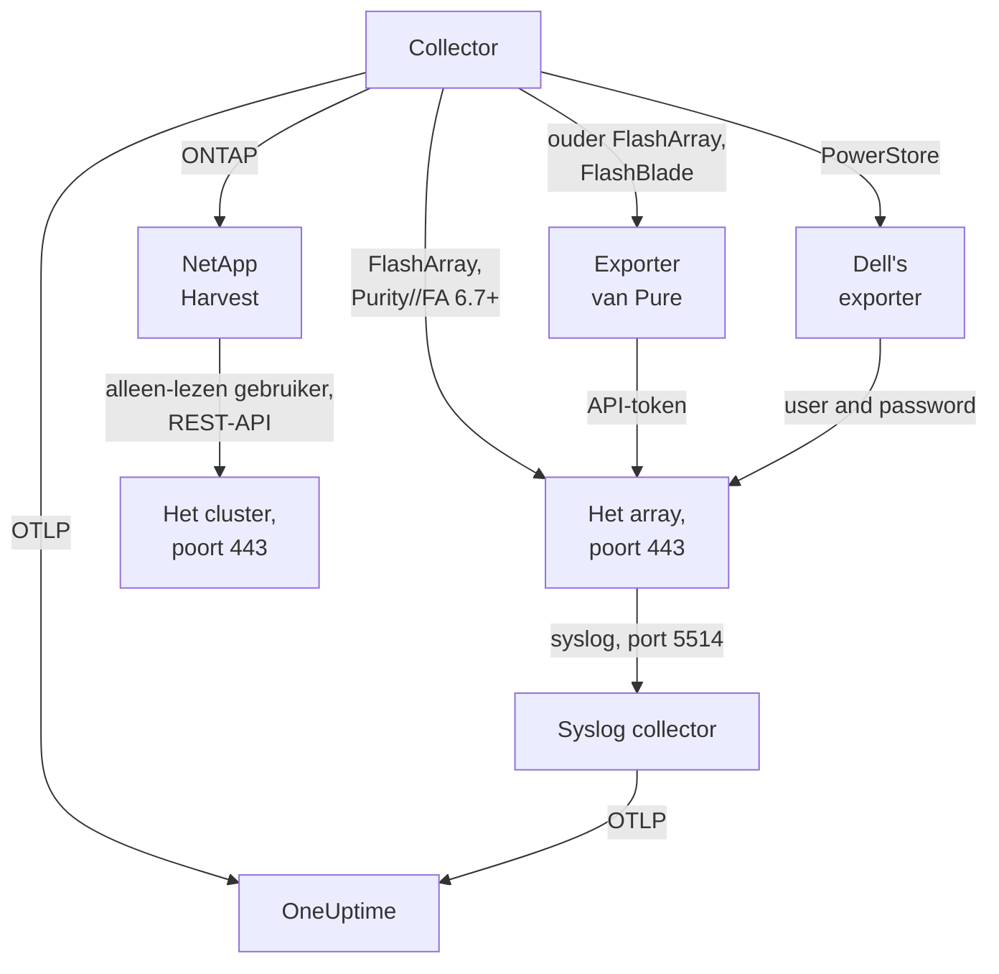

# Opslagarray-agent

De OneUptime Storage Array-agent bewaakt opslagarrays: capaciteit en datareductie, latentie, IOPS en bandbreedte, volumes, hosts, pods en replicatie, hardwaregezondheid, bestandssystemen en buckets, en op NetApp ONTAP ook aggregaten, SVM's, LUN's en SnapMirror-relaties. Het is een standaard OpenTelemetry Collector die de OpenMetrics-endpoints van het array scrapet met het API-token van een alleen-lezen gebruiker (of, voor ONTAP, de eigen exporter van NetApp, Harvest, ernaast), elke metric stempelt met de identiteit van je array en die naar OneUptime stuurt. [Opslagarray-monitors](/docs/monitor/storage-array-monitor) waarschuwen op wat er binnenkomt.

:::cards
- [De agent installeren](#de-agent-installeren): Een alleen-lezen gebruiker, daarna het installatiescript of Docker Compose.
- [Dell PowerScale](#dell-powerscale): SNMP op het cluster, elke node bevraagd, en wat de pagina's ervan tonen.
- [Wat de agent verzamelt](#wat-de-agent-verzamelt): Elk endpoint, en de pagina's die daaruit worden opgebouwd.
- [Meerdere arrays bewaken](#meerdere-arrays-bewaken): Eén agent per array, op één machine.
- [Dell PowerMax](#dell-powermax): Geen agent: een sonde leest elk array achter Unisphere.
- [Problemen oplossen](#problemen-oplossen): Een diagnosescript, en de gebruikelijke problemen.
:::

## Hoe het werkt

Storage Arrays is een product dat voor elke leverancier op dezelfde manier werkt. Het ondersteunt:

| Array | `storage.system` | Hoe de agent het leest | Collectorconfiguratie |
| --- | --- | --- | --- |
| **Pure Storage FlashArray**, Purity//FA 6.7 en later | `purestorage.flasharray` | Het eigen OpenMetrics-endpoint van het array (`https://<array>/metrics/...?namespace=purefa`): naast de collector draait niets | `otel-collector-config.yaml` (de standaard) |
| **Pure Storage FlashArray**, ouder Purity//FA | `purestorage.flasharray` | De FlashArray OpenMetrics-exporter van Pure, die hetzelfde Compose-bestand als de service `pure-fa-exporter` draait | `otel-collector-config.flasharray-exporter.yaml` |
| **Pure Storage FlashBlade** | `purestorage.flashblade` | De FlashBlade OpenMetrics-exporter van Pure, die hetzelfde Compose-bestand als de service `pure-fb-exporter` draait | `otel-collector-config.flashblade.yaml` |
| **Dell PowerStore** | `dell.powerstore` | De PowerStore Metrics Exporter van Dell, die hetzelfde Compose-bestand bouwt en draait als de dienst `powerstore-exporter`; de waarschuwingen van het cluster komen per syslog binnen bij zijn dienst `powerstore-syslog` | `otel-collector-config.powerstore.yaml` |
| **NetApp ONTAP** 9.12.1 en later (AFF, FAS, ASA, ONTAP Select, Cloud Volumes ONTAP), en **Amazon FSx for NetApp ONTAP** | `netapp.ontap` | [NetApp Harvest](https://github.com/NetApp/harvest) 26.11, dat hetzelfde Compose-bestand als de service `netapp-harvest` draait: het meldt zich met een alleen-lezen gebruiker en wachtwoord aan bij de REST-API van het cluster | `otel-collector-config.netapp-ontap.yaml` |
| **Dell PowerScale** (Isilon), OneFS 8.0 en later | `dell.powerscale` | Elke node via SNMP (de ISILON-MIB van Dell), met de eigen SNMP-receiver van de collector: naast de collector draait niets | `otel-collector-config.powerscale.yaml` |

ONTAP heeft geen eigen metrics-endpoint, dus de agent draait de opensource-exporter van NetApp, Harvest, naast de collector. Harvest leest de REST-API van het cluster en serveert wat het heeft gelezen op het Compose-netwerk, elke reeks met de naam `netapp_<object>_<counter>`; de collector scrapet het en stuurt het door. Harvest schrijft nooit naar het cluster, en zijn AutoSupport-rapport aan NetApp staat uit.

**Dell PowerMax** (`dell.powermax`) heeft geen agent nodig: een OneUptime-sonde leest met een alleen-lezenaccount elk array dat een Unisphere for PowerMax beheert. Zie [Dell PowerMax](#dell-powermax).

Pure Storage heeft zichzelf in februari 2026 hernoemd tot **Everpure**. FlashArray, FlashBlade en Purity hielden hun naam, net als de metrics `purefa_*` en `purefb_*`, dus alles op deze pagina geldt voor arrays die onder beide namen worden verkocht.

Een **Dell PowerScale**-cluster wordt op een andere manier gelezen: de agent bevraagt elk van zijn nodes via SNMP, met een alleen-lezen-community of een SNMPv3-gebruiker en zonder API-token. [Dell PowerScale](#dell-powerscale) behandelt alles van het inschakelen van SNMP tot wat de pagina's ervan tonen; de installatiestappen hieronder zijn die van Pure Storage.



Eén agent bewaakt één array: draai één agent per array (zie [Meerdere arrays bewaken](#meerdere-arrays-bewaken)). Het array registreert zich met zijn eerste gegevens, onder de naam die de agent als `storage.array.name` op elke metric stempelt.

## Voordat je begint

- Docker Engine 20.10 of nieuwer met de Docker Compose v2-plugin, op een machine die de beheerinterface van het array via HTTPS (TCP 443) kan bereiken.
- Een beheerdersaccount op het array, om een gebruiker met de ingebouwde rol **readonly** en een API-token daarvoor aan te maken. Op ONTAP een clusterbeheerder (op Amazon FSx for NetApp ONTAP `fsxadmin`), om een alleen-lezen REST-gebruiker met een wachtwoord aan te maken.
- Voor een Dell PowerStore een x86-64-machine (Dell bouwt zijn exporter alleen voor x86-64) en een PowerStore-gebruiker voor de agent: zie [Dell PowerStore](#dell-powerstore).
- Een ingestiesleutel. Maak er een aan onder **Projectinstellingen → Telemetrie & APM → Ingestiesleutels** en kopieer de waarde.

### Waar je de agent draait

De agent praat via HTTPS met de beheerinterface van het array, dus hij kan draaien op elke machine met Docker en een route naar het beheernetwerk op TCP 443: een monitoringhost of een kleine beheer-VM. Kies bij voorkeur een machine waarvan de eigen opslag niet op het bewaakte array staat: als het array uitvalt, mag je monitoring niet mee uitvallen. De optionele syslog-listener vereist ook dat het array de agent op de syslogpoort kan bereiken (zie [De syslog van het array versturen](#optioneel-de-syslog-van-het-array-versturen)).

## De agent installeren

:::steps
### De alleen-lezen gebruiker en het API-token aanmaken

De agent leest alleen maar. Geef hem een eigen gebruiker met de ingebouwde rol **readonly**, nooit een beheerder, en een API-token voor die gebruiker. Maak het token **zonder vervaldatum** aan, anders stopt de agent op de dag dat het token verloopt.

:::tabs
@tab Purity CLI
Maak via SSH als beheerder verbinding met de FlashArray. Het eerste commando vraagt om het wachtwoord van de nieuwe gebruiker; het tweede toont zijn API-token, een UUID:

```bash
pureadmin create --role readonly oneuptime
pureadmin create --api-token oneuptime
```
@tab FlashArray GUI
1. Open _Settings → Users and Policies_ (_Settings → Access_ in oudere releases).
2. Kies in het ⋮-menu van het paneel **Users** de optie **Create User…**, noem de gebruiker `oneuptime` en geef hem de rol readonly.
3. Kies in het ⋮-menu van de nieuwe gebruiker **Create API Token…**, laat **Expires In** leeg en kopieer het token.
@tab FlashBlade
Maak op dezelfde manier een gebruiker met de rol **readonly** en een API-token daarvoor aan: in de gebruikersinstellingen van de FlashBlade-GUI, of met `pureadmin` in de Purity//FB-CLI. Gebruik in een release zonder lokale gebruikers een account van een directoryservice (LDAP of Active Directory) waarvan de groep aan de rol readonly is gekoppeld. FlashBlade-API-tokens beginnen met `T-`.
@tab ONTAP CLI
Maak via SSH als beheerder verbinding met het beheeradres van het cluster. Het eerste commando maakt een REST-rol aan die elke API mag lezen en verder niets; het tweede maakt een HTTP-gebruiker aan die die rol heeft, en vraagt om zijn wachtwoord:

```bash
security login rest-role create -role oneuptime-readonly -api /api -access readonly
security login create -user-or-group-name oneuptime -application http -authentication-method password -role oneuptime-readonly
```

De agent meldt zich aan met deze gebruiker en dit wachtwoord. Er komt geen API-token aan te pas.
@tab ONTAP System Manager
1. Open _Cluster → Settings → Users and Roles_.
2. Kies onder **Roles** de optie **Add**, noem de rol `oneuptime-readonly`, vul `/api` in als **REST API path** en kies de toegang **Read-Only**.
3. Kies onder **Users** de optie **Add**, noem de gebruiker `oneuptime`, geef hem de nieuwe rol, voeg de aanmeldmethode **HTTP** met **Password** toe en stel het wachtwoord in.
@tab Amazon FSx for NetApp ONTAP
Maak via SSH als `fsxadmin` verbinding met het beheerendpoint van het bestandssysteem (de DNS-naam of het IP-adres ervan, uit de FSx-console) en maak de gebruiker aan met de vooraf gedefinieerde alleen-lezen rol van FSx. Het commando vraagt om zijn wachtwoord:

```bash
security login create -user-or-group-name oneuptime -application http -authentication-method password -role fsxadmin-readonly
```

AWS beheert de hardware van het bestandssysteem, dus FSx beantwoordt voor niemand vragen over schijven, shelves of sensoren: de pagina **Hardware** van het array toont de nodes en poorten en zegt dat erbij.
:::

### Controleren of de FlashArray zijn eigen metrics serveert

Pure documenteert het native OpenMetrics-endpoint voor **Purity//FA 6.7.0 en later** (de deprecatiemelding van de FlashArray-exporter van Pure noemt 6.6.11 en later). De snelste manier om het te weten is het array te vragen, vanaf de machine waarop de agent gaat draaien:

```bash
curl -k 'https://<array>/metrics/array?namespace=purefa' --header 'Authorization: Bearer <api-token>' | grep purefa_info
```

Een regel `purefa_info{...} 1` betekent dat het array zijn metrics native serveert: gebruik de standaardconfiguratie. Een `404` betekent van niet: gebruik de exporterconfiguratie, die de exporter van Pure naast de collector draait. Pure heeft die exporter afgeschreven, dus stap over op de native configuratie zodra het array is bijgewerkt. Een FlashBlade loopt altijd via de FlashBlade-exporter van Pure en een ONTAP-cluster via NetApp Harvest, dus sla deze stap daarvoor over.

### De agent installeren en starten

Elke OneUptime serveert het installatiescript en de bestanden van de agent voor zijn eigen release: de opdrachten hieronder downloaden ze van `https://oneuptime.com`, dus vervang dat adres bij een zelf gehoste OneUptime door je URL. Het installatiescript wordt eerst als `install.sh` opgeslagen, zodat je het kunt lezen voordat je het uitvoert.

:::tabs
@tab install.sh
Download het installatiescript en voer het uit op de machine die de agent gaat hosten:

```bash
curl -fsSL https://oneuptime.com/install/storage-array-agent -o install.sh
bash install.sh
```

Het script vraagt welk array het is (een FlashArray die native metrics serveert, een FlashArray met een ouder Purity//FA, een FlashBlade of een NetApp ONTAP-cluster), daarna om je OneUptime-URL, de ingestiesleutel, een naam voor het array, het beheeradres van het array en het API-token van de alleen-lezen gebruiker, of voor ONTAP de naam en het wachtwoord van de alleen-lezen gebruiker (gelezen zonder echo). Het installeert naar `/opt/oneuptime-storage-array-agent`, downloadt het Compose-bestand, elke collectorconfiguratie en de vier bestanden van Harvest, schrijft een met `0600` beschermd `.env`-bestand met de bijbehorende configuratie en het bijbehorende Compose-profiel, en start de agent met Docker Compose. Het zet elke waarde tussen aanhalingstekens voor Docker Compose zoals je die typte. Het opnieuw uitvoeren hergebruikt alles in een bestaande `.env` in plaats van opnieuw te vragen, en bewaart een bestand dat je hebt bewerkt als `<file>.bak.<timestamp>` voordat het dat vervangt.
@tab Docker Compose
Download `docker-compose.yml` en de drie bestanden `otel-collector-config*.yaml` van je OneUptime naar een nieuwe map:

```bash
curl -fsSLO https://oneuptime.com/install/storage-array-agent/docker-compose.yml
curl -fsSLO https://oneuptime.com/install/storage-array-agent/otel-collector-config.yaml
curl -fsSLO https://oneuptime.com/install/storage-array-agent/otel-collector-config.flasharray-exporter.yaml
curl -fsSLO https://oneuptime.com/install/storage-array-agent/otel-collector-config.flashblade.yaml
```

Maak er een `.env`-bestand naast. Het bevat het API-token, dus houd het privé met `chmod 600 .env`. Voor een FlashArray die native metrics serveert:

```bash title=".env"
ONEUPTIME_URL=YOUR_ONEUPTIME_URL
ONEUPTIME_TELEMETRY_INGESTION_KEY=YOUR_TELEMETRY_INGESTION_TOKEN
STORAGE_ARRAY_NAME=my-storage-array
STORAGE_SYSTEM=purestorage.flasharray
STORAGE_ARRAY_COLLECTOR_CONFIG=otel-collector-config.yaml
COMPOSE_PROFILES=
PURE_FA_ENDPOINT=fa-prod-01.example.com
PURE_FA_API_TOKEN=YOUR_READ_ONLY_API_TOKEN
PURE_FB_ENDPOINT=
PURE_FB_API_TOKEN=
POWERSCALE_ENDPOINT=
POWERSCALE_SNMP_COMMUNITY=
STORAGE_ARRAY_INSECURE_SKIP_VERIFY=true
POWERSTORE_ENDPOINT=
POWERSTORE_PASSWORD=
POWERSTORE_USERNAME=
POWERSTORE_BULK_METRICS=
POWERSTORE_API_VERSION=
POWERSTORE_REQUEST_LIMIT=
POWERSTORE_SYSLOG_PORT=
STORAGE_ARRAY_AGENT_CONTAINER_NAME=oneuptime-storage-array-agent
```

Download voor een Dell PowerStore ook `otel-collector-config.powerstore.yaml`, `powerstore-exporter.Dockerfile` en `powerstore-syslog.yaml`, stel `STORAGE_SYSTEM=dell.powerstore`, `STORAGE_ARRAY_COLLECTOR_CONFIG=otel-collector-config.powerstore.yaml` en `COMPOSE_PROFILES=powerstore` in, en vul `POWERSTORE_ENDPOINT`, `POWERSTORE_USERNAME` en `POWERSTORE_PASSWORD` in, het wachtwoord tussen enkele aanhalingstekens.

Stel voor een FlashArray met een ouder Purity//FA `STORAGE_ARRAY_COLLECTOR_CONFIG=otel-collector-config.flasharray-exporter.yaml` en `COMPOSE_PROFILES=flasharray-exporter` in. Stel voor een FlashBlade `STORAGE_SYSTEM=purestorage.flashblade`, `STORAGE_ARRAY_COLLECTOR_CONFIG=otel-collector-config.flashblade.yaml` en `COMPOSE_PROFILES=flashblade` in, en vul `PURE_FB_ENDPOINT` en `PURE_FB_API_TOKEN` in in plaats van het paar `PURE_FA_*`.

Download voor een NetApp ONTAP-cluster of Amazon FSx for NetApp ONTAP ook de ONTAP-configuratie en de vier bestanden van Harvest:

```bash
curl -fsSLO https://oneuptime.com/install/storage-array-agent/otel-collector-config.netapp-ontap.yaml
curl -fsSLO https://oneuptime.com/install/storage-array-agent/netapp-harvest.yml
curl -fsSLO https://oneuptime.com/install/storage-array-agent/netapp-harvest-rest.yaml
curl -fsSLO https://oneuptime.com/install/storage-array-agent/netapp-harvest-keyperf.yaml
curl -fsSLO https://oneuptime.com/install/storage-array-agent/netapp-harvest-restperf.yaml
```

en gebruik deze `.env`. Zet het wachtwoord tussen enkele aanhalingstekens, zoals hier: Docker Compose leest het dan precies zoals het geschreven is, wat er ook in staat. Een wachtwoord met een `'` erin komt in plaats daarvan tussen dubbele aanhalingstekens, met `\"`, `\\` en `$$` voor een `"`, een `\` en een `$`:

```bash title=".env"
ONEUPTIME_URL=YOUR_ONEUPTIME_URL
ONEUPTIME_TELEMETRY_INGESTION_KEY=YOUR_TELEMETRY_INGESTION_TOKEN
STORAGE_ARRAY_NAME=ontap-prod-01
STORAGE_SYSTEM=netapp.ontap
STORAGE_ARRAY_COLLECTOR_CONFIG=otel-collector-config.netapp-ontap.yaml
COMPOSE_PROFILES=netapp-ontap
NETAPP_ONTAP_ENDPOINT=ontap-prod-01.example.com
NETAPP_ONTAP_USERNAME=oneuptime
NETAPP_ONTAP_PASSWORD='YOUR_READ_ONLY_USER_PASSWORD'
STORAGE_ARRAY_INSECURE_SKIP_VERIFY=true
STORAGE_ARRAY_AGENT_CONTAINER_NAME=oneuptime-storage-array-agent
```

Start de agent:

```bash
docker compose up -d
```
:::

### Controleren of de agent draait

```bash
docker compose ps
docker logs -f oneuptime-storage-array-agent
```

`docker compose ps` toont de collector (`oneuptime-storage-array-agent`) en, met een exporterconfiguratie, de exporter (`pure-fa-exporter`, `pure-fb-exporter` of `netapp-harvest`). Zodra de collector is gestart, horen zijn logs deze regel te tonen:

```text
Everything is ready. Begin running and processing data.
```

### Het array in OneUptime vinden

Open **Producten → Infrastructuur → Opslagarrays → Alle opslagarrays**. Na de eerste scrape (ongeveer een minuut) staat het array er met zijn capaciteit, prestaties, open waarschuwingen en hardware. Volumes, hosts en pods volgen binnen 2 minuten, de bestandssystemen en buckets van een FlashBlade binnen 5, en FlashArray-directory's binnen 30. Een ONTAP-cluster verschijnt zodra Harvest het heeft gelezen, en zijn hele inventaris binnen ongeveer 3 minuten, de interval waarmee Harvest de configuratie opvraagt. De pagina **Topologie** van de array tekent haar hosts, volumes, bestandssystemen en hardware op één kaart: zie [Topologie](/docs/telemetry/topology#de-eigen-kaart-van-een-resource-openen).
:::

## Dell PowerStore

De agent leest een PowerStore-cluster via de PowerStore Metrics Exporter van Dell, release `powerstore-metrics-exporter_v1.0.3`. Dell publiceert die als binary, niet als image, dus bouwt de dienst `powerstore-exporter` bij de eerste start het door Dell gedocumenteerde image uit `powerstore-exporter.Dockerfile` en controleert daarbij de SHA-256 van de binary; die build heeft één keer `quay.io` en `github.com` nodig.

De exporter van Dell meldt zich aan met een gebruikersnaam en wachtwoord, want PowerStore heeft geen API-tokens. Voeg in PowerStore Manager onder _Settings → Users_ een lokale gebruiker toe die alleen voor de agent is, met de rol **Storage Operator**: de exporter leest de prestaties uit het bulkmetriekarchief van vijf minuten van PowerStore, dat hij zelf inschakelt en dat PowerStoreOS 4.1 en nieuwer vereisen, en volgens de README van Dell kan de rol Operator het niet inschakelen. Op een oudere PowerStoreOS volstaat de alleen-lezen rol **Operator** met `POWERSTORE_BULK_METRICS=false`. Alleen de exporter leest het wachtwoord, uit `.env`.

De exporter van Dell leest geen waarschuwingen, dus stuurt het cluster zijn eigen: de dienst `powerstore-syslog` ontvangt zijn remote syslog op poort 5514, via TCP en UDP, en zet elke regel op de pagina **Logboeken** van de array, met het record van PowerStore in attributen (`powerstore.alert.id`, `powerstore.alert.state`, `powerstore.event.code`) en een ernst uit de gebeurteniscodes van Dell (`powerstore.alert.severity`). Open in PowerStore Manager _Settings → Security → Remote Logging_, voeg deze machine toe op poort 5514 en open de poort in zijn firewall. Syslog via TLS op poort 6514 staat beschreven in `powerstore-syslog.yaml`.

De exporter van Dell meldt geen hosts en geen replicatiesessies, dus deze versie heeft ze niet.

## Omgevingsvariabelen

Het installatiescript schrijft deze naar `/opt/oneuptime-storage-array-agent/.env`; een Docker Compose-installatie leest ze uit de `.env` naast `docker-compose.yml`. Voer na het wijzigen van een waarde `docker compose up -d` uit in die map.

| Variabele | Vereist | Beschrijving |
| --- | --- | --- |
| `ONEUPTIME_URL` | Ja | Je OneUptime-URL, zoals `https://oneuptime.com` of je zelf-gehoste instantie. Gebruik `http://` en de poort als de instantie alleen HTTP spreekt. |
| `ONEUPTIME_TELEMETRY_INGESTION_KEY` | Ja | De ingestiesleutel uit **Projectinstellingen → Telemetrie & APM → Ingestiesleutels**. |
| `STORAGE_ARRAY_NAME` | Ja | De naam waaronder het array zich in OneUptime registreert, op elke metric gestempeld als het resource-attribuut `storage.array.name`. Houd hem stabiel: een latere wijziging registreert een tweede array. Zonder deze naam weigert de collector te starten. |
| `STORAGE_SYSTEM` | Nee | Het platform, gestempeld als het resource-attribuut `storage.system`: `purestorage.flasharray`, `purestorage.flashblade` of `netapp.ontap`. Standaard `purestorage.flasharray`. |
| `STORAGE_ARRAY_COLLECTOR_CONFIG` | Nee | Welke meegeleverde collectorconfiguratie draait: `otel-collector-config.yaml` (FlashArray, native: de standaard), `otel-collector-config.flasharray-exporter.yaml` (oudere FlashArray), `otel-collector-config.flashblade.yaml` (FlashBlade) of `otel-collector-config.netapp-ontap.yaml` (ONTAP). |
| `COMPOSE_PROFILES` | Nee | Start de exporter die de gekozen configuratie scrapet: leeg voor de native FlashArray-configuratie, `flasharray-exporter`, `flashblade` of `netapp-ontap` voor de andere. |
| `PURE_FA_ENDPOINT` | FlashArray | Het beheeradres van de FlashArray: een hostnaam of IP, zonder `https://`. |
| `PURE_FA_API_TOKEN` | FlashArray | Het API-token van de FlashArray-gebruiker met de rol readonly. |
| `PURE_FB_ENDPOINT` | FlashBlade | Het beheeradres van de FlashBlade: een hostnaam of IP, zonder `https://`. |
| `PURE_FB_API_TOKEN` | FlashBlade | Het API-token van de FlashBlade-gebruiker met de rol readonly. |
| `POWERSTORE_ENDPOINT` | PowerStore | Het beheeradres van het PowerStore-cluster: een hostnaam of IP, zonder `https://`. |
| `POWERSTORE_USERNAME` | PowerStore | De PowerStore-gebruiker waarmee de exporter van Dell zich aanmeldt. |
| `POWERSTORE_PASSWORD` | PowerStore | Het wachtwoord van die gebruiker. Alleen de exporter leest het. |
| `POWERSTORE_BULK_METRICS` | Nee | `true` leest de prestaties uit het bulkmetriekarchief van PowerStore; `false` leest elk object afzonderlijk. Standaard `true`. |
| `POWERSTORE_API_VERSION` | Nee | `v3` voor PowerStoreOS 3.6 en nieuwer, of `v1`. Standaard `v3`. |
| `POWERSTORE_REQUEST_LIMIT` | Nee | Hoeveel verzoeken de exporter tegelijk naar het cluster stuurt. Standaard `16`. |
| `POWERSTORE_SYSLOG_PORT` | Nee | De poort waarop deze machine de syslog van het cluster ontvangt, via TCP en UDP. Standaard `5514`. |
| `NETAPP_ONTAP_ENDPOINT` | ONTAP | Het beheeradres van het cluster (op FSx het beheerendpoint van het bestandssysteem): een hostnaam of IP, zonder `https://`. |
| `NETAPP_ONTAP_USERNAME` | ONTAP | De alleen-lezen REST-gebruiker, zoals `oneuptime`. |
| `NETAPP_ONTAP_PASSWORD` | ONTAP | Zijn wachtwoord. Alleen Harvest leest het, precies zoals het geschreven is. |
| `POWERSCALE_NODES` | PowerScale | De adressen van alle nodes, gescheiden door komma's, nooit de naam van de SmartConnect-zone. Het installatiescript schrijft er de bevragingen hieronder uit. |
| `POWERSCALE_ENDPOINT` | PowerScale | De node waarlangs de gezondheid, capaciteit en quota van het cluster zelf worden gelezen: de eerste in `POWERSCALE_NODES`. |
| `POWERSCALE_SNMP_RECEIVERS` | PowerScale | De bevragingen die de collector uitvoert: `snmp/cluster`, `snmp/quotas` en dan `snmp/node-1` en verder, één per node. |
| `POWERSCALE_NODE_<n>` | PowerScale | Het adres van node `<n>`, van `1` tot `252`. Een IPv6-adres staat tussen vierkante haken, zoals `[fd00::11]`. |
| `POWERSCALE_SNMP_VERSION` | Nee | `v2c` of `v3`. Standaard `v2c`. |
| `POWERSCALE_SNMP_COMMUNITY` | SNMP v2c | De alleen-lezen-community van het cluster. |
| `POWERSCALE_SNMP_USER` | SNMPv3 | De alleen-lezen-gebruiker voor SNMPv3 van het cluster. |
| `POWERSCALE_SNMP_SECURITY_LEVEL` | Nee | `auth_priv`, `auth_no_priv` of `no_auth_no_priv`. Standaard `auth_priv`. |
| `POWERSCALE_SNMP_AUTH_PROTOCOL` | Nee | `MD5`, `SHA`, `SHA224`, `SHA256`, `SHA384` of `SHA512`, zoals `isi snmp settings view` het toont. Standaard `SHA`. |
| `POWERSCALE_SNMP_AUTH_PASSWORD` | SNMPv3 | Het authenticatiewachtwoord van de SNMPv3-gebruiker. |
| `POWERSCALE_SNMP_PRIVACY_PROTOCOL` | Nee | `DES`, `AES`, `AES192`, `AES256`, `AES192C` of `AES256C`. Standaard `AES`. |
| `POWERSCALE_SNMP_PRIVACY_PASSWORD` | SNMPv3 | Het privacywachtwoord van de SNMPv3-gebruiker, op het niveau `auth_priv`. |
| `STORAGE_ARRAY_INSECURE_SKIP_VERIFY` | Nee | `true` accepteert het zelfondertekende certificaat van het array op het native endpoint en in Harvest; `false` verifieert het. Standaard `true`. De exporters van Pure verifiëren het certificaat van het array nooit, dus het geldt niet voor hen. |
| `STORAGE_ARRAY_AGENT_CONTAINER_NAME` | Nee | De containernaam van de agent. Standaard `oneuptime-storage-array-agent`. De agent van een tweede array op dezelfde machine heeft een eigen naam nodig: zie [Meerdere arrays bewaken](#meerdere-arrays-bewaken). Het installatiescript noemt een nieuwe agent naar zijn map, tenzij je hem instelt, en behoudt hem wanneer je het script opnieuw uitvoert. |

## Hoe de agent scrapet

- **Eén scrapejob per endpoint, elk zo vaak gelezen als het waard is.** FlashArray: `/metrics/array` elke 60 seconden; `/metrics/volumes`, `/metrics/hosts` en `/metrics/pods` elke 2 minuten; `/metrics/directories` elke 30 minuten, wat Pure zelf aanraadt, omdat de ruimte van directory's voor het array duur is om te berekenen. FlashBlade: `/metrics/array` elke 60 seconden; `/metrics/filesystems` en `/metrics/objectstore` elke 5 minuten, opnieuw volgens het advies van Pure om de endpoints voor bestandssystemen en objectopslag minder vaak te lezen dan het array.
- **Elke job labelt zijn series met `scrape_endpoint: <endpoint>`.** Elk endpoint exporteert ook `purefa_info` of `purefb_info`, zodat OneUptime weet van welke families een batch de volledige lijst is: zo verdwijnt een verwijderd volume, host, pod, bestandssysteem of bucket uit de inventaris in plaats van te blijven hangen. Houd de labels zoals ze geleverd worden.
- **Latentie per volume en per host houdt drie dimensies.** Elk volume en elke host exporteert zijn latentie in maximaal zestien `dimension`s. Een regel `metric_relabel_configs` houdt `usec_per_read_op`, `usec_per_write_op` en `usec_per_mirrored_write_op` en laat de uitsplitsing naar QoS-snelheidslimiet, wachtrij, SAN en servicetijd vallen, die de series van een groot array vermenigvuldigt. De arraybrede uitsplitsing op `purefa_array_performance_latency_usec` blijft behouden. Verwijder de regel om ook de uitsplitsing per volume te houden.
- **Het API-token is een Bearer-token.** De native configuratie stuurt het naar het array zelf; de exporterconfiguraties sturen het alleen via het Compose-netwerk naar de exporter, en de poorten van de exporters worden nooit gepubliceerd.
- **Een PowerStore elke 5 minuten.** De exporter van Dell biedt elk deel van het cluster aan op `/metrics/<cluster>/<part>`: de configuratie leest `cluster` elke 60 seconden, zijn heartbeat, en `appliance`, `capacity`, `hardware`, `port`, `volume`, `volumeGroup`, `nas` en `file` elke 5 minuten, omdat PowerStore ze in steekproeven van vijf minuten berekent.
- **Geen `send_batch_max_size`.** OneUptime bouwt de inventaris opnieuw op uit één hele scrape per verzoek, dus de meegeleverde processor `batch` verdeelt een scrape nooit over exports. Houd de batchinstellingen zoals ze geleverd worden.
- **ONTAP: Harvest vraagt het cluster op, de collector scrapet Harvest.** Harvest leest de configuratie en status van het cluster elke 3 minuten, de prestaties elke minuut (latenties in microseconden per bewerking, bewerkingen en bytes per seconde) en de EMS-gebeurtenissen elke 3 minuten, en serveert het nieuwste van alles op `netapp-harvest:12990`, dat de collector elke 60 seconden scrapet met het label `scrape_endpoint: harvest`. De drie bestanden `netapp-harvest-*.yaml` beperken Harvest tot wat OneUptime leest. De eigen reeksen `netapp_metadata_*` van Harvest zeggen welke objecten het volledig heeft opgesomd, zodat een verwijderd volume uit de inventaris verdwijnt terwijl een object dat Harvest niet kon lezen zijn laatste aantal houdt. De collector laat de metingen die Harvest van zichzelf doet en de prestatiereeksen per schijf vallen, en zet het schema van elke SnapMirror-relatie om in `netapp_snapmirror_schedule_seconds` (een uurlijks schema is 3600), waarmee SnapMirror Behind Schedule de achterstand vergelijkt.

## Wat de agent verzamelt

De semantische conventies van Pure gelden zowel voor het native FlashArray-endpoint als voor beide exporters; die van ONTAP zijn die van Harvest, beschreven na de tabel. Elke waarde is een gauge die het array zelf berekent (latenties in microseconden per bewerking, doorvoer per seconde), dus er hoeven geen snelheden te worden berekend, en objecten worden benoemd door **datapuntlabels**: `name` voor volumes, pods, directory's, bestandssystemen en buckets, `host` voor hosts, `component_name` voor FlashArray-hardware. De agent voegt de resource-attributen `storage.array.name` en `storage.system` toe, zodat OneUptime alles onder je array plaatst:

| Endpoint | Metricfamilies | Wat OneUptime ermee bouwt |
| --- | --- | --- |
| FlashArray `/metrics/array` | `purefa_info`, `purefa_alerts_open`, `purefa_array_space_*`, `purefa_array_performance_*`, `purefa_hw_component_status`, `purefa_hw_component_temperature_celsius`, `purefa_hw_controller_info`, `purefa_drive_capacity_bytes`, `purefa_network_interface_*` | De naam, Purity-versie en systeem-ID van het array; capaciteit, gebruikte ruimte en datareductie; aantallen open waarschuwingen; de gezondheid van het array; de pagina **Hardware** (componenten, schijven, controllers, netwerkinterfaces) |
| FlashArray `/metrics/volumes` | `purefa_volume_performance_*`, `purefa_volume_space_*`, `purefa_volume_qos_*` | De pagina **Volumes**: toegewezen en fysieke grootte, datareductie, lees- en schrijflatentie, IOPS en bandbreedte per volume |
| FlashArray `/metrics/hosts` | `purefa_host_connectivity_info`, `purefa_host_connections_info`, `purefa_host_performance_*`, `purefa_host_space_*` | De pagina **Hosts**: connectiviteit (redundante paden of niet), verbonden volumes, latentie, IOPS en bandbreedte per host |
| FlashArray `/metrics/pods` | `purefa_pod_performance_*`, `purefa_pod_space_*`, `purefa_pod_replica_links_*`, `purefa_pod_mediator_status` | De pagina **Replicatie**: ActiveCluster- en ActiveDR-pods, status en achterstand van replicakoppelingen |
| FlashArray `/metrics/directories` | `purefa_directory_performance_*`, `purefa_directory_space_*` | De pagina **Mappen** (FlashArray File Services) |
| FlashBlade `/metrics/array` | `purefb_info`, `purefb_alerts_open`, `purefb_array_space_*`, `purefb_array_performance_*`, `purefb_hardware_health` | De naam, Purity-versie en systeem-ID van de FlashBlade; capaciteit en datareductie; aantallen open waarschuwingen; de gezondheid van het array; de pagina **Hardware** |
| FlashBlade `/metrics/filesystems` | `purefb_file_systems_space_*`, `purefb_file_systems_performance_*` | De pagina **Bestandssystemen**: toegewezen en gebruikte ruimte, datareductie, latentie, IOPS en bandbreedte per bestandssysteem |
| FlashBlade `/metrics/objectstore` | `purefb_buckets_space_*`, `purefb_buckets_quota_space_bytes`, `purefb_buckets_object_count`, `purefb_buckets_performance_*`, `purefb_object_store_accounts_*` | De pagina **Buckets**: ruimte, quotum, aantal objecten en prestaties per bucket, gegroepeerd per account |
| PowerStore `cluster`, `appliance`, `capacity` | `powerstore_cluster`, `powerstore_metro_*`, `powerstore_appliance`, `powerstore_perf_*`, `powerstore_cap_*` | De naam en toestand van het cluster; de pagina **Appliances**: capaciteit, gegevensreductie, latentie, IOPS en bandbreedte van elke appliance |
| PowerStore `hardware`, `port` | `powerstore_hardware_*`, `powerstore_wear_metrics_by_drive`, `powerstore_fc_port_*`, `powerstore_eth_port_*`, `powerstore_metricFcPort_*`, `powerstore_metricEthPort_*` | De pagina **Hardware**: knooppunten, ventilatoren, voedingen, batterijen, schijven en front-endpoorten, elk met zijn appliance |
| PowerStore `volume`, `volumeGroup`, `nas`, `file` | `powerstore_volume_*`, `powerstore_metricVolume_*`, `powerstore_volumegroup_*`, `powerstore_metricVg_*`, `powerstore_nas_server_operational_status`, `powerstore_metricNas_*`, `powerstore_filesystem_*`, `powerstore_metricFilesystem_*` | De pagina's **Volumes**, **Volumegroepen**, **NAS-servers** en **Bestandssystemen** |
| ONTAP, via Harvest | `netapp_cluster_*`, `netapp_node_*`, `netapp_aggr_*`, `netapp_svm_*`, `netapp_volume_*`, `netapp_lun_*`, `netapp_snapmirror_*` | De naam, release en UUID van het cluster; de capaciteit (de som van de data-aggregaten) en datareductie; de pagina **Volumes**; de pagina's **Aggregaten**, **SVM's**, **LUN's** en **SnapMirror**, een pagina per object |
| ONTAP-hardware, via Harvest | `netapp_disk_*`, `netapp_shelf_*`, `netapp_environment_sensor_*`, `netapp_net_port_*`, `netapp_nic_*`, `netapp_fcp_*` | De pagina **Hardware**: nodes, schijven, shelves, hun voedingen, ventilatoren, modules en sensoren, de sensoren van de nodes, en Ethernet- en Fibre Channel-poorten |
| Openstaande problemen en gebeurtenissen van ONTAP | `netapp_health_*`, `netapp_ems_events` | De aantallen open waarschuwingen en de kaart **Actieve waarschuwingen** (kapotte schijven, shelf-fouten, HA-takeover, poorten offline, systeemgezondheidswaarschuwingen), en de EMS-sjablonen |
| PowerScale `snmp/cluster` | `powerscale_cluster_*`, `powerscale_ifs_*` | De naam, OneFS-versie, gezondheid en aantallen nodes van het cluster; de capaciteit van `/ifs`; doorvoer, netwerk en CPU over het hele cluster |
| PowerScale `snmp/quotas` | `powerscale_quota_*` | De pagina **Quota**: het gebruik van elk quotum, zijn limieten en hoe dicht het erbij zit |
| PowerScale `snmp/node-<n>` | `powerscale_node_*`, `powerscale_protocol_*`, `powerscale_drive_*`, `powerscale_fan_*`, `powerscale_temperature_*`, `powerscale_power_sensor_*`, `powerscale_interface_*`, `powerscale_chassis_*` | De pagina **Knooppunten**: de gezondheid, CPU, doorvoer en protocolprestaties van elke node; de pagina **Hardware**: zijn schijven, sensoren en poorten |

Op ONTAP is elke reeks van Harvest: een object wordt benoemd door zijn labels (`volume` binnen zijn `svm`, `aggr`, `lun`, `node`, `disk`, `shelf`, `destination_location` voor een SnapMirror-relatie), een status is een `netapp_*_new_status` van 1 of 0 of een reeks `netapp_*_labels` waarvan de labels hem noemen, en elk openstaand probleem is een reeks `netapp_health_*_alerts` die bestaat zolang het duurt.

De kolom **Gezondheid** van **Alle opslagarrays** leest de eigen waarschuwingen en de hardware van het array in zijn nieuwste gegevens: **Kritiek** zolang het een open kritieke waarschuwing meldt, of een hardwarecomponent, schijf of controller die kritiek, defect, ontbrekend of ongezond is; **Waarschuwing** zolang het een open waarschuwing van niveau warning meldt, of een gedegradeerde of onbekende component; anders **OK**; en **Onbekend** zolang de agent niet verbonden is. Het **Overzicht** van het array beoordeelt meer, zoals de volgende sectie zegt. In monitorcriteria krijgen de attributen van het array een prefix `resource.` (`resource.storage.array.name`, `resource.storage.system`), terwijl de datapuntlabels kaal blijven (`name`, `host`, `dimension`, `space`).

De gezondheid van een PowerStore is die van zijn hardware, omdat zijn waarschuwingen als logboeken binnenkomen. De agent berekent `powerstore_cap_physical_used_percent` en `powerstore_filesystem_logical_used_percent` zelf, en leest de toestand van een knooppunt als 1 zolang het Healthy is.

## Wat de pagina's van het array tonen

Het **Overzicht** van het array noemt zijn gezondheid, **Gezond**, **Verminderd** of **Ongezond**, naar wat aandacht nodig heeft, en somt dat op onder **Vraagt aandacht**, het dringendste eerst, elk één stap van waar je moet kijken:

- **Het array zelf.** Een open waarschuwing die het array zelf met ernst critical gaf, is kritiek, en een met ernst warning vraagt een blik. Boven 80% van zijn bruikbare capaciteit vraagt het een blik, en boven 90% is het kritiek, waar de waarschuwingen Capacity Above 80% en Capacity Above 90% afgaan. Een FlashArray met een gemiddelde lees- of schrijflatentie boven 5 ms, of een FlashBlade waarvan leesbewerkingen langer dan 10 ms duren, vraagt een blik.
- **Hardware.** Een component, schijf, controller of netwerkinterface die het array als kritiek, defect, ontbrekend of ongezond meldt, is kritiek: de redundantie is weg tot het onderdeel is vervangen. Een die het als gedegradeerd, onbekend, niet herkend of niet gereed meldt, vraagt een blik. Onderdelen die niet geïnstalleerd, uitgeschakeld of ongebruikt zijn, worden nooit vermeld.
- **Hosts.** Een host die het array niet meer via beide controllers bereikt, vraagt een blik, met de reden: via maar één controller, over ongelijke paden of zonder enig pad.
- **Pods.** Een pod waarvan het array de replicaverbinding als ongezond meldt, is kritiek, en een die meer dan een minuut achterloopt, vraagt een blik.
- **Bestandssystemen.** Een FlashBlade-bestandssysteem met minder dan 10% van zijn toegewezen grootte vrij, vraagt een blik.
- **De eigen objecten van een ONTAP-cluster.** Een volume, aggregaat of LUN dat ONTAP als offline meldt, een kapotte schijf, een shelf-onderdeel met een fout, een node-sensor voorbij zijn kritieke drempel en een poort die offline is, zijn kritiek; een gestopte SVM, een node met een defecte ventilator of voeding en een sensor voorbij zijn waarschuwingsdrempel vragen een blik, met de eigen woorden van ONTAP voor de reden. Een SnapMirror-relatie die ONTAP als ongezond meldt, is kritiek, en een die meer dan anderhalf schema-interval achterloopt, vraagt een blik.

De lijsten **Hosts**, **Replicatie** en **Bestandssystemen** noemen de staat van elk onderdeel volgens dezelfde regels, met de reden eronder, en dat doen ook de lijsten **Volumes**, **Aggregaten**, **SVM's**, **LUN's** en **SnapMirror** van een ONTAP-cluster, waarvan elke rij een eigen pagina opent: de staat, wat aandacht nodig heeft, wat erop open staat, de waarschuwingen van het cluster die het onderdeel bewaken, wat ONTAP erover meldt en de grafieken. De pagina's van elk platform spreken zijn eigen taal: een ONTAP-volume toont zijn SVM, zijn aggregaat en hoe vol het is, en zijn pagina toont de reeksen van ONTAP in grafieken. Op Amazon FSx for NetApp ONTAP toont de pagina **Hardware** de nodes en poorten en zegt ze waarom er geen schijven of shelves zijn. De eigen pagina van een host en van een bestandssysteem zegt wat er aandacht nodig heeft en welke waarschuwingen van het array hem bewaken, met één stap om de rest aan te zetten, en de pagina van elk onderdeel, ook die van een volume en een bucket, zegt wat erop open staat. Zolang de agent niet verbonden is, toont de gezondheid **Gezondheid onbekend**: het laatste rapport van het array is niet meer de waarheid. Elke grens hierboven is die waarop zijn waarschuwingssjabloon afgaat, zoals de [opslagarray-monitor](/docs/monitor/storage-array-monitor) ze opsomt.

Op een PowerStore tonen de tabbladen **Appliances**, **Volumegroepen** en **NAS-servers** de onderdelen die alleen een PowerStore heeft, en de pagina **Hardware** noemt de appliance van elk onderdeel, omdat elke appliance zijn onderdelen hetzelfde noemt.

## Optioneel — De syslog van het array versturen

De syslog-collector van een PowerStore draait zoals hij geleverd wordt (zie [Dell PowerStore](#dell-powerstore)): deze sectie is voor de arrays van Pure.

Standaard stuurt de agent alleen metrics, dus de pagina **Logboeken** van het array blijft leeg. Arrays sturen hun waarschuwingen en auditgebeurtenissen door als syslog, en elke meegeleverde collectorconfiguratie bevat een uitgecommentarieerd receiverpaar `syslog` (TCP en UDP op poort 5514, RFC 3164), gekoppeld aan een uitgecommentarieerde pipeline `logs` die `storage.array.name` stempelt, zodat de logs op je array terechtkomen.

:::steps
### De receivers inschakelen

Haal de twee receivers `syslog/*` en de pipeline `logs` uit commentaar in de collectorconfiguratie die je gebruikt. Tijdstempels volgens RFC 3164 hebben geen tijdzone: stel `location` in op de tijdzone van het array, tenzij de klok daarvan op UTC loopt.

### De poort openen

Haal het blok `ports:` in `docker-compose.yml` uit commentaar, zodat de machine `5514/tcp` en `5514/udp` publiceert, en voer daarna `docker compose up -d` uit. Open de poort in de firewall van de machine voor het beheernetwerk van het array.

### Het array naar de agent laten wijzen

Doe dit als beheerder, niet als de alleen-lezen monitoringgebruiker. Open op een FlashArray _Settings → System → Syslog Servers_, voeg `udp://<agent-host>:5514` (of `tcp://<agent-host>:5514`) toe en stuur een testbericht. Voeg op een FlashBlade in de syslog-instellingen een syslogserver met dezelfde URI toe. Beide arrays accepteren de vorm `PROTOCOL://HOST:PORT`, ook via hun REST-API's (`syslog-servers`).
:::

Een syslog-receiver luistert op maar één transport, daarom zijn TCP en UDP twee receivers: laat er een uitgecommentarieerd als je alleen de andere nodig hebt. De standaard collectorimage leest syslog zoals het is: er is geen eigen image nodig.

## Het array labelen met projectlabels

Een resource-attribuut dat begint met `oneuptime.label.` wordt een projectlabel op het opslagarray: `oneuptime.label.<dimension>=<value>` is het label `<dimension>:<value>`. Voeg de attributen toe aan de processor `resource` in de collectorconfiguratie die je gebruikt, naast `storage.array.name`:

```yaml
processors:
  resource:
    attributes:
      # ...existing attributes...
      - key: oneuptime.label.team
        value: storage
        action: upsert
      - key: oneuptime.label.env
        value: production
        action: upsert
```

De collector leest zijn configuratie alleen bij het starten: voer `docker compose restart oneuptime-storage-array-agent` uit. Het array toont dan de labels `team:storage` en `env:production`. Labels worden zonder onderscheid tussen hoofd- en kleine letters vergeleken, dus een bestaand label `Production` wordt hergebruikt in plaats van gedupliceerd, en de agent verwijdert nooit een label dat iemand in OneUptime heeft toegevoegd.

## Meerdere arrays bewaken

Eén agent leest één array. Om er meerdere vanaf dezelfde machine te bewaken, installeer je elk in een eigen map met een eigen `.env` en een eigen containernaam, want twee containers kunnen geen naam delen: `INSTALL_DIR=/opt/oneuptime-storage-array-agent-fa02 STORAGE_ARRAY_AGENT_CONTAINER_NAME=oneuptime-storage-array-agent-fa02 bash install.sh`. Zonder `STORAGE_ARRAY_AGENT_CONTAINER_NAME` noemt het script de container naar de map, wat hier dezelfde naam oplevert. Het bewaart de naam in de `.env` van die agent, dus als je het script opnieuw uitvoert om de agent te upgraden, blijft de naam ook behouden, en een agent waarvan je de `container_name` ooit in `docker-compose.yml` hebt bewerkt, behoudt die naam. Stel met Docker Compose in plaats daarvan `STORAGE_ARRAY_AGENT_CONTAINER_NAME` in de `.env` van elke agent in. Geef de map met `-d` door aan het diagnosescript.

Een tweede PowerStore-agent heeft ook een eigen syslog-poort nodig: stel `POWERSTORE_SYSLOG_PORT`, bijvoorbeeld `5515`, in zijn `.env` in.

## Draaien als systemd-service

Installeer de systemd-unit van de agent om hem met de machine te starten en hem te herstarten als hij faalt. De unit gaat ervan uit dat de agent in `/opt/oneuptime-storage-array-agent` staat, waar het installatiescript hem neerzet:

```bash
sudo curl -fsSL https://oneuptime.com/install/storage-array-agent/systemd/oneuptime-storage-array-agent.service -o /etc/systemd/system/oneuptime-storage-array-agent.service
sudo systemctl daemon-reload
sudo systemctl enable --now oneuptime-storage-array-agent
```

## De agent upgraden

De agent meldt de collectorversie die zijn bestanden vastzetten als zijn **Agentversie**. Is die ouder dan de versie die deze OneUptime-release vastzet, dan verschijnt er een waarschuwingsteken naast, op de pagina **Overzicht** van het array. Selecteer het om deze commando's te zien. Een agent die is geïnstalleerd voordat zijn bestanden een versie meldden, toont er geen tot hij op deze manier is bijgewerkt.

De collectorimage is vastgezet in `docker-compose.yml` en de configuraties ervan zijn bestanden ernaast, dus alleen pullen brengt de agent niet verder. Voer `install.sh` opnieuw uit: het hergebruikt elke waarde in je bestaande `.env` (er wordt niets opnieuw gevraagd), vernieuwt `docker-compose.yml`, elke collectorconfiguratie en de bestanden van Harvest (een bestand dat je hebt bewerkt, wordt bewaard als `<file>.bak.<timestamp>`) en maakt de agent opnieuw aan zodat de collector zijn nieuwe configuratie leest. Een agent die buiten `/opt/oneuptime-storage-array-agent` is geïnstalleerd, heeft zijn map nodig: `INSTALL_DIR=<folder> bash install.sh`. Hij behoudt zijn containernaam.

```bash
curl -fsSL https://oneuptime.com/install/storage-array-agent -o install.sh
bash install.sh
```

Heb je hem in plaats daarvan met Docker Compose geïnstalleerd? Download in de map van de agent het Compose-bestand en de collectorconfiguraties opnieuw (voor ONTAP ook de ONTAP-configuratie en de vier bestanden van Harvest, en voer eventuele wijzigingen die je erin had gedaan opnieuw door), pull daarna de images en maak de agent opnieuw aan:

```bash
curl -fsSLO https://oneuptime.com/install/storage-array-agent/docker-compose.yml
curl -fsSLO https://oneuptime.com/install/storage-array-agent/otel-collector-config.yaml
curl -fsSLO https://oneuptime.com/install/storage-array-agent/otel-collector-config.flasharray-exporter.yaml
curl -fsSLO https://oneuptime.com/install/storage-array-agent/otel-collector-config.flashblade.yaml
curl -fsSLO https://oneuptime.com/install/storage-array-agent/otel-collector-config.powerstore.yaml
curl -fsSLO https://oneuptime.com/install/storage-array-agent/powerstore-exporter.Dockerfile
curl -fsSLO https://oneuptime.com/install/storage-array-agent/powerstore-syslog.yaml
curl -fsSLO https://oneuptime.com/install/storage-array-agent/otel-collector-config.netapp-ontap.yaml
curl -fsSLO https://oneuptime.com/install/storage-array-agent/netapp-harvest.yml
curl -fsSLO https://oneuptime.com/install/storage-array-agent/netapp-harvest-rest.yaml
curl -fsSLO https://oneuptime.com/install/storage-array-agent/netapp-harvest-keyperf.yaml
curl -fsSLO https://oneuptime.com/install/storage-array-agent/netapp-harvest-restperf.yaml
curl -fsSLO https://oneuptime.com/install/storage-array-agent/otel-collector-config.powerscale.yaml
docker compose pull
docker compose up -d --force-recreate
```

Een PowerStore-agent downloadt ook `otel-collector-config.powerstore.yaml`, `powerstore-exporter.Dockerfile` en `powerstore-syslog.yaml` opnieuw; `docker compose up` bouwt het image van de exporter opnieuw wanneer een nieuwe release zijn tag verplaatst.

## De agent verwijderen

```bash
cd /opt/oneuptime-storage-array-agent
docker compose down
```

Verwijder daarna de alleen-lezen gebruiker en zijn API-token op het array als je ze niet meer nodig hebt. Voer op ONTAP `security login delete -user-or-group-name oneuptime -application http -authentication-method password` uit en daarna `security login rest-role delete -role oneuptime-readonly -api /api`.

Voer op een PowerStore `docker compose --profile powerstore down` uit, zodat ook de exporter en de syslog-collector stoppen.

## Dell PowerMax

Een Dell PowerMax heeft geen agent nodig. Een OneUptime-sonde meldt zich elke 5 minuten met een alleen-lezenaccount aan bij de REST API van Unisphere for PowerMax en leest elk array dat die Unisphere beheert. Elk array verschijnt in **Opslagarrays** onder zijn Symmetrix ID, zoals `000220200269`, en je kunt het hernoemen. Het wachtwoord wordt versleuteld opgeslagen, wordt nooit meer getoond en wordt alleen naar de sonde gestuurd die je kiest.

- **Unisphere for PowerMax 10.1 of nieuwer**, die arrays op PowerMaxOS 10 of 5978 beheert. Vanaf Unisphere 10.3 ziet een alleen-lezenaccount ook poorten en SRDF-groepen.
- **Een sonde die Unisphere via TCP 8443 bereikt**, meestal een [aangepaste sonde](/docs/probe/custom-probe) in het netwerk van Unisphere. Op OneUptime Cloud ontvangt een gedeelde sonde nooit een opslagwachtwoord, dus kies een eigen sonde van je project.
- **Een Unisphere-gebruiker met de rol Monitor** op elk array dat hij moet lezen, en de rol **PerfMonitor** voor prestaties. Meer is niet nodig: OneUptime wijzigt het array nooit.

:::steps
### De alleen-lezen gebruiker aanmaken

Maak in Unisphere for PowerMax onder **Settings → Users and Groups** een lokale gebruiker aan of kies een directorygebruiker. Geef hem de rol **Monitor** op elk array, en **PerfMonitor** voor prestaties.

### Controleren of Unisphere prestaties verzamelt

Controleer onder **Settings → Performance → System Registrations** of de verzameling **Diagnostic** voor elk array aanstaat: zonder die verzameling toont OneUptime de inventaris en waarschuwingen van het array, maar geen prestatiegrafieken. Om een opslaggroep elke 5 seconden te zien, registreer je hem daar ook voor **Real Time**, tot 100 per array.

### Unisphere verbinden

Ga naar **Producten → Infrastructuur → Opslagarrays → Verbindingen** en klik op **Unisphere verbinden**. Voer het adres in waarop je Unisphere opent, zoals `https://unisphere.example.com:8443`, de gebruikersnaam en het wachtwoord, en kies de sonde.

### De verbinding testen

Met **Verbinding testen** meldt de sonde zich aan en leest ze wat het account kan zien: elk array, zijn opslaggroepen en volumes, en of Unisphere de prestaties ervan verzamelt. Unisphere ondertekent standaard zijn eigen certificaat: de test toont het, en **Dit certificaat vertrouwen** zet de SHA-256-vingerafdruk ervan in het formulier. Vergelijk de vingerafdruk eerst met die van Unisphere zelf, bijvoorbeeld met `openssl s_client -connect unisphere.example.com:8443` vanaf de machine van de sonde.

### Een naam geven en verbinden

Geef de verbinding een naam, of houd de hostnaam, en klik op **Koppelen**. De pagina ervan toont binnen een paar minuten de eerste verzameling en elk gevonden array, elk met een link naar zijn pagina in **Opslagarrays**.
:::

De sonde leest de gedocumenteerde REST-endpoints van Unisphere: de klassieke `/univmax/restapi` voor de arrays, capaciteit, gezondheid, waarschuwingen en pools, en de bulk-API `/univmax/rest/v1` voor de opslaggroepen, volumes, directors, poorten, SRDF-groepen en prestaties. Elke aanroep is een leesactie. Wat ze leest, stuurt ze als deze reeksen, met de milliseconden van Unisphere als microseconden en zijn MB per seconde als bytes per seconde:

| Reeksen | Wat ze bevatten |
| --- | --- |
| `powermax_array_*` | Het array: model en microcode, bruikbare, gebruikte en toegezegde capaciteit, datareductie, gezondheidsscores, of Unisphere de prestaties ervan verzamelt, en zijn 5-minutenwaarden voor responstijden, IOPS, doorvoer, cache en bezetting |
| `powermax_alert_open` | Eén reeks per waarschuwing die Unisphere voor het array open heeft, vanaf Minor, totdat iemand die bevestigt of wist |
| `powermax_storage_group_*` | Elke opslaggroep: capaciteit en volumes, 5-minutenwaarden voor responstijden, IOPS en doorvoer, en 5-secondenwaarden als hij voor realtime is geregistreerd |
| `powermax_volume_*` | Elk volume in een opslaggroep: zijn capaciteit, en zijn waarden als zijn opslaggroep voor realtime is geregistreerd |
| `powermax_srp_*` | Elke opslagresourcepool: capaciteit en responstijd |
| `powermax_director_*` | Elke director: rol, status en bezetting, en `powermax_director_offline` zolang hij niet online is |
| `powermax_port_*` | Elke poort: protocol, snelheid, lichtniveaus en bezetting, en `powermax_port_offline` zolang een poort waarop iemand vertrouwt uitgevallen is |
| `powermax_srdf_group_*` | Elke SRDF-groep: extern array en modi, achterstand en doorvoer, en `powermax_srdf_group_not_healthy` zolang hij onderbroken of offline is |

- **Elke 5 minuten**, of elke 10 om een drukke Unisphere te ontzien (**Meer velden** in het formulier van de verbinding): Unisphere berekent prestaties elke 5 minuten.
- **Alleen de arrays die Unisphere zelf beheert.** De externe arrays die hij via SRDF ziet, staan op de pagina van de verbinding en worden gelezen door de Unisphere op hun eigen locatie: verbind die ook.
- **Tot 5,000 opslaggroepen en 10,000 volumes per array**, en 200 nieuwe waarschuwingen per verzameling (de rest komt bij de volgende). Een ingekorte lijst wordt als zodanig vermeld op de pagina van de verbinding.
- **Unisphere 10.1 en 10.2** tonen een alleen-lezenaccount geen poorten of SRDF-groepen: de sonde leest de directors een voor een, haalt de SRDF-groepen uit de opslaggroepen en meldt dat.

## Dell PowerScale

De agent leest een Dell PowerScale-cluster (Isilon) via SNMP, uit de ISILON-MIB van Dell, met de eigen SNMP-receiver van de collector: geen API-token, en naast de collector draait niets. Een cluster is één opslagarray, en zijn nodes, quota, schijven, sensoren en poorten vormen zijn inventaris.

- **Elke node wordt op zijn eigen adres bevraagd.** Een node antwoordt op SNMP alleen voor zijn eigen schijven, sensoren en poorten, dus de agent bevraagt elke node via zijn adres op het netwerk dat de agent bereikt, nooit via de naam van de SmartConnect-zone, die elke bevraging doorgeeft aan een node naar keuze. Een cluster heeft tot 252 nodes.
- **De eigen objecten van het cluster worden één keer gelezen, via de eerste node:** de gezondheid, capaciteit, doorvoer, CPU en aantallen nodes elke 60 seconden (`snmp/cluster`), en de SmartQuotas elke 5 minuten (`snmp/quotas`). De gezondheid, CPU, protocolprestaties (NFS, SMB, S3, HDFS en de rest), schijven, sensoren en poorten van elke node worden elke 60 seconden van de node zelf gelezen (`snmp/node-<n>`).
- **Meetwaarden die OneFS als tekst of in andere eenheden geeft** (sensormetingen, CPU in tienden van een procent, doorvoer in bits) zet de collector om in getallen voordat hij ze verstuurt, zodat elke grafiek en elk template een eenvoudige gauge leest.

### SNMP inschakelen op het cluster

Maak als beheerder via SSH verbinding met een willekeurige node: OneFS past SNMP-instellingen toe op het hele cluster. Als het cluster al op SNMP antwoordt voor een andere tool, geef de agent dan dezelfde alleen-lezen-community of SNMPv3-gebruiker en sla deze stap over. Schakel anders de SNMP-service en SNMP v2c in met een eigen alleen-lezen-community, niet de standaardcommunity van OneFS, `I$ilonpublic`:

```bash
isi snmp settings modify --service yes
isi snmp settings modify --snmp-v1-v2c-access yes -c '<read-only-community>'
```

Of schakel SNMPv3 in, dat elke bevraging authenticeert en versleutelt. OneFS heeft één alleen-lezen-gebruiker voor SNMPv3, `general` totdat je hem hernoemt: geef hem wachtwoorden van minstens acht tekens, zonder spaties:

```bash
isi snmp settings modify --service yes
isi snmp settings modify --snmp-v3-access yes -u '<read-only-user>' --snmp-v3-password '<authentication-password>' --snmp-v3-priv-password '<privacy-password>'
```

`isi snmp settings view` toont de instellingen, met de authenticatie- en privacyprotocollen van de gebruiker. Sta UDP 161 toe van de machine van de agent naar elke node, en toon de adressen van de nodes met `isi network interfaces list`.

### De agent installeren op een PowerScale-cluster

Voer het installatiescript uit met de PowerScale-configuratie:

```bash
curl -fsSL https://oneuptime.com/install/storage-array-agent -o install.sh
STORAGE_ARRAY_COLLECTOR_CONFIG=otel-collector-config.powerscale.yaml bash install.sh
```

Het script vraagt om je OneUptime-URL, de ingestiesleutel en een naam voor het cluster, daarna om de adressen van alle nodes, gescheiden door komma's, en de SNMP-versie, en daarna om de alleen-lezen-community, of de SNMPv3-gebruiker en zijn twee wachtwoorden, elk gelezen zonder echo. Een gebruiker wiens protocollen niet SHA en AES zijn, heeft `POWERSCALE_SNMP_AUTH_PROTOCOL` en `POWERSCALE_SNMP_PRIVACY_PROTOCOL` voor `bash install.sh` nodig, en een gebruiker zonder privacy `POWERSCALE_SNMP_SECURITY_LEVEL=auth_no_priv`. Het script schrijft één bevraging per node in `.env`:

```bash title=".env"
STORAGE_SYSTEM=dell.powerscale
STORAGE_ARRAY_COLLECTOR_CONFIG=otel-collector-config.powerscale.yaml
POWERSCALE_ENDPOINT='10.20.0.11'
POWERSCALE_SNMP_COMMUNITY='YOUR_READ_ONLY_COMMUNITY'
POWERSCALE_SNMP_VERSION='v2c'
POWERSCALE_NODES='10.20.0.11,10.20.0.12,10.20.0.13'
POWERSCALE_SNMP_RECEIVERS='[snmp/cluster, snmp/quotas, snmp/node-1, snmp/node-2, snmp/node-3]'
POWERSCALE_NODE_1='10.20.0.11'
POWERSCALE_NODE_2='10.20.0.12'
POWERSCALE_NODE_3='10.20.0.13'
```

Krijgt het cluster er een node bij, voeg dan het adres ervan toe aan `POWERSCALE_NODES` in `.env` en voer `install.sh` opnieuw uit: het schrijft de bevraging van de node en maakt de agent opnieuw aan. Download met Docker Compose `docker-compose.yml` en `otel-collector-config.powerscale.yaml`, en zet deze regels in de `.env` van de snelstart in plaats van de regels `STORAGE_SYSTEM`, `STORAGE_ARRAY_COLLECTOR_CONFIG` en `POWERSCALE_*` daarin. `troubleshoot.sh` vraagt elke node met `snmpget` naar de naam van het cluster als de machine dat heeft.

### Wat de pagina's van een PowerScale tonen

Het **Overzicht** van het cluster neemt zijn gezondheid over van wat OneFS zelf meldt, telt zijn nodes en quota, en tekent de latentie en belasting van elk protocol, de doorvoer, de drukste nodes en de gebruikte capaciteit. **Knooppunten** toont elke node met zijn gezondheid, model, OneFS-versie, CPU en doorvoer; **Quota** toont elk quotum met hoeveel van zijn limiet het gebruikt, het grootste eerst; **Hardware** toont de schijven van elke node, zijn ventilatoren en zijn temperatuur- en stroomsensoren met hun meetwaarden, en zijn poorten. De capaciteit is die van `/ifs`, en de ruimte die OneFS achterhoudt voor virtuele hot spares telt als gebruikt: die is niet beschikbaar voor schrijfbewerkingen.

### Wat de agent nog niet leest

- **De gebeurtenissen van OneFS en zijn opslagpools.** SNMP draagt geen van beide: ze komen uit de OneFS-API, die een OneUptime-sonde zal lezen ([#11249](https://github.com/OneUptime/oneuptime/issues/11249)). Stuur de gebeurtenissen tot dan als SNMP-traps naar een [aangepaste sonde](/docs/probe/custom-probe), en voeg de nodes van het cluster daaraan toe als [netwerkapparaten](/docs/monitor/network-device-monitor): de traps komen binnen op UDP 162, en de criteria **SNMP-trap ontvangen (trap-OID)** waarschuwen erop. Geef voor SNMPv3-traps de netwerkapparaten de SNMPv3-gebruiker van het cluster ([SNMPv3-traps en -informs](/docs/monitor/network-device-monitor#snmpv3-traps-en-informs)). Maak op het cluster het kanaal aan en stuur er een waarschuwing naartoe:

```bash
isi event channels create oneuptime snmp --host <probe-address> --community '<trap-community>' --use-snmp-trap true
isi event alerts modify <alert> --channel oneuptime
```

- **Datareductie**, die OneFS alleen via zijn API meldt, komt met dezelfde sonde.

## Problemen oplossen

:::details Voer eerst het diagnosescript uit
De agent wordt geleverd met een script, [`troubleshoot.sh`](https://oneuptime.com/install/storage-array-agent/troubleshoot.sh), dat de hele keten controleert: de container-runtime; het endpoint van het array precies zoals de collector het bereikt (het native endpoint of de exporter van Pure: DNS, TLS, of een FlashArray het native endpoint überhaupt heeft, en of het array het API-token accepteert, dat het script via stdin aan curl doorgeeft); de arraynaam die op elke metric is gestempeld; de vorm van het token; de eigen metrics van de collector; en of OneUptime de ingestiesleutel accepteert. Die laatste controle is het belangrijkst. OneUptime weigert een onjuiste sleutel met `401` (`422` voor een uitgeschakelde sleutel of een browsersleutel), en de collector behandelt beide als permanent: hij laat de batch vallen en logt één fout `Exporting failed`, die makkelijk over het hoofd wordt gezien terwijl de container gezond blijft. Het script vraagt `GET <url>/otlp/v1/validate` op vanuit het netwerk van de agent voor een direct `200` (geldig) of `401` (ongeldig), en valt op oudere servers terug op `POST /fluentd/v1/logs`.

```bash
curl -fsSL https://oneuptime.com/install/storage-array-agent/troubleshoot.sh -o troubleshoot.sh
bash troubleshoot.sh    # add -d <dir> if you installed outside /opt/oneuptime-storage-array-agent
```

Het eindigt met een oordeel dat de meest waarschijnlijke oorzaak noemt.
:::

:::details Er verschijnt geen array in OneUptime
1. Lees de logs van de collector: `docker logs oneuptime-storage-array-agent`. `server returned HTTP status 401` betekent dat het array het API-token weigerde, `404` dat de FlashArray geen native endpoint heeft, `x509` dat TLS-verificatie aanstaat tegenover het zelfondertekende certificaat van het array, `no such host` of `connection refused` een onjuiste `PURE_FA_ENDPOINT` of `PURE_FB_ENDPOINT`, en een `401` bij het exporteren een onjuiste ingestiesleutel.
2. Vraag het array vanuit het netwerk van de agent. De collectorimage heeft geen shell of curl, dus vraag het vanuit een container in zijn netwerk: `docker run --rm --network container:oneuptime-storage-array-agent curlimages/curl -sk -H 'Authorization: Bearer <api-token>' 'https://<array>/metrics/array?namespace=purefa'` hoort `purefa_*`-regels te tonen.
3. Controleer of `STORAGE_ARRAY_NAME` is ingesteld: het array wordt gevonden via zijn resource-attribuut `storage.array.name`, en zonder deze naam weigert de collector te starten.
:::

:::details Het array wordt als verbroken weergegeven
Een array krijgt de status verbroken zodra OneUptime er 15 minuten niets van heeft ontvangen; OneUptime controleert elke 5 minuten, en tijd waarin het zelf geen gegevens ontving, telt niet mee. Controleer of de collector draait (`docker compose ps`), of zijn logs geen scrape- of exportfouten tonen en of de machine het array en je OneUptime-URL nog bereikt. Met zijn volgende gegevens is het array weer verbonden.
:::

:::details De FlashArray antwoordt met 404
Zijn Purity//FA heeft geen native OpenMetrics-endpoint. Voer `install.sh` opnieuw uit en kies de optie voor ouder Purity, of stel `STORAGE_ARRAY_COLLECTOR_CONFIG=otel-collector-config.flasharray-exporter.yaml` en `COMPOSE_PROFILES=flasharray-exporter` in `.env` in en voer `docker compose up -d` uit. Schakel na het upgraden van het array naar Purity//FA 6.7 of later terug naar de native configuratie en laat het profiel vallen.
:::

:::details Het array weigert het API-token
Controleer of je het API-token hebt geplakt en niet het wachtwoord van de gebruiker, of de gebruiker nog bestaat en de rol readonly heeft, en of het token niet is verlopen. Maak een nieuw token aan (`pureadmin create --api-token oneuptime` op een FlashArray), zet het in `.env` en voer `docker compose up -d` uit. Via de exporters van Pure verschijnt een geweigerd token in het log van de collector als een HTTP `400` van de exporter, met als inhoud `failed to login`.
:::

:::details x509- of TLS-fouten
Arrays tonen standaard een zelfondertekend certificaat, dat geen enkele Docker-image vertrouwt. Stel `STORAGE_ARRAY_INSECURE_SKIP_VERIFY=true` in (de praktische keuze op een privé beheernetwerk), of installeer op het array een certificaat van een CA die de collectorimage vertrouwt.
:::

:::details pure-fa-exporter, pure-fb-exporter of netapp-harvest wordt niet gevonden
De exporter draait niet: `COMPOSE_PROFILES` moet passen bij `STORAGE_ARRAY_COLLECTOR_CONFIG` (`flasharray-exporter` voor de FlashArray-exporterconfiguratie, `flashblade` voor de FlashBlade-configuratie, `netapp-ontap` voor de ONTAP-configuratie). Corrigeer `.env` en voer `docker compose up -d` uit; `docker compose ps` toont dan de exporter.
:::

:::details ONTAP: Harvest kan zich niet aanmelden, of er ontbreekt een object
Lees het log van Harvest: `docker compose logs netapp-harvest`. Een `401` of `Unauthorized` betekent dat het cluster de gebruiker of zijn wachtwoord weigerde: controleer of de gebruiker de aanmeldmethode **http** en de alleen-lezen REST-rol heeft (`security login show -user-or-group-name oneuptime`), corrigeer `.env` en voer `docker compose up -d` uit. Een `403` of `not authorized` bij één object betekent dat de rol die API niet bereikt; de rol hierboven bereikt heel `/api`. Op Amazon FSx for NetApp ONTAP antwoordt FSx zo voor schijven, shelves en sensoren, wie het ook vraagt: dat is verwacht, en de pagina **Hardware** zegt het. `connection refused` of `no such host` betekent een onjuiste `NETAPP_ONTAP_ENDPOINT`: dat is het beheeradres van het cluster (op FSx het beheerendpoint), niet dat van een node of een SVM. Het diagnosescript controleert dit allemaal ook.
:::

:::details Een PowerStore stuurt niets
Lees het log van de exporter met `docker compose logs powerstore-exporter`: een `401` betekent een verkeerde gebruikersnaam of een verkeerd wachtwoord, en een `403` op `latest_five_min_metrics` betekent dat de rol van de gebruiker het bulkmetriekarchief niet kan inschakelen (geef hem **Storage Operator**, of stel `POWERSTORE_BULK_METRICS=false` in op een PowerStoreOS ouder dan 4.1). De exporter heeft na de start een minuut nodig voordat hij antwoordt. Geen waarschuwingen op de pagina **Logboeken**: controleer de instellingen _Remote Logging_ van het cluster, de firewall op poort 5514 en `docker compose logs powerstore-syslog`.
:::

:::details Een PowerScale-cluster of -node stuurt niets
`Error scraping metrics` met `request timeout` in het log van de collector noemt een node die vanaf de machine van de agent niet op SNMP antwoordt: SNMP staat uit voor de versie die de agent gebruikt, de community of SNMPv3-gebruiker is niet die van het cluster, of UDP 161 wordt geblokkeerd. `bash troubleshoot.sh` bevraagt elke node met `snmpget`. Een node die antwoordt maar ontbreekt in **Knooppunten**, staat niet in `POWERSCALE_NODES`: voeg hem toe en voer `install.sh` opnieuw uit.
:::

:::details Verwijderde volumes of hosts blijven in de inventaris
OneUptime verwijdert een object wanneer een volledige scrape van zijn endpoint het niet meer bevat, wat het herkent aan het label `scrape_endpoint`. Als je de meegeleverde collectorconfiguratie door je eigen hebt vervangen, houd dan de labels `scrape_endpoint` op de scrapejobs ervan; anders verdwijnen objecten pas uit de inventaris als ze verouderd raken.
:::

:::details Metrics komen onder het verkeerde array terecht
OneUptime registreert een opslagarray aan de hand van zijn `storage.array.name`, die de agent uit `STORAGE_ARRAY_NAME` haalt. Die na de eerste gegevens wijzigen maakt een tweede array aan in plaats van het eerste te hernoemen.
:::

:::details Metrics versturen zonder de agent
De agent is één standaard collectorconfiguratie, dus collectors die je al draait, kunnen hetzelfde werk doen: kopieer de scrapejobs en de processor `resource` uit de meegeleverde configuratie naar je eigen configuratie. Het resource-attribuut `storage.array.name` is wat het array in OneUptime registreert, en het verwijderen van `service.name` / `service.instance.id` voorkomt dat de gegevens onder een service worden geplaatst: behoud beide, en behoud de labels `scrape_endpoint`.
:::

:::details De verbindingstest meldt dat het certificaat van Unisphere niet wordt vertrouwd
Unisphere for PowerMax ondertekent zijn eigen certificaat, tenzij iemand er een van een certificeringsinstantie heeft geïnstalleerd. Vergelijk de vingerafdruk die de test toont met die van Unisphere zelf, klik dan op **Dit certificaat vertrouwen** en test opnieuw. Wanneer het certificaat van Unisphere wordt vernieuwd, stopt de verzameling met **Het certificaat van de server is gewijzigd** totdat je het nieuwe vertrouwt: tot dan wordt er niets naar Unisphere gestuurd.
:::

:::details De verbindingstest meldt dat het account de arrays niet mag lezen
Unisphere antwoordt `403` voor een account zonder rol op het array. Geef de gebruiker onder **Settings → Users and Groups** de rol **Monitor** op elk array, en **PerfMonitor** voor prestaties. Een array waarop het account geen rol heeft, staat met de reden op de pagina van de verbinding, en de andere worden gelezen.
:::

:::details Een PowerMax toont geen responstijden of IOPS
Unisphere verzamelt geen prestaties voor het array, of het account mist **PerfMonitor**: de pagina van de verbinding zegt welke van de twee. Zet de verzameling **Diagnostic** aan onder **Settings → Performance → System Registrations**. De waarden van een volume, en die van een opslaggroep elke 5 seconden, vereisen dat de opslaggroep daar ook voor **Real Time** is geregistreerd.
:::

## Volgende stappen

:::cards
- [Opslagarray-monitor](/docs/monitor/storage-array-monitor): Waarschuw op waarschuwingen, capaciteit, latentie, hardware, hostpaden, replicatie en bestandssystemen.
- [VMware-agent](/docs/telemetry/vmware): Draait VMware op het array? Bekijk ook de datastores en VM's.
- [OpenTelemetry-collector op de host](/docs/telemetry/host-otel-collector): De weergave van het besturingssysteem van de machines die het array gebruiken.
:::
