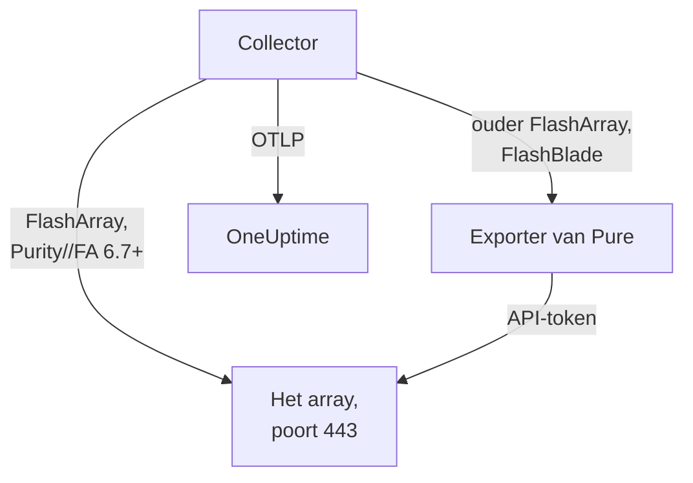

# Opslagarray-agent

De OneUptime Storage Array-agent bewaakt opslagarrays: capaciteit en datareductie, latentie, IOPS en bandbreedte, volumes, hosts, pods en replicatie, hardwaregezondheid, bestandssystemen en buckets. Het is een standaard OpenTelemetry Collector die de OpenMetrics-endpoints van het array scrapet met het API-token van een alleen-lezen gebruiker, elke metric stempelt met de identiteit van je array en die naar OneUptime stuurt. [Opslagarray-monitors](/docs/monitor/storage-array-monitor) waarschuwen op wat er binnenkomt.

:::cards
- [De agent installeren](#de-agent-installeren): Een alleen-lezen gebruiker, daarna het installatiescript of Docker Compose.
- [Wat de agent verzamelt](#wat-de-agent-verzamelt): Elk endpoint, en de pagina's die daaruit worden opgebouwd.
- [Meerdere arrays bewaken](#meerdere-arrays-bewaken): Eén agent per array, op één machine.
- [Problemen oplossen](#problemen-oplossen): Een diagnosescript, en de gebruikelijke problemen.
:::

## Hoe het werkt

Storage Arrays is een product dat voor elke leverancier op dezelfde manier werkt. Het ondersteunt:

| Array | Hoe de agent het leest | Collectorconfiguratie |
| --- | --- | --- |
| **Pure Storage FlashArray**, Purity//FA 6.7 en later | Het eigen OpenMetrics-endpoint van het array (`https://<array>/metrics/...?namespace=purefa`): naast de collector draait niets | `otel-collector-config.yaml` (de standaard) |
| **Pure Storage FlashArray**, ouder Purity//FA | De FlashArray OpenMetrics-exporter van Pure, die hetzelfde Compose-bestand als de service `pure-fa-exporter` draait | `otel-collector-config.flasharray-exporter.yaml` |
| **Pure Storage FlashBlade** | De FlashBlade OpenMetrics-exporter van Pure, die hetzelfde Compose-bestand als de service `pure-fb-exporter` draait | `otel-collector-config.flashblade.yaml` |

Pure Storage heeft zichzelf in februari 2026 hernoemd tot **Everpure**. FlashArray, FlashBlade en Purity hielden hun naam, net als de metrics `purefa_*` en `purefb_*`, dus alles op deze pagina geldt voor arrays die onder beide namen worden verkocht.



Eén agent bewaakt één array: draai één agent per array (zie [Meerdere arrays bewaken](#meerdere-arrays-bewaken)). Het array registreert zich met zijn eerste gegevens, onder de naam die de agent als `storage.array.name` op elke metric stempelt.

## Voordat je begint

- Docker Engine 20.10 of nieuwer met de Docker Compose v2-plugin, op een machine die de beheerinterface van het array via HTTPS (TCP 443) kan bereiken.
- Een beheerdersaccount op het array, om een gebruiker met de ingebouwde rol **readonly** en een API-token daarvoor aan te maken.
- Een ingestiesleutel. Maak er een aan onder **Projectinstellingen → Telemetrie & APM → Ingestiesleutels** en kopieer de waarde.

### Waar je de agent draait

De agent praat via HTTPS met de beheerinterface van het array, dus hij kan draaien op elke machine met Docker en een route naar het beheernetwerk op TCP 443: een monitoringhost of een kleine beheer-VM. Kies bij voorkeur een machine waarvan de eigen opslag niet op het bewaakte array staat: als het array uitvalt, mag je monitoring niet mee uitvallen. De optionele syslog-listener vereist ook dat het array de agent op de syslogpoort kan bereiken (zie [De syslog van het array versturen](#optioneel-de-syslog-van-het-array-versturen)).

## De agent installeren

:::steps
### De alleen-lezen gebruiker en het API-token aanmaken

De agent leest alleen maar. Geef hem een eigen gebruiker met de ingebouwde rol **readonly**, nooit een beheerder, en een API-token voor die gebruiker. Maak het token **zonder vervaldatum** aan, anders stopt de agent op de dag dat het token verloopt.

:::tabs
@tab Purity CLI
Maak via SSH als beheerder verbinding met de FlashArray. Het eerste commando vraagt om het wachtwoord van de nieuwe gebruiker; het tweede toont zijn API-token, een UUID:

```bash
pureadmin create --role readonly oneuptime
pureadmin create --api-token oneuptime
```
@tab FlashArray GUI
1. Open _Settings → Users and Policies_ (_Settings → Access_ in oudere releases).
2. Kies in het ⋮-menu van het paneel **Users** de optie **Create User…**, noem de gebruiker `oneuptime` en geef hem de rol readonly.
3. Kies in het ⋮-menu van de nieuwe gebruiker **Create API Token…**, laat **Expires In** leeg en kopieer het token.
@tab FlashBlade
Maak op dezelfde manier een gebruiker met de rol **readonly** en een API-token daarvoor aan: in de gebruikersinstellingen van de FlashBlade-GUI, of met `pureadmin` in de Purity//FB-CLI. Gebruik in een release zonder lokale gebruikers een account van een directoryservice (LDAP of Active Directory) waarvan de groep aan de rol readonly is gekoppeld. FlashBlade-API-tokens beginnen met `T-`.
:::

### Controleren of de FlashArray zijn eigen metrics serveert

Pure documenteert het native OpenMetrics-endpoint voor **Purity//FA 6.7.0 en later** (de deprecatiemelding van de FlashArray-exporter van Pure noemt 6.6.11 en later). De snelste manier om het te weten is het array te vragen, vanaf de machine waarop de agent gaat draaien:

```bash
curl -k 'https://<array>/metrics/array?namespace=purefa' --header 'Authorization: Bearer <api-token>' | grep purefa_info
```

Een regel `purefa_info{...} 1` betekent dat het array zijn metrics native serveert: gebruik de standaardconfiguratie. Een `404` betekent van niet: gebruik de exporterconfiguratie, die de exporter van Pure naast de collector draait. Pure heeft die exporter afgeschreven, dus stap over op de native configuratie zodra het array is bijgewerkt. Een FlashBlade loopt altijd via de FlashBlade-exporter van Pure, dus sla deze stap daarvoor over.

### De agent installeren en starten

:::tabs
@tab install.sh
Download het installatiescript en voer het uit op de machine die de agent gaat hosten:

```bash
curl -sSL https://raw.githubusercontent.com/OneUptime/oneuptime/master/agents/StorageArrayAgent/install.sh -o install.sh
bash install.sh
```

Het script vraagt welk array het is (een FlashArray die native metrics serveert, een FlashArray met een ouder Purity//FA, of een FlashBlade), daarna om je OneUptime-URL, de ingestiesleutel, een naam voor het array, het beheeradres van het array en het API-token van de alleen-lezen gebruiker (gelezen zonder echo). Het installeert naar `/opt/oneuptime-storage-array-agent`, downloadt het Compose-bestand en alle drie de collectorconfiguraties, schrijft een met `0600` beschermd `.env`-bestand met de bijbehorende configuratie en het bijbehorende Compose-profiel, en start de agent met Docker Compose. Het zet elke waarde tussen aanhalingstekens voor Docker Compose zoals je die typte. Het opnieuw uitvoeren hergebruikt alles in een bestaande `.env` in plaats van opnieuw te vragen, en bewaart een bestand dat je hebt bewerkt als `<file>.bak.<timestamp>` voordat het dat vervangt.
@tab Docker Compose
Download `docker-compose.yml` en de drie bestanden `otel-collector-config*.yaml` uit de [StorageArrayAgent-map](https://github.com/OneUptime/oneuptime/tree/master/agents/StorageArrayAgent) naar een nieuwe map:

```bash
curl -fsSLO https://raw.githubusercontent.com/OneUptime/oneuptime/master/agents/StorageArrayAgent/docker-compose.yml
curl -fsSLO https://raw.githubusercontent.com/OneUptime/oneuptime/master/agents/StorageArrayAgent/otel-collector-config.yaml
curl -fsSLO https://raw.githubusercontent.com/OneUptime/oneuptime/master/agents/StorageArrayAgent/otel-collector-config.flasharray-exporter.yaml
curl -fsSLO https://raw.githubusercontent.com/OneUptime/oneuptime/master/agents/StorageArrayAgent/otel-collector-config.flashblade.yaml
```

Maak er een `.env`-bestand naast. Het bevat het API-token, dus houd het privé met `chmod 600 .env`. Voor een FlashArray die native metrics serveert:

```bash title=".env"
ONEUPTIME_URL=YOUR_ONEUPTIME_URL
ONEUPTIME_TELEMETRY_INGESTION_KEY=YOUR_TELEMETRY_INGESTION_TOKEN
STORAGE_ARRAY_NAME=my-storage-array
STORAGE_SYSTEM=purestorage.flasharray
STORAGE_ARRAY_COLLECTOR_CONFIG=otel-collector-config.yaml
COMPOSE_PROFILES=
PURE_FA_ENDPOINT=fa-prod-01.example.com
PURE_FA_API_TOKEN=YOUR_READ_ONLY_API_TOKEN
PURE_FB_ENDPOINT=
PURE_FB_API_TOKEN=
STORAGE_ARRAY_INSECURE_SKIP_VERIFY=true
```

Stel voor een FlashArray met een ouder Purity//FA `STORAGE_ARRAY_COLLECTOR_CONFIG=otel-collector-config.flasharray-exporter.yaml` en `COMPOSE_PROFILES=flasharray-exporter` in. Stel voor een FlashBlade `STORAGE_SYSTEM=purestorage.flashblade`, `STORAGE_ARRAY_COLLECTOR_CONFIG=otel-collector-config.flashblade.yaml` en `COMPOSE_PROFILES=flashblade` in, en vul `PURE_FB_ENDPOINT` en `PURE_FB_API_TOKEN` in in plaats van het paar `PURE_FA_*`. Start de agent:

```bash
docker compose up -d
```
:::

### Controleren of de agent draait

```bash
docker compose ps
docker logs -f oneuptime-storage-array-agent
```

`docker compose ps` toont de collector (`oneuptime-storage-array-agent`) en, met een exporterconfiguratie, de exporter (`pure-fa-exporter` of `pure-fb-exporter`). Zodra de collector is gestart, horen zijn logs deze regel te tonen:

```text
Everything is ready. Begin running and processing data.
```

### Het array in OneUptime vinden

Open **Producten → Infrastructuur → Storage Arrays → All Storage Arrays**. Na de eerste scrape (ongeveer een minuut) staat het array er met zijn capaciteit, prestaties, open waarschuwingen en hardware. Volumes, hosts en pods volgen binnen 2 minuten, de bestandssystemen en buckets van een FlashBlade binnen 5, en FlashArray-directory's binnen 30.
:::

## Omgevingsvariabelen

Het installatiescript schrijft deze naar `/opt/oneuptime-storage-array-agent/.env`; een Docker Compose-installatie leest ze uit de `.env` naast `docker-compose.yml`. Voer na het wijzigen van een waarde `docker compose up -d` uit in die map.

| Variabele | Vereist | Beschrijving |
| --- | --- | --- |
| `ONEUPTIME_URL` | Ja | Je OneUptime-URL, zoals `https://oneuptime.com` of je zelf-gehoste instantie. Gebruik `http://` en de poort als de instantie alleen HTTP spreekt. |
| `ONEUPTIME_TELEMETRY_INGESTION_KEY` | Ja | De ingestiesleutel uit **Projectinstellingen → Telemetrie & APM → Ingestiesleutels**. |
| `STORAGE_ARRAY_NAME` | Ja | De naam waaronder het array zich in OneUptime registreert, op elke metric gestempeld als het resource-attribuut `storage.array.name`. Houd hem stabiel: een latere wijziging registreert een tweede array. Zonder deze naam weigert de collector te starten. |
| `STORAGE_SYSTEM` | Nee | Het platform, gestempeld als het resource-attribuut `storage.system`: `purestorage.flasharray` of `purestorage.flashblade`. Standaard `purestorage.flasharray`. |
| `STORAGE_ARRAY_COLLECTOR_CONFIG` | Nee | Welke meegeleverde collectorconfiguratie draait: `otel-collector-config.yaml` (FlashArray, native: de standaard), `otel-collector-config.flasharray-exporter.yaml` (oudere FlashArray) of `otel-collector-config.flashblade.yaml` (FlashBlade). |
| `COMPOSE_PROFILES` | Nee | Start de exporter die de gekozen configuratie scrapet: leeg voor de native FlashArray-configuratie, `flasharray-exporter` of `flashblade` voor de andere twee. |
| `PURE_FA_ENDPOINT` | FlashArray | Het beheeradres van de FlashArray: een hostnaam of IP, zonder `https://`. |
| `PURE_FA_API_TOKEN` | FlashArray | Het API-token van de FlashArray-gebruiker met de rol readonly. |
| `PURE_FB_ENDPOINT` | FlashBlade | Het beheeradres van de FlashBlade: een hostnaam of IP, zonder `https://`. |
| `PURE_FB_API_TOKEN` | FlashBlade | Het API-token van de FlashBlade-gebruiker met de rol readonly. |
| `STORAGE_ARRAY_INSECURE_SKIP_VERIFY` | Nee | `true` accepteert het zelfondertekende certificaat van het array op het native endpoint; `false` verifieert het. Standaard `true`. De exporters van Pure verifiëren het certificaat van het array nooit, dus het geldt niet voor hen. |

## Hoe de agent scrapet

- **Eén scrapejob per endpoint, elk zo vaak gelezen als het waard is.** FlashArray: `/metrics/array` elke 60 seconden; `/metrics/volumes`, `/metrics/hosts` en `/metrics/pods` elke 2 minuten; `/metrics/directories` elke 30 minuten, wat Pure zelf aanraadt, omdat de ruimte van directory's voor het array duur is om te berekenen. FlashBlade: `/metrics/array` elke 60 seconden; `/metrics/filesystems` en `/metrics/objectstore` elke 5 minuten, opnieuw volgens het advies van Pure om de endpoints voor bestandssystemen en objectopslag minder vaak te lezen dan het array.
- **Elke job labelt zijn series met `scrape_endpoint: <endpoint>`.** Elk endpoint exporteert ook `purefa_info` of `purefb_info`, zodat OneUptime weet van welke families een batch de volledige lijst is: zo verdwijnt een verwijderd volume, host, pod, bestandssysteem of bucket uit de inventaris in plaats van te blijven hangen. Houd de labels zoals ze geleverd worden.
- **Latentie per volume en per host houdt drie dimensies.** Elk volume en elke host exporteert zijn latentie in maximaal zestien `dimension`s. Een regel `metric_relabel_configs` houdt `usec_per_read_op`, `usec_per_write_op` en `usec_per_mirrored_write_op` en laat de uitsplitsing naar QoS-snelheidslimiet, wachtrij, SAN en servicetijd vallen, die de series van een groot array vermenigvuldigt. De arraybrede uitsplitsing op `purefa_array_performance_latency_usec` blijft behouden. Verwijder de regel om ook de uitsplitsing per volume te houden.
- **Het API-token is een Bearer-token.** De native configuratie stuurt het naar het array zelf; de exporterconfiguraties sturen het alleen via het Compose-netwerk naar de exporter, en de poorten van de exporters worden nooit gepubliceerd.
- **Geen `send_batch_max_size`.** OneUptime bouwt de inventaris opnieuw op uit één hele scrape per verzoek, dus de meegeleverde processor `batch` verdeelt een scrape nooit over exports. Houd de batchinstellingen zoals ze geleverd worden.

## Wat de agent verzamelt

De semantische conventies van Pure gelden zowel voor het native FlashArray-endpoint als voor beide exporters. Elke waarde is een gauge die het array zelf berekent (latenties in microseconden per bewerking, doorvoer per seconde), dus er hoeven geen snelheden te worden berekend, en objecten worden benoemd door **datapuntlabels**: `name` voor volumes, pods, directory's, bestandssystemen en buckets, `host` voor hosts, `component_name` voor FlashArray-hardware. De agent voegt de resource-attributen `storage.array.name` en `storage.system` toe, zodat OneUptime alles onder je array plaatst:

| Endpoint | Metricfamilies | Wat OneUptime ermee bouwt |
| --- | --- | --- |
| FlashArray `/metrics/array` | `purefa_info`, `purefa_alerts_open`, `purefa_array_space_*`, `purefa_array_performance_*`, `purefa_hw_component_status`, `purefa_hw_component_temperature_celsius`, `purefa_hw_controller_info`, `purefa_drive_capacity_bytes`, `purefa_network_interface_*` | De naam, Purity-versie en systeem-ID van het array; capaciteit, gebruikte ruimte en datareductie; aantallen open waarschuwingen; de gezondheid van het array; de pagina **Hardware** (componenten, schijven, controllers, netwerkinterfaces) |
| FlashArray `/metrics/volumes` | `purefa_volume_performance_*`, `purefa_volume_space_*`, `purefa_volume_qos_*` | De pagina **Volumes**: toegewezen en fysieke grootte, datareductie, lees- en schrijflatentie, IOPS en bandbreedte per volume |
| FlashArray `/metrics/hosts` | `purefa_host_connectivity_info`, `purefa_host_connections_info`, `purefa_host_performance_*`, `purefa_host_space_*` | De pagina **Hosts**: connectiviteit (redundante paden of niet), verbonden volumes, latentie, IOPS en bandbreedte per host |
| FlashArray `/metrics/pods` | `purefa_pod_performance_*`, `purefa_pod_space_*`, `purefa_pod_replica_links_*`, `purefa_pod_mediator_status` | De pagina **Replication**: ActiveCluster- en ActiveDR-pods, status en achterstand van replicakoppelingen |
| FlashArray `/metrics/directories` | `purefa_directory_performance_*`, `purefa_directory_space_*` | De pagina **Directories** (FlashArray File Services) |
| FlashBlade `/metrics/array` | `purefb_info`, `purefb_alerts_open`, `purefb_array_space_*`, `purefb_array_performance_*`, `purefb_hardware_health` | De naam, Purity-versie en systeem-ID van de FlashBlade; capaciteit en datareductie; aantallen open waarschuwingen; de gezondheid van het array; de pagina **Hardware** |
| FlashBlade `/metrics/filesystems` | `purefb_file_systems_space_*`, `purefb_file_systems_performance_*` | De pagina **File Systems**: toegewezen en gebruikte ruimte, datareductie, latentie, IOPS en bandbreedte per bestandssysteem |
| FlashBlade `/metrics/objectstore` | `purefb_buckets_space_*`, `purefb_buckets_quota_space_bytes`, `purefb_buckets_object_count`, `purefb_buckets_performance_*`, `purefb_object_store_accounts_*` | De pagina **Buckets**: ruimte, quotum, aantal objecten en prestaties per bucket, gegroepeerd per account |

De gezondheid van het array op zijn pagina **Overzicht** is **Kritiek** zolang het een open kritieke waarschuwing meldt, of een hardwarecomponent, schijf of controller die kritiek, defect, ontbrekend of ongezond is; **Warning** zolang het een open waarschuwing van niveau warning meldt, of een gedegradeerde of onbekende component; en anders **OK**. In monitorcriteria krijgen de attributen van het array een prefix `resource.` (`resource.storage.array.name`, `resource.storage.system`), terwijl de datapuntlabels kaal blijven (`name`, `host`, `dimension`, `space`).

## Optioneel — De syslog van het array versturen

Standaard stuurt de agent alleen metrics, dus de pagina **Logboeken** van het array blijft leeg. Arrays sturen hun waarschuwingen en auditgebeurtenissen door als syslog, en elke meegeleverde collectorconfiguratie bevat een uitgecommentarieerd receiverpaar `syslog` (TCP en UDP op poort 5514, RFC 3164), gekoppeld aan een uitgecommentarieerde pipeline `logs` die `storage.array.name` stempelt, zodat de logs op je array terechtkomen.

:::steps
### De receivers inschakelen

Haal de twee receivers `syslog/*` en de pipeline `logs` uit commentaar in de collectorconfiguratie die je gebruikt. Tijdstempels volgens RFC 3164 hebben geen tijdzone: stel `location` in op de tijdzone van het array, tenzij de klok daarvan op UTC loopt.

### De poort openen

Haal het blok `ports:` in `docker-compose.yml` uit commentaar, zodat de machine `5514/tcp` en `5514/udp` publiceert, en voer daarna `docker compose up -d` uit. Open de poort in de firewall van de machine voor het beheernetwerk van het array.

### Het array naar de agent laten wijzen

Doe dit als beheerder, niet als de alleen-lezen monitoringgebruiker. Open op een FlashArray _Settings → System → Syslog Servers_, voeg `udp://<agent-host>:5514` (of `tcp://<agent-host>:5514`) toe en stuur een testbericht. Voeg op een FlashBlade in de syslog-instellingen een syslogserver met dezelfde URI toe. Beide arrays accepteren de vorm `PROTOCOL://HOST:PORT`, ook via hun REST-API's (`syslog-servers`).
:::

Een syslog-receiver luistert op maar één transport, daarom zijn TCP en UDP twee receivers: laat er een uitgecommentarieerd als je alleen de andere nodig hebt. De standaard collectorimage leest syslog zoals het is: er is geen eigen image nodig.

## Het array labelen met projectlabels

Een resource-attribuut dat begint met `oneuptime.label.` wordt een projectlabel op het opslagarray: `oneuptime.label.<dimension>=<value>` is het label `<dimension>:<value>`. Voeg de attributen toe aan de processor `resource` in de collectorconfiguratie die je gebruikt, naast `storage.array.name`:

```yaml
processors:
  resource:
    attributes:
      # ...existing attributes...
      - key: oneuptime.label.team
        value: storage
        action: upsert
      - key: oneuptime.label.env
        value: production
        action: upsert
```

De collector leest zijn configuratie alleen bij het starten: voer `docker compose restart oneuptime-storage-array-agent` uit. Het array toont dan de labels `team:storage` en `env:production`. Labels worden zonder onderscheid tussen hoofd- en kleine letters vergeleken, dus een bestaand label `Production` wordt hergebruikt in plaats van gedupliceerd, en de agent verwijdert nooit een label dat iemand in OneUptime heeft toegevoegd.

## Meerdere arrays bewaken

Eén agent leest één array. Om er meerdere vanaf dezelfde machine te bewaken, installeer je elk in een eigen map met een eigen `.env`, zoals `INSTALL_DIR=/opt/oneuptime-storage-array-agent-fa02 bash install.sh`, en geef je elk een eigen `container_name` in zijn `docker-compose.yml` (zoals `oneuptime-storage-array-agent-fa02`): twee containers kunnen geen naam delen. Geef de map met `-d` door aan het diagnosescript.

## Draaien als systemd-service

Installeer de systemd-unit van de agent om hem met de machine te starten en hem te herstarten als hij faalt. De unit gaat ervan uit dat de agent in `/opt/oneuptime-storage-array-agent` staat, waar het installatiescript hem neerzet:

```bash
sudo curl -fsSL https://raw.githubusercontent.com/OneUptime/oneuptime/master/agents/StorageArrayAgent/systemd/oneuptime-storage-array-agent.service -o /etc/systemd/system/oneuptime-storage-array-agent.service
sudo systemctl daemon-reload
sudo systemctl enable --now oneuptime-storage-array-agent
```

## De agent upgraden

De agent meldt de collectorversie die zijn bestanden vastzetten als zijn **Agentversie**. Is die ouder dan de versie die deze OneUptime-release vastzet, dan verschijnt er een waarschuwingsteken naast, op de pagina **Overzicht** van het array. Selecteer het om deze commando's te zien. Een agent die is geïnstalleerd voordat zijn bestanden een versie meldden, toont er geen tot hij op deze manier is bijgewerkt.

De collectorimage is vastgezet in `docker-compose.yml` en de configuraties ervan zijn bestanden ernaast, dus alleen pullen brengt de agent niet verder. Voer `install.sh` opnieuw uit: het hergebruikt elke waarde in je bestaande `.env` (er wordt niets opnieuw gevraagd), vernieuwt `docker-compose.yml` en de drie collectorconfiguraties (een bestand dat je hebt bewerkt, wordt bewaard als `<file>.bak.<timestamp>`) en maakt de agent opnieuw aan zodat de collector zijn nieuwe configuratie leest. Een agent die buiten `/opt/oneuptime-storage-array-agent` is geïnstalleerd, heeft zijn map nodig: `INSTALL_DIR=<folder> bash install.sh`.

```bash
curl -sSL https://raw.githubusercontent.com/OneUptime/oneuptime/master/agents/StorageArrayAgent/install.sh -o install.sh
bash install.sh
```

Heb je hem in plaats daarvan met Docker Compose geïnstalleerd? Download in de map van de agent het Compose-bestand en de drie collectorconfiguraties opnieuw (en voer eventuele wijzigingen die je erin had gedaan opnieuw door), pull daarna de images en maak de agent opnieuw aan:

```bash
curl -fsSLO https://raw.githubusercontent.com/OneUptime/oneuptime/master/agents/StorageArrayAgent/docker-compose.yml
curl -fsSLO https://raw.githubusercontent.com/OneUptime/oneuptime/master/agents/StorageArrayAgent/otel-collector-config.yaml
curl -fsSLO https://raw.githubusercontent.com/OneUptime/oneuptime/master/agents/StorageArrayAgent/otel-collector-config.flasharray-exporter.yaml
curl -fsSLO https://raw.githubusercontent.com/OneUptime/oneuptime/master/agents/StorageArrayAgent/otel-collector-config.flashblade.yaml
docker compose pull
docker compose up -d --force-recreate
```

## De agent verwijderen

```bash
cd /opt/oneuptime-storage-array-agent
docker compose down
```

Verwijder daarna de alleen-lezen gebruiker en zijn API-token op het array als je ze niet meer nodig hebt.

## Problemen oplossen

:::details Voer eerst het diagnosescript uit
De agent wordt geleverd met een script, [`troubleshoot.sh`](https://github.com/OneUptime/oneuptime/blob/master/agents/StorageArrayAgent/troubleshoot.sh), dat de hele keten controleert: de container-runtime; het endpoint van het array precies zoals de collector het bereikt (het native endpoint of de exporter van Pure: DNS, TLS, of een FlashArray het native endpoint überhaupt heeft, en of het array het API-token accepteert, dat het script via stdin aan curl doorgeeft); de arraynaam die op elke metric is gestempeld; de vorm van het token; de eigen metrics van de collector; en of OneUptime de ingestiesleutel accepteert. Die laatste controle is het belangrijkst. OneUptime weigert een onjuiste sleutel met `401` (`422` voor een uitgeschakelde sleutel of een browsersleutel), en de collector behandelt beide als permanent: hij laat de batch vallen en logt één fout `Exporting failed`, die makkelijk over het hoofd wordt gezien terwijl de container gezond blijft. Het script vraagt `GET <url>/otlp/v1/validate` op vanuit het netwerk van de agent voor een direct `200` (geldig) of `401` (ongeldig), en valt op oudere servers terug op `POST /fluentd/v1/logs`.

```bash
curl -sSL https://raw.githubusercontent.com/OneUptime/oneuptime/master/agents/StorageArrayAgent/troubleshoot.sh -o troubleshoot.sh
bash troubleshoot.sh    # add -d <dir> if you installed outside /opt/oneuptime-storage-array-agent
```

Het eindigt met een oordeel dat de meest waarschijnlijke oorzaak noemt.
:::

:::details Er verschijnt geen array in OneUptime
1. Lees de logs van de collector: `docker logs oneuptime-storage-array-agent`. `server returned HTTP status 401` betekent dat het array het API-token weigerde, `404` dat de FlashArray geen native endpoint heeft, `x509` dat TLS-verificatie aanstaat tegenover het zelfondertekende certificaat van het array, `no such host` of `connection refused` een onjuiste `PURE_FA_ENDPOINT` of `PURE_FB_ENDPOINT`, en een `401` bij het exporteren een onjuiste ingestiesleutel.
2. Vraag het array vanuit het netwerk van de agent. De collectorimage heeft geen shell of curl, dus vraag het vanuit een container in zijn netwerk: `docker run --rm --network container:oneuptime-storage-array-agent curlimages/curl -sk -H 'Authorization: Bearer <api-token>' 'https://<array>/metrics/array?namespace=purefa'` hoort `purefa_*`-regels te tonen.
3. Controleer of `STORAGE_ARRAY_NAME` is ingesteld: het array wordt gevonden via zijn resource-attribuut `storage.array.name`, en zonder deze naam weigert de collector te starten.
:::

:::details Het array wordt als verbroken weergegeven
Een array krijgt de status verbroken zodra OneUptime er 15 minuten niets van heeft ontvangen; OneUptime controleert elke 5 minuten, en tijd waarin het zelf geen gegevens ontving, telt niet mee. Controleer of de collector draait (`docker compose ps`), of zijn logs geen scrape- of exportfouten tonen en of de machine het array en je OneUptime-URL nog bereikt. Met zijn volgende gegevens is het array weer verbonden.
:::

:::details De FlashArray antwoordt met 404
Zijn Purity//FA heeft geen native OpenMetrics-endpoint. Voer `install.sh` opnieuw uit en kies de optie voor ouder Purity, of stel `STORAGE_ARRAY_COLLECTOR_CONFIG=otel-collector-config.flasharray-exporter.yaml` en `COMPOSE_PROFILES=flasharray-exporter` in `.env` in en voer `docker compose up -d` uit. Schakel na het upgraden van het array naar Purity//FA 6.7 of later terug naar de native configuratie en laat het profiel vallen.
:::

:::details Het array weigert het API-token
Controleer of je het API-token hebt geplakt en niet het wachtwoord van de gebruiker, of de gebruiker nog bestaat en de rol readonly heeft, en of het token niet is verlopen. Maak een nieuw token aan (`pureadmin create --api-token oneuptime` op een FlashArray), zet het in `.env` en voer `docker compose up -d` uit. Via de exporters van Pure verschijnt een geweigerd token in het log van de collector als een HTTP `400` van de exporter, met als inhoud `failed to login`.
:::

:::details x509- of TLS-fouten
Arrays tonen standaard een zelfondertekend certificaat, dat geen enkele Docker-image vertrouwt. Stel `STORAGE_ARRAY_INSECURE_SKIP_VERIFY=true` in (de praktische keuze op een privé beheernetwerk), of installeer op het array een certificaat van een CA die de collectorimage vertrouwt.
:::

:::details pure-fa-exporter of pure-fb-exporter wordt niet gevonden
De exporter draait niet: `COMPOSE_PROFILES` moet passen bij `STORAGE_ARRAY_COLLECTOR_CONFIG` (`flasharray-exporter` voor de FlashArray-exporterconfiguratie, `flashblade` voor de FlashBlade-configuratie). Corrigeer `.env` en voer `docker compose up -d` uit; `docker compose ps` toont dan de exporter.
:::

:::details Verwijderde volumes of hosts blijven in de inventaris
OneUptime verwijdert een object wanneer een volledige scrape van zijn endpoint het niet meer bevat, wat het herkent aan het label `scrape_endpoint`. Als je de meegeleverde collectorconfiguratie door je eigen hebt vervangen, houd dan de labels `scrape_endpoint` op de scrapejobs ervan; anders verdwijnen objecten pas uit de inventaris als ze verouderd raken.
:::

:::details Metrics komen onder het verkeerde array terecht
OneUptime registreert een opslagarray aan de hand van zijn `storage.array.name`, die de agent uit `STORAGE_ARRAY_NAME` haalt. Die na de eerste gegevens wijzigen maakt een tweede array aan in plaats van het eerste te hernoemen.
:::

:::details Metrics versturen zonder de agent
De agent is één standaard collectorconfiguratie, dus collectors die je al draait, kunnen hetzelfde werk doen: kopieer de scrapejobs en de processor `resource` uit de meegeleverde configuratie naar je eigen configuratie. Het resource-attribuut `storage.array.name` is wat het array in OneUptime registreert, en het verwijderen van `service.name` / `service.instance.id` voorkomt dat de gegevens onder een service worden geplaatst: behoud beide, en behoud de labels `scrape_endpoint`.
:::

## Volgende stappen

:::cards
- [Opslagarray-monitor](/docs/monitor/storage-array-monitor): Waarschuw op waarschuwingen, capaciteit, latentie, hardware, hostpaden, replicatie en bestandssystemen.
- [VMware-agent](/docs/telemetry/vmware): Draait VMware op het array? Bekijk ook de datastores en VM's.
- [OpenTelemetry-collector op de host](/docs/telemetry/host-otel-collector): De weergave van het besturingssysteem van de machines die het array gebruiken.
:::
