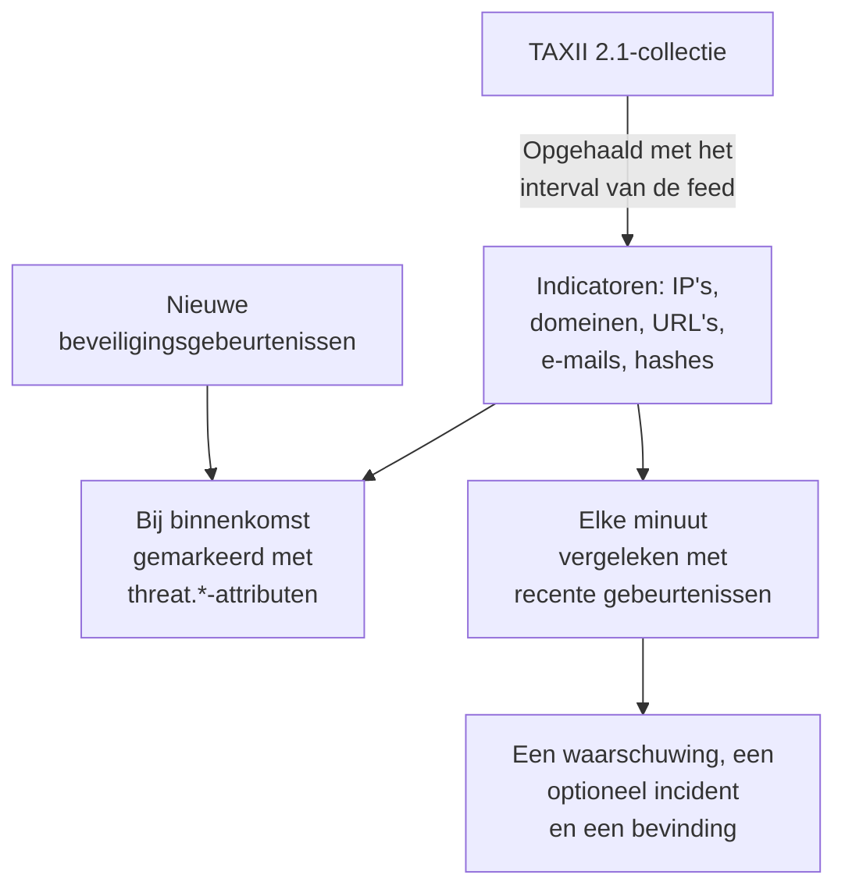

# Dreigingsinformatie (STIX/TAXII)

Een threat-intelfeed brengt bekende kwaadaardige IP-adressen, domeinen, URL's, e-mailadressen en bestandshashes naar OneUptime, en vertelt je wanneer je [beveiligingsgebeurtenissen](/docs/telemetry/security-events) er een noemen. Elke feed abonneert zich op één TAXII 2.1-collectie met STIX 2.1-indicatoren: je eigen MISP-, OpenCTI- of OpenTAXII-server, of de collectie van een aanbieder. OneUptime levert zelf geen feedinhoud: jij brengt de collecties, zoals je de Sigma-regels brengt.

:::cards
- [Een feed abonneren](#een-feed-abonneren): Een TAXII-server, een collectie en hoe je je aanmeldt.
- [Wat wordt ingenomen](#wat-wordt-ingenomen): De indicatorpatronen die OneUptime bewaart, en hoe lang.
- [Hoe matches worden gevonden](#hoe-matches-worden-gevonden): Gemarkeerd bij binnenkomst, en elke minuut vergeleken.
- [Dreigingsniveaus](#dreigingsniveaus): Hoe de confidence van een indicator een ernst wordt.
:::

## Hoe het werkt



## Voordat je begint

- Een TAXII 2.1-server die STIX 2.1-objecten van het type `indicator` publiceert, en de ID van de collectie die moet worden opgehaald. Een feed meldt zich anoniem aan, met een bearer-token, of met HTTP Basic-authenticatie.
- Servers die een TLS-clientcertificaat vereisen (mutual TLS), zoals CISA AIS, worden niet ondersteund. De openbare ATT&CK-server van MITRE publiceert technieken en groepen in plaats van indicatoren, dus een feed die daarop is gericht, blijft leeg.
- Een rol die feeds kan aanmaken: Project Owner, Project Admin, Security Admin of Security Member. Security Viewer kan feeds en indicatoren lezen. Zie [Rollen](/docs/permissions/reference#rollen).

## Een feed abonneren

:::steps
### Ga naar Threat Intel

Open **Producten → Security Events → Threat Intel**.

### Maak de feed aan

Klik op **Threat Intel Feed aanmaken** en vul de vier stappen in: **Basisinformatie**, **TAXII Server**, **Authenticatie** en **Bij overeenkomst**. De velden staan in de tabel hieronder.

### Controleer de eerste ophaalronde

Binnen een minuut of twee toont de rij van de feed **Last Polled**, en **Last Poll Summary** vertelt wat de ophaalronde binnenhaalde. Indicatoren verschijnen in de tabel **Indicators** onder de feeds.
:::

| Veld | Wat je invult |
| --- | --- |
| **TAXII API Root URL** | De TAXII 2.1-API-root van de server, zoals `https://taxii.example.com/api1/`. Collecties worden daaronder geadresseerd. |
| **Collection ID** | De collectie die de indicatoren publiceert. |
| **Poll Interval (Minutes)** | Hoe vaak nieuwe objecten worden opgehaald: 1 tot 1440 minuten, standaard 60. |
| **Minimum Confidence** | Indicatoren met een lagere STIX-`confidence` worden overgeslagen: 0 tot 100, en 0 houdt alles. Indicatoren zonder confidence komen altijd door. |
| **API Token** | Een bearer-token, voor een collectie die erom vraagt. |
| **Basic Auth Username** en **Basic Auth Password** | Voor een collectie die HTTP Basic-authenticatie gebruikt. Laat beide en het token leeg voor een openbare collectie. |
| **Create Alert on Match** | Standaard aan: elke gematchte indicator opent een waarschuwing. |
| **Ernst van waarschuwing** | De ernst van elke waarschuwing die deze feed opent. Laat het leeg om het dreigingsniveau van elke indicator te nemen. |
| **Create Incident on Match** | Standaard uit. Incidenten sturen on-call-escalatie, SLA's en statuspagina's aan, en voor indicatormatches zijn waarschuwingen meestal genoeg. |
| **Ernst van incident** | Zoals **Ernst van waarschuwing**, voor incidenten. |
| **Write Detection Finding on Match** | Standaard aan: elke match schrijft een bevinding in de gebeurtenisstroom. |

Tokens en wachtwoorden worden versleuteld en na het opslaan nooit meer getoond. Om ze te wijzigen, kies je **Update Credentials** in de rij van de feed en daarna **API Token (Bearer)**, **Basic Auth** of **Anonymous (clear stored credentials)**: je keuze vervangt de aanmelding van de feed, dus het opslaan van een token wist een opgeslagen wachtwoord, en omgekeerd.

### Hoe een feed wordt opgehaald

Elke ophaalronde vraagt om de objecten die sinds de vorige zijn toegevoegd, via de cursor `added_after` van TAXII, en leest tot 10 pagina's van 500 objecten. Een grote collectie synchroniseert dus over meerdere ophaalrondes: **Last Poll Summary** meldt wanneer er nog pagina's resten. Om een grote eerste synchronisatie sneller af te ronden, verlaag je **Poll Interval (Minutes)**, tot 1, totdat hij is bijgewerkt.

Ophaalrondes noemen zichzelf met de user agent `OneUptime/<version> (+https://oneuptime.com)`. Antwoordt de firewall van de aanbieder `403`, vraag dan om hem toe te staan: veel firewalls blokkeren verzoeken die op een naamloos script lijken.

Een uitgeschakelde feed wordt niet opgehaald en niet vergeleken. De indicatoren die hij al heeft, blijven nieuwe gebeurtenissen markeren tot ze verlopen.

## Wat wordt ingenomen

OneUptime bewaart STIX-objecten van het type `indicator` waarvan het patroon een eenvoudige gelijkheid is op een van deze typen:

| Type | Voorbeeldpatroon |
| --- | --- |
| IPv4-adres (`ipv4-addr`) | `[ipv4-addr:value = '198.51.100.7']` |
| IPv6-adres (`ipv6-addr`) | `[ipv6-addr:value = '2001:db8::7']` |
| Domeinnaam (`domain-name`) | `[domain-name:value = 'evil.example']` |
| URL (`url`) | `[url:value = 'http://evil.example/payload']` |
| E-mailadres (`email-addr`) | `[email-addr:value = 'billing@evil.example']` |
| Bestandshash, SHA-256 (`file-hash-sha256`) | `[file:hashes.'SHA-256' = 'e3b0…b855']` |
| Bestandshash, SHA-1 (`file-hash-sha1`) | `[file:hashes.'SHA-1' = 'da39…0709']` |
| Bestandshash, MD5 (`file-hash-md5`) | `[file:hashes.MD5 = 'd41d…427e']` |

Vergelijkingen die met `OR` zijn verbonden, binnen één `[...]` of over meerdere, zijn prima, en elke waarde wordt een eigen indicator:

```text
[domain-name:value = 'evil.example' OR domain-name:value = 'evil2.example']
[ipv4-addr:value = '198.51.100.7'] OR [url:value = 'http://evil.example/x']
```

Elk ander patroon, met `AND`, `FOLLOWEDBY`, `NOT`, `LIKE`, `MATCHES`, een tijdskwalificatie zoals `WITHIN`, of een ander objecttype, wordt in zijn geheel overgeslagen en als niet-ondersteund geteld in **Last Poll Summary**. Slechts een deel van een `AND`-patroon vertalen zou veel meer matchen dan de auteur van de feed bedoelde.

### Hoe lang een indicator actief blijft

- Een indicator matcht vanaf zijn `valid_from` tot zijn `valid_until`. Zonder `valid_until` blijft hij 365 dagen actief vanaf `valid_from`, en opnieuw ophalen verlengt dat niet.
- Een ingetrokken indicator, of een indicator die is bijgewerkt met een `valid_until` in het verleden, stopt met matchen zodra de update is opgehaald. Hetzelfde geldt voor een waarde die de aanbieder uit een bijgewerkt patroon laat vallen.
- Waarden worden in kleine letters opgeslagen en gematcht ongeacht hun hoofdletters.

De tabel **Indicators** toont indicatoren zoals ze zijn opgeslagen, met een **Status** van **Actief**, **Verlopen** of **Revoked**. Een opnieuw opgehaalde indicator kan een tijdje dubbel verschijnen, en een verlopen of ingetrokken rij blijft in de lijst staan tot de opslagopschoning hem verwijdert, tot ongeveer een maand nadat hij verloopt. Matchen controleert altijd geldigheid en intrekking, dus zo'n rij matcht nooit.

## Hoe matches worden gevonden

### Gemarkeerd bij binnenkomst

Elke binnenkomende beveiligingsgebeurtenis, uit de ingest-API of een verbinding, wordt vergeleken met je actieve indicatoren voordat ze wordt opgeslagen. Als een van haar observables (de IP's, hosts, domeinen, hashes en gebruikers uit de gebeurtenis) gelijk is aan de waarde van een indicator, krijgt de gebeurtenis deze attributen:

| Attribuut | Waarde |
| --- | --- |
| `threat.matched` | Altijd `"true"` op een gemarkeerde gebeurtenis |
| `threat.indicator_id` | De ID van de STIX-indicator |
| `threat.indicator_type` | Het type van de indicator, zoals `ipv4-addr` of `file-hash-sha256` |
| `threat.indicator_value` | De gematchte waarde, in kleine letters |
| `threat.feed` / `threat.feed_id` | De feed waar de indicator vandaan kwam |
| `threat.confidence` | De STIX-confidence van de indicator |
| `threat.match_count` | Hoeveel observables van de gebeurtenis een indicator matchten |

Als meerdere indicatoren één gebeurtenis matchen, vult die met de hoogste confidence deze waarden in. Het zijn gewone attributen, dus je kunt erop zoeken in **Gebeurtenissen**, er monitoren voor beveiligingsgebeurtenissen mee filteren, en ze gebruiken in detectieregels:

```yaml title="threat-intel-logon.yml"
title: High-confidence indicator in a successful logon
level: critical
detection:
  selection:
    threat.matched: 'true'
    threat.confidence|gte: 80
    className: Authentication
    statusName: Success
  condition: selection
```

Markeren kent alleen de indicatoren die bestaan wanneer een gebeurtenis binnenkomt: gebeurtenissen worden later nooit opnieuw gemarkeerd.

### Elke minuut vergeleken

Elke minuut worden de actieve indicatoren van elke ingeschakelde feed vergeleken met de gebeurtenissen waarvan de gebeurtenistijd na de vorige controle van de feed valt. Zo wordt intel opgevangen die binnenkwam nadat een gebeurtenis was gemarkeerd.

- De eerste controle dekt de laatste 15 minuten. Na een storing haalt de volgende controle hoogstens de laatste 24 uur in.
- Elk venster wordt één keer gecontroleerd. Intel die binnenkomt nadat zijn venster is gecontroleerd, geldt alleen voor latere gebeurtenissen.
- Een gebeurtenis die te laat binnenkomt, met een tijd van vóór de vorige controle, wordt nog steeds bij binnenkomst gemarkeerd, maar niet vergeleken.
- Elke controle vergelijkt hoogstens 100 indicatorwaarden per feed: die welke in de meeste gebeurtenissen voorkomen.

### Wat een match doet

- Een waarschuwing, met de titel `[Threat Intel] <feed name> — <indicator value>`, één per feed en waarde zolang ze openstaat. Zodra ze is opgelost, opent de volgende match een nieuwe. Waarschuwingen worden niet automatisch opgelost.
- Een incident, alleen met **Create Incident on Match**, op dezelfde manier ontdubbeld.
- Een Threat Intel-bevinding, met **Write Detection Finding on Match**: een gebeurtenis `Detection Finding` (OCSF-klasse 2004) van het product `OneUptime Threat Intel`, met het dreigingsniveau van de indicator als ernst, en deze attributen:

| Attribuut | Waarde |
| --- | --- |
| `oneuptime.threat.feed_id` / `oneuptime.threat.feed_name` | De feed |
| `oneuptime.threat.indicator_id` | De ID van de STIX-indicator |
| `oneuptime.threat.indicator_type` / `oneuptime.threat.indicator_value` | Wat matchte |
| `oneuptime.threat.confidence` | De confidence van de indicator |
| `oneuptime.threat.match_count` | Hoeveel gebeurtenissen achter deze bevinding zitten |

Bevindingen worden zelf nooit vergeleken, dus één match kan geen andere in gang zetten.

## Dreigingsniveaus

Indicatoren hebben geen Sigma-level: hun STIX-`confidence` bepaalt in plaats daarvan een dreigingsniveau.

| Confidence van de indicator | Dreigingsniveau |
| --- | --- |
| 90 tot 100 | Critical |
| 70 tot 89 | High |
| 40 tot 69 | Medium |
| 1 tot 39 | Low |
| Zonder score (0 of ontbrekend) | Medium |

Een indicator zonder score telt als Medium: iemand koos er toch voor om hem in een feed op te nemen. Het dreigingsniveau is de ernst van de bevinding, en kiest de ernst van de waarschuwing uit de ernstniveaus van je project, in deze volgorde:

1. De **Ernst van waarschuwing** (of **Ernst van incident**) van de feed, als die is ingesteld: die geldt voor elke match uit de feed.
2. Je ernstniveau dat naar het dreigingsniveau is genoemd, zoals High, ongeacht hoofdletters.
3. Op rang: Critical en High krijgen je zwaarste ernstniveau, Medium en Low je lichtste.

Het dreigingsniveau hoort bij elke indicator, niet bij de feed, dus één feed kan in dezelfde minuut een waarschuwing Critical en een waarschuwing Low openen. **Minimum Confidence** filtert op hetzelfde getal: een minimum van 70 houdt alleen indicatoren High en Critical over, plus die zonder score, die altijd doorkomen.

## De matches van een feed bewaken

De actie **Monitor maken** in de rij van een feed opent een nieuwe monitor voor beveiligingsgebeurtenissen die de bevindingen van de feed telt: gebeurtenisklasse `Detection Finding`, gefilterd op de ID van de feed in `oneuptime.threat.feed_id` (nooit zijn naam, die bij een hernoeming zou veranderen), over het laatste uur. Gebruik hem voor een plotselinge golf van matches, of voor een drukke feed die stil wordt.

## Bewaring en facturering

Indicatoren zijn configuratie, geen telemetrie, en worden niet gefactureerd als ingenomen gegevens. De bevindingen die een match schrijft, zijn gewone beveiligingsgebeurtenissen, gefactureerd en bewaard zoals de rest: zie [Beveiligingsgebeurtenissen](/docs/telemetry/security-events#bewaring-en-facturering).

## Probleemoplossing

:::details Last Error is ingesteld na een ophaalronde
`401` of `403`: de inloggegevens zijn onjuist of ontbreken; vervang ze met **Update Credentials**. Een `403` kan ook de firewall van de aanbieder zijn die de user agent blokkeert. `404`: controleer de **TAXII API Root URL**, die meestal eindigt op een pad zoals `/api1/`, en de **Collection ID**. De fout verdwijnt bij de volgende geslaagde ophaalronde.
:::

:::details De feed haalt op, maar er verschijnen geen indicatoren
Lees **Last Poll Summary**. Geen objecten opgehaald: de collectie is leeg of publiceert geen indicatoren. Niet-ondersteunde patronen: de aanbieder gebruikt patroonfuncties die deze pagina als overgeslagen noemt. Onder de minimale confidence: verlaag **Minimum Confidence**. Al inactief: de aanbieder stuurde indicatoren die al waren ingetrokken of verlopen.
:::

:::details Er zijn indicatoren, maar niets matcht
Matchen vergelijkt de waarde van een indicator met de observables van een gebeurtenis, niet met elk veld: open in **Gebeurtenissen** een gebeurtenis waarvan je een match verwachtte en controleer of haar observables de waarde bevatten. Alleen indicatoren met de status **Actief** matchen. Controleer **Last Match Error** op de feed.
:::

:::details Een match opende geen waarschuwing
**Create Alert on Match** staat uit, of een waarschuwing voor dezelfde feed en waarde staat nog open, en latere matches worden daarin opgenomen. Een project heeft minstens één ernstniveau voor waarschuwingen nodig voordat een feed waarschuwingen kan openen.
:::

## Volgende stappen

:::cards
- [Beveiligingsgebeurtenissen](/docs/telemetry/security-events): Stuur gebeurtenissen, doorzoek ze en schrijf detectieregels.
- [Google SecOps](/docs/integrations/google-secops): Haal de detecties en gebeurtenissen van Chronicle binnen.
- [Machtigingsreferentie](/docs/permissions/reference): De Security-rollen, en wat elk ervan kan.
:::
