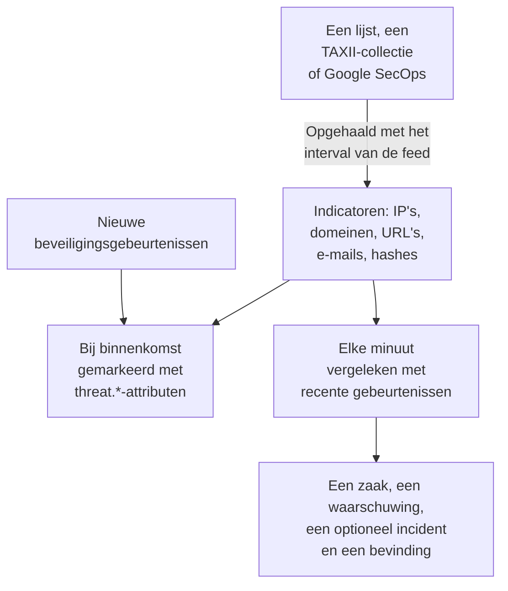

# Dreigingsinformatie (STIX/TAXII)

Een threat-intelfeed brengt bekende kwaadaardige IP-adressen, domeinen, URL's, e-mailadressen en bestandshashes naar OneUptime, en vertelt je wanneer je [beveiligingsgebeurtenissen](/docs/telemetry/security-events) er een noemen. Een feed leest één bron: een lijst met indicatoren op een https-adres, zoals de gratis lijsten die OneUptime met één klik toevoegt, een TAXII 2.1-collectie met STIX 2.1-indicatoren van je eigen MISP-, OpenCTI- of OpenTAXII-server of van een aanbieder, of de indicatoren die Google SecOps in je gebeurtenissen vond.

:::cards
- [Een gratis lijst toevoegen](#een-gratis-lijst-toevoegen): Feodo Tracker, Emerging Threats en de Tor-exitnodes, met één klik.
- [Een feed abonneren](#een-feed-abonneren): Het adres van een lijst, een TAXII-collectie of een Google SecOps-verbinding.
- [Wat wordt ingenomen](#wat-wordt-ingenomen): De indicatorpatronen die OneUptime bewaart, en hoe lang.
- [Hoe matches worden gevonden](#hoe-matches-worden-gevonden): Gemarkeerd bij binnenkomst, en elke minuut vergeleken.
- [Dreigingsniveaus](#dreigingsniveaus): Hoe de confidence van een indicator een ernst wordt.
:::

## Hoe het werkt



## Voordat je begint

- Voor een lijst een `https`-adres dat een tekstbestand downloadt met één indicator per regel.
- Voor een TAXII-feed een TAXII 2.1-server die STIX 2.1-objecten van het type `indicator` publiceert, en de ID van de collectie die moet worden opgehaald. Een TAXII-feed meldt zich anoniem aan, met een bearer-token, of met HTTP Basic-authenticatie.
- Voor een Google SecOps-feed een [Google SecOps-verbinding](/docs/integrations/google-secops#de-beheerde-connector-instellen) waarvan het serviceaccount indicatorovereenkomsten mag doorzoeken: de rol `roles/chronicle.viewer` mag dat.
- Servers die een TLS-clientcertificaat vereisen (mutual TLS), zoals CISA AIS, worden niet ondersteund. De openbare ATT&CK-server van MITRE publiceert technieken en groepen in plaats van indicatoren, dus een feed die daarop is gericht, blijft leeg.
- Een rol die feeds kan aanmaken: Project Owner, Project Admin, Security Admin of Security Member. Security Viewer kan feeds en indicatoren lezen. Zie [Rollen](/docs/permissions/reference#rollen).

## Een gratis lijst toevoegen

De kaart **Gratis lijsten** op **Dreigingsinformatie** voegt met één klik een gratis blokkeerlijst toe: klik bij een lijst op **Lijst toevoegen**, en OneUptime maakt een feed die de lijst volgens haar schema downloadt. Een lijst die het project al leest, toont **Toegevoegd**.

| Lijst | Gepubliceerd door | Gelezen | Confidence | Een overeenkomst opent |
| --- | --- | --- | --- | --- |
| Botnet-C2-servers van Feodo Tracker | abuse.ch | Elk uur | 90, Critical | Een zaak en een waarschuwing |
| Gecompromitteerde hosts van Emerging Threats | Proofpoint Emerging Threats | Elke dag | 70, High | Een zaak en een waarschuwing |
| Tor-exitnodes | The Tor Project | Elk uur | 30, Low | Een zaak |

De tegel van een lijst linkt naar haar voorwaarden: Feodo Tracker is vrij voor elk gebruik (CC0), en de lijst van Emerging Threats heeft een BSD-licentie. Een feed die uit een lijst is toegevoegd, bewerk en verwijder je zoals elke andere.

## Een feed abonneren

:::steps
### Ga naar Threat Intel

Open **Producten → Security Events → Detecties → Dreigingsinformatie**.

### Maak de feed aan

Klik op **Feed met dreigingsinformatie aanmaken** en kies de **Bron**: **Lijst van indicatoren**, **TAXII-collectie** of **Google SecOps**. De volgende stap vraagt alleen naar die bron: voor een lijst de **Lijst-URL**, voor een collectie **TAXII-server** en **Aanmelden**, of de **Google SecOps-verbinding**. **Bij overeenkomst** komt als laatste. De velden staan in de tabel hieronder.

### Controleer de eerste ophaalronde

Binnen een minuut of twee toont de rij van de feed **Laatst opgevraagd**, en **Samenvatting van de laatste opvraging** vertelt wat de ophaalronde binnenhaalde. Indicatoren verschijnen in de tabel **Indicatoren** onder de feeds.
:::

| Veld | Wat je invult |
| --- | --- |
| **Bron** | Waar de indicatoren vandaan komen. Die wordt vastgelegd wanneer de feed wordt aangemaakt: een feed van een andere bron is een nieuwe feed. |
| **Lijst-URL** | Voor een lijst: het `https`-adres van een tekstbestand met één IP-adres, domein, URL of bestandshash per regel. |
| **Betrouwbaarheid** | Voor een lijst: hoe zeker de lijst is, 1 tot 100. Elke indicator op de lijst krijgt die waarde, en die bepaalt het [dreigingsniveau](#dreigingsniveaus); leeg is Medium. |
| **Google SecOps-verbinding** | Voor Google SecOps: de verbinding waarvan de sleutel de indicatoren leest die Google SecOps vond. **Google SecOps verbinden** opent **Verbindingen** als er nog geen is. |
| **Hoofd-URL van de TAXII-API** | De TAXII 2.1-API-root van de server, zoals `https://taxii.example.com/api1/`. Collecties worden daaronder geadresseerd. |
| **Collectie-ID** | De collectie die de indicatoren publiceert. |
| **Opvraaginterval (minuten)** | Hoe vaak de bron wordt gelezen: 1 tot 1440 minuten, standaard 60. Een lijst wordt hooguit elke 15 minuten gelezen. |
| **Minimale betrouwbaarheid** | Voor een TAXII-collectie of Google SecOps: indicatoren met een lagere confidence worden overgeslagen, 0 tot 100, en 0 houdt alles. Indicatoren zonder confidence komen altijd door. |
| **Aanmelden** | Hoe OneUptime zich aanmeldt: **Niet aanmelden** voor een openbare collectie, **Bearer-token** voor een token van de beheerder van de server, of **Gebruikersnaam en wachtwoord** voor HTTP Basic-authenticatie. |
| **API-token**, **Gebruikersnaam voor Basic Auth** en **Wachtwoord voor Basic Auth** | Alleen gevraagd voor de gekozen aanmelding. |
| **Zaak openen bij overeenkomst** | Standaard aan: elke gebeurtenis die een indicator noemt, opent een [zaak](/docs/telemetry/security-cases) over die indicator, of wordt toegevoegd aan de open zaak die er al over gaat. |
| **Waarschuwingen en incidenten** | Standaard **Een waarschuwing maken**: elke gematchte indicator opent een waarschuwing. |
| **Ernst van waarschuwing** | De ernst van elke waarschuwing die deze feed opent. Laat het leeg om het dreigingsniveau van elke indicator te nemen. |
| **Een incident melden** of **Beide** | Onder **Waarschuwingen en incidenten**. Incidenten sturen on-call-escalatie, SLA's en statuspagina's aan, en voor indicatormatches zijn waarschuwingen meestal genoeg. |
| **Ernst van incident** | Zoals **Ernst van waarschuwing**, voor incidenten. |
| **Detection Finding schrijven bij overeenkomst** | Standaard aan: elke match schrijft een bevinding in de gebeurtenisstroom. |

De tokens en wachtwoorden van een TAXII-feed worden versleuteld en na het opslaan nooit meer getoond. Om ze te wijzigen, kies je **Inloggegevens bijwerken** in de rij van de feed en daarna **Bearer-token**, **Gebruikersnaam en wachtwoord** of **Niet aanmelden**, dat wist wat is opgeslagen: je keuze vervangt de aanmelding van de feed, dus het opslaan van een token wist een opgeslagen wachtwoord, en omgekeerd.

### Hoe een feed wordt opgehaald

Elke ophaalronde vraagt om de objecten die sinds de vorige zijn toegevoegd, via de cursor `added_after` van TAXII, en leest tot 10 pagina's van 500 objecten. Een grote collectie synchroniseert dus over meerdere ophaalrondes: **Samenvatting van de laatste opvraging** meldt wanneer er nog pagina's resten. Om een grote eerste synchronisatie sneller af te ronden, verlaag je **Opvraaginterval (minuten)**, tot 1, totdat hij is bijgewerkt.

Ophaalrondes noemen zichzelf met de user agent `OneUptime/<version> (+https://oneuptime.com)`. Antwoordt de firewall van de aanbieder `403`, vraag dan om hem toe te staan: veel firewalls blokkeren verzoeken die op een naamloos script lijken.

Een uitgeschakelde feed wordt niet opgehaald en niet vergeleken. De indicatoren die hij al heeft, blijven nieuwe gebeurtenissen markeren tot ze verlopen.

### Hoe een lijst wordt gelezen

- Elke ophaalronde downloadt de hele lijst en leest die regel voor regel: de eerste waarde op een regel, tot een spatie, tab, komma of puntkomma. Regels die beginnen met `#`, `;` of `//` zijn commentaar, een poort na een adres of domein valt weg, en een adresbereik zoals `198.51.100.0/24` wordt overgeslagen.
- Een waarde blijft 2 dagen na de ophaalronde die haar het laatst las een actieve indicator, en een waarde die de lijst laat vallen, matcht vanaf de volgende ophaalronde niet meer. Een lijst die niet is veranderd, wordt eens per dag opnieuw geschreven.
- Een lijst bevat hooguit 50.000 indicatoren. **Samenvatting van de laatste opvraging** vertelt hoeveel er zijn gelezen, hoeveel regels zijn overgeslagen en hoeveel er zijn weggelaten.
- Het adres moet `https` gebruiken en valt onder dezelfde uitgaande regels als een verbinding: op OneUptime Cloud wordt een privéadres geweigerd.

### Hoe Google SecOps wordt gelezen

- Elke ophaalronde leest de indicatorovereenkomsten die Google SecOps sinds de vorige ronde vastlegde, met de attributen van Mandiant: het gematchte domein, adres of de bestandshash, de confidence, de categorie en de campagnes en actoren waaraan de indicator is gekoppeld. De eerste ophaalronde leest de laatste 7 dagen.
- Een indicator blijft 30 dagen actief nadat Google SecOps hem het laatst zag, of totdat zijn bron zegt dat hij niet meer actief is, en een indicator die een analist in Google SecOps dempte, matcht ook hier niet meer.
- Een overeenkomst die Google SecOps als actieve inbraak markeert, is Critical, en een met hoge prioriteit is minstens High.

## Wat wordt ingenomen

Uit een TAXII-collectie bewaart OneUptime STIX-objecten van het type `indicator` waarvan het patroon een eenvoudige gelijkheid is op een van deze typen. Een lijst en Google SecOps geven dezelfde typen:

| Type | Voorbeeldpatroon |
| --- | --- |
| IPv4-adres (`ipv4-addr`) | `[ipv4-addr:value = '198.51.100.7']` |
| IPv6-adres (`ipv6-addr`) | `[ipv6-addr:value = '2001:db8::7']` |
| Domeinnaam (`domain-name`) | `[domain-name:value = 'evil.example']` |
| URL (`url`) | `[url:value = 'http://evil.example/payload']` |
| E-mailadres (`email-addr`) | `[email-addr:value = 'billing@evil.example']` |
| Bestandshash, SHA-256 (`file-hash-sha256`) | `[file:hashes.'SHA-256' = 'e3b0…b855']` |
| Bestandshash, SHA-1 (`file-hash-sha1`) | `[file:hashes.'SHA-1' = 'da39…0709']` |
| Bestandshash, MD5 (`file-hash-md5`) | `[file:hashes.MD5 = 'd41d…427e']` |

Vergelijkingen die met `OR` zijn verbonden, binnen één `[...]` of over meerdere, zijn prima, en elke waarde wordt een eigen indicator:

```text
[domain-name:value = 'evil.example' OR domain-name:value = 'evil2.example']
[ipv4-addr:value = '198.51.100.7'] OR [url:value = 'http://evil.example/x']
```

Elk ander patroon, met `AND`, `FOLLOWEDBY`, `NOT`, `LIKE`, `MATCHES`, een tijdskwalificatie zoals `WITHIN`, of een ander objecttype, wordt in zijn geheel overgeslagen en als niet-ondersteund geteld in **Samenvatting van de laatste opvraging**. Slechts een deel van een `AND`-patroon vertalen zou veel meer matchen dan de auteur van de feed bedoelde.

### Hoe lang een indicator actief blijft

- Een indicator matcht vanaf zijn `valid_from` tot zijn `valid_until`. Zonder `valid_until` blijft hij 365 dagen actief vanaf `valid_from`, en opnieuw ophalen verlengt dat niet.
- Een ingetrokken indicator, of een indicator die is bijgewerkt met een `valid_until` in het verleden, stopt met matchen zodra de update is opgehaald. Hetzelfde geldt voor een waarde die de aanbieder uit een bijgewerkt patroon laat vallen.
- Waarden worden in kleine letters opgeslagen en gematcht ongeacht hun hoofdletters.

De tabel **Indicatoren** toont indicatoren zoals ze zijn opgeslagen, met een **Status** van **Actief**, **Verlopen** of **Ingetrokken**. Een opnieuw opgehaalde indicator kan een tijdje dubbel verschijnen, en een verlopen of ingetrokken rij blijft in de lijst staan tot de opslagopschoning hem verwijdert, tot ongeveer een maand nadat hij verloopt. Matchen controleert altijd geldigheid en intrekking, dus zo'n rij matcht nooit.

## Hoe matches worden gevonden

### Gemarkeerd bij binnenkomst

Elke binnenkomende beveiligingsgebeurtenis, uit de ingest-API of een verbinding, wordt vergeleken met je actieve indicatoren voordat ze wordt opgeslagen. Als een van haar observables (de IP's, hosts, domeinen, hashes en gebruikers uit de gebeurtenis) gelijk is aan de waarde van een indicator, krijgt de gebeurtenis deze attributen:

| Attribuut | Waarde |
| --- | --- |
| `threat.matched` | Altijd `"true"` op een gemarkeerde gebeurtenis |
| `threat.indicator_id` | De ID van de STIX-indicator, of `list` of `google-secops` voor die bronnen |
| `threat.indicator_type` | Het type van de indicator, zoals `ipv4-addr` of `file-hash-sha256` |
| `threat.indicator_value` | De gematchte waarde, in kleine letters |
| `threat.feed` / `threat.feed_id` | De feed waar de indicator vandaan kwam |
| `threat.confidence` | De STIX-confidence van de indicator |
| `threat.match_count` | Hoeveel observables van de gebeurtenis een indicator matchten |

Als meerdere indicatoren één gebeurtenis matchen, vult die met de hoogste confidence deze waarden in. Het zijn gewone attributen, dus je kunt erop zoeken in **Gebeurtenissen**, er monitoren voor beveiligingsgebeurtenissen mee filteren, en ze gebruiken in detectieregels:

```yaml title="threat-intel-logon.yml"
title: High-confidence indicator in a successful logon
level: critical
detection:
  selection:
    threat.matched: 'true'
    threat.confidence|gte: 80
    className: Authentication
    statusName: Success
  condition: selection
```

Markeren kent alleen de indicatoren die bestaan wanneer een gebeurtenis binnenkomt: gebeurtenissen worden later nooit opnieuw gemarkeerd.

### Elke minuut vergeleken

Elke minuut worden de actieve indicatoren van elke ingeschakelde feed vergeleken met de gebeurtenissen waarvan de gebeurtenistijd na de vorige controle van de feed valt. Zo wordt intel opgevangen die binnenkwam nadat een gebeurtenis was gemarkeerd.

- De eerste controle dekt de laatste 15 minuten. Na een storing haalt de volgende controle hoogstens de laatste 24 uur in.
- Elk venster wordt één keer gecontroleerd. Intel die binnenkomt nadat zijn venster is gecontroleerd, geldt alleen voor latere gebeurtenissen.
- Een gebeurtenis die te laat binnenkomt, met een tijd van vóór de vorige controle, wordt nog steeds bij binnenkomst gemarkeerd, maar niet vergeleken.
- Elke controle legt elke gematchte indicatorwaarde vast als Detection Finding, tot 10.000 per feed. Waarschuwingen, incidenten en zaken openen voor de 100 waarden die in de meeste gebeurtenissen voorkomen; de rest deelt één zaak over de feed, en de **Laatste fout bij matchen** van de feed zegt hoeveel er matchten.

### Wat een match doet

- Een waarschuwing, met de titel `[Threat Intel] <feed name> — <indicator value>`, één per feed en waarde zolang ze openstaat. Zodra ze is opgelost, opent de volgende match een nieuwe. Waarschuwingen worden niet automatisch opgelost.
- Een incident, alleen met **Een incident melden** of **Beide** onder **Waarschuwingen en incidenten**, op dezelfde manier ontdubbeld.
- Een Threat Intel-bevinding, met **Detection Finding schrijven bij overeenkomst**: een gebeurtenis `Detection Finding` (OCSF-klasse 2004) van het product `OneUptime Threat Intel`, met het dreigingsniveau van de indicator als ernst, en deze attributen:

| Attribuut | Waarde |
| --- | --- |
| `oneuptime.threat.feed_id` / `oneuptime.threat.feed_name` | De feed |
| `oneuptime.threat.indicator_id` | De ID van de STIX-indicator, of `list` of `google-secops` voor die bronnen |
| `oneuptime.threat.indicator_type` / `oneuptime.threat.indicator_value` | Wat matchte |
| `oneuptime.threat.confidence` | De confidence van de indicator |
| `oneuptime.threat.match_count` | Hoeveel gebeurtenissen achter deze bevinding zitten |

Bevindingen worden zelf nooit vergeleken, dus één match kan geen andere in gang zetten.

## Dreigingsniveaus

Indicatoren hebben geen Sigma-level: hun STIX-`confidence` bepaalt in plaats daarvan een dreigingsniveau.

| Confidence van de indicator | Dreigingsniveau |
| --- | --- |
| 90 tot 100 | Critical |
| 70 tot 89 | High |
| 40 tot 69 | Medium |
| 1 tot 39 | Low |
| Zonder score (0 of ontbrekend) | Medium |

Een indicator zonder score telt als Medium: iemand koos er toch voor om hem in een feed op te nemen. Het dreigingsniveau is de ernst van de bevinding, en kiest de ernst van de waarschuwing uit de ernstniveaus van je project, in deze volgorde:

1. De **Ernst van waarschuwing** (of **Ernst van incident**) van de feed, als die is ingesteld: die geldt voor elke match uit de feed.
2. Je ernstniveau dat naar het dreigingsniveau is genoemd, zoals High, ongeacht hoofdletters.
3. Op rang: Critical en High krijgen je zwaarste ernstniveau, Medium en Low je lichtste.

Het dreigingsniveau hoort bij elke indicator, niet bij de feed, dus één feed kan in dezelfde minuut een waarschuwing Critical en een waarschuwing Low openen. **Minimale betrouwbaarheid** filtert op hetzelfde getal: een minimum van 70 houdt alleen indicatoren High en Critical over, plus die zonder score, die altijd doorkomen.

## De matches van een feed bewaken

De actie **Monitor maken** in de rij van een feed opent een nieuwe monitor voor beveiligingsgebeurtenissen die de bevindingen van de feed telt: gebeurtenisklasse `Detection Finding`, gefilterd op de ID van de feed in `oneuptime.threat.feed_id` (nooit zijn naam, die bij een hernoeming zou veranderen), over het laatste uur. Gebruik hem voor een plotselinge golf van matches, of voor een drukke feed die stil wordt.

## Bewaring en facturering

Indicatoren zijn configuratie, geen telemetrie, en worden niet gefactureerd als ingenomen gegevens. De bevindingen die een match schrijft, zijn gewone beveiligingsgebeurtenissen, gefactureerd en bewaard zoals de rest: zie [Beveiligingsgebeurtenissen](/docs/telemetry/security-events#bewaring-en-facturering).

## Probleemoplossing

:::details Last Error is ingesteld na een ophaalronde
`401` of `403`: de inloggegevens zijn onjuist of ontbreken; vervang ze met **Inloggegevens bijwerken**. Een `403` kan ook de firewall van de aanbieder zijn die de user agent blokkeert. `404`: controleer de **Hoofd-URL van de TAXII-API**, die meestal eindigt op een pad zoals `/api1/`, en de **Collectie-ID**. De fout verdwijnt bij de volgende geslaagde ophaalronde.
:::

:::details De feed haalt op, maar er verschijnen geen indicatoren
Lees **Samenvatting van de laatste opvraging**. Geen objecten opgehaald: de collectie is leeg of publiceert geen indicatoren. Niet-ondersteunde patronen: de aanbieder gebruikt patroonfuncties die deze pagina als overgeslagen noemt. Onder de minimale confidence: verlaag **Minimale betrouwbaarheid**. Al inactief: de aanbieder stuurde indicatoren die al waren ingetrokken of verlopen.
:::

:::details Er zijn indicatoren, maar niets matcht
Matchen vergelijkt de waarde van een indicator met de observables van een gebeurtenis, niet met elk veld: open in **Gebeurtenissen** een gebeurtenis waarvan je een match verwachtte en controleer of haar observables de waarde bevatten. Alleen indicatoren met de status **Actief** matchen. Staat bij de **Status** van de feed **Vergelijken mislukt**, dan toont **Fout bekijken** in zijn rij waarom.
:::

:::details De Laatste fout van een lijstfeed zegt dat het adres antwoordde met een webpagina
De **Lijst-URL** opent een pagina, zoals een aanmeld- of foutpagina, niet de lijst: open hem in een browser en kopieer het adres van het bestand zelf. Een lijst waarvan de tekst geen enkel IP-adres, domein, URL of bestandshash bevat, wordt op dezelfde manier geweigerd, en de indicatoren van de feed blijven zoals ze waren.
:::

:::details De Laatste fout van een Google SecOps-feed zegt HTTP 403
Het serviceaccount van de verbinding mag geen indicatorovereenkomsten doorzoeken: geef het `roles/chronicle.viewer`. Als de verbinding is verwijderd, zegt de feed dat: bewerk hem en kies een andere **Google SecOps-verbinding**.
:::

:::details Een match opende geen waarschuwing
**Waarschuwingen en incidenten** staat op **Een incident melden** of **Geen van beide**, of een waarschuwing voor dezelfde feed en waarde staat nog open, en latere matches worden daarin opgenomen. Een project heeft minstens één ernstniveau voor waarschuwingen nodig voordat een feed waarschuwingen kan openen.
:::

## Volgende stappen

:::cards
- [Beveiligingsgebeurtenissen](/docs/telemetry/security-events): Stuur gebeurtenissen, doorzoek ze en schrijf detectieregels.
- [Google SecOps](/docs/integrations/google-secops): Haal de detecties en gebeurtenissen van Chronicle binnen.
- [Machtigingsreferentie](/docs/permissions/reference): De Security-rollen, en wat elk ervan kan.
:::
