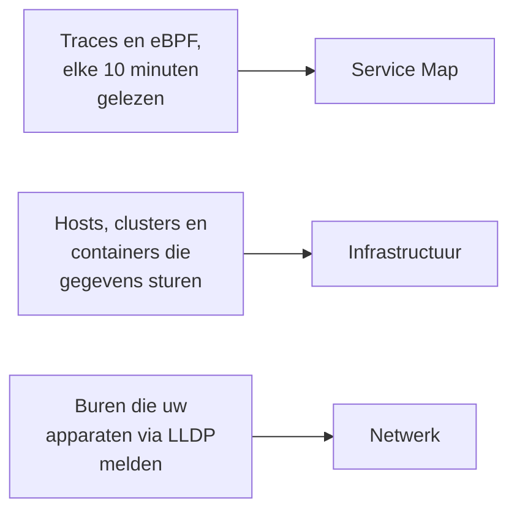

# Topologie

Topologie tekent hoe uw systemen met elkaar verbonden zijn: welke services welke andere aanroepen, wat waar draait en hoe uw netwerkapparaten bekabeld zijn. OneUptime bouwt haar op uit de telemetrie die u al verzendt, dus er valt niets met de hand te tekenen, en ze laat in één oogopslag zien waar fouten en incidenten zitten.

:::cards
- [Topologie openen](#topologie-openen): Drie weergaven van één pagina.
- [De servicekaart lezen](#de-servicekaart-lezen): Wie wie aanroept, en hoe gezond die aanroepen zijn.
- [Uw infrastructuur verkennen](#uw-infrastructuur-verkennen): Waar elke service draait.
- [De eigen kaart van een resource openen](#de-eigen-kaart-van-een-resource-openen): Eén vCenter, cluster of host in detail.
- [Uw netwerk bekijken](#uw-netwerk-bekijken): Apparaten en hun verbindingen, live.
:::

## Hoe de kaart wordt opgebouwd

Elke weergave van Topologie is opgebouwd uit een ander soort telemetrie:

- **Alleen wat actief was, wordt getekend.** Een weergave toont de services en resources die in het tijdsbereik gegevens stuurden, en de verbindingen die daarin werden gezien. Zet **Inactieve tonen** aan om ook de stille te tekenen.
- **Aanroepen worden geteld over een recent venster.** OneUptime zoekt elke 10 minuten naar aanroepen tussen services, en de verkeerscijfers beslaan de laatste 15 minuten, niet het hele tijdsbereik.
- **De netwerkweergave is live.** Ze toont uw apparaten zoals ze nu verbonden zijn, dus ze heeft geen tijdsbereik.

## Voordat u begint

- **Telemetrie die binnenkomt.** De servicekaart heeft traces nodig: zie [OpenTelemetry](/docs/telemetry/open-telemetry). De infrastructuurweergave heeft een host of een cluster nodig die gegevens stuurt: zie de [Kubernetes-agent](/docs/telemetry/kubernetes-agent). De netwerkweergave heeft netwerkapparaten nodig: zie [Netwerkapparaat-monitor](/docs/monitor/network-device-monitor).
- **Een rol die telemetrie leest.** Project Owner, Project Admin, Project Member, Viewer, Telemetry Admin, Telemetry Member of Telemetry Viewer, of een aangepaste rol met de machtiging Read Telemetry Service.

## Topologie openen

Ga naar **Producten → Observability → Topologie**. **Inventaris → Topology Map** opent dezelfde pagina. Die opent op de **Service Map**, voor **Afgelopen dag**.

| Weergave | De vraag die ze beantwoordt |
| --- | --- |
| **Service Map** | Welke services zijn van elkaar afhankelijk? |
| **Infrastructuur** | Wat draait waar in uw infrastructuur? |
| **Netwerk** | Hoe zijn uw netwerkapparaten verbonden? |

Naast de tijdkiezer voegt **Inactieve tonen** toe wat in het bereik niets stuurde, en de vernieuwknop laadt de weergave opnieuw. **Wat wordt getoond · Over deze gegevens** vertelt wat de weergave tekent en hoe vaak die wordt berekend. De adresbalk onthoudt de weergave waarin u zit, dus een link die u deelt, opent dezelfde weergave.

## De servicekaart lezen

De **Service Map** tekent elke service die gegevens stuurde, en de databases, API's en message brokers die ze aanroepen, ook als die zelf geen telemetrie sturen. Pijlen wijzen van aanroeper naar aangeroepene, en dikkere lijnen dragen meer verzoeken. De aantallen erboven zeggen hoeveel services, afhankelijkheden en verbindingen ze tekent, en hoeveel er aandacht vragen.

Elke service toont zijn status, berekend uit de aanroepen die hij in de laatste 15 minuten ontving:

| Status | Wanneer |
| --- | --- |
| **Gezond** | Hooguit 1% van de ontvangen aanroepen mislukte. |
| **Some errors** | Meer dan 1% en minder dan 5% mislukte. |
| **High error rate** | 5% of meer mislukte. |
| **Entry point** | Hij ontving geen aanroepen, maar deed er wel: een webfrontend of een geplande taak. |
| **No calls observed** | Hij deed noch ontving een aanroep. |

Een service met een actief incident of een actieve waarschuwing toont in plaats daarvan hoeveel, en net als een service met **Some errors** of een **High error rate** telt hij als een die aandacht vraagt.

:::steps
### De services vinden die aandacht vragen

Klik op **Vraagt aandacht** om alleen die services en hun directe verbindingen te houden, of zoek op naam in het vak boven de kaart.

### Een service openen

Klik op een service voor zijn verzoeken, fouten en gemiddelde latentie in de laatste 15 minuten, zijn **Actieve incidenten** en **Actieve waarschuwingen**, en links naar **Traces voor deze service** en zijn **Inventarisdetails**.

### Een verbinding openen

Klik op een pijl voor het aantal verzoeken, het foutpercentage en de gemiddelde latentie ervan. Tussen twee services die u instrumenteert, heeft ze ook een **History** van aanroepen, fouten en latentie.
:::

**Verbindingslabels** schrijft een waarde op elke pijl: **Aanvraagsnelheid**, **Foutpercentage** of **Gemiddelde latentie**, of niets totdat u erboven zweeft. **Tabel** toont dezelfde services met hun **Aanvragen**, **Foutpercentage**, **Gem. latentie** en **Verbindingen**, en **Op kaart tonen** tekent er één van.

## Uw infrastructuur verkennen

**Infrastructuur** toont waar uw services draaien: clusters, hosts, pods, containers en de andere resources die gegevens sturen. Replica's van één workload zijn gegroepeerd tot één item, en u kunt alles openen om erin te kijken.

- **Blader er op uw manier door.** Toon haar als **Lijst** of als **Kaart**, van uw hele infrastructuur tot één pod. De aantallen erboven zeggen hoeveel resources en workloads ze tekent, hoeveel services ze kan plaatsen en hoeveel stille resources ze weglaat.
- **Zoek een resource.** Zoek er op naam naar, en klik op **Details bekijken** om de pagina ervan te openen.
- **Wissel tussen weergaven.** Een service die bij een resource staat, opent op de **Service Map**, en de resources waarop een service draait, openen op **Infrastructuur**.

## De eigen kaart van een resource openen

Een vCenter, een Kubernetes-cluster, een host, een Docker- of Podman-host, een Docker Swarm-, Proxmox- of Ceph-cluster en een storage-array hebben elk een eigen pagina **Topologie**. Die tekent die ene resource in detail, uit haar eigen inventaris: wat waarin zit, elk onderdeel gekleurd naar hoe het ervoor staat, en elk open incident en elke open waarschuwing bij het onderdeel waar die over gaat.

- **Lees het als een boom.** De resource staat bovenaan, en de onderdelen van elk onderdeel staan rechts ervan, ermee verbonden door een lijn die rood of oranje wordt waar iets aandacht vraagt. Onderdelen met een probleem erin gaan vanzelf open, de ronde knop op een onderdeel opent of sluit het, en de pijltjestoetsen bewegen door de kaart.
- **Vind wat aandacht vraagt.** **Vraagt aandacht** houdt alleen de onderdelen met problemen over en de weg naar elk ervan, en de zoekfunctie vindt een onderdeel overal in de resource.
- **Kijk van dichterbij.** Klik op een onderdeel voor wat het is en een link naar zijn eigen pagina, en op **Hierop focussen** om alleen dat onderdeel te tekenen, met wat erin zit en waarmee het samenhangt.
- **Ga beide kanten op.** **Openen in Topologie** opent de resource op **Infrastructuur**, en haar knop **vCenter-topologie openen**, **Clustertopologie openen**, **Hosttopologie openen** of **Topologie van de storage-array openen** brengt u terug.

## Uw netwerk bekijken

**Netwerk** is de live kaart van uw netwerkapparaten, opgebouwd uit de buren die ze via LLDP melden, en via CDP op Cisco-apparaten. Ze heeft geen tijdkiezer: verbindingen vernieuwen zichzelf.

Als u apparaten in sites groepeert, opent de weergave op uw sites: kies er een, of schakel over naar **All devices**. **Map options** ordent de kaart en kiest wat ze bevat, en **PDF exporteren** slaat de kaart op die u ziet. De pagina's van netwerkapparaten tekenen dezelfde kaart: zie [Netwerktopologie](/docs/monitor/network-device-monitor#netwerktopologie).

## Problemen oplossen

:::details De servicekaart toont services maar geen verbindingen
OneUptime zoekt elke 10 minuten in uw traces naar aanroepen tussen services. Het ziet er een als een verzoek tracecontext, de `traceparent`-header, meedraagt van de ene geïnstrumenteerde service naar de volgende, zoals de HTTP- en gRPC-instrumentaties van OpenTelemetry doen; als een service client-spans meldt voor de databases en API's die hij aanroept; of als de Kubernetes-agent met eBPF draait.
:::

:::details Een service die ik heb verwijderd, staat nog op de kaart
Hij stuurde gegevens binnen het tijdsbereik. Kies een korter bereik, of wacht tot zijn laatste telemetrie buiten het bereik valt. Met **Inactieve tonen** aan tekent de kaart ook wat gestopt is met gegevens sturen.
:::

:::details De kaart zegt dat er maar een deel wordt getoond
Een heel groot project bereikt de grenzen van de kaart, en een melding zegt hoeveel resources of verbindingen ze toont. Zoek een service, of gebruik **Op kaart tonen** in de tabel, om er een leesbaar deel van te tekenen.
:::

## Volgende stappen

:::cards
- [Servicecatalogus](/docs/telemetry/services): Alles over één service.
- [Traceverkenner](/docs/telemetry/traces-explorer): De verzoeken achter elke pijl.
- [Inventaris – Overzicht](/docs/inventory/overview): Elke resource die de kaart tekent.
- [Netwerkapparaat-monitor](/docs/monitor/network-device-monitor): Zet uw netwerk op de kaart.
:::
