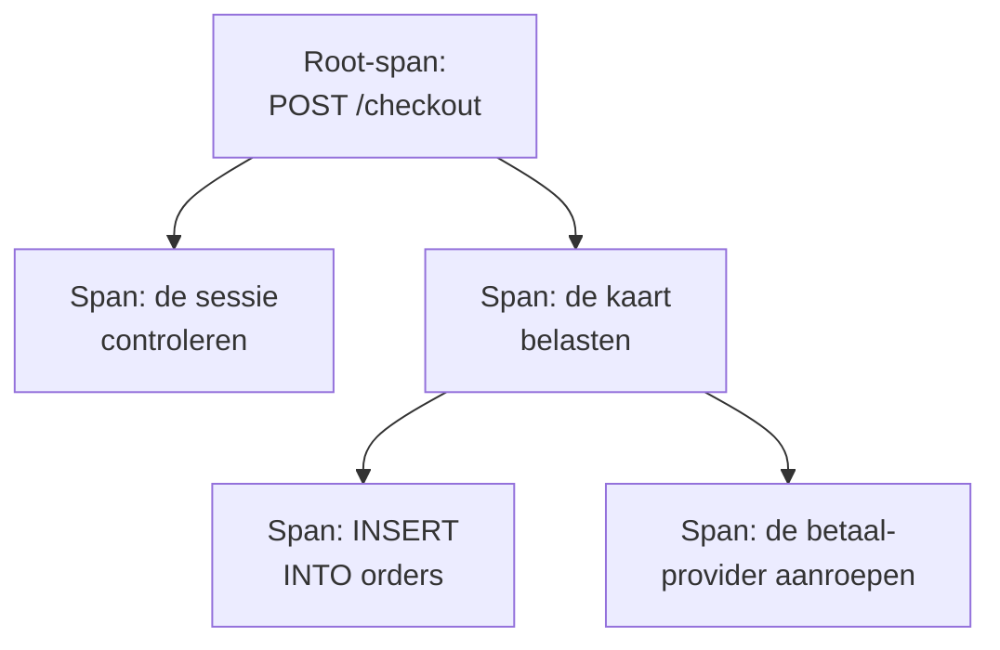

# Traceverkenner

De traceverkenner vindt de verzoeken die door uw services zijn gegaan: de trage, de mislukte, die waarbij het account van één klant betrokken was. Doorzoek en filter de spans die uw services sturen, en open dan een trace om elke stap van het verzoek te zien als waterval, flame graph of servicekaart.

:::cards
- [Een verzoek vinden](#een-verzoek-vinden): Spans zoeken, dan filteren op service, status of soort.
- [Een trace lezen](#een-trace-lezen): Waar de tijd bleef, en welke stap mislukte.
- [Uw spans in grafieken zetten](#uw-spans-in-grafieken-zetten): Aantallen verzoeken en responstijden, gegroepeerd zoals u wilt.
- [Inzichten in traces](#inzichten-in-traces): Foutpercentages, latentie en de traagste verzoeken.
- [Trage en falende bewerkingen vinden en oplossen met AI](#trage-en-falende-bewerkingen-vinden-en-oplossen-met-ai): Pull requests die ze oplossen en de tracing toevoegen die een trace mist.
:::

## Traces en spans

Een trace is één verzoek op zijn weg door uw systeem. Elke stap die het zet, zoals een HTTP-handler, een databasequery of een aanroep van een andere service, is een span, en spans liggen genest in de spans die ze startten. De eerste span van een trace, zonder ouder, is de root-span: het beginpunt van het verzoek.

Elke rij van de verkenner is een span, dus een drukke service vult de lijst met zijn databasequery's en interne aanroepen. Om één rij per verzoek te tonen, kiest u in de zijbalk **Root spans** onder **Span-type**.

De verkenner heeft vijf tabbladen:

| Tabblad | Waarvoor het dient |
| --- | --- |
| **Kijker** | Spans zoeken en filteren, en hun traces openen. Opent op het afgelopen uur, nieuwste eerst, 50 spans per pagina. |
| **Inzichten** | Verzoekaantallen, foutpercentages en latentie per service, en de verzoeken die een blik waard zijn. |
| **AI** | De trage en falende bewerkingen en de ontbrekende tracing die OneUptime in uw traces vindt, en wat OneUptime AI eraan deed. Zie [Trage en falende bewerkingen vinden en oplossen met AI](#trage-en-falende-bewerkingen-vinden-en-oplossen-met-ai). |
| **Installatiegids** | Hoe u traces verstuurt met OpenTelemetry, met een van uw [ingestiesleutels](/docs/telemetry/ingestion-keys). |
| **Instellingen** | Wat er met spans gebeurt als ze binnenkomen: **Pipelines**, **Drop-filters**, **Scrub-regels** en **Opnameregels**. |

## Voordat u begint

- **Binnenkomende traces.** Instrumenteer uw services met [OpenTelemetry](/docs/telemetry/open-telemetry). Het tabblad **Installatiegids** toont de code voor uw taal.
- **Een rol die telemetrie mag lezen.** Project Owner, Project Admin, Project Member, Viewer, Telemetry Admin, Telemetry Member of Telemetry Viewer, of een aangepaste rol met de machtiging Read Telemetry Service Traces. Het bereik ervan bepaalt van wie u de spans ziet: zie [Telemetrie](/docs/permissions/index#telemetrie).

## Een verzoek vinden

:::steps
### De Kijker openen

Ga naar **Producten → Observability → Traces**. De **Kijker** toont de spans van het afgelopen uur, nieuwste eerst, elk met status, service, naam en duur.

### Het tijdsbereik kiezen

Kies een bereik in de tijdkiezer, of sleep over de grafiek boven de lijst om in te zoomen op een piek. Dubbelklik op de grafiek om weer uit te zoomen. Zie [Inzoomen op een tijdsbereik](/docs/telemetry/charts-and-time-ranges).

### Zoeken

Typ een zoekopdracht en druk op Enter, bijvoorbeeld `service:checkout status:error duration:>500`. Losse woorden doorzoeken spannamen, en `@key:value` doorzoekt een attribuut zoals `@http.route:/orders`. Zie [Zoeksyntaxis](/docs/telemetry/search-syntax#traces).

### Beperken met filters

Klik op een waarde in de zijbalk **Filters** om die als chip toe te voegen. De zijbalk filtert op **Service**, op de host, het cluster of de andere bron die de span stuurde, op **Status**, **Span-type**, **Heeft uitzondering**, **Span-soort**, **Span-naam**, **Service-instantie** en **Naam van de host**.

### Een span openen

Klik op een rij om hem uit te klappen: de attributen, en de logboeken en uitzonderingen die hij vastlegde. Klik op **See full trace** om de hele trace te openen.
:::

Uw zoekopdracht, uw chips en het tijdsbereik staan in het adres van de pagina, dus een vernieuwing, een bladwijzer of een gedeelde link opent dezelfde spans.

## Een trace lezen

De pagina van een trace begint met de getallen van het verzoek:

| Getal | Wat het is |
| --- | --- |
| Duur | Hoe lang het hele verzoek duurde. |
| Spans | Hoeveel spans de trace heeft. |
| Services | Door hoeveel services het verzoek ging. |
| Fouten | Hoeveel spans eindigden met een foutstatus. Klik erop om alleen die te tonen. |
| Diepte | De diepste keten van geneste spans. |

Daaronder kiest u een van vier weergaven:

| Weergave | Wat die toont |
| --- | --- |
| **Waterfall** | Elke span op een tijdlijn, genest onder de span die hem startte. Zet **Critical path** aan om de keten van spans te markeren die bepaalde hoe lang het verzoek duurde. |
| **Flame graph** | Dezelfde boom als gestapelde balken, waarbij de breedste balken het langst duurden. |
| **Service map** | De services waar het verzoek doorheen ging, en de aanroepen ertussen. |
| **Operations** | Eén rij per service en spannaam, met de aanroepen, fouten, eigen tijd en totale tijd. Een operatie die 10 keer of vaker vanuit één ouder-span wordt aangeroepen, wordt gemarkeerd: vaak een N+1-query of een lus die gebundeld kan worden. |

Klik in een willekeurige weergave op een span om het paneel ervan te openen, met tabbladen voor attributen, gebeurtenissen, logboeken, uitzonderingen en links, en voor het profiel of de LLM-aanroep als die er is. Doorzoek de spans van de trace op naam, ID of service met het zoekvak naast de weergaven (druk op `/`), en zet **Errors only** aan om alleen de mislukte spans over te houden.

Een grote trace laadt 500 spans tegelijk. Klik op de knop onderaan de trace om meer of alle spans te laden.

> [!TIP]
> **Versnellen met AI** verschijnt alleen bij een trace die het verhelpen waard is: een met een N+1-query, aanroepen na elkaar die parallel zouden kunnen lopen, of één aanroep die het grootste deel van de aanvraag neemt, als dat echt tijd kost (samen 100 ms of meer voor de aanroepen, 500 ms of meer voor één aanroep, en minstens een tiende van de aanvraag). Het noemt wat het vond, zoals "Dezelfde databasequery werd 40 keer uitgevoerd in ReportService.build", en start een AI-taak die een pull request opent om het te verhelpen. Heeft een oplossing voor de trace haar werk al gedaan, dan linkt de trace naar haar taak in plaats van een tweede aan te bieden. Houdt iets anders de AI tegen, zoals het abonnement, opgebruikte AI-tegoeden of geen Runner die online is, dan zegt de trace wat, met de link die het verhelpt. Zie [Code](/docs/ai/ai-agent).

## Uw spans in grafieken zetten

De grafiek boven de lijst toont het aantal spans in de tijd, verdeeld naar status. Kies in de kop van de grafiek een andere maat om in plaats daarvan hun gemiddelde, mediane (P50) of P95-responstijd te tonen.

Wilt u meer, zet de lijst dan van **Spans** op **Analytics**. Kies een tijdreeks, een toplijst of een tabel; meet verzoekaantallen, foutaantallen of responstijden (gemiddelde, P50, P90, P95, P99, minimum of maximum); en groepeer op spannaam, service, status, spansoort of een willekeurig attribuut, en daarna op een tweede veld. Een toplijst of een tabel toont 5 tot 100 groepen.

## Volgen, opslaan en delen

- Klik boven de lijst op **Gepauzeerd** om live-updates aan te zetten. De knop toont dan **Live**, en de lijst kijkt elke 10 seconden of er nieuwe spans zijn. Klik nogmaals om te pauzeren.
- **Opgeslagen weergaven** bewaart een zoekopdracht, de filters en het tijdsbereik onder een naam, voor iedereen in het project. Opgeslagen weergaven werken zoals in de [Logboekverkenner](/docs/telemetry/logs-explorer#een-weergave-opslaan).
- De knoppen **Logboeken** en **Metrieken** openen die verkenners voor hetzelfde tijdvenster, met zoveel van uw filtering als ze kunnen gebruiken. Wijs een knop aan om te zien wat hij niet kan meenemen.

## Inzichten in traces

Het tabblad **Inzichten** vat de verzoeken in een tijdsbereik samen:

- het aantal verzoeken, het foutpercentage en de P50-, P95- en P99-latentie;
- een gezondheidstabel van uw services, gesorteerd op foutpercentage, zodat de services die aandacht nodig hebben bovenaan staan;
- de meest recente mislukte verzoeken, en de traagste.

Beperk het tot bepaalde services met de keuzelijst naast de tijdkiezer.

## Trage en falende bewerkingen vinden en oplossen met AI

Elk uur doorzoekt OneUptime de traces van het afgelopen uur van elke service op bewerkingen die traag zijn, die mislukken of waarvan de traces niet zeggen waarom, en legt wat het vindt vast als AI-inzichten, met het bewijs. Daarna onderzoekt OneUptime AI elk ervan en opent een pull request die het oplost. Er wordt nooit iets samengevoegd: uw team beoordeelt elke pull request.

Een bewerking zijn de spans met dezelfde naam in een service, zoals `GET /orders`. OneUptime leest een service zodra die in het afgelopen uur minstens 100 spans heeft verstuurd, en legt drie soorten bevindingen vast:

| Bevinding | Wanneer OneUptime die vastlegt | De pull request |
| --- | --- | --- |
| **Trage bewerking** | De P99 van de bewerking is 1 seconde of meer over minstens 20 spans, en het traagste verzoek herhaalt een patroon dat echt tijd kost: dezelfde aanroep steeds opnieuw, aanroepen na elkaar die parallel zouden kunnen lopen, of één aanroep die het grootste deel van het verzoek kost. | Maakt de bewerking sneller. |
| **Falende bewerking** | Minstens 20 spans van de bewerking zijn mislukt, 5% of meer ervan, en de meest recente fouten zeggen waarom, met een exceptie of een foutmelding. | Lost op waarom ze mislukt. |
| **Ontbrekende tracing** | De traces zeggen niet waarom: elk van de 500 of meer spans van een service was de wortel van zijn trace, zonder span van de service eronder, een traag verzoek bracht 60% of meer van zijn tijd (en 500 ms of meer) door in één span waaronder niets is getraceerd, of de fouten van een bewerking legden geen foutmelding en geen exceptie vast. | Voegt de ontbrekende tracing toe. |

OneUptime AI opent de pull request voor een falende bewerking pas zelf als het de schuldige code vindt. Een fout die van elders komt, zoals een afhankelijkheid die plat ligt, krijgt geen pull request, tenzij iemand er een vraagt met **Oplossen met AI**.

### Inschakelen

**Traces → AI → Instellingen** bevat de schakelaar **Trage en falende bewerkingen vinden en oplossen**, die voor nieuwe projecten aan staat. Staat **AI inschakelen** uit, dan worden trage en falende bewerkingen nog gevonden, maar doet OneUptime AI er niets mee. Om pull requests te openen heeft OneUptime AI een repository nodig die in [Code](/docs/ai/ai-agent) is gekoppeld: de pagina zegt eerst wat ontbreekt. De code van elke repository wordt gewijzigd op de Runner die de repository in Code kiest.

OneUptime AI opent zelf maximaal 5 pull requests per dag (UTC), één per bevinding, en nooit meer dan de limiet van een repository voor open AI-pull requests.

### AI-regels

Zonder regel onderzoekt OneUptime AI elk probleem dat het in uw traces vindt meteen en opent een pull request voor elk probleem dat het kan oplossen. De **AI-regels** onder **Meer instellingen** beperken dat, in drie stappen:

| Stap | Wat die beslist |
| --- | --- |
| **Overeenkomst** | Welke services: de gekozen services, die met bepaalde labels of die waarvan de naam bij een patroon past. |
| **Onderzoeken** | **Meteen**, of **Alleen als het na een wachttijd nog gevonden wordt**: een probleem dat tijdens de wachttijd verdwijnt, wordt niet onderzocht. |
| **Herstel** | **Niet herstellen**, **Eerst om goedkeuring vragen** of **Herstellen zonder te vragen**. Eerst vragen laat de pull request aan een persoon over: de bevinding biedt **Oplossen met AI** aan. |

Onder **Meer velden** kiest een regel de coderepositories, de MCP-servers en de LLM-provider die OneUptime AI ervoor mag gebruiken. Is er niets gekozen, dan mag het ze allemaal gebruiken, en de standaard-LLM-provider van het project.

### Zien wat het deed

- **Traces → AI → Inzichten** toont wat OneUptime vond, elke bevinding met haar bewijs en **Openen in Traces**, dat de spans waar het om gaat, uit het uur waarin ze werd gevonden, in de **Kijker** opent. Bij een falende bewerking stelt **Monitor maken** een tracesmonitor in op haar mislukte spans.
- **Traces → AI → Logboeken** toont elk onderzoek en elke pull request, nieuwste eerst, met hoe elk ervoor staat en wat elk onderzoek vond.
- In Code zegt de taak dat OneUptime haar startte, met een link naar haar bevinding, en de pull request zegt waarom hij werd geopend.

## Wat er met spans gebeurt als ze binnenkomen

Het tabblad **Instellingen** bevat de regels die OneUptime op spans toepast als ze binnenkomen, net als bij logboeken. Ze werken op de spans die daarna binnenkomen, niet op opgeslagen spans. Hoe lang elke span wordt bewaard, wordt ook bij aankomst bepaald: zie [Gegevensbewaring](/docs/telemetry/data-retention).

| Regel | Wat hij doet |
| --- | --- |
| **Drop-filters** | Spans weggooien die u niet wilt bewaren, of er alleen een steekproef van bewaren. Zie [Records weggooien of bemonsteren](/docs/telemetry/drop-filters-and-scrub-rules#records-weggooien-of-bemonsteren). |
| **Scrub-regels** | Gevoelige gegevens in span-attributen maskeren. Zie [Gevoelige gegevens opschonen](/docs/telemetry/drop-filters-and-scrub-rules#gevoelige-gegevens-opschonen). |
| **Pipelines** | Spans wijzigen en verrijken: elke pipeline selecteert spans met een filter en voert daarna zijn processors op volgorde uit. |
| **Opnameregels** | Elke minuut spanaantallen, foutaantallen en duren omzetten in nieuwe metrieken. Zie [Opnameregels voor logboeken](/docs/telemetry/log-recording-rules). |

## Problemen oplossen

:::details Een trace meldt dat er geen spans zijn gevonden
Spans komen meestal binnen een minuut na het einde van het verzoek binnen. Klik op de pagina van de trace op **Vernieuwen** om opnieuw te kijken.
:::

:::details Sommige spans staan op het hoogste niveau van de waterval
Ze noemen een ouder-span die OneUptime niet heeft ontvangen, vaak omdat de service die de ouder schreef nog geen traces naar OneUptime stuurt. Instrumenteer die service ook.
:::

:::details De lijst toont veel meer rijen dan verzoeken
Elke rij is een span, geen verzoek. Kies in de zijbalk **Root spans** onder **Span-type** om één rij per verzoek te tonen.
:::

## Volgende stappen

:::cards
- [Zoeksyntaxis](/docs/telemetry/search-syntax): Elk filter dat het zoekvak begrijpt.
- [Traces-monitor](/docs/monitor/traces-monitor): Een melding krijgen bij mislukte of trage verzoeken.
- [Uitzonderingen volgen](/docs/telemetry/exceptions): De fouten beoordelen die uw spans vastleggen.
- [Logboekverkenner](/docs/telemetry/logs-explorer): De logregels lezen die een verzoek schreef.
:::
