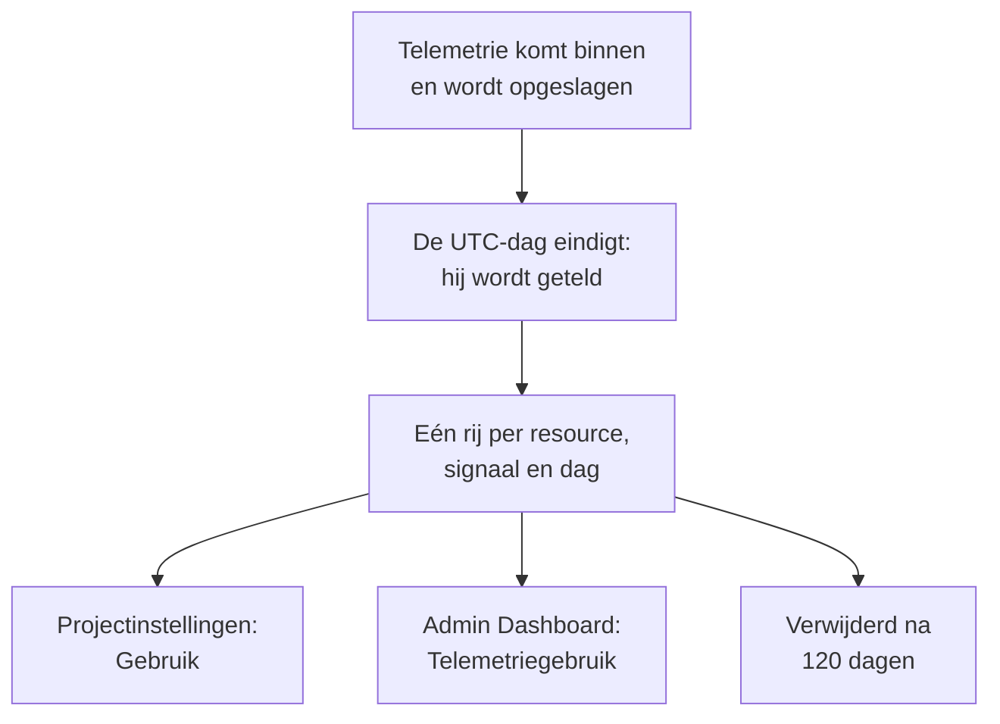

# Telemetriegebruik

Zie hoeveel telemetrie elk project, en elke service of resource daarin, verstuurt: logboeken, metrieken, traces en hun uitzonderingen, profielen, sessieherhalingen en beveiligingsgebeurtenissen. Gebruik wordt op elke OneUptime-installatie geteld, met of zonder facturering, zodat u kunt vinden wat uw opslag vult zonder ClickHouse te bevragen.

:::cards
- [Hoe gebruik wordt geteld](#hoe-gebruik-wordt-geteld): Eén keer per dag, voor elke resource en elk signaal.
- [Het gebruik van een project bekijken](#het-gebruik-van-een-project-bekijken): Projectinstellingen → Telemetrie & APM → Gebruik.
- [Het gebruik van elk project bekijken](#het-gebruik-van-elk-project-bekijken): Het Admin Dashboard, voor de instantiebeheerder.
- [Hoe lang gebruik wordt bewaard](#hoe-lang-gebruik-wordt-bewaard): 120 dagen, tenzij u dat wijzigt.
:::

## Hoe gebruik wordt geteld

Eén keer per dag, nadat een dag in UTC is afgelopen, telt OneUptime wat elke resource van elk project die dag heeft verstuurd, voor elk signaal, en bewaart de telling als één rij per resource, signaal en dag.



- **Een dag wordt geteld zodra hij voorbij is.** Elke dag wordt uiterlijk rond 08:00 UTC de volgende dag geteld, dus het gebruik van vandaag verschijnt morgen. Een dag die niet kon worden geteld, wordt een week lang opnieuw geprobeerd.
- **De grootte is de opgeslagen grootte.** Elk signaal wordt geteld als de grootte van de rijen waarin het is opgeslagen, vóór compressie. Sessieherhalingen worden geteld als de bytes die de recorders hebben geüpload.
- **Traces omvatten hun uitzonderingen, en profielen hun samples.**
- **De eigen telemetrie van OneUptime wordt niet geteld.** Metingen van monitoren, waarschuwingen, incidenten en SLO's, metingen van Data-observability en de budgetmetrieken van sessieherhalingen worden door OneUptime zelf geschreven.
- **Op OneUptime Cloud wordt telemetrie gefactureerd op basis van deze rijen.** Op een installatie zonder facturering wordt gebruik kosteloos geteld, en er wordt niets voor in rekening gebracht, ook niet als facturering later wordt ingeschakeld.

## Voordat u begint

- **Een rol die de telemetrie van het project leest.** Projecteigenaar, Projectbeheerder, Projectlid, Kijker, Telemetriebeheerder, Telemetrielid of Telemetriekijker, of een van de factureringsrollen. De rol moet het hele project omvatten: een rol die tot enkele labels is beperkt, toont geen gebruik.
- **Telemetrie in het project.** Gebruik wordt geteld voor de telemetrie die de [ingestiesleutels](/docs/telemetry/ingestion-keys) van het project versturen.

## Het gebruik van een project bekijken

:::steps
### Gebruik openen

Ga naar **Projectinstellingen → Telemetrie & APM → Gebruik**. **Telemetrie & APM** staat in het zijmenu eerst ingeklapt: klik erop om het te openen.

### Een periode kiezen

De pagina opent op **Laatste 30 dagen**. Kies **Laatste 7 dagen** of **Laatste 90 dagen** in het vak rechtsboven op de kaart **Telemetriegebruik**. Een periode eindigt met gisteren, de recentste dag die is geteld.

### Vinden wat is gegroeid

De kaart **Gebruik per resource** toont elke service en resource die in de periode iets heeft verstuurd, de grootste eerst. Klik op de titel van een kolom om erop te sorteren, en op de naam van een resource om de pagina ervan te openen.
:::

De pagina heeft drie kaarten:

| Kaart | Wat die toont |
| --- | --- |
| **Telemetriegebruik** | Het **Totaal** van de periode, een totaal voor elk signaal en een grafiek van elke dag, met de signalen gestapeld. |
| **Gebruik per resource** | Elke **Resource** met zijn soort, een kolom voor elk signaal, het **Totaal** en de **Bewaartermijn** van de telemetrie ervan. |
| **Geschiedenis van telemetriegebruik** | Eén rij per signaal, resource en dag, met filters voor **Product**, **Dag** en **Service**. |

Telemetrie die geen service noemde, staat vermeld als **Onbekende service**. Een resource die sindsdien is verwijderd, of waarvan uw rol de soort niet leest, staat vermeld met zijn soort en het begin van zijn ID.

## Wie wat ziet

| Rol | Ziet |
| --- | --- |
| Projecteigenaar, Projectbeheerder, Factureringsbeheerder, Factureringslid, Factureringskijker, Manage Billing | Hoeveel elke resource heeft verstuurd en hoe lang dat wordt bewaard, en op OneUptime Cloud wat het kostte |
| Projectlid, Kijker, Telemetriebeheerder, Telemetrielid, Telemetriekijker | Hoeveel elke resource heeft verstuurd en hoe lang dat wordt bewaard |

Wat gebruik kostte, wordt alleen op OneUptime Cloud getoond: een installatie zonder facturering rekent er niets voor. Zie [Facturering en gebruik](/docs/configuration/billing#gebruiksgeschiedenis) voor de prijzen.

## Het gebruik van elk project bekijken

Op een zelfgehoste installatie ziet de instantiebeheerder het gebruik van elk project in het Admin Dashboard:

:::steps
### Telemetriegebruik openen

Open in het Admin Dashboard het menu en klik op **Telemetriegebruik**. De lijst toont elk project dat in de periode iets heeft verstuurd, de grootste eerst, met een kolom voor elk signaal en het **Totaal**.

### De grootste projecten vinden

Kies rechtsboven op de kaart een periode, en klik op de titel van een kolom om erop te sorteren: **Totaal**, een signaal, of **Project** voor de naam.

### Een project openen

Klik op de naam van een project. De pagina **Telemetriegebruik** ervan, onder **Projecten** in het Admin Dashboard, toont het gebruik per dag, signaal en resource, zoals de leden het zien.
:::

## Hoe lang gebruik wordt bewaard

Gebruik wordt 120 dagen bewaard, tenzij u dat wijzigt, met facturering aan of uit. Dit is hoe lang de gebruikstellingen worden bewaard, niet de telemetrie zelf: zie daarvoor [Gegevensbewaring](/docs/telemetry/data-retention).

:::steps
### Gegevensbewaring openen

Ga in het Admin Dashboard naar **Instellingen → Gegevensbewaring**.

### Het aantal dagen instellen

Klik op de kaart **Bewaring van telemetriegebruik** op **Bewaring van telemetriegebruik bewerken**, vul **Bewaring van telemetriegebruik (dagen)** in van 30 tot 1095, en klik op **Wijzigingen opslaan**. Laat het leeg voor 120 dagen.
:::

Ouder gebruik wordt één keer per dag verwijderd. De bewaring is nooit korter dan 30 dagen: een dag die is geteld, wordt nooit verwijderd om daarna opnieuw te worden geteld.

## Gebruik uitlezen met de API

`GET /api/telemetry-usage/project` antwoordt met het gebruik van één project over een periode van UTC-dagen, zoals de pagina het toont. Roep het aan met een [API-sleutel](/docs/permissions/index#api-sleutels) die een van de rollen hierboven heeft:

```bash
curl 'https://oneuptime.com/api/telemetry-usage/project?startDay=2026-10-01&endDay=2026-10-31' \
  -H "ApiKey: $ONEUPTIME_API_KEY"
```

`startDay` en `endDay` zijn dagen in de vorm `YYYY-MM-DD`, beide inbegrepen, en een periode kan tot 1095 dagen lang zijn. Het antwoord bevat de totalen, elke dag per signaal en elke resource per signaal, in GB, met de kosten alleen waar facturering aan staat en de sleutel facturering leest.

## Problemen oplossen

:::details De pagina Gebruik toont Nog geen telemetriegebruik
Een dag wordt geteld zodra hij in UTC voorbij is, uiterlijk rond 08:00 UTC de volgende dag: een project dat vandaag begon met versturen, toont morgen zijn eerste dag. Controleer of het project telemetrie ontvangt in de explorers.
:::

:::details De getallen zijn groter dan mijn ClickHouse-schijf
Gebruik is de grootte van de rijen vóór compressie. ClickHouse comprimeert wat het opslaat, dus de schijfruimte die het gebruikt is meerdere keren kleiner.
:::

:::details Een resource staat vermeld met zijn soort en een ID
De resource is verwijderd nadat hij de telemetrie verstuurde, of uw rol leest dat soort resource niet. Het gebruik ervan wordt nog steeds geteld.
:::

## Volgende stappen

:::cards
- [Drop-filters en scrub-regels](/docs/telemetry/drop-filters-and-scrub-rules): Sla de telemetrie die u niet nodig hebt niet meer op.
- [Gegevensbewaring](/docs/telemetry/data-retention): Bewaar telemetrie zo lang als nodig, en niet langer.
- [Facturering en gebruik](/docs/configuration/billing): Wat telemetrie kost op OneUptime Cloud.
- [Ingestiesleutels](/docs/telemetry/ingestion-keys): Stuur telemetrie naar uw project.
:::
