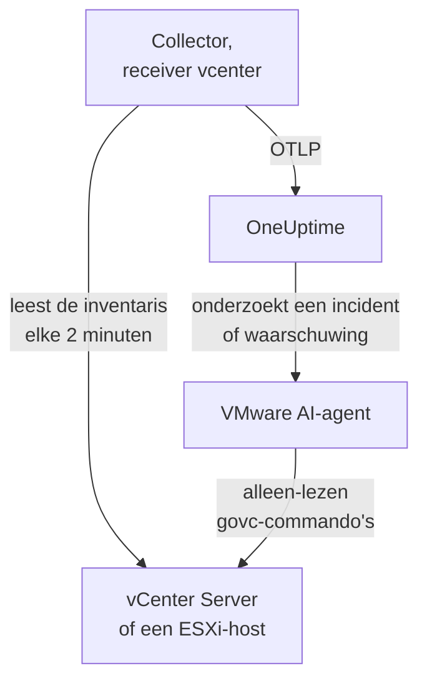

# VMware-agent

De OneUptime VMware-agent bewaakt VMware vSphere: vCenter Server, ESXi-hosts, virtuele machines, datastores, clusters, resourcepools en vSAN. Het is een standaard OpenTelemetry Collector waarvan de [receiver `vcenter`](https://github.com/open-telemetry/opentelemetry-collector-contrib/tree/main/receiver/vcenterreceiver) de vSphere-API leest met een alleen-lezen gebruiker, elke metric stempelt met de naam van je vCenter en die naar OneUptime stuurt: geen plugin op vCenter en niets binnen de VM's. [VMware-monitors](/docs/monitor/vmware-monitor) waarschuwen op wat er binnenkomt.

:::cards
- [De agent installeren](#de-agent-installeren): Een alleen-lezen gebruiker, daarna het installatiescript, Docker Compose of systemd.
- [Wat de agent verzamelt](#wat-de-agent-verzamelt): Elk vSphere-object, zijn identiteit en zijn metrics.
- [AI-agent](#ai-agent): Laat OneUptime AI het vCenter lezen terwijl het onderzoekt.
- [Problemen oplossen](#problemen-oplossen): Een diagnosescript, en de gebruikelijke problemen.
:::

## Hoe het werkt

Eén agent bewaakt één vSphere-endpoint: een **vCenter Server**, die elk datacenter, elk cluster en elke host dekt die hij beheert, of een **zelfstandige ESXi-host** die door geen vCenter wordt beheerd. Draai één agent per vCenter. De collector doorloopt de hele inventaris één keer per verzameling (standaard elke 2 minuten) en stuurt één resource per object. Hetzelfde Compose-bestand draait ernaast de VMware AI-agent, voor OneUptime AI. Liever geen Docker? Dezelfde collector draait met dezelfde configuratie ook als systemd-service op elke Linux-machine.



Het vCenter registreert zich met zijn eerste gegevens, onder de naam die de agent als `vmware.vcenter.name` op elke metric stempelt. Om een vCenter te bewaken zonder de agent te draaien, zie [VMware zonder agent](/docs/telemetry/vmware-agentless): een van je probes verzamelt dezelfde gegevens met een alleen-lezen account.

## Voordat je begint

- Docker Engine 20.10 of nieuwer met de Docker Compose v2-plugin, of, om zonder Docker te installeren, een Linux-machine (x86_64 of arm64) met systemd 235 of nieuwer. Hoe dan ook moet de machine vCenter via HTTPS (TCP 443) kunnen bereiken.
- vCenter Server of ESXi 7.0 of nieuwer: de receiver ondersteunt vSphere 7 en 8.
- Een account dat een vSphere-gebruiker kan aanmaken en die een rol kan geven op het bovenste vCenter-object.
- Een ingestiesleutel. Maak er een aan onder **Projectinstellingen → Telemetrie & APM → Ingestiesleutels** en kopieer de waarde.

### Waar je de agent draait

De agent praat via HTTPS met vCenter, dus hij hoeft er niet in de buurt te draaien, en idealiter draait hij niet op de vCenter Server Appliance of in een VM op het cluster dat hij bewaakt: als dat cluster uitvalt, valt je monitoring mee uit. Een kleine beheer-VM op aparte hardware, een monitoringhost of elke machine die Docker draait (of, zonder Docker, elke Linux-machine met systemd) en vCenter op TCP 443 bereikt, is de juiste plek. De optionele syslog-listener vereist ook dat de ESXi-hosts de agent op de syslogpoort bereiken (zie [ESXi-syslog versturen](#optioneel-esxi-syslog-versturen)).

## De agent installeren

:::steps
### De alleen-lezen vSphere-gebruiker aanmaken

De agent leest alleen maar: de inventaris, prestatiecounters en vSAN-statistieken. Geef hem een eigen account met de ingebouwde rol **Read-Only**, nooit een beheerder.

:::tabs
@tab vSphere Client
1. Maak het account aan: open _Menu → Administration → Single Sign On → Users and Groups_, kies het domein `vsphere.local` (of je identiteitsbron), klik op **Add**, noem de gebruiker `oneuptime` en stel een wachtwoord in. De gebruiker is dan `oneuptime@vsphere.local`.
2. Ken de rol toe: selecteer het bovenste object **vCenter Server** in de inventaris _Hosts and Clusters_, open het tabblad **Permissions**, klik op **Add**, kies de gebruiker, zet de rol op **Read-Only** en vink **Propagate to children** aan.
@tab govc
Vanaf een machine met beheerdersreferenties:

```bash
govc sso.user.create -p 'a-strong-password' -R ReadOnly oneuptime
govc permissions.set -principal oneuptime@vsphere.local -role ReadOnly -propagate=true /
```
@tab PowerCLI
Vanuit een sessie die als beheerder met vCenter is verbonden:

```powershell
New-SsoPersonUser -UserName oneuptime -Password 'a-strong-password'
New-VIPermission -Entity (Get-Folder -NoRecursion) -Principal 'VSPHERE.LOCAL\oneuptime' -Role ReadOnly -Propagate:$true
```
@tab ESXi Host Client
Maak voor een zelfstandige ESXi-host (zonder vCenter) de gebruiker aan onder _Host → Manage → Security & Users → Users_ en geef hem de rol Read-Only onder _Host → Manage → Security & Users → Permissions_. Of voer in de shell van de host `esxcli system account add` uit, daarna `esxcli system permission set --id oneuptime --role ReadOnly`.
:::

> [!IMPORTANT]
> Propagatie is het deel dat mensen missen. De receiver doorloopt datacenters, clusters, hosts, VM's, datastores en resourcepools, en elk object dat de gebruiker niet kan zien, wordt stilzwijgend weggelaten. Een rol Read-Only die op het vCenter-object is toegekend _zonder_ propagatie, geeft een inventaris zonder inhoud en een dashboard vol nullen.

### De agent installeren en starten

:::tabs
@tab install.sh
Download het installatiescript en voer het uit op de machine die de agent gaat hosten:

```bash
curl -sSL https://raw.githubusercontent.com/OneUptime/oneuptime/master/agents/VMwareAgent/install.sh -o install.sh
bash install.sh
```

Het script vraagt om je OneUptime-URL, de ingestiesleutel, een naam voor het vCenter, het vCenter-endpoint en de alleen-lezen referenties (het wachtwoord leest het zonder echo), en of de AI-agent fixes mag toepassen (zo ja, om een eigen vSphere-gebruiker en de VM's die hij nooit mag wijzigen). Het installeert naar `/opt/oneuptime-vmware-agent`, schrijft een met `0600` beschermd `.env`-bestand en start de agent met Docker Compose. Het zet elke waarde tussen aanhalingstekens voor Docker Compose zoals je die typte, zodat een wachtwoord met `$`, `#`, spaties of aanhalingstekens werkt zoals getypt. Het script opnieuw uitvoeren hergebruikt alles in een bestaande `.env` in plaats van opnieuw te vragen; zo [werk je de agent bij](#de-agent-upgraden).
@tab Docker Compose
Download `docker-compose.yml` en `otel-collector-config.yaml` uit de [VMwareAgent-map](https://github.com/OneUptime/oneuptime/tree/master/agents/VMwareAgent) naar een nieuwe map en maak er een `.env`-bestand naast. Het bevat een wachtwoord, dus houd het privé met `chmod 600 .env`:

```bash title=".env"
ONEUPTIME_URL=YOUR_ONEUPTIME_URL
ONEUPTIME_TELEMETRY_INGESTION_KEY=YOUR_TELEMETRY_INGESTION_TOKEN
VMWARE_VCENTER_NAME=my-vcenter
VCENTER_ENDPOINT=https://vcsa.example.com
VCENTER_USERNAME=oneuptime@vsphere.local
VCENTER_PASSWORD=a-strong-password
VCENTER_INSECURE_SKIP_VERIFY=true
VCENTER_COLLECTION_INTERVAL=2m
```

Een wachtwoord met `$`, `#`, spaties of aanhalingstekens hoort tussen enkele aanhalingstekens (zie [vCenter weigert de aanmelding](#problemen-oplossen)). Start de agent:

```bash
docker compose up -d
```
@tab systemd
De agent heeft geen Docker nodig: hij is één OpenTelemetry Collector-binary en één configuratiebestand. Draai op een Linux-machine (x86_64 of arm64) met systemd 235 of nieuwer (Ubuntu 18.04, Debian 10, RHEL 8 of nieuwer) de release van `otelcol-contrib` die de agent vastzet, met dezelfde `otel-collector-config.yaml`, als systemd-service. De unit die de agent daarvoor meelevert, [`oneuptime-vmware-agent-native.service`](https://github.com/OneUptime/oneuptime/blob/master/agents/VMwareAgent/systemd/oneuptime-vmware-agent-native.service), draait de collector als een tijdelijke gebruiker zonder rechten, zonder capabilities en zonder iets waarnaar hij kan schrijven.

Download de collector, de configuratie en de unit, en installeer ze naar `/opt/oneuptime-vmware-agent`:

```bash
cd "$(mktemp -d)"
VERSION=0.161.0   # the collector release the agent pins
ARCH=$(uname -m | sed 's/x86_64/amd64/;s/aarch64/arm64/')
curl -fL -o otelcol-contrib.tar.gz \
  https://github.com/open-telemetry/opentelemetry-collector-releases/releases/download/v${VERSION}/otelcol-contrib_${VERSION}_linux_${ARCH}.tar.gz
curl -fsSLO https://raw.githubusercontent.com/OneUptime/oneuptime/master/agents/VMwareAgent/otel-collector-config.yaml
curl -fsSL -o oneuptime-vmware-agent.service \
  https://raw.githubusercontent.com/OneUptime/oneuptime/master/agents/VMwareAgent/systemd/oneuptime-vmware-agent-native.service

sudo install -d -m 0755 /opt/oneuptime-vmware-agent
sudo tar --no-same-owner --preserve-permissions -xzf otelcol-contrib.tar.gz -C /opt/oneuptime-vmware-agent otelcol-contrib
sudo install -m 0644 otel-collector-config.yaml /opt/oneuptime-vmware-agent/otel-collector-config.yaml
sudo install -m 0644 oneuptime-vmware-agent.service /etc/systemd/system/oneuptime-vmware-agent.service
```

De instellingen komen in `/opt/oneuptime-vmware-agent/.env`: dezelfde variabelen als in de `.env` van de Docker-installatie. Het bevat een wachtwoord, dus maak het alleen leesbaar voor root voordat je het opent:

```bash
sudo touch /opt/oneuptime-vmware-agent/.env
sudo chmod 600 /opt/oneuptime-vmware-agent/.env
sudoedit /opt/oneuptime-vmware-agent/.env
```

Zet dit erin:

```bash
ONEUPTIME_URL=YOUR_ONEUPTIME_URL
ONEUPTIME_TELEMETRY_INGESTION_KEY=YOUR_TELEMETRY_INGESTION_TOKEN
VMWARE_VCENTER_NAME=my-vcenter
VCENTER_ENDPOINT=https://vcsa.example.com
VCENTER_USERNAME="oneuptime@vsphere.local"
VCENTER_PASSWORD="a-strong-password"
VCENTER_INSECURE_SKIP_VERIFY=true
VCENTER_COLLECTION_INTERVAL=2m
```

systemd leest dit bestand, geen shell: zet de gebruikersnaam en het wachtwoord tussen dubbele aanhalingstekens, waarbij elke `\` als `\\` en elke `"` als `\"` wordt geschreven — `DOMAIN\user` is `"DOMAIN\\user"` —, terwijl `$`, `#`, `'` en spaties erin gaan zoals ze zijn. Dat is de vorm die elke systemd-versie hetzelfde leest; oudere versies (die van RHEL 8, bijvoorbeeld) laten een backslash zelfs binnen enkele aanhalingstekens vallen. Start daarna de agent en laat hem bij elke boot starten:

```bash
sudo systemctl daemon-reload
sudo systemctl enable oneuptime-vmware-agent
sudo systemctl restart oneuptime-vmware-agent
```

Deze installatie draait alleen de collector: de [AI-agent](#ai-agent) wordt alleen als containerimage geleverd. Draai één agent per vCenter: als je overstapt van de Docker-installatie, voer daar dan eerst `docker compose down` uit, anders komt elke metric twee keer binnen.
:::

### De installatie controleren

Controleer of de agent draait en lees de logs van de collector:

```bash
docker compose ps
docker logs -f oneuptime-vmware-agent
```

Met systemd geïnstalleerd? Controleer dan de service en zijn journal:

```bash
systemctl status oneuptime-vmware-agent --no-pager
sudo journalctl -u oneuptime-vmware-agent -f
```

Zodra de collector is gestart, horen zijn logs deze regel te tonen:

```text
Everything is ready. Begin running and processing data.
```

### Het vCenter in OneUptime vinden

Er wordt niets verstuurd totdat de eerste volledige doorloop van de inventaris klaar is, dus wacht één verzamelinterval (standaard 2 minuten). Open daarna **Producten → Infrastructuur → VMware → Alle vCenters**: het vCenter staat er, met zijn datacenters, clusters, ESXi-hosts, virtuele machines, datastores en resourcepools.
:::

## Omgevingsvariabelen

Docker Compose leest deze uit de `.env` naast `docker-compose.yml`; de systemd-installatie leest ze uit `/opt/oneuptime-vmware-agent/.env`, en haar unit geeft dezelfde standaardwaarden.

| Variabele | Vereist | Beschrijving |
| --- | --- | --- |
| `ONEUPTIME_URL` | Ja | Je OneUptime-URL, zoals `https://oneuptime.com` of je zelf-gehoste instantie. Gebruik `http://` en de poort als de instantie alleen HTTP spreekt. |
| `ONEUPTIME_TELEMETRY_INGESTION_KEY` | Ja | De ingestiesleutel uit **Projectinstellingen → Telemetrie & APM → Ingestiesleutels**. |
| `VMWARE_VCENTER_NAME` | Ja | De naam van het vCenter in OneUptime, op elke metric gestempeld als het resource-attribuut `vmware.vcenter.name`. Houd hem stabiel: een latere wijziging registreert een tweede vCenter. Standaard `vmware-vcenter`. |
| `VCENTER_ENDPOINT` | Ja | Het schema en de host van de vCenter Server of van een zelfstandige ESXi-host, **zonder** `/sdk`, zoals `https://vcsa.example.com`. |
| `VCENTER_USERNAME` | Ja | De vSphere-gebruiker met de rol Read-Only, zoals `oneuptime@vsphere.local` (of `DOMAIN\user` voor een Active Directory-identiteitsbron). |
| `VCENTER_PASSWORD` | Ja | Het wachtwoord van die gebruiker. Bevat het `$`, `#`, spaties of aanhalingstekens, zet het dan in de `.env` van de Docker-installatie tussen enkele aanhalingstekens (`install.sh` doet dit voor je), en in die van de systemd-installatie tussen dubbele (zie [Problemen oplossen](#problemen-oplossen)). |
| `VCENTER_INSECURE_SKIP_VERIFY` | Nee | `true` accepteert het standaard zelfondertekende (VMCA-)certificaat van vCenter; `false` laat de TLS-verificatie aan. Standaard `false`. |
| `VCENTER_COLLECTION_INTERVAL` | Nee | Hoe vaak de hele inventaris wordt gelezen. Verhoog het naar `5m` of `10m` voor zeer grote vCenters. Standaard `2m`. |

De eigen instellingen van de AI-agent staan onder [AI-agent](#ai-agent).

## Wat de agent verzamelt

Bij elk `VCENTER_COLLECTION_INTERVAL` doorloopt de receiver de hele vSphere-inventaris en stuurt hij één OpenTelemetry-resource per object. De identiteit van elk object zit in zijn **resource-attributen** — `vcenter.datacenter.name`, `vcenter.cluster.name`, `vcenter.host.name`, `vcenter.vm.name` / `vcenter.vm.id`, `vcenter.datastore.name`, `vcenter.resource_pool.name` / `vcenter.resource_pool.inventory_path` — en de agent voegt daar `vmware.vcenter.name` aan toe, zodat OneUptime alles onder je vCenter plaatst:

| vSphere-object | Identiteit (resource-attributen) | Metrics |
| --- | --- | --- |
| Datacenter | `vcenter.datacenter.name` | `vcenter.datacenter.cluster.count`, `vcenter.datacenter.host.count`, `vcenter.datacenter.vm.count`, `vcenter.datacenter.datastore.count`, `vcenter.datacenter.disk.space`, `vcenter.datacenter.cpu.limit`, `vcenter.datacenter.memory.limit` |
| Cluster | + `vcenter.cluster.name` | `vcenter.cluster.cpu.effective`, `vcenter.cluster.cpu.limit`, `vcenter.cluster.memory.effective`, `vcenter.cluster.memory.limit`, `vcenter.cluster.host.count`, `vcenter.cluster.vm.count`, `vcenter.cluster.vm_template.count`, `vcenter.cluster.vsan.*` (doorvoer, operaties, latentie, congesties) |
| ESXi-host | + `vcenter.host.name` (en `vcenter.cluster.name` als de host in een cluster zit) | `vcenter.host.cpu.usage` / `.capacity` / `.utilization` / `.reserved`, `vcenter.host.memory.usage` / `.utilization` / `.capacity`, `vcenter.host.disk.latency.avg` / `.latency.max` / `.throughput`, `vcenter.host.network.usage` / `.throughput` / `.packet.rate` / `.packet.drop.rate` / `.packet.error.rate`, `vcenter.host.vsan.*` |
| Virtuele machine | + `vcenter.host.name`, `vcenter.vm.name`, `vcenter.vm.id` (instance-UUID); `vcenter.resource_pool.*` of `vcenter.virtual_app.*` | `vcenter.vm.disk.usage`, `vcenter.vm.disk.utilization`, `vcenter.vm.memory.usage` / `.utilization` / `.ballooned` / `.swapped` / `.swapped_ssd`; alleen ingeschakelde VM's: `vcenter.vm.cpu.usage`, `vcenter.vm.cpu.readiness`, `vcenter.vm.cpu.utilization`, `vcenter.vm.disk.latency.avg` / `.latency.max` / `.throughput`, `vcenter.vm.network.*`, `vcenter.vm.vsan.*` |
| VM-sjabloon | `vcenter.vm_template.name`, `vcenter.vm_template.id` | alleen `vcenter.vm.disk.usage` |
| Datastore | + `vcenter.datastore.name` | `vcenter.datastore.disk.usage`, `vcenter.datastore.disk.utilization` |
| Resourcepool | + `vcenter.resource_pool.name`, `vcenter.resource_pool.inventory_path` | `vcenter.resource_pool.cpu.usage` / `.cpu.shares`, `vcenter.resource_pool.memory.usage` / `.memory.shares` / `.memory.ballooned` / `.memory.swapped` / `.memory.granted` |

Tel- en capaciteitsmetrics waaieren uit over **datapuntattributen**, en precies daarop filter en groepeer je in monitorcriteria:

| Attribuut | Waarden | Gedragen door |
| --- | --- | --- |
| `direction` | `read` / `write` voor schijven, `transmitted` / `received` voor het netwerk | Schijflatentie en -doorvoer, netwerkdoorvoer en pakketsnelheden |
| `disk_state` | `available` / `used` | `vcenter.datastore.disk.usage`, `vcenter.vm.disk.usage`, `vcenter.datacenter.disk.space` |
| `status` | `red` / `yellow` / `green` / `gray` (de algemene status van het object in vSphere) | `vcenter.datacenter.cluster.count` / `.host.count` / `.vm.count` |
| `power_state` | Hosts: `on` / `off` / `standby` / `unknown`; VM's: `on` / `off` / `suspended` / `unknown` | `vcenter.datacenter.host.count` / `.vm.count`, `vcenter.cluster.vm.count` |
| `effective` | `true` / `false` (opgeslagen als strings) | `vcenter.cluster.host.count` |
| `object` | De NIC-, schijf- of vCPU-instantie (zoals `vmnic0`) | Schijf- en netwerkseries per apparaat van hosts en VM's |
| `cpu_reservation_type` | `total` / `used` | `vcenter.host.cpu.reserved` |
| `type` | Geheugen: `guest` / `host` / `overhead`, `private` / `shared`; vSAN: `read` / `write` / `unmap` | Geheugenseries van resourcepools, vSAN-latentie en -operaties |

De eenheden zijn de eigen OTLP-eenheden van de receiver, die OneUptime voor weergave schaalt: `MHz` voor CPU-gebruik en -capaciteit, `%` voor benutting en CPU-ready, `MiBy` voor het geheugen van hosts, VM's en resourcepools, `By` voor het geheugen van clusters en datacenters en alle schijfruimte, `ms` voor de schijflatentie van hosts en VM's, en `us` (microseconden) voor de vSAN-latentie. In monitorcriteria krijgen de identiteitsattributen een prefix `resource.` (`resource.vcenter.host.name`, `resource.vmware.vcenter.name`), terwijl datapuntattributen kaal blijven (`disk_state`, `power_state`, `status`).

`vcenter.host.memory.capacity` staat upstream standaard uit; de meegeleverde configuratie zet hem aan, omdat OneUptime erdoor deelt voor de geheugenbenutting van hosts. Een opmerking in `otel-collector-config.yaml` noemt de andere optionele metrics (`vcenter.vm.cpu.time`, `vcenter.vm.memory.granted`, `vcenter.host.memory.active`, `vcenter.host.memory.ballooned`, `vcenter.host.memory.granted`, `vcenter.vm.network.broadcast.packet.rate`, `vcenter.vm.network.multicast.packet.rate`): zet er een van aan op dezelfde manier.

### Aan/uit-status van VM's

De receiver stuurt geen metric voor de aan/uit-status van een VM. Hij stuurt `vcenter.vm.cpu.*` **alleen voor ingeschakelde VM's**, dus leidt OneUptime de status af uit wat er in elke verzameling binnenkwam: een VM die CPU-metrics meldde, is **Powered on**; een die alleen geheugen- en schijfgebruik meldde, is **Powered off** (of gepauzeerd: vSphere maakt hier geen onderscheid tussen die twee). VM-sjablonen hebben geen aan/uit-status. Dit leest **een hele verzameling tegelijk**, en daarom heeft de meegeleverde processor `batch` een grote `send_batch_size` en bewust geen `send_batch_max_size`: een verzameling die over twee exports is verdeeld, zou de inventaristellingen op nul zetten en VM's "uit" zetten. Houd de batchinstellingen zoals ze geleverd worden.

## Het vCenter in OneUptime


De pagina **Overzicht** beantwoordt eerst de vraag "is dit vCenter gezond": de effectieve hosts, host-CPU en -geheugen gewogen naar capaciteit, de volste datastore en de slechtste CPU-ready-tijd van een VM. Als er iets gedegradeerd is, noemt de pagina het verantwoordelijke object, zodat je niet hoeft te zoeken.

### ESXi-hosts


### Virtuele machines


Uitgeschakelde virtuele machines en sjablonen staan er ook bij. vCenter meldt CPU-counters alleen voor ingeschakelde VM's, dus hun CPU-kolommen tonen N/A in plaats van een misleidende nul.

### Datastores


## Optioneel — ESXi-syslog versturen

Standaard stuurt de agent alleen metrics, dus de pagina **Logboeken** van het vCenter blijft leeg. ESXi-hosts (en vCenter zelf) kunnen hun syslog doorsturen naar elke listener, en de meegeleverde `otel-collector-config.yaml` bevat een uitgecommentarieerd receiverpaar `syslog` (TCP en UDP op poort 5514, RFC 3164: het eigen formaat van ESXi), gekoppeld aan een uitgecommentarieerde pipeline `logs` die `vmware.vcenter.name` stempelt, zodat de logs op je vCenter terechtkomen.

:::steps
### De receivers inschakelen

Haal de twee receivers `syslog/*` en de pipeline `logs` in `otel-collector-config.yaml` uit commentaar.

### De poort openen

Haal het blok `ports:` in `docker-compose.yml` uit commentaar, zodat de machine `5514/tcp` en `5514/udp` publiceert, en voer daarna `docker compose up -d` uit. Met systemd is er geen poort te publiceren, omdat de collector op de machine zelf luistert: voer in plaats daarvan `sudo systemctl restart oneuptime-vmware-agent` uit. Open de poort in de firewall van de machine voor het ESXi-beheernetwerk.

### Elke ESXi-host naar de agent laten wijzen

Selecteer in de vSphere Client de host, open _Configure → System → Advanced System Settings_, bewerk `Syslog.global.logHost` en stel het in op `udp://<agent-host>:5514` (of `tcp://<agent-host>:5514`; scheid meerdere doelen met komma's). Sta daarna het uitgaande verkeer toe onder _Configure → System → Firewall → Edit → syslog_. Of, op elke host, met `esxcli`:

```bash
esxcli system syslog config set --loghost='udp://<agent-host>:5514'
esxcli system syslog reload
esxcli network firewall ruleset set --ruleset-id=syslog --enabled=true
```

Met PowerCLI, voor een heel cluster: `Get-VMHost | Get-AdvancedSetting -Name Syslog.global.logHost | Set-AdvancedSetting -Value 'udp://<agent-host>:5514' -Confirm:$false`.
:::

Een syslog-receiver luistert op maar één transport, daarom zijn TCP en UDP twee receivers: laat er een uitgecommentarieerd als je alleen de andere nodig hebt. Beëindig TLS-syslog (`ssl://`) vóór de agent; de receiver zelf spreekt gewoon TCP en UDP. De standaard collectorimage leest syslog zoals het is: er is geen eigen image nodig.

## Het vCenter labelen met projectlabels

Een resource-attribuut dat begint met `oneuptime.label.` wordt een projectlabel op het vCenter: `oneuptime.label.<dimension>=<value>` is het label `<dimension>:<value>`. Voeg de attributen toe aan de processor `resource` in `otel-collector-config.yaml`, naast `vmware.vcenter.name`:

```yaml
processors:
  resource:
    attributes:
      # ...existing attributes...
      - key: oneuptime.label.team
        value: platform
        action: upsert
      - key: oneuptime.label.env
        value: production
        action: upsert
```

De collector leest zijn configuratie alleen bij het starten: voer `docker compose restart oneuptime-vmware-agent` uit, of `sudo systemctl restart oneuptime-vmware-agent` met systemd. Het vCenter toont dan de labels `team:platform` en `env:production`. Labels worden zonder onderscheid tussen hoofd- en kleine letters vergeleken, dus een bestaand label `Production` wordt hergebruikt in plaats van gedupliceerd, en de agent verwijdert nooit een label dat iemand in OneUptime heeft toegevoegd.

## Draaien als systemd-service

Ook de Docker-installatie kan onder systemd draaien, zodat ze met de machine start en herstart als ze faalt. Haar unit omhult Docker Compose en gaat ervan uit dat de agent in `/opt/oneuptime-vmware-agent` staat, waar het installatiescript hem neerzet:

```bash
sudo curl -fsSL https://raw.githubusercontent.com/OneUptime/oneuptime/master/agents/VMwareAgent/systemd/oneuptime-vmware-agent.service -o /etc/systemd/system/oneuptime-vmware-agent.service
sudo systemctl daemon-reload
sudo systemctl enable --now oneuptime-vmware-agent
```

De installatie zonder Docker is al een systemd-service, met een eigen unit.

## De agent upgraden

De agent meldt de collectorversie die zijn bestanden vastzetten als zijn **Agentversie**. Is die ouder dan de versie die deze OneUptime-release vastzet, dan verschijnt er een waarschuwingsteken naast, op de pagina **Overzicht** van het vCenter en in de lijst **Alle vCenters**. Selecteer het om deze commando's te zien. Een agent die is geïnstalleerd voordat zijn bestanden een versie meldden, toont er geen tot hij op deze manier is bijgewerkt.

De collector ligt vast in `docker-compose.yml` (of, zonder Docker, via de release die je hebt gedownload) en de configuratie ervan is een bestand ernaast, dus alleen pullen brengt de agent niet verder:

:::tabs
@tab install.sh
Voer `install.sh` opnieuw uit: het hergebruikt elke waarde in je bestaande `.env` (er wordt niets opnieuw gevraagd), vernieuwt `docker-compose.yml` en `otel-collector-config.yaml` en maakt de agent opnieuw aan zodat de collector zijn nieuwe configuratie leest.

```bash
curl -sSL https://raw.githubusercontent.com/OneUptime/oneuptime/master/agents/VMwareAgent/install.sh -o install.sh
bash install.sh
```
@tab Docker Compose
Download in de map van de agent beide bestanden opnieuw (en voer eventuele wijzigingen die je erin had gedaan opnieuw door), pull daarna de images en maak de agent opnieuw aan:

```bash
curl -fsSLO https://raw.githubusercontent.com/OneUptime/oneuptime/master/agents/VMwareAgent/docker-compose.yml
curl -fsSLO https://raw.githubusercontent.com/OneUptime/oneuptime/master/agents/VMwareAgent/otel-collector-config.yaml
docker compose pull
docker compose up -d --force-recreate
```
@tab systemd
Voer de installatiecommando's opnieuw uit: ze downloaden de release die deze OneUptime vastzet met de nieuwste `otel-collector-config.yaml` en unit, en laten je `.env` zoals hij is (voer eventuele wijzigingen aan de configuratie opnieuw door). Herstart daarna de service:

```bash
cd "$(mktemp -d)"
VERSION=0.161.0   # the collector release the agent pins
ARCH=$(uname -m | sed 's/x86_64/amd64/;s/aarch64/arm64/')
curl -fL -o otelcol-contrib.tar.gz \
  https://github.com/open-telemetry/opentelemetry-collector-releases/releases/download/v${VERSION}/otelcol-contrib_${VERSION}_linux_${ARCH}.tar.gz
curl -fsSLO https://raw.githubusercontent.com/OneUptime/oneuptime/master/agents/VMwareAgent/otel-collector-config.yaml
curl -fsSL -o oneuptime-vmware-agent.service \
  https://raw.githubusercontent.com/OneUptime/oneuptime/master/agents/VMwareAgent/systemd/oneuptime-vmware-agent-native.service

sudo install -d -m 0755 /opt/oneuptime-vmware-agent
sudo tar --no-same-owner --preserve-permissions -xzf otelcol-contrib.tar.gz -C /opt/oneuptime-vmware-agent otelcol-contrib
sudo install -m 0644 otel-collector-config.yaml /opt/oneuptime-vmware-agent/otel-collector-config.yaml
sudo install -m 0644 oneuptime-vmware-agent.service /etc/systemd/system/oneuptime-vmware-agent.service
sudo systemctl daemon-reload
sudo systemctl restart oneuptime-vmware-agent
```
:::

## De agent verwijderen

:::tabs
@tab Docker Compose
```bash
cd /opt/oneuptime-vmware-agent
docker compose down
```
@tab systemd
```bash
sudo systemctl disable --now oneuptime-vmware-agent
sudo rm /etc/systemd/system/oneuptime-vmware-agent.service
sudo systemctl daemon-reload
sudo rm -r /opt/oneuptime-vmware-agent
```
:::

Verwijder daarna de machtiging van de gebruiker `oneuptime` in vCenter als je die niet meer nodig hebt, en de eigen gebruiker van de AI-agent als je er een hebt aangemaakt.

## AI-agent

De `docker-compose.yml` van de agent draait ook de **VMware-AI-agent**, `oneuptime-vmware-ai-agent` (image `oneuptime/resource-ai-agent:release`). Terwijl OneUptime AI een incident of waarschuwing op dit vCenter onderzoekt, voert het daarmee alleen-lezen `govc`-commando's uit — `govc vm.info web-01`, `govc events -n 50 /DC/vm/web-01`, `govc metric.sample -n 12 /DC/vm/web-01 cpu.usage.average` — en past het, alleen als je dat toestaat, fixes toe zoals een VM weer inschakelen. Hij registreert zich, net als de collector, als het vCenter met de naam `VMWARE_VCENTER_NAME` en verschijnt in OneUptime op de pagina **AI → AI-agent** van het vCenter.

- **AI-onderzoeken staan standaard aan.** Zodra de agent verbinding maakt, onderzoekt OneUptime AI er incidenten en waarschuwingen op dit vCenter mee, en de pagina **Overzicht** van het vCenter toont de status van de agent. Om te stoppen, stel je `ONEUPTIME_AI_INVESTIGATION=false` in waar de agent draait (**Wijzigen** onder **Wat AI mag doen** op de pagina van de AI-agent laat zien hoe), of laat je de agent weg.
- **De vSphere-rol is de harde grens.** Onderzoeken melden zich aan als de gebruiker **Read-Only** van de collector (`VCENTER_USERNAME` / `VCENTER_PASSWORD`), die kan lezen en verder niets. Fixes hebben een eigen gebruiker van de AI-agent nodig waarvan de rol VM's mag in- en uitschakelen en resetten (`VirtualMachine.Interact.PowerOn`, `PowerOff` en `Reset`), alleen toegekend op de mappen die AI mag fixen en ingesteld als `ONEUPTIME_AI_VCENTER_USERNAME` / `ONEUPTIME_AI_VCENTER_PASSWORD`.
- Hij is **alleen-lezen**, tenzij je `ONEUPTIME_AI_ALLOW_WRITES=true` instelt; `ONEUPTIME_AI_WRITE_TARGETS` (VM- en hostnamen of inventarispaden) beperkt wat een fix mag aanraken. Hij wijzigt nooit de VM die genoemd is naar de host in `VCENTER_ENDPOINT` — normaal de vCenter-appliance — en kent de appliance alleen onder die naam: als `VCENTER_ENDPOINT` een IP-adres is, of de VM van de appliance een andere naam heeft, zet die VM dan in `ONEUPTIME_AI_PROTECTED_TARGETS`, samen met de VM waarop de agent draait. `ONEUPTIME_AI_FIXES` in dezelfde `.env` bepaalt hoe fixes verlopen — `ask-for-approval` (een persoon keurt elke fix goed), `automatic` of `bypass-approval` — en de pagina van de AI-agent toont dit alleen-lezen ([Wat AI mag doen, ingesteld door de agent](/docs/ai/infrastructure-ai-agents#what-ai-may-do-set-by-the-agent)).
- Om het certificaat van vCenter te verifiëren in plaats van de verificatie over te slaan, koppel je de CA ervan in de container en stel je `VCENTER_CA_FILE` in; bij een vCenter met meerdere datacenters stel je `GOVC_DATACENTER` in.
- Hij draait als UID 1000 zonder capabilities en voert nooit gastbewerkingen, snapshots, `esxcli` of iets uit dat een VM aanmaakt of vernietigt. Verwijder de service `oneuptime-vmware-ai-agent` uit `docker-compose.yml` als je OneUptime AI niet gebruikt.
- De installatie zonder Docker heeft geen AI-agent: die wordt alleen als containerimage geleverd. Om er een toe te voegen, draai je hem met Docker op een machine die vCenter kan bereiken — download `docker-compose.yml`, schrijf er een `.env` naast met de instellingen van `/opt/oneuptime-vmware-agent/.env`, tussen enkele aanhalingstekens zoals Docker Compose ze wil, en start alleen de AI-agent met `docker compose up -d oneuptime-vmware-ai-agent` (niet de collector, die al draait).

Wat hij mag uitvoeren, hoe fixes werken en hoe je hem probleemoplost: [Infrastructure AI Agents](/docs/ai/infrastructure-ai-agents#vmware-vcenter). De README van de agent bevat de exacte commando's voor de rol voor fixes.

## Problemen oplossen

:::details Voer eerst het diagnosescript uit
De agent wordt geleverd met een script, [`troubleshoot.sh`](https://github.com/OneUptime/oneuptime/blob/master/agents/VMwareAgent/troubleshoot.sh), dat de hele keten controleert: de container-runtime, of vCenter antwoordt en de referenties accepteert, de vCenter-naam die op elke metric is gestempeld, de vorm van het token, de eigen metrics van de collector, en of OneUptime de ingestiesleutel accepteert. Die laatste controle is het belangrijkst. OneUptime weigert een onjuiste sleutel met `401` (`422` voor een uitgeschakelde sleutel of een browsersleutel), en de collector behandelt beide als permanent: hij laat de batch vallen en logt één fout `Exporting failed`, die makkelijk over het hoofd wordt gezien terwijl de container gezond blijft. Het script vraagt `GET <url>/otlp/v1/validate` op vanuit het netwerk van de agent voor een direct `200` (geldig) of `401` (ongeldig), valt op oudere servers terug op `POST /fluentd/v1/logs` en vraagt `<VCENTER_ENDPOINT>/sdk/vimServiceVersions.xml` op dezelfde manier op, zodat DNS-, firewall- en TLS-fouten precies zo verschijnen als de collector ze tegenkomt.

```bash
curl -sSL https://raw.githubusercontent.com/OneUptime/oneuptime/master/agents/VMwareAgent/troubleshoot.sh -o troubleshoot.sh
bash troubleshoot.sh    # add -d <dir> if you installed outside /opt/oneuptime-vmware-agent
```

Het eindigt met een oordeel dat de meest waarschijnlijke oorzaak noemt.
:::

:::details Geïnstalleerd zonder Docker
Het diagnosescript heeft Docker nodig. Zonder Docker draait de collector op de machine zelf, dus controleer dezelfde keten rechtstreeks: de service en zijn log, de API van vCenter via het netwerkpad van de collector zelf, of OneUptime de ingestiesleutel accepteert (`"valid":true` met `"keyType":"Server"`) en de eigen counters van de collector, die hij serveert op `127.0.0.1:8890` in plaats van `8888`, zodat hij naast een andere collector kan draaien:

```bash
systemctl status oneuptime-vmware-agent --no-pager
sudo journalctl -u oneuptime-vmware-agent -n 100 --no-pager
curl -sk https://<vcenter-host>/sdk/vimServiceVersions.xml
curl -s -H "x-oneuptime-token: <key>" https://<oneuptime-host>/otlp/v1/validate
curl -s http://127.0.0.1:8890/metrics | grep -E 'otelcol_(receiver_accepted|exporter_sent|exporter_send_failed)_metric_points'
```

Het log leest als dat van de container, dus de onderstaande items gelden. Een service die blijft herstarten, logt waarom: `Failed with result 'resources'` betekent dat systemd `/opt/oneuptime-vmware-agent/.env` niet kan lezen, en `cannot unmarshal the configuration` of `requires positive value` betekent dat een waarde erin er geen is die de collector accepteert. systemd leest `.env` met eigen regels, en oudere versies (die van RHEL 8, bijvoorbeeld) laten een backslash zelfs binnen enkele aanhalingstekens vallen: zet de gebruikersnaam en het wachtwoord tussen dubbele aanhalingstekens, waarbij elke `\` als `\\` en elke `"` als `\"` wordt geschreven, de ene vorm die elke versie leest zoals hij is getypt. Omdat de collector de CA-opslag van de machine vertrouwt, kun je de TLS-verificatie aan laten: voeg het rootcertificaat van vCenter (de `.0`-bestanden onder `certs/lin/` in `https://<vcenter>/certs/download.zip`) toe aan `/usr/local/share/ca-certificates/` met een `.crt`-naam en voer `update-ca-certificates` uit op Debian en Ubuntu, of aan `/etc/pki/ca-trust/source/anchors/` en voer `update-ca-trust` uit op RHEL; herstart daarna de service.
:::

:::details Er verschijnt geen vCenter in OneUptime
1. Lees de logs van de collector: `docker logs oneuptime-vmware-agent`. Een aanmeldfout (`incorrect user name or password`, `InvalidLogin`) betekent onjuiste referenties, `x509: certificate signed by unknown authority` betekent dat TLS-verificatie aanstaat tegenover een zelfondertekend certificaat, `connection refused` of `no such host` betekent een onjuiste `VCENTER_ENDPOINT`, en een `401` bij het exporteren betekent een onjuiste ingestiesleutel.
2. Controleer of vCenter vanuit het netwerk van de agent antwoordt. De collectorimage heeft geen shell of curl, dus vraag het vanuit een container in zijn netwerk: `docker run --rm --network container:oneuptime-vmware-agent curlimages/curl -sk https://<vcenter-host>/sdk/vimServiceVersions.xml` hoort een XML-document te tonen dat `urn:vim25` noemt.
3. Controleer of `VMWARE_VCENTER_NAME` is ingesteld: het vCenter wordt gevonden via zijn resource-attribuut `vmware.vcenter.name`.
4. Wacht één verzamelinterval: er wordt niets verstuurd totdat de eerste volledige doorloop van de inventaris klaar is.
:::

:::details Het vCenter wordt als verbroken weergegeven
Een vCenter krijgt de status verbroken zodra OneUptime er 15 minuten niets van heeft ontvangen; OneUptime controleert elke 5 minuten, en tijd waarin het zelf geen gegevens ontving, telt niet mee. Controleer of de collector draait, of zijn logs geen exportfouten tonen en of een verzameling binnen `VCENTER_COLLECTION_INTERVAL` klaar is (zie het item over grote inventarissen hieronder). Met zijn volgende gegevens is het vCenter weer verbonden.
:::

:::details x509- of TLS-fouten
vCenter-appliances tonen een certificaat dat hun eigen VMCA heeft uitgegeven en dat geen enkele Docker-image vertrouwt. Stel `VCENTER_INSECURE_SKIP_VERIFY=true` in (de praktische keuze op een privé beheernetwerk), of vervang het machinecertificaat van vCenter door een van een CA die de collectorimage vertrouwt. Laat het endpoint **niet** naar een `http://`-URL wijzen: vCenter serveert zijn API alleen via HTTPS.
:::

:::details vCenter weigert de aanmelding (401 of InvalidLogin)
Gebruik de volledige principal — `oneuptime@vsphere.local`, of `DOMAIN\user` / `user@domain.example` voor een Active Directory-identiteitsbron — en controleer hoe het wachtwoord in `.env` is geschreven. Docker Compose v2 expandeert `$VAR`-verwijzingen in waarden zonder aanhalingstekens en met dubbele aanhalingstekens, en leest een spatie gevolgd door `#` als het begin van commentaar, dus een wachtwoord met `$`, `#`, spaties of aanhalingstekens moet tussen enkele aanhalingstekens staan — `VCENTER_PASSWORD='p@ss$word'` —, en dat is wat `install.sh` schrijft. Een wachtwoord dat zelf een enkel aanhalingsteken bevat, gaat tussen dubbele aanhalingstekens, met elke `$` geschreven als `$$` en `"` / `\` geëscaped met een backslash. Een vergrendeld account (te veel mislukte pogingen) weigert ook een correct wachtwoord: controleer _Administration → Single Sign On → Users and Groups_.
:::

:::details Hosts verschijnen, maar geen VM's, datastores of clusters (NoPermission)
De rol Read-Only is toegekend op het vCenter-object zonder **Propagate to children**, of op een smaller object dan de vCenter-root. Objecten die de gebruiker niet kan zien, worden stilzwijgend weggelaten. Herstel de machtiging op het bovenste vCenter-object met propagatie aan; de volgende verzameling vult de inventaris.
:::

:::details Elke VM wordt als uitgeschakeld weergegeven
De aan/uit-status van een VM wordt afgeleid uit `vcenter.vm.cpu.*`-datapunten die in dezelfde verzameling binnenkomen als haar geheugen- en schijfdatapunten (zie [Aan/uit-status van VM's](#aanuit-status-van-vms)). Als je de processor `batch` hebt gewijzigd en een `send_batch_max_size` hebt toegevoegd, wordt een grote inventaris over exports verdeeld en komen de CPU-datapunten in een ander verzoek terecht dan de rest: zet de meegeleverde batchinstellingen terug.
:::

:::details Grote inventarissen: trage verzamelingen, fouten met vpxd.stats.maxQueryMetrics
Elke verzameling doorloopt de hele inventaris en doet één prestatiequery per batch objecten. Voor vCenters met duizenden VM's:

- Verhoog `VCENTER_COLLECTION_INTERVAL` naar `5m` of `10m`. Een verzameling die langer duurt dan het interval wordt overgeslagen, niet overlapt, dus een te kort interval laat alleen gaten achter.
- De receiver vraagt tot `max_query_metrics: 256` entiteiten per prestatiequery. vCenter begrenst dit met `vpxd.stats.maxQueryMetrics` (standaard 256 in vCenter 7 en 8). Als een beheerder dit heeft verlaagd, logt de collector `The maximum number of performance metrics per query exceeded`: verlaag `max_query_metrics` in `otel-collector-config.yaml` dienovereenkomstig, of verhoog de vCenter-instelling onder _vCenter → Configure → Advanced Settings_.
- Houd het geheugen van de collector in de gaten: de meegeleverde `memory_limiter` staat 512 MiB toe. Als het log zegt dat de limiter gegevens laat vallen, verhoog dan `limit_mib` (en geef de container meer geheugen).
:::

:::details Een zelfstandige ESXi-host bewaken (zonder vCenter)
Laat `VCENTER_ENDPOINT` naar de host zelf wijzen (`https://esxi01.example.com`), met een lokale ESXi-gebruiker die de rol Read-Only heeft. Alles wat één host weet, wordt verzameld: de host, zijn VM's, datastores en resourcepools. Een zelfstandige host heeft geen datacenter- of clusterobject, dus die pagina's blijven leeg, en hij heeft geen vCenter-REST-API, dus het diagnosescript meldt de controle van de referenties als onbeslist (het log van de collector heeft daar het antwoord).
:::

:::details Metrics komen onder het verkeerde vCenter terecht
OneUptime registreert een vCenter aan de hand van zijn `vmware.vcenter.name`, die de agent uit `VMWARE_VCENTER_NAME` haalt. Die na de eerste gegevens wijzigen maakt een tweede vCenter aan in plaats van het eerste te hernoemen.
:::

:::details Metrics versturen zonder de agent
vSphere heeft geen eigen OpenTelemetry-push, dus de agent (of een OpenTelemetry Collector met de receiver `vcenter`) is de weg naar binnen. Draai je al collectors, voeg dan de receiver `vcenter` aan een ervan toe in plaats van deze agent te draaien: kopieer de receiver `vcenter` en de processor `resource` uit de meegeleverde `otel-collector-config.yaml` naar je eigen configuratie. Het resource-attribuut `vmware.vcenter.name` is wat het vCenter in OneUptime registreert, en het verwijderen van `service.name` / `service.instance.id` voorkomt dat de gegevens onder een service worden geplaatst: behoud beide.
:::

## Volgende stappen

:::cards
- [VMware-monitor](/docs/monitor/vmware-monitor): Waarschuw op hosts, VM's, datastores, clusters, datacenters en vSAN.
- [VMware zonder agent](/docs/telemetry/vmware-agentless): Laat in plaats daarvan een probe het vCenter verzamelen.
- [Infrastructure AI Agents](/docs/ai/infrastructure-ai-agents): Wat de VMware AI-agent mag uitvoeren en hoe fixes werken.
- [OpenTelemetry-collector op de host](/docs/telemetry/host-otel-collector): De weergave van het besturingssysteem binnen de VM's, of van de machine van de agent.
:::
