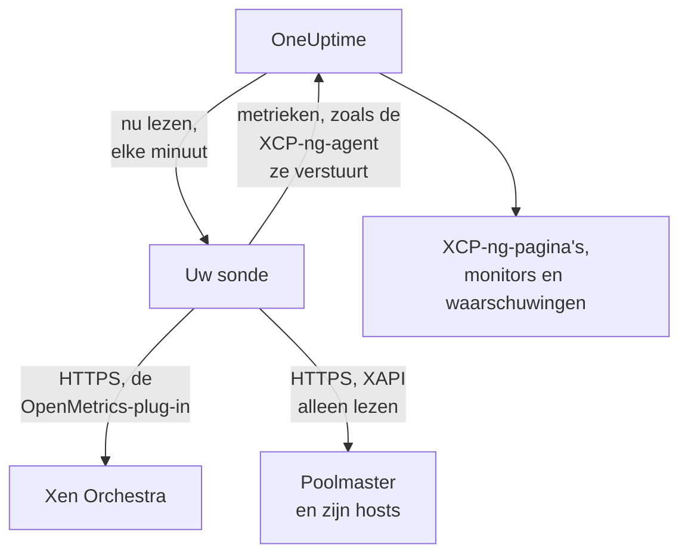

# XCP-ng zonder agent

Bewaak XCP-ng-pools zonder iets te installeren: een OneUptime-sonde leest ze, via de Xen Orchestra die ze beheert of, voor een pool zonder Xen Orchestra, rechtstreeks uit de XAPI op de master van de pool. Elke pool krijgt dezelfde pagina's, [XCP-ng-monitors](/docs/monitor/xcp-ng-monitor) en sjablonen als een pool die de [XCP-ng-agent](/docs/telemetry/xcp-ng) verstuurt. Er is geen agent om te installeren, bij te werken of draaiende te houden.

:::cards
- [Voordat u begint](#voordat-u-begint): een sonde die Xen Orchestra of de pool bereikt, en alleen-lezentoegang.
- [Xen Orchestra verbinden](#xen-orchestra-verbinden): elke pool die het beheert, via één verbinding.
- [Een pool zonder Xen Orchestra verbinden](#een-pool-zonder-xen-orchestra-verbinden): één pool, gelezen vanaf de master.
- [Problemen oplossen](#problemen-oplossen): wat elk bericht betekent en wat het oplost.
:::

## Zo werkt het

Elke minuut leest de sonde elke verbinding en verstuurt wat ze las naar OneUptime:

- **Xen Orchestra**: de sonde leest de OpenMetrics-plug-in van Xen Orchestra met het geheim van de plug-in, precies zoals de XCP-ng-agent, zodat elke pool die Xen Orchestra beheert met dezelfde reeksen binnenkomt.
- **De XAPI van een pool**: de sonde meldt zich aan bij de poolmaster en doet de leesacties die de plug-in van Xen Orchestra zelf doet: de records van de pool, en de metrieken van elke draaiende host, gelezen op die host. Ze maakt daar dezelfde reeksen van die de plug-in levert, zodat de pool precies zo wordt gelezen als via Xen Orchestra. Ook zet ze de XAPI-berichten van de pool, zoals een vastgelopen VM of een host die HA verloor, in de feed van de pool.

Elke pool registreert zich bij de eerste leesactie op basis van zijn UUID, net als de pools van de agent, en verschijnt onder **XCP-ng → Alle pools**.

## Welke manier van verbinden

| | Xen Orchestra, vanaf een sonde | De XAPI van een pool, vanaf een sonde | De XCP-ng-agent |
|---|---|---|---|
| Wat u draait | Een sonde die u al draait, of een nieuwe | Een sonde die u al draait, of een nieuwe | De agent, op een eigen machine |
| Wat er wordt gelezen | Elke pool die Xen Orchestra beheert | Eén pool | Elke pool die Xen Orchestra beheert |
| Wat er nodig is | Het geheim van de OpenMetrics-plug-in, en optioneel een alleen-lezen-API-token | Een account van de pool: root, of een Active Directory-gebruiker met de rol read-only | Het geheim van de OpenMetrics-plug-in |
| Waar de geheimen worden bewaard | Versleuteld in OneUptime, alleen naar de sonde verstuurd | Versleuteld in OneUptime, alleen naar de sonde verstuurd | In het bestand `.env` van de agent |
| XAPI-berichten in de feed van de pool | Niet inbegrepen | Inbegrepen | Niet inbegrepen |

Alle drie versturen dezelfde reeksen. Een pool wordt door één van hen tegelijk gelezen, zodat de geschiedenis één lijn blijft, wie hem ook leest.

## Voordat u begint

- **Een sonde die het adres via TCP 443 bereikt.** Meestal is dat een [aangepaste sonde](/docs/probe/custom-probe) in hetzelfde netwerk. In OneUptime Cloud ontvangen de gedeelde sondes nooit XCP-ng-geheimen, dus voeg een eigen sonde toe. Op een zelfgehoste instantie kunnen ook de eigen sondes van de instantie lezen.
- **Voor Xen Orchestra:** Xen Orchestra 6.9 of later met de OpenMetrics-plug-in ingeschakeld: volg [De OpenMetrics-plug-in inschakelen](/docs/telemetry/xcp-ng#de-openmetrics-plug-in-aanzetten) en kopieer het geheim. Optioneel een API-token van een Xen Orchestra-gebruiker met de ingebouwde rol **Read only**: OneUptime controleert dat het alleen leest, en waarschuwt u voordat het verloopt.
- **Voor een pool zonder Xen Orchestra:** XCP-ng 8.2 of later, en het adres van de master. De rollen van XAPI gelden alleen voor Active Directory-gebruikers, dus het enige lokale account, `root`, kan alles in de pool wijzigen. Voor alleen-lezentoegang neemt u de pool op in Active Directory en geeft u een gebruiker de rol `read-only`.

> [!IMPORTANT]
> Verbind een pool via Xen Orchestra of via zijn XAPI, niet allebei: de tweede verbinding die een pool leest, laat hem aan de eerste over.

## Xen Orchestra verbinden

:::steps
### Verbindingen openen
Open in OneUptime **XCP-ng → Verbindingen** en klik op **XCP-ng verbinden**.

### Xen Orchestra kiezen
Kies onder **Wat lezen** voor **Xen Orchestra**. Voer het **Adres van Xen Orchestra** in, waarop u het in een browser opent, zoals `https://xo.example.com`, en kies de sonde die het bereikt.

### Het geheim van de plug-in invoeren
Plak het **OpenMetrics-geheim**. Voeg een **API-token** van de alleen-lezengebruiker toe als u er een hebt.

### De verbinding testen en het certificaat vertrouwen
Klik op **Verbinding testen**. Xen Orchestra ondertekent zijn eigen certificaat, dus de test toont het: controleer de vingerafdruk en klik dan op **Dit certificaat vertrouwen**. Het resultaat toont de pools die Xen Orchestra levert, met hun hosts, VM's en opslagrepository's.

### Een naam geven en verbinden
De naam is standaard de hostnaam van Xen Orchestra, en elke pool die het leest toont die. Klik op **XCP-ng verbinden**, en de pagina van de verbinding opent.
:::

## Een pool zonder Xen Orchestra verbinden

:::steps
### Beginnen bij de verbindingen
Open in OneUptime **XCP-ng → Verbindingen** en klik op **XCP-ng verbinden**.

### De pool kiezen
Kies onder **Wat lezen** voor **Een pool zonder Xen Orchestra**. Voer het **Adres van de poolmaster** in, zoals `https://10.0.0.10`, en kies de sonde die hem bereikt.

### Het account invoeren
Voer de **Gebruikersnaam** en het **Wachtwoord** in: `root`, of een Active Directory-gebruiker met de rol read-only, met het domein geschreven, zoals `EXAMPLE\oneuptime`.

### De verbinding testen en het certificaat van de master vertrouwen
Klik op **Verbinding testen**. Elke XCP-ng-host ondertekent zijn eigen certificaat, dus de test toont dat van de master: controleer de vingerafdruk en klik dan op **Dit certificaat vertrouwen**. Het resultaat zegt welke XCP-ng de master draait en wat het account kan lezen, en waarschuwt u wanneer het account de pool kan wijzigen.

### De pool een naam geven en verbinden
Klik op **XCP-ng verbinden**, en de pagina van de verbinding opent.
:::

De pagina van de verbinding toont hoe het lezen ervoor staat. Ze toont **Bezig met controleren** tot de eerste leesactie, die binnen een minuut begint, daarna **Wordt verzameld**, en de pools die ze leest verschijnen onder **Pools die ze leest**.

Komt er 20 minuten lang geen sonde voor de verbinding, omdat die offline of te oud is, dan toont de pagina **Wordt niet verzameld** en zegt dat. Mag geen sonde de verbinding lezen, dan toont ze meteen **Wordt niet verzameld** en zegt ze wat er moet veranderen: een geheim, een gebruikersnaam of een wachtwoord ontbreekt, er is geen sonde ingesteld om haar te lezen, haar sonde mag haar niet lezen (een gedeelde sonde in OneUptime Cloud, of die van een ander project), of haar sonde is niet verbonden.

## Pools die de agent al verstuurt

Een pool die de XCP-ng-agent registreerde, wordt overgenomen door de eerste verbinding die hem leest: de geschiedenis loopt door als één lijn, en de feed van de pool zegt dat de agent kan worden gestopt.

> [!WARNING]
> Stop de XCP-ng-agent zodra een sonde zijn pools leest. Zolang beide draaien, komt elke metriek twee keer binnen.

Om terug te gaan, opent u de pagina **Instellingen** van de pool. De kaart **Gegevensverzameling** daarop biedt **De XCP-ng-agent gebruiken** voor een pool die een sonde leest, en **Verzamelen met een sonde** voor een pool die de agent verstuurt. Een pool die terug naar de agent is gezet, blijft bij de agent, wat de verbinding ook leest.

## Certificaten

De sonde slaat de controle van certificaten nooit over. Elke verbinding doorloopt een volledige TLS-handshake, en dan:

- zonder vertrouwd certificaat moet het certificaat komen van een autoriteit die de machine van de sonde vertrouwt, voor het ingevoerde adres;
- met een vertrouwd certificaat moet het adres precies dat certificaat tonen, herkend aan zijn SHA-256-vingerafdruk, welke naam het certificaat ook draagt. Het eigen certificaat van Xen Orchestra noemt geen adres en wordt op deze manier vertrouwd.

Om een vingerafdruk te controleren, voert u `openssl s_client -connect xo.example.com:443 </dev/null | openssl x509 -noout -fingerprint -sha256` uit op de machine van de sonde en vergelijkt u die met het certificaat zelf: op een poolmaster `openssl x509 -noout -fingerprint -sha256 -in /etc/xensource/xapi-ssl.pem`.

Bij een pool vertrouwt u het certificaat van de master. De pool vermeldt zelf het certificaat dat elk van zijn hosts gebruikt, en de sonde leest elke andere host vastgezet op dat certificaat. Wordt een andere host master, dan volgt de sonde die alleen naar een host waar de pool bij de laatste leesactie voor instond. Verandert een certificaat, dan stopt het lezen met **Het certificaat is gewijzigd** en wordt het nieuwe certificaat getoond: er wordt niets verstuurd totdat u het vertrouwt, op de pagina van de verbinding.

## De opgeslagen geheimen

Het geheim, het token en het wachtwoord zijn versleuteld en alleen-schrijven: niemand kan ze teruglezen, en de API geeft ze nooit terug. Ze worden alleen verstuurd naar de sonde die de verbinding leest, en die houdt ze in het geheugen.

Een opgeslagen geheim wordt alleen verstuurd naar het adres, via de sonde en naar het certificaat waarvoor het is ingevoerd. Wie bij **Verbinding bewerken** het adres, de sonde of het vertrouwde certificaat wijzigt, moet het opnieuw invoeren, zodat niemand die de verbinding mag bewerken het ergens anders heen kan sturen, en een opgeslagen API-token dat niet opnieuw wordt ingevoerd, wordt vergeten. Het certificaat vertrouwen dat de sonde op het opgeslagen adres vond, behoudt ze. **Het API-token verwijderen** verwijdert het token uit OneUptime: trek het ook in Xen Orchestra in.

## Het API-token

Een API-token is optioneel: de metrieken komen via het geheim van de plug-in. Met een token controleert elke leesactie het hoogstens één keer per uur:

- **Het leest alleen.** Een token waarvan de gebruiker beheerder is, of waarvan de rol iets mag wijzigen, faalt voor de test en wordt op de pagina van de verbinding als probleem getoond. OneUptime bewaart alleen alleen-lezentokens.
- **Het leest wat OneUptime nodig heeft.** Xen Orchestra beantwoordt een lijst die een gebruiker niet mag lezen met een lege lijst, dus het token moet alarmen, berichten en back-uplogboeken lezen. De ingebouwde rol **Read only** leest alle drie.
- **Wanneer het verloopt.** Xen Orchestra vergeet een token op het moment dat het verloopt. Twee weken ervoor melden de pagina van de verbinding en de feed van elke pool die ze leest dat. Maak een nieuw token voor dezelfde gebruiker en voer het in bij **Verbinding bewerken**.

## Referentie

| Instelling | Standaard | Opmerkingen |
|---|---|---|
| Lezen elke | 1 minuut | Van 1 tot 60 minuten. Elke minuut komt overeen met de XCP-ng-agent; lees een grote Xen Orchestra minder vaak om hem te ontzien. |
| Leesacties tegelijk | 4 per sonde | Een leesactie die trager is dan haar interval wordt overgeslagen, nooit opgestapeld. |
| Grootste leesactie | Ongeveer 48 MiB | Grotere Xen Orchestra's hebben de XCP-ng-agent nodig. |
| XAPI-berichten | 200 per leesactie | Vanaf het moment dat de pool is verbonden, elk één keer bezorgd, het oudste eerst. |
| Verbindingstest | 90 seconden om te starten | Een test die geen sonde op tijd oppakt, of die langer dan 150 seconden duurt, wordt als mislukt beantwoord. |

## Problemen oplossen

:::details Het certificaat wordt niet vertrouwd
Xen Orchestra en XCP-ng-hosts ondertekenen standaard hun eigen certificaten. Vergelijk de getoonde vingerafdruk met het certificaat en klik dan op **Dit certificaat vertrouwen**.
:::

:::details Het certificaat is gewijzigd
Er wordt niets verstuurd totdat u het nieuwe certificaat vertrouwt. Hebt u het vernieuwd, controleer dan de nieuwe vingerafdruk, vertrouw het en voer de geheimen opnieuw in bij **Verbinding bewerken**.
:::

:::details Xen Orchestra heeft het geheim geweigerd
Kopieer het geheim opnieuw uit **Settings → Plugins → openmetrics** in Xen Orchestra en voer het in bij **Verbinding bewerken**.
:::

:::details De OpenMetrics-plug-in antwoordt niet
Laad **openmetrics** onder **Settings → Plugins** in Xen Orchestra en schakel **Auto-load** in, zodat hij na een herstart terugkomt.
:::

:::details Deze Xen Orchestra heeft geen OpenMetrics-plug-in
De plug-in heeft Xen Orchestra 6.9 of later nodig, en op een Xen Orchestra Appliance een Premium-licentie. Verbind zonder licentie elke pool via zijn XAPI.
:::

:::details Er is geen pool verbonden
Xen Orchestra meldt geen verbonden pool. Voeg uw pools toe in Xen Orchestra of verbind ze opnieuw, en test daarna nog eens.
:::

:::details Het API-token kan Xen Orchestra wijzigen
OneUptime bewaart alleen alleen-lezentokens. Maak er een voor een gebruiker met een kopie van de ingebouwde rol **Read only** en geen andere rol.
:::

:::details Het API-token kan geen alarmen, berichten of back-ups lezen
Geef de gebruiker van het token een kopie van de ingebouwde rol **Read only** van Xen Orchestra, die alle drie leest.
:::

:::details Het API-token is verlopen
Maak in Xen Orchestra een nieuw token voor de alleen-lezengebruiker en voer het in bij **Verbinding bewerken**. De metrieken blijven intussen binnenkomen.
:::

:::details XAPI heeft de aanmelding geweigerd
Controleer de gebruikersnaam en het wachtwoord. Een Active Directory-gebruiker wordt met het domein geschreven, zoals `EXAMPLE\oneuptime`.
:::

:::details Deze host is niet de poolmaster
Een lid van de pool antwoordt met het adres van zijn master, dat het bericht noemt. Voer dat adres in en test opnieuw.
:::

:::details Het account kan de pool niet lezen
Geef de Active Directory-gebruiker de rol read-only op de pool, of gebruik een account dat die rol heeft.
:::

:::details De sonde krijgt geen antwoord
Het netwerk van de sonde kan het adres via TCP 443 niet bereiken. Sta het toe in de firewall, of kies een sonde in hetzelfde netwerk.
:::

:::details De sonde heeft dit niet opgepakt
De sonde is offline, of draait een OneUptime-versie die ouder is dan het lezen van XCP-ng. Controleer in de tabel **Aangepaste sondes** of ze verbonden is, en werk haar bij.
:::

:::details Deze verbinding is te groot om vanaf een sonde te lezen
De metrieken zijn groter dan één upload van een sonde mag zijn. Gebruik hiervoor de [XCP-ng-agent](/docs/telemetry/xcp-ng).
:::

## Volgende stappen

:::cards
- [XCP-ng-monitor](/docs/monitor/xcp-ng-monitor): waarschuw bij pools, hosts, VM's en opslagrepository's.
- [Aangepaste sonde](/docs/probe/custom-probe): draai een sonde in het netwerk van de pools.
- [XCP-ng-agent](/docs/telemetry/xcp-ng): lees Xen Orchestra in plaats daarvan met de agent.
:::
