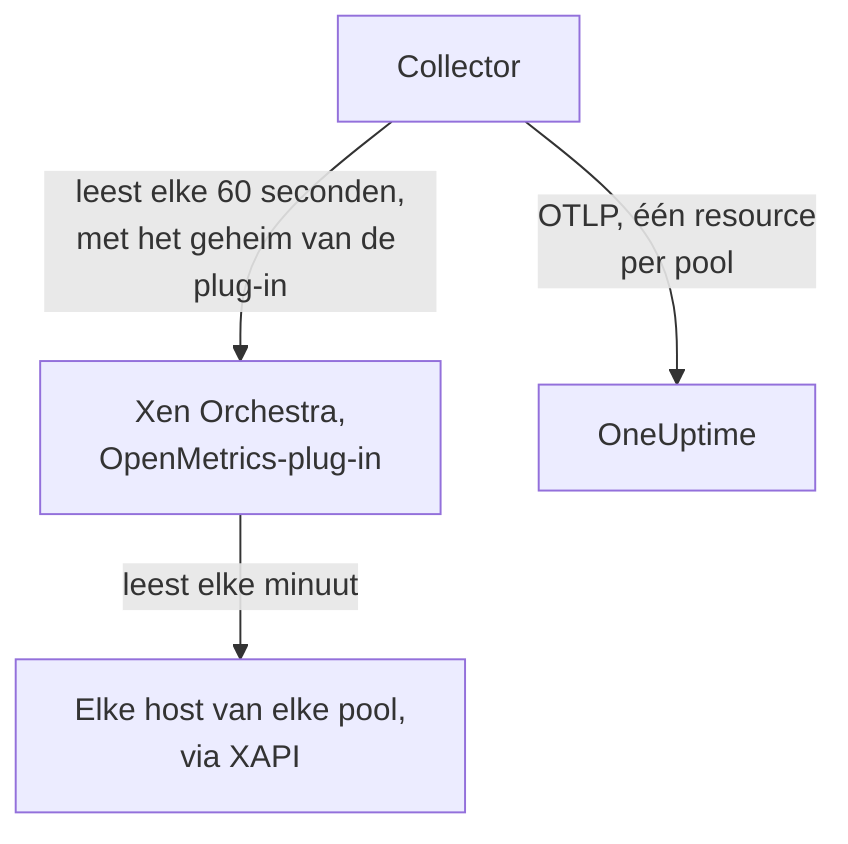

# XCP-ng-agent

De XCP-ng-agent van OneUptime bewaakt de XCP-ng-pools die een Xen Orchestra beheert: hun hosts, VM's, opslagrepository's en virtuele schijven. Het is een standaard OpenTelemetry Collector die de eigen OpenMetrics-plug-in van Xen Orchestra leest met het geheim van de plug-in en wat hij leest naar OneUptime stuurt, waar elke pool met zijn inventaris verschijnt. Geen wachtwoord van een pool of van Xen Orchestra bereikt ooit de agent. [XCP-ng-monitoren](/docs/monitor/xcp-ng-monitor) waarschuwen op wat er binnenkomt. Om dezelfde pools zonder iets te installeren vanaf een OneUptime-sonde te laten lezen, zie [XCP-ng zonder agent](/docs/telemetry/xcp-ng-agentless).

:::cards
- [De agent installeren](#de-agent-installeren): Zet de plug-in aan, en gebruik daarna het installatiescript of Docker Compose.
- [Het certificaat van Xen Orchestra](#het-certificaat-van-xen-orchestra): Hoe de agent Xen Orchestra vertrouwt, nooit door de controle over te slaan.
- [Wat de agent verzamelt](#wat-de-agent-verzamelt): Elke reeks van de plug-in, en de tellers die eigenlijk snelheden zijn.
- [Problemen oplossen](#problemen-oplossen): Een diagnosescript, en de gebruikelijke problemen.
:::

## Wat je krijgt

- **Elke pool op zich.** Elke pool die de Xen Orchestra beheert, wordt in OneUptime een XCP-ng-pool, herkend aan zijn XAPI-UUID en genoemd zoals Xen Orchestra hem noemt. Twee pools achter één Xen Orchestra zijn twee pools, en een pool in OneUptime hernoemen is veilig: telemetrie wordt via zijn UUID gekoppeld.
- **Zijn inventaris.** De hosts, VM's, opslagrepository's en virtuele schijven van de pool, met hun status en hun metrieken. Controledomeinen (dom0) melden zich als VM's, en de pagina's van de pool verbergen ze tenzij je erom vraagt.
- **Eén agent per Xen Orchestra.** De plug-in levert elke pool waarmee zijn Xen Orchestra verbonden is, dus één agent leest ze allemaal, en een later verbonden pool verschijnt bij de volgende leesbeurt.

## Hoe het werkt

De agent is één container die je met Docker Compose op één machine draait: een standaard OpenTelemetry Collector, zonder eigen image van OneUptime. Elke 60 seconden vraagt hij Xen Orchestra om `/openmetrics/metrics`, met het geheim van de plug-in als Bearer-token, via het eigen adres en certificaat van Xen Orchestra. De plug-in leest de metrieken van elke host via XAPI met een resolutie van 60 seconden. De collector houdt de reeksen van de pools, groepeert ze per pool en stuurt ze via OTLP naar OneUptime.



Elke pool registreert zichzelf met zijn eerste gegevens, onder de UUID die de agent als `xcp_ng.pool.id` op zijn reeksen zet, en de naam die Xen Orchestra hem geeft, `xcp_ng.pool.name`. Een pool zonder naam in Xen Orchestra heet "Pool" met het begin van zijn UUID erachter, tot je hem hernoemt.

## Voordat je begint

- Xen Orchestra 6.9 of later, verbonden met de pools die je wilt bewaken, met zijn OpenMetrics-plug-in. Op een Xen Orchestra Appliance (XOA) heeft de plug-in een Premium-licentie nodig; een vanuit de broncode gebouwde Xen Orchestra bevat hem.
- Docker Engine 20.10 of later met de Docker Compose v2-plug-in, `curl` en `openssl`, op een machine die Xen Orchestra via HTTPS bereikt.
- Een certificaat op Xen Orchestra dat het adres noemt waarmee de agent verbinding maakt. Het zelfondertekende certificaat dat Xen Orchestra voor zichzelf maakt, noemt er geen, dus geen enkele huidige TLS-client kan het controleren, en een vanuit de broncode gebouwde Xen Orchestra serveert gewoon HTTP tot je hem er een geeft: zie [Het certificaat van Xen Orchestra](#het-certificaat-van-xen-orchestra).
- Een ingestiesleutel. Maak er een aan onder **Projectinstellingen → Telemetrie & APM → Ingestiesleutels** en kopieer de waarde.
- Uitgaand HTTPS van die machine naar je OneUptime-URL.

### Ondersteunde versies

| | Ondersteund | Waarom |
| --- | --- | --- |
| Xen Orchestra | 6.9 of later, met de OpenMetrics-plug-in `xo-server-openmetrics` 1.9 | De plug-in houdt zijn geheim bij een herstart van Xen Orchestra, bevat de oplossingen voor de geheugenlekken bij het uitlezen en levert elke reeks die de pagina's van de pool lezen: de status van hosts en VM's, opslagrepository's en virtuele schijven. Een oudere plug-in kon bij een herstart een nieuw geheim maken, waardoor de agent buitengesloten werd tot iemand het opnieuw kopieerde. |
| XCP-ng | 8.3 LTS | Door Vates ondersteund tot 30 november 2028. XCP-ng 8.2 bereikte het einde van zijn levensduur op 16 september 2025. |
| XenServer | Nog niet getest | Xen Orchestra meldt een XenServer-pool die het beheert met dezelfde reeksen, dus het zou moeten werken, maar niemand heeft er nog een met OneUptime getest. |

### Waar je de agent draait

De agent praat via HTTPS met Xen Orchestra, dus hij kan draaien op elke machine met Docker en een route ernaartoe: de machine van Xen Orchestra zelf, een monitoringhost of een kleine beheer-VM. Kies bij voorkeur een machine waarvan de VM niet op de bewaakte pools draait: als een pool uitvalt, mag je monitoring niet mee uitvallen. Eén agent leest één Xen Orchestra; voor meer, zie [Meerdere Xen Orchestra's uitlezen](#meerdere-xen-orchestras-uitlezen).

## De OpenMetrics-plug-in aanzetten

De agent leest elke pool via de OpenMetrics-plug-in van Xen Orchestra, met het geheim van de plug-in.

:::steps
### De plug-in aanzetten

Open in Xen Orchestra *Settings → Plugins*, zoek **openmetrics** en zet hem aan. De eerste keer dat hij start, maakt hij een geheim, en Xen Orchestra bewaart het bij herstarts.

### Het geheim kopiëren

Open de instellingen van de plug-in en kopieer zijn **Prometheus secret**: je geeft het in de volgende stap aan de agent. Je kunt daar ook een eigen geheim typen en opslaan. Houd het privé: wie het heeft, kan de metrieken van elke pool lezen.

### Controleren of hij antwoordt

De plug-in antwoordt op het eigen adres en met het eigen certificaat van Xen Orchestra, op `/openmetrics/metrics`, en alleen op een verzoek dat zijn geheim meestuurt. Zijn statuscontrole heeft er geen nodig, dus dit ene verzoek mag de certificaatcontrole overslaan met `-k`; de agent doet dat nooit:

```bash
curl -k https://xo.example.com/openmetrics/health
```

Hij antwoordt `{"status":"ok"}` zolang de plug-in draait. Een `404` betekent dat de plug-in niet aan staat.
:::

## De agent installeren

:::steps
### De agent installeren en starten

Elke OneUptime serveert het installatiescript en de bestanden van de agent voor zijn eigen release: de opdrachten hieronder downloaden ze van `https://oneuptime.com`, dus vervang dat adres bij een zelf gehoste OneUptime door je URL. Het installatiescript wordt eerst als `install.sh` opgeslagen, zodat je het kunt lezen voordat je het uitvoert.

:::tabs
@tab install.sh
Download het installatiescript en voer het uit op de machine die de agent gaat hosten:

```bash
curl -fsSL https://oneuptime.com/install/xcp-ng-agent -o install.sh
bash install.sh
```

Het script vraagt om je OneUptime-URL, de ingestiesleutel, het adres van Xen Orchestra zoals je het in een browser opent (zoals `https://xo.example.com` of `https://10.0.0.5:8443`), het geheim van de plug-in (niet getoond terwijl je typt) en hoe deze Xen Orchestra in OneUptime moet heten. Daarna leest het het certificaat van Xen Orchestra: een certificaat dat deze machine al vertrouwt, wordt tegen haar CA-bundel gecontroleerd; elk ander wordt met zijn SHA-256-vingerafdruk getoond, en je antwoordt **y** om dat certificaat en niets anders te vertrouwen, zodra je de vingerafdruk hebt vergeleken met die op de machine van Xen Orchestra. Het zet de controle nooit uit. Ten slotte vraagt het de plug-in met het geheim om zijn metrieken en noemt het de pools die Xen Orchestra meldt, voordat het iets installeert. Het installeert naar `/opt/oneuptime-xcp-ng-agent`, schrijft met de rechten `0600` een `.env`-bestand en `xo-ca.pem`, de certificaten die de agent voor Xen Orchestra vertrouwt, en start de agent met Docker Compose. Als je het script opnieuw uitvoert, gebruikt het alles in die `.env` opnieuw in plaats van opnieuw te vragen; zo [upgrade je de agent](#de-agent-upgraden).
@tab Docker Compose
Download `docker-compose.yml` en `otel-collector-config.yaml` van je OneUptime naar een nieuwe map:

```bash
mkdir oneuptime-xcp-ng-agent && cd oneuptime-xcp-ng-agent
curl -fsSLO https://oneuptime.com/install/xcp-ng-agent/docker-compose.yml
curl -fsSLO https://oneuptime.com/install/xcp-ng-agent/otel-collector-config.yaml
```

Maak ernaast een `.env`-bestand aan. Het bevat het geheim van de plug-in, dus houd het privé met `chmod 600 .env`:

```bash title=".env"
ONEUPTIME_URL=YOUR_ONEUPTIME_URL
ONEUPTIME_TELEMETRY_INGESTION_KEY=YOUR_TELEMETRY_INGESTION_TOKEN
XO_SCHEME=https
XO_ADDRESS=xo.example.com
XO_OPENMETRICS_SECRET='your-plugin-secret'
XO_NAME='Xen Orchestra'
XO_TLS_SERVER_NAME=
XCP_NG_AGENT_CONTAINER_NAME=oneuptime-xcp-ng-agent
```

`XO_ADDRESS` is de `host` of `host:port` van Xen Orchestra, zonder `https://`. Zet het geheim van de plug-in tussen enkele aanhalingstekens en schrijf elke `$` erin als `$$`: de collector leest de waarde nog een keer en zou een `$` voor het begin van een variabele aanzien. Een geheim met een `'` erin kan niet tussen enkele aanhalingstekens: laat het installatiescript het schrijven, of kies een ander geheim in Xen Orchestra.

Sla daarna het certificaat van Xen Orchestra op als `xo-ca.pem` naast `docker-compose.yml`: de agent controleert Xen Orchestra tegen dit bestand en niets anders. Om het eigen certificaat van Xen Orchestra te vertrouwen, lees je het uit en vergelijk je de vingerafdruk met die op de machine van Xen Orchestra voordat je het gebruikt:

```bash
openssl s_client -connect xo.example.com:443 -servername xo.example.com </dev/null 2>/dev/null \
  | openssl x509 -out xo-ca.pem
openssl x509 -in xo-ca.pem -noout -fingerprint -sha256
```

Heeft een eigen CA het certificaat uitgegeven, kopieer dan in plaats daarvan het certificaat van die CA naar `xo-ca.pem`; heeft een publieke CA het uitgegeven, kopieer dan de CA-bundel van deze machine (`cp /etc/ssl/certs/ca-certificates.crt xo-ca.pem`). Start de agent:

```bash
docker compose up -d
```
:::

### Controleren of de agent draait

```bash
docker compose ps
docker logs -f oneuptime-xcp-ng-agent
```

`docker compose ps` toont de collector, `oneuptime-xcp-ng-agent`. Zijn logboeken zouden deze regel moeten tonen zodra hij gestart is:

```text
Everything is ready. Begin running and processing data.
```

### De pools in OneUptime vinden

Open **Producten → Infrastructuur → XCP-ng → Alle pools**. Elke pool die Xen Orchestra meldt, verschijnt ongeveer een minuut na de eerste leesbeurt, onder de naam die Xen Orchestra hem geeft, met zijn hosts, VM's en opslag. Zijn pagina **Topologie** tekent ze als één kaart: zie [Topologie](/docs/telemetry/topology#de-eigen-kaart-van-een-resource-openen).
:::

## Het certificaat van Xen Orchestra

De agent controleert het certificaat van Xen Orchestra bij elke leesbeurt, tegen `xo-ca.pem` en niets anders, en slaat de controle nooit over: het geheim van de plug-in reist in elk verzoek mee. `xo-ca.pem` bevat een van drie dingen:

- **Het eigen certificaat van Xen Orchestra**, vastgepind via zijn SHA-256-vingerafdruk (`XO_TLS_FINGERPRINT`): de agent vertrouwt dat certificaat en geen ander.
- **De CA die het heeft uitgegeven** (`XO_CA_FILE`), voor een certificaat van een eigen CA.
- **De CA-bundel van deze machine**, voor een certificaat dat deze machine al vertrouwt, zoals een van een publieke CA.

Hoe dan ook moet het certificaat het adres noemen waarmee de agent verbinding maakt. De agent controleert de namen waarvoor een certificaat is uitgegeven, de alternatieve namen van het onderwerp (subject alternative names), zoals elke huidige TLS-client doet, en nooit het onderwerp zelf. Het zelfondertekende certificaat dat Xen Orchestra voor zichzelf maakt, noemt er geen, dus de agent kan het niet vertrouwen, vastgepind of niet, en faalt met `x509: certificate is not valid for any names`; het installatiescript stopt bij zo'n certificaat en zegt waarom.

### Xen Orchestra een certificaat geven dat zijn adres noemt

Gebruik een certificaat van je eigen CA of van een publieke CA, of maak op de machine van Xen Orchestra een zelfondertekend certificaat dat het adres van Xen Orchestra noemt, met zijn naam en zijn adres in de alternatieve namen van het onderwerp:

```bash
sudo mkdir -p /etc/ssl/xo
sudo openssl req -x509 -newkey rsa:2048 -nodes -days 825 \
  -subj "/CN=xo.example.com" \
  -addext "subjectAltName=DNS:xo.example.com,IP:10.0.0.5" \
  -keyout /etc/ssl/xo/key.pem -out /etc/ssl/xo/cert.pem
```

Laat de HTTPS-listener van xo-server naar de twee bestanden wijzen, die de gebruiker waaronder xo-server draait (standaard root) moet kunnen lezen, in een eigen configuratiebestand: `/etc/xo-server/config.httpscert.toml` op een XOA, of naast de `config.toml` van xo-server bij een vanuit de broncode gebouwde Xen Orchestra. De listeners van Xen Orchestra zijn genummerd, en de tweede, `http.listen.1`, is de HTTPS-listener:

```toml
[http.listen.1]
port = 443
cert = '/etc/ssl/xo/cert.pem'
key = '/etc/ssl/xo/key.pem'
```

Herstart daarna xo-server met `systemctl restart xo-server` en installeer de agent, of voer het installatiescript opnieuw uit: het leest het nieuwe certificaat en toont de vingerafdruk om te controleren. Of laat Xen Orchestra zelf een Let's Encrypt-certificaat aanvragen, zoals een XOA kan (zie de documentatie van Xen Orchestra): het wordt publiek vertrouwd, dus de agent heeft geen instelling nodig. Noemt een certificaat Xen Orchestra bij een andere naam dan het adres in `XO_ADDRESS`, stel dan `XO_TLS_SERVER_NAME` in op die naam; het installatiescript vult die uit het certificaat in wanneer het kan.

Wordt een vastgepind certificaat vernieuwd, dan stopt de agent met het uitlezen van Xen Orchestra tot hij het nieuwe vertrouwt. Voer het installatiescript opnieuw uit: het toont de nieuwe vingerafdruk en stopt, zonder iets te veranderen. Controleer die vingerafdruk op de machine van Xen Orchestra en voer het script daarna nog een keer uit met die vingerafdruk: `XO_TLS_FINGERPRINT=<new fingerprint> bash install.sh`. Met Docker Compose geïnstalleerd: schrijf `xo-ca.pem` opnieuw en voer `docker compose up -d --force-recreate` uit.

## Omgevingsvariabelen

Het installatiescript schrijft deze naar `/opt/oneuptime-xcp-ng-agent/.env`; een Docker Compose-installatie leest ze uit de `.env` naast `docker-compose.yml`. Voer na het wijzigen van een variabele `docker compose up -d` uit in die map.

| Variabele | Vereist | Beschrijving |
| --- | --- | --- |
| `ONEUPTIME_URL` | Ja | Je OneUptime-URL, zoals `https://oneuptime.com` of je zelf-gehoste instantie. Gebruik `http://` en de poort als de instantie alleen HTTP spreekt. |
| `ONEUPTIME_TELEMETRY_INGESTION_KEY` | Ja | De ingestiesleutel uit **Projectinstellingen → Telemetrie & APM → Ingestiesleutels**. |
| `XO_URL` | Installatiescript | Het adres van Xen Orchestra zoals je het in een browser opent, zoals `https://xo.example.com` of `https://10.0.0.5:8443`. Het installatiescript leidt er `XO_SCHEME` en `XO_ADDRESS` van af. |
| `XO_SCHEME` | Nee | `https`, de standaard. `http` alleen in een lab: het geheim gaat dan onversleuteld over het netwerk. |
| `XO_ADDRESS` | Ja | De `host` of `host:port` van Xen Orchestra, zonder schema. |
| `XO_OPENMETRICS_SECRET` | Ja | Het geheim van de OpenMetrics-plug-in, verstuurd als Bearer-token. Elke `$` erin wordt als `$$` geschreven. |
| `XO_NAME` | Nee | Hoe deze Xen Orchestra in OneUptime heet, als `xen_orchestra.name` op elke pool gezet die hij leest en getoond in de **Instellingen** van elke pool. Standaard het adres van Xen Orchestra. |
| `XO_TLS_FINGERPRINT` | Installatiescript | De SHA-256-vingerafdruk van het eigen certificaat van Xen Orchestra, zoals `openssl x509 -fingerprint -sha256` hem toont, dubbele punten optioneel, wanneer de agent dat certificaat en niets anders vertrouwt. Het installatiescript weigert een certificaat dat er niet bij past. |
| `XO_CA_FILE` | Installatiescript | Een CA-bundel die het certificaat van Xen Orchestra heeft uitgegeven; het installatiescript controleert het certificaat ertegen en kopieert hem naar `xo-ca.pem`. |
| `XO_TLS_SERVER_NAME` | Nee | De naam waartegen het certificaat van Xen Orchestra wordt gecontroleerd, wanneer `XO_ADDRESS` een adres is dat het certificaat niet noemt. Leeg: de host van `XO_ADDRESS`. |
| `XCP_NG_AGENT_CONTAINER_NAME` | Nee | De containernaam van de agent. Standaard `oneuptime-xcp-ng-agent`. De agent van een tweede Xen Orchestra op dezelfde machine heeft een eigen naam nodig: zie [Meerdere Xen Orchestra's uitlezen](#meerdere-xen-orchestras-uitlezen). Het installatiescript noemt een nieuwe agent naar zijn map, tenzij je hem instelt, en behoudt hem wanneer je het script opnieuw uitvoert. |

## Wat de agent verzamelt

Elke minuut leest de agent de plug-in, die via XAPI de round-robin-databases van elke host leest met een resolutie van 60 seconden. Hij houdt de reeksen `xcp_*` en verplaatst de pool van elke reeks naar de resource waarop hij ze verstuurt, als `xcp_ng.pool.id` (de UUID van de pool, die nooit verandert) en `xcp_ng.pool.name`:

| Categorie | Reeksen |
| --- | --- |
| Pool | `xcp_pool_connected`, aanwezig zolang Xen Orchestra met de pool verbonden is |
| Hosts | `xcp_host_status` (zijn energiestatus en of hij ingeschakeld is), `xcp_host_uptime_seconds`, `xcp_host_cpu_average`, `xcp_host_cpu_core_usage`, `xcp_host_load`, `xcp_host_load_average`, `xcp_host_memory_*`, `xcp_host_running_vcpus`, `xcp_host_network_*` per fysieke interface, `xcp_host_disk_*` per opslagrepository, `xcp_host_power_consumption_watts` |
| VM's | `xcp_vm_status`, `xcp_vm_uptime_seconds`, `xcp_vm_cpu_usage`, `xcp_vm_cpu_core_usage`, `xcp_vm_runstate_*` (CPU-concurrentie), `xcp_vm_memory_*`, `xcp_vm_network_*` per interface, `xcp_vm_disk_*` per schijf, `xcp_vm_power_consumption_watts` |
| Opslag | `xcp_sr_physical_size_bytes`, `xcp_sr_physical_usage_bytes`, `xcp_sr_virtual_size_bytes`, `xcp_vdi_virtual_size_bytes`, `xcp_vdi_physical_usage_bytes` |
| XOSTOR | `xcp_xostor_*`, op pools die XOSTOR draaien |

Controledomeinen melden zich als VM's met `is_control_domain="true"`. Elke reeks van Xen Orchestra houdt zijn naam en zijn labels, zoals `uuid`, `host_name`, `vm_name`, `sr_name` en `tags`; de [XCP-ng-monitor](/docs/monitor/xcp-ng-monitor#verzamelde-metrieken) noemt ze allemaal.

### De tellers die snelheden zijn

Xen Orchestra typeert acht doorvoerreeksen als tellers en noemt ze `_total`, hoewel elk de snelheid per seconde van XAPI bevat: `xcp_host_network_receive_bytes_total`, `xcp_host_network_transmit_bytes_total`, `xcp_vm_network_receive_bytes_total`, `xcp_vm_network_transmit_bytes_total`, `xcp_vm_network_receive_errors_total`, `xcp_vm_network_transmit_errors_total`, `xcp_vm_disk_read_bytes_total` en `xcp_vm_disk_write_bytes_total`. Als tellers gelezen zou elke netwerk- en schijfdoorvoergrafiek fout zijn: een snelheid die daalt, leest als een reset van de teller. De processor `transform/xcp-ng-rates` van de agent maakt er gauges van met ongewijzigde namen en waarden, zodat OneUptime ze opslaat als de snelheden die ze zijn, in bytes of fouten per seconde. OneUptime zet ook elke reeks om die nog als teller binnenkomt, van een collector die je zelf hebt geconfigureerd.

### Wat OneUptime toevoegt

OneUptime leidt voor elke pool vier 0/1-reeksen af terwijl zijn gegevens binnenkomen, die de waarschuwingssjablonen lezen:

| Reeks | 1 zolang |
| --- | --- |
| `xcp_ng.host.running` | Xen Orchestra de host als Running meldt; 0 zolang hij Halted is, of zijn status Unknown |
| `xcp_ng.host.enabled` | de host ingeschakeld is; 0 in onderhoudsmodus of tijdens een evacuatie, wanneer XAPI er geen VM op start |
| `xcp_ng.vm.running` | de VM Running is; 0 zolang hij Halted, Paused of Suspended is |
| `xcp_ng.vm.stopped_after_running` | een VM die de afgelopen 24 uur draaide, Halted of Paused is |

Hij zet ook op elk punt `xcp_ng.scope` (`pool`, `host`, `vm`, `sr`, `vdi` of `xostor`) en `xcp_ng.id` (de UUID van dat object), waarop monitoren en dashboards filteren: zie [Resource-identiteit](/docs/monitor/xcp-ng-monitor#resource-identiteit).

### Wat de agent niet bewaart

- De eigen procesreeksen van Xen Orchestra (`xo_*`), die bij geen enkele pool horen, en de eigen leesreeksen van de collector.
- Het vermogen van een host dat Xen Orchestra via IPMI leest: de plug-in stuurt die meting zonder zijn pool, dus die hoort ook bij geen enkele pool. Het geschatte aandeel van elke VM, `xcp_vm_power_consumption_watts`, blijft bewaard.

## Wat de pagina's van een pool tonen

Open een pool via **Producten → Infrastructuur → XCP-ng → Alle pools**. Zijn menu bevat:

| Pagina | Wat ze toont |
| --- | --- |
| **Overzicht** | De gezondheid van de pool en wat aandacht vraagt, zijn hosts, VM's en opslag, zijn drukste VM's en hosts, en de Xen Orchestra waaruit hij gelezen wordt, met de versie van de agent. |
| **Hosts**, **VM's**, **Opslag** | Elke host, VM en opslagrepository, elk met een eigen pagina en zijn grafieken. **VM's** verbergt controledomeinen tenzij je erom vraagt, en de pagina van een opslagrepository toont zijn virtuele schijven. |
| **Topologie** | De pool, zijn hosts, de VM's op elke host en de opslagrepository's die ze gebruiken, als één kaart. |
| **Resourcegebruik** | Grafieken van de hosts, VM's, opslag, schijven en het netwerk van de pool door de tijd, één lijn per host, VM of opslagrepository. |
| **Aanbevelingen** | De [waarschuwingssjablonen](/docs/monitor/xcp-ng-monitor#kant-en-klare-waarschuwingssjablonen) om aan te zetten, elk één monitor. |
| **Metrieken**, **Logboeken** | Elke reeks van de pool in de verkenners, beperkt tot hem. De agent stuurt alleen metrieken, dus **Logboeken** toont alleen logboeken die je met de `xcp_ng.pool.id` van de pool verstuurt. |
| **Incidenten**, **Waarschuwingen**, **Gepland onderhoud** | Degene die de pool noemen. |
| **Feed** | Wat er in OneUptime met de pool gebeurde: wanneer hij werd toegevoegd, gewijzigd, gearchiveerd of hersteld, wie zijn eigenaren zijn, en de eigenaar- en labelregels die erop zijn uitgevoerd. |
| **Eigenaren** | Wie erover wordt ingelicht, met de hand of via eigenaarregels. |
| **Instellingen** | Zijn naam, de Xen Orchestra waaruit hij gelezen wordt, zijn naam daar en de versie van de agent, met hoe lang zijn telemetrie bewaard blijft. |
| **Documentatie** | Deze installatie, met je URL en sleutel al ingevuld. |

Het **Overzicht** van de pool noemt zijn gezondheid, **Gezond**, **Verminderd** of **Ongezond**, op basis van wat aandacht vraagt, en toont dat onder **Vraagt aandacht**, het dringendste eerst:

- **Kritiek:** een host die Halted is, of in een status die Xen Orchestra niet kan bepalen (Unknown); een opslagrepository die voor meer dan 95% vol is, waar VM's niet meer kunnen schrijven.
- **Verdient een blik:** een uitgeschakelde host, in onderhoudsmodus of in evacuatie; een VM die Halted of Paused is en de afgelopen 24 uur draaide; een opslagrepository die voor meer dan 90% vol is, waar de waarschuwing Storage Repository Near Full afgaat, of door thin provisioning boven zijn grootte is toegewezen.

Een geschorste VM (Suspended) is met opzet geschorst en telt nooit mee, net zo min als een VM die niemand een dag lang heeft zien draaien, of een controledomein. ISO-bibliotheken en verwisselbare media bevatten geen VM-schijven, dus de opslagcijfers van de pool laten ze weg.

Als Xen Orchestra een pool 15 minuten lang niet meer meldt, wordt de pool **Verbinding verbroken**, en zijn pagina's houden wat hij het laatst meldde. Een host, VM, opslagrepository of virtuele schijf die niet meer in de meldingen van Xen Orchestra voorkomt, verlaat de inventaris 15 minuten later; een VM stoppen verwijdert hem nooit.

## De pools labelen met projectlabels

Een resource-attribuut dat begint met `oneuptime.label.` wordt een projectlabel op elke pool die de agent leest: `oneuptime.label.<dimension>=<value>` is het label `<dimension>:<value>`. Voeg de attributen toe aan de processor `resource` in `otel-collector-config.yaml`, naast `oneuptime.agent.version`:

```yaml
processors:
  resource:
    attributes:
      # ...existing attributes...
      - key: oneuptime.label.team
        value: platform
        action: upsert
      - key: oneuptime.label.env
        value: production
        action: upsert
```

De collector leest zijn configuratie alleen bij het starten: voer `docker compose restart oneuptime-xcp-ng-agent` uit. De pools tonen dan de labels `team:platform` en `env:production`. Labels worden vergeleken zonder op hoofdletters te letten, dus een bestaand label `Production` wordt hergebruikt in plaats van verdubbeld, en de agent verwijdert nooit een label dat iemand in OneUptime heeft toegevoegd. Het installatiescript opnieuw uitvoeren vervangt een bewerkte `otel-collector-config.yaml` en bewaart die van jou ernaast als `otel-collector-config.yaml.bak.<timestamp>`.

## Meerdere Xen Orchestra's uitlezen

Eén agent leest één Xen Orchestra en elke pool die het beheert. Om een tweede Xen Orchestra vanaf dezelfde machine te lezen, installeer je een tweede agent in een eigen map met een eigen `.env` en een eigen containernaam, want twee containers kunnen geen naam delen: `INSTALL_DIR=/opt/oneuptime-xcp-ng-agent-lab XCP_NG_AGENT_CONTAINER_NAME=oneuptime-xcp-ng-agent-lab bash install.sh`. Zonder `XCP_NG_AGENT_CONTAINER_NAME` noemt het script de container naar de map, wat hier dezelfde naam oplevert. Het bewaart de naam in de `.env` van die agent, dus als je het script opnieuw uitvoert om de agent te upgraden, blijft de naam ook behouden, en een agent waarvan je de `container_name` ooit in `docker-compose.yml` hebt bewerkt, behoudt die naam. Stel met Docker Compose in plaats daarvan `XCP_NG_AGENT_CONTAINER_NAME` in de `.env` van elke agent in. Geef elk een eigen `XO_NAME`, zodat de **Instellingen** van elke pool zeggen welke Xen Orchestra hem leest, en geef de map met `-d` door aan het diagnosescript.

Laat nooit twee agents dezelfde pool lezen, via twee Xen Orchestra's die hem allebei beheren: het is één pool in OneUptime, via zijn UUID, en hij zou dubbel gemeld worden.

## Draaien als systemd-service

Om de agent met de machine te laten starten en hem te herstarten als hij faalt, installeer je zijn systemd-unit. Die gaat ervan uit dat de agent in `/opt/oneuptime-xcp-ng-agent` staat, waar het installatiescript hem neerzet:

```bash
sudo curl -fsSL https://oneuptime.com/install/xcp-ng-agent/systemd/oneuptime-xcp-ng-agent.service -o /etc/systemd/system/oneuptime-xcp-ng-agent.service
sudo systemctl daemon-reload
sudo systemctl enable --now oneuptime-xcp-ng-agent
```

## De agent upgraden

De agent meldt de collectorversie die zijn bestanden vastleggen als zijn **Agentversie**, in het **Overzicht** en de **Instellingen** van elke pool. Is die ouder dan de versie die deze release van OneUptime vastlegt, dan verschijnt er een waarschuwingsteken naast. Selecteer het om deze opdrachten te zien.

Het collector-image is vastgelegd in `docker-compose.yml` en zijn configuratie is een bestand ernaast, dus alleen pullen brengt de agent niet verder. Voer `install.sh` opnieuw uit: het gebruikt elke waarde in je bestaande `.env` opnieuw (er wordt niets opnieuw gevraagd), controleert het certificaat van Xen Orchestra op dezelfde manier, vernieuwt `docker-compose.yml` en `otel-collector-config.yaml` (een bestand dat je hebt bewerkt, blijft bewaard als `<file>.bak.<timestamp>`), pullt het image en maakt de agent opnieuw aan, zodat de collector zijn nieuwe configuratie leest. Een agent die buiten `/opt/oneuptime-xcp-ng-agent` is geïnstalleerd, heeft zijn map nodig: `INSTALL_DIR=<folder> bash install.sh`. Hij behoudt zijn containernaam.

```bash
curl -fsSL https://oneuptime.com/install/xcp-ng-agent -o install.sh
bash install.sh
```

Geïnstalleerd met Docker Compose? Download in de map van de agent beide bestanden opnieuw (en breng je wijzigingen eraan opnieuw aan), pull daarna het image en maak de agent opnieuw aan. Je `.env` en `xo-ca.pem` blijven:

```bash
curl -fsSLO https://oneuptime.com/install/xcp-ng-agent/docker-compose.yml
curl -fsSLO https://oneuptime.com/install/xcp-ng-agent/otel-collector-config.yaml
docker compose pull
docker compose up -d --force-recreate
```

## De agent verwijderen

```bash
cd /opt/oneuptime-xcp-ng-agent
docker compose down
```

Zet daarna de OpenMetrics-plug-in in Xen Orchestra uit als niets anders hem leest.

## Problemen oplossen

:::details Voer eerst het diagnosescript uit
De agent bevat een script, [`troubleshoot.sh`](https://oneuptime.com/install/xcp-ng-agent/troubleshoot.sh), dat de hele keten controleert in de volgorde waarin de gegevens reizen: de container; het adres van Xen Orchestra vanuit het eigen netwerk van de agent; de statuscontrole van de plug-in; het certificaat van Xen Orchestra tegen `xo-ca.pem`, en of een vastgepind certificaat nog het certificaat is dat het toont; het geheim van de plug-in; de pools die Xen Orchestra meldt; de vorm van de ingestiesleutel; de eigen metrieken van de collector; en of OneUptime de ingestiesleutel accepteert. Die laatste controle telt het zwaarst. OneUptime weigert een verkeerde sleutel met `401` (`422` voor een uitgeschakelde sleutel of een browsersleutel), en de collector behandelt beide als permanent: hij gooit de batch weg en logt één fout `Exporting failed`, die makkelijk over het hoofd wordt gezien terwijl de container gezond blijft. Het script vraagt `GET <url>/otlp/v1/validate` op vanuit het netwerk van de agent voor een direct `200` (geldig) of `401` (ongeldig), en valt op oudere servers terug op `POST /fluentd/v1/logs`. Het toont nooit het geheim of de sleutel.

```bash
curl -fsSL https://oneuptime.com/install/xcp-ng-agent/troubleshoot.sh -o troubleshoot.sh
bash troubleshoot.sh    # add -d <dir> if you installed outside /opt/oneuptime-xcp-ng-agent
```

Het eindigt met een oordeel dat de meest waarschijnlijke oorzaak noemt.
:::

:::details Xen Orchestra weigert het geheim (401)
De collector logt `server returned HTTP status 401 Unauthorized`. Kopieer het geheim opnieuw uit *Settings → Plugins → openmetrics*, zet `XO_OPENMETRICS_SECRET` erop in `.env`, tussen enkele aanhalingstekens en met elke `$` geschreven als `$$`, en voer `docker compose up -d` uit in de map van de agent. Vóór 6.8 kon Xen Orchestra bij een herstart een nieuw geheim maken: upgrade het.
:::

:::details De plug-in antwoordt niet (404, 500, 502 of 503)
Xen Orchestra antwoordt, maar zijn OpenMetrics-plug-in niet. Zet de plug-in aan onder *Settings → Plugins → openmetrics*, en controleer dat Xen Orchestra 6.9 of later is. Een XOA heeft voor de plug-in een Premium-licentie nodig. `/openmetrics/health` antwoordt `{"status":"ok"}` zonder geheim zolang de plug-in draait.
:::

:::details Certificaatfouten
- `x509: certificate is not valid for any names`: het certificaat noemt geen adres, zoals het eigen zelfondertekende certificaat van Xen Orchestra. [Geef Xen Orchestra een certificaat dat zijn adres noemt](#xen-orchestra-een-certificaat-geven-dat-zijn-adres-noemt).
- `x509: certificate is valid for <names>, not <address>`: maak verbinding met een van die namen, of zet `XO_TLS_SERVER_NAME` op een ervan.
- `x509: cannot validate certificate for <IP> because it doesn't contain any IP SANs`: `XO_ADDRESS` is een IP-adres dat het certificaat niet noemt. Zet `XO_TLS_SERVER_NAME` op een naam die het wel noemt, of voer het installatiescript opnieuw uit, dat dat doet.
- `x509: certificate signed by unknown authority`: `xo-ca.pem` bevat noch dit certificaat noch de CA die het heeft uitgegeven. Het certificaat is vernieuwd, of het bestand bevat een ander: controleer de nieuwe vingerafdruk op de machine van Xen Orchestra en voer het installatiescript ermee uit, `XO_TLS_FINGERPRINT=<new fingerprint> bash install.sh`, of schrijf het bestand opnieuw.
- `unable to read CA cert`: `xo-ca.pem` ontbreekt of kan niet gelezen worden. Voer het installatiescript opnieuw uit.
:::

:::details Het uitlezen loopt in een time-out (context deadline exceeded)
Xen Orchestra had meer dan 50 seconden, de limiet van de agent, nodig om de metrieken te verzamelen, dus die leesbeurt verstuurt niets: meestal antwoordt een host van een van zijn pools hem niet. Controleer de hosts van de pools in Xen Orchestra; de agent leest een minuut later opnieuw.
:::

:::details Een pool staat op Verbinding verbroken
OneUptime zet een pool op Verbinding verbroken wanneer er 15 minuten lang niets voor is gelezen; OneUptime controleert elke 5 minuten, en tijd waarin het zelf geen gegevens ontving, telt niet mee.

1. Staan alle pools van deze Xen Orchestra op Verbinding verbroken, controleer dan de agent: `docker compose ps` en `docker logs oneuptime-xcp-ng-agent`, in de map van de agent.
2. Is het er maar één, dan meldt Xen Orchestra hem niet meer: onder *Settings → Servers* in Xen Orchestra moet de server van de pool verbonden zijn. De hosts, VM's en opslag van de pool blijven zoals Xen Orchestra ze het laatst meldde.
:::

:::details Een pool ontbreekt
Xen Orchestra meldt alleen de pools waarmee het verbonden is, en de agent leest alleen die Xen Orchestra. Verbind de server van de pool onder *Settings → Servers* in Xen Orchestra; de pool verschijnt in OneUptime bij de volgende leesbeurt. Een pool die een andere Xen Orchestra beheert, heeft een eigen agent nodig, naast die Xen Orchestra.
:::

:::details Doorvoergrafieken zien er fout uit
De acht reeksen `_total` die snelheden bevatten, moeten OneUptime als gauges bereiken. Heb je de meegeleverde `otel-collector-config.yaml` door je eigen vervangen, houd dan de processor `transform/xcp-ng-rates` erin. Lees ze zoals ze zijn, in bytes of fouten per seconde: een snelheid per seconde ervan zou een snelheid van een snelheid zijn.
:::

:::details Metrics versturen zonder de agent
De agent is één standaardconfiguratie van de collector, dus een collector die je al draait, kan hetzelfde werk doen: kopieer de leestaak en de processors uit de meegeleverde configuratie naar die van jou. Het resource-attribuut `xcp_ng.pool.id` registreert elke pool in OneUptime, de processor `groupbyattrs` maakt van elke pool één resource, en het verwijderen van `service.name` en `service.instance.id` voorkomt dat de gegevens onder een service belanden: houd alle drie, en `transform/xcp-ng-rates`.
:::

## Wat de plug-in nog niet dekt

De OpenMetrics-plug-in van Xen Orchestra levert metrieken, dus een deel van waar je bij een XCP-ng-pool op let, zit er nog niet in:

- **Alarmen**, behalve die van XOSTOR, de **HA-status**, de **pool-master**, **ontbrekende patches**, **back-ups** en **snapshots**, en de **linkstatus** van de fysieke interfaces van een host (PIF's). Die komen uit de REST API van Xen Orchestra, in [#10997](https://github.com/OneUptime/oneuptime/issues/10997).
- **Pools zonder Xen Orchestra**, of achter een XOA zonder de Premium-licentie die de plug-in nodig heeft: een OneUptime-sonde leest ze rechtstreeks via XAPI ([#10999](https://github.com/OneUptime/oneuptime/issues/10999)), zie [XCP-ng zonder agent](/docs/telemetry/xcp-ng-agentless).
- **Verbinden zonder agent**: een OneUptime-sonde leest zelf de plug-in van Xen Orchestra, zoals bij VMware kan ([#10996](https://github.com/OneUptime/oneuptime/issues/10996)), op dezelfde pagina.

## Volgende stappen

:::cards
- [XCP-ng-monitor](/docs/monitor/xcp-ng-monitor): Waarschuwingen voor pools, hosts, VM's en opslagrepository's.
- [Proxmox-agent](/docs/telemetry/proxmox): Proxmox VE-clusters op dezelfde manier bewaken.
- [OpenTelemetry-collector op de host](/docs/telemetry/host-otel-collector): Het zicht van het besturingssysteem binnen je VM's.
:::
