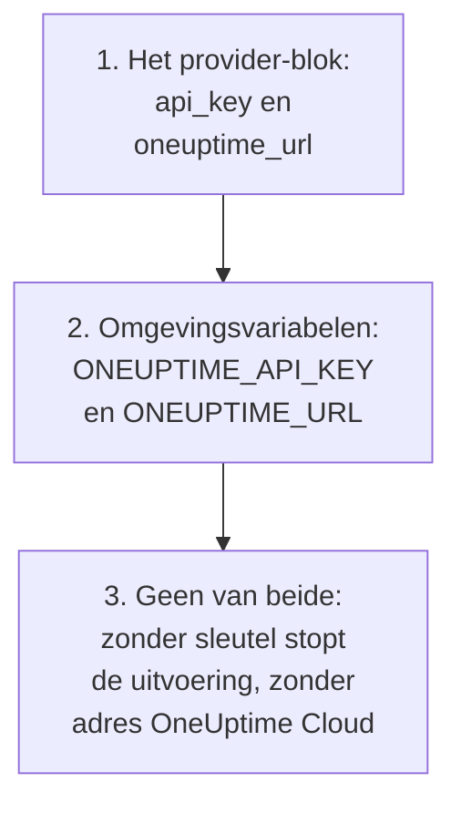

# Volledige handleiding

Deze handleiding behandelt wat er na je eerste apply komt: hoe de provider zijn API-sleutel vindt, hoe je een configuratie indeelt voor één project of meerdere, hoe resources naar elkaar verwijzen, hoe je records leest die je niet beheert, hoe je de state veilig houdt en hoe je upgradet. Nieuw met de provider? Begin met de [Snelle start](/docs/terraform/quick-start).

:::cards
- [De provider configureren](#de-provider-configureren): De API-sleutel en het adres, en waar de provider ze leest.
- [Een configuratie indelen](#een-configuratie-indelen): Bestanden, projecten en veel resources uit één blok.
- [Lezen wat al bestaat](#lezen-wat-al-bestaat): Data sources, en hoe een opzoeking overeenkomt.
- [De state veilig houden](#de-state-veilig-houden): Een externe backend, en wat je nooit commit.
:::

## De provider configureren

De provider heeft twee instellingen. Elke instelling komt uit het provider-blok, of anders uit een omgevingsvariabele:

| Instelling | Omgevingsvariabele | Als geen van beide is ingesteld |
| --- | --- | --- |
| `api_key` | `ONEUPTIME_API_KEY` | De provider stopt voordat er iets wordt gepland: `Missing API Key` |
| `oneuptime_url` | `ONEUPTIME_URL` | `https://oneuptime.com`, en dat is OneUptime Cloud |



`oneuptime_url` is het adres van je OneUptime, zonder `/api`: de provider voegt `https://` toe als het adres geen schema heeft, en `/api` aan het einde. `api_key` is gevoelig, dus Terraform drukt hem nooit af.

De sleutel moet een API-sleutel zijn van het project dat je beheert, met toestemming om elk soort record in je configuratie aan te maken, te lezen, te wijzigen en te verwijderen: zie [Een API-sleutel voor het project aanmaken](/docs/terraform/quick-start#een-api-sleutel-voor-het-project-aanmaken). De master-API-sleutel van een zelf gehoste OneUptime hoort bij geen enkel project, dus een aanmaak met die sleutel mislukt met `ProjectId required`.

### De provider zijn sleutel geven

:::tabs
@tab Omgevingsvariabele
```bash
export ONEUPTIME_API_KEY="<your-api-key>"
# Only on a self-hosted OneUptime:
export ONEUPTIME_URL="https://oneuptime.example.com"
```

```hcl title="main.tf"
provider "oneuptime" {}
```
@tab Terraform-variabele
```hcl title="variables.tf"
variable "oneuptime_api_key" {
  description = "API key of the OneUptime project"
  type        = string
  sensitive   = true
}

provider "oneuptime" {
  api_key = var.oneuptime_api_key
}
```

```hcl title="terraform.tfvars"
oneuptime_api_key = "<your-api-key>"
```
:::

Een omgevingsvariabele houdt de sleutel uit elk bestand. Een variabelenbestand is handig op je eigen machine: voeg `terraform.tfvars` toe aan `.gitignore`. Stel in een pipeline `TF_VAR_oneuptime_api_key` in in plaats van het bestand te schrijven.

### Uitvoeren in CI/CD

Geef de job de sleutel als geheim, in de omgevingsvariabele `ONEUPTIME_API_KEY`:

:::tabs
@tab GitHub Actions
```yaml title=".github/workflows/oneuptime.yml"
name: OneUptime
on:
  push:
    branches: [main]

jobs:
  apply:
    runs-on: ubuntu-latest
    env:
      ONEUPTIME_API_KEY: ${{ secrets.ONEUPTIME_API_KEY }}
    steps:
      - uses: actions/checkout@v4
      - uses: hashicorp/setup-terraform@v3
      - run: terraform init -input=false
      - run: terraform plan -input=false -out=tfplan
      - run: terraform apply -input=false tfplan
```
@tab GitLab CI
```yaml title=".gitlab-ci.yml"
apply:
  image:
    name: hashicorp/terraform:latest
    entrypoint: [""]
  rules:
    - if: $CI_COMMIT_BRANCH == $CI_DEFAULT_BRANCH
  script:
    - terraform init -input=false
    - terraform plan -input=false -out=tfplan
    - terraform apply -input=false tfplan
```
:::

Voeg in GitHub het geheim toe onder **Settings → Secrets and variables → Actions**; voeg in GitLab een gemaskeerde CI/CD-variabele met dezelfde naam toe. Bewaar de state in een [externe backend](#de-state-veilig-houden), zodat elke uitvoering begint vanuit de state die de vorige achterliet.

## Een configuratie indelen

Een indeling die goed werkt:

```text
oneuptime/
├── main.tf          # the terraform and provider blocks
├── variables.tf     # input variables
├── outputs.tf       # the IDs other configurations need
├── shared.tf        # labels, teams and monitor statuses
├── monitors.tf      # monitors and monitor groups
├── status-pages.tf  # status pages and their domains
└── on-call.tf       # on-call policies and escalation rules
```

- **Eén configuratie per project.** Een API-sleutel hoort bij één project, dus een configuratie beheert vanzelf één project.
- **Gedeelde records één keer.** Definieer labels, teams en monitorstatussen in één bestand, en verwijs overal elders naar hun adres.

### Meerdere projecten beheren

Om meer dan één project vanuit één configuratie te beheren, geef je de provider een alias voor elk project, elk met de sleutel van dat project. Een resource noemt met `provider` de alias die hij gebruikt:

```hcl
provider "oneuptime" {
  alias   = "production"
  api_key = var.production_api_key
}

provider "oneuptime" {
  alias   = "staging"
  api_key = var.staging_api_key
}

resource "oneuptime_label" "staging_critical" {
  provider = oneuptime.staging

  name  = "critical"
  color = "#FF5733"
}
```

Declareer `production_api_key` en `staging_api_key` als variabelen die als `sensitive` zijn gemarkeerd, zoals hierboven.

### Veel resources uit één blok

`for_each` maakt één resource voor elk item van een map. Deze monitoren delen hun criteria en verschillen alleen in naam en adres:

```hcl
variable "websites" {
  type = map(string)
  default = {
    homepage = "https://example.com"
    docs     = "https://docs.example.com"
  }
}

resource "oneuptime_monitor" "website" {
  for_each = var.websites

  name                = "Website: ${each.key}"
  monitor_type        = "Website"
  monitoring_interval = "*/5 * * * *"

  monitor_steps = [{
    monitor_destination      = each.value
    monitor_destination_type = "URL"

    criteria = [
      {
        name                  = "Offline"
        filter_condition      = "Any"
        change_monitor_status = true
        monitor_status_id     = data.oneuptime_monitor_status.offline.id

        filters = [
          {
            check_on    = "Is Online"
            filter_type = "False"
          }
        ]
      }
    ]
  }]
}
```

Voeg een site toe aan de map, en de volgende apply maakt de monitor ervan aan. Haal er een weg, en die wordt verwijderd.

## Naar andere resources verwijzen

Een resource die een attribuut van een andere noemt, hangt ervan af, en Terraform zet het werk op volgorde aan de hand van die verwijzingen. Hier wordt het label als eerste aangemaakt en als laatste verwijderd, omdat de monitor en de statuspagina het noemen:

```mermaid title="Terraform maakt eerst aan waarnaar een resource verwijst"
flowchart TB
    L["oneuptime_label<br/>payments"] --> M["oneuptime_monitor<br/>checkout_api"]
    L --> SP["oneuptime_status_page<br/>payments"]
    M --> R["oneuptime_status_page_resource<br/>checkout_api"]
    SP --> R
```

```hcl
resource "oneuptime_label" "payments" {
  name        = "payments"
  description = "Payment infrastructure"
  color       = "#2ECC71"
}

resource "oneuptime_monitor" "checkout_api" {
  name         = "Checkout API"
  description  = "Availability of the checkout API"
  monitor_type = "Manual"
  labels       = [oneuptime_label.payments.id]
}

resource "oneuptime_status_page" "payments" {
  name                  = "Payments Status"
  page_title            = "Payments Status"
  is_public_status_page = true
  labels                = [oneuptime_label.payments.id]
}

resource "oneuptime_status_page_resource" "checkout_api" {
  status_page_id = oneuptime_status_page.payments.id
  monitor_id     = oneuptime_monitor.checkout_api.id
  display_name   = "Checkout API"
}
```

Je hebt zelden `depends_on` nodig: voeg het alleen toe voor een volgorde die Terraform niet uit de attributen kan afleiden. Lijsten van ID's zoals `labels` zijn sets, dus de volgorde veranderen verandert niets.

## Lezen wat al bestaat

Elke resource heeft een data source met dezelfde naam. Een data source leest een record dat deze configuratie niet beheert, gemaakt in het dashboard of door een andere configuratie, zodat je ernaar kunt verwijzen zonder het over te nemen.

```hcl
data "oneuptime_label" "critical" {
  name = "critical"
}

data "oneuptime_monitor_status" "offline" {
  is_offline_state = true
}

data "oneuptime_status_page" "main" {
  id = "5f8a1b2c-3d4e-4f6a-8b9c-0d1e2f3a4b5c"
}

resource "oneuptime_monitor" "database" {
  name         = "Database Health"
  monitor_type = "Manual"
  labels       = [data.oneuptime_label.critical.id]
}
```

Hoe een opzoeking overeenkomt:

| Je stelt in | Het vindt | Fouten |
| --- | --- | --- |
| `id` | Het record met die ID | `Not Found` als geen record die heeft |
| Andere eenvoudige argumenten, één of meer | Het ene record dat met allemaal overeenkomt | `Not Found` als er geen overeenkomt, `Ambiguous Match` als er meer dan één overeenkomt |
| `id` en een ander argument, of niets | Niets | `Invalid Lookup` |

Eenvoudige argumenten zijn tekst, getallen en waar of onwaar: een naam, een prioriteit, een vlag zoals `is_offline_state`. Op lijsten, JSON-waarden, tijdstempels en geheimen kun je niet zoeken. Om een record over te nemen in plaats van het alleen te lezen, [importeer je het](/docs/terraform/importing-resources).

## De state veilig houden

De state van Terraform bevat de ID's en attributen van alles wat het beheert, geheimen inbegrepen. Bewaar hem in een externe backend die hem vergrendelt, zodat een team één state deelt en twee uitvoeringen hem nooit tegelijk schrijven. Elke standaardbackend werkt, bijvoorbeeld een S3-bucket:

```hcl
terraform {
  backend "s3" {
    bucket       = "my-terraform-state"
    key          = "oneuptime/production.tfstate"
    region       = "us-east-1"
    encrypt      = true
    use_lockfile = true
  }
}
```

`use_lockfile` vereist Terraform 1.10 of OpenTofu 1.10, of hoger. Daarvoor vergrendelt de S3-backend met een DynamoDB-tabel (`dynamodb_table`).

- **Bewerk de state nooit met de hand.** Gebruik `terraform state mv` en `terraform state rm`.
- **Commit nooit `terraform.tfstate`, of een `.tfvars`-bestand met een geheim erin.**

## Drift, en wat het niet veroorzaakt

`terraform plan` vergelijkt OneUptime met je configuratie, en toont wat verschilt. Sommige verschillen worden nooit getoond:

- **Tijden worden als tijdstippen vergeleken.** `2030-06-01T02:00:00Z` en de manier waarop de server hetzelfde tijdstip schrijft, zijn gelijk.
- **Standaardwaarden die de server toevoegt** aan de stappen van een monitor, of aan een JSON-waarde, zijn geen verschil met wat je hebt geschreven.
- **Wat de server actueel houdt**, zoals de huidige status van een monitor, is ook geen verschil.

Een waarde die je bij elke uitvoering berekent, is dat wel: `timestamp()` geeft bij elke uitvoering een nieuwe tijd, dus een plan toont hem altijd. Schrijf in plaats daarvan vaste tijden:

```hcl
resource "oneuptime_scheduled_maintenance_event" "database_upgrade" {
  title       = "Database upgrade"
  description = "Planned PostgreSQL upgrade"
  starts_at   = "2030-06-01T02:00:00Z"
  ends_at     = "2030-06-01T04:00:00Z"
}
```

## De provider upgraden

:::steps
### De release notes lezen

De [Terraform Registry](https://registry.terraform.io/providers/oneuptime/oneuptime) en de [GitHub-releases van de provider](https://github.com/OneUptime/terraform-provider-oneuptime/releases) tonen wat er is veranderd.

### De versiebeperking verhogen

`{{TERRAFORM_PROVIDER_VERSION}}` neemt al elke {{TERRAFORM_PROVIDER_MAJOR}}.x-release. Een nieuwe hoofdversie heeft een nieuwe beperking nodig.

### De nieuwe versie downloaden

```bash
terraform init -upgrade
```

### Plannen voordat je toepast

Voer `terraform plan` uit, en pas alleen toe als het leeg is of de wijzigingen toont die je verwacht.
:::

Upgrade op een zelf gehoste OneUptime eerst OneUptime en daarna de provider: de provider mag niet nieuwer zijn dan je OneUptime. Zie [Zelf gehoste installatie](/docs/terraform/self-hosted).

## Volgende stappen

:::cards
- [Monitorstappen](/docs/terraform/monitor-steps): Bepaal wat een monitor controleert en wat elk resultaat betekent.
- [Voorbeelden](/docs/terraform/examples): Kant-en-klare configuraties voor de gangbare resources.
- [Resources importeren](/docs/terraform/importing-resources): Breng wat je in het dashboard hebt gemaakt onder Terraform.
- [Probleemoplossing](/docs/terraform/troubleshooting): Veelvoorkomende fouten en hoe je ze oplost.
:::
