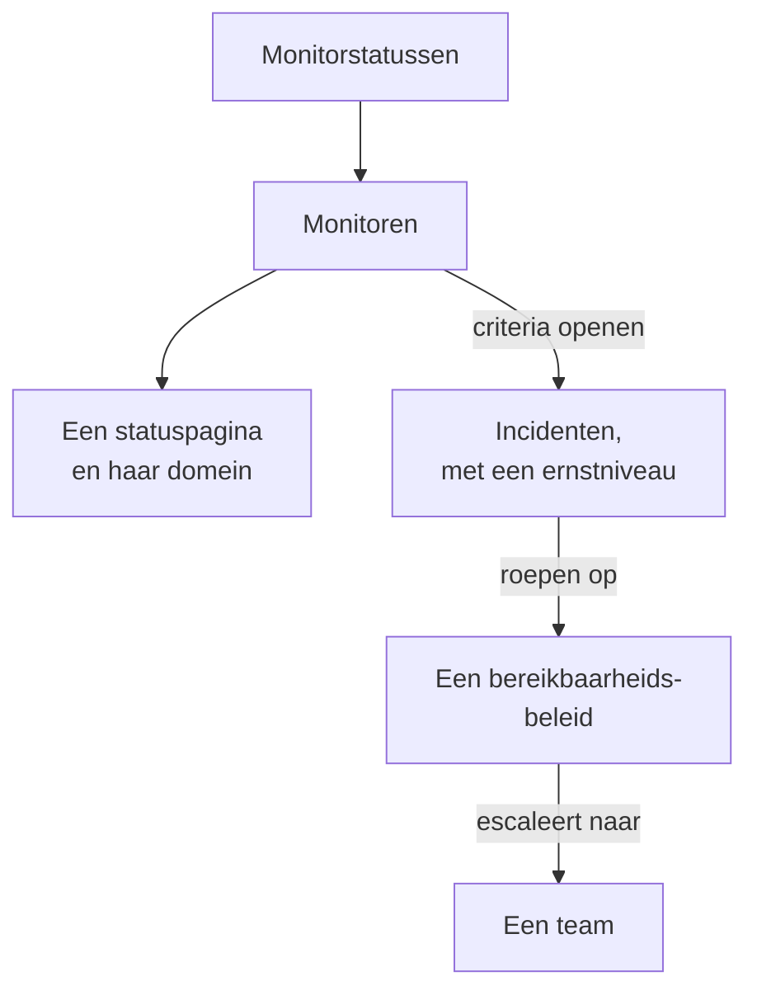

# Voorbeelden

Kant-en-klare configuraties voor de resources waarmee de meeste projecten beginnen. Elk blok werkt zoals het is bovenop de provider-instelling hieronder, en de meeste komen uit de end-to-endtests van de provider, die ze bij elke wijziging op een echte OneUptime toepassen.

:::cards
- [Monitoren](#monitoren): Website-, API-, ping-, poort-, SSL-certificaat-, heartbeat- en handmatige monitoren.
- [Statuspagina's](#statuspaginas): Een statuspagina met een groep en een monitor, en een eigen domein.
- [Teams en bereikbaarheid](#teams-en-bereikbaarheid): Een team, en een bereikbaarheidsbeleid dat het oproept.
- [Incidenten en onderhoud](#incidenten-en-onderhoud): Ernstniveaus, statussen, een gemeld incident en een onderhoudsvenster.
:::



## Provider-instelling

Elk voorbeeld gaat uit van deze instelling, met de API-sleutel in de omgevingsvariabele `ONEUPTIME_API_KEY`:

```hcl title="main.tf"
terraform {
  required_providers {
    oneuptime = {
      source  = "oneuptime/oneuptime"
      version = "{{TERRAFORM_PROVIDER_VERSION}}"
    }
  }
}

provider "oneuptime" {
  # On a self-hosted OneUptime, add your OneUptime's address:
  # oneuptime_url = "https://oneuptime.example.com"
}
```

## Labels

Labels sorteren en filteren records. De meeste resources accepteren een set label-ID's in `labels`:

```hcl
resource "oneuptime_label" "production" {
  name        = "production"
  description = "Production infrastructure"
  color       = "#FF5733"
}
```

## Monitoren

De monitoren hieronder stellen hun status in met drie van de statussen waarmee elk project begint, gelezen met data sources:

```hcl
data "oneuptime_monitor_status" "operational" {
  name = "Operational"
}

data "oneuptime_monitor_status" "degraded" {
  name = "Degraded"
}

data "oneuptime_monitor_status" "offline" {
  name = "Offline"
}
```

De `monitor_steps` van elke monitor zeggen wat hij controleert en hoe elk resultaat wordt beoordeeld: [Monitorstappen](/docs/terraform/monitor-steps) legt elk attribuut uit.

### Websitemonitor

Offline als de site niet antwoordt, online als hij antwoordt met 200. De end-to-endtest `35-monitor-with-steps` past een monitor met deze controles toe:

```hcl
resource "oneuptime_monitor" "website" {
  name                = "Website"
  description         = "Homepage availability and status code"
  monitor_type        = "Website"
  monitoring_interval = "*/5 * * * *"
  labels              = [oneuptime_label.production.id]

  monitor_steps = [{
    monitor_destination      = "https://example.com"
    monitor_destination_type = "URL"
    request_type             = "GET"

    criteria = [
      {
        name                  = "Offline"
        description           = "The website does not respond"
        filter_condition      = "Any"
        change_monitor_status = true
        monitor_status_id     = data.oneuptime_monitor_status.offline.id

        filters = [
          {
            check_on    = "Is Online"
            filter_type = "False"
          }
        ]
      },
      {
        name                  = "Online"
        description           = "The website responds with 200"
        filter_condition      = "All"
        change_monitor_status = true
        monitor_status_id     = data.oneuptime_monitor_status.operational.id

        filters = [
          {
            check_on    = "Is Online"
            filter_type = "True"
          },
          {
            check_on    = "Response Status Code"
            filter_type = "Equal To"
            value       = "200"
          }
        ]
      }
    ]
  }]
}
```

### API-monitor

Een `POST` met headers en een JSON-body, gedegradeerd als het antwoord traag is. De end-to-endtest `35-monitor-with-steps` past een vergelijkbare API-monitor toe:

```hcl
resource "oneuptime_monitor" "orders_api" {
  name         = "Orders API"
  description  = "Health check of the orders API"
  monitor_type = "API"

  monitor_steps = [{
    monitor_destination      = "https://api.example.com/v1/health"
    monitor_destination_type = "URL"
    request_type             = "POST"
    request_headers = {
      "Content-Type" = "application/json"
      "Accept"       = "application/json"
    }
    request_body = jsonencode({ check = "health" })

    criteria = [
      {
        name                  = "Offline"
        description           = "The API does not answer, or answers with an error"
        filter_condition      = "Any"
        change_monitor_status = true
        monitor_status_id     = data.oneuptime_monitor_status.offline.id

        filters = [
          {
            check_on    = "Is Online"
            filter_type = "False"
          },
          {
            check_on    = "Response Status Code"
            filter_type = "Greater Than Or Equal To"
            value       = "500"
          }
        ]
      },
      {
        name                  = "Slow"
        description           = "The API takes more than two seconds"
        filter_condition      = "All"
        change_monitor_status = true
        monitor_status_id     = data.oneuptime_monitor_status.degraded.id

        filters = [
          {
            check_on    = "Response Time (in ms)"
            filter_type = "Greater Than"
            value       = "2000"
          }
        ]
      },
      {
        name                  = "Online"
        description           = "The API answers in time"
        filter_condition      = "All"
        change_monitor_status = true
        monitor_status_id     = data.oneuptime_monitor_status.operational.id

        filters = [
          {
            check_on    = "Is Online"
            filter_type = "True"
          }
        ]
      }
    ]
  }]
}
```

### Ping-monitor

Een Ping-monitor accepteert een hostnaam of een IP-adres in plaats van een URL:

```hcl
resource "oneuptime_monitor" "gateway" {
  name         = "Gateway"
  description  = "The gateway answers ping"
  monitor_type = "Ping"

  monitor_steps = [{
    monitor_destination      = "gateway.example.com"
    monitor_destination_type = "Hostname"

    criteria = [
      {
        name                  = "Unreachable"
        filter_condition      = "Any"
        change_monitor_status = true
        monitor_status_id     = data.oneuptime_monitor_status.offline.id

        filters = [
          {
            check_on    = "Is Online"
            filter_type = "False"
          }
        ]
      },
      {
        name                  = "Reachable"
        filter_condition      = "All"
        change_monitor_status = true
        monitor_status_id     = data.oneuptime_monitor_status.operational.id

        filters = [
          {
            check_on    = "Is Online"
            filter_type = "True"
          }
        ]
      }
    ]
  }]
}
```

### Poortmonitor

Een poortmonitor voegt de `port` toe die hij controleert, als getal:

```hcl
resource "oneuptime_monitor" "database_port" {
  name         = "Database port"
  description  = "PostgreSQL accepts connections"
  monitor_type = "Port"

  monitor_steps = [{
    monitor_destination      = "db.example.com"
    monitor_destination_type = "Hostname"
    port                     = 5432

    criteria = [
      {
        name                  = "Closed"
        filter_condition      = "Any"
        change_monitor_status = true
        monitor_status_id     = data.oneuptime_monitor_status.offline.id

        filters = [
          {
            check_on    = "Is Online"
            filter_type = "False"
          }
        ]
      },
      {
        name                  = "Open"
        filter_condition      = "All"
        change_monitor_status = true
        monitor_status_id     = data.oneuptime_monitor_status.operational.id

        filters = [
          {
            check_on    = "Is Online"
            filter_type = "True"
          }
        ]
      }
    ]
  }]
}
```

### SSL-certificaatmonitor

Offline als het certificaat niet geldig is, gedegradeerd als het binnen 14 dagen of minder verloopt, zoals een nieuwe SSL-certificaatmonitor in het dashboard is ingesteld:

```hcl
resource "oneuptime_monitor" "certificate" {
  name         = "example.com certificate"
  description  = "The TLS certificate of example.com"
  monitor_type = "SSL Certificate"

  monitor_steps = [{
    monitor_destination      = "https://example.com"
    monitor_destination_type = "URL"

    criteria = [
      {
        name                  = "Not valid"
        description           = "Expired, self-signed, untrusted or not reachable"
        filter_condition      = "Any"
        change_monitor_status = true
        monitor_status_id     = data.oneuptime_monitor_status.offline.id

        filters = [
          {
            check_on    = "Is Not A Valid Certificate"
            filter_type = "True"
          }
        ]
      },
      {
        name                  = "Expires soon"
        description           = "Valid, and expires in 14 days or less"
        filter_condition      = "All"
        change_monitor_status = true
        monitor_status_id     = data.oneuptime_monitor_status.degraded.id

        filters = [
          {
            check_on    = "Is Valid Certificate"
            filter_type = "True"
          },
          {
            check_on    = "Expires In Days"
            filter_type = "Less Than Or Equal To"
            value       = "14"
          }
        ]
      },
      {
        name                  = "Valid"
        filter_condition      = "All"
        change_monitor_status = true
        monitor_status_id     = data.oneuptime_monitor_status.operational.id

        filters = [
          {
            check_on    = "Is Valid Certificate"
            filter_type = "True"
          }
        ]
      }
    ]
  }]
}
```

### Handmatige monitor

Een handmatige monitor controleert niets: je stelt zijn status zelf in. Hij heeft geen `monitor_steps` nodig:

```hcl
resource "oneuptime_monitor" "payment_provider" {
  name         = "Payment provider"
  description  = "Set by hand during the provider's incidents"
  monitor_type = "Manual"
}
```

### Heartbeat-monitor

Een monitor voor inkomende verzoeken wacht op verzoeken in plaats van ze te sturen: hier een back-upjob die zich elke nacht meldt. Hij gaat offline als er 25 uur lang geen verzoek is binnengekomen:

```hcl
resource "oneuptime_monitor" "nightly_backup" {
  name         = "Nightly backup"
  description  = "The backup job sends a heartbeat when it finishes"
  monitor_type = "Incoming Request"

  monitor_steps = [{
    criteria = [
      {
        name                  = "No heartbeat"
        filter_condition      = "Any"
        change_monitor_status = true
        monitor_status_id     = data.oneuptime_monitor_status.offline.id

        filters = [
          {
            check_on    = "Incoming Request"
            filter_type = "Not Recieved In Minutes"
            value       = "1500"
          }
        ]
      },
      {
        name                  = "Heartbeat received"
        filter_condition      = "All"
        change_monitor_status = true
        monitor_status_id     = data.oneuptime_monitor_status.operational.id

        filters = [
          {
            check_on    = "Incoming Request"
            filter_type = "Recieved In Minutes"
            value       = "1500"
          }
        ]
      }
    ]
  }]
}

output "nightly_backup_heartbeat_key" {
  value     = oneuptime_monitor.nightly_backup.incoming_request_secret_key
  sensitive = true
}
```

De job stuurt zijn verzoek naar `https://oneuptime.com/heartbeat/YOUR_SECRET_KEY`, met de sleutel die `terraform output -raw nightly_backup_heartbeat_key` afdrukt: zie [Inkomende-verzoek-monitor](/docs/monitor/incoming-request-monitor). De agent van een servermonitor meldt zich op dezelfde manier aan, met `server_monitor_secret_key`.

### Monitorgroep

Een monitorgroep toont een set monitoren met één status:

```hcl
resource "oneuptime_monitor_group" "storefront" {
  name        = "Storefront"
  description = "Everything the shop needs"
}

resource "oneuptime_monitor_group_resource" "website" {
  monitor_group_id = oneuptime_monitor_group.storefront.id
  monitor_id       = oneuptime_monitor.website.id
}

resource "oneuptime_monitor_group_resource" "orders_api" {
  monitor_group_id = oneuptime_monitor_group.storefront.id
  monitor_id       = oneuptime_monitor.orders_api.id
}
```

## Statuspagina's

### Een statuspagina met een groep en een monitor

Een statuspagina toont resources, en kan ze in groepen indelen. De end-to-endtest `42-status-page-resources` past deze opzet toe:

```hcl
resource "oneuptime_status_page" "public" {
  name                  = "Public Status"
  description           = "Customer-facing status page"
  page_title            = "System Status"
  page_description      = "Check our system status and incident history"
  is_public_status_page = true
}

resource "oneuptime_status_page_group" "services" {
  status_page_id = oneuptime_status_page.public.id
  name           = "Services"
}

resource "oneuptime_status_page_resource" "website" {
  status_page_id       = oneuptime_status_page.public.id
  status_page_group_id = oneuptime_status_page_group.services.id
  monitor_id           = oneuptime_monitor.website.id
  display_name         = "Website"
}
```

### Een eigen domein

Drie resources werken samen: een domein van je project, de statuspagina en het domein van de statuspagina dat ze verbindt. De server vult `full_domain` en het CNAME-verificatietoken in: stel ze niet in. De end-to-endtests `12-status-page-domain` en `25-status-page-with-domain` passen deze opzet toe:

```hcl
resource "oneuptime_domain" "company" {
  domain = "example.com"
}

resource "oneuptime_status_page_domain" "status" {
  domain_id      = oneuptime_domain.company.id
  status_page_id = oneuptime_status_page.public.id
  subdomain      = "status"
}

output "status_page_address" {
  # The subdomain and the domain, such as status.example.com.
  value = oneuptime_status_page_domain.status.full_domain
}
```

Een nieuw domein moet de DNS-verificatie doorstaan voordat de statuspagina erop antwoordt.

## Teams en bereikbaarheid

### Een team en zijn leden

```hcl
resource "oneuptime_team" "sre" {
  name        = "SRE"
  description = "Site reliability engineering"
}

variable "alice_user_id" {
  description = "Alice's user ID, the last part of the address of her page under Users"
  type        = string
}

resource "oneuptime_team_member" "alice" {
  team_id = oneuptime_team.sre.id
  user_id = var.alice_user_id
}
```

Iemand die al in het project zit, komt meteen in het team. Ieder ander wordt uitgenodigd, en zit in het team zodra die de uitnodiging accepteert. De end-to-endtest `33-team-crud` past het team toe.

### Een bereikbaarheidsbeleid dat een team oproept

De eerste regel van het beleid roept het team op, en het beleid begint opnieuw, tot twee keer toe, als niemand bevestigt:

```hcl
resource "oneuptime_on_call_policy" "primary" {
  name                                             = "Primary on-call"
  description                                      = "First line for production incidents"
  repeat_policy_if_no_one_acknowledges             = true
  repeat_policy_if_no_one_acknowledges_no_of_times = 2
}

resource "oneuptime_escalation_rule" "first_line" {
  on_call_duty_policy_id    = oneuptime_on_call_policy.primary.id
  name                      = "Page the SRE team"
  description               = "Moves on after 5 minutes without an acknowledgement"
  order                     = 1
  escalate_after_in_minutes = 5
}

resource "oneuptime_team_on_call_duty_escalation_rule" "sre" {
  on_call_duty_policy_id                 = oneuptime_on_call_policy.primary.id
  on_call_duty_policy_escalation_rule_id = oneuptime_escalation_rule.first_line.id
  team_id                                = oneuptime_team.sre.id
}
```

De criteria van een monitor roepen het beleid op via `on_call_policy_ids` bij de incidenten die ze openen: zie [Incidenten en waarschuwingen](/docs/terraform/monitor-steps#incidenten-en-waarschuwingen).

## Incidenten en onderhoud

### Ernstniveaus en statussen

Ernstniveaus rangschikken de impact van een incident, en statussen zijn de stappen in zijn levensloop. `order` is de plek waar elk ervan staat:

```hcl
resource "oneuptime_incident_severity" "sev1" {
  name        = "SEV-1"
  description = "Full outage, all hands"
  color       = "#E74C3C"
  order       = 1
}

resource "oneuptime_incident_state" "mitigated" {
  name        = "Mitigated"
  description = "Impact contained, fix in progress"
  color       = "#F39C12"
  order       = 3
}
```

`oneuptime_alert_severity` en `oneuptime_alert_state` werken op dezelfde manier voor waarschuwingen. De end-to-endtests `03-incident-severity` en `04-incident-state` passen ze toe.

### Een incident melden

Meestal openen monitoren incidenten, maar een incident is ook een resource, wat handig is voor een gameday. Het is een echt incident, dus houd een oefening van je statuspagina's af:

```hcl
resource "oneuptime_incident" "drill" {
  title                     = "Disaster recovery drill"
  description               = "A game day: we fail over the database"
  incident_severity_id      = oneuptime_incident_severity.sev1.id
  is_visible_on_status_page = false

  should_status_page_subscribers_be_notified_on_incident_created = false
}
```

De end-to-endtest `28-incident-crud` past een incident toe.

### Gepland onderhoud

Een onderhoudsvenster met vaste tijden, getoond op je statuspagina's:

```hcl
resource "oneuptime_scheduled_maintenance_event" "database_upgrade" {
  title                       = "Database maintenance"
  description                 = "Planned PostgreSQL upgrade: writes pause briefly"
  starts_at                   = "2030-06-01T02:00:00Z"
  ends_at                     = "2030-06-01T04:00:00Z"
  is_visible_on_status_page   = true
  monitors                    = [oneuptime_monitor.website.id]
  change_monitor_status_to_id = data.oneuptime_monitor_status.degraded.id
}
```

Tijden zijn in RFC 3339, en hetzelfde tijdstip anders geschreven is geen wijziging. De end-to-endtest `30-scheduled-maintenance-crud` past onderhoudsgebeurtenissen toe.

Om de monitoren van de gebeurtenis in een status te zetten zolang die loopt, koppel je ze met `monitors` en stel je `change_monitor_status_to_id` in op een van je monitorstatussen: de monitoren gaan naar die status als de gebeurtenis begint, en terug naar operationeel als die eindigt. Terraform wijzigt `change_monitor_status_to_id` ter plekke totdat de gebeurtenis begint. Zodra de gebeurtenis is begonnen, staan de monitoren al in die status, en een apply die hem wijzigt, mislukt met „Change Monitor Status to can no longer be changed: this event has already started.”

## Probes

Een eigen probe voert controles uit vanuit je netwerk. Zijn sleutel is het geheim waarmee de probe zich aanmeldt, dus geef hem door in een variabele:

```hcl
variable "probe_key" {
  description = "The key the probe signs in with"
  type        = string
  sensitive   = true
}

resource "oneuptime_probe" "eu_west" {
  key           = var.probe_key
  name          = "EU West"
  description   = "Probe in our eu-west-1 network"
  probe_version = "1.0.0"

  should_auto_enable_probe_on_new_monitors = true
}
```

Voer de probe uit met `PROBE_ID` ingesteld op de `id` van de probe en `PROBE_KEY` op de sleutel: zie [Aangepaste probes](/docs/probe/custom-probe). De end-to-endtest `23-probe-crud` past probes toe.

## Volgende stappen

:::cards
- [Monitorstappen](/docs/terraform/monitor-steps): Elk attribuut van de controles en criteria van een monitor.
- [Resources importeren](/docs/terraform/importing-resources): Breng wat je in het dashboard hebt gemaakt onder Terraform.
- [Volledige handleiding](/docs/terraform/complete-guide): Data sources, state, CI/CD en upgrades.
:::
