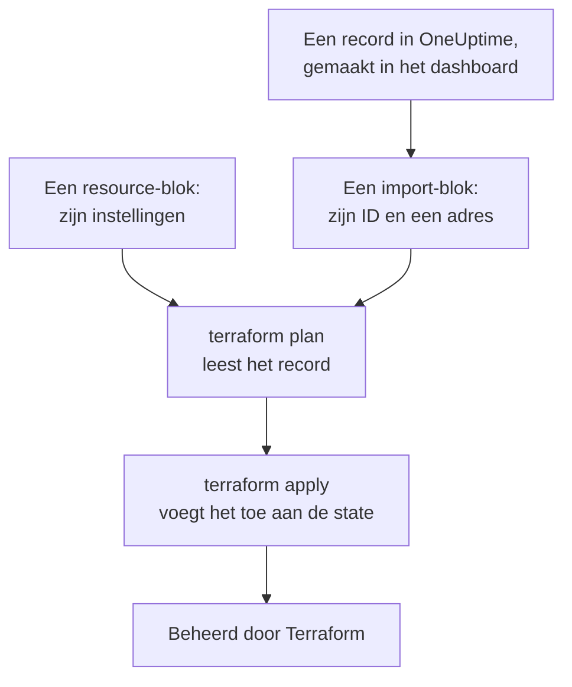
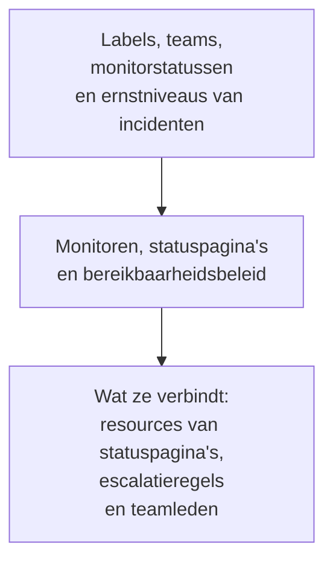

# Resources importeren

Je hoeft niet opnieuw te beginnen om OneUptime met Terraform te beheren. Importeer de monitoren, statuspagina's, teams en andere records die je al hebt, en Terraform beheert ze vanaf dat moment, zoals ze zijn. Een import leest alleen: er verandert niets in OneUptime tot je een wijziging toepast die je hebt gepland.

:::cards
- [Hoe een import werkt](#hoe-een-import-werkt): Wat een import leest, en wat jij schrijft.
- [Eén resource importeren](#eén-resource-importeren): Vanaf de pagina ervan in het dashboard, in vier stappen.
- [Veel resources importeren](#veel-resources-importeren): Importblokken voor een hele lijst, en de configuratie die Terraform voor je schrijft.
- [Een resource niet meer beheren](#een-resource-niet-meer-beheren): Geef hem terug aan het dashboard zonder hem te verwijderen.
:::

## Hoe een import werkt

Een import koppelt een record dat al in OneUptime bestaat aan een `resource`-blok in je configuratie. Je schrijft een `import`-blok met het ID van het record en het adres waar het naartoe gaat. De volgende `terraform plan` leest het record via zijn ID en toont dat het wordt geïmporteerd, samen met elk verschil tussen het record en je configuratie. `terraform apply` voegt het toe aan de state van Terraform, en vanaf dat moment wordt het record beheerd zoals alles wat Terraform heeft aangemaakt.



Schrijf het `resource`-blok zo dat het zegt wat het record al is. Waar ze verschillen, toont het plan de import en een wijziging, en het toepassen ervan wijzigt het record in OneUptime.

### Wat je kunt importeren

Elke resource van de provider kan via zijn ID worden geïmporteerd, behalve `oneuptime_file`: de API van OneUptime kan een bestand niet teruglezen, dus de provider antwoordt `Import Not Supported`. Data sources worden nooit geïmporteerd. Om een record in je configuratie te gebruiken zonder het te beheren, lees je het in plaats daarvan met een [data source](/docs/terraform/complete-guide#lezen-wat-al-bestaat).

## Voordat je begint

- **Terraform 1.5 of later, of OpenTofu 1.6 of later.** De `import`-blokken op deze pagina hebben deze versies nodig. Een oudere Terraform importeert via de [opdrachtregel](#importeren-via-de-opdrachtregel).
- **Een API-sleutel die kan lezen wat je importeert.** De import leest elk record met de sleutel van de provider, en het daarna beheren vraagt ook de machtigingen om het te wijzigen en te verwijderen. Zie [Een API-sleutel voor het project aanmaken](/docs/terraform/quick-start#een-api-sleutel-voor-het-project-aanmaken).
- **De provider in je configuratie**, ingesteld zoals in de [Snelle start](/docs/terraform/quick-start#terraform-op-oneuptime-richten).

## Eén resource importeren

Het dashboard schrijft de configuratie van de resource die je bekijkt, met het `import`-blok ervan, dus je schrijft er zelden een met de hand.

:::steps
### De Terraform-pagina van de resource openen

Open de monitor, de statuspagina of een andere resource in het dashboard. Open in het zijmenu ervan **Ontwikkelaars**, en daarna **Terraform**.

### De configuratie kopiëren

De pagina schrijft het `resource`-blok van de resource op basis van de huidige instellingen ervan, en een `import`-blok met het ID ervan. Zet ze allebei in een `.tf`-bestand:

```hcl title="status-pages.tf"
resource "oneuptime_status_page" "public_status" {
  name       = "Public Status"
  page_title = "Acme Status"

  # Secrets are not shown here: master_password, embedded_overall_status_token.
  # Terraform leaves them as they are in OneUptime.
}

import {
  to = oneuptime_status_page.public_status
  id = "68a1b2c3-d4e5-4f6a-8b9c-0d1e2f3a4b02"
}
```

Ze schrijft de instellingen die afwijken van de standaardwaarden, en een opmerking na elk ID noemt het record waarnaar het verwijst. Geheimen worden nooit getoond: de geheimen die de resource nodig heeft, worden gelezen uit variabelen die als `sensitive` zijn gemarkeerd, en de opmerking noemt de geheimen die ze weglaat.

### Plannen

Voer `terraform plan` uit. Het eindigt met `Plan: 1 to import, 0 to add, 0 to change, 0 to destroy.`: Terraform heeft het record gevonden, en je configuratie komt ermee overeen.

### Toepassen

Voer `terraform apply` uit. De statuspagina staat nu in de state van Terraform, en het volgende plan antwoordt `No changes.` Daarna kun je het `import`-blok verwijderen, of het bewaren als notitie van waar de resource vandaan kwam: het doet niets meer zodra de resource beheerd wordt.
:::

### De blokken zelf schrijven

Zonder het dashboard schrijf je beide blokken zelf. Begin het `resource`-blok met de attributen die de resource nodig heeft, en voer `terraform plan` uit. Waar je configuratie afwijkt van het record, toont het plan de wijziging naast de import:

```text
  # oneuptime_label.critical will be updated in-place
  # (imported from "68a1b2c3-d4e5-4f6a-8b9c-0d1e2f3a4b03")
  ~ resource "oneuptime_label" "critical" {
      ~ color = "#FF5733" -> "#000000"
    }

Plan: 1 to import, 0 to add, 1 to change, 0 to destroy.
```

Kopieer de waarde van het record naar je configuratie (hier `color = "#FF5733"`), en plan opnieuw tot het plan de import toont en geen wijziging. Het ID van het record staat op drie plaatsen:

| Waar | Hoe |
| --- | --- |
| De pagina van de resource | De detailkaart ervan eindigt met een regel **ID**. Klik op het ID, of op de kopieerknop ernaast, om het hele ID te kopiëren. |
| De adresbalk | Het ID komt na de naam van de lijst: `/dashboard/<project-id>/monitors/<monitor-id>`. |
| De API | Elk record draagt zijn ID in `_id`. |

## Veel resources importeren

Om elke monitor, statuspagina of andere resource van één soort te importeren, begin je bij de lijst ervan.

:::steps
### De Terraform-pagina van de lijst openen

Open de lijst, en daarna **Ontwikkelaars** en **Terraform** in het zijmenu ervan, bijvoorbeeld **Monitoren → Ontwikkelaars → Terraform**.

### De importblokken kopiëren

De pagina schrijft een `import`-blok voor elk record (de eerste 100), met een adres dat gemaakt is van de naam van het record. Zet ze in een eigen bestand, zoals `imports.tf`:

```hcl title="imports.tf"
import {
  to = oneuptime_monitor.homepage
  id = "68a1b2c3-d4e5-4f6a-8b9c-0d1e2f3a4b01"
}

import {
  to = oneuptime_monitor.checkout_api
  id = "68a1b2c3-d4e5-4f6a-8b9c-0d1e2f3a4b05"
}
```

### Terraform de configuratie laten schrijven

Voer het plan uit met een bestandsnaam voor de configuratie die Terraform schrijft. Het bestand mag nog niet bestaan: Terraform schrijft alleen naar een nieuw bestand.

```bash
terraform plan -generate-config-out=monitors.tf
```

Terraform leest elk record en schrijft een `resource`-blok voor elk `import`-blok dat er geen heeft. Het waarschuwt dat het genereren van configuratie experimenteel is, dus lees wat het heeft geschreven.

### Nakijken en toepassen

Vervang in het nieuwe bestand de ID's van andere records door verwijzingen naar hun resources, zoals `labels = [oneuptime_label.critical.id]`, zodat Terraform weet in welke volgorde het moet werken. Voer `terraform plan` uit tot het alleen de imports toont, en daarna `terraform apply`.
:::

### Een heel project

Importeer een project lijst voor lijst, te beginnen met de records waarnaar andere verwijzen. Dan kan elk resource-blok naar de blokken ervoor verwijzen via hun adres in plaats van hun ID:



Records waarmee elk project begint, zoals de monitorstatussen en de ernstniveaus van incidenten, kun je vaak beter met data sources lezen dan importeren: Terraform kan er dan naar verwijzen, maar wijzigt of verwijdert ze nooit. Het project is geïmporteerd wanneer `terraform plan` antwoordt met `No changes.`

## Importeren via de opdrachtregel

`terraform import` importeert één resource per keer, en werkt met elke versie van Terraform en OpenTofu. Schrijf eerst het `resource`-blok, en voer dan de opdracht uit met het adres van het blok en het ID van het record:

```bash
terraform import oneuptime_status_page.public_status 68a1b2c3-d4e5-4f6a-8b9c-0d1e2f3a4b02
terraform import oneuptime_label.critical 68a1b2c3-d4e5-4f6a-8b9c-0d1e2f3a4b03
terraform import oneuptime_team.sre 68a1b2c3-d4e5-4f6a-8b9c-0d1e2f3a4b04
```

Elke opdracht eindigt met `Import successful!`. Anders dan een `import`-blok schrijft de opdracht de state meteen, zonder een plan om eerst na te kijken: voer daarna `terraform plan` uit, en wijzig je configuratie tot het plan antwoordt met `No changes.`

## Een resource niet meer beheren

Om een resource terug te geven aan het dashboard zonder hem te verwijderen, vervang je zijn `resource`-blok door een `removed`-blok dat het record bewaart:

```hcl
removed {
  from = oneuptime_team.sre

  lifecycle {
    destroy = false
  }
}
```

Het plan zegt dat het team niet langer door Terraform wordt beheerd, en vernietigt niets. Pas het toe, en verwijder daarna het `removed`-blok. Een `removed`-blok met `destroy = false` vereist Terraform 1.7 of later, of OpenTofu 1.10 of later. Voer op een oudere versie in plaats daarvan `terraform state rm oneuptime_team.sre` uit.

> [!WARNING]
> Een `resource`-blok verwijderen verwijdert het record ervan in OneUptime bij de volgende apply. Onder Terraform doet een `removed`-blok zonder `destroy = false` hetzelfde: schrijf altijd het `lifecycle`-blok.

## Goed om te weten

- **Een import wijzigt niets, maar de volgende apply wel.** Een plan toepassen dat een wijziging naast een import toont, wijzigt het record in OneUptime. Zorg eerst dat het plan alleen de import toont.
- **Geheimen worden niet teruggelezen.** Een geheim dat OneUptime nooit terugstuurt, zoals de `secret_value` van een monitorgeheim, staat na een import niet in de state. Als je configuratie het instelt, toont het eerste plan het als een wijziging, en het toepassen ervan schrijft het geheim opnieuw.
- **Eén configuratie per record.** Een record dat in twee configuraties is geïmporteerd, wordt bij elke apply teruggezet naar wat elk van beide zegt.
- **Geïmporteerde records zijn beheerde records.** `terraform destroy` verwijdert ze uit OneUptime, net als de records die Terraform heeft aangemaakt.

## Probleemoplossing

:::details Melding „Cannot import non-existent remote object”
Geen enkel record heeft dat ID, of de API-sleutel van de provider mag het niet lezen: OneUptime antwoordt in beide gevallen hetzelfde. Controleer het ID, en of de sleutel dat soort record kan lezen.
:::

:::details Melding „Import Not Supported”
`oneuptime_file` is de enige resource die niet geïmporteerd kan worden. Laat hem weg, en laat Terraform in plaats daarvan een nieuw bestand aanmaken.
:::

:::details Melding „Invalid ID format”
Het ID is niet het ID van een record, bijvoorbeeld een naam. Een import neemt het ID, een UUID zoals `68a1b2c3-d4e5-4f6a-8b9c-0d1e2f3a4b02`: kopieer het van de pagina van de resource.
:::

:::details Melding „Target generated file already exists”
`-generate-config-out` noemt een bestand dat al bestaat. Noem een nieuw bestand, of verplaats de inhoud van het bestand naar elders en verwijder het.
:::

:::details Melding „Resource already managed by Terraform”
`terraform import` kreeg een adres dat al in de state staat. Importeer het record naar een ander adres, of controleer met `terraform state list` wat het adres bevat.
:::

## Volgende stappen

:::cards
- [Volledige handleiding](/docs/terraform/complete-guide): Data sources, verwijzingen tussen resources, en state.
- [Monitorstappen](/docs/terraform/monitor-steps): Lees en wijzig wat een geïmporteerde monitor controleert.
- [Voorbeelden](/docs/terraform/examples): Kant-en-klare configuraties voor de veelgebruikte resources.
- [Probleemoplossing](/docs/terraform/troubleshooting): Veelvoorkomende fouten en hoe je ze oplost.
:::
