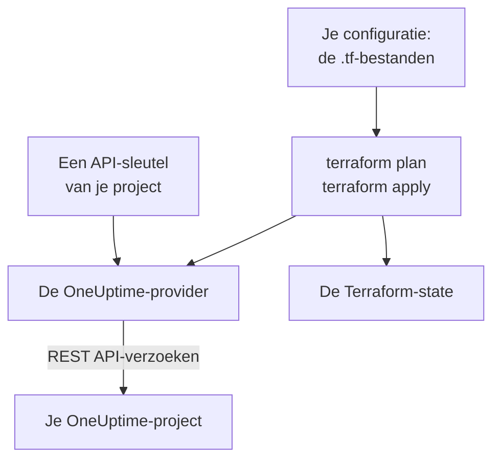

# Terraform – Overzicht

De Terraform-provider van OneUptime beheert je OneUptime-project als code. Beschrijf monitoren, statuspagina's, bereikbaarheidsbeleid, teams, labels en de andere records van je project in `.tf`-bestanden, zie met `terraform plan` wat er verandert en voer de wijziging door met `terraform apply`. Hij werkt met OneUptime Cloud en met een zelf gehoste OneUptime, en met OpenTofu net zo goed als met Terraform.

:::cards
- [Hoe de provider werkt](#hoe-de-provider-werkt): Je configuratie, het plan en de API-verzoeken erachter.
- [De provider installeren](#de-provider-installeren): Het provider-blok, en welke versie je kiest.
- [Laat het dashboard het schrijven](#laat-het-dashboard-het-schrijven): Configuratie en import-blokken voor wat je al hebt.
- [Wat je kunt beheren](#wat-je-kunt-beheren): Resources, data sources en hoe je hun attributen schrijft.
:::

## Hoe de provider werkt

De provider is een plug-in die Terraform uit een registry downloadt. Bij `terraform apply` zet hij elke wijziging in het plan om in een verzoek aan de REST API van OneUptime, gedaan met een API-sleutel van je project. Terraform houdt in zijn state bij wat het heeft gemaakt, zodat het volgende plan alleen toont wat er sindsdien is veranderd.



Een API-sleutel hoort bij één project en bepaalt wat Terraform daarin mag lezen en wijzigen, dus één configuratie beheert één project. Om er meerdere te beheren, geef je de provider voor elk project een [alias](/docs/terraform/complete-guide#meerdere-projecten-beheren).

## Voordat je begint

- **Terraform 1.5 of hoger, of OpenTofu 1.6 of hoger.** De `import`-blokken die het dashboard schrijft, hebben deze versies nodig.
- **Een API-sleutel van je project.** De [Snelle start](/docs/terraform/quick-start#een-api-sleutel-voor-het-project-aanmaken) laat zien hoe je er een aanmaakt in **Projectinstellingen → Geavanceerd → API-sleutels**.
- **Op OneUptime Cloud het Growth-abonnement of hoger.** De API-sleutels van een project werken alleen daarmee.

## De provider installeren

Voeg de provider toe aan een `.tf`-bestand. `terraform init` downloadt hem uit de Terraform Registry, en `tofu init` uit de OpenTofu Registry:

```hcl title="main.tf"
terraform {
  required_providers {
    oneuptime = {
      source  = "oneuptime/oneuptime"
      version = "{{TERRAFORM_PROVIDER_VERSION}}"
    }
  }
}

provider "oneuptime" {
  # The API key comes from the ONEUPTIME_API_KEY environment variable.
  # On a self-hosted OneUptime, add your OneUptime's address:
  # oneuptime_url = "https://oneuptime.example.com"
}
```

Houd de sleutel uit je bestanden: exporteer hem voordat je Terraform uitvoert, of geef hem door in een variabele die als `sensitive` is gemarkeerd. De [Volledige handleiding](/docs/terraform/complete-guide#de-provider-configureren) noemt elke manier om de provider zijn sleutel en adres te geven.

### Een versie kiezen

Providerversies volgen die van OneUptime: provider {{TERRAFORM_PROVIDER_MAJOR}}.x wordt gemaakt uit OneUptime {{TERRAFORM_PROVIDER_MAJOR}}.x. De beperking hierboven, `{{TERRAFORM_PROVIDER_VERSION}}`, neemt de nieuwste {{TERRAFORM_PROVIDER_MAJOR}}.x-release, en dat is de juiste voor OneUptime Cloud. Gebruik op een zelf gehoste OneUptime de nieuwste provider die niet nieuwer is dan je OneUptime: [Zelf gehoste installatie](/docs/terraform/self-hosted) laat zien hoe je hem vastzet.

## Laat het dashboard het schrijven

Een resource die je al hebt, hoef je niet met de hand te schrijven. Elke resource in het OneUptime-dashboard (een monitor, een statuspagina, een workflow, een bereikbaarheidsbeleid en de andere) heeft een sectie **Ontwikkelaars** in het zijmenu, ingeklapt totdat je hem opent. De pagina **Terraform** daarin schrijft de configuratie voor je, ingevuld vanuit je eigen project.

:::steps
### De resource openen

Open de monitor, de statuspagina of de andere resource die je door Terraform wilt laten beheren.

### De Terraform-pagina openen

Open in het zijmenu **Ontwikkelaars** en daarna **Terraform**.

### De configuratie kopiëren

De pagina schrijft de configuratie van de resource uit de huidige instellingen, met een `import`-blok. Een opmerking na elke ID noemt het record waarnaar die verwijst (`incident_severity_id = "..." # Critical Incident`).

### Plannen en toepassen

Voer `terraform plan` uit: het toont dat de resource wordt geïmporteerd en dat er niets te wijzigen is. Pas het toe, en vanaf dan beheert Terraform de resource.
:::

Onder de configuratie staat bij **Verder bouwen** wat mensen vaak naast de resource toevoegen, met een verwijzing naar het adres ervan: een eigenaarsteam voor een incident, een groep monitoren voor een statuspagina, een escalatieregel voor een bereikbaarheidsbeleid.

De lijstpagina's (bijvoorbeeld **Incidenten** of **Monitoren**) hebben dezelfde sectie. Daar schrijft de pagina **Terraform** een nieuwe resource met de velden die de meeste mensen invullen, met de eigen records van je project: een incident met een van je ernstniveaus, een monitor met de criteria die een nieuwe monitor in het dashboard krijgt, gekoppeld aan je statussen. Ze geeft kant-en-klare **Veelgebruikte configuraties** (een statuspagina met een groep en een monitor, een bereikbaarheidsbeleid dat een team oproept, een wekelijks bereikbaarheidsrooster) en een `import`-blok voor elke resource die je al hebt (de eerste 100), klaar voor `terraform plan -generate-config-out`. Beide pagina's geven ook het provider-blok voor je OneUptime: de juiste `oneuptime_url` en een versiebeperking die bij je OneUptime past.

Geheimen worden nooit op deze pagina's getoond. Als de configuratie er een nodig heeft (bijvoorbeeld de `Authorization`-header van een monitor), leest ze die uit een Terraform-variabele die als `sensitive` is gemarkeerd. Geheimen die ze niet nodig heeft, blijven weg, en Terraform laat ze zoals ze in OneUptime zijn.

Dezelfde sectie heeft een pagina **API**, met `curl`-opdrachten voor de resource, en een pagina **AI-assistenten**, die Claude, GitHub Copilot of Cursor met de [MCP-server](/docs/ai/mcp-server) verbindt.

## Wat je kunt beheren

De provider heeft een resource voor elk soort record dat je via de OneUptime-API kunt aanmaken, met de naam `oneuptime_<name>`. Met deze beginnen de meeste configuraties:

| Resource | Wat het is |
| --- | --- |
| `oneuptime_monitor` | Een monitor: website, API, ping, poort, SSL-certificaat, server, inkomend verzoek, handmatig en elk ander type |
| `oneuptime_monitor_status` | Een monitorstatus, zoals Operational, Degraded of Offline |
| `oneuptime_monitor_group` | Een groep monitoren, getoond met één status |
| `oneuptime_status_page` | Een openbare of privé statuspagina |
| `oneuptime_status_page_domain` | Een eigen domein van een statuspagina |
| `oneuptime_domain` | Een domein van je project, geverifieerd voor statuspagina's |
| `oneuptime_label` | Een label, om records te sorteren en te filteren |
| `oneuptime_team`, `oneuptime_team_member` | Een team, en wie erin zit |
| `oneuptime_on_call_policy`, `oneuptime_escalation_rule` | Een bereikbaarheidsbeleid, en de regels die het op volgorde oproept |
| `oneuptime_incident`, `oneuptime_incident_severity`, `oneuptime_incident_state` | Incidenten, hun ernstniveaus en hun statussen |
| `oneuptime_alert`, `oneuptime_alert_severity`, `oneuptime_alert_state` | Waarschuwingen, hun ernstniveaus en hun statussen |
| `oneuptime_scheduled_maintenance_event` | Een gepland onderhoudsvenster |
| `oneuptime_probe` | Een eigen probe, die vanuit je netwerk controleert |

De [Terraform Registry](https://registry.terraform.io/providers/oneuptime/oneuptime/latest/docs) toont elke resource met al zijn attributen.

### Lezen wat al bestaat

Elke resource heeft een data source met dezelfde naam, zoals `data "oneuptime_label"`. Een data source leest een record dat deze configuratie niet beheert, bijvoorbeeld een dat in het dashboard is gemaakt. Zoek het op met zijn `id`, of met zijn andere eenvoudige argumenten: elk argument dat je instelt moet overeenkomen, en precies één record mag met allemaal overeenkomen.

```hcl
data "oneuptime_monitor_status" "offline" {
  name = "Offline"
}

# Any plain argument works. Set several, and all of them must match.
data "oneuptime_monitor_status" "offline_state" {
  is_offline_state = true
}
```

Geen overeenkomst, of meer dan één, is een fout en geen leeg of willekeurig antwoord. De [Volledige handleiding](/docs/terraform/complete-guide#lezen-wat-al-bestaat) geeft de regels.

### Hernoemde resources

Resourcenamen houden woorden als IoT en vCenter heel: `oneuptime_iot_fleet` en `oneuptime_vcenter`, waar oudere providers `oneuptime_io_t_fleet` en `oneuptime_v_center` hadden (en hetzelfde voor hun labelregels, eigenaren en feeds). De oude namen werken nog als verouderde aliassen, en een plan dat er een gebruikt, meldt dat. Om over te stappen hernoem je de resource in je configuratie en voeg je een `moved`-blok toe, waarna Terraform de bestaande resource behoudt in plaats van hem te vervangen:

```hcl
# Was: resource "oneuptime_io_t_fleet" "factory"
resource "oneuptime_iot_fleet" "factory" {
  name = "Factory floor"
}

moved {
  from = oneuptime_io_t_fleet.factory
  to   = oneuptime_iot_fleet.factory
}
```

Een resource naar een ander type verplaatsen vereist Terraform 1.8 of hoger. Houd op een oudere engine voorlopig de oude naam: die blijft werken.

## Hoe je attributen schrijft

Attributen volgen de OneUptime-API, in snake_case:

| Soort waarde | Hoe je hem schrijft | Voorbeeld |
| --- | --- | --- |
| Tekst, getallen, waar of onwaar | Zoals ze zijn | `is_public_status_page = false` |
| Een verwijzing naar een ander record | De ID ervan, meestal de `id` van een andere resource | `incident_severity_id = oneuptime_incident_severity.sev1.id` |
| Een lijst van verwijzingen | Een set van ID's, waarvan de volgorde niets uitmaakt | `labels = [oneuptime_label.critical.id]` |
| Een kleur, een domein en andere verpakte waarden | Hun gewone waarde | `color = "#FF5733"` |
| Een datum en tijd | Tekst in RFC 3339 | `starts_at = "2030-06-01T02:00:00Z"` |
| De controles van een monitor | Getypeerde geneste attributen: zie [Monitorstappen](/docs/terraform/monitor-steps) | `monitor_steps = [{ ... }]` |
| Andere gestructureerde instellingen | JSON, geschreven met `jsonencode()` | `log_monitor = jsonencode({ ... })` |

Twee soorten waarden zijn van de server, en die laat je weg:

- **ID's binnen een resource.** De stappen en criteria van een monitor, en hun sjablonen voor incidenten en waarschuwingen, hebben ID's die de server geeft en bij elke apply behoudt, zodat incidenten blijven verwijzen naar de criteria die ze hebben geopend.
- **Wat de server actueel houdt.** De huidige status van een monitor, of wanneer hij voor het laatst een heartbeat ontving, kan veranderen tussen `terraform plan` en het einde van `terraform apply`. De provider houdt de geplande waarde aan voor alles wat je niet hebt ingesteld, en de volgende refresh leest die van de server, zodat dit nooit een apply laat mislukken of als wijziging verschijnt.

## Hulp krijgen

- Bugs en functieverzoeken: [github.com/OneUptime/oneuptime/issues](https://github.com/OneUptime/oneuptime/issues).
- De provider wordt gegenereerd uit de OpenAPI-specificatie van OneUptime in de [hoofdrepository van OneUptime](https://github.com/OneUptime/oneuptime). De gepubliceerde providerrepository is alleen-lezen, dus meld problemen in de hoofdrepository.

## Volgende stappen

:::cards
- [Snelle start](/docs/terraform/quick-start): Maak een API-sleutel aan en pas je eerste resources toe in tien minuten.
- [Volledige handleiding](/docs/terraform/complete-guide): Authenticatie, projectindeling, data sources, state en upgrades.
- [Monitorstappen](/docs/terraform/monitor-steps): Bepaal wat een monitor controleert en wat elk resultaat betekent.
- [Voorbeelden](/docs/terraform/examples): Kant-en-klare configuraties voor de gangbare resources.
- [Resources importeren](/docs/terraform/importing-resources): Breng wat je in het dashboard hebt gemaakt onder Terraform.
:::
