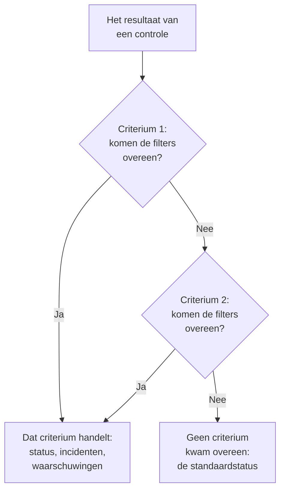
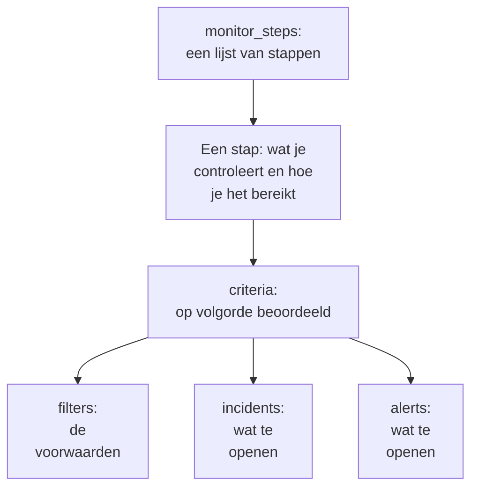

# Monitorstappen

`monitor_steps` is het attribuut van `oneuptime_monitor` dat zegt wat een monitor controleert en hoe elk resultaat wordt beoordeeld: het adres om te controleren, het verzoek om te sturen en de criteria die van een resultaat een monitorstatus, een incident of een waarschuwing maken. Deze pagina legt elk onderdeel ervan uit.

:::cards
- [Hoe een controle wordt beoordeeld](#hoe-een-controle-wordt-beoordeeld): Criteria op volgorde, en het eerste dat overeenkomt.
- [De stappen schrijven](#de-stappen-schrijven): Hun vorm, een volledig voorbeeld en de twee regels voor waarden.
- [Filterreferentie](#filterreferentie): Wat een filter kan controleren, en hoe hij vergelijkt.
- [Veelgemaakte fouten](#veelgemaakte-fouten): Wat het vaakst misgaat, en de oplossing.
:::

## Hoe een controle wordt beoordeeld

Elke controle geeft een resultaat: het antwoord van een probe, de returnwaarde van een script of de telemetrie die de controle leest. De criteria van de stap beoordelen het daarna op hun volgorde. Het eerste criterium waarvan de filters overeenkomen, bepaalt wat er gebeurt: het kan de status van de monitor wijzigen, incidenten openen en waarschuwingen openen. De criteria erna worden voor die controle niet bekeken.



De volgorde van de criteria doet er dus toe: zet de criteria die alarm slaan bovenaan, de ernstigste eerst, en het gezonde criterium als laatste. [Attributen van een criterium](#attributen-van-een-criterium) legt uit waarom, en wat de ene uitzondering is.

## De stappen schrijven

`monitor_steps` is een lijst van getypeerde objecten die je rechtstreeks in HCL schrijft. Er is geen `jsonencode()`, geen `{_type, value}`-omhulsel, geen camelCase-sleutel en geen ID om te schrijven: de provider zet je HCL om in het formaat van de API, en de server geeft elke stap, elk criterium, elk incidentsjabloon en elk waarschuwingssjabloon zijn ID. Hij behoudt die ID's bij elke apply door elk criterium en sjabloon te koppelen aan het exemplaar dat het vervangt, op naam en anders op positie, zodat proberesultaten bij hun stap blijven en incidenten blijven verwijzen naar de criteria die ze hebben geopend.



De kleinste nuttige stap controleert één adres en heeft één criterium met één filter:

```hcl
resource "oneuptime_monitor" "example" {
  name         = "Example"
  description  = "The smallest monitor_steps"
  monitor_type = "Website"

  monitor_steps = [{
    monitor_destination      = "https://example.com"
    monitor_destination_type = "URL"
    request_type             = "GET"

    criteria = [
      {
        name             = "Check if online"
        description      = "The website responds"
        filter_condition = "All"

        filters = [
          {
            check_on    = "Is Online"
            filter_type = "True"
          }
        ]
      }
    ]
  }]
}
```

Overal in `monitor_steps` gelden twee regels:

- **Laat weg wat je niet gebruikt.** Een attribuut dat je niet instelt, wordt niet naar de API gestuurd. Schrijf nooit `[]`, `{}` of `""` als plaatsvervanger: de provider weigert lege strings, lijsten en maps, zodat een ontbrekende waarde altijd "niet ingesteld" betekent.
- **Filterwaarden zijn strings.** De `value` van een filter is een string, zelfs bij een getal: `value = "200"`, niet `value = 200`. Numerieke instellingen zoals `port` zijn getallen.

:::details Overstappen van provider 1.x, waar monitor_steps JSON was
In provider 1.x was `monitor_steps` een JSON-string, geschreven met `jsonencode({ _type = "MonitorSteps", value = { ... } })`. Herschrijf hem met de getypeerde attributen op deze pagina: haal de omhulsels `_type` en `value` weg, schrijf de camelCase-sleutels in snake_case (`monitorDestination` wordt `monitor_destination` en `monitor_destination_type`, `filterCondition` wordt `filter_condition`, `checkOn` wordt `check_on`) en verwijder elke `id`. De server geeft nu alle ID's, en daarmee zijn ook de vast ingeprogrammeerde willekeurige ID's uit issue [#2291](https://github.com/OneUptime/oneuptime/issues/2291) verleden tijd. State die als JSON-string is opgeslagen, wordt niet vanzelf bijgewerkt: pas de nieuwe configuratie toe.
:::

### Een volledig voorbeeld

Deze websitemonitor controleert wat de websitemonitor in de end-to-endtests van de provider controleert (test `35-monitor-with-steps`): offline als de site niet antwoordt, online als hij antwoordt met 200.

```hcl
resource "oneuptime_monitor_status" "operational" {
  name                 = "Operational"
  description          = "Monitor is operational"
  color                = "#2ecc71"
  priority             = 1
  is_operational_state = true
}

resource "oneuptime_monitor_status" "offline" {
  name                 = "Offline"
  description          = "Monitor is offline"
  color                = "#e74c3c"
  priority             = 3
  is_operational_state = false
}

resource "oneuptime_monitor" "website" {
  name         = "Website"
  description  = "Website monitor with explicit steps"
  monitor_type = "Website"

  monitor_steps = [{
    monitor_destination      = "https://example.com" # what to check
    monitor_destination_type = "URL"                 # URL, Hostname or IP
    request_type             = "GET"                 # the HTTP method

    criteria = [ # judged in order: the first match decides
      {
        name                  = "Offline"
        description           = "Check if website is offline"
        filter_condition      = "Any"
        change_monitor_status = true
        create_incidents      = false
        create_alerts         = false
        monitor_status_id     = oneuptime_monitor_status.offline.id

        filters = [
          {
            check_on    = "Is Online"
            filter_type = "False"
          }
        ]
      },
      {
        name                  = "Online"
        description           = "Check if website is online"
        filter_condition      = "All" # All: every filter, Any: at least one
        change_monitor_status = true
        create_incidents      = false
        create_alerts         = false
        monitor_status_id     = oneuptime_monitor_status.operational.id

        filters = [
          {
            check_on    = "Is Online"
            filter_type = "True"
          },
          {
            check_on    = "Response Status Code"
            filter_type = "Equal To"
            value       = "200" # a string, even for a number
          }
        ]
      }
    ]
  }]
}
```

Een criterium verwijst naar een status via de resource ervan, zoals `oneuptime_monitor_status.offline.id` hier doet, of naar een status die je project al heeft via een [data source](/docs/terraform/complete-guide#lezen-wat-al-bestaat).

## Attributen van een stap

Elk item van `monitor_steps` is één ding om te controleren:

| Attribuut | Type | Gebruikt door | Opmerkingen |
| --- | --- | --- | --- |
| `monitor_destination` | string | Website, API, Ping, IP, Poort, SSL-certificaat, NTP | De URL, hostnaam of het IP-adres om te controleren. Vereist `monitor_destination_type`. |
| `monitor_destination_type` | string | dezelfde | `URL`, `Hostname` of `IP`, naar wat het monitortype accepteert: een URL voor website-, API- en SSL-certificaatmonitoren; een hostnaam of een IP-adres voor Ping-, IP-, Poort- en NTP-monitoren. |
| `port` | number | Poort, NTP | De TCP-poort om te controleren, zoals `443`. Bij NTP de UDP-poort waarop de tijdserver antwoordt: `123` als hij niet is ingesteld. |
| `request_type` | string | Website, API | De HTTP-methode: `GET`, `POST`, `PUT`, `DELETE`, `HEAD` of `PATCH`. De server gebruikt `GET` als hij niet is ingesteld. |
| `request_headers` | map(string) | Website, API | Headers om mee te sturen: `{ "Accept" = "application/json" }`. |
| `request_body` | string | API | De body van het verzoek, als tekst. |
| `do_not_follow_redirects` | bool | Website, API | Stoppen bij het eerste antwoord in plaats van omleidingen te volgen. |
| `allow_self_signed_certificates` | bool | Website, API | Een zelfondertekend TLS-certificaat accepteren. |
| `tls_client_certificate` | string | Website, API | Een clientcertificaat voor wederzijdse TLS: PEM, of een verwijzing `{{monitorSecrets.name}}`. |
| `tls_client_key` | string (gevoelig) | Website, API | De privésleutel van het clientcertificaat. Stel hem samen met het certificaat in. |
| `tls_client_key_passphrase` | string (gevoelig) | Website, API | De wachtwoordzin van de privésleutel. |
| `request_timeout_in_ms` | number | Controles die een probe uitvoert | Hoe lang één poging mag duren, in milliseconden. De probe verlaagt alles boven 60000 naar 60000. |
| `retry_count` | number | Controles die een probe uitvoert | Nieuwe pogingen na een mislukte eerste poging: `0` controleert één keer, `3` tot vier keer. De probe verlaagt alles boven 3 naar 3. |
| `custom_code` | string | Custom JavaScript Code, Synthetic | Het script dat de stap uitvoert. |
| `screen_size_types` | list(string) | Synthetic | `Mobile`, `Tablet` en `Desktop`. |
| `browser_types` | list(string) | Synthetic | `Chromium` en `Firefox`. |
| `retry_count_on_error` | number | Synthetic | Nieuwe pogingen als het script mislukt: `0` voert het één keer uit. |
| `criteria` | list (verplicht) | Alle | Hoe elk resultaat wordt beoordeeld: zie [Attributen van een criterium](#attributen-van-een-criterium). |

### Instellingen per monitortype

Monitortypen waarbij meer in te stellen is dan een adres, bewaren hun instellingen (een logquery, een databaseverbinding, een cluster om te bewaken) in een eigen attribuut, als ruwe JSON geschreven met `jsonencode()`: `log_monitor`, `trace_monitor`, `llm_monitor`, `metric_monitor`, `exception_monitor`, `profile_monitor`, `dns_monitor`, `domain_monitor`, `dnssec_monitor`, `sql_monitor`, `database_monitor`, `external_status_page_monitor`, `network_device_monitor`, `kubernetes_monitor`, `docker_monitor`, `docker_swarm_monitor`, `host_monitor`, `podman_monitor`, `proxmox_monitor`, `vmware_monitor`, `ceph_monitor`, `storage_array_monitor` en `iot_monitor`.

Hun JSON is dezelfde als die van het dashboard, met sleutels in camelCase. Een ID daarin schrijf je zoals de API hem schrijft: `{ _type = "ObjectID", value = "..." }`. Een Logs-monitor die de fouten van één service telt:

```hcl
resource "oneuptime_service" "checkout" {
  name = "checkout"
}

resource "oneuptime_monitor" "checkout_errors" {
  name         = "Checkout errors"
  monitor_type = "Logs"

  monitor_steps = [{
    log_monitor = jsonencode({
      attributes          = {}
      body                = "error"
      severityTexts       = ["Error"]
      telemetryServiceIds = [{ _type = "ObjectID", value = oneuptime_service.checkout.id }]
      lastXSecondsOfLogs  = 300
    })

    criteria = [
      {
        name             = "Errors found"
        filter_condition = "Any"

        filters = [
          {
            check_on    = "Log Count"
            filter_type = "Greater Than"
            value       = "0"
          }
        ]
      }
    ]
  }]
}
```

> [!TIP]
> De makkelijkste manier om deze JSON goed te krijgen: stel de monitor in het dashboard in, open dan de sectie **Ontwikkelaars** ervan en **Terraform**. De pagina schrijft de `monitor_steps` van de monitor, `jsonencode()` en al.

## Attributen van een criterium

Elk item van `criteria` is één regel: als de filters overeenkomen, doe wat de regel zegt.

De criteria worden van boven naar beneden beoordeeld, en het eerste dat overeenkomt beslist, dus zet de criteria die alarm slaan bovenaan, de ernstigste eerst (kritiek, dan waarschuwing), en het gezonde criterium als laatste. Een gezond criterium bovenaan is de meest voorkomende manier om een monitor te bouwen die nooit alarm slaat: een brede regel zoals `Is Online` is `True`, of een metriekwaarde `Greater Than` `0`, komt overeen met bijna elke controle, en de criteria eronder worden nooit bekeken. Als laatste geplaatst komt het alleen overeen als niets erboven overeenkwam, en dat is wat je wilt.

Gegroepeerde metriekmonitoren zijn de ene uitzondering. Als de query van een metriekmonitor gegroepeerd is (`groupByAttributeKeys` ingesteld in de JSON van `metric_monitor`, op `metricViewConfig.queryConfigs[].metricQueryData.groupByAttributeKeys`), opent de monitor één waarschuwing of incident per groep (per host, container of koppelpunt), en wordt elk criterium beoordeeld, zodat een kritiek criterium en een waarschuwingscriterium bij dezelfde controle voor verschillende hosts kunnen afgaan. Een host die beide schendt, wordt toch maar één keer opgeroepen, door het eerste criterium dat overeenkomt, dus de ernstigste gaat nog steeds voor. Zie [Metrics-monitor](/docs/monitor/metrics-monitor).

| Attribuut | Type | Wat het is |
| --- | --- | --- |
| `name` | string (verplicht) | De naam die het dashboard toont. |
| `description` | string | De beschrijving die het dashboard toont. |
| `filter_condition` | string (verplicht) | `All`: elke filter moet overeenkomen. `Any`: één is genoeg. |
| `filters` | list (verplicht) | De voorwaarden, minstens één: zie [Filterreferentie](#filterreferentie). |
| `change_monitor_status` | bool | Of een overeenkomst de status van de monitor wijzigt. |
| `monitor_status_id` | string | De ID van de `oneuptime_monitor_status` waarnaar je wisselt. Stel hem in als `change_monitor_status` `true` is. |
| `create_incidents` | bool | Of een overeenkomst incidenten opent. |
| `incidents` | list | De incidenten om te openen. Laat het weg, tenzij `create_incidents = true`. |
| `create_alerts` | bool | Of een overeenkomst waarschuwingen opent. |
| `alerts` | list | De waarschuwingen om te openen. Laat het weg, tenzij `create_alerts = true`. |
| `is_enabled` | bool | `true` op de server als het niet is ingesteld. Stel `false` in om een criterium te bewaren zonder ermee te beoordelen. |
| `incident_grouping` | string (JSON) | Alleen monitoren voor inkomende verzoeken: één incident per waarde die in het verzoek wordt gevonden, zoals `jsonencode({ groupByJSONPath = "..." })`. |

### Incidenten en waarschuwingen

Een item van `incidents` accepteert `title` en `description` (beide verplicht), `incident_severity_id`, `auto_resolve_incident`, `remediation_notes`, `on_call_policy_ids`, `label_ids`, `owner_team_ids`, `owner_user_ids`, `show_incident_on_status_page` en `is_private`. Een item van `alerts` accepteert dezelfde, met `alert_severity_id` en `auto_resolve_alert`, en zonder `show_incident_on_status_page`.

Dit criterium zet de monitor op offline, opent een incident dat het bereikbaarheidsbeleid oproept, en lost het op als de site terug is:

```hcl
criteria = [
  {
    name                  = "Offline"
    description           = "The site is unreachable"
    filter_condition      = "Any"
    change_monitor_status = true
    monitor_status_id     = oneuptime_monitor_status.offline.id
    create_incidents      = true

    filters = [
      {
        check_on    = "Is Online"
        filter_type = "False"
      }
    ]

    incidents = [
      {
        title                 = "Website is down"
        description           = "The website did not respond to the probe."
        incident_severity_id  = oneuptime_incident_severity.critical.id
        auto_resolve_incident = true
        on_call_policy_ids    = [oneuptime_on_call_policy.primary.id]
      }
    ]
  }
]
```

## Filterreferentie

Een filter heeft `check_on` (waar hij naar kijkt), `filter_type` (hoe hij vergelijkt) en `value` (waarmee hij vergelijkt, als string; laat het weg bij controles op waar of onwaar zoals `True` en `False`).

Een filter kan ook een tijdvenster beoordelen in plaats van de laatste controle: stel `evaluate_over_time = true` in, de lengte van het venster in `evaluate_over_time_minutes`, en in `evaluate_over_time_type` hoe het venster wordt gelezen: `Average`, `Sum`, `Maximum Value`, `Minimum Value`, `All Values` of `Any Value`.

`All Values` betekent dat elke controle in het venster de regel schond, dus het komt pas overeen als het venster met gegevens is gevuld: een monitor die net is aangemaakt, wacht tot zijn venster vol is in plaats van bij zijn eerste controle overeen te komen. Geef het een venster van minstens twee keer het `monitoring_interval` van de monitor; anders bevat het venster één controle, en betekent "alle waarden" hetzelfde als "een willekeurige waarde". `Any Value` komt bewust overeen bij één controle die de regel schendt.

`evaluate_over_time_no_data_policy` zegt wat de filter doet zolang het venster niet genoeg gegevens bevat: `Ignore` (de standaard) komt niet overeen, `Trigger` behandelt de ontbrekende gegevens als de storing, zoals een heartbeat doet, en `Treat As Zero` vergelijkt het venster als één enkele nul.

### Wat een filter kan controleren

De `check_on`-waarden die elk monitortype het meest gebruikt. De criteria-editor van het dashboard biedt dezelfde aan, en toont ze allemaal:

| Monitortype | `check_on`-waarden |
| --- | --- |
| Website / API | `Is Online`, `Response Time (in ms)`, `Response Status Code`, `Response Body`, `Response Header`, `Response Header Value`, `JavaScript Expression`, `Is Request Timeout` |
| Ping / IP | `Is Online`, `Response Time (in ms)`, `Packet Loss (in %)`, `Jitter (in ms)`, `Is Request Timeout` |
| Poort | `Is Online`, `Response Time (in ms)` (de totale verbindingstijd van het dashboard), `Port DNS Lookup Time (in ms)`, `Port TCP Connect Time (in ms)`, `Is Request Timeout` |
| SSL-certificaat | `Is Valid Certificate`, `Is Not A Valid Certificate`, `Is Self Signed Certificate`, `Is Expired Certificate`, `Expires In Days`, `Expires In Hours` |
| Inkomend verzoek | `Incoming Request`, `Request Body`, `Request Header`, `Request Header Value`, `JavaScript Expression` |
| Inkomende e-mail | `Email Received`, `Email Subject`, `Email From Address`, `Email To Address`, `Email Body` |
| Server | `Is Online`, `CPU Usage (in %)`, `Memory Usage (in %)`, `Disk Usage (in %)` (met `disk_path`), `Server Process Name` |
| Logs | `Log Count` |
| Traces | `Span Count` |
| Exceptions | `Exception Count` |
| Profielen | `Profile Count` |
| AI / LLM | `Bad AI Answers (in %)`, `Bad AI Answers`, `AI Answers` |
| Metrieken | `Metric Value` (metriekfilters kunnen JSON in `metric_monitor_options` krijgen) |
| Aangepaste code / Synthetic | `Result Value` (kan één veld van de teruggegeven gegevens vergelijken, genoemd in de JSON van `custom_code_monitor_options`, bijv. `jsonencode({ resultValuePath = "status" })` — zie hieronder), `Error`, `Execution Time (in ms)` |
| DNS | `DNS Is Online`, `DNS Response Time (in ms)`, `DNS Record Value`, `DNS Record Exists` |
| Domein | `Domain Expires In Days`, `Domain Is Expired`, `Domain Registrar`, `Domain Name Server` |
| DNSSEC | `DNSSEC Chain Is Valid`, `DNSSEC DS Record Exists At Parent`, `DNSSEC Signature Expires In Days` |
| SQL-query | `SQL Is Online`, `SQL Query Row Count`, `SQL Query Scalar Value` |
| Databasegezondheid | `Database Is Online`, `Database Metric` (met JSON in `database_monitor_options` die de reeks noemt, bijv. `jsonencode({ metricType = "oneuptime.monitor.database.connections.used.percent" })`), `Database Collection Error` |
| Externe statuspagina | `External Status Page Is Online`, `External Status Page Active Incidents`, `External Status Page Component Status` |
| NTP | `NTP Is Online`, `NTP Is Synchronized`, `NTP Stratum`, `NTP Clock Offset (in ms)`, `NTP Response Time (in ms)`, `NTP Root Dispersion (in ms)` (`NTP Is Online` en `NTP Is Synchronized` krijgen geen `value`) |
| Netwerkapparaat (SNMP) | `SNMP Device Is Online` (het antwoordt op ping of SNMP), `SNMP Walk Is Succeeding` (false als het antwoordt maar niet kan worden doorlopen), `SNMP OID Value` (SNMP-filters kunnen JSON in `snmp_monitor_options` krijgen) |

### Hoe een filter vergelijkt

| Soort | `filter_type`-waarden |
| --- | --- |
| Waar of onwaar | `True`, `False` |
| Getallen | `Equal To`, `Not Equal To`, `Greater Than`, `Less Than`, `Greater Than Or Equal To`, `Less Than Or Equal To` |
| Tekst | `Contains`, `Not Contains`, `Starts With`, `Ends With`, `Is Empty`, `Is Not Empty` |
| Heartbeats | `Recieved In Minutes`, `Not Recieved In Minutes` (gespeld zoals de API ze spelt) |
| Serverprocessen | `Is Executing`, `Is Not Executing` |
| Scripts | `Evaluates To True` |
| Afwijkingen, voor metrieken, logs en traces | `Anomalously High`, `Anomalously Low`, `Anomalous` |

Een filter die overeenkomt als een SSL-certificaat binnen 14 dagen of minder verloopt:

```hcl
filters = [
  {
    check_on    = "Expires In Days"
    filter_type = "Less Than Or Equal To"
    value       = "14"
  }
]
```

De provider controleert `check_on`, `filter_type` en de andere vaste lijsten bij het plannen, zodat een typefout mislukt voordat er iets naar de API wordt gestuurd. De waarden zijn de namen die de API geeft aan de opties van de criteria-editor van het dashboard.

### Eén veld van het resultaat van een script vergelijken

Het script van een Aangepaste-code-monitor of een Synthetic-monitor geeft `data` terug, en een filter `Result Value` vergelijkt dat. Als `data` een object of een array is, noemt `custom_code_monitor_options` het ene veld ervan om te vergelijken: het **Veldpad** van de Result Value-filter in het dashboard. Gebruik punten voor geneste velden en `[n]` voor items van een array, en laat het attribuut weg om de hele waarde te vergelijken:

```hcl
monitor_steps = [{
  custom_code = <<-EOT
    const response = await axios.get("https://api.example.com/health");
    // For example { status: "UP", checks: [{ name: "db", latency: 12 }] }
    return { data: response.data };
  EOT

  criteria = [
    {
      name             = "Unhealthy"
      filter_condition = "Any"
      filters = [
        {
          check_on                    = "Result Value"
          filter_type                 = "Not Equal To"
          value                       = "UP"
          custom_code_monitor_options = jsonencode({ resultValuePath = "status" })
        },
        {
          check_on                    = "Result Value"
          filter_type                 = "Greater Than"
          value                       = "500"
          custom_code_monitor_options = jsonencode({ resultValuePath = "checks[0].latency" })
        }
      ]
    }
  ]
}]
```

`Greater Than` en de andere getalvoorwaarden komen alleen overeen met een veld dat een getal is, en een veld dat in de teruggegeven gegevens ontbreekt, komt alleen overeen met `Is Empty`. Zie [Waarschuwen op de teruggegeven gegevens](/docs/monitor/custom-code-monitor#waarschuwen-op-de-teruggegeven-gegevens) voor hoe paden en voorwaarden werken.

## Veelgemaakte fouten

1. **Lege plaatsvervangers.** `incidents = []`, `request_headers = {}` en `description = ""` worden geweigerd: laat het attribuut in plaats daarvan weg.
2. **Een getal waar een string hoort.** De `value` van een filter is een string, zelfs bij een getal: `value = "200"`. Numerieke instellingen zoals `port`, `retry_count`, `request_timeout_in_ms` en `evaluate_over_time_minutes` krijgen getallen.
3. **Het verkeerde bestemmingstype.** `monitor_destination_type = "URL"` met een kale hostnaam, of `Hostname` met een volledige URL, laat de controle mislukken. Website- en API-monitoren krijgen URL's; Ping-, IP- en Poort-monitoren krijgen hostnamen of IP-adressen.
4. **Een statuswijziging zonder status.** `change_monitor_status = true` zonder `monitor_status_id` komt overeen, en heeft geen status om naartoe te wisselen.
5. **ID's.** Geen enkel item van `monitor_steps` heeft een attribuut `id`. Stap je over van de oude JSON, verwijder ze dan: de server geeft de ID's.
6. **Met de hand geschreven JSON.** Schrijf `log_monitor` en de andere instellingen met `jsonencode()`, zodat Terraform ze tussen aanhalingstekens zet en de JSON elke keer op dezelfde manier schrijft. Geef bij `metric_monitor` het hele object dat het dashboard schrijft: de server normaliseert het.

## Als geen criterium overeenkomt

Een controle die met geen enkel criterium overeenkomt, zet de monitor in zijn standaardstatus: de operationele status van het project, de status die het dashboard voor een nieuwe monitor kiest. Zijn open incidenten waarvan de criteria voor automatisch oplossen hebben gekozen, worden ook opgelost. Om elke uitkomst zelf te bepalen, sluit je de lijst af met een breed gezond criterium, zoals de voorbeelden op deze pagina doen.

## Een monitor zonder stappen

`monitor_steps` is optioneel, maar een monitor die zonder wordt aangemaakt, heeft geen criteria om een resultaat mee te beoordelen: probes slaan een monitor zonder stappen over, en hij blijft in de status waarin hij begon. Je state houdt het attribuut leeg, en het plan blijft schoon. Een handmatige monitor heeft nooit stappen nodig: je stelt zijn status zelf in. Elk ander type heeft minstens één stap nodig om iets te controleren.

## Het transportformaat

Achter de provider spreekt de API nog steeds zijn eigen JSON, waarin elk rijk object is verpakt als `{_type, value}`:

```json
{
  "_type": "MonitorSteps",
  "value": {
    "monitorStepsInstanceArray": [
      {
        "_type": "MonitorStep",
        "value": {
          "monitorDestination": { "_type": "URL", "value": "https://example.com" },
          "requestType": "GET",
          "monitorCriteria": {
            "_type": "MonitorCriteria",
            "value": { "monitorCriteriaInstanceArray": [ { "_type": "MonitorCriteriaInstance", "value": { "...": "..." } } ] }
          }
        }
      }
    ]
  }
}
```

De provider bouwt dit uit je HCL als hij schrijft, en leest het terug in HCL, zonder wat de server beheert (de ID's en de standaardwaarden die hij toevoegt). Je komt het alleen tegen als je zelf de antwoorden van de API leest, bijvoorbeeld in een script dat `monitorSteps` leest.

## Volgende stappen

:::cards
- [Voorbeelden](/docs/terraform/examples): Ping-, poort-, SSL-certificaat- en API-monitoren, klaar voor gebruik.
- [Volledige handleiding](/docs/terraform/complete-guide): Data sources, state en upgrades.
- [Metrics-monitor](/docs/monitor/metrics-monitor): Metriekquery's, groeperen en afwijkingen.
- [Probleemoplossing](/docs/terraform/troubleshooting): Inclusief een inconsistent resultaat na een apply op een monitor.
:::
