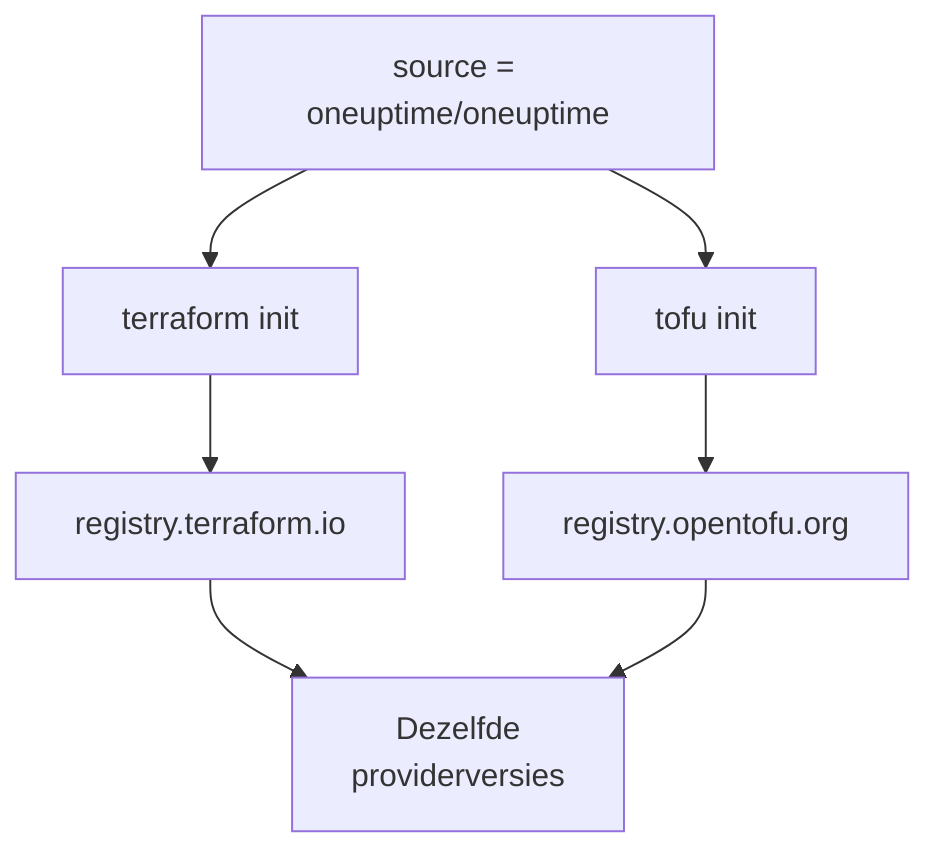

# OpenTofu

De OneUptime-provider werkt met [OpenTofu](https://opentofu.org) zoals hij met Terraform werkt. Hij wordt gepubliceerd in het [OpenTofu Registry](https://search.opentofu.org/provider/oneuptime/oneuptime/latest), en elke release doorstaat dezelfde end-to-endtests onder beide voordat hij wordt gepubliceerd. Je configuratie verandert niet: voer `tofu` uit overal waar deze documentatie `terraform` uitvoert.

:::cards
- [De provider met OpenTofu gebruiken](#de-provider-met-opentofu-gebruiken): Dezelfde configuratie, uitgevoerd met `tofu`.
- [Wat er anders is dan bij Terraform](#wat-er-anders-is-dan-bij-terraform): Registers, lockbestanden, `.tofu`-bestanden en versies.
- [Een configuratie naar OpenTofu verhuizen](#een-configuratie-naar-opentofu-verhuizen): Zet een bestaande configuratie over in vier stappen.
- [Een herbruikbare module](#een-herbruikbare-module): Monitoren, een bereikbaarheidsbeleid en een statuspagina voor één dienst.
:::

## De provider met OpenTofu gebruiken

Je hebt OpenTofu 1.6 of later nodig. Declareer de provider zoals je dat voor Terraform zou doen:

```hcl title="main.tf"
terraform {
  required_providers {
    oneuptime = {
      source  = "oneuptime/oneuptime"
      version = "{{TERRAFORM_PROVIDER_VERSION}}"
    }
  }
}

provider "oneuptime" {
  # The API key comes from the ONEUPTIME_API_KEY environment variable.
  # On a self-hosted OneUptime, add your OneUptime's address:
  # oneuptime_url = "https://oneuptime.example.com"
}
```

Voer hem daarna uit met `tofu`:

```bash
export ONEUPTIME_API_KEY="<your-api-key>"
tofu init
tofu plan
tofu apply
```

`tofu init` downloadt de provider uit het OpenTofu Registry. Alles in de [Snelle start](/docs/terraform/quick-start), de [Volledige handleiding](/docs/terraform/complete-guide), [Monitorstappen](/docs/terraform/monitor-steps), [Voorbeelden](/docs/terraform/examples) en [Resources importeren](/docs/terraform/importing-resources) geldt zoals het is, en de configuratie die de **Terraform**-pagina's van het dashboard schrijven, werkt ongewijzigd.

### Het register buiten het bronadres houden

`source = "oneuptime/oneuptime"` noemt geen register, dus elke engine leest het uit zijn eigen register:



Laat de hostnaam weg. Met een hostnaam gebruikt elke engine dat register: onder `registry.terraform.io/oneuptime/oneuptime` downloadt ook OpenTofu uit het Terraform Registry, en Terraform weigert de kopie uit het OpenTofu Registry met `authentication signature from unknown issuer`.

## Wat er anders is dan bij Terraform

| Onderwerp | Onder OpenTofu |
| --- | --- |
| Het register | `oneuptime/oneuptime` is `registry.opentofu.org/oneuptime/oneuptime`, dat dezelfde versies publiceert als het Terraform Registry. |
| Handtekeningen | `tofu init` zegt dat de controle van de handtekening is overgeslagen: het OpenTofu Registry heeft geen ondertekeningssleutel voor deze provider, dus OpenTofu controleert de download met de checksums van het register. |
| Het `terraform`-blok | Blijft `terraform`: het hoort bij de taal, en OpenTofu leest het zoals het is. |
| `.tofu`-bestanden | OpenTofu 1.8 en later lezen ook `.tofu`-bestanden, en slaan een `.tf`-bestand over dat een `.tofu`-bestand met dezelfde naam heeft. Terraform leest alleen `.tf`-bestanden. |
| `required_version` | De versies van OpenTofu beginnen bij 1.6.0, dus `>= 1.5.0`, geschreven voor Terraform, laat elke OpenTofu toe. |
| Het lockbestand | Noemt `registry.opentofu.org/oneuptime/oneuptime`. Van engine wisselen herschrijft die vermelding: commit de wijziging. |
| State | OpenTofu leest een state die Terraform schreef, zoals die is. |
| Variabelen | `TF_VAR_name` stelt ook onder OpenTofu een variabele in. |
| Het CLI-configuratiebestand | `~/.tofurc` of `~/.terraformrc`, of het bestand dat `TF_CLI_CONFIG_FILE` noemt. |
| Een `removed`-blok | Het `lifecycle`-blok ervan vereist OpenTofu 1.10 of later. Zonder dat blok vergeet OpenTofu de resource en houdt het het record, waar Terraform het vernietigt. |
| Naar een hernoemd resourcetype verhuizen | Een `moved`-blok van `oneuptime_io_t_fleet` naar `oneuptime_iot_fleet`, of tussen de andere hernoemde types, vereist OpenTofu 1.12 of later. |

## Een configuratie naar OpenTofu verhuizen

Een configuratie die Terraform beheert, verhuist naar OpenTofu zoals ze is, met haar state:

:::steps
### OpenTofu installeren

Installeer OpenTofu: 1.6 is genoeg voor de provider, en 1.12 of later verhuist ook een resource naar een hernoemd type, zoals `oneuptime_io_t_fleet` naar `oneuptime_iot_fleet`.

### Initialiseren met tofu

Voer in de map van de configuratie `tofu init` uit. Het downloadt de provider uit het OpenTofu Registry, en zegt dat het het lockbestand heeft gewijzigd: de vermelding van de provider noemt nu het OpenTofu Registry.

### Plannen

Voer `tofu plan` uit. Het leest de state die Terraform achterliet, en antwoordt met `No changes.`

### Het lockbestand committen

Commit `.terraform.lock.hcl`, en voer de configuratie voortaan uit met `tofu`, ook in CI.
:::

## Een herbruikbare module

[`Examples/opentofu/`](https://github.com/OneUptime/oneuptime/tree/master/Examples/opentofu) in de OneUptime-repository bevat configuraties die je zo kunt uitvoeren, en een module die één dienst opzet: een websitemonitor voor elk adres dat je meegeeft, een label op alles wat hij aanmaakt, een bereikbaarheidsbeleid met één escalatieregel, en een statuspagina die de monitoren toont. Het is gewone HCL, dus het werkt ook onder Terraform.

```hcl title="main.tf"
module "storefront" {
  source = "github.com/OneUptime/terraform-provider-oneuptime//modules/monitoring-and-incident-response?ref=vX.Y.Z"

  service_name          = "storefront"
  status_page_is_public = true

  monitors = {
    homepage = { url = "https://example.com" }
    checkout = { url = "https://example.com/checkout" }
    api      = { url = "https://api.example.com/health", expected_status_code = "204" }
  }
}
```

Vervang `vX.Y.Z` door een gepubliceerde providerversie, zoals de nieuwste op de [releases van de provider](https://github.com/OneUptime/terraform-provider-oneuptime/releases): de module wordt met de provider gepubliceerd, en de repository ervan verandert bij elke release.

De module maakt geen monitorstatussen of ernstniveaus van incidenten aan. Hij zoekt op naam de exemplaren op waarmee elk project begint: `Operational`, `Offline` en `Critical Incident`. Als je project ze heeft hernoemd, stel dan `operational_monitor_status_name`, `offline_monitor_status_name` of `incident_severity_name` in.

Zijn escalatieregel waarschuwt niemand tot je zegt wie: voeg er een team aan toe met de outputs van de module:

```hcl title="main.tf"
resource "oneuptime_team" "storefront" {
  name = "Storefront"
}

resource "oneuptime_team_on_call_duty_escalation_rule" "storefront" {
  on_call_duty_policy_id                 = module.storefront.on_call_policy_id
  on_call_duty_policy_escalation_rule_id = module.storefront.escalation_rule_id
  team_id                                = oneuptime_team.storefront.id
}
```

## Volgende stappen

:::cards
- [Snelle start](/docs/terraform/quick-start): Maak een API-sleutel aan en pas je eerste resources toe.
- [Registergebruik](/docs/terraform/registry): Hoe versies worden genummerd, en het lockbestand.
- [Zelf gehoste installatie](/docs/terraform/self-hosted): Je eigen OneUptime, en een mirror voor offline machines.
- [Probleemoplossing](/docs/terraform/troubleshooting): Veelvoorkomende fouten en hoe je ze oplost.
:::
