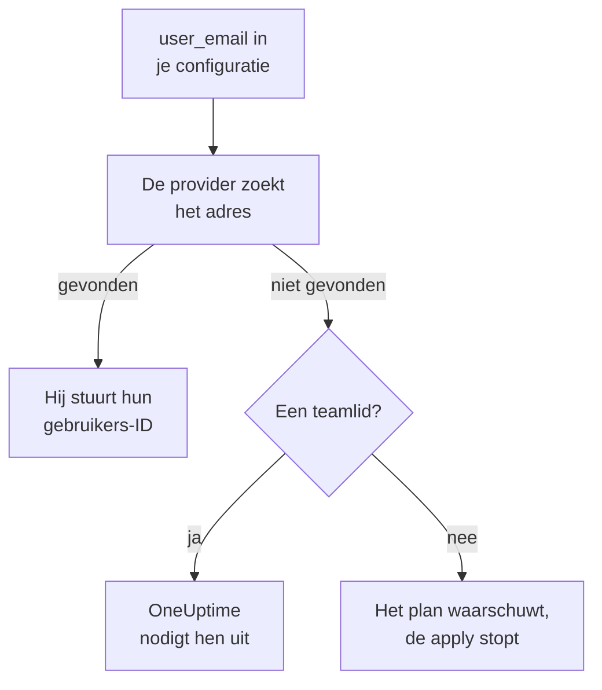

# Mensen en teams

Leg in je Terraform-configuratie vast wie er in je project zit: teams en hun leden, wie er bereikbaar is en wie waarvan eigenaar is. Noem elke persoon bij zijn e-mailadres: de provider vindt hem en nodigt iedereen uit die nieuw is in het project.

:::cards
- [Mensen bij hun e-mailadres noemen](#mensen-bij-hun-e-mailadres-noemen): Het attribuut naast elke gebruikers-ID.
- [Iemand laten beginnen](#iemand-laten-beginnen): Nodig iemand uit en geef hem een team, bereikbaarheidsbeurten en iets om eigenaar van te zijn.
- [Iemand laten vertrekken](#iemand-laten-vertrekken): Verwijder iemand, en wat OneUptime samen met hem verwijdert.
- [Leden importeren die je al hebt](#leden-importeren-die-je-al-hebt): Via hun team en hun adres.
:::

## Hoe het werkt

De provider zoekt het adres op onder de mensen van het project van de API-sleutel: de leden, en de mensen die ervoor zijn uitgenodigd. Hij stuurt de API de ID van de persoon die hij vindt. Een teamlid dat wordt genoemd met een adres dat niemand in het project heeft, nodigt in plaats daarvan dat adres uit.



Alleen het eigen project van de API-sleutel wordt doorzocht. Niemand daarbuiten wordt ooit gevonden, en de provider kan niet zien of een adres ergens anders een account heeft.

## Voordat je begint

- **Een API-sleutel die de teams van het project mag lezen.** Via die teams vindt de provider mensen.
- **Om iemand nieuw toe te voegen, een sleutel die mensen mag uitnodigen.** Zie [Mensen uitnodigen](/docs/permissions/inviting-people).

## Mensen bij hun e-mailadres noemen

Elke resource die een persoon noemt, neemt naast diens gebruikers-ID ook diens e-mailadres. Geef een van de twee op:

| Gebruikers-ID | E-mailadres |
| --- | --- |
| `user_id` | `user_email` |
| `owner_users` | `owner_user_emails` |
| `assigned_to_user_id` | `assigned_to_user_email` |
| `override_user_id` | `override_user_email` |

Het adres wordt gevonden ongeacht hoofdletters en kleine letters, en blijft in de state staan zoals je het schreef. De gebruikers-ID wordt ingevuld, zodat andere resources ernaar kunnen verwijzen.

## Iemand laten beginnen

Deze configuratie voegt Alice, die nieuw is in het project, toe aan een team, geeft haar vanaf haar eerste dag bereikbaarheidsbeurten en maakt Bob, die al in het project zit, eigenaar van een monitor:

```hcl title="people.tf"
resource "oneuptime_team" "sre" {
  name        = "SRE"
  description = "Site reliability engineering"
}

# New to the project: OneUptime invites her.
resource "oneuptime_team_member" "alice" {
  team_id    = oneuptime_team.sre.id
  user_email = "alice@example.com"
}

resource "oneuptime_on_call_policy_schedule" "weekly" {
  name     = "SRE weekly"
  timezone = "UTC"
}

resource "oneuptime_on_call_schedule_layer" "weekly" {
  on_call_duty_policy_schedule_id = oneuptime_on_call_policy_schedule.weekly.id
  name                            = "Weekly"
  starts_at                       = "2030-01-07T09:00:00Z"
  hand_off_time                   = "2030-01-14T09:00:00Z"
}

# Named through her membership, so she is invited first.
resource "oneuptime_on_call_schedule_layer_user" "alice" {
  on_call_duty_policy_schedule_id       = oneuptime_on_call_policy_schedule.weekly.id
  on_call_duty_policy_schedule_layer_id = oneuptime_on_call_schedule_layer.weekly.id
  user_id                               = oneuptime_team_member.alice.user_id
}

resource "oneuptime_monitor" "api" {
  name         = "Public API"
  monitor_type = "Manual"
}

# In the project already: named by his address.
resource "oneuptime_monitor_user_owner" "api" {
  monitor_id = oneuptime_monitor.api.id
  user_email = "bob@example.com"
}
```

`terraform apply` nodigt Alice per e-mail uit, zoals een uitnodiging vanuit het dashboard dat doet. OneUptime maakt een account voor haar aan als ze er geen heeft. `has_accepted_invitation` blijft `false` tot ze accepteert, en dat ze accepteert is geen wijziging in het plan. Wie al in het project zit, komt meteen in een nieuw team.

Om iemand die deze configuratie uitnodigt bereikbaar te maken, of eigenaar, verwijs je naar diens lidmaatschap met `user_id = oneuptime_team_member.<name>.user_id`: dan nodigt Terraform hem uit voordat het hem ergens anders noemt. Een adres dat niemand in het project heeft, is een waarschuwing in het plan en een fout in de apply.

## Iemand vinden

De databron `oneuptime_user` zoekt iemand op via `email`, `name` of `id`, en leest diens gebruikers-ID, naam, of hij al lid is en de teams waarin hij zit:

```hcl
data "oneuptime_user" "alice" {
  email = "alice@example.com"
}

output "alice_teams" {
  value = data.oneuptime_user.alice.team_ids
}
```

## Iemand laten vertrekken

Verwijder de lidmaatschappen van de persoon uit je configuratie en pas die toe. Uit het laatste team van het project is hij uit het project, en OneUptime haalt hem uit elk bereikbaarheidsrooster, elke escalatieregel en elke vervanging, en van wat hij in eigendom heeft: alles, behalve de incidenten, meldingen en onderhoudsgebeurtenissen die voorbij zijn. Verwijder in dezelfde wijziging de blokken die hem noemen, anders maakt het volgende plan ze opnieuw aan voor iemand die niet meer in het project zit.

Zijn OneUptime-account blijft van hem: alleen het project verlaat hij. Een team dat een lid moet houden, laat zijn laatste lid dat heeft geaccepteerd niet gaan.

## Leden importeren die je al hebt

Geen scherm toont de ID van een lidmaatschap, dus importeer het via de ID van het team en het adres van de persoon:

```bash
terraform import oneuptime_team_member.alice 6b1d1c2e-4f3a-4b5c-8d6e-7f8091a2b3c4/alice@example.com
```

Het adres blijft zoals je het schreef, dus schrijf het zoals je configuratie dat doet. De eigen ID van het lidmaatschap importeert het ook, en dan wordt het adres uit OneUptime gelezen, in kleine letters.

## Als iemand zijn adres wijzigt

Iemand die zijn adres in OneUptime wijzigt, blijft voor Terraform dezelfde persoon: er verandert niets tot je het nieuwe adres schrijft, en dan verandert alleen `user_email`.

## Probleemoplossing

:::details Het plan zegt dat een adres nog niet in dit project zit
Niemand in het project, of uitgenodigd ervoor, heeft dat adres. Nodig de persoon eerst uit met een `oneuptime_team_member`. Staat dat lidmaatschap in dezelfde configuratie, verwijs er dan naar met `user_id = oneuptime_team_member.<name>.user_id` in plaats van het adres. Heeft hij zijn adres in OneUptime gewijzigd, gebruik dan het nieuwe.
:::

:::details De apply zegt dat de gebruiker al voor dit team is uitgenodigd
De persoon zit al in het team. Importeer dat lidmaatschap in plaats van het aan te maken, zoals bij [Leden importeren die je al hebt](#leden-importeren-die-je-al-hebt).
:::

## Volgende stappen

:::cards
- [Resources importeren](/docs/terraform/importing-resources): Breng de rest van je project onder Terraform.
- [Mensen uitnodigen](/docs/permissions/inviting-people): Hoe uitnodigingen in OneUptime werken.
- [Voorbeelden](/docs/terraform/examples): Kant-en-klare configuraties voor de gebruikelijke resources.
:::
