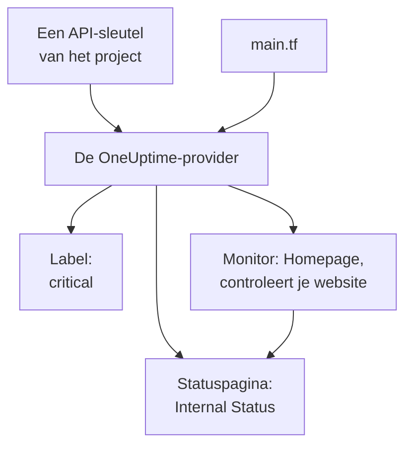

# Snelle start

Deze handleiding brengt je in ongeveer tien minuten van niets naar een OneUptime-project dat door Terraform wordt beheerd. Je maakt een API-sleutel aan, richt Terraform op je project en past een label toe, een monitor die je website controleert en een privé statuspagina die hem toont. Daarna wijzig je er een en ruim je op.

:::cards
- [Voordat je begint](#voordat-je-begint): Terraform, een project en een abonnement met API-sleutels.
- [Je eerste resources maken](#je-eerste-resources-maken): Van een API-sleutel naar een toegepast plan, in zes stappen.
- [Een resource wijzigen](#een-resource-wijzigen): Bewerk de configuratie, plan en pas toe.
- [Probleemoplossing](#probleemoplossing): De fouten waarop een eerste uitvoering kan stoppen.
:::



## Voordat je begint

- **Terraform 1.5 of hoger, of OpenTofu 1.6 of hoger.** Voer met OpenTofu `tofu` uit overal waar deze handleiding `terraform` uitvoert.
- **Een OneUptime-project** op [oneuptime.com](https://oneuptime.com) of op je eigen OneUptime, waarin je API-sleutels kunt aanmaken.
- **Op OneUptime Cloud het Growth-abonnement of hoger.** De API-sleutels van een project werken alleen daarmee.

## Je eerste resources maken

:::steps
### Een API-sleutel voor het project aanmaken

Open in het OneUptime-dashboard **Projectinstellingen → Geavanceerd → API-sleutels** en klik op **API-sleutel aanmaken**. Geef hem een **Naam**, zoals `terraform`, en kies onder **Toegang** voor **Projectbeheerder**: Terraform maakt, leest, wijzigt en verwijdert elk soort record dat het beheert, en **Projectbeheerder** mag dat allemaal. Kies voor een beperktere sleutel **Machtigingen later kiezen** en voeg op de pagina van de sleutel alleen de machtigingen toe die je nodig hebt.

De sleutel verloopt over een jaar. Om een andere datum te kiezen, open je **Meer velden** voordat je hem aanmaakt, of wijzig je de datum later op de pagina van de sleutel. Zodra de sleutel is aangemaakt, opent zijn pagina: kopieer de **API-sleutel** uit de kaart **API-sleuteldetails**.

### De sleutel beschikbaar maken voor Terraform

Zet de sleutel in de omgevingsvariabele `ONEUPTIME_API_KEY` van de shell waarin je Terraform uitvoert, zodat hij nooit in een bestand belandt:

:::tabs
@tab Linux
```bash
export ONEUPTIME_API_KEY="<your-api-key>"
```
@tab macOS
```bash
export ONEUPTIME_API_KEY="<your-api-key>"
```
@tab Windows
```powershell
$env:ONEUPTIME_API_KEY = "<your-api-key>"
```
:::

### Terraform op OneUptime richten

Maak een lege map, met daarin een bestand met de naam `main.tf`:

```hcl title="main.tf"
terraform {
  required_providers {
    oneuptime = {
      source  = "oneuptime/oneuptime"
      version = "{{TERRAFORM_PROVIDER_VERSION}}"
    }
  }
}

provider "oneuptime" {
  # The API key comes from ONEUPTIME_API_KEY.
  # On a self-hosted OneUptime, add your OneUptime's address:
  # oneuptime_url = "https://oneuptime.example.com"
}
```

Lees op een zelf gehoste OneUptime eerst [Zelf gehoste installatie](/docs/terraform/self-hosted) voordat je een providerversie kiest.

### Je resources beschrijven

Voeg deze blokken toe aan `main.tf`. Ze lezen twee van de monitorstatussen waarmee elk project begint, en maken een label, een monitor die `https://example.com` elke vijf minuten controleert (zet daar je eigen website neer) en een privé statuspagina die de monitor toont:

```hcl title="main.tf"
data "oneuptime_monitor_status" "operational" {
  name = "Operational"
}

data "oneuptime_monitor_status" "offline" {
  name = "Offline"
}

resource "oneuptime_label" "critical" {
  name        = "critical"
  description = "Resources that page on-call when down"
  color       = "#FF5733"
}

resource "oneuptime_monitor" "homepage" {
  name                = "Homepage"
  description         = "Checks that the homepage responds"
  monitor_type        = "Website"
  monitoring_interval = "*/5 * * * *"
  labels              = [oneuptime_label.critical.id]

  monitor_steps = [{
    monitor_destination      = "https://example.com"
    monitor_destination_type = "URL"
    request_type             = "GET"

    criteria = [
      {
        name                  = "Offline"
        description           = "The homepage does not respond"
        filter_condition      = "Any"
        change_monitor_status = true
        monitor_status_id     = data.oneuptime_monitor_status.offline.id

        filters = [
          {
            check_on    = "Is Online"
            filter_type = "False"
          }
        ]
      },
      {
        name                  = "Online"
        description           = "The homepage responds"
        filter_condition      = "All"
        change_monitor_status = true
        monitor_status_id     = data.oneuptime_monitor_status.operational.id

        filters = [
          {
            check_on    = "Is Online"
            filter_type = "True"
          }
        ]
      }
    ]
  }]
}

resource "oneuptime_status_page" "internal" {
  name                  = "Internal Status"
  description           = "Status of our internal services"
  page_title            = "Service Status"
  is_public_status_page = false
}

resource "oneuptime_status_page_resource" "homepage" {
  status_page_id = oneuptime_status_page.internal.id
  monitor_id     = oneuptime_monitor.homepage.id
  display_name   = "Homepage"
}

output "monitor_id" {
  value = oneuptime_monitor.homepage.id
}
```

De `monitor_steps` van de monitor zeggen wat hij controleert en wat elk resultaat betekent: na elke controle bepaalt het eerste criterium dat overeenkomt zijn status. [Monitorstappen](/docs/terraform/monitor-steps) legt elk onderdeel uit.

### Plannen en toepassen

:::tabs
@tab Terraform
```bash
terraform init
terraform plan
terraform apply
```
@tab OpenTofu
```bash
tofu init
tofu plan
tofu apply
```
:::

`init` downloadt de provider. Het plan eindigt met `Plan: 4 to add, 0 to change, 0 to destroy.` Typ `yes` om het toe te passen; als het klaar is, drukt Terraform de ID van de nieuwe monitor af.

### Het dashboard controleren

In het OneUptime-dashboard:

- **Monitoren** toont `Homepage`, met het label `critical`. De eerste controle komt binnen een paar minuten binnen.
- **Statuspagina's** toont `Internal Status`, die `Homepage` toont.
- **Projectinstellingen → Basis → Labels** toont `critical`, in de kleur die je hebt ingesteld.

Voer `terraform plan` opnieuw uit. Het antwoordt `No changes.`: OneUptime bevat precies wat de configuratie zegt.
:::

## Een resource wijzigen

Wijzig de configuratie, niet het dashboard. Zet de `color` van het label in `main.tf` op `"#2ECC71"`, en plan en pas dan toe:

```bash
terraform plan
terraform apply
```

Het plan eindigt met `Plan: 0 to add, 1 to change, 0 to destroy.`: het label wordt ter plekke gewijzigd. Een wijziging die iemand in het dashboard aanbrengt aan een resource die Terraform beheert, verschijnt in het volgende plan, en door het toe te passen komt terug wat de configuratie zegt.

## Opruimen

Als dit een proefrit was, verwijder dan wat de configuratie heeft gemaakt:

```bash
terraform destroy
```

Dit verwijdert het label, de monitor, de statuspagina en de resource ervan. De twee monitorstatussen blijven: de data sources lezen ze alleen.

## Probleemoplossing

:::details Melding „Missing API Key”
De provider heeft geen API-sleutel gevonden. Exporteer `ONEUPTIME_API_KEY` in de shell waarin je Terraform uitvoert, of stel `api_key` in het provider-blok in, en voer de opdracht opnieuw uit.
:::

:::details Melding „the OneUptime API returned status 400: Invalid API Key”
De sleutel is verkeerd getypt, verlopen of verwijderd, of hij hoort bij een andere OneUptime dan die waar `oneuptime_url` naar wijst. Kopieer de sleutel opnieuw van zijn pagina, of maak een nieuwe aan.
:::

:::details Melding „the OneUptime API returned status 402: API keys need the Growth plan”
Op OneUptime Cloud werken de API-sleutels van een project alleen met het Growth-abonnement of hoger. Upgrade het project in **Projectinstellingen → Facturering en facturen → Facturering**, en dezelfde sleutel werkt weer.
:::

:::details Melding „the OneUptime API returned status 422: You do not have permissions to create Monitor”
De sleutel heeft geen machtiging voor dat soort record. Geef hem op de pagina van de sleutel **Projectbeheerder**, of de machtiging die de melding noemt.
:::

:::details Melding „No monitor status matches {name = "Offline"}”
De monitorstatussen van je project hebben andere namen. Gebruik de namen die je ziet in **Monitoren → Instellingen → Monitorstatus**, of zoek de status in plaats daarvan op met `is_offline_state = true`.
:::

## Volgende stappen

:::cards
- [Volledige handleiding](/docs/terraform/complete-guide): Authenticatie, projectindeling, data sources, state en upgrades.
- [Monitorstappen](/docs/terraform/monitor-steps): Bepaal wat een monitor controleert en wat elk resultaat betekent.
- [Voorbeelden](/docs/terraform/examples): Kant-en-klare configuraties voor de gangbare resources.
- [Resources importeren](/docs/terraform/importing-resources): Breng wat je in het dashboard hebt gemaakt onder Terraform.
:::
