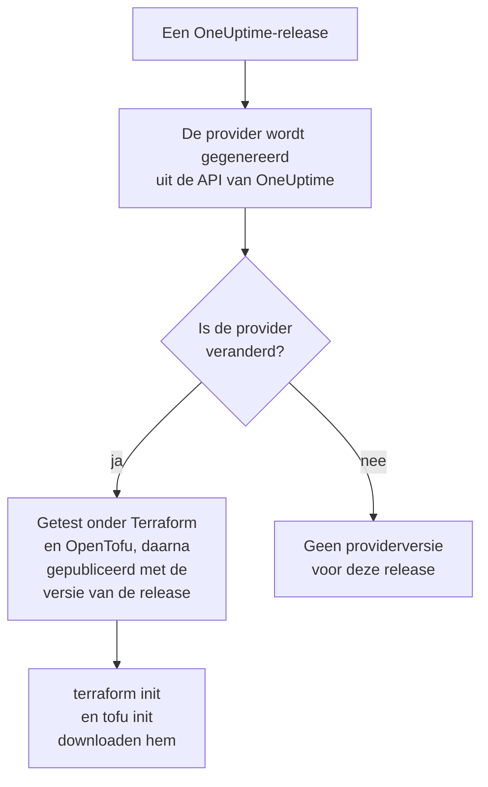

# Registergebruik

De OneUptime-provider wordt gepubliceerd in het [Terraform Registry](https://registry.terraform.io/providers/oneuptime/oneuptime) en het [OpenTofu Registry](https://search.opentofu.org/provider/oneuptime/oneuptime/latest). `terraform init` en `tofu init` downloaden hem daarvandaan: er is niets met de hand te installeren. Deze pagina behandelt wat er wordt gepubliceerd, hoe versies worden genummerd, en hoe je naar een nieuwere overstapt.

:::cards
- [Wat er wordt gepubliceerd](#wat-er-wordt-gepubliceerd): De provider voor elk platform, zijn referentie en zijn versies.
- [Hoe versies worden genummerd](#hoe-versies-worden-genummerd): De versie van een provider is de OneUptime-release die hem publiceerde.
- [Het lockbestand](#het-lockbestand): De versie en checksums die elke machine installeert.
- [Naar een nieuwere versie overstappen](#naar-een-nieuwere-versie-overstappen): Lees wat er veranderde, download haar en plan.
:::

## Wat er wordt gepubliceerd

Elke OneUptime-release genereert de provider uit de eigen API van OneUptime. Wanneer de provider veranderde, publiceert de release hem, onder de versie van de release, zodra hij zijn end-to-endtests onder Terraform en onder OpenTofu heeft doorstaan:



| Wat | Waar |
| --- | --- |
| De provider, voor Linux, macOS, Windows, FreeBSD, OpenBSD en Solaris | Gedownload door `terraform init` en `tofu init`, met checksums die OneUptime ondertekent |
| De referentie van elke resource en data source, met elk van hun attributen | De documentatie van het register, gegroepeerd per product: monitoren, statuspagina's, incidenten, on-call en de andere |
| Een handleiding voor het gebruik van de provider met OpenTofu | De handleidingen van het register |
| Elke versie, de nieuwste eerst | De versielijst van het register |

De referentie zegt wat elk attribuut is. Deze documentatie laat zien hoe je ze samen gebruikt: begin bij [Terraform – Overzicht](/docs/terraform/index).

## Hoe versies worden genummerd

De versie van een provider is de versie van de OneUptime-release die hem publiceerde: provider {{TERRAFORM_PROVIDER_MAJOR}}.0.20 kwam met OneUptime {{TERRAFORM_PROVIDER_MAJOR}}.0.20. Een release waarvan de provider niet veranderde, publiceert er geen, dus de versies hebben gaten, en een beperking die één exacte versie noemt, kan een versie noemen die niet bestaat. Schrijf in plaats daarvan een bereik:

| Je gebruikt | Beperking | Terraform installeert |
| --- | --- | --- |
| OneUptime Cloud | `{{TERRAFORM_PROVIDER_VERSION}}` | De nieuwste {{TERRAFORM_PROVIDER_MAJOR}}.x-provider |
| Een zelf gehoste OneUptime | Een bereik dat eindigt bij de versie van je OneUptime, zoals `>= {{TERRAFORM_PROVIDER_MAJOR}}.0, <= {{TERRAFORM_PROVIDER_MAJOR}}.0.40` | De nieuwste provider die niet nieuwer is dan je OneUptime |

Op een zelf gehoste OneUptime kan een provider die nieuwer is dan je OneUptime instellingen sturen die je OneUptime nog niet heeft: [Zelf gehoste installatie](/docs/terraform/self-hosted#de-providerversie-kiezen) laat zien hoe je het bereik ervan schrijft.

```hcl title="main.tf"
terraform {
  required_providers {
    oneuptime = {
      source  = "oneuptime/oneuptime"
      version = "{{TERRAFORM_PROVIDER_VERSION}}"
    }
  }
}
```

Het bronadres noemt geen register: Terraform leest het uit het Terraform Registry, en OpenTofu uit het OpenTofu Registry, die dezelfde versies publiceren.

## Het lockbestand

`terraform init` legt de versie die het koos, en de checksums van zijn downloads, vast in `.terraform.lock.hcl`. Commit dat bestand: elke machine en elke CI-run installeert dan precies die versie, tot je een andere kiest. De checksums dekken elk platform dat het register publiceert, dus één lockbestand werkt voor Linux-, macOS- en Windows-machines tegelijk.

```hcl title=".terraform.lock.hcl"
provider "registry.terraform.io/oneuptime/oneuptime" {
  version     = "{{TERRAFORM_PROVIDER_MAJOR}}.0.20"
  constraints = "{{TERRAFORM_PROVIDER_VERSION}}"
  hashes = [
    "h1:...",
    "zh:...",
  ]
}
```

Het lockbestand noemt het register. OpenTofu schrijft `registry.opentofu.org/oneuptime/oneuptime` waar Terraform `registry.terraform.io/oneuptime/oneuptime` schrijft, dus van engine wisselen wijzigt het lockbestand: `init` vervangt de vermelding, en vraagt je de wijziging te committen.

## Naar een nieuwere versie overstappen

:::steps
### Lezen wat er veranderde

[De releases van OneUptime](https://github.com/OneUptime/oneuptime/releases) zeggen wat elke release veranderde, de provider inbegrepen. [De releases van de provider](https://github.com/OneUptime/terraform-provider-oneuptime/releases) linken naar de wijzigingen sinds de vorige.

### Haar downloaden

```bash
terraform init -upgrade
```

`init -upgrade` neemt de nieuwste versie die je beperking toestaat, toont die en werkt `.terraform.lock.hcl` bij. De beperking `{{TERRAFORM_PROVIDER_VERSION}}` neemt elke {{TERRAFORM_PROVIDER_MAJOR}}.x-release; een nieuwe hoofdversie vraagt een nieuwe beperking.

### Plannen voordat je toepast

Voer `terraform plan` uit, en pas alleen toe wanneer het leeg is of de wijzigingen toont die je verwacht. Commit het bijgewerkte lockbestand.
:::

Upgrade op een zelf gehoste OneUptime eerst OneUptime, en verhoog daarna het einde van het bereik van de provider.

## Waar de code staat

De provider wordt gegenereerd uit de OneUptime-API in de [hoofdrepository van OneUptime](https://github.com/OneUptime/oneuptime), en elke versie wordt gebouwd vanuit de release die hem publiceerde. Zijn eigen repository, [OneUptime/terraform-provider-oneuptime](https://github.com/OneUptime/terraform-provider-oneuptime), bevat wat de generator schreef, dus wijzigingen gebeuren in de hoofdrepository: meld problemen, ook die in de documentatie, op [github.com/OneUptime/oneuptime/issues](https://github.com/OneUptime/oneuptime/issues).

## Volgende stappen

:::cards
- [Zelf gehoste installatie](/docs/terraform/self-hosted): Het versiebereik voor je eigen OneUptime, en een mirror voor offline machines.
- [OpenTofu](/docs/terraform/opentofu): Dezelfde provider en configuratie, met `tofu`.
- [Volledige handleiding](/docs/terraform/complete-guide): Authenticatie, projectindeling, data sources, state en upgrades.
- [Probleemoplossing](/docs/terraform/troubleshooting): Veelvoorkomende fouten en hoe je ze oplost.
:::
