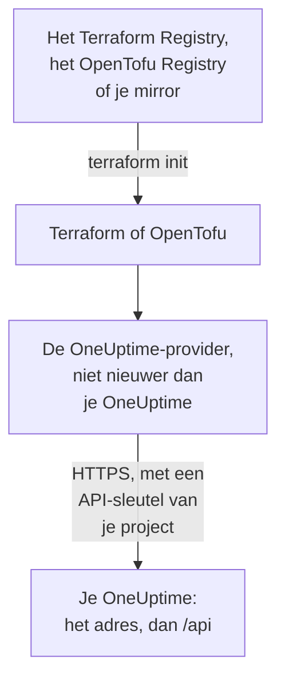

# Zelf gehoste installatie

De provider werkt met je eigen OneUptime zoals hij met OneUptime Cloud werkt: dezelfde resources, dezelfde attributen en dezelfde API-sleutels van het project. Wat jij instelt: het adres van je OneUptime, de providerversie die erbij past, en waar je ze nodig hebt, een mirror voor machines zonder internettoegang en vertrouwen in een privécertificaatautoriteit.

:::cards
- [De provider naar je OneUptime laten wijzen](#de-provider-naar-je-oneuptime-laten-wijzen): Het adres ervan, en een API-sleutel van je project.
- [De providerversie kiezen](#de-providerversie-kiezen): De nieuwste provider die niet nieuwer is dan je OneUptime.
- [Zonder internettoegang](#zonder-internettoegang): Spiegel de provider naar je netwerk.
- [TLS en certificaten](#tls-en-certificaten): Een privécertificaatautoriteit, proxy's en gewone HTTP.
:::



## De provider naar je OneUptime laten wijzen

Stel `oneuptime_url` in op het adres waarop je het dashboard opent: het schema en de host, zonder pad. De provider voegt `https://` toe wanneer het adres geen schema heeft, en `/api` aan het eind, dus `https://oneuptime.example.com` stuurt elk verzoek naar `https://oneuptime.example.com/api`.

```hcl title="main.tf"
terraform {
  required_providers {
    oneuptime = {
      source  = "oneuptime/oneuptime"
      version = "{{TERRAFORM_PROVIDER_MATCHING}}"
    }
  }
}

provider "oneuptime" {
  oneuptime_url = "https://oneuptime.example.com"
  # The API key comes from the ONEUPTIME_API_KEY environment variable.
}
```

Het adres kan in plaats daarvan uit de omgevingsvariabele `ONEUPTIME_URL` komen, zodat één configuratie naar meerdere installaties kan wijzen:

```bash
export ONEUPTIME_URL="https://oneuptime.example.com"
export ONEUPTIME_API_KEY="<your-api-key>"
```

Het adres is de host waarop je installatie wordt geserveerd: `HOST` en `HTTP_PROTOCOL` in `config.env` met Docker Compose, en `host` en `httpProtocol` in de values van de Helm-chart.

De sleutel is een API-sleutel van het project dat je beheert, aangemaakt in het dashboard van je OneUptime onder **Projectinstellingen → Geavanceerd → API-sleutels**, net als op OneUptime Cloud. De master-API-sleutel van een zelf gehoste OneUptime hoort bij geen enkel project, dus een aanmaak met die sleutel mislukt met `ProjectId required`.

> [!TIP]
> Je OneUptime schrijft dit blok voor je. Open een willekeurige resource of lijst in het dashboard, en daarna **Ontwikkelaars** en **Terraform** in het zijmenu: het provider-blok dat het toont, heeft het adres van je OneUptime, en een versiebereik dat erbij past.

## De providerversie kiezen

Gebruik de nieuwste gepubliceerde provider die niet nieuwer is dan je OneUptime. Providerversies volgen die van OneUptime: een OneUptime-release die de provider wijzigt, publiceert hem onder het eigen versienummer van de release, en een provider die nieuwer is dan je OneUptime, kan instellingen sturen die je OneUptime nog niet heeft.

Schrijf dus een bereik dat eindigt bij de versie van je OneUptime, zoals het dashboard doet. Het blok hierboven neemt `{{TERRAFORM_PROVIDER_MATCHING}}`, het bereik voor de OneUptime waar deze documentatie vandaan komt: wanneer je ze op je eigen OneUptime leest, is dat bereik het jouwe. Schrijf anders je eigen versie in:

:::steps
### De versie van je OneUptime opzoeken

Vraag het aan je OneUptime:

```bash
curl https://oneuptime.example.com/version
```

Het antwoord is JSON, zoals `{"version":"{{TERRAFORM_PROVIDER_MAJOR}}.0.40","commit":"..."}`. Als hoofdbeheerder kun je ook het editielabel in de kop van het Admin-dashboard openen: zie [Je huidige versie opzoeken](/docs/installation/upgrading#zoek-uw-huidige-versie-op).

### Je versie in het bereik schrijven

Het bereik begint bij de hoofdversie en eindigt bij de jouwe. Voor een OneUptime {{TERRAFORM_PROVIDER_MAJOR}}.0.40:

```hcl title="main.tf"
terraform {
  required_providers {
    oneuptime = {
      source  = "oneuptime/oneuptime"
      version = ">= {{TERRAFORM_PROVIDER_MAJOR}}.0, <= {{TERRAFORM_PROVIDER_MAJOR}}.0.40"
    }
  }
}
```

Terraform neemt de nieuwste provider in het bereik. Een OneUptime-release die de provider niet wijzigde, publiceert er geen, en het bereik slaat de versies over die niet bestaan.

### De provider downloaden

Voer `terraform init` uit. Het toont de versie die het installeerde en legt die vast in `.terraform.lock.hcl`.
:::

Upgrade bij een upgrade eerst OneUptime. Verhoog daarna het einde van het bereik naar de nieuwe versie, en voer `terraform init -upgrade` uit.

## Zonder internettoegang

Wanneer de machines die Terraform uitvoeren het register niet kunnen bereiken, kopieer je de provider één keer naar je netwerk, en laat je Terraform naar de kopie wijzen.

:::steps
### De provider spiegelen

Download op een machine met internettoegang, in een map met je configuratie, de provider voor elk platform waarop je machines draaien. Zonder `-platform` downloadt de opdracht de provider alleen voor zijn eigen platform:

:::tabs
@tab Terraform
```bash
terraform providers mirror -platform=linux_amd64 -platform=darwin_arm64 /srv/terraform-mirror
```
@tab OpenTofu
```bash
tofu providers mirror -platform=linux_amd64 -platform=darwin_arm64 /srv/terraform-mirror
```
:::

De map bevat de provider onder het adres van het register, zoals `registry.terraform.io/oneuptime/oneuptime/`. Kopieer hem naar je netwerk.

### Terraform naar de mirror laten wijzen

Schrijf een CLI-configuratiebestand dat de OneUptime-provider uit de map installeert, en al het andere zoals gewoonlijk:

:::tabs
@tab Terraform
```hcl title="mirror.tfrc"
provider_installation {
  filesystem_mirror {
    path    = "/srv/terraform-mirror"
    include = ["registry.terraform.io/oneuptime/oneuptime"]
  }
  direct {
    exclude = ["registry.terraform.io/oneuptime/oneuptime"]
  }
}
```
@tab OpenTofu
```hcl title="mirror.tfrc"
provider_installation {
  filesystem_mirror {
    path    = "/srv/terraform-mirror"
    include = ["registry.opentofu.org/oneuptime/oneuptime"]
  }
  direct {
    exclude = ["registry.opentofu.org/oneuptime/oneuptime"]
  }
}
```
:::

Noem het in `TF_CLI_CONFIG_FILE`, dat zowel Terraform als OpenTofu leest: `export TF_CLI_CONFIG_FILE=/etc/terraform/mirror.tfrc`.

### Initialiseren

Voer `terraform init` uit: het installeert de provider uit de mirror. Het waarschuwt dat het lockbestand nu alleen checksums voor dit platform heeft. Om ze voor elk platform vast te leggen, voer je `terraform providers lock` uit met dezelfde `-platform`-opties op de machine met internettoegang, en commit je `.terraform.lock.hcl` met je configuratie.
:::

Spiegel opnieuw telkens wanneer je het versiebereik verhoogt.

## TLS en certificaten

De provider controleert het certificaat van je OneUptime tegen de vertrouwensopslag van de machine die Terraform uitvoert, en er is geen instelling om de controle over te slaan. Wanneer het certificaat van een privécertificaatautoriteit komt, voeg je die autoriteit toe aan de vertrouwensopslag van elke machine en CI-runner die Terraform uitvoert:

:::tabs
@tab Debian / Ubuntu
```bash
sudo cp my-ca.crt /usr/local/share/ca-certificates/
sudo update-ca-certificates
```
@tab RHEL / Fedora
```bash
sudo cp my-ca.crt /etc/pki/ca-trust/source/anchors/
sudo update-ca-trust
```
:::

Op Linux, waar je de vertrouwensopslag niet kunt wijzigen, zoals in een CI-container, stel je `SSL_CERT_FILE` in op een bestand dat je autoriteit en de openbare autoriteiten bevat. Op macOS en Windows voeg je de autoriteit toe aan de certificaatopslag van het systeem.

- **Proxy's.** De provider stuurt zijn verzoeken via de proxy in `HTTPS_PROXY`, behalve naar de hosts in `NO_PROXY`. Een reverse proxy voor OneUptime moet elk `/api`-pad en de header `APIKey` ongewijzigd doorlaten.
- **Gewone HTTP.** Een `http://`-adres werkt, voor een testinstallatie. De API-sleutel reist met elk verzoek mee, dus gebruik HTTPS voor al het andere.

## Probleemoplossing

:::details Melding „x509: certificate signed by unknown authority”
De machine die Terraform uitvoert, vertrouwt het certificaat van je OneUptime niet: voeg je certificaatautoriteit toe zoals [TLS en certificaten](#tls-en-certificaten) laat zien.
:::

:::details Melding „invalid character '<' looking for beginning of value”
Een webpagina antwoordde in plaats van de API: `oneuptime_url` bevat een pad, of een proxy antwoordde. Stel het in op alleen het adres van je OneUptime.
:::

:::details Melding „no available releases match the given constraints”
Geen gepubliceerde provider past bij de versiebeperking, bijvoorbeeld een beperking die één versie noemt die OneUptime nooit heeft gepubliceerd. Schrijf een bereik, zoals [De providerversie kiezen](#de-providerversie-kiezen) laat zien.
:::

:::details Melding „ProjectId required”
De sleutel is de master-API-sleutel, die bij geen enkel project hoort. Maak een API-sleutel van het project aan, onder **Projectinstellingen → Geavanceerd → API-sleutels**.
:::

[Probleemoplossing](/docs/terraform/troubleshooting) bevat de andere fouten, en wat elke fout betekent.

## Volgende stappen

:::cards
- [Snelle start](/docs/terraform/quick-start): Maak een API-sleutel aan en pas je eerste resources toe.
- [Registergebruik](/docs/terraform/registry): Waar de provider wordt gepubliceerd, en hoe versies worden genummerd.
- [Probleemoplossing](/docs/terraform/troubleshooting): Veelvoorkomende fouten en hoe je ze oplost.
- [Upgraden](/docs/installation/upgrading): Upgrade je OneUptime, voordat je het bereik van de provider verhoogt.
:::
