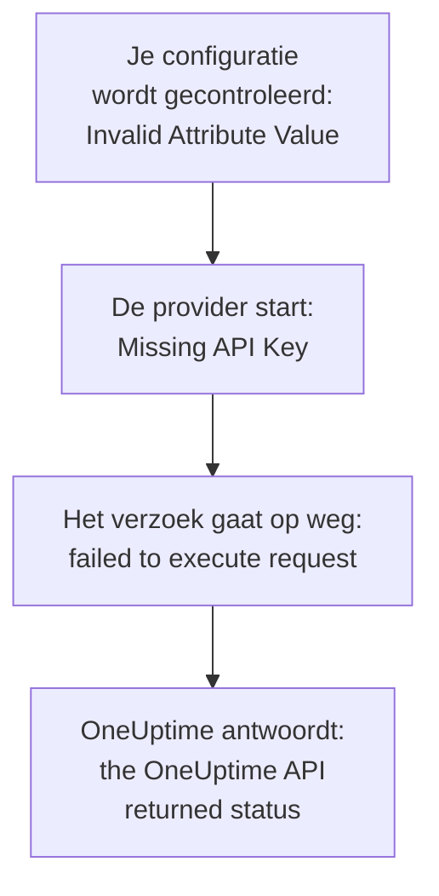

# Probleemoplossing

Zoek in de tabel hieronder de melding op die Terraform toonde, of wat je zag gebeuren: elke rij leidt naar de oplossing. De secties na de tabel leggen elke fout uit, gegroepeerd naar waar ze vandaan komt.

:::cards
- [Je fout vinden](#je-fout-vinden): Elke melding en elk symptoom op deze pagina, met de oplossing.
- [API-sleutels, machtigingen en abonnementen](#api-sleutels-machtigingen-en-abonnementen): Wanneer OneUptime de sleutel van de provider weigert.
- [Plannen die niet tot rust komen](#plannen-die-niet-tot-rust-komen): Wijzigingen die terugkomen, en resources die de state verlaten.
- [Verbinden met een zelf gehoste OneUptime](#verbinden-met-een-zelf-gehoste-oneuptime): Het adres, certificaten en proxy's.
:::

## Je fout vinden

| Melding of symptoom | Wat te doen |
| --- | --- |
| `Missing API Key` | Geef de provider zijn sleutel: zie [`Missing API Key` of `Invalid API Key`](#missing-api-key-of-invalid-api-key) |
| `Invalid API Key` | Kopieer de sleutel opnieuw, of maak een nieuwe aan: zie [`Missing API Key` of `Invalid API Key`](#missing-api-key-of-invalid-api-key) |
| `ProjectId required` | Gebruik een API-sleutel van het project, geen mastersleutel: zie [`ProjectId required`](#projectid-required) |
| `You do not have permissions to create Monitor` | Geef de sleutel de machtiging die de melding noemt: zie [De sleutel mist een machtiging](#de-sleutel-mist-een-machtiging) |
| `API keys need the Growth plan` | Zet het project terug op het Growth-abonnement: zie [Betaling vereist](#betaling-vereist) |
| `402` voor één resource of één instelling | Upgrade het abonnement, of laat de instelling op de standaardwaarde: zie [Betaling vereist](#betaling-vereist) |
| `This project has been blocked` | Vraag een hoofdbeheerder om het project te deblokkeren: zie [Een geblokkeerd project](#een-geblokkeerd-project) |
| `references records that are not in this project` | Gebruik het ID van een record van je eigen project: zie [ID's van een ander project](#ids-van-een-ander-project) |
| `Not Found` of `Ambiguous Match` van een data source | Corrigeer de argumenten van de zoekopdracht: zie [Zoekopdrachten die niets of meerdere vinden](#zoekopdrachten-die-niets-of-meerdere-vinden) |
| `Cannot import non-existent remote object` | Controleer het ID en de machtigingen van de sleutel: zie [Resources importeren](/docs/terraform/importing-resources#probleemoplossing) |
| `Provider produced inconsistent result after apply` | Upgrade de provider: zie [Inconsistent resultaat na apply](#inconsistent-resultaat-na-apply) |
| Een plan maakt een resource aan die je niet hebt toegevoegd | De sleutel kan hem niet meer lezen, en OneUptime antwoordde `404`: geef de sleutel zijn leestoegang terug, en importeer de resource daarna met `terraform import`: zie [Een resource verlaat de state, en de volgende apply maakt hem opnieuw aan](#een-resource-verlaat-de-state-en-de-volgende-apply-maakt-hem-opnieuw-aan) |
| Een `priority` of `order` verandert na apply | Geef elk een nummer dat niemand anders heeft: zie [Een prioriteit of volgorde die verschuift](#een-prioriteit-of-volgorde-die-verschuift) |
| `Invalid Configuration for Read-Only Attribute` | Haal het attribuut uit de configuratie: zie [Alleen-lezen attributen](#alleen-lezen-attributen) |
| `has been renamed to` | Hernoem het resourcetype, met een `moved`-blok: zie [Een hernoemd resourcetype](#een-hernoemd-resourcetype) |
| Een monitor die met Terraform is gemaakt, toont nooit zijn controles | Upgrade OneUptime: zie [Monitoren van vóór stap-ID's](#monitoren-van-vóór-stap-ids) |
| `must contain at least 1 elements` | Laat het attribuut weg in plaats van het leeg te laten: zie [Lege waarden](#lege-waarden) |
| JSON uit het dashboard in een `.tf`-bestand | Schrijf het als HCL: zie [JSON uit het dashboard](#json-uit-het-dashboard) |
| `no available releases match the given constraints` | Gebruik een versiebereik, niet één exacte versie: zie [Een versie die nooit is gepubliceerd](#een-versie-die-nooit-is-gepubliceerd) |
| `x509: certificate signed by unknown authority` | Vertrouw je certificaatautoriteit: zie [Certificaten](#certificaten) |
| `invalid character '<' looking for beginning of value` | Laat `oneuptime_url` naar je OneUptime zelf wijzen: zie [Een webpagina in plaats van de API](#een-webpagina-in-plaats-van-de-api) |
| `connection refused` of `Client.Timeout exceeded` | Controleer het adres, het netwerk en een eventuele proxy: zie [Verbindingen die mislukken](#verbindingen-die-mislukken) |

## Een fout lezen

Een fout noemt de stap die mislukte, en de melding zegt waar ze vandaan komt:



- Een fout die vóór elk verzoek komt, zoals `Invalid Attribute Value`, gaat over je configuratie: de provider controleert die voordat hij met OneUptime praat.
- `failed to execute request` betekent dat het verzoek nooit antwoord kreeg: zie [Verbinden met een zelf gehoste OneUptime](#verbinden-met-een-zelf-gehoste-oneuptime).
- `the OneUptime API returned status` is het antwoord van OneUptime: de status en de melding erna zeggen wat OneUptime weigerde.

De provider noemt wat hij aan het doen was: `Unable to create monitor` en `Unable to update monitor` voor een wijziging, en `Unable to parse label response` wanneer hij een resource leest. Een lezing die OneUptime weigert, wordt gemeld met de samenvatting `Parse Error`, maar de melding erna is het antwoord van OneUptime, geen probleem met het verwerken.

## API-sleutels, machtigingen en abonnementen

### `Missing API Key` of `Invalid API Key`

`Missing API Key` stopt de provider voordat hij een verzoek doet: noch `api_key` in het provider-blok, noch de omgevingsvariabele `ONEUPTIME_API_KEY` is ingesteld. Exporteer de variabele in de shell waarin je Terraform uitvoert, of geef de sleutel mee in een variabele die als `sensitive` is gemarkeerd.

`Invalid API Key` is het antwoord van OneUptime op een sleutel die het niet kent: een verkeerd getypte, verlopen of verwijderde sleutel, of een sleutel van een andere OneUptime dan die waar `oneuptime_url` naar wijst. Kopieer de sleutel opnieuw van zijn pagina onder **Projectinstellingen → Geavanceerd → API-sleutels**, of maak een nieuwe aan.

### `ProjectId required`

De provider heeft een API-sleutel nodig van het project dat hij beheert: daar komt het project vandaan. De master-API-sleutel van een zelf gehoste OneUptime hoort bij geen enkel project, dus elke aanmaak met die sleutel mislukt met `ProjectId required`. Maak een API-sleutel van het project aan, zoals in [Een API-sleutel voor het project aanmaken](/docs/terraform/quick-start#een-api-sleutel-voor-het-project-aanmaken), en gebruik die in plaats daarvan.

### De sleutel mist een machtiging

`You do not have permissions to create Monitor` en soortgelijke meldingen komen met status `422`: de sleutel mag dat niet doen met dat soort record. Ze noemen de machtigingen die het zouden toestaan. Open de pagina van de sleutel onder **Projectinstellingen → Geavanceerd → API-sleutels** en geef hem er een van, of **Projectbeheerder**. Een import heeft alleen de machtiging om te lezen nodig.

### Betaling vereist

- **402 Payment Required bij elk verzoek** — `API keys need the Growth plan...`: op OneUptime Cloud zit het project onder **Growth**, en de API-sleutels van een project - die van de provider inbegrepen - werken daaronder niet meer. Elke aanroep van de provider wordt geweigerd, ook `terraform plan`, tot het project weer op Growth zit; dan werkt dezelfde sleutel weer, zonder dat je iets in je configuratie hoeft te wijzigen. Upgrade in **Projectinstellingen → Facturering en facturen → Facturering**, of beheer het project intussen in het dashboard. Zie [API-sleutels en SCIM onder hun abonnement](/docs/api-reference/api-reference#api-sleutels-en-scim-onder-hun-abonnement).
- **402 Payment Required** — je hebt een limiet van je OneUptime-abonnement bereikt, of de configuratie zet een instelling aan die je abonnement niet bevat (een privéstatuspagina, e-mailrapporten, een openbaar dashboard, een IP-toegangslijst...), of `terraform apply` de resource er nu mee aanmaakt of hem later wijzigt. Terraform toont de melding van OneUptime zoals die is. Upgrade het abonnement, of beperk de configuratie.

Zo'n instelling terugzetten naar de standaardwaarde, waarmee de functie uitgaat, werkt met elk abonnement, dus een configuratie die betaalde functies uitzet, wordt toegepast nadat een proefperiode afloopt of het abonnement omlaag gaat.

Hetzelfde geldt voor de resources die je abonnement verkoopt en die een project houdt nadat het omlaag gaat - SSO-providers, SCIM-verbindingen, API-sleutels, bereikbaarheidsroosters, en regels en samenvattingen voor Slack en Microsoft Teams: onder het abonnement (zolang het project nog op Growth zit, wat de eigen API-sleutel van de provider nodig heeft) kunnen de exemplaren die het project al heeft nog worden gelezen (dus `terraform plan` en `import` werken), verwijderd (dus ze uit de configuratie halen, of `terraform destroy`, wordt toegepast), en uitgezet waar ze een attribuut `is_enabled` hebben. Ze aanmaken, wijzigen of weer aanzetten antwoordt nog steeds 402.

Andere resources die je abonnement verkoopt, zoals sjablonen, aangepaste velden en monitorgroepen, hebben het abonnement nog steeds nodig om gelezen te worden, dus een plan dat ze ververst, antwoordt 402; ze kunnen wel nog worden verwijderd, bijvoorbeeld met `terraform destroy -refresh=false`.

De machtigingen van een API-sleutel worden onder Growth niet één voor één verwijderd, omdat het verwijderen van een blokkerende machtiging de sleutel meer toegang zou geven: voer `terraform state rm` uit op de machtigingsresources, vernietig daarna de sleutel, en zijn machtigingen gaan mee.

### Een geblokkeerd project

`This project has been blocked. Please contact your administrator.` komt met status `403`: een hoofdbeheerder heeft het project geblokkeerd, en tot die het deblokkeert, handelt niemand anders dan een hoofdbeheerder erin, ook de API-sleutels van het project niet.

## Records en zoekopdrachten

### ID's van een ander project

Elk ID dat een resource noemt - de labels van een monitor, de statuspagina van een statuspaginagroep, de site van een netwerkapparaat, de teams van een escalatieregel - moet een record zijn van het project waartoe je API-sleutel behoort. Een ID van een record van een ander project, een ID dat niet bestaat en een ID van een record dat de sleutel niet mag lezen, krijgen allemaal hetzelfde antwoord, dat het veld en het ID noemt:

```text
This network device references records that are not in this project: Network Site "…". Please pick values from this project and try again.
```

Meestal betekent het dat een ID is gekopieerd uit de configuratie of state van een ander project, of dat het record buiten Terraform is verwijderd. Verwijs naar het record via zijn resource of een data source in dezelfde configuratie (`oneuptime_label.critical.id`) in plaats van een letterlijk ID, en pas opnieuw toe. Iemand die als gebruiker wordt genoemd, moet lid zijn van het project.

### Zoekopdrachten die niets of meerdere vinden

Een data source vindt precies één record, of stopt het plan. `Not Found` zegt dat geen enkel record het `id` heeft, of dat geen enkel record overeenkomt met de argumenten die je hebt ingesteld; `Ambiguous Match` zegt dat er meerdere overeenkomen. Corrigeer de argumenten, stel er meer in om de zoekopdracht tot één te beperken, of zoek het record op via `id`. [Lezen wat al bestaat](/docs/terraform/complete-guide#lezen-wat-al-bestaat) geeft de regels.

## Plannen die niet tot rust komen

### Inconsistent resultaat na apply

`Provider produced inconsistent result after apply` betekent dat de provider andere waarden teruggaf dan hij had gepland. Oudere providers deden dat met waarden die de server berekent: standaardwaarden die de server toevoegt binnen `monitor_steps`, tijdstempels die de server anders schreef, ingepakte waarden zoals `probe_version`, en attributen die de server bijwerkt, zoals wanneer een monitor voor inkomende verzoeken zijn laatste heartbeat ontving. Ze lazen ook een decimaal getal als null wanneer de API het als tekst stuurde, waardoor elke apply van een kleurregel voor statuspaginabalken mislukte op `uptime_percent_greater_than_or_equal_to`. Huidige providers handelen dit allemaal af: tijdstempels worden vergeleken als tijdstippen, lijsten van labels zijn sets, getallen worden teruggelezen zoals je ze schreef, en een attribuut dat je niet hebt ingesteld, houdt zijn geplande waarde tot de volgende refresh die van de server leest.

:::steps
1. Upgrade de provider: houd `version = "{{TERRAFORM_PROVIDER_VERSION}}"` in de providervereiste, en voer `terraform init -upgrade` uit.
2. Pas opnieuw toe. Een resource die de mislukte apply als tainted achterliet, wordt één keer vervangen, en daarna zijn de plannen leeg. Om de resource in plaats daarvan te houden zoals hij is, haal je eerst de markering weg via zijn adres: `terraform untaint oneuptime_status_page_history_chart_bar_color.operational`.
:::

Als een huidige provider nog steeds zo mislukt, meld het dan op [github.com/OneUptime/oneuptime/issues](https://github.com/OneUptime/oneuptime/issues), met de providerversie, het resourcetype, het kleinste `resource`-blok dat mislukt, en de volledige fout. De fout noemt het attribuut waarvan de waarde veranderde, en dat is het nuttigste om mee te sturen.

### Een resource verlaat de state, en de volgende apply maakt hem opnieuw aan

Een lezing via ID antwoordt `404` zowel voor een record dat niet bestaat als voor een record dat de API-sleutel niet mag lezen: de API zegt niets over een record dat ze je niet laat zien. Terraform houdt een `404` bij een refresh voor een resource die buiten Terraform is verwijderd. Het haalt de resource uit de state, en de volgende `terraform apply` maakt hem opnieuw aan, naast de resource die er nog is.

Dat gebeurt wanneer de sleutel die een resource beheert, hem niet meer kan lezen: zijn leesmachtiging is beperkt tot labels die de resource niet draagt, of tot de resources waarvan zijn teams eigenaar zijn, of een blokkering neemt de resource weg - of de labels of eigenaren van de resource zijn veranderd.

**Voordat je plant:**

- Geef de sleutel voor elk resourcetype dat hij beheert een leesmachtiging die elke resource bereikt die hij beheert: met bereik **Alle**, of beperkt tot labels die die resources dragen. De bewerk- en verwijdermachtigingen van een sleutel bereiken alleen wat hij mag lezen.
- Lees het plan voordat je het toepast: een resource die gepland staat om te worden aangemaakt en die je niet hebt toegevoegd, is er een die de sleutel niet meer kan lezen.

**Wanneer de state al een resource kwijt is:** geef de sleutel zijn leestoegang terug, en [importeer](/docs/terraform/importing-resources) daarna de resource in plaats van toe te passen, zodat Terraform de bestaande overneemt in plaats van een tweede aan te maken. Als er al een kopie is aangemaakt, verwijder dan degene die je niet wilt.

### Een prioriteit of volgorde die verschuift

Monitorstatussen, statussen en ernstniveaus van incidenten en waarschuwingen, en de andere lijsten die je in het dashboard op volgorde zet, bevatten elk nummer één keer. Een nummer dat niemand anders heeft, blijft zoals het geschreven is. Een nummer dat een ander al heeft, wordt overgenomen, en de items die in de weg staan, schuiven één plaats op, zoals slepen in het dashboard doet. Twee items die met hetzelfde nummer zijn geconfigureerd, wisselen dus bij elke apply van plaats.

Geef elk een eigen nummer met ruimte ertussen, zoals `101`, `102` en `103`, en orden de items die Terraform beheert opnieuw in Terraform, niet door ze in het dashboard te slepen.

### Alleen-lezen attributen

`Invalid Configuration for Read-Only Attribute` stopt het plan wanneer een configuratie een attribuut instelt dat alleen OneUptime schrijft. Wie een record heeft aangemaakt, en wie het heeft gearchiveerd, opgelost of bevestigd, wordt vastgelegd op basis van het verzoek: de persoon die is aangemeld, en niemand voor een verzoek met een API-sleutel, en zo meldt Terraform zich aan. Dus `created_by_user_id`, en elk ander attribuut dat eindigt op `_by_user_id`, kan worden gelezen uit een resource of een data source, maar niet worden ingesteld. Hetzelfde geldt voor `archived_at`: `is_archived` instellen legt vast wanneer de resource werd gearchiveerd, en het ongewijzigd opnieuw toepassen houdt dat tijdstip. Haal het attribuut uit het resource-blok; verder verandert er niets aan de resource.

### Een hernoemd resourcetype

`has been renamed to` waarschuwt dat een resourcetype een nieuwe naam heeft. Resourcetypes houden woorden als IoT en vCenter nu heel: `oneuptime_iot_fleet` en `oneuptime_vcenter`, waar oudere providers ze splitsten (`oneuptime_io_t_fleet`, `oneuptime_v_center`). De oude namen blijven werken als verouderde aliassen. Om over te stappen zonder iets te vervangen, hernoem je de resource in je configuratie en vertel je Terraform dat hij is verplaatst:

```hcl
resource "oneuptime_iot_fleet" "factory" {
  name = "Factory floor"
}

moved {
  from = oneuptime_io_t_fleet.factory
  to   = oneuptime_iot_fleet.factory
}
```

`terraform plan` toont dan de verplaatsing en geen andere wijziging. Verplaatsen tussen resourcetypes vereist Terraform 1.8 of later, of OpenTofu 1.12 of later; houd op een oudere versie de oude naam, die blijft werken. Data sources zijn op dezelfde manier hernoemd: wijzig de naam, en verder niets.

### Monitoren van vóór stap-ID's

De ID's binnen de stappen van een monitor - van elke stap, elk criterium, en elk incident- en waarschuwingssjabloon - worden door de server gegeven. Oudere OneUptime-versies gaven alleen criteria een ID, en bij elke schrijfactie een nieuwe reeks, dus een monitor die via de API werd geschreven, zoals elke monitor die de provider aanmaakte, werd opgeslagen met een stap zonder ID. Zijn probes controleerden hem nog steeds en zijn status veranderde nog steeds, maar de pagina van de monitor kon zijn controles niet vinden, zijn incidenten konden zichzelf niet oplossen, en elke `terraform apply` die `monitor_steps` wijzigde, maakte open incidenten los van hun criteria.

De huidige OneUptime geeft elk ervan een ID bij het aanmaken, houdt ze bij elke apply, en vult de ontbrekende ID's van bestaande monitoren aan wanneer hij wordt geüpgraded. Er verandert niets in je configuratie: er zijn nog steeds geen ID's om te schrijven. Een incident dat het oude gedrag open liet, sluit bij het volgende herstel van de monitor, zolang het criterium dat het opende er nog is; een incident waarvan een eerdere apply het criterium heeft vervangen, moet één keer met de hand worden opgelost.

## Configuratie die de provider weigert

### Lege waarden

De provider weigert een lege lijst, map of tekst in `monitor_steps` en de onderdelen ervan, zoals `monitor_steps = []`, `request_headers = {}` of `request_body = ""`:

```text
Attribute monitor_steps list must contain at least 1 elements, got: 0
```

Laat het attribuut in plaats daarvan weg: een attribuut dat er niet is, is niet ingesteld. [Monitorstappen](/docs/terraform/monitor-steps) somt op wat elk onderdeel aanneemt.

### JSON uit het dashboard

De JSON die het dashboard en de API voor een resource tonen, is wat de API verstuurt, geen Terraform-configuratie: attribuutnamen zijn in Terraform snake_case, waarden worden anders geschreven, en veel velden zijn van de server. In een `.tf`-bestand geplakt, werkt het niet.

- Om de resource over te nemen, [importeer je hem](/docs/terraform/importing-resources): de pagina **Terraform** van het dashboard schrijft de configuratie voor je.
- Om een nieuwe te schrijven, begin je bij de [Voorbeelden](/docs/terraform/examples).
- Schrijf voor de stappen van een monitor het getypeerde attribuut `monitor_steps` dat [Monitorstappen](/docs/terraform/monitor-steps) beschrijft: laat de `{_type, value}`-wrappers weg, schrijf de camelCase-sleutels in snake_case, en laat elk `id` weg.

## Versies en het register

### Een versie die nooit is gepubliceerd

`no available releases match the given constraints` betekent dat geen gepubliceerde versie bij de versiebeperking past. Niet elke OneUptime-release publiceert een provider: een release waarvan de provider niet veranderde, publiceert er geen, dus een beperking die één exacte versie noemt, kan een versie noemen die niet bestaat. Gebruik in plaats daarvan een bereik:

```hcl
terraform {
  required_providers {
    oneuptime = {
      source  = "oneuptime/oneuptime"
      version = "{{TERRAFORM_PROVIDER_VERSION}}"
    }
  }
}
```

Begrens het bereik op een zelf gehoste OneUptime op de versie van je OneUptime, zoals [Zelf gehoste installatie](/docs/terraform/self-hosted#de-providerversie-kiezen) laat zien. [Registergebruik](/docs/terraform/registry#hoe-versies-worden-genummerd) legt uit hoe versies worden genummerd.

## Verbinden met een zelf gehoste OneUptime

### Certificaten

`x509: certificate signed by unknown authority` betekent dat de machine die Terraform uitvoert het certificaat dat je OneUptime toont niet vertrouwt, meestal een certificaat van een privécertificaatautoriteit. De provider controleert het tegen de vertrouwensopslag van die machine. Voeg daar je certificaatautoriteit toe, op elke machine en CI-runner die Terraform uitvoert: zie [TLS en certificaten](/docs/terraform/self-hosted#tls-en-certificaten). Er is geen instelling om de controle over te slaan.

### Een webpagina in plaats van de API

`invalid character '<' looking for beginning of value` betekent dat een webpagina antwoordde waar de provider de API verwachtte: `oneuptime_url` heeft een pad na de host, zoals `/dashboard`, of een proxy voor OneUptime antwoordde in plaats daarvan. Stel `oneuptime_url` in op alleen het adres van je OneUptime, zoals `https://oneuptime.example.com`: de provider voegt `/api` zelf toe.

### Verbindingen die mislukken

`failed to execute request` met `connection refused`, `no such host` of `Client.Timeout exceeded` betekent dat er geen antwoord terugkwam. Controleer of het adres en de poort kloppen en bereikbaar zijn vanaf waar Terraform draait, en stel `HTTPS_PROXY` in als de machine het internet via een proxy bereikt. De provider wacht tot 60 seconden op elk antwoord. Hij probeert een lezing of een verwijdering tot drie keer wanneer er geen antwoord komt, of het antwoord `429`, `502`, `503` of `504` is, maar nooit een aanmaak of een wijziging: kijk nadat een aanmaak zo mislukt in het dashboard voordat je opnieuw toepast, voor het geval hij toch is gemaakt.

## Meer details krijgen

De provider schrijft zijn waarschuwingen naar het log van Terraform. Voer de opdracht uit met `TF_LOG_PROVIDER=WARN` om ze te zien, en met `TF_LOG_PATH` om ze in een bestand te bewaren:

```bash
TF_LOG_PROVIDER=WARN TF_LOG_PATH=terraform.log terraform plan
```

`OneUptime rejected a column in the select; dropping it and retrying` noemt een kolom die OneUptime niet naar de sleutel van de provider wilde sturen, meestal door een ontbrekende machtiging. Dat attribuut blijft leeg in de state, dus het kan bij elk plan als een wijziging verschijnen.

## Kom je er nog steeds niet uit?

Open een issue op [github.com/OneUptime/oneuptime/issues](https://github.com/OneUptime/oneuptime/issues) met de providerversie (`terraform version` toont die na `init`), het resource-blok en de volledige fout. De provider wordt gegenereerd uit de code van OneUptime, dus de issues ervan staan in de hoofdrepository.

## Volgende stappen

:::cards
- [Resources importeren](/docs/terraform/importing-resources): Neem over wat je in het dashboard hebt gemaakt, en los importfouten op.
- [Zelf gehoste installatie](/docs/terraform/self-hosted): Het adres, de versie en de certificaten van je eigen OneUptime.
- [Volledige handleiding](/docs/terraform/complete-guide): Authenticatie, data sources, state en upgrades.
- [Monitorstappen](/docs/terraform/monitor-steps): Elk attribuut van de controles van een monitor.
:::
