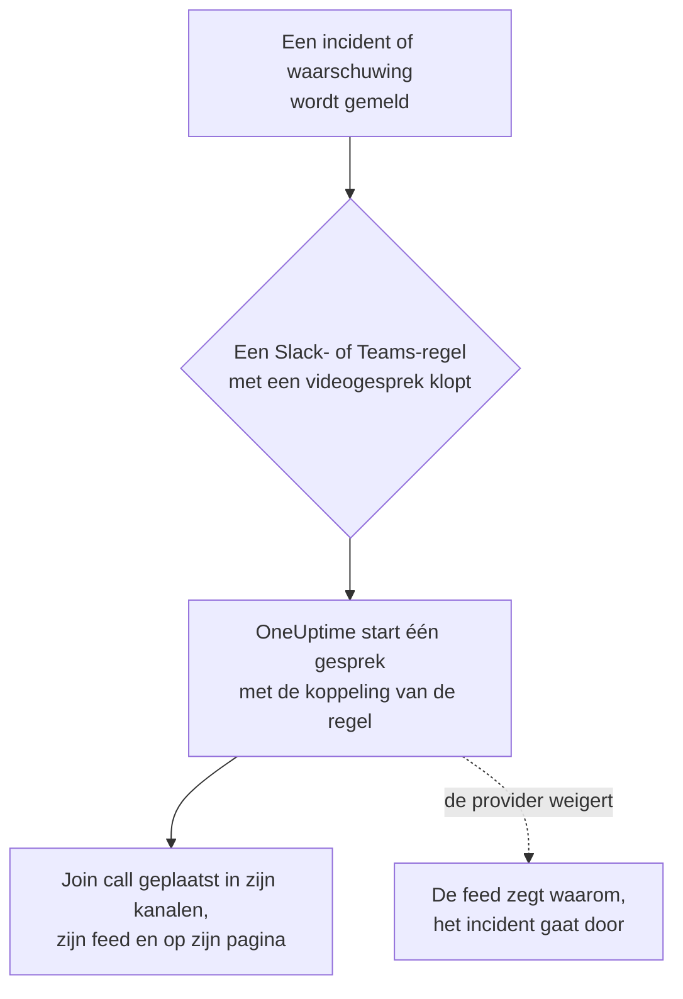

# Videogesprekken

Geef elk incident en elke waarschuwing een eigen gesprek. Als een meldingsregel van Slack of Microsoft Teams afgaat voor een nieuw incident of een nieuwe waarschuwing, start OneUptime een speciale vergadering (een Zoom-vergadering, een Google Meet, een Microsoft Teams-vergadering of de huddle van het Slack-kanaal van het incident) en plaatst een knop **Join call** overal waar de updates van het incident naartoe gaan. Responders doen met één klik mee, en niemand hoeft om 3 uur 's nachts een vergadering aan te maken en de link rond te sturen.

:::cards
- [Hoe het werkt](#hoe-het-werkt): Een regel start het gesprek, en responders doen mee vanaf waar ze ook zijn.
- [Koppelen met één klik](#koppelen-met-één-klik): Zoom, Google Meet of Microsoft Teams, door je aan te melden.
- [Providers](#providers): De service-identiteit van je eigen app, een vaste vergaderlink of een Slack-huddle.
- [Een gesprek handmatig starten](#een-gesprek-handmatig-starten): Vanaf de pagina van een incident of een waarschuwing.
:::

## Hoe het werkt



:::steps
### Een provider koppelen

Ga naar **Projectinstellingen** > **Werkruimte** > **Video Calls** en koppel Zoom, Google Meet of Microsoft Teams, of voeg een vaste vergaderlink toe. Op OneUptime Cloud is het koppelen van Zoom, Google Meet of Microsoft Teams één klik: meld je aan en sta OneUptime toe vergaderingen aan te maken (zie [Koppelen met één klik](#koppelen-met-één-klik)). Slack-huddles hebben niets meer nodig dan de Slack-koppeling van het project.

### Het aanzetten in een regel

Open een meldingsregel van Slack of Microsoft Teams voor incidenten of waarschuwingen (**Incidenten** > **Werkruimte** > **Slack**, bijvoorbeeld). Zet in de stap **Video Call** van de regel **Start a video call for the incident** aan en kies waar het gesprek plaatsvindt.

### Met één klik meedoen

Als de regel afgaat, start OneUptime één gesprek voor het incident en plaatst het met een knop **Join call** in de kanalen waar de updates van het incident naartoe gaan en in de feed van het incident. De pagina van het incident toont het gesprek in zijn kaart **Video Call** en een knop **Join call** in zijn kop.
:::

De voorwaarden van de regel bepalen welke incidenten een gesprek krijgen. Geef de regel voor een bridge bij alleen Sev1-incidenten een voorwaarde op **Ernst**. Gesprekken starten voor incidenten en waarschuwingen die als lopend worden gemeld. Een incident dat al opgelost werd aangemaakt, krijgt geen gesprek.

### Eén gesprek per incident

Een gesprek wordt één keer per incident gestart voor elke plek waar een gesprek plaatsvindt. Regels die dezelfde koppeling kiezen, delen één gesprek, en een regel start nooit een tweede gesprek voor een incident dat er al een heeft van die koppeling. Regels die verschillende plekken kiezen, starten elk hun eigen gesprek, bijvoorbeeld een Zoom-vergadering voor de responders en de huddle van het Slack-kanaal van het incident.

### Als een gesprek niet kan starten

Een incident melden wacht nooit op een provider van videogesprekken. Het gesprek wordt gestart nadat het incident is aangemaakt, dus een trage of falende provider vertraagt nooit het incident of de oproepen van de bereikbaarheidsdienst.

Als de provider weigert (een verlopen geheim, een ontbrekend recht, een verwijderde host), zegt de feed van het incident dat het gesprek van de regel niet kon worden gestart, met de reden van de provider, zodat responders weten dat ze er een vanaf de pagina van het incident moeten starten. De uitvoering van de regel staat in de meldingslogboeken van de workspace als **Videogesprek starten**, en de rij van de koppeling in **Projectinstellingen** > **Werkruimte** > **Video Calls** toont de fout tot er weer een gesprek start.

### Privé-incidenten

Een vergadering krijgt de naam van het incident waarvoor ze is, met het nummer en de titel, en haar beschrijving linkt terug naar het incident. Bij een privé-incident blijft de titel weg, omdat iedereen die voor de vergadering is uitgenodigd haar naam kan lezen.

## Koppelen met één klik

Op OneUptime Cloud kost het koppelen van Zoom, Google Meet of Microsoft Teams één klik en hoeft er bij de provider niets te worden ingesteld:

:::steps
1. Ga naar **Projectinstellingen** > **Werkruimte** > **Video Calls** en klik op **Koppelen** bij Zoom, Google Meet of Microsoft Teams.
2. Klik op **Continue to Zoom** (of Google, of Microsoft), meld je aan en sta OneUptime toe vergaderingen aan te maken.
3. Je komt terug op de pagina met videogesprekken, met de koppeling gemaakt. **Start a test meeting** controleert haar van begin tot eind; kies de koppeling daarna in een meldingsregel van Slack of Microsoft Teams.
:::

Elke vergadering wordt aangemaakt als het account waarmee je je aanmeldt, dat de host ervan is. Meld je aan met een gedeeld account, zoals incidents@example.com, in plaats van je eigen account, zodat gesprekken blijven starten als mensen vertrekken. De rij van de koppeling toont met welk account ze is aangemeld.

| Provider | Aanmelden met | Wat OneUptime mag doen |
| --- | --- | --- |
| Zoom | Een Zoom-gebruiker. Vergaderingen met een Basic-gebruiker (gratis) als host eindigen na 40 minuten. | Vergaderingen aanmaken voor die gebruiker (`meeting:write:meeting`) en lezen wie het is (`user:read:user`). |
| Google Meet | Een Google-account dat Google Meet mag gebruiken. | Meet-ruimtes aanmaken als dat account (`meetings.space.created`) en het e-mailadres ervan lezen. |
| Microsoft Teams | Een werk- of schoolaccount met Microsoft Teams. Persoonlijke Microsoft-accounts kunnen geen Teams-vergaderingen aanmaken. | Onlinevergaderingen aanmaken als dat account (het gedelegeerde recht `OnlineMeetings.ReadWrite`) en aangemeld blijven (`offline_access`). |

Een koppeling die door aanmelden is gemaakt, heeft nog steeds de instellingen die bepalen wie wacht: **Who can join** voor Google Meet en **Who skips the lobby** voor Microsoft Teams. Wijzig ze met **Bewerken** in de rij van de koppeling.

### Aangemeld blijven

OneUptime bewaart het vernieuwingstoken van de aanmelding, versleuteld, en vernieuwt het minstens één keer per week, zodat het nooit verloopt door ongebruik, hoe lang het project ook zonder incident blijft. Als de aanmelding niet meer werkt (het account heeft OneUptime verwijderd, is verwijderd of geschorst, of het beleid van je organisatie vraagt om opnieuw aan te melden), toont de rij van de koppeling **Not working** met de reden op de dag dat OneUptime het merkt, niet bij het volgende incident. **Reconnect** in de rij meldt opnieuw aan.

Koppelingen die met hetzelfde account zijn aangemeld, delen één aanmelding, in elk project: Zoom bewaart maar één aanmelding per account, dus dezelfde Zoom-gebruiker opnieuw koppelen vervangt die voor allemaal.

### Opnieuw koppelen en verwijderen

**Reconnect** in de rij van een koppeling meldt opnieuw aan, als hetzelfde account of een ander. Gebruik het nadat het account OneUptime heeft verwijderd, of om incidentvergaderingen naar een ander account te verplaatsen.

Een koppeling verwijderen trekt de toegang van OneUptime bij Zoom en Google in zodra geen andere koppeling de aanmelding gebruikt. Verwijder OneUptime bij Microsoft onder **My Apps** (myapps.microsoft.com) van het account. OneUptime uit je Zoom-account verwijderen in de Zoom App Marketplace verwijdert de aanmelding uit elke koppeling die met dat account is aangemeld, en die tonen **Not working** tot ze opnieuw zijn gekoppeld.

### Als Microsoft om een beheerder vraagt

Sommige Microsoft 365-organisaties laten alleen beheerders apps goedkeuren. Als Microsoft zegt dat je goedkeuring van een beheerder nodig hebt, vraag dan een Microsoft 365-beheerder om Microsoft Teams te koppelen, of om OneUptime goed te keuren in het [Microsoft Entra-beheercentrum](https://entra.microsoft.com/) onder **Enterprise applications** > **Admin consent requests**.

### In plaats daarvan je eigen app gebruiken

Om te koppelen met een service-identiteit in plaats van de aanmelding van een persoon — een Zoom-app van het type Server-to-Server OAuth, een Google-serviceaccount met domeinbrede delegatie of een Microsoft Entra-appregistratie — klik je op **Use your own Zoom app** (of Google, of Microsoft) in het dialoogvenster Koppelen. [Providers](#providers) legt ze elk uit. Op een zelf gehoste server zonder ingestelde apps voor koppelen met één klik opent **Koppelen** dit formulier direct; zie [Koppelen met één klik op een zelf gehoste server](#koppelen-met-één-klik-op-een-zelf-gehoste-server) om ze in te stellen.

## Een gesprek handmatig starten

De kaart **Video Call** op de pagina van een incident of waarschuwing heeft **Start call** (of **Start another** zodra er een is). Kies een van de koppelingen van het project, de huddle van het Slack-kanaal van het incident, of plak een eigen vergaderlink. Het gesprek wordt in de kanalen en de feed van het incident geplaatst, net als een gesprek dat een regel start.

**Verwijderen** op de kaart haalt een gesprek van de pagina van het incident. De vergadering zelf wordt niet verwijderd, en iedereen met de link kan er nog steeds aan meedoen.

Gesprekken starten en verwijderen vereist rechten om aan incidenten (of waarschuwingen) te werken: **Project Owner**, **Project Admin**, **Project Member**, **Incident Admin** of **Incident Member**, of **Create Incident Video Call** en **Delete Incident Video Call** in een aangepaste rol. Iedereen die het incident mag lezen, ziet de gesprekken ervan.

## Providers

Deze sectie gaat over het koppelen van een provider met de service-identiteit van je eigen app: een Zoom-app van het type Server-to-Server OAuth, een Google-serviceaccount, een Microsoft Entra-appregistratie. Een service-identiteit hangt nooit af van een persoon, dus ze blijft werken wie er ook vertrekt. Zie [Koppelen met één klik](#koppelen-met-één-klik) om in plaats daarvan door aanmelden te koppelen.

Inloggegevens worden versleuteld opgeslagen en worden nooit door de API teruggegeven. Als je een koppeling bewerkt, behoudt een leeg gelaten inloggegeven het opgeslagen gegeven.

**Start test meeting** in het koppelingsformulier, en **Testen** in de rij van een koppeling, maken een echte vergadering aan met de instellingen van de koppeling en tonen de link ervan. Het is de enige controle die bewijst dat de inloggegevens, het recht aan de kant van de provider en de host samen werken. Er wordt nergens iets geplaatst.

Een provider koppelen vereist **Project Owner**, **Project Admin** of **Settings Admin**, of **Create Video Call Connection** en **Edit Video Call Connection** in een aangepaste rol.

### Zoom

OneUptime maakt voor elk incident een Zoom-vergadering aan via een Zoom-app van het type **Server-to-Server OAuth**, met als host een Zoom-gebruiker met licentie naar keuze.

:::steps
1. Kies in de [Zoom App Marketplace](https://marketplace.zoom.us/) **Develop** > **Build App** en maak een app van het type **Server-to-Server OAuth** aan. Daarvoor is een beheerder van het Zoom-account nodig, of een rol die Server-to-Server OAuth-apps toestaat.
2. Voeg op de pagina **Scopes** van de app **meeting:write:meeting:admin** toe (een vergadering aanmaken voor een gebruiker). Een app die vóór de gedetailleerde scopes is gemaakt, kan in plaats daarvan **meeting:write:admin** gebruiken.
3. Klik op **Activate** om de app te activeren en kopieer daarna de **Account ID**, de **Client ID** en het **Client secret** van de pagina **App Credentials** naar het koppelingsformulier.
4. Vul de **Meeting host** in: het e-mailadres van een Zoom-gebruiker met licentie, bij voorkeur een serviceaccount zoals incidents@example.com, zodat vergaderingen blijven werken als mensen vertrekken. Vergaderingen met een Basic-gebruiker (gratis) als host eindigen na 40 minuten.
5. Responders doen mee zonder op de host te wachten, omdat de host een serviceaccount is dat nooit meedoet. Zorg dat de instelling **Waiting room** van je Zoom-account niet vergrendeld aan staat, anders komt niemand binnen.
:::

| Veld | Waar je het vindt |
| --- | --- |
| Account ID | De pagina **App Credentials** van de app |
| Client ID | De pagina **App Credentials** van de app |
| Client secret | De pagina **App Credentials** van de app |
| Meeting host | Het e-mailadres van de Zoom-gebruiker met licentie die elke vergadering host |

### Google Meet

OneUptime maakt voor elk incident een Google Meet aan met de Google Meet REST API, via een Google Cloud-serviceaccount dat met domeinbrede delegatie optreedt als een Google Workspace-gebruiker.

:::steps
1. Kies of maak in de [Google Cloud-console](https://console.cloud.google.com/) een project en schakel er de **Google Meet REST API** voor in.
2. Maak onder **IAM & Admin** > **Service accounts** een serviceaccount aan. Open het, ga naar **Keys** > **Add key** > **Create new key**, kies **JSON**, en plak het gedownloade bestand in het koppelingsformulier als de **Service account JSON key**.
3. Open in de [Google Beheerdersconsole](https://admin.google.com/) **Security** > **Access and data control** > **API controls** > **Manage Domain Wide Delegation** en klik op **Add new**. Vul de numerieke **Client ID** van het serviceaccount in en de scope `https://www.googleapis.com/auth/meetings.space.created`.
4. Vul in **Create meetings as** de Google Workspace-gebruiker in als wie het serviceaccount optreedt: een speciaal account zoals incidents@example.com. Elke vergadering is van deze gebruiker.
:::

**Who can join** bepaalt wie meedoet zonder te vragen: met **People in your organization join directly, others ask to join** (de standaard) vragen mensen van buiten je Google Workspace om mee te doen en laat iemand in het gesprek ze toe. Met **Anyone with the link joins directly** wacht niemand.

Domeinbrede delegatie kan een paar minuten nodig hebben om te gaan werken. Als de test vlak na het toevoegen van de delegatie meldt dat Google het serviceaccount niet als de gebruiker liet optreden, wacht dan een paar minuten en test opnieuw.

### Microsoft Teams

OneUptime maakt voor elk incident een Microsoft Teams-vergadering aan met Microsoft Graph, via een Microsoft Entra-appregistratie die vergaderingen organiseert namens een Teams-gebruiker met licentie.

:::steps
1. Open in het [Microsoft Entra-beheercentrum](https://entra.microsoft.com/) **App registrations** > **New registration** en registreer een app voor één tenant. Kopieer de **Directory (tenant) ID** en de **Application (client) ID**.
2. Voeg onder **API permissions** het Microsoft Graph-recht van het type **application** **OnlineMeetings.ReadWrite.All** toe en klik daarna op **Grant admin consent**.
3. Maak onder **Certificates & secrets** een clientgeheim aan en plak de **Value** ervan, niet de Secret ID, in het koppelingsformulier als het **Client secret**.
4. Kies de organisator: een Teams-gebruiker met licentie, bij voorkeur een serviceaccount. Kopieer de **Object ID** ervan uit **Users** in het Entra-beheercentrum naar **Organizer object ID**.
5. Sta de app toe vergaderingen aan te maken voor de organisator met een toegangsbeleid voor toepassingen. Voer in Teams PowerShell, na `Connect-MicrosoftTeams`, de twee onderstaande commando's uit.
:::

```powershell
New-CsApplicationAccessPolicy -Identity OneUptime-Meetings -AppIds "<application-client-id>"
Grant-CsApplicationAccessPolicy -PolicyName OneUptime-Meetings -Identity "<organizer-object-id>"
```

Het beleid kan tot 30 minuten nodig hebben om van kracht te worden. Tot dan meldt de test dat de app geen vergaderingen mag aanmaken voor de organisator.

**Who skips the lobby** bepaalt wie meedoet zonder te wachten: met **People in your organization skip the lobby** (de standaard) wacht ieder ander in de lobby tot iemand in de vergadering hem toelaat. Met **Everyone skips the lobby** wacht niemand.

### Vergaderlink

Een vaste vergaderlink is dezelfde ruimte voor elk incident: een persoonlijke Zoom-vergaderruimte, een terugkerende Microsoft Teams- of Google Meet-vergadering, een persoonlijke Webex-ruimte of een Jitsi-ruimte. Er wordt per incident niets aangemaakt, dus er valt niets te autoriseren.

:::steps
1. Maak in het hulpmiddel dat je team al gebruikt een vergadering aan die nooit verloopt.
2. Plak de https-deelnamelink ervan in het koppelingsformulier als de **Meeting link**.
:::

Elk incident en elke waarschuwing die met deze koppeling wordt gestart, deelt de ruimte, dus twee gelijktijdige incidenten delen haar ook. Zorg dat de vergadering mensen laat meedoen zonder de host.

### Slack-huddles

Een Slack-regel kan in plaats daarvan de huddle van het Slack-kanaal van het incident starten. Er valt niets te koppelen: kies **Slack huddle** in de stap **Video Call** van de regel.

De huddle vindt plaats in het kanaal dat de regel voor het incident aanmaakt of, als de regel in bestaande kanalen plaatst, in het eerste daarvan. De regel moet dus een kanaal aanmaken of in een bestaand kanaal plaatsen. De knop **Join huddle** opent de huddle van het kanaal in Slack. De eerste responder die hem opent, start de huddle, en iedereen daarna doet mee. Slack biedt een app geen manier om een huddle te starten, dus er zit niemand in de huddle tot iemand hem opent.

Een Slack-huddle is alleen voor Slack-regels. Een Microsoft Teams-regel start zijn gesprekken met een van de koppelingen voor videogesprekken van het project.

## De API gebruiken

Een gesprek is een record bij het incident (`IncidentVideoCall`) of de waarschuwing (`AlertVideoCall`). Maak er een aan met de `_id` van het incident en een van deze:

- `videoCallConnectionId`: start een nieuwe vergadering met die koppeling.
- `provider` ingesteld op `SlackHuddle`: de huddle van het Slack-kanaal van het incident.
- `joinUrl` (en optioneel `title`): een eigen vergaderlink.

```json
{
  "data": {
    "projectId": "<project-id>",
    "incidentId": "<incident-id>",
    "videoCallConnectionId": "<connection-id>"
  }
}
```

`POST /api/video-call-connection/test` start een testvergadering met een opgeslagen koppeling (`{ "connectionId": "..." }`) of met instellingen die nog niet zijn opgeslagen (`{ "provider": "Zoom", "config": { ... }, "secrets": { ... } }`), en geeft de `joinUrl` ervan terug.

De `authMethod` van een koppeling zegt hoe ze zich aanmeldt: `OAuth` voor een koppeling die door aanmelden is gemaakt, `AppCredentials` voor een met de inloggegevens van je eigen app, en niets voor een vergaderlink. Een koppeling die door aanmelden is gemaakt, wordt alleen door aanmelden aangemaakt, in het dashboard. Via de API kun je haar hernoemen en haar `config` wijzigen, en haar `connectedAccount` zegt met welk account ze is aangemeld.

## Koppelen met één klik op een zelf gehoste server

OneUptime Cloud heeft eigen Zoom-, Google- en Microsoft-apps voor koppelen met één klik. Een zelf gehoste server biedt het aan voor elke provider waarvan je de app instelt. Zonder die app opent **Koppelen** het formulier voor je eigen app.

Maak per provider één OAuth-app aan en registreer er deze omleidings-URI in, met de host van je server:

| Provider | Omleidings-URI | Omgevingsvariabelen | Helm-waarden |
| --- | --- | --- | --- |
| Zoom | `https://<host>/api/video-call-oauth/zoom/callback` | `ZOOM_APP_CLIENT_ID`, `ZOOM_APP_CLIENT_SECRET`, `ZOOM_APP_WEBHOOK_SECRET_TOKEN` | `zoomApp.clientId`, `zoomApp.clientSecret`, `zoomApp.webhookSecretToken` |
| Google Meet | `https://<host>/api/video-call-oauth/google-meet/callback` | `GOOGLE_MEET_APP_CLIENT_ID`, `GOOGLE_MEET_APP_CLIENT_SECRET` | `googleMeetApp.clientId`, `googleMeetApp.clientSecret` |
| Microsoft Teams | `https://<host>/api/video-call-oauth/microsoft-teams/callback` | `MICROSOFT_TEAMS_MEETINGS_APP_CLIENT_ID`, `MICROSOFT_TEAMS_MEETINGS_APP_CLIENT_SECRET` | `microsoftTeamsMeetingsApp.clientId`, `microsoftTeamsMeetingsApp.clientSecret` |

- **Zoom**: kies in de [Zoom App Marketplace](https://marketplace.zoom.us/) **Develop** > **Build App** en maak een **General App** aan, beheerd door gebruikers. Voeg onder **Basic Information** de omleidings-URI toe als OAuth Redirect URL op zowel het tabblad **Development** als **Production** en aan de OAuth-toelatingslijst, en stel op het tabblad **Production** de eindpunt-URL van **Deauthorization Notification** in op `https://<host>/api/video-call-oauth/zoom/events`. Voeg onder **Scopes** `meeting:write:meeting` en `user:read:user` toe. Het **Secret Token** onder **Features** > **Access** is `ZOOM_APP_WEBHOOK_SECRET_TOKEN`. De **Development**-inloggegevens werken alleen voor gebruikers van je eigen Zoom-account; de **Production**-inloggegevens werken voor iedereen zodra Zoom de app heeft beoordeeld en gepubliceerd.
- **Google Meet**: schakel in de [Google Cloud-console](https://console.cloud.google.com/) de **Google Meet REST API** in, stel het OAuth-toestemmingsscherm in (**Google Auth Platform**) met de scopes `openid`, `email` en `https://www.googleapis.com/auth/meetings.space.created`, en maak een OAuth-client van het type **Web application** aan met de omleidings-URI. Publiceer de app naar productie: een app die in de testfase blijft, verliest zijn aanmeldingen na zeven dagen. Google beoordeelt apps die om de Meet-scope vragen; tot dat is gebeurd, zien mensen een waarschuwing voordat ze zich aanmelden.
- **Microsoft Teams**: registreer in het [Microsoft Entra-beheercentrum](https://entra.microsoft.com/) een app voor **Accounts in any organizational directory**, voeg de omleidings-URI toe als **Web**-omleidings-URI, voeg de gedelegeerde Microsoft Graph-rechten `openid`, `profile`, `email`, `offline_access` en `OnlineMeetings.ReadWrite` toe, en maak een clientgeheim aan. Gebruik een eigen registratie, niet die van de Microsoft Teams-bot (`MICROSOFT_TEAMS_APP_CLIENT_ID`). Zolang de app geen geverifieerde uitgever heeft, hebben de meeste organisaties een beheerder nodig die er toestemming voor geeft.

De client-ID's zijn openbaar: ze worden naar het dashboard gestuurd zodat het weet welke providers met één klik koppelen. Houd de geheimen en het geheime webhooktoken geheim. De worker vernieuwt elke aanmelding dagelijks, dus hij heeft dezelfde waarden nodig als de app.

## Problemen oplossen

:::details Er is geen gesprek gestart voor een incident
Controleer of de regel bij het incident paste (**Testregel**), of de stap **Video Call** ervan aanstaat, en of het incident als lopend werd gemeld: een incident dat al opgelost werd aangemaakt, krijgt geen gesprek. Een regel die al een gesprek voor het incident startte met die koppeling, start er geen tweede.
:::

:::details De feed zegt dat het gesprek niet kon worden gestart
De provider weigerde, en de feed geeft de reden. Start intussen een gesprek vanaf de pagina van het incident. Voer daarna **Testen** uit in de rij van de koppeling: dat toont dezelfde reden terwijl je de instelling bij de provider herstelt, zoals een verlopen clientgeheim of een ontbrekend recht.
:::

:::details Een koppeling toont Not working
De aanmelding ervan werkt niet meer: het account heeft OneUptime verwijderd, is verwijderd of geschorst, of moet zich opnieuw aanmelden. Klik op **Reconnect** in de rij. Tot dan kunnen de gesprekken die ze zou moeten starten, niet starten.
:::

:::details Mensen wachten in een lobby of wachtkamer
Wijzig **Who can join** (Google Meet) of **Who skips the lobby** (Microsoft Teams) met **Bewerken** in de rij van de koppeling. Zorg bij Zoom dat de instelling **Waiting room** van het account niet vergrendeld aan staat.
:::

## Volgende stappen

:::cards
- [Slack](/docs/workspace-connections/slack): De regels die gesprekken starten, en de kanalen waarin ze plaatsen.
- [Microsoft Teams](/docs/workspace-connections/microsoft-teams): Dezelfde regels en gesprekken in Microsoft Teams.
- [Microsoft Teams-integratie](/docs/self-hosted/microsoft-teams-integration): De Teams-bot instellen op een zelf gehoste server.
- [Een incident melden](/docs/incidents/declaring-incidents): Wat er gebeurt als een incident begint.
:::
