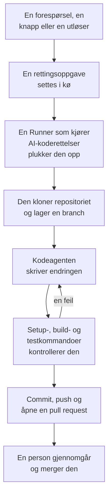

# Kode

Kode er der du ber OneUptime AI om å jobbe i repositoriene dine, slik du ville bedt en kodeagent: rette en feil, skrive tester, forklare koden, gjøre en endring. Kode åpner på feltet der du spør, med repositoriet og branchen valgt i det og alle oppgavene under det; siden til en oppgave er en samtale du kan svare i. OneUptime starter også oppgaver på egen hånd, fra unntak, spor og undersøkelser. En [Runner](/docs/runbooks/agents) kloner repositoriet, skriver endringen på en ny branch, bygger og tester den og åpner en pull request. En person gjennomgår og merger hver eneste en: Runneren kan pushe brancher og åpne pull requests, ingenting mer.

:::cards
- [Be AI om noe i et repositorium](#be-ai-om-noe-i-et-repositorium): En forespørsel med dine egne ord, med konteksten den trenger.
- [Samtalen til en oppgave](#samtalen-til-en-oppgave): Hva AI gjorde, hva den endret, og svaret ditt.
- [Slik går en rettingskjøring](#slik-går-en-rettingskjøring): Fra et klikk til en pull request, steg for steg.
- [Hvor rettingsoppgaver starter](#hvor-rettingsoppgaver-starter): Oppgavene OneUptime starter, og hva hver pull request gjør.
- [Produksjonstelemetri i en retting](#produksjonstelemetri-i-en-retting): Hva en retting leser fra produksjonen mens den skriver endringen.
- [Produksjonsgjennomgang av pull requests](#produksjonsgjennomgang-av-pull-requests): Hva produksjonen sier om koden hver pull request endrer.
- [Før du begynner](#før-du-begynner): En modell, et tilkoblet repositorium og en Runner.
- [Når en retting mislykkes](#når-en-retting-mislykkes): Hva som skjer med en kjøring som feiler, stopper opp eller venter.
:::

> [!TIP]
> Du kan også starte dette fra GitHub. Nevn OneUptime GitHub App i en issue eller en pull request, så implementerer, reviderer eller gjennomgår den der og da: se [GitHub App](/docs/ai/github-app). Det er den samme agenten, den samme Runneren og de samme budsjettene; bare utløseren er en annen.

## Be AI om noe i et repositorium

:::steps
### Åpne Kode

Åpne **Produkter → Kode**. Kode åpner på **Hva skal AI gjøre?**: feltet der du spør, med alle oppgavene under, de nyeste først. Finnes det ikke noe repositorium ennå, tilbyr Kode i stedet **Koble til GitHub** (se [Før du begynner](#før-du-begynner)). **Repositorier** i sidemenyen viser repositoriene AI kan jobbe i, og samler dem GitHub App ikke lenger når, under **Ikke tilkoblet**. Siden til hvert repositorium har det samme feltet for det repositoriet.

### Velg repositoriet og branchen

Feltet starter på repositoriet du valgte sist. Velg et annet i den nederste raden, og ved siden av branchen oppgaven starter fra: repositoriets hovedbranch, merket **Standard**, til du velger en annen. AI lager sin branch fra den du velger, og åpner sin pull request mot den.

### Si hva du vil

Skriv endringen, feilen eller spørsmålet med dine egne ord. Inntil noe er spurt om, foreslår Kode noen under **Prøv å spørre**.

### Legg til kontekst

Klikk på **Legg til kontekst** for å gi AI det den trenger: en fil eller mappe i repositoriet, et notat, en lenke eller en post i prosjektet. OneUptime leser hver post når du sender forespørselen, med dine tillatelser, og tar vare på det AI fikk.

### Start oppgaven

Klikk på **Start oppgave**, eller trykk Enter. Oppgavens side åpnes, og arbeidet til AI vises der mens det skjer.
:::

| Kontekst | Hva AI får |
| --- | --- |
| **Fil eller mappe** | En sti i repositoriet, som AI leser først. |
| **Notat** | Tekst du limer inn: en feil, en spesifikasjon, en logglinje. |
| **Lenke** | En nettadresse, som referanse. |
| **Hendelse** eller **Varsel** | Tilstanden, beskrivelsen og rotårsaken, slik de er når du sender forespørselen. |
| **Unntak** | Meldingen og stack tracen. |
| **Overvåking** | Typen, statusen og beskrivelsen. |
| **Spor** | Spanene: navnene, tidene og feilene deres. |
| **Logger** | De siste 20 logglinjene som inneholder søket ditt, fra den siste timen, dagen eller uken. |
| **Ytelsesprofil** | Hvor tiden til en funksjon går i profilene til tjenesten dens: hvem som kaller den, hva den kaller og de varmeste linjene. |

En forespørsel bærer høyst 10 kontekstelementer. Tokener, nøkler, passord og e-postadresser i det OneUptime leser, sladdes før AI ser dem, som overalt der OneUptime AI leser dataene dine.

## Samtalen til en oppgave

Siden til en oppgave er en samtale: hva det ble spurt om og konteksten som ble lagt til, deretter turen til AI – stegene den tar mens den tar dem (filene den leste og redigerte, hva den søkte etter, kommandoene den kjørte), svaret, filene den endret med diffen deres, og pull requesten. Øverst på siden står det hvor oppgaven jobber (repositoriet og branchen den startet fra), hvor mange linjer den endret, med en knapp til pull requesten, og hvordan det står til med oppgaven:

| Tilstand | Hva det betyr |
| --- | --- |
| **I kø** | Den venter på at en Runner tar den. |
| **Jobber…** | AI jobber med den. **Stopp** stopper den; det den har pushet, blir liggende på branchen. |
| **Venter på deg** | AI har stilt et spørsmål. Svar på det i feltet nedenfor. |
| **Ferdig** | AI er ferdig: svaret, og pull requesten når den endret kode. |
| **Mislyktes** | Turen kunne ikke fullføres, og sier hvorfor. **Prøv igjen** ber om det samme på nytt. |
| **Stoppet** | Noen stoppet den. **Prøv igjen** ber om det samme på nytt. |

For å følge opp skriver du i feltet nederst, som blir synlig mens samtalen ruller: svar AI, legg til kontekst eller be om endringer. Hvert svar er neste tur i samme oppgave: den jobber på samme branch og pusher til samme pull request så lenge den er åpen. En oppgave tar én tur om gangen, så feltet venter mens AI jobber. **Logg** for hver tur er den ordrette oversikten over hva den gjorde.

Den som kan lese et repositorium, leser oppgavene i det. Å be AI om noe, svare og stoppe en oppgave krever tillatelse til å redigere repositoriet, og det samme gjør det å se diffen til en endring: alle andre ser hvilke filer som er endret. Oppgavene OneUptime starter på egen hånd (nedenfor), står også i repositoriet sitt, som samtaler du kan svare i.

## Slik går en rettingskjøring



1. Du klikker **Start oppgave** i Kode, eller **Fiks med AI** på et uløst unntak, eller en annen knapp eller utløser starter en oppgave (se [Hvor rettingsoppgaver starter](#hvor-rettingsoppgaver-starter)).
2. Oppgaven settes i kø på repositoriet sitt, og Runneren som repositoriet velger, tar den: en av dine Runnere, eller en global Runner når det ikke velger noen (se [Velg repositoriets Runner](#velg-repositoriets-runner)).
3. Runneren henter oppgavens kontekst. For en forespørsel er det ordene, konteksten som ble lagt til, og samtalen så langt; for et unntak typen, meldingen og stack tracen.
4. Den kloner repositoriet til et eget arbeidsområde og lager en branch. En retting av et unntak heter `oneuptime-fix-exception-` etterfulgt av de første tegnene i kjøringens id. En forespørsel starter fra branchen som ble valgt da den ble stilt, og pull requesten åpnes mot den. Et svar jobber i stedet på branchen til oppgavens åpne pull request.
5. En kodeagent, drevet av prosjektets LLM-leverandør, leser koden og skriver endringen. OneUptime-serveren gjør LLM-kallene, slik at Runneren aldri har leverandørens API-nøkkel, og hvert kall måles og vises i AI-loggene. En retting av et unntak, et tregt spor eller en hendelse leser også fra produksjonen mens den jobber: unntakene, sporene, loggene og målingene til repositoriets tjenester (se [Produksjonstelemetri i en retting](#produksjonstelemetri-i-en-retting)).
6. På din egen Runner bygger og tester kodeagenten endringen sin slik repositoriets `AGENTS.md` sier, før noe committes, og reparerer det som feiler (se [Kontroll før pull requesten](#kontroll-før-pull-requesten)).
7. Runneren committer, pusher branchen, åpner pull requesten (for en forespørsel bare når den endret kode) og sletter arbeidsområdet.

Siden oppgaven ble startet fra, viser statusen live. Hver oppgave står i repositoriet sitt under **Produkter → Kode**: siden er samtalen, og **Logg** for hver tur har en linje for hver fil Runneren leste eller skrev og hver kommando den kjørte.

Hver kjøring holdes innenfor budsjetter som serveren håndhever: høyst **40 LLM-kall** og **100 000 utdata-tokens**. Kjøringens spørringer mot produksjonstelemetrien teller mot de samme 40 kallene. En kjøring som når ett av dem, avslutter med et sammendrag av arbeidet så langt i stedet for å gå i ring. Rettingskjøringer teller også mot prosjektets daglige AI-grenser, når prosjektet setter dem.

## Hvor rettingsoppgaver starter

| Hvor | Klikk | Pull requesten |
| --- | --- | --- |
| Et unntaks side **AI Assistance** | **Fiks med AI** | Retter feilen bak unntaket. |
| Et unntaks side **AI Assistance** | **Generate Regression Test** | Legger til en test som gjenskaper unntaket og feiler til feilen er rettet. |
| Et unntaks side **AI Assistance** | **Forbedre feilhåndtering** | For en forventet feil, som ugyldig inndata: tar brukerdata ut av meldingen, validerer inndataene tidligere og merker feilen som håndtert, uten å endre oppførselen. |
| En hendelses eller et varsels kort **AI Investigation** | **Open Fix PR from this analysis** | Retter rotårsaken undersøkelsen publiserte (se [Automatiske koderettinger fra undersøkelser](#automatiske-koderettinger-fra-undersøkelser)). |
| Et spor som er verdt å rette | **Fiks ytelsen med AI** | Retter det trege mønsteret som knappen nevner, som en N+1-spørring eller kall som kunne kjørt parallelt. |
| En tjenestes side **Logger** | **Forbedre logging** | Gjør tjenestens logger strukturerte, med riktig alvorlighetsgrad og knyttet til sporene, uten å endre oppførselen. |
| En tjenestes side **Spor** | **Forbedre sporing** | Legger til spans og attributter der tjenestens tracing mangler, uten å endre oppførselen. |
| En funksjon i **Ytelsesprofiler** | **Fiks med AI** | Får funksjonen til å gjøre det samme arbeidet med mindre tid eller minne, med profilen som bevis. |

Disse knappene vises bare der de kan starte en oppgave. Med AI slått av for prosjektet vises ingen av dem, og sidemenyen til et unntak har ingen **AI Assistance**. **Forbedre logging** og **Forbedre sporing** vises så snart et repository er koblet til, og **Fiks ytelsen med AI** bare på et spor som er verdt å rette (se [Sporutforsker](/docs/telemetry/traces-explorer)). **Fiks med AI** for en funksjon vises bare for applikasjonens egen kode som tar minst 5 % av profilens tid eller minne, eller der andelen har vokst med 3 poeng eller mer siden vinduet den sammenlignes med (se [Kontinuerlig profilering](/docs/telemetry/profiles)).

For å åpne et unntaks side **AI Assistance**, åpne unntaket under **Produkter → Observerbarhet → Unntak** og velg **AI Assistance** i sidemenyen. Et løst eller arkivert unntak må først merkes som uløst.

OneUptime AI starter også rettingsoppgaver på egen hånd: fra en undersøkelse som finner en kodeendring, fra en som ender uten konklusjon fordi telemetri manglet, og fra AI Insights om unntak og trege spor. Hver har sin egen bryter; se [Automatiske koderettinger](/docs/ai/ai-sre#automatiske-koderettelser).

## Produksjonstelemetri i en retting

OneUptime har oversikt over hva koden din gjør i produksjon, så en retting trenger ikke å jobbe ut fra en stack trace alene. Mens kodeagenten jobber, kan den gjøre spørringer mot produksjonstelemetrien til tjenestene repositoriet hører til:

| Den leser | Til hva |
| --- | --- |
| **Unntak** | Unntaksgruppene som kastes i bestemte filer eller en funksjon: hvor ofte de siste dagene, siden hvilken release, og sporet til en nylig forekomst. |
| **Spor** | Latens- og feilprofilen til et endepunkt eller en operasjon, og spanene i ett spor. |
| **Logger** | Logglinjene til en tjeneste, etter tid, alvorlighetsgrad, tekst eller spor. |
| **Målinger** | En måling som en tjeneste rapporterer, over tid; uten navn, målingene den rapporterer. |
| **Hendelser** | Hendelser som rammet tjenestene, eller som en OneUptime-retting i dette repositoriet ble åpnet for, med rotårsaken og etteranalysen deres. |
| **Utrullinger** | Nylige utrullinger og andre endringer i tjenestene, hver med OneUptimes vurdering av om den skadet tjenesten sin. |

| Oppgave | Hva den sjekker |
| --- | --- |
| **Fiks med AI** på et unntak | Hvor ofte det kastes nå og siden hvilken release, loggene og sporet til en forekomst. |
| **Fiks ytelsen med AI** | Hvor travel og hvor treg operasjonen er på tvers av alle sporene sine, ikke bare det som ble analysert. Den endrer ingenting når operasjonen ikke lenger er treg. |
| **Open Fix PR from this analysis**, og rettinger som åpnes automatisk fra undersøkelser | Utrullingene før hendelsen, feilene, loggene og de trege operasjonene i den, og om årsaken har slått til før. |
| `@oneuptime review` fra GitHub | Hva produksjonen sier om den endrede koden (se [Gjennomganger med produksjonskontekst](/docs/ai/github-app#gjennomganger-med-produksjonskontekst)). |

Beskrivelsen av pull requesten sier hva agenten spurte etter, og hva det viste. Andre oppgaver, som regresjonstester og forbedringer av logging eller sporing, gjør ingen spørringer mot produksjonen.

Hva agenten kan lese, bestemmes av OneUptime-serveren, ut fra selve oppgaven:

- **Bare lesing.** Spørringene kjører på OneUptime-serveren, aldri på Runneren, som ikke har noen påloggingsdetaljer som kan lese telemetri. Ingenting de gjør, kan endre prosjektet ditt.
- **Dette prosjektet, og bare tjenestene dette repositoriet hører til.** Du knytter dem ikke til repositoriet selv: det er tjenestene OneUptime finner dette repositoriet for, slik den finner repositoriet til en retting - stack tracene til unntakene deres går gjennom filene i det, de heter det samme som det, eller det er prosjektets eneste repositorium. Telemetrien til en annen tjeneste kan ikke leses.
- **Ingen private hendelser**, og tokener, nøkler, passord og e-postadresser sladdes før agenten ser et resultat, som overalt der OneUptime AI leser dataene dine.
- **Avgrenset.** Høyst **12** spørringer per kjøring, og hver av dem teller mot kjøringens 40 kall.

Når ingen tjeneste kan knyttes til repositoriet, kjører oppgaven uten produksjonstelemetri, som før.

## Produksjonsgjennomgang av pull requests

OneUptime vet hva koden din gjør i produksjon, så den kan gå gjennom en pull request med det ingen ser ved å lese diffen. Slå på **Gå gjennom pull-forespørsler opp mot produksjon** under **Flere innstillinger** på siden **Innstillinger** for et repositorium i Kode, så får hver pull request som noen med skrivetilgang åpner eller pusher til, én kommentar som sier hva produksjonen viser om koden den endrer. Kommentaren redigeres på stedet ved hvert push, og repositoriets side **Produksjonsgjennomganger** i Kode tar vare på hver gjennomgang, med **Gå gjennom på nytt**.

| Den leser | Om koden pull requesten endrer |
| --- | --- |
| **Unntak** | Unntakene som er kastet i de endrede linjene, funksjonene og filene de siste 7 dagene, med nye og uhåndterte merket. |
| **Operasjoner** | De sporede operasjonene som kjører den endrede koden den siste timen: spennene, feilene og p95 deres. |
| **Tunge funksjoner** | Funksjonene i den endrede koden som tar en del av tjenestenes profiler den siste timen. |
| **Hendelser** | Tjenestenes hendelser fra de siste 30 dagene som fortsatt er åpne, eller der rotårsaken eller etteranalysen nevner den endrede koden. Aldri en privat hendelse. |
| **Utrullinger** | Tjenestenes utrullinger fra de siste 7 dagene som OneUptime mistenker for en regresjon. |

Når produksjonen viser noe, leser OneUptime AI det ved siden av diffen og legger til **Hva du bør følge med på**: noen få korte punkter som hvert bygger på fakta. Det kjører bare mens AI er slått på for prosjektet, høyst 10 ganger om dagen for en pull request og 100 for et repositorium, og måles som alle AI-kall; fakta leses hver gang uten det. Når produksjonen ikke viser noe om endringen, publiserer OneUptime ingenting.

- **Bare samlede tall.** Kommentaren inneholder antall, varigheter og navn på kode: aldri meldingen til et unntak, en logglinje, tittelen på en hendelse eller personopplysninger.
- **Offentlige repositorier får en lenke.** Alle kan lese pull requestene i et offentlig repositorium, så der lenker kommentaren bare til gjennomgangen i OneUptime, som bare prosjektets medlemmer kan åpne. **Kommentar fra produksjonsgjennomgang** under **Flere innstillinger** på repositoriets side **Innstillinger** kan publisere **Bare en lenke til gjennomgangen** overalt, eller **Gjennomgangen, også i et offentlig kodelager**.
- **Eksterne bidragsytere kan ikke starte en.** En pull request gjennomgås bare av seg selv når forfatteren, og den som pushet til den, kan skrive til repositoriet. En fra alle andre - en ekstern bidragsyter, en fork, en bot - gjennomgås når noen med skrivetilgang kommenterer `@oneuptime production review` på den, eller klikker **Gå gjennom på nytt** i Kode.
- **Bare lesing.** En gjennomgang kloner ingenting og kjører ingenting fra pull requesten. Diffen og tittelen er data for OneUptime AI, aldri instruksjoner: AI-en har ingen verktøy, og det den skriver, settes inn i kommentaren som tekst.

Bryteren er slått på for repositoriene GitHub App kobler til fra nå av. Et repositorium som ble koblet til før den fantes, beholder den slått av til du slår den på.

## Kontroll før pull requesten

Et repositorium sier hvordan det bygges og testes, i en `AGENTS.md` i roten, filen kodeagenter leser. Før kodeagenten endrer noe, leser den repositoriets `AGENTS.md` (eller dets `CLAUDE.md`, når det ikke har noen `AGENTS.md`) fra branchen oppgaven starter fra, og jobber slik den sier. Uten noen av dem finner den ut av det fra repositoriets `CONTRIBUTING.md`, README, pakkeskript, `Makefile` eller CI-arbeidsflyter. Det er ingenting å sette opp i OneUptime.

| Hvor AI jobber | Hva den gjør med repositoriets bygg og tester |
| --- | --- |
| En av dine Runnere | Bygger og tester endringen sin før pull requesten åpnes, retter det som feiler og sjekker igjen, og sier i sammendraget hvilke sjekker den kjørte. Hver kommando den kjører, får opptil 2 minutter, uten Runnerens egne påloggingsopplysninger i miljøet. |
| **Global Runner** | Kjører ingen kommando: den skriver endringen og åpner pull requesten, og repositoriets egen CI sjekker den. |

Ingenting fra en pull request som kommer fra en fork, leses noen gang som repositoriets instruksjoner: en revisjon avviser en slik pull request, og en gjennomgang leser basisbranchen.

### Kommandoer satt på et repositorium

Kode ber ikke lenger om oppsett-, bygge- og testkommandoer, men et repositorium som har dem, satt tidligere eller gjennom API-et eller Terraform, beholder dem. De vises skrivebeskyttet på kortet **Bygg- og testkommandoer**, under **Flere innstillinger** på repositoriets side **Innstillinger**, og **Fjern kommandoer** fjerner alle tre. Så lenge en av dem er satt, kontrollerer hver rettingskjøring på din egen Runner også endringen sin med dem før pull requesten åpnes:

1. Når kodeagenten er ferdig, kjører kommandoene i rekkefølge i roten av repositoriet, på Runneren, i det klonede arbeidsområdet. Hver får opptil 15 minutter og kjører med `CI=true`, slik at ingenting venter på inndata; den første feilen stopper gjennomkjøringen.
2. Ved en feil går slutten av utdataene fra den feilende kommandoen tilbake til den samme kodeagenten som en reparasjonsoppgave, med beskjed om å rette sin egen endring i stedet for å svekke eller hoppe over tester, og kommandoene kjører på nytt. Den gjør høyst **2** reparasjonsforsøk. De deler kjøringens LLM-budsjett, og endringene havner i samme commit som rettingen.
3. Utfallet, bestått, feilet eller hoppet over (ingen kommandoer satt, eller en global Runner), skrives i en Verification-seksjon i pull requestens beskrivelse og registreres på oppgavens pull request.

En endring som fortsatt ikke består kontrollen, kastes ikke: pull requesten åpnes likevel, med en tydelig merket seksjon "Verification failed" som nevner den feilende kommandoen og slutter med utdataene dens. Arbeidet beholdes, og den som gjennomgår, bestemmer. Et repositorium uten kommandoer rapporteres som hoppet over, i stedet for å antyde et grønt bygg.

Kommandoene er repositoriuminnstillinger som teamet ditt skriver, og de kjører på din egen Runner: samme tillitsmodell som Bash-stegene i en runbook. AI-en skriver eller endrer dem aldri. En global Runner, som OneUptime kjører for alle prosjekter, kjører dem aldri: på en global Runner skrives rettingen og åpnes for gjennomgang, kontrollen rapporteres som hoppet over, og repositoriets egen CI sjekker endringen. [Kjør din egen Runner](#kjør-din-egen-runner) for å få rettinger bygget og testet før pull requesten åpnes.

## Etter at en rettelse er slått sammen

Å slå sammen en rettelse retter ingenting før den kjører. Når en pull-forespørsel med en rettelse er slått sammen, venter OneUptime på en registrert utrulling som inneholder den (se [Utrullinger og endringer](/docs/telemetry/change-events)), og følger med i den utrullingen på det rettelsen var til. Oppgavens pull-forespørsel i Code sier hvordan det gikk, og det gjør også unntakets side **AI Assistance**, hendelsens AI-logger og AI-innsikten rettelsen kom fra:

| En rettelse av | Det som følges med på | Det virket | Det virket ikke |
| --- | --- | --- | --- |
| Et unntak | Om unntaket skjer igjen | **Rettet i produksjon** | **Skjer fortsatt etter rettelsen** |
| En treg trace eller en latens-innsikt | p99 for operasjonen rettelsen nevner | **Raskere i produksjon** | **Fortsatt treg etter rettelsen** |
| Rotårsaken til en hendelse eller et varsel | Om monitoren utløser en til | **Rettet i produksjon** | **Skjedde igjen etter rettelsen** |
| Manglende telemetri, logging eller tracing | Det rettelsen legger til, og resten av tjenestens telemetri | **Kommer frem i produksjon** | **Telemetri stoppet etter rettelsen** |

Til en utrulling leverer den, står det **Merget, venter på et deploy** ved rettelsen, deretter **Deployet, overvåkes i produksjon** mens det følges med på den. En rettelse som ingen registrert utrulling inneholder innen 14 dager, eller som produksjonen ikke kan si noe om, står som **Ikke verifisert i produksjon**. [Automatiske koderettelser](/docs/ai/ai-sre#automatiske-koderettelser) har reglene. En regresjonstest, bedre feilhåndtering, en gjennomgang og en forespørsel i Code følges det ikke med på: produksjonen kan ikke vise hva de endrer.

## Før du begynner

En oppgave trenger tre ting. Forespørselsfeltet i Kode og unntakets side **AI Assistance** kontrollerer alle tre før de tilbyr å starte, og sier hva som mangler.

| Hva | OneUptime Cloud | Selvhostet |
| --- | --- | --- |
| En LLM-leverandør | Ingenting å sette opp: et prosjekt uten egen leverandør bruker den globale leverandøren, betalt fra prosjektets AI-kreditter. En egen leverandør, under **Prosjektinnstillinger → KI → LLM-leverandører**, går foran. | Sett miljøvariablene `GLOBAL_LLM_PROVIDER_*` én gang på serveren, eller legg til en leverandør i prosjektet. |
| Et repositorium koblet til via GitHub App | **Produkter → Kode**, deretter **Koble til GitHub**. Hvis appen allerede er installert på GitHub-kontoen, klikker du i stedet på **Koble til en eksisterende installasjon**: den blir ikke koblet til av å installere den på nytt. Krever Growth-planen. | Det samme, når instansen din har en GitHub App (se [GitHub-integrasjon](/docs/self-hosted/github-integration)). |
| En Runner som kjører AI-koderettelser | Ingenting å drifte: et repositorium som ikke velger noen, jobber på OneUptimes globale Runnere. | Docker Compose-tjenesten `runner`, eller Helm-chartets Runner (`runner.enabled`, på som standard), registrerer seg selv og kjører AI-koderettelser i hvert repositorium som ikke velger noen Runner. |

På en selvhostet instans er den globale leverandøren én blokk i `config.env` (Docker Compose) eller i Helm-verdiene dine. For en selvhostet Ollama:

```bash
GLOBAL_LLM_PROVIDER_TYPE=Ollama
# An address the OneUptime server can reach, never localhost.
GLOBAL_LLM_PROVIDER_BASE_URL=http://ollama:11434
GLOBAL_LLM_PROVIDER_MODEL_NAME=llama3.1
# No GLOBAL_LLM_PROVIDER_API_KEY needed — Ollama is keyless.
```

Enhver støttet leverandør fungerer: se [LLM-leverandører](/docs/ai/llm-provider) for alle leverandørene og hver miljøvariabel.

Du knytter ikke repositorier til tjenester. Når en oppgave starter, finner OneUptime repositoriet ved å sammenligne filstiene i unntakets stack trace med de tilkoblede repositoriene dine. Når ingenting passer, faller den tilbake på et repositorium som heter det samme som tjenesten, og deretter på prosjektets eneste repositorium når det bare finnes ett. Siden **AI Assistance** viser hvilket repositorium den fant.

### Velg repositoriets Runner

Hvert repositorium velger Runneren AI jobber i det på: åpne **Flere innstillinger** på siden **Innstillinger** i Kode, klikk **Rediger** på kortet **Runner**, og velg en. Et repositorium som GitHub App importerer, starter på prosjektets [standard-Runner](/docs/runbooks/agents#prosjektets-standard-runner) når prosjektet har en. Et repositorium som ikke velger noen, jobber på **Global Runner**, som OneUptime kjører for alle prosjekter.

| Runner | Hva den gjør med en oppgave |
| --- | --- |
| **Global Runner** | Skriver endringen og åpner pull requesten uten å bygge eller teste den: repositoriets egen CI sjekker endringen. |
| En av dine Runnere | Bygger og tester også endringen slik repositoriets `AGENTS.md` sier, på en vert du kontrollerer. |

Bare Runneren et repositorium velger, får oppgavene og et token for det. I et prosjekt som slår av **Bruk globale Runnere** under **Runbooks → Runbook-agenter**, trenger hvert repositorium en av prosjektets egne Runnere. Siden til en Runner viser repositoriene som velger den.

### Kjør din egen Runner

Slik kjører du en Runner et annet sted, for eksempel på en maskin nær repositoriene dine:

:::steps
### Opprett Runneren

Opprett en Runner under **Runbooks → Runbook-agenter** og klikk **Vis oppsettsinstruksjoner** på raden. Kommandoen inneholder Runnerens hemmelige nøkkel, som bare en Project Owner, Project Admin eller Runbook Admin kan lese. Den ser slik ut:

```bash
docker run --name oneuptime-runner --restart unless-stopped \
  -e ONEUPTIME_RUNNER_ID=<runner-id> \
  -e ONEUPTIME_RUNNER_KEY=<runner-key> \
  -e ONEUPTIME_URL=<your-oneuptime-url> \
  -d oneuptime/runner:release
```

### Velg den for repositoriet

Åpne **Flere innstillinger** på repositoriets side **Innstillinger** i Kode, klikk **Rediger** på kortet **Runner**, og velg Runneren. Runneren fanger opp endringen ved neste heartbeat, innen omtrent ett minutt; det er ingenting å starte på nytt.

### Kontroller at den kobler til

Runneren vises som tilkoblet på siden **Runbooks → Runbook-agenter** innen et minutt eller to. Hvis ikke, les containerens logg (`docker logs oneuptime-runner`) etter en feil med påloggingsdetaljer eller nettverk.
:::

Enhver måte å kjøre containeren på fungerer (Docker Compose, Kubernetes og så videre), så lenge den har disse variablene og kan nå OneUptime-instansen din over HTTPS:

| Variabel | Hva den er |
| --- | --- |
| `ONEUPTIME_RUNNER_ID` | Runnerens id, fra dashbordet. |
| `ONEUPTIME_RUNNER_KEY` | Runnerens hemmelige nøkkel. |
| `ONEUPTIME_URL` | Adressen til OneUptime-instansen din (`https://oneuptime.com` på OneUptime Cloud). |

> [!NOTE]
> Før OneUptime 12 kjørte AI-koderettelser på en egen AI Agent-komponent (imaget `oneuptime/ai-agent` med `AI_AGENT_*`-variabler). Den er slått sammen med Runneren: kjører du fortsatt en, forklarer [oppgraderingsveiledningen fra v11 til v12](/docs/installation/upgrading) hvordan du erstatter den.

## Automatiske koderettinger fra undersøkelser

Når en [AI-undersøkelse](/docs/ai/ai-sre) publiserer en rotårsaksanalyse på en hendelse eller et varsel, og den nøye klassifiseringen anbefaler en endring i koden, tilbyr undersøkelseskortet **Open Fix PR from this analysis**: en rettingsoppgave der hele konteksten er den publiserte analysen. Knappen er skjult når løsningen er driftsmessig, bare gjelder infrastruktur, er ekstern, er en forventet avvisning, en brukerfeil eller uten konklusjon. Egnede rettinger skjer uten klikket så lenge **Rett nye hendelser automatisk** er på på **Hendelser → KI → Innstillinger** (og **Rett nye varsler automatisk** på **Varsler → KI → Innstillinger**). Rettingen starter av, også for nye prosjekter. Uten AI-regler åpnes hver egnet retting; med regler bare en for det en regel samsvarer med, når regelen har **Pull-forespørsler med rettinger** på (det har en ny regel), i koderepositoriene den nevner.

Mens rettingen er på, setter en undersøkelse som ender med en sikker, underbygd rotårsak som en kodeendring kan rette, den samme rettingsoppgaven i kø som knappen oppretter. Avgjørelsen er en avgrenset klassifisering som serveren kontrollerer, aldri et mønster som matches mot analysens tekst: bare en positiv dom om en koderetting åpner en pull request. Manglende belegg, en løsning utenfor koden og en mislykket klassifisering ender alle med at ingenting skjer.

Alt annet er som med knappen:

- Pull requesten åpnes klar for gjennomgang, skrevet ut fra den publiserte analysen, og trenger et repositorium koblet til via GitHub App, et av dem de samsvarende reglene nevner når de nevner noen, og en Runner som er tilkoblet for å jobbe i det: den repositoriet velger, eller en global Runner.
- Den teller mot signalets daglige grense for rettingsoppgaver (**Daily Incident AI Fix Task Limit** eller **Daily Alert AI Fix Task Limit**, under **Flere innstillinger** på AI-innstillingssiden) og mot repositoriets tak på åpne pull requests, når en av dem er satt. Når de ikke er satt, begrenser ingen av dem noe.
- Hver utløser ser først etter en rettingsoppgave som allerede står i kø eller kjører for den samme hendelsen eller det samme varselet, slik at en automatisk utløser og et klikk normalt blir én oppgave, ikke to pull requests. Kontrollen er en lesing før skrivingen, ikke en lås, så to utløsere i nøyaktig samme øyeblikk kan fortsatt begge slippe gjennom.
- Kjøringen skrives av systemet, krediteres ingen, og ingenting merges av seg selv.

## Når en retting mislykkes

:::details Kjøringen feiler
Rettingen kunne ikke brukes, repositoriet eller branchen en forespørsel startet fra kunne ikke nås, eller LLM-kallet mislyktes. Oppgavens samtale, og siden den ble startet fra, viser årsaken og tilbyr å prøve igjen. **Logg** for turen har hele kjøringsloggen.
:::

:::details Runneren stopper midt i en kjøring
En kjøring der heartbeat har vært stille i mer enn 12 minutter, avsluttes med en feil. Den settes aldri i kø igjen av seg selv, fordi Runneren allerede kan ha pushet en del av en rettingsbranch; start den på nytt der du startet den.
:::

:::details Ingen Runner plukker opp oppgaven
En oppgave som venter i mer enn 30 minutter mens Runneren som skal ta den, ikke er tilkoblet - den repositoriet velger, eller en global Runner for et repositorium som ikke velger noen - feiler med en melding som sier hvilken, slik at den aldri vises som pågående for alltid. Når en Runner er tilkoblet, men opptatt, venter oppgaver i kø på tur. En Runner som er eldre enn Kode, får aldri en forespørsel fra Kode: oppdater en Runner du kjører selv, sammen med serveren.
:::

## Personvern

Klonen av repositoriet ditt ligger i et arbeidsområde inne i Runnerens container og slettes når kjøringen slutter, enten den lyktes eller ikke. Runneren har aldri LLM-leverandørens API-nøkkel: OneUptime-serveren gjør LLM-kallene for den, og kjører også spørringene mot produksjonstelemetrien. OneUptime beholder ikke repositoriet ditt og trener ikke på koden din. Oppgavens logg beholder de første 300 tegnene av utdataene fra hvert steg, slik at du kan sjekke hva Runneren gjorde, og det kan inneholde kodebiter. Kjør en selvhostet Runner med din egen LLM-leverandør (lokal Ollama inkludert), og koden din forlater aldri infrastrukturen din.

## På veikartet

Planlagt, og **ikke tilgjengelig i dag**:

- **Støtte for GitLab.** Repositorier kobles bare til via GitHub App.

## Neste steg

:::cards
- [GitHub App](/docs/ai/github-app): Be om en endring, en revisjon eller en gjennomgang rett fra GitHub.
- [AI SRE](/docs/ai/ai-sre): Undersøkelsene som rettingsoppgaver kan gjøre analysene til pull requests for.
- [Runbook-agenter](/docs/runbooks/agents): Workeren som utfører hver rettingskjøring.
:::
