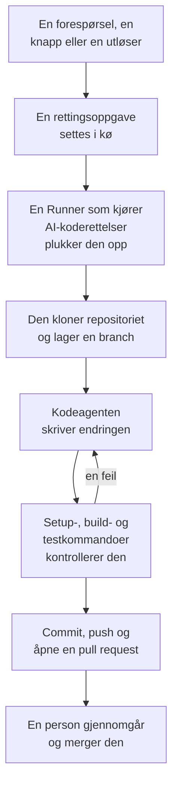

# Kode

Kode er der du ber OneUptime AI om å jobbe i repositoriene dine, slik du ville bedt en kodeagent: rette en feil, skrive tester, forklare koden, gjøre en endring. Kode åpner på de tilkoblede repositoriene dine; siden til et repositorium har oppgavene og feltet der du spør; siden til en oppgave er en samtale du kan svare i. OneUptime starter også oppgaver på egen hånd, fra unntak, spor og undersøkelser. En [Runner](/docs/runbooks/agents) kloner repositoriet, skriver endringen på en ny branch, bygger og tester den og åpner en pull request. En person gjennomgår og merger hver eneste en: Runneren kan pushe brancher og åpne pull requests, ingenting mer.

:::cards
- [Be AI om noe i et repositorium](#be-ai-om-noe-i-et-repositorium): En forespørsel med dine egne ord, med konteksten den trenger.
- [Samtalen til en oppgave](#samtalen-til-en-oppgave): Hva AI gjorde, hva den endret, og svaret ditt.
- [Slik går en rettingskjøring](#slik-går-en-rettingskjøring): Fra et klikk til en pull request, steg for steg.
- [Hvor rettingsoppgaver starter](#hvor-rettingsoppgaver-starter): Oppgavene OneUptime starter, og hva hver pull request gjør.
- [Før du begynner](#før-du-begynner): En modell, et tilkoblet repositorium og en Runner.
- [Når en retting mislykkes](#når-en-retting-mislykkes): Hva som skjer med en kjøring som feiler, stopper opp eller venter.
:::

> [!TIP]
> Du kan også starte dette fra GitHub. Nevn OneUptime GitHub App i en issue eller en pull request, så implementerer, reviderer eller gjennomgår den der og da: se [GitHub App](/docs/ai/github-app). Det er den samme agenten, den samme Runneren og de samme budsjettene; bare utløseren er en annen.

## Be AI om noe i et repositorium

:::steps
### Åpne et repositorium

Åpne **Produkter → Kode**. Der står prosjektets repositorier, hvert med oppgavene AI jobber med, de som venter på deg, og de åpne pull requestene. Finnes det ingen ennå, tilbyr Kode **Koble til GitHub** (se [Før du begynner](#før-du-begynner)).

### Si hva du vil

Skriv endringen, feilen eller spørsmålet med dine egne ord på repositoriets side. Et repositorium uten oppgaver foreslår noen under **Prøv å spørre**.

### Legg til kontekst

Klikk på **Legg til kontekst** for å gi AI det den trenger: en fil eller mappe i repositoriet, et notat, en lenke eller en post i prosjektet. OneUptime leser hver post når du sender forespørselen, med dine tillatelser, og tar vare på det AI fikk.

### Start oppgaven

Klikk på **Start oppgave**, eller trykk Enter. Oppgavens side åpnes, og arbeidet til AI vises der mens det skjer.
:::

| Kontekst | Hva AI får |
| --- | --- |
| **Fil eller mappe** | En sti i repositoriet, som AI leser først. |
| **Notat** | Tekst du limer inn: en feil, en spesifikasjon, en logglinje. |
| **Lenke** | En nettadresse, som referanse. |
| **Hendelse** eller **Varsel** | Tilstanden, beskrivelsen og rotårsaken, slik de er når du sender forespørselen. |
| **Unntak** | Meldingen og stack tracen. |
| **Overvåking** | Typen, statusen og beskrivelsen. |
| **Spor** | Spanene: navnene, tidene og feilene deres. |
| **Logger** | De siste 20 logglinjene som inneholder søket ditt, fra den siste timen, dagen eller uken. |

En forespørsel bærer høyst 10 kontekstelementer. Tokener, nøkler, passord og e-postadresser i det OneUptime leser, sladdes før AI ser dem, som overalt der OneUptime AI leser dataene dine.

## Samtalen til en oppgave

Siden til en oppgave er en samtale: hva det ble spurt om og konteksten som ble lagt til, deretter turen til AI – stegene den tar mens den tar dem (filene den leste og redigerte, hva den søkte etter, kommandoene den kjørte), svaret, filene den endret med diffen deres, og pull requesten. Øverst på siden står det hvordan det står til med oppgaven:

| Tilstand | Hva det betyr |
| --- | --- |
| **I kø** | Den venter på at en Runner tar den. |
| **Jobber…** | AI jobber med den. **Stopp** stopper den; det den har pushet, blir liggende på branchen. |
| **Venter på deg** | AI har stilt et spørsmål. Svar på det i feltet nedenfor. |
| **Ferdig** | AI er ferdig: svaret, og pull requesten når den endret kode. |
| **Mislyktes** | Turen kunne ikke fullføres, og sier hvorfor. **Prøv igjen** ber om det samme på nytt. |
| **Stoppet** | Noen stoppet den. **Prøv igjen** ber om det samme på nytt. |

For å følge opp skriver du i feltet nederst: svar AI, legg til kontekst eller be om endringer. Hvert svar er neste tur i samme oppgave: den jobber på samme branch og pusher til samme pull request så lenge den er åpen. En oppgave tar én tur om gangen, så feltet venter mens AI jobber. **Logg** for hver tur er den ordrette oversikten over hva den gjorde.

Den som kan lese et repositorium, leser oppgavene i det. Å be AI om noe, svare og stoppe en oppgave krever tillatelse til å redigere repositoriet, og det samme gjør det å se diffen til en endring: alle andre ser hvilke filer som er endret. Oppgavene OneUptime starter på egen hånd (nedenfor), står også i repositoriet sitt, som samtaler du kan svare i.

## Slik går en rettingskjøring



1. Du klikker **Start oppgave** i et repositorium, eller **Fix with AI** på et uløst unntak, eller en annen knapp eller utløser starter en oppgave (se [Hvor rettingsoppgaver starter](#hvor-rettingsoppgaver-starter)).
2. Oppgaven settes i kø, og en ledig Runner med **Kjører AI-koderettelser** slått på plukker den opp.
3. Runneren henter oppgavens kontekst. For en forespørsel er det ordene, konteksten som ble lagt til, og samtalen så langt; for et unntak typen, meldingen og stack tracen.
4. Den kloner repositoriet til et eget arbeidsområde og lager en branch. En retting av et unntak heter `oneuptime-fix-exception-` etterfulgt av de første tegnene i kjøringens id. Et svar jobber i stedet på branchen til oppgavens åpne pull request.
5. En kodeagent, drevet av prosjektets LLM-leverandør, leser koden og skriver endringen. OneUptime-serveren gjør LLM-kallene, slik at Runneren aldri har leverandørens API-nøkkel, og hvert kall måles og vises i AI-loggene.
6. Har repositoriet kontrollkommandoer, bygger og tester din egen Runner endringen før den committer noe, og gir en feil tilbake til kodeagenten for å reparere den (se [Kontroll før pull requesten](#kontroll-før-pull-requesten)).
7. Runneren committer, pusher branchen, åpner pull requesten (for en forespørsel bare når den endret kode) og sletter arbeidsområdet.

Siden oppgaven ble startet fra, viser statusen live. Hver oppgave står i repositoriet sitt under **Produkter → Kode**: siden er samtalen, og **Logg** for hver tur har en linje for hver fil Runneren leste eller skrev og hver kommando den kjørte.

Hver kjøring holdes innenfor budsjetter som serveren håndhever: høyst **40 LLM-kall** og **100 000 utdata-tokens**. En kjøring som når ett av dem, avslutter med et sammendrag av arbeidet så langt i stedet for å gå i ring. Rettingskjøringer teller også mot prosjektets daglige AI-grenser, når prosjektet setter dem.

## Hvor rettingsoppgaver starter

| Hvor | Klikk | Pull requesten |
| --- | --- | --- |
| Et unntaks side **AI Assistance** | **Fix with AI** | Retter feilen bak unntaket. |
| Et unntaks side **AI Assistance** | **Generate Regression Test** | Legger til en test som gjenskaper unntaket og feiler til feilen er rettet. |
| Et unntaks side **AI Assistance** | **Forbedre feilhåndtering** | For en forventet feil, som ugyldig inndata: tar brukerdata ut av meldingen, validerer inndataene tidligere og merker feilen som håndtert, uten å endre oppførselen. |
| En hendelses eller et varsels kort **AI Investigation** | **Open Fix PR from this analysis** | Retter rotårsaken undersøkelsen publiserte (se [Automatiske koderettinger fra undersøkelser](#automatiske-koderettinger-fra-undersøkelser)). |
| Et spor som er verdt å rette | **Fiks ytelsen med AI** | Retter det trege mønsteret som knappen nevner, som en N+1-spørring eller kall som kunne kjørt parallelt. |
| En tjenestes side **Logger** | **Forbedre logging** | Gjør tjenestens logger strukturerte, med riktig alvorlighetsgrad og knyttet til sporene, uten å endre oppførselen. |
| En tjenestes side **Spor** | **Forbedre sporing** | Legger til spans og attributter der tjenestens tracing mangler, uten å endre oppførselen. |

Disse knappene vises bare der de kan starte en oppgave. Med AI slått av for prosjektet vises ingen av dem, og sidemenyen til et unntak har ingen **AI Assistance**. **Forbedre logging** og **Forbedre sporing** vises så snart et repository er koblet til, og **Fiks ytelsen med AI** bare på et spor som er verdt å rette (se [Sporutforsker](/docs/telemetry/traces-explorer)).

For å åpne et unntaks side **AI Assistance**, åpne unntaket under **Produkter → Observerbarhet → Unntak** og velg **AI Assistance** i sidemenyen. Et løst eller arkivert unntak må først merkes som uløst.

OneUptime AI starter også rettingsoppgaver på egen hånd: fra en undersøkelse som finner en kodeendring, fra en som ender uten konklusjon fordi telemetri manglet, og fra AI Insights om unntak og trege spor. Hver har sin egen bryter; se [Automatiske koderettinger](/docs/ai/ai-sre#automatiske-koderettelser).

## Kontroll før pull requesten

Et repositorium kan ha opptil tre kontrollkommandoer på siden **Innstillinger** i Kode:

| Kommando | Eksempel | Når den kjører |
| --- | --- | --- |
| **Setup Command** | `npm ci` | Først, for å installere avhengigheter. |
| **Build Command** | `npm run build` | Etter oppsettet. |
| **Test Command** | `npm test` | Til slutt. |

Når en av dem er satt, kontrollerer hver rettingskjøring endringen sin før pull requesten åpnes:

1. Når kodeagenten er ferdig, kjører kommandoene i rekkefølge i roten av repositoriet, på Runneren, i det klonede arbeidsområdet. Hver får opptil 15 minutter og kjører med `CI=true`, slik at ingenting venter på inndata; den første feilen stopper gjennomkjøringen.
2. Ved en feil går slutten av utdataene fra den feilende kommandoen tilbake til den samme kodeagenten som en reparasjonsoppgave, med beskjed om å rette sin egen endring i stedet for å svekke eller hoppe over tester, og kommandoene kjører på nytt. Den gjør høyst **2** reparasjonsforsøk. De deler kjøringens LLM-budsjett, og endringene havner i samme commit som rettingen.
3. Utfallet, bestått, feilet eller hoppet over (ingen kommandoer satt, eller en delt Runner), skrives i en Verification-seksjon i pull requestens beskrivelse og registreres på oppgavens pull request.

En endring som fortsatt ikke består kontrollen, kastes ikke: pull requesten åpnes likevel, med en tydelig merket seksjon "Verification failed" som nevner den feilende kommandoen og slutter med utdataene dens. Arbeidet beholdes, og den som gjennomgår, bestemmer. Et repositorium uten kommandoer rapporteres som hoppet over, i stedet for å antyde et grønt bygg.

Kommandoene er repositoriuminnstillinger som teamet ditt skriver, og de kjører på din egen Runner: samme tillitsmodell som Bash-stegene i en runbook. AI-en skriver eller endrer dem aldri. OneUptimes delte Runnere kjører dem aldri: på en delt Runner skrives rettingen og åpnes for gjennomgang, kontrollen rapporteres som hoppet over, og repositoriets egen CI sjekker endringen. [Kjør din egen Runner](#kjør-din-egen-runner) for å få rettinger bygget og testet før pull requesten åpnes.

## Før du begynner

En oppgave trenger tre ting. Siden til et repositorium i Kode og unntakets side **AI Assistance** kontrollerer alle tre før de tilbyr å starte, og sier hva som mangler.

| Hva | OneUptime Cloud | Selvhostet |
| --- | --- | --- |
| En LLM-leverandør | Ingenting å sette opp: et prosjekt uten egen leverandør bruker den globale leverandøren, betalt fra prosjektets AI-kreditter. En egen leverandør, under **Prosjektinnstillinger → KI → LLM-leverandører**, går foran. | Sett miljøvariablene `GLOBAL_LLM_PROVIDER_*` én gang på serveren, eller legg til en leverandør i prosjektet. |
| Et repositorium koblet til via GitHub App | **Produkter → Kode**, deretter **Koble til GitHub**. Hvis appen allerede er installert på GitHub-kontoen, klikker du i stedet på **Koble til en eksisterende installasjon**: den blir ikke koblet til av å installere den på nytt. Krever Growth-planen. | Det samme, når instansen din har en GitHub App (se [GitHub-integrasjon](/docs/self-hosted/github-integration)). |
| En Runner som kjører AI-koderettelser | Ingenting å drifte: OneUptimes delte Runnere gjør det. | Docker Compose-tjenesten `runner`, eller Helm-chartets Runner (`runner.enabled`, på som standard), registrerer seg selv og kjører AI-koderettelser. |

På en selvhostet instans er den globale leverandøren én blokk i `config.env` (Docker Compose) eller i Helm-verdiene dine. For en selvhostet Ollama:

```bash
GLOBAL_LLM_PROVIDER_TYPE=Ollama
# An address the OneUptime server can reach, never localhost.
GLOBAL_LLM_PROVIDER_BASE_URL=http://ollama:11434
GLOBAL_LLM_PROVIDER_MODEL_NAME=llama3.1
# No GLOBAL_LLM_PROVIDER_API_KEY needed — Ollama is keyless.
```

Enhver støttet leverandør fungerer: se [LLM-leverandører](/docs/ai/llm-provider) for alle leverandørene og hver miljøvariabel.

Du knytter ikke repositorier til tjenester. Når en oppgave starter, finner OneUptime repositoriet ved å sammenligne filstiene i unntakets stack trace med de tilkoblede repositoriene dine. Når ingenting passer, faller den tilbake på et repositorium som heter det samme som tjenesten, og deretter på prosjektets eneste repositorium når det bare finnes ett. Siden **AI Assistance** viser hvilket repositorium den fant.

### Kjør din egen Runner

Slik kjører du en Runner et annet sted, for eksempel på en maskin nær repositoriene dine:

:::steps
### Opprett Runneren

Opprett en Runner under **Runbooks → Runbook-agenter** og klikk **Vis oppsettsinstruksjoner** på raden. Kommandoen inneholder Runnerens hemmelige nøkkel, som bare en Project Owner, Project Admin eller Runbook Admin kan lese. Den ser slik ut:

```bash
docker run --name oneuptime-runner --restart unless-stopped \
  -e ONEUPTIME_RUNNER_ID=<runner-id> \
  -e ONEUPTIME_RUNNER_KEY=<runner-key> \
  -e ONEUPTIME_URL=<your-oneuptime-url> \
  -d oneuptime/runner:release
```

### Slå på AI-koderettelser

Slå på **Kjører AI-koderettelser** på Runneren. Den er av som standard, og Runneren fanger opp endringen ved neste heartbeat, innen omtrent ett minutt; det er ingenting å starte på nytt.

### Kontroller at den kobler til

Runneren vises som tilkoblet på siden **Runbooks → Runbook-agenter** innen et minutt eller to. Hvis ikke, les containerens logg (`docker logs oneuptime-runner`) etter en feil med påloggingsdetaljer eller nettverk.
:::

Enhver måte å kjøre containeren på fungerer (Docker Compose, Kubernetes og så videre), så lenge den har disse variablene og kan nå OneUptime-instansen din over HTTPS:

| Variabel | Hva den er |
| --- | --- |
| `ONEUPTIME_RUNNER_ID` | Runnerens id, fra dashbordet. |
| `ONEUPTIME_RUNNER_KEY` | Runnerens hemmelige nøkkel. |
| `ONEUPTIME_URL` | Adressen til OneUptime-instansen din (`https://oneuptime.com` på OneUptime Cloud). |

> [!NOTE]
> Før OneUptime 12 kjørte AI-koderettelser på en egen AI Agent-komponent (imaget `oneuptime/ai-agent` med `AI_AGENT_*`-variabler). Den er slått sammen med Runneren: kjører du fortsatt en, forklarer [oppgraderingsveiledningen fra v11 til v12](/docs/installation/upgrading) hvordan du erstatter den.

## Automatiske koderettinger fra undersøkelser

Når en [AI-undersøkelse](/docs/ai/ai-sre) publiserer en rotårsaksanalyse på en hendelse eller et varsel, og den nøye klassifiseringen anbefaler en endring i koden, tilbyr undersøkelseskortet **Open Fix PR from this analysis**: en rettingsoppgave der hele konteksten er den publiserte analysen. Knappen er skjult når løsningen er driftsmessig, bare gjelder infrastruktur, er ekstern, er en forventet avvisning, en brukerfeil eller uten konklusjon. Egnede rettinger skjer uten klikket så lenge bryteren **Åpne en pull-forespørsel med en rettelse når en undersøkelse finner en kodeendring** er på. Den hører til rettingen: den ligger under **Rett nye hendelser automatisk** på **Hendelser → KI → Innstillinger** (og under **Rett nye varsler automatisk** på **Varsler → KI → Innstillinger**), slås på når rettingen slås på, og åpner bare pull requests mens rettingen er på. Begge starter av, også for nye prosjekter.

Mens den er på, setter en undersøkelse som ender med en sikker, underbygd rotårsak som en kodeendring kan rette, den samme rettingsoppgaven i kø som knappen oppretter. Avgjørelsen er en avgrenset klassifisering som serveren kontrollerer, aldri et mønster som matches mot analysens tekst: bare en positiv dom om en koderetting åpner en pull request. Manglende belegg, en løsning utenfor koden og en mislykket klassifisering ender alle med at ingenting skjer.

Alt annet er som med knappen:

- Pull requesten åpnes klar for gjennomgang, skrevet ut fra den publiserte analysen, og trenger et repositorium koblet til via GitHub App og en Runner med **Kjører AI-koderettelser** slått på.
- Den teller mot signalets daglige grense for rettingsoppgaver (**Daily Incident AI Fix Task Limit** eller **Daily Alert AI Fix Task Limit**, under **Flere innstillinger** på AI-innstillingssiden) og mot repositoriets tak på åpne pull requests, når en av dem er satt. Når de ikke er satt, begrenser ingen av dem noe.
- Hver utløser ser først etter en rettingsoppgave som allerede står i kø eller kjører for den samme hendelsen eller det samme varselet, slik at en automatisk utløser og et klikk normalt blir én oppgave, ikke to pull requests. Kontrollen er en lesing før skrivingen, ikke en lås, så to utløsere i nøyaktig samme øyeblikk kan fortsatt begge slippe gjennom.
- Kjøringen skrives av systemet, krediteres ingen, og ingenting merges av seg selv.

## Når en retting mislykkes

:::details Kjøringen feiler
Rettingen kunne ikke brukes, repositoriet kunne ikke nås, eller LLM-kallet mislyktes. Oppgavens samtale, og siden den ble startet fra, viser årsaken og tilbyr å prøve igjen. **Logg** for turen har hele kjøringsloggen.
:::

:::details Runneren stopper midt i en kjøring
En kjøring der heartbeat har vært stille i mer enn 12 minutter, avsluttes med en feil. Den settes aldri i kø igjen av seg selv, fordi Runneren allerede kan ha pushet en del av en rettingsbranch; start den på nytt der du startet den.
:::

:::details Ingen Runner plukker opp oppgaven
En oppgave som venter i mer enn 30 minutter mens ingen Runner med **Kjører AI-koderettelser** er tilkoblet, feiler med en melding om å sjekke Runneren, slik at den aldri vises som pågående for alltid. Når en Runner er tilkoblet, men opptatt, venter oppgaver i kø på tur. En Runner som er eldre enn Kode, får aldri en forespørsel fra Kode: oppdater en Runner du kjører selv, sammen med serveren.
:::

## Personvern

Klonen av repositoriet ditt ligger i et arbeidsområde inne i Runnerens container og slettes når kjøringen slutter, enten den lyktes eller ikke. Runneren har aldri LLM-leverandørens API-nøkkel: OneUptime-serveren gjør LLM-kallene for den. OneUptime beholder ikke repositoriet ditt og trener ikke på koden din. Oppgavens logg beholder de første 300 tegnene av utdataene fra hvert steg, slik at du kan sjekke hva Runneren gjorde, og det kan inneholde kodebiter. Kjør en selvhostet Runner med din egen LLM-leverandør (lokal Ollama inkludert), og koden din forlater aldri infrastrukturen din.

## På veikartet

Planlagt, og **ikke tilgjengelig i dag**:

- **Støtte for GitLab.** Repositorier kobles bare til via GitHub App.
- **Mer telemetri i en retting.** Å gi rettingen sporene, loggene og målingene rundt et unntak, utover stack tracen.

## Neste steg

:::cards
- [GitHub App](/docs/ai/github-app): Be om en endring, en revisjon eller en gjennomgang rett fra GitHub.
- [AI SRE](/docs/ai/ai-sre): Undersøkelsene som rettingsoppgaver kan gjøre analysene til pull requests for.
- [Runbook-agenter](/docs/runbooks/agents): Workeren som utfører hver rettingskjøring.
:::
