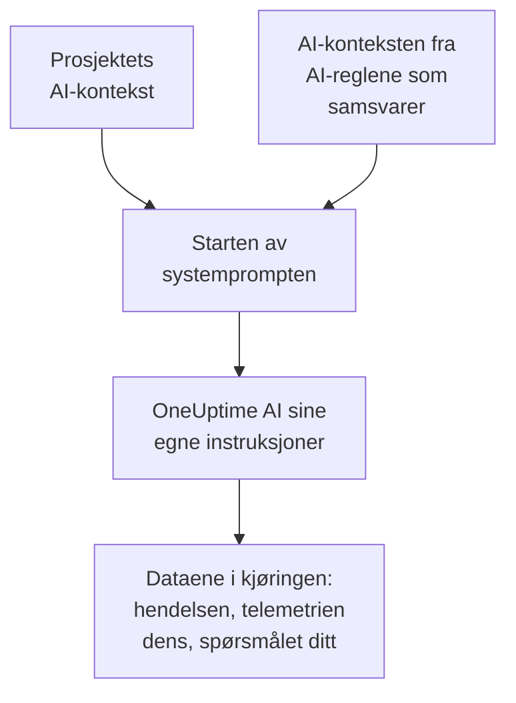

# AI-kontekst

AI-konteksten er det teamet ditt skriver ned for OneUptime AI om deres egne systemer: hvordan de henger sammen, hvem som eier hvilket symptom, hvor loggene ligger og hvilke ord teamet ditt bruker. OneUptime AI leser den først i hver undersøkelse, hver retting, hvert utkast til etteranalyse og hver samtale i Spør AI, så den starter med det teamet ditt allerede vet.

:::cards
- [Skriv AI-konteksten](#skriv-ai-konteksten): Ett kort i prosjektets AI-innstillinger.
- [En AI-regels egne notater](#en-ai-regels-egne-notater): Notater om det én regel samsvarer med.
- [Hva som leser den](#hva-som-leser-den): Funksjonene som leser den, og de som ikke gjør det.
- [Hva en kjøring leste](#hva-en-kjøring-leste): Hver kjøring viser notatene den fikk.
:::

## Slik fungerer det

OneUptime AI setter AI-konteksten helt i starten av systemprompten sin, foran sine egne instruksjoner og dataene i kjøringen: først prosjektets notater, deretter notatene fra AI-reglene som samsvarer. Den leser dem som bakgrunnskunnskap fra teamet ditt. De er ikke bevis for hva som skjer akkurat nå, og de endrer aldri OneUptime AI sine egne regler.

Fordi notatene kommer først og er de samme fra én kjøring til den neste, hører de til starten av prompten som leverandører lagrer i hurtigbufferen. Hos Anthropic merker OneUptime systemprompten for hurtigbufring; OpenAI, Azure OpenAI og de andre leverandørene som lagrer en gjentatt start av en prompt i hurtigbufferen, gjør det på egen hånd. Notater som ikke er endret, koster mindre å lese på nytt.

## Skriv AI-konteksten

:::steps
### Åpne AI Features
Åpne **Prosjektinnstillinger → KI → AI Features**. Kortet **AI-kontekst** ligger under **Aktiver AI**.

### Skriv notatene
Klikk på **Legg til AI-kontekst**, eller på **Rediger** når det finnes notater. Skriv i Markdown, eller klikk på **Start med en disposisjon** for å få en overskrift for hver type notat.

### Lagre dem
Klikk på **Lagre endringer**. Kortet viser notatene, hvor lange de er, og omtrent hvor mange tokener en modell leser dem som.
:::

Skriv det du ville fortalt noen som akkurat har begynt i teamet:

| Type notat | For eksempel |
| --- | --- |
| Hvordan systemene deres henger sammen | `checkout-api` leverer betalingssiden og er avhengig av `payments-db`. |
| Hvem som eier hvilket symptom | En 502 på betalingssiden hører til Betalings-teamet: sjekk `payments-db` først. |
| Hvor loggene ligger | Loggene for betalingen ligger i Loki under `app=checkout`. |
| Ordene teamet ditt bruker | PSP er betalingstjenesteleverandøren vår. |

> [!WARNING]
> Utelat hemmeligheter: alle som kan se hva en AI-kjøring gjorde, kan lese notatene den fikk.

## En AI-regels egne notater

En AI-regel kan ha egne notater om hendelsene eller varslene den samsvarer med: tjenestene til ett produkt, hvem som eier dem, hvor loggene deres ligger. Skriv dem i regelens **AI-kontekst** under **Flere felt**, etter **LLM-leverandør**. En regel som bare kjører runbookene sine hver gang, spør ikke OneUptime AI om noe, og har derfor ingen AI-kontekst å skrive.

- En undersøkelse leser prosjektets notater, deretter notatene fra hver aktiverte AI-regel som undersøker og samsvarer med hendelsen eller varselet, i rekkefølgen til reglenes navn.
- En retting leser prosjektets notater, deretter notatene fra sin egen regel.
- Samtalen om en hendelse eller et varsel leser de samme notatene som undersøkelsen av den.

## Hva som leser den

| Funksjon | Hva den leser |
| --- | --- |
| Undersøkelser fra AI SRE, og de nye kontrollene deres når et nytt varsel åpnes | Prosjektets notater, og notatene fra AI-reglene som samsvarer |
| Rettingene en AI-regel starter: planene, kommandoene og MCP-serverne deres | Prosjektets notater, og regelens |
| Spør AI, og samtalen om en hendelse eller et varsel | Prosjektets notater; ved en hendelse eller et varsel også notatene fra AI-reglene som samsvarer |
| Svar i Slack og Microsoft Teams | Prosjektets notater |
| Utkast til etteranalyser, for hendelser og episoder | Prosjektets notater |
| Triage i AI Insights og triage av sikkerhetssaker | Prosjektets notater |

Kall som bare omformulerer eller vurderer det de får, leser den ikke: utkast til notater og offentlige notater, sammendrag av samtaler, en undersøkelses sammendrag, hvor sikker den er og karakteren dens, og tittelen på en samtale. Det gjør heller ikke promptene folk skriver selv, i AI-trinnet i en arbeidsflyt eller en runbook.

## Grenser

| Hva | Høyst |
| --- | --- |
| Prosjektets AI-kontekst | 20 000 tegn |
| En AI-regels AI-kontekst | 5 000 tegn |
| All AI-konteksten én kjøring leser | 30 000 tegn |

Skjemaet teller tegnene mens du skriver og nekter å lagre over grensen, og det gjør API-et også. En kjøring leser først prosjektets notater, deretter notatene fra hver regel som samsvarer, i rekkefølgen til navnene deres. En regel der notatene ville ført kjøringen over 30 000 tegn, utelates helt, og aktiviteten til kjøringen sier det.

Antallet tokener er et anslag: størrelsen på notatene i UTF-8-byte delt på 4, rundet opp. Hver modell teller tokener på sin egen måte, så en leverandørs telling kan avvike, mest for tekst som ikke er på engelsk.

## Hva en kjøring leste

Hver kjøring lagrer ord for ord notatene den leste. Aktiviteten dens sier **Leste prosjektets AI-kontekst**, eller hvor mange AI-reglers notater den også leste, med omtrent hvor mange tokener det ble. **Vis** åpner notatene slik kjøringen leste dem: først prosjektets, deretter hver regels under navnet sitt, også etter at de er endret. Når notatene fra en regel ble utelatt på grunn av grensen for kjøringen, sier en melding det.

## Hvem som kan endre den

- **Prosjekteier** og **Prosjektadministrator** kan endre prosjektets AI-kontekst. **Prosjektmedlem**, **Leser** og **Read Project** kan lese den.
- Notatene til en AI-regel er en del av regelen: den som kan endre regelen, kan endre dem.
- Notatene leses bare for sitt eget prosjekt: ingen kjøring leser AI-konteksten til et annet prosjekt.

Gjennom API-et eller Terraform er prosjektets notater prosjektets `aiContext`, og notatene til en AI-regel er regelens egen `aiContext`.

## Neste steg

:::cards
- [AI SRE](/docs/ai/ai-sre): La OneUptime AI undersøke hver nye hendelse og hvert nye varsel.
- [Spør AI](/docs/ai/ask-ai): Spør om dataene i prosjektet ditt i en samtale.
- [LLM-leverandører](/docs/ai/llm-provider): Velg modellen som leser notatene.
:::
