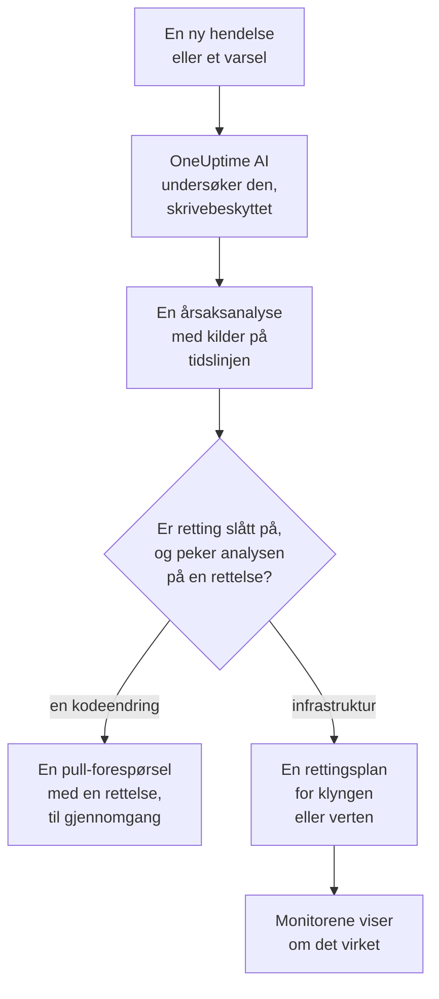
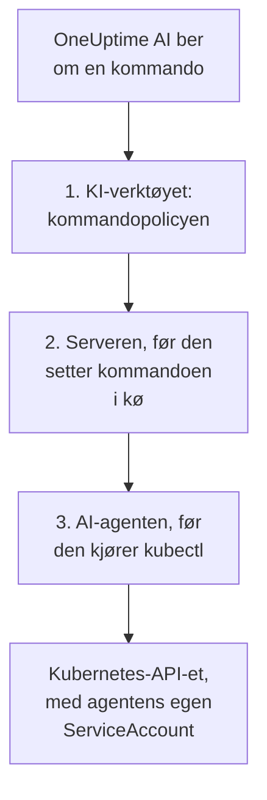

# AI SRE

OneUptime AI er din KI-drevne Site Reliability Engineer. I det øyeblikket en ny hendelse eller et nytt varsel blir erklært, setter den i gang, undersøker den ut fra din egen telemetri (logger, metrikker, traces, unntak, monitorer og nylige endringer) og legger ut en årsaksanalyse med kildehenvisninger på tidslinjen til hendelsen eller varselet, som regel før den som har vakt, er ferdig med å lese varslingen.

Hver påstand i analysen har en kildehenvisning som lenker direkte til de nøyaktige dataene som underbygger den, og selve undersøkelsen er **strengt skrivebeskyttet**: OneUptime AI kan aldri endre noe i prosjektet ditt mens den undersøker.

:::cards
- [Slik fungerer det](#slik-fungerer-det): Fra en ny hendelse til en analyse med kilder, og til en rettelse når du tillater det.
- [Slå på KI-undersøkelser](#slå-på-ki-undersøkelser): Bryterne, og hva de krever.
- [Klyngetilgang: la OneUptime AI kjøre kubectl](#klyngetilgang-la-oneuptime-ai-kjøre-kubectl): Undersøk, og rett, inne i Kubernetes.
- [Kostnadskontroll](#kostnadskontroll): Grenser for hendelser, for varsler og for hele prosjektet.
:::

## Slik fungerer det

OneUptime AI gjør tre ting for en ny hendelse eller et nytt varsel, og hver av dem har sin egen bryter:

- **Den undersøker** (på som standard). Den leser telemetrien din, og klyngene og vertene der en AI-agent kjører, og legger ut en årsaksanalyse med kilder. En undersøkelse endrer ingenting.
- **Den retter** (av som standard). Når retting er slått på, blir en sikker analyse til en rettelse: en pull-forespørsel med en endring i koden din, eller en plan med kommandoer for en klynge eller en vert, kjørt slik AI-agenten for den klyngen eller verten tillater.
- **Den lærer.** Sidene i AI Insights forteller hva som stadig går galt, utledet fra alt som er registrert.



En analyse som ikke finner noen årsak, legges ut i stillhet, uten å varsle noen (se [Stille modus](#stille-modus)), og ingenting rettes uten en årsak.

## Hva undersøkelsen legger ut

Når en undersøkelse er ferdig, legger OneUptime AI ut en årsaksanalyse med disse delene:

- **Summary**: en eller to setninger som en varslet person kan lese på fem sekunder.
- **Most likely root cause**: hypotesen, bare med den sikkerheten bevisene gir, og med kilde for hver faktapåstand. Er telemetrien ikke tilstrekkelig, sier KI-en det rett ut og lister opp hva den sjekket, i stedet for å gjette.
- **Evidence**: de viktigste funnene som støtter eller utelukker hypotesen, hvert med kilde.
- **Suggested next steps**: konkrete tiltak for den som har vakt.

For hendelser legges analysen ut i hendelsens feed **og** som et internt notat på hendelsen (der de som håndterer den, samarbeider). For varsler legges den ut i varselets feed.

Mens undersøkelsen pågår, viser siden til hendelsen eller varselet et live-panel **AI Investigation** som forteller om hvert trinn (hvilke verktøy som kjørte, hva de fant og hvor lang tid de brukte), så du kan se den tenke. Hvis en undersøkelse mislykkes, viser panelet årsaken i stedet for et stille hull.

En undersøkelse kjører til den er ferdig: den har **ingen tidsgrense** og ikke noe lite spørringsbudsjett, så den kan kjøre alle spørringer og alle kubectl- eller infrastrukturkommandoer den trenger. Lange kommandoutdata (en `kubectl describe node` for en travel node, loggene til en pod) blir aldri kuttet: OneUptime AI leser dem én side om gangen. Vil du ha en hard stopp, angir du en **tidsgrense for undersøkelser** for hver signaltype (se **Kostnadskontroll** nedenfor).

## Hva en undersøkelse leser

En undersøkelse starter ved hendelsen eller varselet og ved infrastrukturen den er koblet til: vertene, Docker- og Podman-vertene, Kubernetes-klyngene, databasene og tjenestene som overvåkingene dens følger med på. En nettsted-, API- eller syntetisk overvåking følger med på det du kobler den til under **Overvåking → Oversikt → Tilkoblede ressurser**, så koble den til vertene som leverer det den sjekker, og hver undersøkelse av hendelsene dens starter der. Før alt dette leser den prosjektets [AI-kontekst](/docs/ai/ai-context): det teamet ditt har skrevet ned for OneUptime AI om deres egne systemer, med notatene fra AI-reglene som samsvarer.

- Varslene på den infrastrukturen som ble åpnet i de 30 minuttene før hendelsen, eller som fortsatt er åpne, de nyeste først, som varselet om høy CPU på verten bak et tregt nettsted. Private varsler utelates.
- Infrastrukturens egne metrikker, lest slik folk leser dem. Vertsmetrikker som `system.cpu.utilization` og `system.memory.utilization` rapporteres én gang per tilstand, og tilstandene summerer til 100 %, så ett gjennomsnitt over alle sier ingenting. OneUptime AI leser dem én tilstand om gangen (opptatt CPU er user pluss system), og enhver metrikk per container, per monteringspunkt eller etter et hvilket som helst annet attributt.
- Containerne på en Docker- eller Podman-vert: de travleste etter CPU, minne eller omstarter, og de som sluttet å rapportere. En stoppet container sender ingenting i stedet for null, så tallene for hele verten skjuler den.
- Endringene som er registrert i de 2 timene før hendelsen eller varselet (utrullinger, Kubernetes-rollouts, konfigurasjonsendringer og rettelsene OneUptime kjørte), og hvilke av dem telemetrien til tjenestene gjør til mistenkte: en tjeneste som ble målbart dårligere rett etter en endring. Se [Utrullinger og endringer](/docs/telemetry/change-events).

Undersøkelsens aktivitet på kortet **AI Investigation** sier hvor mange åpne eller nye varsler den leste, og på hvilke ressurser.

### Sjekket igjen når et nytt varsel åpnes

En undersøkelse starter i det øyeblikket en hendelse erklæres, og et vertsvarsel som trenger noen minutter med metrikker, kan åpnes etterpå. Når et varsel åpnes på hendelsens tilkoblede infrastruktur innen 30 minutter etter hendelsen, etter at undersøkelsen leste den, og hendelsen fortsatt er åpen, sjekker OneUptime AI hendelsen én gang til med det varselet i hånden. Den nye analysen begynner med **Checked again** og varselet som utløste sjekken, og aktiviteten dens sier det også. Hvis en AI-regel fikk OneUptime AI til å vente før den undersøkte hendelsen, telles de minuttene i stedet fra da undersøkelsen ble ferdig (se [Vent før undersøkelsen](#vent-før-undersøkelsen)).

Det skjer høyst én gang per hendelse, med de samme bryterne og grensene som en ny undersøkelse: **Aktiver AI**, _Undersøk nye hendelser_, AI-kredittene og grensene per dag og for samtidighet. Det er ingenting å slå på. En oppfølgingssjekk kjører aldri automatisk utbedring på nytt og blir aldri selv fulgt opp, og undersøkelsen av et varsel sjekkes ikke igjen.

## Snakk med OneUptime AI om hendelsen

Kortet **AI Investigation** slutter med en samtale, **Ask OneUptime AI**, som deles av alle som kan se hendelsen eller varselet. Det er ett kort uansett hva som skjedde over det: under en rapport stiller du oppfølgingsspørsmål, og når ingen automatisk undersøkelse kjørte (eller den stoppet før rapporten), er det første forslaget **What is the root cause?**, som får OneUptime AI til å undersøke ved behov.

- **Still oppfølgingsspørsmål**: «hvilke pods bruker mest minne?», «hva endret seg rett før dette startet?», «er noe annet berørt?». OneUptime AI bygger videre på rapporten sin, henter ferske data (og kjører skrivebeskyttede kubectl- eller infrastrukturkommandoer der den har tilgang, på klyngene og ressursene du har lov til å se) og oppgir kilde for hver påstand.
- **Be den handle**: «bekreft denne hendelsen», «legg ut en statusoppdatering om at vi undersøker», «varsle databasevakten», «øk alvorlighetsgraden». Den bruker de samme handlingene som Spør AI og handler alltid **med dine egne tillatelser**, så den kan aldri gjøre mer enn du kunne.
- **Velg hvordan den handler** med bryteren i meldingsfeltet, som ved siden av forteller hva den valgte modusen betyr: _Auto-run_ (standard: den handler med en gang på en tydelig forespørsel), _Ask to act_ (den viser først et godkjenningskort som alle på hendelsen kan godkjenne eller avvise) eller _Skrivebeskyttet_.
- **Én felles tråd.** Hvert spørsmål viser hvem som stilte det, alle ser den samme samtalen live, og alle kan stoppe et svar underveis. Diagrammer og tabeller i et svar vises for den som spurte; alle andre ser svaret med kilder. Hvert svar lister opp sine **Kilder**, og en kilde med egen side (logger, metrikker, en monitor) åpner den. En lang tråd åpnes ved de nyeste meldingene, med en knapp over dem (for eksempel **Show 6 earlier messages**) som henter frem resten.

En hendelse eller et varsel som OneUptime AI verken undersøkte eller rettet fordi KI var slått av for den – slått av for prosjektet, _Undersøk nye hendelser_ (eller varsler) slått av da den ble opprettet, ingen KI-regel som undersøker samsvarte med den, eller alvorlighetsgraden var under minimum – får i stedet et kort på én linje: **KI-undersøkelse er slått av** (eller **KI er slått av for dette prosjektet**, så lenge det er det), og hvorfor. Pilen, **Dette kan du gjøre**, åpner hva som skal slås på, med en lenke til der det endres for dem som kan endre det, og hvem som kan endre det for alle andre; en endring gjelder bare nye hendelser og varsler, ikke denne. Så lenge KI er slått på, åpner **Ask OneUptime AI** på linjen samtalen, og en samtale som noen allerede har startet, vises av seg selv under linjen. Kortet **Utbedring** utelates da: linjen sier hvorfor ingenting ble rettet.

## Slå på KI-undersøkelser

Autonome undersøkelser er **slått på som standard for nye prosjekter**. Det er også utkast til etteranalyser og AI Insights. Retting starter avslått, og pull-forespørslene som hører til, åpnes bare så lenge retting er på (se [Automatiske koderettelser](#automatiske-koderettelser)). Et prosjekt som ble opprettet før denne standarden, beholder innstillingen sin; slå på undersøkelser som i trinn 3, eller med **Slå på** på siden **AI-agent** for en hvilken som helst Kubernetes-klynge (Project Owner eller Project Admin). Slik sjekker eller endrer du dem:

:::steps
1. **Konfigurer en LLM-leverandør.** Selvhostede installasjoner bruker sin egen nøkkel (eller kjører helt isolert med en lokal Ollama): se [LLM-leverandører](/docs/ai/llm-provider). Brukere av OneUptime Cloud kan bruke den forhåndskonfigurerte globale leverandøren, fakturert som målte KI-tokener, så prosjektet trenger AI-kreditter: en prosjekteier eller en med **Manage Billing** legger dem til på **Prosjektinnstillinger → KI → AI-kreditter**, der **Automatisk påfylling** sørger for at de ikke går tom.
2. **Sørg for at KI er slått på for prosjektet** (det er det som standard): **Aktiver AI** på **Prosjektinnstillinger → KI → AI Features**.
3. **Velg for hver signaltype** (begge på for nye prosjekter):
   - Hendelser: **Hendelser → KI → Innstillinger**: slå på _Undersøk nye hendelser_.
   - Varsler: **Varsler → KI → Innstillinger**: slå på _Undersøk nye varsler_.
:::

Hver KI-atferd på disse sidene er en bryter som lagres så snart du slår den om; det finnes ingen Lagre-knapp. Hendelsessiden har tre, under **Hva OneUptime AI gjør**: _Undersøk nye hendelser_, _Rett nye hendelser automatisk_ og _Skriv utkast til etteranalyse når en hendelse er løst_. Varselsiden har de samme, uten etteranalysen. _Rett nye hendelser automatisk_ (og _Rett nye varsler automatisk_) starter **av**, også for nye prosjekter: den lar OneUptime AI endre infrastrukturen din, så et prosjekt slår den på selv; se [Hvilke hendelser som undersøkes og rettes](#hvilke-hendelser-som-undersøkes-og-rettes). Pull-forespørslene den åpner, en rettelse av koden din og telemetrien en undersøkelse manglet, hører til, og hver AI-regel bestemmer dem: uten regler åpnes begge, og en regel kan slå av hver av dem under **Flere felt** (se [Automatiske koderettelser](#automatiske-koderettelser)). Project Owners og Project Admins kan endre dem; for alle andre er hver bryter låst og forteller hvilken tillatelse den krever.

Sidene sier to ting bare når de stemmer. Er **Aktiver AI** av, kjører ingenting på dem, og siden sier det øverst, med selve bryteren Aktiver AI for dem som kan endre den (Project Owners, og alle med Manage Billing); alle andre får vite hvem som kan. Har prosjektet ingen LLM-leverandør som OneUptime AI kan bruke (ingen i det hele tatt, eller leverandører men ingen satt som standard), sier siden det også, med en lenke til **Prosjektinnstillinger → KI → LLM-leverandører**. På OneUptime Cloud teller den globale leverandøren med, så der står det ingenting.

Hendelser og varsler konfigureres uavhengig av hverandre, så du kan gi hver signaltype sin egen grense for samtidighet, sitt eget daglige tokenbudsjett, sitt eget budsjett for rettingsoppgaver og sine egne regler. Ingen av disse grensene gjelder før du setter dem: de er slått sammen under **Flere innstillinger** nederst på hver side; se **Kostnadskontroll** nedenfor. Å endre en KI-innstilling for varsler endrer ikke den tilsvarende innstillingen for hendelser, og omvendt.

Retting bygger på undersøkelser: så lenge **Rett nye hendelser automatisk** (eller varsler) er på, åpner en undersøkelse som med sikkerhet finner en kodeendring i et repository, automatisk en pull-forespørsel med en rettelse; se **Automatiske koderettelser** nedenfor.

## Klyngetilgang: la OneUptime AI kjøre kubectl

I utgangspunktet kan en undersøkelse bare bruke telemetrien agentene dine sender. For et Kubernetes-signal er det ofte ikke nok: «pods som står fast i Pending» er et planleggingsproblem som du diagnostiserer ved å beskrive poden og lese hendelsene dens, ikke ved å se på en metrikk. **Kubernetes-AI-agenten** lar OneUptime AI gjøre akkurat det og, hvis du tillater det, rette det den finner.

Siden til hver klynge har en del **KI** i sidemenyen:

- **Agent**: klyngens side **AI-agent**: om agenten er tilkoblet, hva KI-en får gjøre på klyngen, og alt som trenger oppmerksomhet, hver med trinnet som løser det. Den samme forklaringen vises i hendelsens undersøkelsespanel når KI-en måtte undersøke med bare OneUptime-data.
- **Innsikt**: klyngens side **KI-innsikt**: hva OneUptime AI har funnet ut om klyngen, hva som stadig går galt og hvorfor, og hva du kan gjøre med det (se [Hva KI-en har lært på en klynge](#hva-ki-en-har-lært-på-en-klynge)).
- **Logger**: klyngens side **AI-logger**: alt OneUptime AI har gjort på klyngen, nyeste først (se [Alt KI-en har gjort på en klynge](#alt-ki-en-har-gjort-på-en-klynge)).

Klyngens **Oversikt** slutter med et kort **AI-agent** som oppsummerer AI-agentens side: om agenten er tilkoblet, om **Undersøk med kubectl** er på, hvordan rettelser kjøres (**Av**, **Be om godkjenning**, **Automatisk** eller **Hopp over godkjenning**) og hva som trenger oppmerksomhet, med en lenke til AI-agentens side, der de endres.

### Kubernetes-AI-agenten: på som standard, skrivebeskyttet

Charten for [OneUptime-Kubernetes-agenten](/docs/telemetry/kubernetes-agent) kjører Kubernetes-AI-agenten som standard: én liten pod (`component=ai-agent`, image `oneuptime/kubernetes-ai-agent`) med en **skrivebeskyttet** ServiceAccount. Den kobler til med API-nøkkelen charten allerede bruker, så det er ingenting å sette opp i dashbordet: innen ett minutt viser klyngens AI-agentside den som **Tilkoblet**, og **Undersøk med kubectl** er på, med mindre noen allerede har valgt KI-innstillinger for klyngen der, som da beholdes som de er.

På en agent som ble installert før Kubernetes-AI-agenten fantes, oppdaterer du først chartindeksen og oppgraderer deretter:

```bash
helm repo update
helm upgrade kubernetes-agent oneuptime/kubernetes-agent \
  --namespace oneuptime-agent --reset-then-reuse-values \
  --set aiAgent.enabled=true
```

`kubernetes-agent` i `oneuptime-agent` er releasenavnet og navnerommet som installasjonsveiledningen i dashbordet bruker; installerte du agenten med andre navn, bruker du dine (`helm list -A | grep kubernetes-agent` viser dem). Uten `helm repo update` kan Helm bruke charten du installerte fra, som ikke kjenner `aiAgent` og feiler med `Additional property aiAgent is not allowed`. På en selvhostet OneUptime oppgraderer du OneUptime før charten: se [Oppgrader agenten](/docs/telemetry/kubernetes-agent#oppgradere-agenten). For å kjøre charten uten AI-agenten sender du med `--set aiAgent.enabled=false`.

**Test tilkoblingen** i menyen **⋯** ved siden av agentens status på AI-agentens side kjører `kubectl version` og `kubectl auth can-i --list` gjennom agenten og viser resultatene: hva den kan nå, og hva den har lov til. Sier siden at agenten ikke er tilkoblet, leser du loggen dens med `kubectl logs -n oneuptime-agent -l component=ai-agent --tail=100`. En nøkkel med et **Festet tjenestenavn** kan ikke registrere agenten: gi charten en nøkkel uten. Når serveren avviser en registrering, sier loggen om avvisningen forsvinner av seg selv (en tidligere agent-pod som fortsatt melder seg, eller den gamle Runneren i klyngen som fortsatt holder på å stenge ned under en oppgradering), eller hva som må endres. **Tilbakestill agenten** i samme meny får serveren til å glemme agentens nøkkel når du bekrefter; poden kobler seg til igjen av seg selv i løpet av noen minutter.

Kubernetes-AI-agenten er ikke en Runner og vises aldri under Runbooks → Runbook-agenter. Den bruker bare sin egen ServiceAccount, så OneUptime gir den aldri påloggingsinformasjon, den brukes aldri som Bash/SSH-vert for runbooks, og den godtas aldri som kommando-Runner for en AI-regel.

### Hva KI-en kan gjøre: bestemt av agenten

Hva OneUptime AI kan gjøre på en klynge, bestemmes der agenten kjører, i charten, med to verdier:

- `aiAgent.investigation`: `true`: KI-en kan kjøre skrivebeskyttet kubectl på klyngen mens den undersøker. `false`: den undersøker fortsatt, med dataene OneUptime allerede har.
- `aiAgent.fixes`: hvordan KI-en tar i bruk en rettelse: `off`, `ask-for-approval`, `automatic` eller `bypass-approval` (se [Slik fungerer rettelser](#slik-fungerer-rettelser)). Alle nivåer unntatt `off` gir AI-agenten skrivetilgang; med `off` har den ingen og avviser selv alle skriveoperasjoner.

AI-agenten rapporterer begge til OneUptime ved hvert heartbeat, og OneUptime bruker dem på klyngen. **Hva AI kan gjøre** på klyngens AI-agentside viser dem (**På** og rettelsesnivået, i grønt når de er på) uten at du kan endre dem der; **Endre** viser hvert alternativ med den nøyaktige `helm upgrade` som setter det. En endring som gjøres et annet sted (på AI-agentens side, via API-et eller Terraform), avvises så lenge agenten bestemmer dem.

En release som ikke setter noen av de to verdiene, lar agenten bruke standardene sine (undersøkelse på; rettelser av, eller ask-for-approval med den eldre `aiAgent.remediation.enabled=true`). OneUptime bruker bare disse standardene på en klynge der ingen har valgt KI-innstillinger på AI-agentsiden: innstillinger som er valgt der, beholdes som de er, og siden viser kommandoen som flytter dem over i charten. Det samme gjelder en klynge der AI-agenten er for gammel til å rapportere dem: en oppgradering av charten med de to verdiene flytter dem.

### La KI-en rette det den finner

Rettelser er av til du slår dem på med `aiAgent.fixes`, som også gir AI-agenten skrivetilgang, helst bare i de navnerommene KI-en får rette, og med nodeoperasjoner slått av:

```bash
helm repo update
helm upgrade kubernetes-agent oneuptime/kubernetes-agent \
  --namespace oneuptime-agent --reset-then-reuse-values \
  --set aiAgent.enabled=true \
  --set aiAgent.investigation=true \
  --set aiAgent.fixes=ask-for-approval \
  --set "aiAgent.remediation.namespaces={web,api}" \
  --set aiAgent.remediation.nodeOperations=false
```

Eller for hele klyngen:

```bash
helm repo update
helm upgrade kubernetes-agent oneuptime/kubernetes-agent \
  --namespace oneuptime-agent --reset-then-reuse-values \
  --set aiAgent.enabled=true \
  --set aiAgent.investigation=true \
  --set aiAgent.fixes=ask-for-approval \
  --set-json 'aiAgent.remediation.namespaces=[]'
```

Erstatt `{web,api}` med navnerommene KI-en får rette. Hvert navnerom i listen må finnes fra før: charten oppretter én RoleBinding i hvert av dem og oppretter aldri et navnerom, så et som mangler, får hele installasjonen eller oppgraderingen (collectoren inkludert) til å feile med `namespaces "api" not found`. Opprett det først, eller ta det ut av listen; ta et navnerom ut av listen før du sletter det. Utelater du flagget ved en oppgradering, beholdes listen som er lagret i releasen, så for å gå tilbake til hele klyngen sender du med `--set-json 'aiAgent.remediation.namespaces=[]'` (Helm 3.10+), slik den andre kommandoen gjør, og ikke `={}`, som Helm leser som ett tomt navn og charten avviser. `--set aiAgent.remediation.namespaces=null` tilbakestiller ikke en lagret liste under `--reuse-values`: Helm beholder den lagrede listen. `aiAgent.remediation.nodeOperations=false` holder rettelser unna noder; sett den til `true` for å la KI-en sperre, åpne, tømme og sette taints på noder (en drain, en taint eller en patch av en node venter fortsatt på et menneske).

Bruk `automatic` eller `bypass-approval` i stedet for `ask-for-approval` for mer selvstendighet, og `--set aiAgent.fixes=off` for å slå av rettelser igjen, noe som også fjerner skrivetilgangen. Rettelser trenger også to prosjektbrytere. **Rett nye hendelser automatisk** (på **Hendelser → KI → Innstillinger**) og **Rett nye varsler automatisk** (på **Varsler → KI → Innstillinger**) starter av: før en av dem er på, rettes ingenting nytt av den typen. **Aktiver AI** (**Prosjektinnstillinger → KI → AI Features**) er på med mindre noen har slått den av; den slår av all KI for prosjektet, uansett hva konfigurasjonen til en agent sier.

### Hvilke hendelser en klynges rettelser virker på

Så lenge **Rett nye hendelser automatisk** er på og ingen AI-regel er satt opp, retter OneUptime AI hver nye hendelse som klyngen er knyttet til, i modusen som AI-agentsiden angir, og det samme for varsler med **Rett nye varsler automatisk**. Med regler retter den bare hendelsene som en regel som retter med OneUptime AI, samsvarer med (se [Hvilke hendelser som undersøkes og rettes](#hvilke-hendelser-som-undersøkes-og-rettes)). Det den ikke er knyttet til, rører den ikke, uansett hvor tydelig årsaken ligger i klyngen. En hendelse eller et varsel er knyttet til en klynge når:

- telemetrien den ble utløst fra, nevner klyngen (en metrikk-, logg- eller trace-monitor på klyngens data);
- monitoren er en Kubernetes-monitor for klyngen;
- monitoren er knyttet til klyngen under **Overvåking → Oversikt → Tilkoblede ressurser**, som er måten å knytte en nettsted-, API- eller syntetisk monitor til klyngen som leverer det den sjekker;
- noen valgte klyngen under **Andre berørte ressurser** da den ble erklært (å velge en tilknyttet monitor legger den til der for deg).

Hver hendelse og hvert varsel sier på kortet **Utbedring** om den var knyttet til en klynge og hva klyngens rettelser gjorde; se [Hva den automatiske utbedringen gjorde](#hva-den-automatiske-utbedringen-gjorde). Det samme gjelder en infrastrukturressurs og AI-agenten dens.

### Hvem som kan endre det

Så lenge Kubernetes-AI-agenten bestemmer undersøkelse og rettelser, er det den som kan endre chartens verdier på klyngen, som endrer dem; OneUptime avviser en endring som gjøres et annet sted. Reglene nedenfor gjelder det som blir værende i OneUptime (kubectl-tillatelseslisten og koblingen til den tidligere Runneren i klyngen) og undersøkelse og rettelser på en klynge der innstillingene fortsatt settes i OneUptime (se [Hva KI-en kan gjøre: bestemt av agenten](#hva-ki-en-kan-gjøre-bestemt-av-agenten)).

Å slå på rettelser (enhver overgang fra **Av** til en annen modus) og å løsne på dem (bytte til **Automatisk** eller **Hopp over godkjenning**, skrive kubectl-tillatelseslisten eller koble til en Runner) krever en Project Owner, en Project Admin eller tillatelsen **Edit AI Rule**, altså de samme personene som kan opprette en AI-regel som retter uten å spørre. **Tilbakestill agenten** krever de samme personene som å slå på rettelser. Å stramme dem inn (**Av**, tilbake til **Be om godkjenning**, tømme tillatelseslisten eller Runner-koblingen) er åpent for alle som kan redigere klyngen, og det samme gjelder **Test tilkoblingen** og å godkjenne en rettelse som OneUptime AI foreslår for den. Alt dette krever tillatelse til å redigere nettopp den klyngen: en tillatelse som er begrenset til bestemte etiketter, eller til klyngene du eller teamene dine eier, når bare de klyngene, og en blokkeringsoppføring med etiketter fjerner klyngene som bærer dem.

### Hva en undersøkelse kan kjøre

Med tilgang kjører en undersøkelse **skrivebeskyttet** kubectl gjennom AI-agenten (`get`, `describe`, `logs`, `events`, `top`, `rollout status/history`, `auth can-i`), så mange kommandoer som den trenger, og oppgir hver kommando som kilde, som ethvert annet bevis. Utdataene kuttes aldri: agenten tar vare på opptil en megabyte av dem, og OneUptime AI leser lange utdata én side om gangen. Tre uavhengige kontroller holder den skrivebeskyttet: policyen som klassifiserer hver kommando, serveren som nekter å sette noe annet i kø for en undersøkelse, og AI-agenten, som sjekker den samme policyen igjen før den starter kubectl. «Skrivebeskyttet: ingenting i systemene dine ble endret» er fortsatt bokstavelig sant.



### Slik fungerer rettelser

**Rettelser** på AI-agentens side har fire innstillinger (chartens `aiAgent.fixes`: `off`, `ask-for-approval`, `automatic`, `bypass-approval`):

- **Av**: KI-en bare undersøker.
- **Be om godkjenning**: etter årsaksanalysen stiller OneUptime AI en diagnose med kubectl og setter sammen den minste kubectl-planen som tar tak i årsaken, for eksempel `kubectl rollout restart deployment/web -n web`. Planen vises på hendelsen med begrunnelse, forventet effekt og tilbakerulling; et menneske godkjenner den med ett klikk, og OneUptime kjører nøyaktig de kommandoene. Kommer ikke monitorene seg, kjøres tilbakerullingen, og OneUptime AI setter sammen én plan til, igjen til godkjenning, med det mislykkede forsøket foran seg, så den velger en annen tilnærming eller sier hva et menneske bør se på.
- **Automatisk**: trygge endringer kjører av seg selv; en mer risikabel endring aldri. Når runden bare fant mer risikable rettelser, avsluttes den med å foreslå nøyaktig disse til godkjenning med ett klikk. Når den også kjørte en trygg rettelse, blir den mer risikable værende i analysen og foreslås bare hvis verifiseringen viser at den trygge rettelsen ikke fikk monitorene til å komme seg, av oppfølgingsrunden, som ber om godkjenning. Legg formen til en mer risikabel kommando inn i tillatelseslisten på AI-agentens side, så kjører også den av seg selv. Automatisk modus løser også signalet når verifiseringen bekrefter at monitorene har kommet seg, og den har en sikring på tre rettelser uten tilsyn per klynge per time: utover det, eller mens en annen runde uten tilsyn fra OneUptime AI fortsatt endrer eller verifiserer den samme klyngen, foreslår en runde planen sin til godkjenning i stedet for å kjøre den.
- **Hopp over godkjenning**: KI-en spør ikke. Hver endring policyen tillater, også de mer risikable, kjører av seg selv, og det gjør også oppfølgingsrunden etter en mislykket verifisering; signalet løser seg selv når verifiseringen bekrefter at alt har kommet seg. Det som trenger et menneske i alle moduser (nedenfor), venter fortsatt på et. En runde foreslår også planen sin til godkjenning i stedet for å kjøre den, og sier hvorfor på hendelsen, når:
  - timesikringen (tre rettelser uten tilsyn per klynge per time) er utløst eller ikke kan sjekkes;
  - en annen runde uten tilsyn fra OneUptime AI fortsatt endrer den samme klyngen, eller fortsatt verifiserer en rettelse på den (et varsel og en hendelse fra samme monitor er det vanlige tilfellet), eller dette ikke kan sjekkes;
  - det er oppfølgingsrunden etter en rettelse der tilbakerullingen ikke ble fullført.

**Tilbakerulling først.** Når OneUptime har markert en Kubernetes-rollout på klyngen som mistenkt for hendelsen (se [Utrullinger og endringer](/docs/telemetry/change-events)), prøver OneUptime AI å rulle den tilbake før noen annen rettelse. OneUptime bygger `kubectl rollout undo` ut fra den registrerte endringen, aldri ut fra det modellen skriver, og den kjører eller venter på godkjenning som enhver trygg endring i klyngens modus. Den tilbys ikke når Deploymenten er endret igjen etter den rollouten, fordi tilbakerullingen da også ville rulle tilbake den senere endringen.

**Workloads som Argo CD, Flux eller Helm deklarerer.** Mange klynger deklarerer workloadene sine i git og lar Argo CD eller Flux ta det i bruk, eller installerer dem med Helm, og en kubectl-endring av det som er deklarert der, varer ikke: Argo CD setter den tilbake i løpet av sekunder når Application har self-heal slått på (ellers ved neste synkronisering), Flux ved neste reconciliation og en Helm-release ved neste oppgradering. Derfor leser OneUptime, før OneUptime AI kjører eller foreslår en kubectl-endring, med skrivebeskyttet kubectl gjennom klyngens KI-agent objektet endringen endrer (for et ReplicaSet, dets Deployment), og hvem som deklarerer det: Argo CD (annotasjonen `argocd.argoproj.io/tracking-id`, etiketten `argocd.argoproj.io/instance` eller feltbehandleren dens), Flux (etikettene `kustomize.toolkit.fluxcd.io/*` eller `helm.toolkit.fluxcd.io/*`) eller en Helm-release (annotasjonen `meta.helm.sh/release-name` eller etiketten `app.kubernetes.io/managed-by: Helm`). En endring som Argo CD eller Flux setter tilbake (`rollout undo`, også tilbakerulling først, `scale` når git fastsetter antall replikaer, `set image/env/resources`, `patch`, sletting av en workload), kjører aldri av seg selv, i noen modus, heller ikke med Hopp over godkjenning eller via tillatelseslisten: den foreslås til godkjenning med ett klikk som en **midlertidig løsning**, og planen nevner den varige løsningen, den samme endringen i git (manifestet, Helm-values eller Kustomize-overlayet workloaden bygges av). Argo CD og Helm lar det git ikke deklarerer være i fred, for eksempel en `rollout restart`, en `rollout pause` eller en tilføyd annotasjon, så en slik endring kjører slik klyngens modus sier. En Flux Kustomization fjerner også det ved neste reconciliation, så der er en pause, en etikett eller en annotasjon også en midlertidig løsning. En omstart kjører likevel slik modusen sier med Flux: når Flux fjerner annotasjonen dens, starter podene på nytt én gang til, men omstarten angres ikke. Sletting av en pod som feiler, kjører slik modusen sier, uansett hvem som deklarerer workloaden: git deklarerer aldri en pod, og ReplicaSet-et dens erstatter den. En Helm-release setter først en endring tilbake ved neste oppgradering, så der kjører endringen også slik klyngens modus sier, og planen sier at den er midlertidig.

**Verifiseringen merker en rettelse som ble satt tilbake.** OneUptime leser objektet en kubectl-rettelse endrer, rett før og rett etter at den kjører, og igjen med noen minutters mellomrom mens verifiseringsvinduet er åpent. En rettelse som står på de gamle verdiene sine igjen (satt tilbake av Argo CD, Flux, en Helm-oppgradering, en operator eller en autoscaler), får verifiseringen til å mislykkes med en gang, og notatet sier hvem som satte den tilbake og hvor den varige endringen hører hjemme. Tilbakerullingen dens kjøres ikke: klyngen har allerede angret den, og å angre den kunne ta rettelsen i bruk på nytt. En endring som Argo CD eller Flux setter tilbake, vurderes ved slutten av vinduet sitt, ikke så snart monitorene har kommet seg. En omstart etterlater ingenting å overvåke: podene dens er erstattet, uansett hva som senere skjer med annotasjonen dens.

En **trygg** endring berører nøyaktig ett navngitt objekt: `rollout restart/undo/pause/resume`, `scale` (til alt unntatt 0), sletting av en navngitt pod, `cordon`/`uncordon` og `label`/`annotate` på én navngitt Pod, Deployment, StatefulSet, DaemonSet, ReplicaSet, Job eller CronJob med en vanlig nøkkel (ikke en reservert som `*.kubernetes.io/…` eller `*.k8s.io/…`). Alt annet policyen tillater, er **mer risikabelt**: de samme verbene på en ressurstype uten navn (`rollout restart deployment`), på flere objekter, med en selektor eller med `--all`; `scale` til 0; sletting av en jobb; `taint`; `drain`; `patch`; `set image/env/resources`; `create`; sletting med `--force`; og labels eller annotasjoner på en hvilken som helst annen type eller med en reservert nøkkel.

Noen grenser gjelder i **alle** moduser, Hopp over godkjenning inkludert, og ingen oppføring i tillatelseslisten endrer dem:

- En skriveoperasjon i **kube-system**, **kube-public** eller **kube-node-lease** krever alltid et menneske. En egendefinert ressurs vurderes etter navnerommet den skrives i, også en der navnet ligner en innebygd klyngeomfattende type (`nodes.example.com`, `namespaces.example.com`).
- En `drain`, en `taint` eller en `patch` av en node krever alltid et menneske. Å tømme en node kaster ut pods i alle navnerom (de tre over og agentens eget inkludert), og en `NoExecute`-taint kaster dem også ut, enten `kubectl taint` setter den eller en `patch` av noden gjør det.
- AI-agenten endrer aldri noe i sitt eget navnerom (en rettelse der kunne skalere bort Kubernetes-agenten, eller AI-agenten selv), ingenting utenfor navnerommene charten lar den skrive i (`aiAgent.remediation.namespaces`), og ingen node når charten har slått av nodeoperasjoner (`aiAgent.remediation.nodeOperations=false`). OneUptime leser dette omfanget fra det AI-agenten rapporterer, og avviser en slik rettelse når OneUptime AI foreslår den, og igjen når noen godkjenner den, så den når aldri AI-agenten som en mislykket rettelse; AI-agenten avviser den også, før den starter `kubectl`.
- Destruktive kommandoer (nedenfor) kjører aldri, heller ikke med et menneskes godkjenning.

Tillatelseslisten for automatisk modus sammenlignes ord for ord med den tolkede kommandoen, ikke som fritekst: `*` står for nøyaktig ett ord (et image, et navn), aldri for ekstra objekter, flagg eller en ekstra `-n`, og hvert flagg kommandoen bruker, må være skrevet ut i oppføringen. `kubectl set image deployment/web * -n web` tillater et nytt image for `web` i `web`, ingenting annet. En oppføring må skrive ut verbet sitt (og underkommandoen til `rollout`, `set` eller `create`) i stedet for å bruke `*` for det, og må ha mer enn ett ord etter den valgfrie `kubectl` i starten; en oppføring som bryter disse reglene, som `scale` eller `kubectl *`, kunne aldri forhåndsgodkjent en endring og avvises når du lagrer den.

:::details Kommandoer som aldri kjører, og hvordan en kommando leses
Noen kommandoer kjører **aldri**, uansett modus og selv med et menneskes godkjenning. Kommandopolicyen avviser dem, og den håndheves tre ganger (av serverens verktøy, av knutepunktet der serveren setter i kø, og av AI-agenten før den starter `kubectl`): `exec`, `attach`, `cp`, `port-forward`, `proxy`, `debug`, `run`, `edit`, `apply`, `replace`, `diff`, kubectl-plugins og ethvert annet verb som ikke står på listen, all inndata fra fil (`-f`, `-k`) eller utdataformater som leser en fil (`-o jsonpath-file=`, `-o go-template-file=`, `-o custom-columns-file=`, `--template` og en bar `-o jsonpath`/`go-template`/`custom-columns` uten innebygd mal), flagg for påloggingsinformasjon, for å utgi seg for en annen (`--as`, `--as-group`, `--as-uid`, `--as-user-extra`), for valg av klynge, `--kuberc`, for rå-API-et og for detaljert logging, Secret-objekter med **ethvert** verb (OneUptime AI leser, endrer, sletter eller oppretter aldri en Secret, og `create secret`, `create token` og `set env --resolve` avvises sammen med dem), alt som gir RBAC (`create role`, `create clusterrole`, `create rolebinding`, `create clusterrolebinding`, `set subject`), `certificate approve`, `set serviceaccount`, `create deployment`, `create cronjob` eller `create job` med `--image` (`create job --from=cronjob/…` forblir en mer risikabel endring), `expose --overrides` eller `--override-type` (overstyringen kan få kubectl til å opprette en Job, en ClusterRoleBinding eller en hvilken som helst annen type objekt i stedet for en Service), en `patch`-kropp som ikke er JSON (kubectl ville lest den som YAML, der tagger kan skrive et felt ingen kontroll ser), patcher som endrer en pod-mals ServiceAccount, volumer eller sikkerhetsinnstillinger (vertsporter, unntaket fra brukernavnerommet `hostUsers` og kjøretidsklassen `runtimeClassName` inkludert), patcher som erstatter en hel del av en pod-mal i stedet for å sette felt i den (en strategic-merge `$patch: replace`, en merge patch som setter en hel `containers`-liste, eller en JSON patch som erstatter eller fjerner pod-spesifikasjonen), noe som ville droppe disse innstillingene uten å nevne dem, en label eller annotasjon på Namespace-objekter valgt med `--all` eller en selektor i stedet for ved navn, enhver skriveoperasjon (`patch`, `label`, `annotate`, `set`) til RBAC-objekter, CustomResourceDefinitions, APIServices, konfigurasjoner av admission-webhooks eller admission-policyer, skriveoperasjoner med `--all-namespaces`, `delete --all`, og sletting av navnerom, noder, volumer, CRD-er eller klyngeroller. Flagg tolkes slik kubectl tolker dem, så et forbudt flagg eller en forbudt type ikke kan gjemme seg bak et annet: kombinerte korte flagg deles bokstav for bokstav (`-As` fanges opp), flagg med valgfri verdi (`--cascade`, `--dry-run`, `--validate`) sluker aldri det neste ordet, og alle flagg unntatt `-n`/`--namespace`, `--request-timeout` og `--match-server-version` må komme etter verbet (og etter underkommandoen til `rollout`, `set`, `create`, `auth`, `cluster-info` og `top`), fordi kubectl velger kommandoen før den tolker flaggene. AI-agenten har med sin egen låste kubectl (v1.36.5) og slår av kuberc, så en kuberc-fil ikke kan legge til standarder eller aliaser i en kommando etter at policyen har sjekket den. Den gir hver kommando en privat kubeconfig for sin egen ServiceAccount som peker til den monterte tokenfilen, aldri en kopi av tokenet.
:::

### Hva RBAC-en til AI-agenten begrenser, og hva den ikke begrenser

:::details Hva chartens RBAC gir
Chartens RBAC er et eget lag ved siden av policyen, og den begrenser **hvor** AI-agenten kan skrive, ikke hva en skriveoperasjon kan gjøre. Skrivebeskyttet tilgang (get/list/watch, pod-logger) gis for hele klyngen. `aiAgent.remediation.enabled` legger til patch/update på Deployments, StatefulSets, DaemonSets, ReplicaSets og deres scale-underressurs, Jobs, CronJobs, Pods og HPA-er; create på Jobs og HPA-er; og delete bare på Pods og Jobs. `aiAgent.remediation.nodeOperations` (på som standard) legger til cordon, uncordon, taint og drain på noder for hele klyngen; sett den til `false`, så gir charten ingen node-RBAC og forteller det til AI-agenten (`ONEUPTIME_KUBECTL_ALLOW_NODE_OPERATIONS=false`), som da avviser cordon, uncordon, drain, taint og label/annotate/patch på en node før den starter kubectl; og siden AI-agenten rapporterer bryteren, avviser OneUptime en slik rettelse allerede når den foreslås eller godkjennes. Den gir aldri Secrets, `exec`, `attach`, `port-forward`, ServiceAccount-tokener, å utgi seg for en annen, CRD-er eller RBAC-skriving, så sletting av en hvilken som helst annen type, eller å sette en label på en Service, et ConfigMap, en Ingress, et Namespace eller en PVC, feiler hos API-serveren med `Forbidden` selv når et menneske har godkjent det. De to lagene er ikke kopier av hverandre: for RBAC er `apply`, `edit`, `replace`, skriving med `--all-namespaces` og `delete --all` vanlige patch-, update- og delete-kall, og bare policyen stopper dem.
:::

:::warning Hva skrivetilgang betyr
Vær likevel klar over hva den skrivetilgangen betyr: **patch/update på workloads, pods og CronJobs, og create på Jobs, i et navnerom tilsvarer å kjøre et hvilket som helst image som en hvilken som helst ServiceAccount i det navnerommet og lese Secrets der.** En pod-mal kan nevne et hvilket som helst image, en hvilken som helst ServiceAccount og et hvilket som helst Secret-volum, og RBAC har ikke noe verb for «patch, men ikke pod-malen»; at ingen regel nevner `exec` eller Secrets, endrer ikke det. Derfor avviser policyen å endre hvilken ServiceAccount, hvilke sikkerhetsinnstillinger, volumer, kommando eller Secret-tilkobling en pod kjører med (sikkerhetspatcher av pod-malen, patcher som erstatter pod-spesifikasjonen eller en hel `containers`-liste, `set serviceaccount`, `create … --image`, `expose --overrides`, patch-kropper som ikke er JSON), derfor krever de beskyttede navnerommene alltid et menneske, og derfor finnes `aiAgent.remediation.namespaces`. Policyen avviser **ikke** å endre et image: `set image`, eller en patch av et image-felt, er en mer risikabel endring (det nye imaget kjører som workloadens egen ServiceAccount, med dens Secrets) som et menneske godkjenner, med mindre klyngen hopper over godkjenninger eller tillatelseslisten nevner kommandoen. Uten `aiAgent.remediation.namespaces` er skriverollen koblet til hele klyngen (kube-system, kube-public, kube-node-lease og agentens eget navnerom inkludert, siden RBAC ikke kan utelate navnerom fra en kobling for hele klyngen), og der er det policyen og AI-agenten som holder linjen, ikke RBAC. Med den kobler charten rollen i nøyaktig de navnerommene du lister opp, OneUptime avviser en skriveoperasjon andre steder når den foreslås eller godkjennes, og AI-agenten avviser den igjen før den starter kubectl.
:::

### Hva KI-en har lært på en klynge

Klyngens side **KI-innsikt** (KI → Innsikt) forteller deg hva som er verdt å vite om klyngen fra de siste 30 dagene: ikke en oversikt over hva KI-en gjorde, men hva den fant ut:

- **Hva OneUptime AI fant**: de få tingene som betyr mest, det viktigste først, hver med hendelsene og varslene bak og ett neste steg:
  - et problem som stadig kommer tilbake: hvor ofte (hver hendelse og hvert varsel det utløste, teller, undersøkt eller ikke) og hvor stor del av helheten det er, om det er nytt denne uken eller blir verre, tiden på døgnet det pleier å starte (i din egen tidssone), delene av klyngen det rammer, hva den siste undersøkelsen fant og det første steget rapporten foreslår;
  - en rettelse som ikke løste problemet sitt, og rettelser som venter på godkjenningen din;
  - en risiko som ble oppdaget før noen ble varslet: en åpen [innsikt](#innsikt-proaktiv-oppdagelse) med alvorlighetsgrad High eller Medium om klyngens egen telemetri;
  - noden, poden, navnerommet eller workloaden bak flere forskjellige problemer, med lenke til sin egen side i klyngen;
  - hva KI-en rettet på egen hånd og om rettelsen holdt, og (når teamet ditt har godkjent alle rettelsene KI-en foreslo) at KI-en kunne tatt i bruk rettelser som disse på egen hånd;
  - et problem som stadig kom tilbake og stoppet etter en rettelse.

  Når ingenting skiller seg ut, sier siden det.
- **Andre problemer**: alt annet KI-en så på, gruppert etter det som utløste det (én monitor er ett problem, uansett hvor mange pods eller noder den ble utløst for), det hyppigste først: hvor ofte, hvilke navnerom, workloads, pods eller noder det rammer, hva den siste undersøkelsen fant og foreslår, hva som skjedde med rettelsene KI-en foreslo, og hva teamet ditt og vurderingen sa om funnene. Et problem som har dukket opp mer enn én gang, merkes som **Gjentakende**, **Nytt denne uken** eller **Blir verre**.
- **Hvor problemene oppstår**: delene av klyngen som dukket opp oftest, og i hvor mange forskjellige problemer.
- **Oppdaget før noen ble varslet**: de andre åpne innsiktene som detektorene har registrert om klyngens egen telemetri.
- **Hva OneUptime AI gjorde her**: fotnoten: hvor mange undersøkelser, rettelser og kommandoer det var og hvor mange av dem som mislyktes, undersøkelser per dag, hvor rettelsene KI-en foreslo, endte, og om de som ble tatt i bruk, løste problemet, og hva som gikk galt i KI-ens eget arbeid (mislykkede undersøkelser, kommandoer agenten aldri hentet, funn teamet ditt avviste), hver med hvor du skal se.

Med **Aktiver AI** slått av for prosjektet, eller uten en LLM-leverandør som OneUptime AI kan bruke, sier siden det øverst: ingenting nytt undersøkes, så ingenting nytt dukker opp.

Alt på siden kommer fra det OneUptime allerede har registrert (hendelsene og varslene, undersøkelsene av dem og hva de konkluderte, vurderingene av dem, rettelsene og kommandoene), og ingen modell kalles for å bygge den: ordene som er KI-ens egne (et funn, et foreslått steg), ble skrevet av undersøkelsen som fant dem, og vises som dens. Alle som kan se klyngen, kan se siden, og den nevner bare hendelser og varsler som personen har lov til å lese.

### Alt KI-en har gjort på en klynge

Klyngens side **AI-logger** (KI → Logger) er oversikten over alt OneUptime AI har gjort der, nyeste først: hver undersøkelse med hendelsen eller varselet og sammendraget, hver rettelse den foreslo eller kjørte, med status, og hver kubectl-kommando (for undersøkelse eller rettelse) med kommandoen, statusen og når den kjørte. Sammendraget til en undersøkelse er TL;DR-en eller, når ingen TL;DR kunne skrives, sammendraget rapporten starter med. Denne siden het tidligere AI Insights; et bokmerke til den gamle adressen åpner nå siden AI Insights, som lenker hit.

### Gjennom den tidligere Runneren i klyngen

Klynger som er satt opp med en tidligere chart (`aiAccess.enabled=true`), når OneUptime AI gjennom den tidligere Runneren i klyngen til charten oppgraderes. Oppgraderingen erstatter den Runneren med Kubernetes-AI-agenten og tar med innstillingene: se [Oppgrader agenten](/docs/telemetry/kubernetes-agent#oppgradere-agenten).

En Runner utenfor klyngen når den ikke lenger: Den gjorde det med Kubernetes-runbook-påloggingsinformasjon, og runbook-påloggingsinformasjon er fjernet. En klynge som ikke kjører Kubernetes-agentens chart, får OneUptime AIs kubectl ved å installere den: chartens Kubernetes-AI-agent er veien inn.

## Infrastrukturtilgang: Docker, Podman, Swarm, Proxmox, VMware, Ceph, databaser og verter

Den samme typen tilgang finnes for resten av infrastrukturen din. En ressurs-AI-agent (image `oneuptime/resource-ai-agent`) kjører ved siden av collectoren for en Docker- eller Podman-vert, en Docker Swarm-klynge, en Proxmox-klynge, en VMware vCenter, en Ceph-klynge eller en databaseserver (eller alene på en Linux-vert) og lar OneUptime AI kjøre skrivebeskyttede kommandoer der mens den undersøker (`docker logs`, `pvesh get`, `govc vm.info`, `ceph health detail`, en fast katalog med databasediagnostikk, `systemctl status`, `journalctl`, …) og, bare når du starter agenten med `ONEUPTIME_AI_ALLOW_WRITES=true` og et rettelsesnivå (`ONEUPTIME_AI_FIXES`), ta i bruk rettelser med de samme fire modusene og de samme tre kontrollene som en Kubernetes-klynge. Akkurat som for en klynge bestemmes det KI-en kan gjøre på en slik ressurs, der agenten kjører (`ONEUPTIME_AI_INVESTIGATION`, `ONEUPTIME_AI_FIXES`), og det vises skrivebeskyttet på AI-agentsiden. Hver slik ressurs har de samme sidene **AI-agent**, **Innsikt** og **Logger**. Se [AI-agenter for infrastrukturen](/docs/ai/infrastructure-ai-agents) for hvordan du installerer dem, hva hver av dem kan kjøre, og sikkerhetsmodellen deres.

## Stille modus

En undersøkelse som ikke kan fastslå en årsak, legger analysen sin på tidslinjen **uten** å pinge Slack- eller Teams-arbeidsområdet ditt eller den som har vakt. Et ikke-svar skal aldri varsle noen: analysen er der når noen ser etter, men ingen blir vekket for et «ikke entydig». Sikre analyser varsler arbeidsområdet som vanlig.

Om en analyse regnes som sikker, avgjøres av et signal serveren har verifisert, ikke av hva analysens tekst sier: en undersøkelse som ikke samlet noen bevis (ingen vellykkede telemetrispørringer, ingen kildehenvisninger), behandles alltid som ikke entydig, og ellers klassifiserer en egen, avgrenset kontroll analysen. Mislykkes selve den kontrollen, velger OneUptime AI i tvilstilfeller å varsle: stille modus feiler med mer støy, aldri lydløst.

## Automatiske koderettelser

En sikker analyse som anbefaler en kodeendring i et repository, kan gå et steg lenger enn å varsle: den åpner rettelsen. Pull-forespørsler med rettinger hører til retting: de åpnes bare så lenge **Rett nye hendelser automatisk** (på **Hendelser → KI → Innstillinger**) eller **Rett nye varsler automatisk** (på **Varsler → KI → Innstillinger**) er på, og retting starter **av**, også for nye prosjekter. Uten AI-regler åpnes de for hver undersøkelse som kvalifiserer; med regler bestemmer hver regel det for det den samsvarer med, med **Pull-forespørsler med rettinger** under **Flere felt**, slått på for en ny regel. Ingenting åpnes før prosjektet har et tilkoblet repository og en Runner med evnen til koderettelser. En undersøkelse som kvalifiserer, setter automatisk den samme rettingsoppgaven i kø som knappen **Open Fix PR from this analysis** i undersøkelsespanelet: en AI-agentoppgave som gjør den publiserte analysen om til en pull-forespørsel, klar til gjennomgang. Knappen bruker den samme anbefalingen og er skjult for analyser der utbedringen er operasjonell, bare gjelder infrastruktur, er ekstern, er en forventet avvisning, en brukerfeil eller ikke entydig.

**Pull-forespørsler med telemetri**, ved siden av under en regels **Flere felt** og også slått på for en ny regel, er for undersøkelsene som ender uten entydig svar fordi loggene, tracene eller metrikkene de trengte, manglet: OneUptime AI åpner en pull-forespørsel som legger til den instrumenteringen i de berørte kodestiene, så teamet ditt kan gå gjennom den. De trenger et tilkoblet repository (se [Koble til et repositorium](/docs/ai/ai-agent#koble-til-et-repositorium)) og åpnes også bare så lenge retting er på.

En pull-forespørsel endrer ingenting før teamet ditt merger den, men retting gjør mer enn å åpne dem. For å få pull-forespørslene uten at OneUptime AI endrer klyngene eller vertene dine, slår du på retting, lar **Rettelser** være av på siden **AI-agent** for hver Kubernetes-klynge og hver vert (av er standarden der) og legger ikke til noen AI-regel: med retting på og ingen regel retter OneUptime AI bare der en AI-agentside tillater det. Med regler satt opp åpnes en pull-forespørsel bare for en hendelse (eller et varsel) som en regel samsvarer med, når en samsvarende regel har den pull-forespørselen på, og bare i koderepositoriene de samsvarende reglene nevner; en samsvarende regel som ikke nevner noen, tillater alle tilkoblede repositorier.

Via API-et eller Terraform er retting prosjektets felt `enableAutomaticIncidentRemediation` (`enableAutomaticAlertRemediation` for varsler), og hver AI-regel har `openCodeFixPullRequests` og `openTelemetryPullRequests`, begge `true` med mindre du setter dem, og `codeRepositories`, tom for alle tilkoblede repositorier. Prosjektfeltene som før holdt de to pull-forespørslene, finnes ikke lenger; se [oppgraderingsnotatet](/docs/installation/upgrading#bryterne-for-pull-forespørsler-er-flyttet-inn-i-reglene-for-automatisk-utbedring).

Den samme avgrensede klassifiseringen, verifisert av serveren, som avgjør sikkerheten, avgjør også om en endring i repositoryet er passende. Bare en positiv klassifisering som koderettelse tilbyr eller åpner pull-forespørselen automatisk. En undersøkelse som ikke samlet bevis serveren har verifisert, som anbefaler en utbedring uten kode, eller der klassifiseringen mislyktes, åpner aldri en: opprettelse av PR-er feiler alltid i retning av å ikke gjøre noe. Alt annet tilsvarer den manuelle knappen: pull-forespørselen åpnes klar til gjennomgang, trenger et tilkoblet repository og en Runner med evnen til koderettelser, teller mot den daglige grensen for rettingsoppgaver for den signaltypen og mot repositoryets tak for åpne PR-er når en av dem er satt, og høyst én rettingsoppgave per hendelse eller varsel kan være aktiv om gangen. Selve undersøkelsen forblir skrivebeskyttet: rettelsen kjører som en egen, fullt logget agentoppgave. Se [Kode](/docs/ai/ai-agent) for hvordan pull-forespørsler med rettelser fungerer, inkludert bygg- og testverifiseringen som kjører før hver pull-forespørsel åpnes.

**Verifisert i produksjon.** Å merge en rettelse retter ikke unntaket; å kjøre den gjør det. Når en AI-rettelse av et unntak er merget, venter OneUptime på en registrert utrulling av unntakets tjeneste som inneholder commiten til rettelsen (se [Utrullinger og endringer](/docs/telemetry/change-events)), og følger deretter med på unntaket i den utrullingen. Skjer unntaket igjen, markeres rettelsen som **Skjer fortsatt etter rettelsen**, og unntaket gjenåpnes. Uteblir det i minst en dag, og lenge nok til at det med raten fra uken før rettelsen ville ha skjedd minst 3 ganger, markeres rettelsen som **Rettet i produksjon**, og unntaket løses. En rettelse som ingen registrert utrulling inneholder innen 14 dager, eller et unntak som er for sjeldent til at 7 rolige dager betyr noe, markeres som **Ikke verifisert i produksjon**. Rettingsoppgaven til unntaket viser hvilken.

**De andre rettelsene bedømmes etter hva de retter.** En rettelse av en treg trace eller av en latens-innsikt, en rettelse av rotårsaken en undersøkelse fant og en forbedring av telemetrien venter på den samme utrullingen, og bedømmes deretter etter hva de var til:

- **En treg operasjon** — dens p99 i den utrullede rettelsen sammenlignet med uken før sammenslåingen, når rettelsen har kjørt en dag på minst 100 spans, lest i utrullingens versjon når tjenestens telemetri melder den. Minst en femtedel raskere er **Raskere i produksjon**, og latens-innsikten som ba om rettelsen, løses; ikke raskere i det hele tatt er **Fortsatt treg etter rettelsen**, og innsikten trenger oppmerksomhet igjen.
- **Rotårsaken til en hendelse eller et varsel** — monitoren som utløste den. Enhver hendelse eller ethvert varsel den utløser etter utrullingen, er **Skjedde igjen etter rettelsen**, notert i feeden til begge; stille i en dag, og lenge nok til at den med raten i de 30 dagene før rettelsen ville ha utløst 3, er **Rettet i produksjon**, notert i feeden til den undersøkte hendelsen. Så lenge en av hendelsene dens forblir åpen, utløser en monitor ingen annen, så den tiden teller ikke.
- **Manglende telemetri, logging eller tracing** — det rettelsens endringer legger til, og som uken før sammenslåingen ikke inneholdt: navnet på et span, nøkkelen til et attributt, meldingen i en logg. Så snart noe av det kommer fra den utrullede rettelsen, eller en tjeneste som ikke sendte spans eller logger begynner å sende dem, og rettelsen har kjørt en dag, er den **Kommer frem i produksjon**; en tjeneste som sendte spans eller logger jevnt og ikke sender noen etter utrullingen, er **Telemetri stoppet etter rettelsen**.

En rettelse det ikke kan sies noe om innen 7 dager etter utrullingen (14 for rotårsaken til en hendelse), er **Ikke verifisert i produksjon**. Code viser dommen over hver pull-forespørsel med en rettelse, og det gjør også hendelsens AI-logger og innsikten som ba om rettelsen.

## Hvilke hendelser som undersøkes og rettes

To brytere på hver signaltypes side for KI-innstillinger avgjør hva OneUptime AI gjør av seg selv med en ny hendelse: _Undersøk nye hendelser_ (på som standard) og _Rett nye hendelser automatisk_ (av som standard); varsler har sitt eget par. **AI-regler**, slått sammen under **Flere innstillinger** på samme side, avgrenser begge: hvilke nye hendelser OneUptime AI arbeider med, og hva den gjør med hver av dem. De fleste prosjekter trenger ingen.

- Uten regler undersøker OneUptime AI hver nye hendelse med en gang og retter, så lenge _Rett nye hendelser automatisk_ er på, hver av dem på Kubernetes-klyngene og vertene den er knyttet til, i modusen som AI-agentsiden til hver av dem angir, og kan velge den runbooken i prosjektet som passer, som den foreslår for godkjenning.
- Med regler undersøker OneUptime AI bare hendelsene som samsvarer med minst én aktivert regel, og retter bare dem som en regel som retter, samsvarer med, hver slik de samsvarende reglene sier. De andre sier det: en hendelse utenfor reglene på kortet **AI Investigation** (**This incident was outside the AI rules that investigate at creation**), der du likevel kan spørre OneUptime AI om den, og en som bare regler som ikke retter, samsvarte med, på kortet **Utbedring**. Regler som ikke kan leses, stopper aldri en undersøkelse: hendelsen undersøkes som om det ikke fantes noen.

En AI-regel stiller tre spørsmål, ett per trinn:

1. **Treff**: hvilke hendelser den samsvarer med: **Alle hendelser**, som en ny regel starter på, eller **Bare hendelser som oppfyller betingelsene** på monitorer, alvorlighetsgrader, labels, monitorlabels, tittel og beskrivelse, de samme betingelsene som prosjektets andre regler for hendelser og varsler.
2. **Undersøke**: når OneUptime AI undersøker det regelen samsvarer med: **Med en gang** eller **Bare hvis fortsatt åpen etter en ventetid** (se [Vent før undersøkelsen](#vent-før-undersøkelsen)).
3. **Rettelse**: hva OneUptime AI gjør når den har undersøkt. **Ikke rett**: den publiserer det den finner, og endrer ingenting. **Spør før retting**: ingenting kjører før noen godkjenner rettelsen med ett klikk. **Rett uten å spørre**: OneUptime AI retter med en gang overalt der AI-agentens innstillinger tillater det (en klynge eller vert som er satt til å be om godkjenning, spør fortsatt), og starter runbookene du valgte. En ny regel spør før retting.

Det finnes ingen retting uten undersøkelse, så hver regel som lages i dashbordet, undersøker. En regel som var en regel for automatisk utbedring før de to typene regler ble én, eller som en API- eller Terraform-klient oppretter uten å si det, kan bare rette: kolonnen **Undersøker og retter** sier **Undersøker ikke**, trinnet **Undersøke** sier det, og **Undersøk også** gjør den til en regel som alle andre. En slik regel avgjør aldri hvilke hendelser som undersøkes: OneUptime AI undersøker det den samsvarer med, når en annen regel gjør det, eller når ingen aktivert regel undersøker. En regel som verken undersøker eller retter, avvises.

OneUptime AI retter gjennom AI-agenten på klyngen eller verten hendelsen berører, med runbooken i prosjektet som passer til den, når en gjør det, og med en pull-forespørsel når rettelsen er en endring i koden din. Det de fleste regler aldri endrer, er brettet inn under **Flere felt**, på slutten av regelens siste trinn; runbookene, Runneren og de to pull-forespørslene finnes bare for en regel som retter:

- **Koderepositorier**: repositoriene OneUptime AI kan lese mens den undersøker og retter, og åpne pull-forespørsler i. Er ingen valgt (**Alle tilkoblede repositorier**), kan den bruke alle repositorier som er koblet til prosjektet.
- **MCP-servere**: de [eksterne MCP-serverne](/docs/ai/external-mcp-servers) som OneUptime AI kan bruke for regelen: bare verktøyene deres som leser, mens den undersøker, og også de andre når den retter. Er ingen valgt (**Alle MCP-servere**), kan den bruke alle prosjektets servere som er slått på, og hver endring via dem venter på godkjenning; velg noen for at den bare skal bruke dem, og for at en regel som retter uten å spørre, selv skal kunne gjøre endringene deres.
- **LLM-leverandør**: LLM-leverandøren OneUptime AI bruker for regelen: undersøkelsen, og runbookene den velger, kommandoene den setter sammen, rettingene den gjør gjennom MCP-servere, pull-forespørslene dens og arbeidet til AI-agenten på klyngen eller verten. Med ingen valgt er det prosjektets standardleverandør, ellers den globale (se [Hvilken LLM-leverandør en regel bruker](#hvilken-llm-leverandør-en-regel-bruker)). En regel som bare retter og er satt til **Kjør dem hver gang**, bruker ingen KI og har derfor ingen.
- **Runbooks**: runbookene OneUptime AI kan kjøre for regelen. Med ingen valgt (**Hvilken som helst runbook**) kan den velge hvilken som helst aktivert runbook i prosjektet; velg noen for at den bare skal kjøre dem. En runbook den velger blant alle, foreslås alltid for godkjenning. En den velger blant regelens egne runbooks, starter med en gang for en regel som retter uten å spørre, med mindre en annen samsvarende regel spør først, AI-agenten allerede retter hendelsen på en klynge eller vert, eller regelen allerede har startet det høyeste antallet runbooks den kan starte i løpet av en time.
- **Kjør dem hver gang**: regelen starter hver runbook den nevner for hver hendelse den samsvarer med, på samme måte hver gang, i stedet for at OneUptime AI bestemmer. Den vises så snart regelen nevner runbooks.
- **Runner**: hvor OneUptime AI kjører Bash-kommandoer for regelen. Listen viser dine egne Runnere og **Global Runner**: en ny regel starter på prosjektets standard-Runner, som står først, eller på **Global Runner** når prosjektet ikke har noen standard. En global Runner deles av alle prosjekter og kjører aldri et skall, så på **Global Runner** kjører OneUptime AI ingen egne Bash-kommandoer for regelen; velg en av Runnerne dine for å få dem kjørt i nettverket ditt. I et prosjekt som ikke bruker globale Runnere, eller på en server som ikke kjører noen, viser feltet **Ingen Runner** i stedet. Kommandoer på den berørte Kubernetes-klyngen eller verten går alltid gjennom AI-agenten der, uansett hva regelen velger. Det er valget av en av Runnerne dine som lar OneUptime AI kjøre kommandoer på den: En Runner har ingen bryter for det.
- **Pull-forespørsler med rettinger** og **Pull-forespørsler med telemetri**: om OneUptime AI åpner en pull-forespørsel med en rettelse, eller en som legger til manglende telemetri, for hendelsene regelen samsvarer med (se [Automatiske koderettelser](#automatiske-koderettelser)). Begge er på for en ny regel.

Når flere regler samsvarer, kjører hver av dem: OneUptime AI undersøker hendelsen én gang, etter den korteste av ventetidene deres, og retter den én gang, og hver regel som kjører runbookene sine hver gang, kjører dem. Spør en samsvarende regel som retter med OneUptime AI, før retting, spør hver rettelse fra OneUptime AI for hendelsen først, og linjen på kortet **Utbedring** nevner den regelen. En samsvarende regel som ikke retter, legger ingenting til rettingen.

En regel som ble lagret før reglene ble forenklet, fortsetter å gjøre det den gjorde. En som lot KI-en sette sammen kommandoer på Runnere, eller velge en av prosjektets runbooks, vises som **OneUptime AI: kommandoer på Runnere** eller **OneUptime AI: velger en runbook** og gjør det fortsatt; den slår ikke på rettelsene for klynger og verter og får dem ikke til å spørre. De andre innstillingene (kommandotillatelseslisten, kommando-Runnerne, verifiseringsvinduet) beholdes og settes via API-et eller Terraform. Når du redigerer den, står det hva den gjør, og **Rett som en ny regel** får den til å rette som en ny regel og spørre først til du velger noe annet.

Gjennom API-et er en AI-regel en `AutoRemediationRule` på `/api/auto-remediation-rule`: ruten, tillatelsene og ID-ene som reglene for automatisk utbedring hadde. `investigates` og `fixes` sier hva den gjør (`false` og `true` med mindre du setter dem, så en eldre klient fortsatt oppretter regler som bare retter), og `onlyIfOpenAfterMinutes` er ventetiden. I Terraform er den `oneuptime_ai_rule`; `oneuptime_auto_remediation_rule` virker fortsatt, men er foreldet. Undersøkelsesreglenes egen rute og Terraform-ressurs finnes ikke lenger: se [oppgraderingsnotatet](/docs/installation/upgrading#undersøkelsesregler-og-regler-for-automatisk-utbedring-er-nå-ai-regler).

**Kommandoer på Runnere.** En kommando som OneUptime AI setter sammen for en regel som velger en **Runner**, eller for en regel som er lagret for å sette sammen kommandoer på Runnere, er en Bash-kommando som kjører på Runnerens egen vert, med det verten kan nå. OneUptime AI setter ikke lenger sammen SSH-kommandoer: En slik nådde en annen vert med runbook-påloggingsinformasjon, og runbook-påloggingsinformasjon er fjernet, så en lagret plan som fortsatt inneholder en, godkjennes ikke og kjører aldri. En kubectl-kommando kjører gjennom klyngens Kubernetes-AI-agent, eller den tidligere Runneren i klyngen, med sin egen ServiceAccount (se [Klyngetilgang](#klyngetilgang-la-oneuptime-ai-kjøre-kubectl)).

### Hvilken LLM-leverandør en regel bruker

Hver OneUptime AI-regel – AI-regler og etteranalyseregler – kan under **Flere felt** velge **LLM-leverandør** som OneUptime AI bruker for det regelen starter: en av prosjektets egne leverandører, eller en global. De fleste regler velger ingen. Det en regel starter, bruker i denne rekkefølgen:

1. leverandøren regelen velger;
2. uten den, prosjektets standardleverandør, den som er satt som standard under **Prosjektinnstillinger → KI → LLM-leverandører**;
3. uten standard, den globale leverandøren.

Et tomt felt nevner leverandøren det står for, og det gjør også regelens sammenslåtte linje **Flere felt** når det er mer enn én leverandør å velge mellom.

- **Alt regelen starter.** Leverandøren til en AI-regel skriver undersøkelsen, den nye kontrollen når et nytt varsel åpnes, og vurderingen når hendelsen løses; **Undersøk nå**, og å be OneUptime AI starte en undersøkelse, bruker den også. For en regel som retter, utarbeider den også regelens rettinger og åpner pull-forespørslene dens, og en senere runde av en retting bruker leverandøren fra runden før. Leverandøren til en etteranalyseregel skriver utkastet og velger malen.
- **Flere regler.** Når flere regler som undersøker, samsvarer, avgjør den første av dem etter navn som velger en leverandør. Når flere regler som retter, samsvarer, utarbeider hver sine egne rettinger med sin egen leverandør, og det de deler – arbeidet til AI-agenten på klyngen eller verten, og pull-forespørslene – bruker den første av dem etter navn som velger en. En samsvarende regel som ikke velger noen, skjuler aldri en annens valg. For en etteranalyse avgjør regelen som avgjør malene, også leverandøren.
- **En leverandør som ikke lenger kan brukes.** Å slette en leverandør fjerner den fra hver regel som valgte den. Arbeid som ble satt i kø før det, og en leverandør prosjektet ikke lenger kan bruke, faller tilbake til prosjektets standardleverandør, ellers den globale. En global leverandør som betales med KI-kreditter, faller bare tilbake til prosjektets egen standardleverandør når kredittene er brukt opp eller prosjektets daglige grense for KI-forbruk stopper den; uten egen standard stopper arbeidet.
- **Kjøringen sier hvilken.** En kjøring der regelen valgte en leverandør, sier i aktiviteten sin hvilken leverandør den brukte, eller hvilken den brukte i stedet, og hvorfor. Et etteranalyseutkast sier det i hendelsens feed.
- **Hvem som kan velge en.** Å velge en leverandør krever tillatelse til å lese prosjektets LLM-leverandører. En egendefinert rolle som redigerer regler, men ikke leser noen leverandører, kan ikke velge en, og en redigering den gjør, beholder leverandøren regelen har valgt.

Gjennom API-et eller Terraform er hver regels leverandør dens `llmProviderId`, tom for ingen, og en KI-kjøring registrerer leverandøren regelen valgte, i sin egen `llmProviderId`.

### Vent før undersøkelsen

Mange hendelser er over i løpet av få minutter: en sjekk som svinger, en utrulling som henter seg inn av seg selv. En AI-regel kan få OneUptime AI til å vente før den undersøker hendelsene regelen samsvarer med, og bare undersøke dem som fortsatt er åpne når ventetiden er over. Under **Når det undersøkes** velger hver regel ett av to svar:

- **Med en gang**: OneUptime AI starter så snart hendelsen erklæres. En ny regel starter her, og hver regel som ble lagret før regler kunne vente, beholder det.
- **Bare hvis fortsatt åpen etter en ventetid**: OneUptime AI venter regelens **Ventetid (minutter)**, fra 1 til 1440 (et døgn), regnet fra hendelsen erklæres. En hendelse som løses i ventetiden, undersøkes ikke, og kortet **AI Investigation** sier hvorfor: **Resolved before the investigation started**. I API-et og Terraform er ventetiden regelens felt `onlyIfOpenAfterMinutes`; tomt betyr ingen ventetid.

Mens en hendelse venter, viser kortet **AI Investigation** **Venter** og tidspunktet OneUptime AI undersøker den hvis den fortsatt er åpen, og regeltabellens kolonne **Undersøker og retter** sier når hver regel undersøker. Den som kan redigere hendelsen, kan starte undersøkelsen tidligere med **Undersøk nå** på kortet, eller ved å be OneUptime AI starte den. Den starter straks, uansett hva reglene, den nedre grensen for alvorlighetsgrad eller pausen sier, så lenge KI er slått på, har en LLM-leverandør og AI-kreditt, og ingen grense er nådd.

- **Flere regler.** Når flere aktiverte regler samsvarer, avgjør den korteste ventetiden, og en samsvarende regel som undersøker med en gang, betyr med en gang.
- **Endringer i ventetiden.** Når hendelsens alvorlighetsgrad, etiketter, monitorer, tittel eller beskrivelse endres mens den venter, følger ventetiden reglene den da samsvarer med: en alvorlighetsgrad der regelen venter kortere, eller ikke i det hele tatt, avslutter ventetiden tidligere.
- **Når ventetiden er over.** Hendelsen sjekkes slik en ny hendelse blir: bryterne, reglene, den nedre grensen for alvorlighetsgrad, pausen og grensene. Venter reglene den nå samsvarer med lenger, venter den videre til da. Samsvarer den ikke lenger med noen regel, eller stopper noe annet den, undersøkes den ikke, og kortet sier hvorfor, merket med **Beslutning registrert da ventetiden var over**.
- **Retting venter ikke.** Automatisk utbedring starter når hendelsen erklæres, som når ingen undersøkelse settes i kø, og undersøkelsen etter ventetiden starter den aldri igjen (se [Automatisk utbedring venter på analysen](#automatisk-utbedring-venter-på-analysen)).
- **Et nytt varsel etterpå.** Oppfølgingssjekken teller sine 30 minutter fra da undersøkelsen ble ferdig, ikke fra da hendelsen ble erklært (se [Sjekket igjen når et nytt varsel åpnes](#sjekket-igjen-når-et-nytt-varsel-åpnes)).

Varsler fungerer på samme måte, på **Varsler → KI → Innstillinger**, regnet fra varselet opprettes.

## Automatisk utbedring venter på analysen

Når prosjektet retter nye hendelser eller varsler automatisk (**Rett nye hendelser automatisk** og **Rett nye varsler automatisk**, med AI-reglene under **Flere innstillinger** på **Hendelser → KI → Innstillinger** og **Varsler → KI → Innstillinger**), venter retting på undersøkelsen, **årsaksanalysen først**:

- Når en ny hendelse eller et nytt varsel **setter en KI-undersøkelse i kø**, utsettes den automatiske utbedringen av hendelsen eller varselet til undersøkelsen **er avsluttet**, med ethvert endelig utfall: analysen er lagt ut, kjøringen feiler etter nye forsøk, den utløper i køen, eller den blir foreldet. Først da kjører AI-reglene, så utbedringsplanleggeren alltid har den publiserte årsaksanalysen som inndata i stedet for å kappløpe med den.
- Når **ingen undersøkelse settes i kø** (undersøkelser slått av, eller en nedre grense for alvorlighetsgrad, en pause eller et budsjett du har satt, hoppet over den), utløses utbedringen straks hendelsen eller varselet opprettes, akkurat som før. Automatisk utbedring er aldri avhengig av at sporet for KI-undersøkelser er slått på.
- Når en AI-regel får OneUptime AI til å **vente før undersøkelsen** (se [Vent før undersøkelsen](#vent-før-undersøkelsen)), venter ikke utbedringen sammen med den: den utløses når hendelsen eller varselet opprettes, som når ingen undersøkelse settes i kø.
- En hendelse eller et varsel som **ble opprettet allerede løst**, blir verken undersøkt eller utbedret: den var over før den ble registrert. Kortet **AI Investigation** sier det, og du kan likevel spørre OneUptime AI om den. Se [Erklært allerede bekreftet eller løst](/docs/incidents/declaring-incidents#erklært-allerede-bekreftet-eller-løst).

En undersøkelse som mislykkes, utløper eller blir foreldet, frigir likevel utbedringen: utsettelsen forsinker utbedringen til utfallet er kjent; den avlyser den aldri.

Mens utbedringen venter, sier kortet **Utbedring** for hendelsen eller varselet det, og viser hva som skjedde når undersøkelsen er avsluttet.

Automatisk utbedring avhenger av to brytere. **Rett nye hendelser automatisk** (eller varsler), av til prosjektet slår den på: når den er av, rettes ingen ny hendelse (eller nytt varsel). Og **Aktiver AI** (**Prosjektinnstillinger → KI → AI Features**), prosjektets hovedbryter for KI: når den er av, kjører ingen AI-regel (heller ikke en som starter en runbook uten KI), og ingen klynge eller ressurs blir rettet.

## Hva den automatiske utbedringen gjorde

Hver hendelse og hvert varsel har et kort **Utbedring** som sier hva den automatiske utbedringen gjorde med den, også når den ikke gjorde noe. Hver gang motoren vurderer hendelsen eller varselet, registrerer den én linje per måte den kan rettes på:

- **Hver Kubernetes-klynge den er knyttet til**: OneUptime AI startet en rettelse (og om den ber om godkjenning eller kjører av seg selv); rettelser er av på klyngen; rettelser er på, men blokkert, med årsaken og det neste steget klyngens AI-agentside gir; klyngen har allerede en rettelse for den; eller rettelsen kunne ikke starte.
- **Hver infrastrukturressurs den er knyttet til**: det samme, og at en annen tilknyttet ressurs fikk den ene KI-rettelsen en hendelse får.
- **AI-reglene**: med regler satt opp samsvarte ingen (og hvor mange som ble sjekket), eller bare regler som ikke retter, så ingenting ble rettet; eller hva hver samsvarende regel gjorde: lot OneUptime AI rette hendelsen (med eller uten å spørre først), foreslo eller startet en runbook, lot KI-en sette sammen kommandoer eller velge en runbook, eller klarte det ikke, og hvorfor.
- **Prosjektet**: **Rett nye hendelser automatisk** (eller varsler) er av; **Aktiver AI** er av, så ingenting kjører; hendelsen har allerede det høyeste antallet rettelser den kan få; eller vurderingen stoppet ved en feil.

Når hendelsen ikke er knyttet til noen klynge eller infrastrukturressurs i det hele tatt, sier kortet det på én linje (den vanligste grunnen til at ingenting ble rettet), med en lenke til hver av monitorene dens, der du kan knytte dem til det de overvåker, så den neste hendelsen de utløser, er knyttet. Hver linje lenker til der det endres: klyngens eller ressursens AI-agentside, KI-innstillingene for hendelsen (eller varselet), der rettingsbryteren og reglene ligger, **Aktiver AI** eller LLM-leverandørene. Hendelser og varsler som ble opprettet før dette ble registrert, viser bare kortet når noe ble foreslått. Når KI var helt slått av for en hendelse, sier linjen på kortet **AI Investigation** hvorfor ingenting ble rettet, og kortet **Utbedring** utelates.

## Hva OneUptime AI har lært, og alt den har gjort

Delen **KI** i sidemenyene for Hendelser og Varsler åpner på to sider som ser tilbake på hva OneUptime AI har gjort for den signaltypen. Ingen av dem endrer noe: begge viser bare det som er registrert, og bare for hendelsene (eller varslene) du kan se.

- **Innsikt** (**Hendelser → KI → Innsikt**, **Varsler → KI → Innsikt**): den samme siden AI Insights som en klynge har (se [Hva KI-en har lært på en klynge](#hva-ki-en-har-lært-på-en-klynge)), over hendelsene (eller varslene) fra de siste 30 dagene, beregnet på serveren fra det som er registrert:
  - **Hva OneUptime AI fant**: de få tingene som betyr mest, hver med hendelsene bak og ett neste steg: en hendelse som stadig kommer tilbake (hvor ofte og hvor stor del av helheten det er, om den er ny denne uken eller blir verre, når den pleier å starte, monitorene som utløste den, hva KI-en fant og steget den foreslår), en rettelse som ikke hjalp eller venter på godkjenning, hendelsene KI-en ikke så på, og hvorfor (med veien til innstillingen som avgjør det, for dem som kan endre den), tjenesten eller monitoren bak flere forskjellige problemer, hva KI-en rettet på egen hånd, og (når teamet ditt har godkjent alle rettelsene KI-en foreslo) måten å la KI-en ta i bruk rettelser som disse på egen hånd.
  - **Andre problemer**: resten av det KI-en så på, gruppert etter monitoren som utløste det (etter tittel når det ikke finnes noen), det hyppigste først: hvor ofte, monitorene bak, hvilke verter, pods eller andre deler det rammer, hva den siste undersøkelsen fant og foreslår, hva som skjedde med rettelsene KI-en foreslo, og hva teamet ditt og den automatiske vurderingen mente om funnene.
  - **Monitorer som stadig feiler** og **Tjenester som stadig feiler**: monitorene bak, og tjenestene berørt av, flest hendelser i de 30 dagene, undersøkt eller ikke.
  - **Hva OneUptime AI gjorde her**: fotnoten: hvor mange undersøkelser det var og hvor mange av hendelsene som ble opprettet i de 30 dagene, KI-en undersøkte, rettelsene og kommandoene og hvor mange av dem som mislyktes, undersøkelser per dag, hvor rettelsene og pull-forespørslene med rettelser endte, og hvorfor KI-en ikke undersøkte de andre, med veien til KI-innstillingene som avgjør det.

  Å se tallene for rettelser krever tillatelse til å lese forslag til automatisk utbedring; uten den utelates de, de vises ikke som null.
- **Logger** (**Hendelser → KI → Logger**, **Varsler → KI → Logger**): hver undersøkelse, rettelse, pull-forespørsel med en rettelse og kommando, nyeste først, hver med lenke til hendelsen eller varselet sitt. Sammendraget til en undersøkelse er TL;DR-en eller, når ingen TL;DR kunne skrives, sammendraget rapporten starter med. Filtrer på én type, og bruk **Last inn eldre oppføringer** for å bla bakover. Kommandoer krever tillatelse til å lese Runner-jobber, og rettelser krever tillatelse til å lese forslag til automatisk utbedring; siden sier hvilke typer den utelater for rollen din.

KI-innstillingene og AI-reglene lå tidligere på `…/settings/ai` og `…/settings/auto-remediation-rules`, og reglene deretter på `…/ai/auto-remediation-rules`; disse adressene virker fortsatt og åpner **KI → Innstillinger**, der reglene ligger nå, under **Flere innstillinger**.

## Kostnadskontroll

Alle grensene nedenfor er valgfrie, og ingen av dem gjelder før du setter dem: med automatisk undersøkelse på blir hver ny hendelse og hvert nytt varsel undersøkt, uansett alvorlighetsgrad, og ingenting begrenser hvor mange undersøkelser eller rettingsoppgaver som kjører. Mengden varsler kan være mye høyere enn mengden hendelser, så dette er kontrollene du griper til når du vil ha et tak.

De er slått sammen under **Flere innstillinger** nederst på hver signaltypes side for KI-innstillinger, sammen med AI-reglene (se [Hvilke hendelser som undersøkes og rettes](#hvilke-hendelser-som-undersøkes-og-rettes)) og, på siden for hendelser, postmortem-reglene (se [Automatisk etteranalyse](#automatisk-etteranalyse)), på **Hendelser → KI → Innstillinger** og **Varsler → KI → Innstillinger**, i tre deler som hver redigeres på én side: **Hvilke hendelser som undersøkes** (eller varsler: den nedre grensen for alvorlighetsgrad og pausen), **Grenser for undersøkelser** (grensen for samtidighet og tidsgrensen) og **Daglige grenser** (grensene for tokener og rettingsoppgaver). Sammenslått nevner **Flere innstillinger** regeltabellene sine og de tre delene og sier hva standardene gjør (hver hendelse eller hvert varsel undersøkes, uansett alvorlighetsgrad, hver rettes så lenge retting er på, hver løste hendelse får et utkast til etteranalyse, og ingenting begrenser hvor mye OneUptime AI gjør), og viser, så snart en regel eller en grense er satt, tabellen eller delen som inneholder den. Utvidet er det ett kort: hver tabell og hvert sett med grenser er en del av det, med egen tittel og egen knapp **Rediger** eller **Opprett**, skilt fra den neste med en skillelinje.

| Kontroll | Atferd |
| --- | --- |
| Nedre grense for alvorlighetsgrad | Bare hendelser eller varsler med en minste alvorlighetsgrad eller høyere undersøkes. Ikke satt (standarden) betyr **enhver alvorlighetsgrad**. |
| Pause før ny undersøkelse | En gjentatt hendelse eller et gjentatt varsel fra en monitor som ble undersøkt innenfor pausen, undersøkes ikke på nytt: den første analysen står. Ikke satt (standarden) eller 0 betyr **ingen pause**: hver hendelse og hvert varsel undersøkes. Høyst 1440 minutter (ett døgn). |
| Grense for samtidighet | Hvor mange undersøkelser av denne signaltypen som kjører samtidig. Hendelser og varsler har egne puljer. Ikke satt (standarden) betyr **ingen grense**: hver undersøkelse starter med en gang. En grense du setter, er minst 1, uten maksimum; først da venter undersøkelser i kø på en ledig plass, og de utløper etter 30 minutter. |
| Tidsgrense for undersøkelser | Valgfri. Stopper en undersøkelse etter så mange minutter og rapporterer hva den fant. Ikke satt (standarden) betyr **ingen tidsgrense**: undersøkelsen kjører til den er ferdig, bare med en sperre mot løpske kjøringer på 100 LLM-kall og 300 verktøykall. En fullført undersøkelse bruker i tillegg ett bitte lite kall for å klassifisere sikkerheten (høyst 20 utdatatokener), målt og regnet med i den daglige tokengrensen. |
| Daglig tokengrense | Valgfritt maksimum av tokener per UTC-døgn for autonomt KI-arbeid knyttet til denne signaltypen, inkludert undersøkelser, utbedring og oppfølgende rettingsoppgaver. Forbruket for hendelser og for varsler telles hver for seg. Når én grense nås, settes bare den signaltypens KI-arbeid på pause til neste dag: interaktiv KI-chat blokkeres aldri. Ikke satt (standarden) betyr **ingen grense**; sett **0** for å sette det sporet på pause. |
| Daglig grense for rettingsoppgaver | Høyeste antall rettingsoppgaver knyttet til hendelser eller varsler som opprettes per UTC-døgn. Hver signaltype har sin egen grense. Ikke satt (standarden) betyr **ingen grense**; sett 0 for å sette sporets rettingsoppgaver på pause. |

KI-arbeid utenfor hendelser og varsler (triage av innsikt, og rettingsoppgaver for unntak, innsikt og ytelsesregresjoner) har ingen egen innstilling og ingen av grensene i tabellen; bare prosjektets egne daglige grenser (nedenfor) gjelder for det. Pull-forespørslene teller mot et repositorys **Maks. åpne pull-forespørsler med rettelser** (på repositoryets side **Innstillinger**) så snart du setter en; ikke satt betyr ikke noe tak, og 0 blokkerer KI-pull-forespørsler med rettelser for det repositoryet.

### Slik telles tokener

Hver tokengrense på denne siden teller tokenene i et kall etter hva de koster, og det samme gjør AI-loggene og, på OneUptime Cloud, AI-kredittene. En token modellen leser for første gang, og hver token den skriver, teller som én. En undersøkelse eller et svar fra Spør AI består av mange kall, og hvert kall sender hele samtalen på nytt: leverandøren leverer den delen den allerede har sett, fra sin prompt-cache, til en brøkdel av prisen. En token som leses fra den cachen, teller som en tidel token, og en token som skrives til den, som en og en kvart.

AI-loggene (**Prosjektinnstillinger → KI → AI-logger**) viser hvert kall med tokenene som teller og, under dem, hvor mange tokener det brukte totalt og hvor mange av dem som kom fra cachen eller ble skrevet til den. Med Anthropic, Claude i Microsoft Foundry inkludert, merker OneUptime systemprompten, verktøyene og samtalen for cachen, slik at hvert kall i en undersøkelse leser alt før sine nyeste verktøyresultater fra den. OpenAI og Azure OpenAI cacher en gjentatt prompt på egen hånd.

### Prosjektets egne daglige grenser

Over alle grensene i tabellen kan et prosjekt sette et tak på hva OneUptime AI bruker på et døgn, uansett hva den gjør: Spør AI, undersøkelser, utkast til etteranalyser, pull-forespørsler med rettelser, triage av innsikt, workflows, runbooks og spørsmål i Slack eller Microsoft Teams, alt sammen. Grensene ligger på **Prosjektinnstillinger → KI → AI Features**, slått sammen under **Flere innstillinger**, i delen **Daglige grenser**:

- **Daglig AI-tokengrense**: det høyeste antallet tokener prosjektets KI kan bruke hvert døgn, gjennom en hvilken som helst LLM-leverandør.
- **Daglig grense for AI-forbruk (USD)**, på OneUptime Cloud: det høyeste antallet AI-kreditter, i hele amerikanske dollar, som prosjektets KI kan bruke hvert døgn. Bare KI som faktureres mot prosjektets AI-kreditter, teller, så den stopper aldri KI som kjører på prosjektets egen LLM-leverandør. Selvhostede installasjoner fakturerer ikke KI, så de tilbyr den ikke.

Ikke satt (standarden) betyr **ingen grense**. En grense er et helt tall på minst 1; for å slå av KI bruker du **Aktiver AI**. Et døgn er et UTC-døgn, som for grensene for hendelser og varsler: forbruket telles fra midnatt UTC, og tellingen starter på nytt ved neste midnatt UTC. Sammenslått sier delen hva som gjelder og hva KI-en har brukt i dag, for eksempel «Høyst 200 000 tokener per dag. Brukt i dag: 45 210 tokener.» Bare en prosjekteier eller en med **Manage Billing** kan endre grensene: de samme personene som kan slå av KI.

Når en grense er nådd, stopper nytt KI-arbeid til midnatt UTC. Et kall som allerede kjører, fullføres, og hvert kall etter det avvises med én setning som sier hvilken grense som er nådd, hvor mye som er brukt, og hvem som kan endre den og hvor: «A project owner or someone with Manage Billing can raise or remove the limit in Project Settings → AI → AI Features → More settings.» Spør AI, en knapp **Generate with AI**, en workflow, et runbooktrinn, samt Slack og Microsoft Teams svarer med den setningen, og hvert avvist kall står i AI-loggene (**Prosjektinnstillinger → KI → AI-logger**) med statusen **Budget Exceeded**. Automatiske undersøkelser, utkast til etteranalyser og triage av innsikt startes ikke i det hele tatt. En hendelse eller et varsel som opprettes i mellomtiden, sier det på kortet for KI-undersøkelsen, med en lenke til grensene for dem som kan endre dem. De daglige tokengrensene for hendelser og varsler gjelder fortsatt under prosjektets egen: KI-en stopper ved den som nås først.

#### Når en grense er nådd

**Prosjektets eiere får en e-post.** Første gang en grense stopper OneUptime AI i et UTC-døgn, får hver prosjekteier én e-post: hvilken grense, hvor mye prosjektet har brukt av den i dag, når den tilbakestilles, og en lenke til **Prosjektinnstillinger → KI → AI Features**, der de kan heve eller fjerne den. Den kommer én gang om dagen for hver grense: tokengrensen og forbruksgrensen sender hver sin, og ingenting mer sendes den dagen, uansett hvor mange kall som avvises. Det er den samme e-posten eierne får om fakturering, og den vises som dem i prosjektets e-postlogger.

**Hendelser og varsler som ble hoppet over, undersøkes etter tilbakestillingen.** En hendelse eller et varsel som ikke ble undersøkt fordi en grense var nådd, undersøkes så snart grensen ikke lenger stopper KI-en: etter midnatt UTC, eller så snart en eier hever eller fjerner grensen. Bare så lenge den fortsatt er åpen og er under ett døgn gammel, og bare én gang. Innstillingene i øyeblikket gjelder, som for en ny hendelse eller et nytt varsel: så lenge Aktiver AI eller automatisk undersøkelse er av, det ikke finnes noen LLM-leverandør eller AI-kreditt, eller den daglige tokengrensen for hendelser eller varsler er nådd, venter den videre; den nedre grensen for alvorlighetsgrad og pausen kan fortsatt hoppe over den, og kortet sier da hvorfor. En post som ble løst i mellomtiden, eller som noen i mellomtiden har bedt OneUptime AI om å undersøke, undersøkes ikke på nytt. Noen få tas opp hvert femte minutt, de nyeste først, og bare så lenge prosjektets undersøkelseskø ikke har noe annet som venter, så nye hendelser og varsler går først; nås grensen igjen, venter resten på neste tilbakestilling.

### Når AI-kredittene tar slutt

På OneUptime Cloud betales OneUptime AI på den globale leverandøren av prosjektets AI-kreditter, på **Prosjektinnstillinger → KI → AI-kreditter**. Hva som skjer når de tar slutt, avhenger av **Automatisk påfylling** på samme side:

- **Automatisk påfylling på**: KI-kallet som først finner kredittene brukt opp, legger til beløpet automatisk påfylling er satt til, belaster prosjektets kort og kjører deretter. Kall som kommer i samme øyeblikk, belaster kortet bare én gang. Å slå på automatisk påfylling mens kredittene er under terskelen, fyller dem på med en gang, slik automatisk påfylling av saldoen for SMS og samtaler gjør.
- **Automatisk påfylling av**: OneUptime AI stopper. Hvert KI-kall avvises med beskjed om hvem som kan legge til kreditter, og hvor: «A project owner or someone with Manage Billing can add AI credits in Project Settings → AI → AI Credits.» Hvert avvist kall står i AI-loggene (**Prosjektinnstillinger → KI → AI-logger**) med statusen **Insufficient Balance**. Automatiske undersøkelser og utkast til etteranalyser startes ikke, og AI-agentsidene og Kode sier at prosjektet er tomt for AI-kreditter.
- **Automatisk påfylling klarte ikke å belaste kortet** (det finnes ingen betalingsmetode, eller kortet ble avvist): OneUptime AI stopper på samme måte, og eierne får e-posten som sier at påfyllingen mislyktes. Automatisk påfylling prøver kortet igjen en time senere. Å legge til kreditter manuelt, eller å lagre automatisk påfylling på nytt, prøver med en gang. Inntil da sier **AI-kreditter** det øverst til alle som åpner den: en prosjekteier eller en med **Manage Billing** blir bedt om å sjekke betalingsmetoden eller legge til kreditter, og alle andre får vite hvem som kan.

**Prosjektets eiere får en e-post** første gang OneUptime AI stopper fordi kredittene er brukt opp: når kallet som bruker de siste, er ferdig, eller når et KI-kall avvises eller en undersøkelse hoppes over. E-posten sier hva som skal gjøres, og lenker til **AI-kreditter**. Den kommer én gang hver gang kredittene tar slutt; etter at kreditter er lagt til, sender neste gang de tar slutt, en ny.

## Tillit og sikkerhet

- **Alltid skrivebeskyttet.** Autonome undersøkelser kjører med et utvalgt sett skrivebeskyttede verktøy (spørringer på metrikker, logger, traces, unntak og endringer, inkludert `baseline_anomaly`, som vurderer en metrikk mot det innlærte normalområdet for hver time i uken). KI-en kan ikke bekrefte, løse, varsle eller endre noe fra en undersøkelse.
- **Kildehenvisninger lages på serveren** fra verktøykall som faktisk ble utført: modellen kan ikke dikte opp en kildehenvisning til data den aldri har lest.
- **Fullt revisjonsspor.** Hver undersøkelse registreres som en KI-kjøring med et ordnet hendelsesspor (hvert LLM-kall og hvert verktøykall), og hvert LLM-kall måles på siden AI-logger (**Prosjektinnstillinger → KI → AI-logger**) med antall tokener og kostnad.
- **Hemmeligheter sladdes** i verktøyresultater før noe sendes til LLM-en (tokener, påloggingsinformasjon, nøkkelmønstre).
- **Bilder holdes utenfor det modellen leser.** Et bilde som er innebygd i teksten til en hendelse eller et varsel - en syntetisk monitors skjermbilde i beskrivelsen, et bilde limt inn i et notat - er hundrevis av kilobyte med base64 som modellen ikke kan lese, og som ville blitt fakturert ved hvert kall. Det erstattes av et kort notat, som `[image omitted: JPEG, 340 KB]`, og undersøkelsens aktivitet sier hva som ble utelatt. En beskrivelse, rotårsak eller et notat på over 4 000 tegn kortes ned på samme måte og slutter med et notat om hvor mye som mangler (16 000 tegn i et utkast til en etteranalyse eller et notat). Mennesker ser fortsatt alle bildene: bare det modellen leser, endres.
- **Selvhostet = ingen data til tredjeparter.** Med din egen LLM-leverandør (inkludert en lokal Ollama) forlater telemetrien aldri infrastrukturen din.
- **Det den skriver, virker ikke på noe.** OneUptime AI skriver ut fra telemetrien din, og telemetri kan inneholde tekst som er ment å styre den. Uansett hvor Markdown-en havner - rapporten i feeden og det interne notatet, et utkast til en etteranalyse, notatene, statusoppdateringene og hendelsesbeskrivelsene den skriver, og svarene i Slack og Microsoft Teams - beholder den overskrifter, lister, tabeller og kode, men en Slack-omtale som `<!channel>` i den varsler ingen, et bilde vises som en lenke, en lenke viser ordene og adressen slik de er skrevet (en bar adresse forblir en lenke som viser hvor den går), og en HTML-tagg vises som tekst.

## Automatisk etteranalyse

Uavhengig av undersøkelser kan OneUptime AI automatisk skrive et utkast til en etteranalyse når en hendelse er løst. Det er en egen bryter (**Skriv utkast til etteranalyse når en hendelse er løst**, på siden for KI-innstillinger for hendelser, **Hendelser → KI → Innstillinger**), så du kan undersøke uten å skrive utkast, eller skrive utkast uten å undersøke. Den er **på som standard for nye prosjekter**; et prosjekt som ble opprettet før denne standarden, beholder innstillingen sin. Utkastet overskriver aldri et eksisterende etteranalysenotat og skrives ikke inn i en etteranalyse der **Publiser på statussiden** allerede er slått på: der ville det havnet på statussiden uten gjennomgang, og abonnentene ville fått beskjed om det. Det skrives med prosjektets LLM-leverandør, eller med den som den samsvarende etteranalyseregelen velger (se [Hvilken LLM-leverandør en regel bruker](#hvilken-llm-leverandør-en-regel-bruker)), og vises i etteranalysefanen til hendelsen, så et menneske kan gå gjennom det.

**Postmortem-regler**, slått sammen under **Flere innstillinger** på samme side, avgjør hvilke løste hendelser som får et utkast, og hvilke maler for etteranalyse det kan følge. Uten regler får hver løste hendelse et, i standardoppsettet til OneUptime AI. Med regler avgjør den første aktiverte regelen som samsvarer med hendelsen, regnet fra toppen av listen; en hendelse som ingen regel samsvarer med, får ikke noe utkast, og ingen hendelse får et så lenge reglene ikke kan leses. Se [Velg hvilke hendelser som får et utkast, og malen det følger](/docs/incidents/postmortems#velg-hvilke-hendelser-som-får-et-utkast-og-malen-det-følger).

## Innsikt: proaktiv oppdagelse

Undersøkelser reagerer på hendelser og varsler. **KI-innsikt** følger med på problemer før noen blir varslet: hvert 15. minutt går deterministiske detektorer gjennom telemetrien din etter problemer som ikke (ennå) har utløst en monitor. Det finnes **ingen KI i overvåkingssløyfen**: detektorene er statistiske kontroller med faste terskler, så den delen av funksjonen som alltid kjører, bruker ingen tokener og kan ikke hallusinere et funn. Tersklene er bevisst forsiktige: en innsikt betyr at noe virkelig har flyttet seg, ikke at et tall har vippet.

Hva detektorene følger med på:

| Detektor | Utløses når | Alvorlighetsgrad |
| ------------------------- | ------------------------------------------------------------------------------------------------------------------------------------------------------------------------------------------------------------------------------------------------------------------------------------------ | ------------------------------------------------------------------------------------------------------- |
| Nye unntak | Et unntak som først ble sett i løpet av de siste 24 timene, har allerede forekommet 3+ ganger | Medium; High ved 50+ forekomster |
| Topper i unntak | Et kjent unntak hopper til 10+ forekomster i løpet av den siste timen, med 5×+ den normale raten per time, inkludert et unntak som lenge har ligget i dvale og våkner | Medium; High ved 10× |
| Topper i feillogger | Mengden Error/Fatal-logger for hele prosjektet når 100+ i løpet av den siste timen, med 3×+ forrige døgns gjennomsnitt per time; innsikten nevner tjenestene som bidrar mest | Medium; High ved 10× |
| Latensregresjoner i traces | En tjenestes p99-latens over den siste timen er minst 1 sekund og 2×+ dens p99 for de foregående 24 timene, med nok trafikk til å være meningsfull. Detektoren går ned i en representativ treg trace og registrerer hva den fant (N+1-spørringsmønstre, dominerende trege spans) som bevis på innsikten | Medium; High ved 4× |
| Drift i metrikker | En metrikks gjennomsnitt denne uken har flyttet seg 50%+ sammenlignet med den samme metrikken forrige uke | Alltid Low: driftens retning sier ingenting om hvorvidt endringen er dårlig, så drift rettes aldri automatisk |
| Regresjoner etter utrulling | En tjeneste ble målbart dårligere i de 30 minuttene etter en registrert utrulling enn i de 30 minuttene før, etter tersklene som får en undersøkelse til å kalle en endring mistenkt (se [Utrullinger og endringer](/docs/telemetry/change-events)). Innsikten nevner utrullingen: versjonen, commiten og hva som flyttet seg | Medium; High når to signaler flyttet seg eller en tidel av spans feilet |

Hvert funn blir til en **innsikt** i en rolig innboks: **Produkter → AI → Insights** i dashbordet. Innboksen starter med det du bør se på først: det åpne funnet som betyr mest (det mest alvorlige, det sist sette) med konklusjonen fra triagen, tjenesten bak de fleste åpne funnene når én skiller seg ut, og hvor mange som er nye denne uken. Innsikter **varsler aldri noen og åpner aldri hendelser**; de venter til noen ser på dem. Et gjentakende funn oppdaterer den eksisterende innsikten sin (sist sett, antall forekomster) i stedet for å hope opp duplikater, et funn du lukker, holdes ute av innboksen din i 7 dager, og hver skanning registrerer høyst 10 nye innsikter per prosjekt.

Når en LLM-leverandør er konfigurert, får hver ny innsikt også en **triage-analyse**: en skrivebeskyttet KI-undersøkelse med kilder (samme motor, samme revisjonsspor og samme budsjett per kjøring som autonome undersøkelser) som vurderer den sannsynlige rotårsaken, rekkevidden og den ene neste handlingen som er verdt å gjøre. Triage av innsikt er ikke knyttet til en hendelse eller et varsel, så den bruker aldri av tokenbudsjettet for verken hendelser eller varsler. Resultatet lagres på innsiktens side. Uten en leverandør får du fortsatt innsiktene; du hopper bare over KI-triagen.

Valgfritt kan OneUptime AI også åpne en **pull-forespørsel med en rettelse** for de typene innsikt som har de sterkeste bevisene: nye unntak og topper i unntak (gjennom den eksisterende pipelinen for retting av unntak) og latensregresjoner i traces (basert på bevisene fra spans som er registrert på innsikten). Topper i feillogger, drift i metrikker og regresjoner etter utrulling rettes aldri automatisk. Hver automatisk rettelses-PR åpnes klar til gjennomgang og krever en menneskelig gjennomgang: automatisk merge finnes ikke. KI-arbeid utenfor hendelser og varsler har ingen daglig grense for rettingsoppgaver, så det eneste taket disse pull-forespørslene møter, er repositoryets tak for åpne PR-er, hvis du setter et. Så lenge Unntaks egen AI-del er på, blir nye og kraftig økende unntak i stedet undersøkt og rettet der, slik AI-reglene dens sier: se [Unntakssporing](/docs/telemetry/exceptions#finn-og-rett-nye-og-økende-unntak-med-ai).

Alle tre innstillingene er **på som standard for nye prosjekter** (et prosjekt som ble opprettet før denne standarden, beholder innstillingen sin), på **Produkter → AI → Insights → Innstillinger**. Hver av dem er en bryter som lagres så snart du slår den om:

1. **Overvåk telemetri for problemer**: slår på overvåkingssløyfen, innboksen og triagen.
2. **Åpne en pull-forespørsel med en rettelse når en innsikt peker på koden din**: slår på oppretting av rettingsoppgaver for kvalifiserte innsikter. Det krever det samme oppsettet som den manuelle flyten «Fix with AI»: et tilkoblet repository og en LLM-leverandør.
3. **Arkiver forventede unntak**: grupper av unntak som triagen klassifiserer som forventede avvisninger (avviste innlogginger, plangrenser, skannere som utløser tilsiktet validering), arkiveres, så de slutter å vises som uløste. Brukerfeil og infrastrukturtilstander blir det aldri, og du kan hente tilbake en arkivert gruppe fra fanen **Arkivert**.

Med **Aktiver AI** av blir innsikter fortsatt funnet (detektorene bruker ingen KI), men ingen får triage, arkiveres eller rettes; innstillingssiden sier det øverst. Uten en LLM-leverandør som OneUptime AI kan bruke, sier den at innsikter ikke får triage.

Hver innsikt har knappene **Bekreft** og **Lukk**: bruk dem også når du ikke gjør noe med funnet. Stemmene dine med bekreft og lukk er det som måler presisjonen til hver detektor, og den målte presisjonen avgjør hvilke typer innsikt som over tid fortjener mer automatisering. Å lukke holder også det samme funnet ute av innboksen din de neste 7 dagene.

## Krav og grenser

- Det må være konfigurert en LLM-leverandør (prosjektspesifikk eller den globale leverandøren i skyen).
- Undersøkelser utløses bare av **nyopprettede** hendelser og varsler: å slå på bryterne undersøker ikke tidligere signaler.
- Kontrollen `baseline_anomaly` trenger omtrent to uker med metrikkhistorikk før grunnlinjene for hver time i uken er pålitelige; før det melder den «insufficient baseline data» i stedet for å gjette.
- På OneUptime Cloud med den globale leverandøren bruker undersøkelser målte KI-tokener (se **Prosjektinnstillinger → KI → AI-kreditter**). Bruk din egen leverandørnøkkel for umålt bruk, eller sett et tak på hva KI-en kan bruke hver dag med en daglig grense for AI-forbruk (Prosjektinnstillinger → KI → AI Features → Flere innstillinger).

## Feilsøking

:::details En hendelse ble ikke undersøkt
Kortet **AI Investigation** sier hvorfor: KI er slått av for prosjektet, det finnes ingen LLM-leverandør eller ingen AI-kreditt, en grense er nådd, hendelsen lå utenfor AI-reglene eller under den nedre grensen for alvorlighetsgrad, monitoren ble undersøkt innenfor pausen, den ble opprettet allerede løst, eller den ble løst i ventetiden til en AI-regel. Mens en regel får OneUptime AI til å vente, sier kortet i stedet når den undersøker. Be OneUptime AI på kortet om å undersøke den nå. Når KI var slått av for hendelsen og ingenting heller ble rettet, er kortet én linje: åpne **Dette kan du gjøre** på det for å se hva som skal slås på.
:::

:::details Analysen sier at den ikke fant noen årsak
Undersøkelsen fant for lite bevis: den sier hva den sjekket. Sørg for at tjenesten sender loggene, tracene eller metrikkene årsaken ville vist seg i, og gi klyngen eller verten en AI-agent, så OneUptime AI kan se innsiden. Så lenge retting er på, åpner OneUptime AI en pull-forespørsel som legger til det som manglet, med mindre de samsvarende AI-reglene slår av **Pull-forespørsler med telemetri**.
:::

:::details Ingenting ble rettet
Hendelsens kort **Utbedring** har en linje for hver måte den kunne ha blitt rettet på, med grunnen til at den ikke ble det og en lenke til der det endres: retting av, ingen klynge eller vert knyttet til hendelsen, rettelser av på AI-agentens side, eller ingen samsvarende AI-regel. Når KI var helt slått av for hendelsen, sier linjen på kortet **AI Investigation** det i stedet.
:::

:::details OneUptime AI sluttet å jobbe for i dag
En daglig grense eller AI-kredittene tok slutt. Avvisningen sier hvilken og hvem som kan endre den; se [Kostnadskontroll](#kostnadskontroll).
:::

## Neste steg

:::cards
- [AI-agenter for infrastrukturen](/docs/ai/infrastructure-ai-agents): La OneUptime AI se innsiden av Docker, Proxmox, VMware, Ceph, databaser og verter.
- [Kode](/docs/ai/ai-agent): Slik skrives og kontrolleres en pull-forespørsel med en rettelse.
- [Spør AI](/docs/ai/ask-ai): Spør om hva som helst i prosjektet ditt, fra hvilken som helst side.
:::
