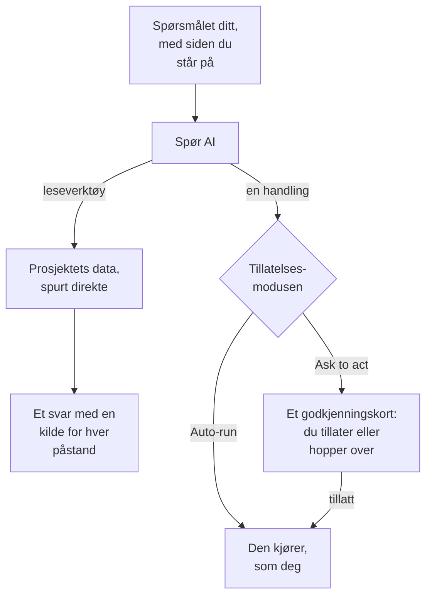

# Spør AI

Spør AI er OneUptimes chat over dataene i prosjektet ditt. Spør om logger, spor, målinger, unntak, hendelser, varsler, monitorer, vakttjeneste, statussider, SLO-er, runbooks eller arbeidsflyter: chatten spør prosjektet ditt direkte, underbygger hver påstand med en kilde og handler for deg når du tillater det.

:::cards
- [Åpne Spør AI](#åpne-spør-ai): Fra toppfeltet, tastaturet, et diagram eller produktmenyen.
- [Hva den kan se](#hva-den-kan-se): Dataene den leser for å svare deg.
- [Handlinger og tillatelsesmoduser](#handlinger-og-tillatelsesmoduser): Velg om den får handle, og når den spør først.
- [Handlinger gjøres som deg](#handlinger-gjøres-som-deg): Dine tillatelser, ditt navn på hver endring.
:::

## Slik svarer Spør AI

Spør AI svarer bare med det verktøyene returnerer: den kjører spørringer mot prosjektet ditt i stedet for å svare fra hukommelsen. Hvert faktum i et svar har en kildebrikke som viser spørringen bak og åpner dataene den leste. Når du ber den endre noe, avgjør samtalens tillatelsesmodus om den spør deg først. Før spørsmålet ditt leser den prosjektets [AI-kontekst](/docs/ai/ai-context): det teamet ditt har skrevet ned for OneUptime AI om deres egne systemer.

I modusen **Skrivebeskyttet** tilbys modellen aldri handlingene, så samtalen bare leser.

## Spørsmål om OneUptime

Spør AI svarer også på spørsmål om selve OneUptime: «Hvordan får jeg en SMS når nettstedet mitt er nede?», «Hva er en episode?», «Hvor legger jeg til et nummer til?». Svarene kommer fra denne dokumentasjonen, kopien din OneUptime selv leverer, så det virker uten internettilgang og sender ingenting til nye steder. Den leser en side på ditt språk når siden er oversatt, oppgir side og avsnitt for hvert trinn, og sier at dokumentasjonen ikke dekker noe i stedet for å gjette.

Et svar på «hvordan gjør jeg» slutter med en knapp som åpner siden i prosjektet ditt der du gjør det, for eksempel **Opprett monitor** eller **Varselmetoder**. Den åpner bare sider OneUptime har: de Søk (`Ctrl` + `K`) finner.

## Åpne Spør AI

| Hvor | Hvordan |
| --- | --- |
| Hvilken som helst side | Klikk **Spør AI** i toppfeltet, eller trykk `Ctrl` + `I` (`Cmd` + `I` på en Mac). Mens du skriver i et tekstfelt eller en redigerer, forblir tastene redigererens snarvei for kursiv. |
| Kommandopaletten | Trykk `Ctrl` + `K` (`Cmd` + `K` på en Mac), og velg **Spør AI**. |
| Et feilmønster i loggene, eller funnene i et diagram | Klikk **Forklar med AI**: Spør AI åpnes med bevisene som et spørsmål du kan redigere før du sender det. |
| Produktmenyen | Åpne **Produkter → AI → Chat**. Spør AI åpnes ved siden av siden du var på. Hver samtale har sin egen adresse, så du kan bokmerke den og komme tilbake til den. |

Spør AI åpnes i kanten av vinduet, og siden gir plass til den: ingenting skjules bak den, så du kan jobbe videre på siden, gå til andre sider og spørre igjen. Dra i kanten for å gjøre den bredere eller smalere. Trykk `Esc` i den, eller klikk på **Spør AI** igjen, for å gi siden hele vinduet tilbake. Mens den er åpen, går `Ctrl` + `I` (`Cmd` + `I` på en Mac) fra siden til feltet du skriver i, og lukker den derfra. Samtalen blir der du forlot den: åpne Spør AI igjen for å fortsette. Lukker du den mens den fortsatt svarer, sier en påminnelse i hjørnet når svaret er klart, og åpner det. På et nettbrett eller en telefon, der det ikke er plass til begge, åpnes den over siden, og på en telefon fyller den hele skjermen.

På en hendelse eller et varsel har kortet **OneUptime AI** sin egen samtale, **Spør OneUptime AI**, som deles av alle som kan se hendelsen eller varselet: se [Snakk med OneUptime AI om hendelsen](/docs/ai/ai-sre#snakk-med-oneuptime-ai-om-hendelsen).

## Hva den kan se

Spør AI leser prosjektet ditt med dine egne tillatelser, så den ser det du kan se, og ikke mer.

| Område | Hva Spør AI leser |
| --- | --- |
| Telemetri | Loggsøk og histogrammer, sporaggregeringer og span-trær, målinger, unntak, sikkerhetshendelser, real user monitoring og Web Vitals, nylige endringer og avvikskontroller mot innlærte grunnlinjer. |
| Infrastruktur | Verter, Docker, Podman, Kubernetes, Docker Swarm, Proxmox, VMware vCenter, Ceph, lagringsmatriser, serverløse funksjoner, skymiljøer, IoT-flåter og nettverksenheter: hva som er i inventaret, rapportert tilkoblingstilstand, trender i målinger, antall logger per alvorlighetsgrad og sammendrag av sporoperasjoner. En spørring dekker både telemetri som nevner en tjeneste og telemetri som nevner en infrastrukturressurs. |
| Hendelseshåndtering | Hendelser og varsler, med tilstandsfiltre ("hva er aktivt akkurat nå?"), aktivitetstidslinjene deres (tilstandsendringer, interne og offentlige notater, feeden) og eierne, og et søk i tidligere hendelser for å gjenbruke hvordan de ble løst. |
| Vakttjeneste | Hvem som har vakt nå, retningslinjer og eskaleringskjeder, og om de siste utkallingene ble levert og bekreftet. |
| AI-ens eget arbeid | Resultatene av AI SRE-undersøkelser og AI Insights, slik at "hva fant AI-en?" besvares ut fra den publiserte analysen i stedet for å utledes på nytt. |
| Plattform | Monitorer (med statusfiltre), planlagt vedlikehold, statussider og kunngjøringene deres, SLO-er, runbooks, kjøringer av arbeidsflyter, probenes helse, team og koden i tilkoblede repositorier på GitHub, GitLab, Forgejo, Gitea og Azure DevOps (se [Hva AI leser i et Git-repositorium](/docs/ai/ai-agent#hva-ai-leser-i-et-git-repositorium)). |

## Sidekontekst

Spør AI vet hvilken side du åpnet den fra. På en hendelsesside betyr "hvorfor skjedde dette?" akkurat den hendelsen: skrivefeltet viser en brikke med sidens emne, og spørsmålene den foreslår, er sidens egne. Fjern brikken for å spørre om hele prosjektet, og legg den til igjen på samme måte. Åpne Spør AI på en annen side, så følger konteksten med. Samtalen husker også sitt første emne på serveren, så et oppfølgingsspørsmål dager senere fortsatt forstår "denne hendelsen".

På en hendelse, et varsel, en monitor eller et planlagt vedlikehold følger spørsmålene også hvor den posten står, lest hver gang Spør AI åpnes på den. En løst hendelse spør hvordan responsen gikk og hva som ville hindret at den skjer igjen, et løst varsel om det var et reelt problem og hvor ofte varsler som det blir utløst, og en monitor som ikke er i drift spør hvorfor. Et vedlikehold som ikke har startet spør om monitorene er friske før det starter, og et som er over om de er tilbake til normalt.

Infrastrukturlister og ressurssider foreslår spørsmål for den typen ressurs du ser på. Åpne en Kubernetes-klynge og spør "Hvilke målinger har endret seg de siste 24 timene?", eller åpne en Docker-vert og spør "Oppsummer alvorlighet i loggene og sporfeil de siste seks timene." Bevislenker fører tilbake til ressursens side. Lesing respekterer tillatelsene dine for prosjekt, ressurser og telemetri, inkludert begrensninger på eierskap og etiketter.

På en underside registrerer konteksten også poden, containeren, VM-en, prosessen eller den andre underressursen du valgte. Infrastrukturverktøyene leser telemetrien til den overordnede ressursen; de kan ikke måle én underressurs ut fra navnet alene. Spør AI sier det, og gjetter ikke på et Kubernetes-navnerom som siden ikke oppgir. En tilkoblingstilstand er ikke helsen til en arbeidslast, og manglende telemetri betyr ikke at en ressurs er frisk.

## Kommandoer på infrastrukturen din

Åpnet på siden til en ressurs der AI-agenten er tilkoblet (en vert, en Docker- eller Podman-vert, en Docker Swarm-klynge, en Proxmox-klynge, et VMware vCenter, en Ceph-klynge, en databaseserver eller en Kubernetes-klynge), kjører Spør AI kommandoer på den gjennom den agenten når du ber om det: "kjør `uptime` på denne verten" eller "vis de siste 100 linjene av `journalctl -u nginx`". Den svarer med det som kom tilbake, med kildehenvisning som for alt annet bevis. Åpnet på en hendelse eller et varsel når den ressursene som er knyttet til den.

- Den kjører bare de skrivebeskyttede kommandoene en AI-undersøkelse kan kjøre på den typen ressurs (se [AI-agenter for infrastrukturen](/docs/ai/infrastructure-ai-agents)), så mange som svaret trenger, kontrollert av OneUptime og igjen av agenten, i alle tillatelsesmoduser. En endring gjennom agenten, for eksempel å starte en tjeneste på nytt, kjøres aldri fra Spør AI: den gir deg i stedet den nøyaktige kommandoen, og agenten gjør bare endringer når OneUptime AI utbedrer en hendelse eller et varsel, etter ressursens egne innstillinger for rettelser. Spør AIs egne handlinger, for eksempel å kjøre en runbook, følger samtalens tillatelsesmodus, som beskrevet nedenfor.
- Den når bare ressursene du har lov til å se, og bare mens AI-undersøkelse er slått på for ressursen.
- Når den ikke kan kjøre en kommando der (ingen agent er tilkoblet, agenten er frakoblet, eller AI-undersøkelse er slått av for ressursen), sier den det, sammen med hva som må endres, og svarer i stedet ut fra prosjektets data.

## Handlinger og tillatelsesmoduser

Hver samtale har en tillatelsesmodus, som du velger i skrivefeltet, ved siden av boksen du skriver i:

| Modus | Hva som skjer |
| --- | --- |
| **Spør før handling** | Standard. Spør AI foreslår hver handling på et godkjenningskort, og ingenting kjører før du velger **Tillat** eller **Hopp over** for den, eller **Avvis alle**. |
| **Kjør automatisk** | Handlinger kjører så snart modellen ber om dem, fortsatt begrenset til det rollen din har lov til. Bruk den med omtanke. |
| **Skrivebeskyttet** | Handlingene tilbys ikke modellen i det hele tatt: Spør AI kan bare lese. |

Hva Spør AI kan gjøre når en modus tillater det:

- Opprette en hendelse eller et varsel, bekrefte eller løse hendelser og varsler, og endre alvorlighetsgraden til en hendelse.
- Knytte en hendelse eller et varsel til infrastrukturen og tjenestene den gjelder. En hendelse eller et varsel den oppretter på siden til en ressurs, for eksempel en verts, knyttes til den ressursen, og godkjenningskortet viser hva hver handling knytter til. OneUptime AI undersøker og retter det en hendelse eller et varsel er knyttet til.
- Registrere et problem som noen allerede tar seg av, eller som allerede er over: en hendelse eller et varsel den oppretter, kan starte bekreftet eller løst og tilkaller da ingen. Godkjenningskortet sier hvilken. Se [Erklært allerede bekreftet eller løst](/docs/incidents/declaring-incidents#erklært-allerede-bekreftet-eller-løst).
- Legge inn et internt notat på en hendelse eller et varsel. Interne notater vises aldri på en statusside.
- Publisere en offentlig statusoppdatering på en hendelse. Det er en egen handling, fordi den varsler abonnentene på statussiden.
- Kalle ut en vaktretningslinje, kjøre en runbook eller starte en AI-undersøkelse av en hendelse eller et varsel.
- Sette opp ting fra én setning: en monitor for et nettsted eller et API, hvem som kalles ut, en statusside og monitorene den viser, alt på ett godkjenningskort. Se [Sett opp ting](#sett-opp-ting).
- Foreslå en kodeendring: committe til en ny gren i et repositorium på GitHub, GitLab, Forgejo eller Gitea og åpne en pull request (en merge request på GitLab). Den skriver aldri til standardgrenen eller en beskyttet gren, så et menneske fletter fortsatt endringen. Ask AI skriver hver fil i sin helhet, ut fra filen slik den sist leste den, og leser hovedgrenen i et repositorium med mindre den blir bedt om en annen. Er en fil endret på grenen etter at Ask AI leste den, nevner kortet den før du godkjenner commiten eller pull requesten, for eksempel «Denne filen ble endret på fix/login etter at AI leste den, og AI-versjonen omgjør den endringen: src/billing/charge.ts.» Kortet nevner også en fil som Ask AI bare har lest på en annen gren, der den er annerledes, en fil som Ask AI aldri har lest, men erstatter, og en fil som OneUptime ikke kunne sjekke. Ask AI leser en lang fil litt om gangen, så kortet nevner også en fil som Ask AI bare har lest en del av, for eksempel «AI leste bare en del av denne filen, og AI-versjonen erstatter hele filen: src/billing/charge.ts.» Når Ask AI har lest hele filen, i én lesing eller flere, sier kortet ingenting om den. Et senere svar har ordene fra de tidligere svarene, ikke filene de leste, så kortet nevner også en fil som Ask AI bare har lest i et tidligere svar, for eksempel «AI leste denne filen i et tidligere svar og har ikke lenger teksten i den, og AI-versjonen erstatter hele filen: src/billing/charge.ts.» Et svært langt svar utelater også de eldste resultatene sine, for å holde seg innenfor det modellen kan ta inn på én gang, så kortet nevner også en fil som Ask AI leste tidligere i samme svar hvis det resultatet ble utelatt, for eksempel «AI leste denne filen tidligere i dette svaret og har ikke lenger teksten i den, og AI-versjonen erstatter hele filen: src/billing/charge.ts.» Hvis Ask AI har lest filen i flere deler og ikke lenger har alle delene, sier kortet også det, for eksempel «AI leste denne filen og har ikke lenger en del av teksten i den, og AI-versjonen erstatter hele filen: src/billing/charge.ts.» Når Ask AI leser filen på nytt i svaret som endrer den, sier kortet ingenting om den. En ny fil teller aldri. Vil du beholde det noen andre har endret, hopper du over handlingen og ber Ask AI lese filene på nytt. I Kjør automatisk, der ingen godkjenner handlinger, gjør ikke Ask AI en slik endring: den leser filene på nytt og gjør endringen sin på dem slik de er nå. Endres en fil mens kortet venter på deg, endrer godkjenningen ingenting, og Ask AI foreslår endringen på nytt. En pull request du godkjenner likevel, nevner filene i beskrivelsen sin, for den som går gjennom den. Ask AI får aldri se verdier som ser ut som hemmeligheter eller personopplysninger, som IP-adresser, e-postadresser og nøkler: den leser en plassholder som `[redacted-ip]` i stedet. Derfor nevner kortet også en fil som Ask AI-versjonen skriver slike plassholdere inn i, for eksempel «Verdier som ser ut som hemmeligheter eller personopplysninger, ble skjult for AI, og AI-versjonen av denne filen skriver plassholdere i stedet for dem: config/servers.ts.» En plassholder som filen på grenen allerede har, teller ikke. Ask AI kan ikke skrive disse verdiene tilbake, så i Kjør automatisk gjør den ikke den endringen, men forteller deg i stedet hva du skal endre.

Be om en hendelse når brukere blir berørt, og om et varsel når noe først trenger oppmerksomheten til teamet ditt, for eksempel minnet på en vert som bare stiger. Begge opprettes én gang og overvåker ingenting: For å bli varslet hver gang minnet på en vert går over 75 %, oppretter du en [vertsmonitor](/docs/monitor/host-monitor#ferdige-varslingsmaler) fra minnemalen dens, med 75 % som terskel. Spør AI setter bare opp monitorer for nettsteder og API-er (se [Sett opp ting](#sett-opp-ting)). Blir den bedt om en annen type, sier den det, sjekker gjeldende verdi og tilbyr å opprette et varsel hvis den allerede er over.

## Handlinger gjøres som deg

Hver handling Spør AI utfører, gjøres som deg: den gjør den samme endringen som dashbordet gjør for samme handling, med dine egne tillatelser i prosjektet, og endringen krediteres deg. Bekreftes en hendelse fra chatten, oppstår den samme tilstandsendringen som fra hendelsens tilstandspanel, så hendelsens tidslinje og feed viser at du endret tilstanden. En utkalling sendt fra chatten viser deg som den som utløste den.

- **Hva hver handling trenger.** Tillatelsen dashbordet krever for samme endring. Å opprette en hendelse eller et varsel krever tillatelse til å opprette dem: en rolle som får lov, eller **Create Incident** eller **Create Alert** i en egendefinert rolle. Å bekrefte eller løse en hendelse krever tillatelse til å endre tilstanden: **Prosjekteier**, **Prosjektadministrator**, **Prosjektmedlem**, **Hendelsesadministrator** og **Hendelsesmedlem**, eller **Create Incident State Timeline** i en egendefinert rolle; et varsel krever samme tillatelse for varsler (**Create Alert State Timeline**). Å opprette en hendelse eller et varsel som starter bekreftet eller løst, krever begge deler: tillatelse til å opprette den og tillatelse til å endre tilstanden. Å kalle ut en vaktretningslinje krever tillatelse til å kjøre den (**Execute On-Call Policies**), og å kjøre en runbook krever tillatelse til å starte runbook-kjøringer: en rolle som kjører runbooks, for de runbookene etikettene når, eller **Create Runbook Execution** i en egendefinert rolle, som når hver runbook i prosjektet. Å endre alvorlighetsgraden til en hendelse, starte en AI-undersøkelse av en hendelse eller et varsel og skrive kode til et tilkoblet repositorium krever tillatelse til å endre den hendelsen, det varselet eller det repositoriet. En handling du ikke har lov til, avvises, og AI-en forteller deg hvilken tillatelse den trenger. Har du tillatelsen, men et team du er med i blokkerer den, sier AI-en det i stedet: en blokkering på enkelte etiketter avviser handlingen i Spør AI for alle poster, ikke bare for poster med de etikettene.
- **Hvilke poster.** De du har lov til å endre, som overalt i OneUptime: med en rolle som er begrenset til enkelte etiketter, eller til postene du eier, endrer en handling på en hvilken som helst annen post ingenting. En runbook kjører bare når tillatelsen din til å starte runbook-kjøringer når den. I OneUptime Cloud avvises en handling prosjektets abonnement ikke omfatter, med abonnementet den krever.
- **Når en handling avvises.** Ingenting endres, og AI-en sier tydelig at handlingen ikke ble utført, og hvorfor, i stedet for å prøve igjen. Blant svarets trinn sier handlingens eget trinn at den ikke ble utført, og hvorfor: rollen din tillater det ikke, et team du er med i blokkerer det, eller prosjektets abonnement omfatter det ikke.
- **Slack, Microsoft Teams og AI-undersøkelser.** AI-ens svar i Slack og Microsoft Teams, og autonome AI-undersøkelser, bare leser: de utfører ingen av disse handlingene. Ber du om en endring der, sier AI-en hvordan du gjør den fra chatten: `/oneuptime incident` erklærer en hendelse, `/oneuptime incident 42` viser hendelse 42 med knappene sine, `/oneuptime page` tilkaller noen (i Microsoft Teams de samme ordene skrevet til OneUptime-boten), og knappene på OneUptimes meldinger handler også som deg (se [Slack](/docs/workspace-connections/slack#handle-på-hendelser-varsler-og-begivenheter-fra-slack) og [Microsoft Teams](/docs/workspace-connections/microsoft-teams#handle-på-hendelser-varsler-og-begivenheter-fra-microsoft-teams)). For enhver annen endring lenker den til Spør AI, som foreslår endringen slik at du kan godkjenne den. Spurt i en hendelses eller et varsels egen kanal, tar den den hendelsen eller det varselet som det du mener.

## Sett opp ting

Spør AI setter opp fra én setning det de veiledede oppsettene setter opp: "Overvåk example.com hvert minutt, og send meg en SMS hvis det er nede."

- **Én plan, én godkjenning.** Spør AI foreslår hver del på ett godkjenningskort, hver med enkle ord: en monitor for et nettsted eller et API, prosjektets første vaktretningslinje, en statusside og monitorene den viser. Kortet slutter med "Ingenting annet endres." Velg **Hopp over** på alle deler du ikke vil ha, og kjør resten. Ingenting opprettes før det.
- **Spør alltid.** Oppsettet venter på godkjenningen din i alle moduser, også **Kjør automatisk**, fordi det oppretter ting som kaller ut folk og som kundene dine ser. **Skrivebeskyttet** tilbyr det ikke.
- **De veiledede oppsettenes poster.** Monitoren er den **Vite når nettstedet eller API-et mitt er nede** oppretter for den samme adressen: standardverdiene fra Opprett monitor, som åpner en hendelse når adressen ikke svarer eller svarer med en feil, sjekket hvert 5. minutt med mindre du ber om et annet av Opprett monitors intervaller. Den er din, så du får en e-post når statusen endres. Statussiden er den **Publiser en statusside** oppretter: offentlig så snart den er opprettet, og den viser hver monitors status, oppetid og historikk.
- **Hvem som kalles ut.** I et prosjekt som ennå ikke kaller ut noen, foreslår Spør AI prosjektets første vaktretningslinje, "Default on-call policy", som kaller ut deg, og medlemmene og teamene du nevner, ved hver ny hendelse og hvert nytt varsel. Et prosjekt som allerede kaller ut folk, beholder sine egne vaktretningslinjer og vaktregler, og Spør AI sier det i stedet for å opprette enda en.
- **Hva som mangler.** Spør AI legger aldri til et telefonnummer eller mobilappen: Du legger dem til og bekrefter dem selv under **Brukerinnstillinger → Varselmetoder**. Ber du om SMS uten et bekreftet nummer, sier kortet det, og svaret lenker til siden. En del Spør AI ikke kan opprette, foreslås ikke, for eksempel når rollen din ikke tillater det, adressen ikke er en adresse eller monitorene ikke finnes: Svaret sier hva som trengs.
- **Hva hver del trenger.** En monitor trenger tillatelse til å opprette monitorer. Utkalling trenger tillatelse til å opprette vaktretningslinjer, eskaleringsreglene deres og vaktregler for hendelser og varsler. En statusside trenger tillatelse til å opprette statussider og legge til monitorer på dem. Prosjektets abonnementsgrenser gjelder, som i de veiledede oppsettene.
- **Test det etterpå.** Når planen har kjørt, åpner hvert kort det som ble opprettet, og **Test denne policyen** (eller **Send meg et testoppkall**, for en monitor alene) under svaret sender et testoppkall som du bekrefter fra meldingen. Feiler en del, sier svaret hva som ble opprettet og hva som ikke ble det.
- **Hvem som får beskjed.** Spør "hvem får beskjed når example.com er nede?", og Spør AI svarer fra den samme kjeden som monitorens side viser, og nevner hvert brudd.

## Styr en samtale

- **Stopp den.** Mens Spør AI arbeider, blir sendeknappen en stoppknapp. Stopp en kjøring når som helst, og spør om noe annet med en gang.
- **Følg arbeidet.** Mens den svarer, sier én linje hva den gjør nå, for eksempel søker i logger. Klikk på antallet trinn ved siden av for å se hvert trinn.
- **Velg modellen.** Når prosjektet kan bruke mer enn én LLM-leverandør, viser leverandørvelgeren i skrivefeltet prosjektets LLM-leverandører og de globale, med standarden merket. En ny samtale bruker standarden.
- **Vurder et svar.** **Godt svar** og **Dårlig svar** lagres sammen med meldingen, så kvaliteten på svarene kan måles over tid.
- **Se kostnaden.** Under hvert svar åpner kildene seg i spørringene det kjørte, og kildene til det nyeste svaret sier også hvor mange spørringer det kjørte, tokenene og kostnaden. Hver kildebrikke i et svar åpner dataene bak.
- **Behold en kopi.** **Last ned samtale** lagrer tråden med **Last ned som Markdown**, for å lese eller lime inn i en sak, eller **Last ned som PDF**, for å gi til noen.
- **Fortsett der du slapp.** **Alle samtaler**, i toppfeltet til Spør AI, viser samtalene dine, nyeste først, så du kan åpne dem igjen eller slette dem. Starten på en ny samtale viser de tre siste.

## Krav

- **En LLM-leverandør.** Spør AI bruker prosjektets standard-LLM-leverandør (se [LLM-leverandører](/docs/ai/llm-provider)). I OneUptime Cloud fungerer den med en gang med den globale leverandøren, betalt fra prosjektets AI-kreditter; en selvhostet installasjon konfigurerer en leverandør, eller miljøvariablene for den globale leverandøren. Svarene er bare så gode som modellen: en liten selvhostet modell uten pålitelige verktøykall svarer dårlig.
- **Growth-abonnementet, i OneUptime Cloud.** Et prosjekt på et lavere abonnement ser at AI ikke er med i abonnementet, med en lenke til **Prosjektinnstillinger → Fakturering og fakturaer → Fakturering**.
- **AI slått på for prosjektet.** **Aktiver AI**, på **Prosjektinnstillinger → KI → AI-funksjoner**, slår av alle prosjektets AI-funksjoner, Spør AI inkludert. Den er på med mindre noen har slått den av.

Spør AI teller med i prosjektets egne daglige AI-grenser når prosjektet setter dem (Prosjektinnstillinger → KI → AI Features → Flere innstillinger): når en er nådd, viser Spør AI en setning som sier hvilken grense som ble nådd, at OneUptime AI starter igjen ved midnatt UTC, og hvem som kan heve eller fjerne grensen. Prosjektets eiere får en e-post første gang en grense nås hver dag. De daglige grensene for hendelser og varsler stopper aldri Spør AI. Se [prosjektets egne daglige grenser](/docs/ai/ai-sre#prosjektets-egne-daglige-grenser).

## Feilsøking

:::details Spør AI sier at AI ikke er tilgjengelig
Spør AI sier hvorfor før du skriver: prosjektets abonnement omfatter ikke AI, **Aktiver AI** er slått av, eller prosjektet har ingen LLM-leverandør. Hver melding lenker til siden der det endres.
:::

:::details En handling ble avvist
Spør AI sier hvilken tillatelse handlingen trenger, eller hvilket team som blokkerer den. Be noen som har lov til å gjøre endringen, eller be en prosjekteier om å gi rollen din tillatelsen. Ingenting ble endret.
:::

:::details Svarene er vage eller bruker aldri data
Sjekk modellen bak leverandøren. Spør AI trenger en modell som kaller verktøy pålitelig; små lokale modeller svarer ofte uten å kjøre en eneste spørring. Se [LLM-leverandører](/docs/ai/llm-provider).
:::

## Neste steg

:::cards
- [AI SRE](/docs/ai/ai-sre): La OneUptime AI undersøke hver nye hendelse og hvert nye varsel.
- [LLM-leverandører](/docs/ai/llm-provider): Velg modellen Spør AI og de andre AI-funksjonene bruker.
- [MCP-server](/docs/ai/mcp-server): Spør om OneUptime fra Claude, Cursor eller VS Code i stedet.
:::
