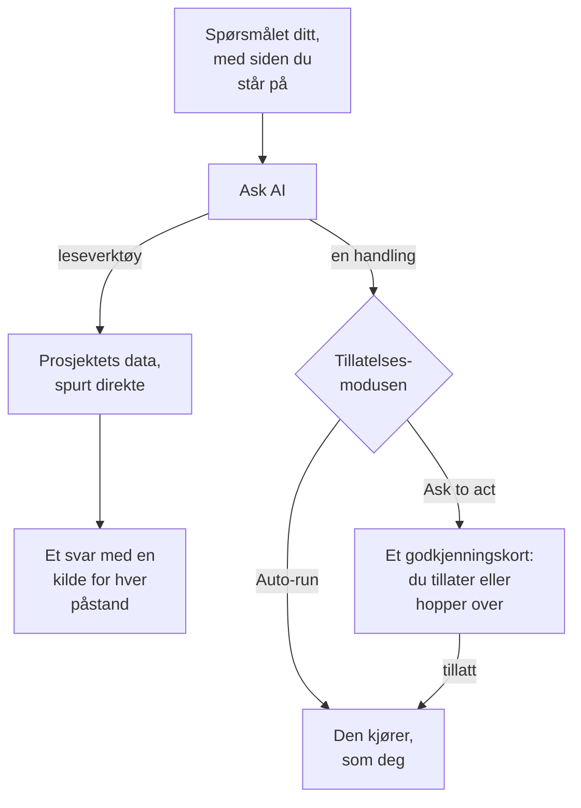

# Spør AI

Spør AI er OneUptimes chat over dataene i prosjektet ditt. Spør om logger, spor, målinger, unntak, hendelser, varsler, monitorer, vakttjeneste, statussider, SLO-er, runbooks eller arbeidsflyter: chatten spør prosjektet ditt direkte, underbygger hver påstand med en kilde og handler for deg når du tillater det.

:::cards
- [Åpne Spør AI](#åpne-spør-ai): Fra toppfeltet, tastaturet, et diagram eller en egen side.
- [Hva den kan se](#hva-den-kan-se): Dataene den leser for å svare deg.
- [Handlinger og tillatelsesmoduser](#handlinger-og-tillatelsesmoduser): Velg om den får handle, og når den spør først.
- [Handlinger gjøres som deg](#handlinger-gjøres-som-deg): Dine tillatelser, ditt navn på hver endring.
:::

## Slik svarer Spør AI

Spør AI svarer bare med det verktøyene returnerer: den kjører spørringer mot prosjektet ditt i stedet for å svare fra hukommelsen. Hvert faktum i et svar har en kildebrikke som viser spørringen bak og åpner dataene den leste. Når du ber den endre noe, avgjør samtalens tillatelsesmodus om den spør deg først. Før spørsmålet ditt leser den prosjektets [AI-kontekst](/docs/ai/ai-context): det teamet ditt har skrevet ned for OneUptime AI om deres egne systemer.

I modusen **Skrivebeskyttet** tilbys modellen aldri handlingene, så samtalen bare leser.

## Åpne Spør AI

| Hvor | Hvordan |
| --- | --- |
| Hvilken som helst side | Klikk **Ask AI** i toppfeltet, eller trykk `Ctrl` + `I` (`Cmd` + `I` på en Mac). Mens du skriver i et tekstfelt eller en redigerer, forblir tastene redigererens snarvei for kursiv. |
| Kommandopaletten | Trykk `Ctrl` + `K` (`Cmd` + `K` på en Mac), og velg **Ask AI**. |
| Et feilmønster i loggene, eller funnene i et diagram | Klikk **Explain with AI**: Spør AI åpnes med bevisene som et spørsmål du kan redigere før du sender det. |
| En egen side | Åpne **Produkter → AI → Chat** for et arbeidsområde på hele siden. Hver samtale der har sin egen adresse, så du kan bokmerke en tråd eller lime den inn i kanalen til en hendelse. |

På en hendelse eller et varsel har kortet **AI Investigation** sin egen samtale, **Ask OneUptime AI**, som deles av alle som kan se hendelsen eller varselet: se [Snakk med OneUptime AI om hendelsen](/docs/ai/ai-sre#snakk-med-oneuptime-ai-om-hendelsen).

## Hva den kan se

Spør AI leser prosjektet ditt med dine egne tillatelser, så den ser det du kan se, og ikke mer.

| Område | Hva Spør AI leser |
| --- | --- |
| Telemetri | Loggsøk og histogrammer, sporaggregeringer og span-trær, målinger, unntak, sikkerhetshendelser, real user monitoring og Web Vitals, nylige endringer og avvikskontroller mot innlærte grunnlinjer. |
| Infrastruktur | Verter, Docker, Podman, Kubernetes, Docker Swarm, Proxmox, VMware vCenter, Ceph, lagringsmatriser, serverløse funksjoner, skymiljøer, IoT-flåter og nettverksenheter: hva som er i inventaret, rapportert tilkoblingstilstand, trender i målinger, antall logger per alvorlighetsgrad og sammendrag av sporoperasjoner. En spørring dekker både telemetri som nevner en tjeneste og telemetri som nevner en infrastrukturressurs. |
| Hendelseshåndtering | Hendelser og varsler, med tilstandsfiltre ("hva er aktivt akkurat nå?"), aktivitetstidslinjene deres (tilstandsendringer, interne og offentlige notater, feeden) og eierne, og et søk i tidligere hendelser for å gjenbruke hvordan de ble løst. |
| Vakttjeneste | Hvem som har vakt nå, retningslinjer og eskaleringskjeder, og om de siste utkallingene ble levert og bekreftet. |
| AI-ens eget arbeid | Resultatene av AI SRE-undersøkelser og AI Insights, slik at "hva fant AI-en?" besvares ut fra den publiserte analysen i stedet for å utledes på nytt. |
| Plattform | Monitorer (med statusfiltre), planlagt vedlikehold, statussider og kunngjøringene deres, SLO-er, runbooks, kjøringer av arbeidsflyter, probenes helse, team og koden i tilkoblede repositorier. |

## Sidekontekst

Spør AI vet hvilken side du åpnet den fra. På en hendelsesside betyr "hvorfor skjedde dette?" akkurat den hendelsen, og skrivefeltet viser en brikke med sidens emne; fjern den for å spørre om hele prosjektet. Går du til en annen side mens panelet er åpent, følger konteksten med. Samtalen husker også sitt første emne på serveren, så et oppfølgingsspørsmål dager senere fortsatt forstår "denne hendelsen".

Infrastrukturlister og ressurssider foreslår spørsmål for den typen ressurs du ser på. Åpne en Kubernetes-klynge og spør "Hvilke målinger har endret seg de siste 24 timene?", eller åpne en Docker-vert og spør "Oppsummer alvorlighet i loggene og sporfeil de siste seks timene." Bevislenker fører tilbake til ressursens side. Lesing respekterer tillatelsene dine for prosjekt, ressurser og telemetri, inkludert begrensninger på eierskap og etiketter.

På en underside registrerer konteksten også poden, containeren, VM-en, prosessen eller den andre underressursen du valgte. Infrastrukturverktøyene leser telemetrien til den overordnede ressursen; de kan ikke måle én underressurs ut fra navnet alene. Spør AI sier det, og gjetter ikke på et Kubernetes-navnerom som siden ikke oppgir. En tilkoblingstilstand er ikke helsen til en arbeidslast, og manglende telemetri betyr ikke at en ressurs er frisk.

## Kommandoer på infrastrukturen din

Åpnet på siden til en ressurs der AI-agenten er tilkoblet (en vert, en Docker- eller Podman-vert, en Docker Swarm-klynge, en Proxmox-klynge, et VMware vCenter, en Ceph-klynge, en databaseserver eller en Kubernetes-klynge), kjører Spør AI kommandoer på den gjennom den agenten når du ber om det: "kjør `uptime` på denne verten" eller "vis de siste 100 linjene av `journalctl -u nginx`". Den svarer med det som kom tilbake, med kildehenvisning som for alt annet bevis. Åpnet på en hendelse eller et varsel når den ressursene som er knyttet til den.

- Den kjører bare de skrivebeskyttede kommandoene en AI-undersøkelse kan kjøre på den typen ressurs (se [AI-agenter for infrastrukturen](/docs/ai/infrastructure-ai-agents)), kontrollert av OneUptime og igjen av agenten, i alle tillatelsesmoduser. En endring, for eksempel å starte en tjeneste på nytt, kjøres aldri fra Spør AI: den gir deg i stedet den nøyaktige kommandoen. Rettelser kjøres bare når OneUptime AI utbedrer en hendelse eller et varsel, etter ressursens egne innstillinger for rettelser.
- Den når bare ressursene du har lov til å se, og bare mens AI-undersøkelse er slått på for ressursen.
- Når den ikke kan kjøre en kommando der (ingen agent er tilkoblet, agenten er frakoblet, eller AI-undersøkelse er slått av for ressursen), sier den det, sammen med hva som må endres, og svarer i stedet ut fra prosjektets data.

## Handlinger og tillatelsesmoduser

Hver samtale har en tillatelsesmodus, som du velger i skrivefeltet, ved siden av boksen du skriver i:

| Modus | Hva som skjer |
| --- | --- |
| **Ask to act** | Standard. Spør AI foreslår hver handling på et godkjenningskort, og ingenting kjører før du velger **Allow** eller **Hopp over** for den, eller **Deny all**. |
| **Auto-run** | Handlinger kjører så snart modellen ber om dem, fortsatt begrenset til det rollen din har lov til. Bruk den med omtanke. |
| **Skrivebeskyttet** | Handlingene tilbys ikke modellen i det hele tatt: Spør AI kan bare lese. |

Hva Spør AI kan gjøre når en modus tillater det:

- Opprette en hendelse, bekrefte eller løse hendelser og varsler, og endre alvorlighetsgraden til en hendelse.
- Legge inn et internt notat på en hendelse eller et varsel. Interne notater vises aldri på en statusside.
- Publisere en offentlig statusoppdatering på en hendelse. Det er en egen handling, fordi den varsler abonnentene på statussiden.
- Kalle ut en vaktretningslinje, kjøre en runbook eller starte en AI-undersøkelse av en hendelse eller et varsel.
- Foreslå en kodeendring: committe til en ny gren i et tilkoblet repositorium og åpne en pull request. Den skriver aldri til standardgrenen eller en beskyttet gren, så et menneske fletter fortsatt endringen.

## Handlinger gjøres som deg

Hver handling Spør AI utfører, gjøres som deg: den gjør den samme endringen som dashbordet gjør for samme handling, med dine egne tillatelser i prosjektet, og endringen krediteres deg. Bekreftes en hendelse fra chatten, oppstår den samme tilstandsendringen som fra hendelsens tilstandspanel, så hendelsens tidslinje og feed viser at du endret tilstanden. En utkalling sendt fra chatten viser deg som den som utløste den.

- **Hva hver handling trenger.** Tillatelsen dashbordet krever for samme endring. Å bekrefte eller løse en hendelse krever tillatelse til å endre tilstanden: **Project Owner**, **Project Admin**, **Project Member**, **Incident Admin** og **Incident Member**, eller **Create Incident State Timeline** i en egendefinert rolle; et varsel krever samme tillatelse for varsler (**Create Alert State Timeline**). Å kalle ut en vaktretningslinje krever tillatelse til å kjøre den (**Create On-Call Duty Policy Execution Log**), og å kjøre en runbook krever tillatelse til å starte runbook-kjøringer: en rolle som kjører runbooks, for de runbookene etikettene når, eller **Create Runbook Execution** i en egendefinert rolle, som når hver runbook i prosjektet. Å endre alvorlighetsgraden til en hendelse, starte en AI-undersøkelse av en hendelse eller et varsel og skrive kode til et tilkoblet repositorium krever tillatelse til å endre den hendelsen, det varselet eller det repositoriet. En handling du ikke har lov til, avvises, og AI-en forteller deg hvilken tillatelse den trenger. Har du tillatelsen, men et team du er med i blokkerer den, sier AI-en det i stedet: en blokkering på enkelte etiketter avviser handlingen i Spør AI for alle poster, ikke bare for poster med de etikettene.
- **Hvilke poster.** De du har lov til å endre, som overalt i OneUptime: med en rolle som er begrenset til enkelte etiketter, eller til postene du eier, endrer en handling på en hvilken som helst annen post ingenting. En runbook kjører bare når tillatelsen din til å starte runbook-kjøringer når den. I OneUptime Cloud avvises en handling prosjektets abonnement ikke omfatter, med abonnementet den krever.
- **Når en handling avvises.** Ingenting endres, og AI-en sier tydelig at handlingen ikke ble utført, og hvorfor, i stedet for å prøve igjen.
- **Slack, Microsoft Teams og AI-undersøkelser.** AI-ens svar i Slack og Microsoft Teams, og autonome AI-undersøkelser, bare leser: de utfører ingen av disse handlingene. For å handle fra Slack eller Microsoft Teams bruker du knappene på OneUptimes meldinger, som også handler som deg (se [Slack](/docs/workspace-connections/slack#handle-på-hendelser-varsler-og-begivenheter-fra-slack) og [Microsoft Teams](/docs/workspace-connections/microsoft-teams#handle-på-hendelser-varsler-og-begivenheter-fra-microsoft-teams)).

## Styr en samtale

- **Stopp den.** Mens Spør AI arbeider, blir sendeknappen en stoppknapp. Stopp en kjøring når som helst, og spør om noe annet med en gang.
- **Velg modellen.** Leverandørvelgeren i skrivefeltet viser prosjektets LLM-leverandører og de globale, med standarden merket. En ny samtale bruker standarden.
- **Vurder et svar.** **Good answer** og **Poor answer** lagres sammen med meldingen, så kvaliteten på svarene kan måles over tid.
- **Se kostnaden.** Bunnteksten under det nyeste svaret viser kostnaden, tokenene og hvor mange spørringer det kjørte, og hver spørring er en kildebrikke som åpner dataene bak.
- **Behold en kopi.** **Download conversation** lagrer tråden med **Download as Markdown**, for å lese eller lime inn i en sak, eller **Download as PDF**, for å gi til noen.

## Krav

- **En LLM-leverandør.** Spør AI bruker prosjektets standard-LLM-leverandør (se [LLM-leverandører](/docs/ai/llm-provider)). I OneUptime Cloud fungerer den med en gang med den globale leverandøren, betalt fra prosjektets AI-kreditter; en selvhostet installasjon konfigurerer en leverandør, eller miljøvariablene for den globale leverandøren. Svarene er bare så gode som modellen: en liten selvhostet modell uten pålitelige verktøykall svarer dårlig.
- **Growth-abonnementet, i OneUptime Cloud.** Et prosjekt på et lavere abonnement ser at AI ikke er med i abonnementet, med en lenke til **Prosjektinnstillinger → Fakturering og fakturaer → Fakturering**.
- **AI slått på for prosjektet.** **Aktiver AI**, på **Prosjektinnstillinger → KI → AI Features**, slår av alle prosjektets AI-funksjoner, Spør AI inkludert. Den er på med mindre noen har slått den av.

Spør AI teller med i prosjektets egne daglige AI-grenser når prosjektet setter dem (Prosjektinnstillinger → KI → AI Features → Flere innstillinger): når en er nådd, viser Spør AI en setning som sier hvilken grense som ble nådd, at OneUptime AI starter igjen ved midnatt UTC, og hvem som kan heve eller fjerne grensen. Prosjektets eiere får en e-post første gang en grense nås hver dag. De daglige grensene for hendelser og varsler stopper aldri Spør AI. Se [prosjektets egne daglige grenser](/docs/ai/ai-sre#prosjektets-egne-daglige-grenser).

## Feilsøking

:::details Spør AI sier at AI ikke er tilgjengelig
Panelet sier hvorfor før du skriver: prosjektets abonnement omfatter ikke AI, **Aktiver AI** er slått av, eller prosjektet har ingen LLM-leverandør. Hver melding lenker til siden der det endres.
:::

:::details En handling ble avvist
Spør AI sier hvilken tillatelse handlingen trenger, eller hvilket team som blokkerer den. Be noen som har lov til å gjøre endringen, eller be en prosjekteier om å gi rollen din tillatelsen. Ingenting ble endret.
:::

:::details Svarene er vage eller bruker aldri data
Sjekk modellen bak leverandøren. Spør AI trenger en modell som kaller verktøy pålitelig; små lokale modeller svarer ofte uten å kjøre en eneste spørring. Se [LLM-leverandører](/docs/ai/llm-provider).
:::

## Neste steg

:::cards
- [AI SRE](/docs/ai/ai-sre): La OneUptime AI undersøke hver nye hendelse og hvert nye varsel.
- [LLM-leverandører](/docs/ai/llm-provider): Velg modellen Spør AI og de andre AI-funksjonene bruker.
- [MCP-server](/docs/ai/mcp-server): Spør om OneUptime fra Claude, Cursor eller VS Code i stedet.
:::
