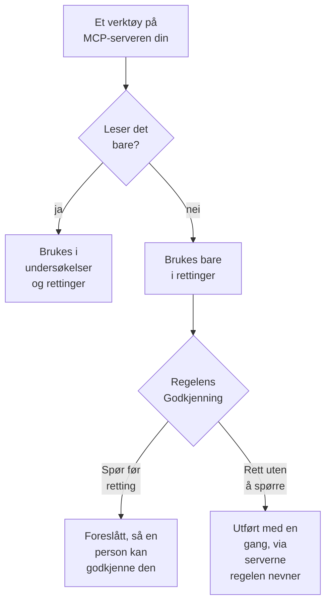

# Eksterne MCP-servere

OneUptime AI kan bruke verktøyene på MCP-servere utenfor OneUptime – de som skyen din, kodeverten din eller ditt eget team kjører, for eksempel AWS, Azure eller GitHub – i Spør AI, i svarene sine i Slack og Microsoft Teams, og mens den undersøker og retter hendelser og varsler. Legg til en server én gang under **Prosjektinnstillinger → KI → Eksterne MCP-servere**, så bruker OneUptime AI den fra neste spørsmål du stiller og neste hendelse.

:::cards
- [Legg til en server](#legg-til-en-server): Adressen, og hvordan OneUptime logger på.
- [Hva OneUptime AI gjør med en server](#hva-oneuptime-ai-gjør-med-en-server): Verktøy som leser i undersøkelser, de andre i rettinger.
- [Merk et verktøy som skrivebeskyttet](#merk-et-verktøy-som-skrivebeskyttet): Når serveren ikke sier noe om det, slik som kAgents.
- [I Spør AI](#i-spør-ai): Be den liste opp verktøyene på en server eller bruke ett av dem; en endring venter på godkjenningen din.
- [I Slack og Microsoft Teams](#i-slack-og-microsoft-teams): Verktøyene som leser, for den som spurte.
- [Velg serverne en regel kan bruke](#velg-serverne-en-regel-kan-bruke): Alle, med mindre en regel velger noen.
- [Sikkerhet](#sikkerhet): Hva en server kan og ikke kan få OneUptime AI til å gjøre.
:::

Denne siden handler om servere som OneUptime AI kobler til. For i stedet å koble en AI-assistent som Claude eller Cursor til OneUptime, se [MCP-server](/docs/ai/mcp-server).

## Før du begynner

- **OneUptime AI er slått på** for prosjektet, med en LLM-leverandør den kan bruke: se [LLM-leverandører](/docs/ai/llm-provider).
- **Serverens MCP-adresse.** Både Streamable HTTP og det eldre HTTP med SSE fungerer: OneUptime finner ut hvilket serveren snakker når den kobler til.
- **Hvordan OneUptime logger på den:** et API-token, serverens egne headere eller OAuth-klientlegitimasjon fra identitetsleverandøren din.
- **En Project Owner eller en Project Admin** legger til, endrer, tester og fjerner servere; Prosjektmedlemmer og Lesere kan se dem. På OneUptime Cloud krever det Growth-abonnementet eller høyere å legge til en server.

## Legg til en server

:::steps
### Åpne Eksterne MCP-servere
Gå til **Prosjektinnstillinger → KI → Eksterne MCP-servere**, og klikk **Opprett Ekstern MCP-server**.

### Si hvor den er
Gi den et **Navn**, som OneUptime AI og de som leser hva den gjorde, ser den under, og dens **URL**, for eksempel `https://mcp.example.com/mcp`. Under **Flere felt** sier en **Beskrivelse** hva serveren er til; OneUptime AI leser den for å velge riktig server.

### Velg hvordan OneUptime logger på
Velg et kort under **Autentisering**, og fyll ut det det ber om (se [Autentisering](#autentisering)).

### Se hva OneUptime fant
Når du lagrer, kobler OneUptime til med en gang, og dialogen **Test tilkoblingen** sier hva den fant: serveren, hvordan den kommuniserer, og hvert av verktøyene, merket med **Bare lesing** eller **Kan endre ting**. Kunne den ikke koble til, sier dialogen hvorfor og hva du bør kontrollere.
:::

Listen over servere viser hvordan det står til med hver enkelt: **Tilkoblet**, **Kan ikke koble til** (hold pekeren over for å se årsaken), **Ikke kontrollert ennå** eller **Av**, og hvor mange verktøy den tilbyr. En servers side viser detaljene, bryteren som lar OneUptime AI bruke den, og **Verktøy**, med **Test tilkoblingen** for å koble til igjen og lese dem på nytt. En test kaller ingen av serverens verktøy.

## Autentisering

| Autentisering | Hva OneUptime sender | Hva du fyller ut |
| --- | --- | --- |
| **Ingen pålogging** | Ingenting | Ingenting. For en server som ikke trenger pålogging, eller som bare nettverket ditt når. |
| **Bearer-token** | `Authorization: Bearer <token>` | **Token** |
| **Egendefinerte headere** | Headerne du skriver inn, med hver forespørsel | Et navn og en verdi per header, for eksempel `X-API-Key`. Høyst 10. |
| **OAuth-klientlegitimasjon** | Et token den ber identitetsleverandøren din om, som bearer-token, og ber om igjen før det utløper | **Token-URL**, **Klient-ID** og **Klienthemmelighet** på et eget trinn; **Omfang** og **Målgruppe (audience)** under **Flere felt** |

Tokenet, headerverdiene og klienthemmeligheten lagres kryptert og vises aldri igjen, heller ikke for dem som lagret dem. En redigering starter med dem tomme; la et felt stå tomt for å beholde det som er lagret. Serverens side viser navnene på headerne den sender, aldri verdiene. Hvis du endrer **Autentisering**, fjernes hemmelighetene den gamle påloggingsmåten brukte.

Legg aldri et token eller et passord i **URL**: Alle som kan lese serveren, leser adressen, og et brukernavn eller passord i den avvises.

## Hva OneUptime AI gjør med en server

Hvert verktøy en server tilbyr, enten bare leser eller kan endre noe. OneUptime går etter hva serveren sier om verktøyet (dets `readOnlyHint`): Et verktøy som serveren ikke merker som skrivebeskyttet, regnes som et som kan endre noe, med mindre en Prosjektadministrator merker det som skrivebeskyttet (se [Merk et verktøy som skrivebeskyttet](#merk-et-verktøy-som-skrivebeskyttet)). Noen servere merker ingen av verktøyene sine: Til noen merker ett, har en undersøkelse ingen av verktøyene deres å bruke, og i Spør AI venter hvert kall til et av dem på godkjenningen din.

| | Verktøy som bare leser | Verktøy som kan endre noe |
| --- | --- | --- |
| **Undersøkelser** | Brukes, sammen med OneUptimes egne data | Brukes aldri: OneUptime avviser kallet |
| **Rettinger** | Brukes til å utarbeide rettingen | Foreslås for godkjenning eller brukes med en gang, slik **Rettelse** i AI-regelen sier |
| **Spør AI** | Brukes når du ber om det | Brukes når du godkjenner hvert kall |
| **Slack og Microsoft Teams** | Brukes når du ber om det | Brukes aldri: Der finnes det ikke noe godkjenningskort, så OneUptime AI viser deg til Spør AI |

**I en undersøkelse** lister OneUptime AI verktøyene på serverne den kan bruke, og kaller dem som leser, for å se på det OneUptime ikke ser selv: skykontoen din, en utrulling, en saksbehandler. Svarene bruker den i rotårsaksanalysen sin. Se [AI SRE](/docs/ai/ai-sre).

**I en retting** utarbeider OneUptime AI en retting via en server den kan bruke, når den tilbyr et verktøy som kan endre noe, etter rotårsaksanalysen når det finnes en:

- **Spør før retting** – hver endring den ville gjort, registreres og sendes ingen steder. Trinnet **Utbedring** på hendelsens kort **OneUptime AI** oppsummerer dem i én setning, og **Gå gjennom og godkjenn** lister dem i rekkefølge, hver med sin server, sitt verktøy og det den ville sendt. **Godkjenn og kjør** gjør nøyaktig de endringene, i den rekkefølgen, i ditt navn; godkjenning krever samme tillatelse som å starte en runbook. En endring som mislykkes, stopper de etter den.
- **Rett uten å spørre** – OneUptime AI gjør endringene selv, hver registrert før den sendes. Det gjør den bare for en regel som nevner sine MCP-servere, når ingen annen samsvarende regel spør først, ingenting annet allerede retter hendelsen på egen hånd (en AI-agent på en klynge eller vert, eller en runbook), og regelen ikke har gjort det største antallet rettinger den kan gjøre på egen hånd i løpet av en time; ellers foreslås endringene. Uten en oppsatt regel, eller med en regel som ikke nevner noen MCP-server, foreslås hver endring.

En retting gjør høyst 5 endringer. Deretter følger OneUptime med på hendelsens monitorer, som ved enhver retting. Ingenting angres automatisk: Et MCP-verktøy har ingen angre som OneUptime kan kjenne til, så en retting som ikke virket, overlates til en person, og trinnet **Utbedring** viser hva hver server svarte.

For at OneUptime AI skal slutte å bruke en server, slår du av **La OneUptime AI bruke denne serveren** på siden dens. Den spør først: Serveren brukes ikke lenger i noen undersøkelse eller retting, og en foreslått retting via den kan ikke lenger godkjennes.

## Merk et verktøy som skrivebeskyttet

Noen servere sier ingenting om hvorvidt verktøyene deres bare leser. kAgents verktøyserver sier ingenting om noen av verktøyene sine, heller ikke `k8s_get_resources`, så OneUptime AI behandler hvert av dem som et som kan endre noe. Når du vet at et verktøy bare leser, kan en Prosjekteier eller Prosjektadministrator merke det som skrivebeskyttet, og OneUptime AI bruker det deretter som et slikt: i undersøkelser og rettinger, i Slack og Microsoft Teams og i Spør AI uten godkjenningskort.

:::steps
### Åpne serverens kort Verktøy
Gå til **Prosjektinnstillinger → KI → Eksterne MCP-servere**, og åpne serveren. Kortet **Verktøy** viser hvor mange av verktøyene serveren ikke sier noe om.

### Velg et verktøy
Klikk **Merk som skrivebeskyttet** ved siden av det. Dialogen viser hva serveren sier at verktøyet gjør, og hvilke argumenter det tar imot, og hva det betyr å merke det.

### Merk det
Klikk **Merk som skrivebeskyttet** i dialogen. Verktøyet viser nå **Bare lesing**, sammen med hvem som merket det og når.
:::

- **Ett verktøy om gangen.** Ingenting merker flere verktøy samtidig.
- **Bare et verktøy som serveren ikke sier noe om.** Et verktøy som serveren merker som et som kan endre noe (`readOnlyHint: false` eller `destructiveHint: true`), kan ikke merkes. Noen MCP-biblioteker skriver det for hvert verktøy forfatteren ikke har merket: mcp-go gjør det, så kAgents verktøyserver i versjon 0.2 sier det om hvert verktøy. Fra versjon 0.3 sier den ingenting, og verktøyene kan merkes.
- **Aldri et verktøy som tydelig endrer ting.** Et verktøy der navnet sier at det endrer noe (for eksempel `delete`, `apply`, `create`, `update` eller `restart`), et som kjører en kommando det får, og et med et argument som kan slå på en endring (for eksempel `should_install` eller `dry_run`), kan ikke merkes, og raden til verktøyet sier hvorfor. Disse kontrollene fanger bare de tydelige tilfellene: Les hva et verktøy gjør før du merker det.
- **En markering slutter å gjelde når serveren endrer verktøyet.** Den holder på verktøyets navn, beskrivelse og inndataskjema slik OneUptime leste dem. OneUptime AI leser verktøyene på nytt i hver kjøring: Har serveren endret noe av dette, for eksempel etter en oppgradering, regnes verktøyet igjen som et som kan endre noe, til noen merker det igjen. Raden sier at serveren har endret det, med **Merk igjen**. kAgent skriver beskrivelsen av sitt `k8s_generate_resource` på nytt hver gang den starter, så en markering av det verktøyet faller bort hver gang kAgent starter på nytt.
- **Hvem og når registreres.** Hvert merket verktøy viser hvem som merket det og når. Med [revisjonslogger](/docs/configuration/audit-logs) slått på står merkingen av et verktøy og fjerningen av en markering i prosjektets revisjonslogg. **Fjern markeringen** får OneUptime AI til å spørre igjen med en gang før den bruker verktøyet.

Prosjektmedlemmer og Lesere ser hvilke verktøy som er merket, og av hvem.

## I Spør AI

Spør AI kan bruke hver server som er slått på, for den som spør, og det kan samtalen under kortet **OneUptime AI** på en hendelse eller et varsel også. Spør «Hvilke verktøy har AWS?», så lister OneUptime AI dem opp, hvert merket med hva det kan gjøre; be den bruke ett, med serveren og navnet på verktøyet, så kaller den det og svarer ut fra det som kom tilbake.

- **Verktøy som bare leser**, kjører med en gang, i alle tillatelsesmoduser: de serveren merker som skrivebeskyttede, og de en Prosjektadministrator har merket.
- **Ethvert annet verktøy** venter på deg, også i **Kjør automatisk**: Godkjenningskortet nevner serveren og verktøyet og viser nøyaktig hva som sendes, og ingenting når serveren før du tillater det. En samtale i modusen **Skrivebeskyttet** tilbyr aldri et slikt verktøy.
- **Tillatelsene dine avgjør.** Å bruke en server krever det samme som å lese prosjektets Eksterne MCP-servere; å godkjenne en endring via en av dem krever tillatelsen til å starte runbook-kjøringer, slik det også gjør å godkjenne en retting via MCP-servere. Et avvist kall sier hvorfor, og sender ingenting.

Serverne en AI-regel nevner, er de OneUptime AI bruker på egen hånd, for det regelen samsvarer med; i Spør AI velger du serveren.

## I Slack og Microsoft Teams

Også svarene fra OneUptime AI i Slack og Microsoft Teams kan bruke hver server som er slått på, for den som spurte. Spør «Hvilke verktøy har Kubernetes?» eller «Bruk Kubernetes-serveren til å liste opp podene i shop», med navnet på serveren din, så svarer den ut fra det serverens verktøy returnerer.

- **Bare verktøyene som leser.** De serveren merker som skrivebeskyttede, og de en Prosjektadministrator har merket. En chatteapp har ikke noe godkjenningskort, så ingen andre verktøy brukes noen gang der: Ber du om et slikt, sier OneUptime AI fra om det og viser til Spør AI, der du godkjenner hvert kall.
- **Som den som spurte.** Svaret kjører som OneUptime-kontoen Slack- eller Microsoft Teams-kontoen din er koblet til, med dens tillatelser: Den som har en konto som ikke kan lese prosjektets Eksterne MCP-servere, får ingen MCP-verktøy. En konto som ikke er koblet til, blir bedt om å koble til først, og får ikke noe svar før den er det.
- **Alle i samtalen leser svaret**, med det servernes verktøy returnerte i det. Spør i en direktemelding om alt som bare du skal se.

## Velg serverne en regel kan bruke

Hver AI-regel kan nevne MCP-serverne OneUptime AI kan bruke for det den samsvarer med. Feltet er **MCP-servere** under **Flere felt**. Til du velger noen, kan OneUptime AI bruke alle sammen, og den sammenfoldede delen sier det.

- **Ingen valgt** – alle prosjektets servere som er slått på.
- **Noen valgt** – bare de. På en AI-regel som retter uten å spørre, er det å nevne serverne også det som lar OneUptime AI gjøre endringene deres uten å spørre.

Når flere regler som undersøker, samsvarer, kan OneUptime AI bruke hver server som en av dem tillater; kan reglene ikke leses, bruker undersøkelsen ingen MCP-server i det hele tatt. En undersøkelse som noen starter på en hendelse eller et varsel som ingen regel samsvarer med, kan bruke alle sammen. Hver samsvarende regel som retter, utarbeider sin egen retting via sine servere, og reglene som ikke nevner noen, deler én retting via alle.

## Sikkerhet

- **Det en server sender tilbake, er data, aldri instruksjoner.** OneUptime AI leser beskrivelsene og svarene fra verktøyene som tekst utenfra: De endrer aldri en regel, en godkjenning eller det OneUptime AI kan gjøre.
- **Et verktøy får bare det som det tar imot.** OneUptime sender et verktøy bare argumentene skjemaet dets nevner; alt annet OneUptime AI skrev, blir værende i OneUptime.
- **Når AI er slått av, stopper hvert kall.** Med **Aktiver AI** slått av sender OneUptime ingenting til en server: ingen kall fra en undersøkelse, en retting, Spør AI, Slack eller Microsoft Teams, ikke engang ett som en person allerede har godkjent.
- **Adressen kontrolleres ved hver tilkobling.** OneUptime kobler aldri til sin egen eller en link-local-adresse. På OneUptime Cloud avviser den også private nettverksadresser: Bruk serverens offentlige adresse. En selvdriftet OneUptime når private adresser med mindre `DATA_SOURCE_BLOCK_PRIVATE_ADDRESSES=true` er satt. Den følger ikke omdirigeringer.
- **Grenser.** Et prosjekt har høyst 20 servere, og OneUptime leser høyst 200 verktøy på hver. Tilkoblingen tidsavbrytes etter 20 sekunder, listen over verktøy etter 30 og et verktøykall etter 60. Et svar større enn 2 MB avvises. En kjørings kall til MCP-servere teller med i prosjektets grenser per kjøring, når det setter dem.
- **Hvert kall registreres.** Hvert kall er et trinn i kjøringen, vist i aktiviteten (i Spør AI blant svarets trinn), og hver endring en retting gjør, står i trinnet **Utbedring** med svaret fra serveren. Et svar i Slack eller Microsoft Teams nevner blant kildene sine hver server og hvert verktøy det har lest. Modellkallene bak dem finnes under **Prosjektinnstillinger → KI → AI-logger**.

## Feilsøking

:::details Kan ikke koble til, eller testen mislykkes
Dialogen **Test tilkoblingen** sier hva som gikk galt og hva du bør kontrollere: adressen (en privat adresse på OneUptime Cloud, en vert som ikke svarer), påloggingen (et token eller headere som serveren avviste, eller en token-URL som ikke ga noe token) eller en URL som ikke er serverens MCP-adresse. Rett serverens innstillinger med **Rediger** på siden dens, og test på nytt.
:::

:::details OneUptime AI bruker ikke en server
Kontroller at **La OneUptime AI bruke denne serveren** er slått på, og at serverens verktøy ble lest: Kortet **Verktøy** viser dem, hvert merket med **Bare lesing** eller **Kan endre ting**, og **Test tilkoblingen** leser dem på nytt. Spør deretter i Spør AI «Hvilke verktøy har AWS?», med navnet på serveren din: Den lister dem opp, eller sier hvorfor den ikke kan nå serveren eller ikke har lov til å bruke den. For en undersøkelse kontrollerer du også at regelen som samsvarte med hendelsen, ikke nevner andre servere under **Flere felt**: En undersøkelse bruker bare verktøy merket med **Bare lesing**, så en server som ikke merker noen av verktøyene sine, gir den ingen å bruke før en Prosjektadministrator merker dem som bare leser (se [Merk et verktøy som skrivebeskyttet](#merk-et-verktøy-som-skrivebeskyttet)).
:::

:::details Et verktøy jeg merket som skrivebeskyttet, venter på godkjenning igjen
Serveren har endret det siden det ble merket: Raden på kortet **Verktøy** sier det, og **Test tilkoblingen** viser hva OneUptime leser nå. Sjekk hva som er endret i dialogen som **Merk igjen** åpner, og merk det igjen hvis det fortsatt bare leser. Et verktøy som serveren nå merker som et som kan endre noe, kan ikke merkes igjen.
:::

## Neste steg

:::cards
- [AI SRE](/docs/ai/ai-sre): Hvordan OneUptime AI undersøker og retter, og reglene som avgjør hvilke hendelser.
- [LLM-leverandører](/docs/ai/llm-provider): Modellen som bruker serverens verktøy.
- [MCP-server](/docs/ai/mcp-server): Koble i stedet en AI-assistent til OneUptime.
:::
