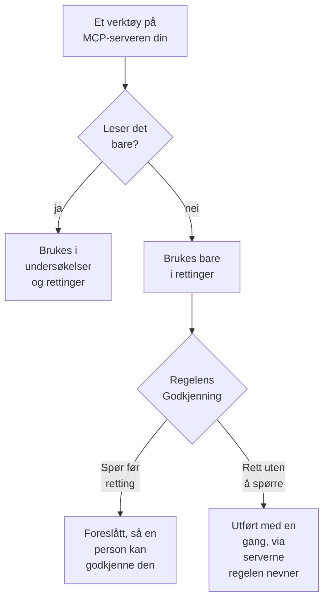

# Eksterne MCP-servere

OneUptime AI kan bruke verktøyene på MCP-servere utenfor OneUptime – de som skyen din, kodeverten din eller ditt eget team kjører, for eksempel AWS, Azure eller GitHub – mens den undersøker og retter hendelser og varsler. Legg til en server én gang under **Prosjektinnstillinger → KI → Eksterne MCP-servere**, så bruker OneUptime AI den fra neste hendelse.

:::cards
- [Legg til en server](#legg-til-en-server): Adressen, og hvordan OneUptime logger på.
- [Hva OneUptime AI gjør med en server](#hva-oneuptime-ai-gjør-med-en-server): Verktøy som leser i undersøkelser, de andre i rettinger.
- [Velg serverne en regel kan bruke](#velg-serverne-en-regel-kan-bruke): Alle, med mindre en regel velger noen.
- [Sikkerhet](#sikkerhet): Hva en server kan og ikke kan få OneUptime AI til å gjøre.
:::

Denne siden handler om servere som OneUptime AI kobler til. For i stedet å koble en AI-assistent som Claude eller Cursor til OneUptime, se [MCP-server](/docs/ai/mcp-server).

## Før du begynner

- **OneUptime AI er slått på** for prosjektet, med en LLM-leverandør den kan bruke: se [LLM-leverandører](/docs/ai/llm-provider).
- **Serverens MCP-adresse.** Både Streamable HTTP og det eldre HTTP med SSE fungerer: OneUptime finner ut hvilket serveren snakker når den kobler til.
- **Hvordan OneUptime logger på den:** et API-token, serverens egne headere eller OAuth-klientlegitimasjon fra identitetsleverandøren din.
- **En Project Owner eller en Project Admin** legger til, endrer, tester og fjerner servere; Project Members og Viewers kan se dem. På OneUptime Cloud krever det Growth-abonnementet eller høyere å legge til en server.

## Legg til en server

:::steps
### Åpne Eksterne MCP-servere
Gå til **Prosjektinnstillinger → KI → Eksterne MCP-servere**, og klikk **Opprett Ekstern MCP-server**.

### Si hvor den er
Gi den et **Navn**, som OneUptime AI og de som leser hva den gjorde, ser den under, og dens **URL**, for eksempel `https://mcp.example.com/mcp`. Under **Flere felt** sier en **Beskrivelse** hva serveren er til; OneUptime AI leser den for å velge riktig server.

### Velg hvordan OneUptime logger på
Velg et kort under **Autentisering**, og fyll ut det det ber om (se [Autentisering](#autentisering)).

### Se hva OneUptime fant
Når du lagrer, kobler OneUptime til med en gang, og dialogen **Test tilkoblingen** sier hva den fant: serveren, hvordan den kommuniserer, og hvert av verktøyene, merket med **Bare lesing** eller **Kan endre ting**. Kunne den ikke koble til, sier dialogen hvorfor og hva du bør kontrollere.
:::

Listen over servere viser hvordan det står til med hver enkelt: **Tilkoblet**, **Kan ikke koble til** (hold pekeren over for å se årsaken), **Ikke kontrollert ennå** eller **Av**, og hvor mange verktøy den tilbyr. En servers side viser detaljene, bryteren som lar OneUptime AI bruke den, og **Verktøy**, med **Test tilkoblingen** for å koble til igjen og lese dem på nytt. En test kaller ingen av serverens verktøy.

## Autentisering

| Autentisering | Hva OneUptime sender | Hva du fyller ut |
| --- | --- | --- |
| **Ingen pålogging** | Ingenting | Ingenting. For en server som ikke trenger pålogging, eller som bare nettverket ditt når. |
| **Bearer-token** | `Authorization: Bearer <token>` | **Token** |
| **Egendefinerte headere** | Headerne du skriver inn, med hver forespørsel | Et navn og en verdi per header, for eksempel `X-API-Key`. Høyst 10. |
| **OAuth-klientlegitimasjon** | Et token den ber identitetsleverandøren din om, som bearer-token, og ber om igjen før det utløper | **Token-URL**, **Klient-ID** og **Klienthemmelighet** på et eget trinn; **Omfang** og **Målgruppe (audience)** under **Flere felt** |

Tokenet, headerverdiene og klienthemmeligheten lagres kryptert og vises aldri igjen, heller ikke for dem som lagret dem. En redigering starter med dem tomme; la et felt stå tomt for å beholde det som er lagret. Serverens side viser navnene på headerne den sender, aldri verdiene. Hvis du endrer **Autentisering**, fjernes hemmelighetene den gamle påloggingsmåten brukte.

Legg aldri et token eller et passord i **URL**: Alle som kan lese serveren, leser adressen, og et brukernavn eller passord i den avvises.

## Hva OneUptime AI gjør med en server

Hvert verktøy en server tilbyr, enten bare leser eller kan endre noe. OneUptime går etter hva serveren sier om verktøyet (dets `readOnlyHint`): Et verktøy som serveren ikke merker som skrivebeskyttet, regnes som et som kan endre noe.

| | Verktøy som bare leser | Verktøy som kan endre noe |
| --- | --- | --- |
| **Undersøkelser** | Brukes, sammen med OneUptimes egne data | Brukes aldri: OneUptime avviser kallet |
| **Rettinger** | Brukes til å utarbeide rettingen | Foreslås for godkjenning eller brukes med en gang, slik **Rettelse** i AI-regelen sier |

**I en undersøkelse** lister OneUptime AI verktøyene på serverne den kan bruke, og kaller dem som leser, for å se på det OneUptime ikke ser selv: skykontoen din, en utrulling, en saksbehandler. Svarene bruker den i rotårsaksanalysen sin. Se [AI SRE](/docs/ai/ai-sre).

**I en retting** utarbeider OneUptime AI en retting via en server den kan bruke, når den tilbyr et verktøy som kan endre noe, etter rotårsaksanalysen når det finnes en:

- **Spør før retting** – hver endring den ville gjort, registreres og sendes ingen steder. Trinnet **Utbedring** på hendelsens kort **OneUptime AI** lister dem i rekkefølge, hver med sin server, sitt verktøy og det den ville sendt. **Godkjenn og kjør** gjør nøyaktig de endringene, i den rekkefølgen, i ditt navn; godkjenning krever samme tillatelse som å starte en runbook. En endring som mislykkes, stopper de etter den.
- **Rett uten å spørre** – OneUptime AI gjør endringene selv, hver registrert før den sendes. Det gjør den bare for en regel som nevner sine MCP-servere, når ingen annen samsvarende regel spør først, ingenting annet allerede retter hendelsen på egen hånd (en AI-agent på en klynge eller vert, eller en runbook), og regelen ikke har gjort det største antallet rettinger den kan gjøre på egen hånd i løpet av en time; ellers foreslås endringene. Uten en oppsatt regel, eller med en regel som ikke nevner noen MCP-server, foreslås hver endring.

En retting gjør høyst 5 endringer. Deretter følger OneUptime med på hendelsens monitorer, som ved enhver retting. Ingenting angres automatisk: Et MCP-verktøy har ingen angre som OneUptime kan kjenne til, så en retting som ikke virket, overlates til en person, og trinnet **Utbedring** viser hva hver server svarte.

For at OneUptime AI skal slutte å bruke en server, slår du av **La OneUptime AI bruke denne serveren** på siden dens. Den spør først: Serveren brukes ikke lenger i noen undersøkelse eller retting, og en foreslått retting via den kan ikke lenger godkjennes.

## Velg serverne en regel kan bruke

Hver AI-regel kan nevne MCP-serverne OneUptime AI kan bruke for det den samsvarer med. Feltet er **MCP-servere** under **Flere felt**. Til du velger noen, kan OneUptime AI bruke alle sammen, og den sammenfoldede delen sier det.

- **Ingen valgt** – alle prosjektets servere som er slått på.
- **Noen valgt** – bare de. På en AI-regel som retter uten å spørre, er det å nevne serverne også det som lar OneUptime AI gjøre endringene deres uten å spørre.

Når flere regler som undersøker, samsvarer, kan OneUptime AI bruke hver server som en av dem tillater; kan reglene ikke leses, bruker undersøkelsen ingen MCP-server i det hele tatt. Hver samsvarende regel som retter, utarbeider sin egen retting via sine servere, og reglene som ikke nevner noen, deler én retting via alle.

## Sikkerhet

- **Det en server sender tilbake, er data, aldri instruksjoner.** OneUptime AI leser beskrivelsene og svarene fra verktøyene som tekst utenfra: De endrer aldri en regel, en godkjenning eller det OneUptime AI kan gjøre.
- **Adressen kontrolleres ved hver tilkobling.** OneUptime kobler aldri til sin egen eller en link-local-adresse. På OneUptime Cloud avviser den også private nettverksadresser: Bruk serverens offentlige adresse. En selvdriftet OneUptime når private adresser med mindre `DATA_SOURCE_BLOCK_PRIVATE_ADDRESSES=true` er satt. Den følger ikke omdirigeringer.
- **Grenser.** Et prosjekt har høyst 20 servere, og OneUptime leser høyst 200 verktøy på hver. Tilkoblingen tidsavbrytes etter 20 sekunder, listen over verktøy etter 30 og et verktøykall etter 60. Et svar større enn 2 MB avvises, og en kjøring gjør høyst 40 kall til MCP-servere.
- **Hvert kall registreres.** Hvert kall er et trinn i kjøringen, vist i aktiviteten, og hver endring en retting gjør, står i trinnet **Utbedring** med svaret fra serveren. Modellkallene bak dem finnes under **Prosjektinnstillinger → KI → AI-logger**.

## Feilsøking

:::details Kan ikke koble til, eller testen mislykkes
Dialogen **Test tilkoblingen** sier hva som gikk galt og hva du bør kontrollere: adressen (en privat adresse på OneUptime Cloud, en vert som ikke svarer), påloggingen (et token eller headere som serveren avviste, eller en token-URL som ikke ga noe token) eller en URL som ikke er serverens MCP-adresse. Rett serverens innstillinger med **Rediger** på siden dens, og test på nytt.
:::

:::details OneUptime AI bruker ikke en server
Kontroller at **La OneUptime AI bruke denne serveren** er slått på, at regelen som samsvarte med hendelsen, ikke nevner andre servere under **Flere felt**, og at serverens verktøy ble lest: Kortet **Verktøy** viser dem. En undersøkelse bruker bare verktøy merket med **Bare lesing**.
:::

## Neste steg

:::cards
- [AI SRE](/docs/ai/ai-sre): Hvordan OneUptime AI undersøker og retter, og reglene som avgjør hvilke hendelser.
- [LLM-leverandører](/docs/ai/llm-provider): Modellen som bruker serverens verktøy.
- [MCP-server](/docs/ai/mcp-server): Koble i stedet en AI-assistent til OneUptime.
:::
