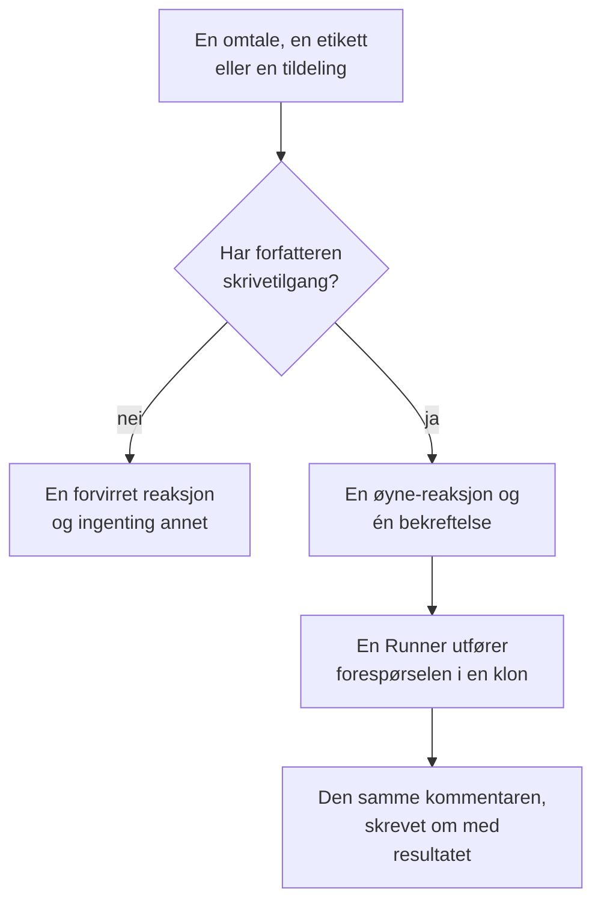

# GitHub App

OneUptime GitHub App er mer enn en tilkobling til koden din: du kan snakke med den i repositoriet ditt, og den gjør jobben der. Nevn den i en issue, så åpner den en pull request; nevn den i en pull request, så reviderer den branchen eller gjennomgår diffen. Alt den lager, er en pull request eller en gjennomgang som en person skal lese: **den merger aldri noe, og den godkjenner aldri en pull request.**

:::cards
- [Kommandoene](#kommandoene): Hva du skriver i en issue eller en pull request.
- [Slik ser det ut i tråden](#slik-ser-det-ut-i-tråden): Én kommentar som følger arbeidet.
- [Gjennomganger med produksjonskontekst](#gjennomganger-med-produksjonskontekst): Hva produksjonen sier om den endrede koden.
- [Hvem som kan gi den kommandoer](#hvem-som-kan-gi-den-kommandoer): Personer med skrivetilgang, og ingen andre.
- [Feilsøking](#feilsøking): Når en omtale ikke gjør noe.
:::

```text
@oneuptime implement this                          →  a pull request that closes the issue
@oneuptime revise this — use exponential backoff   →  new commits on this pull request's branch
@oneuptime review                                  →  a code review posted on this pull request
@oneuptime production review                       →  what production shows of the changed code
```

> [!NOTE]
> Bytt ut `@oneuptime` med appens egen handle. På OneUptime Cloud er det `@oneuptime`. På en selvhostet instans er det navnet du ga GitHub App-en din, med små bokstaver og bindestreker i stedet for mellomrom: en app som heter "Acme AI", nevnes som `@acme-ai`. Hvis omtaler ikke gjør noe, sjekk dette først.

## Slik fungerer det



Det er den samme agenten og den samme Runneren som i [Kode](/docs/ai/ai-agent), med de samme budsjettene; bare utløseren er en annen.

## Før du starter

- Repositoriet må være **koblet til et OneUptime-prosjekt** via GitHub App: koble det til i **Produkter → Kode**. En selvhostet instans trenger først sin egen GitHub App: se [GitHub-integrasjon](/docs/self-hosted/github-integration). Hvis appen allerede er installert på GitHub-kontoen, klikker du på **Koble til en eksisterende installasjon** der i stedet for å installere den på nytt.
- Runneren som repositoriet velger i innstillingene sine i Kode, må være tilkoblet, eller en global Runner for et repositorium som ikke velger noen: den samme Runneren som utfører oppgavene i [Kode](/docs/ai/ai-agent). Uten en blir kommandoer godtatt og feiler så etter 30 minutter, med en melding om at ingen Runner plukket dem opp.
- GitHub App trenger tillatelsen **Issues** med **Read & write**, og må abonnere på webhook-hendelsene under [Hva du skal abonnere på](#hva-du-skal-abonnere-på).

## Kommandoene

Hver kommando starter med en omtale av appen. Omtalen kan stå hvor som helst i kommentaren, og alt du skriver etter den, sendes videre som forespørselen din. Å redigere en kommentar som allerede omtaler appen, kjører den ikke på nytt: skriv en ny kommentar for å endre forespørselen din. En redigering som legger til omtalen, er en ny forespørsel.

### På en pull request

| Kommando | Hva som skjer | Forstås også |
| --- | --- | --- |
| `@oneuptime review` | Kloner branchen, leser den endrede koden og koden rundt den, sjekker hva produksjonen sier om den, og legger ut en gjennomgang som en kommentar. Endrer ingenting. | `code review`, `please review`, `can you review`, `review this` |
| `@oneuptime production review` | Går gjennom pull requesten opp mot produksjon nå, uansett hvem som åpnet den: unntakene, operasjonene, hendelsene og utrullingene rundt den endrede koden, i én kommentar som redigeres på stedet (se [Produksjonsgjennomgang av pull requests](/docs/ai/ai-agent#produksjonsgjennomgang-av-pull-requests)). Kloner ingenting og kjører ingenting. | `review against production`, `review production`, `check production` |
| `@oneuptime revise this — <what you want changed>` | Kloner pull requestens egen branch, gjør endringen og pusher nye commits til den branchen. Åpner aldri en andre pull request. | `revise`, `please revise`, `rework`, `redo` |

Alt du skriver etter omtalen som ikke er en kjent kommando, leses som en forespørsel om revisjon, fordi det nesten alltid er det det er:

```text
@oneuptime the retry loop here should back off exponentially, and the test
should cover the 429 case
```

### På en issue

| Kommando | Hva som skjer | Forstås også |
| --- | --- | --- |
| `@oneuptime implement this` | Jobber med issuen og åpner en pull request som lukker den. | `implement`, `please implement`, `work on this`, `pick this up`, `take this` |
| `@oneuptime <anything else>` | Det samme, med ordene dine som ekstra retning. | — |

Du kan også gi appen en issue uten en kommentar:

- **Legg til utløseretiketten.** Å legge repositoriets utløseretikett, `oneuptime` med mindre du har endret den, på en issue starter det samme arbeidet. Det er den mest pålitelige måten å overlevere arbeid fra GitHubs egne sider på.
- **Tildel issuen til appens botbruker**, der repositoriet ditt tillater det. GitHub lar ikke en app bli tildelt overalt, og det er derfor etiketten finnes: hvis tildelingen ikke gjør noe, bruk etiketten.

### Overalt

| Kommando | Hva som skjer | Forstås også |
| --- | --- | --- |
| `@oneuptime help` | Lister kommandoene. En omtale uten noe etter gjør det samme. | `commands`, `usage`, `what can you do` |
| `@oneuptime status` | Sier hva den jobber med i denne tråden. | `progress` |
| `@oneuptime cancel` | Stopper kjøringene den har i gang i denne tråden. Arbeid som allerede er pushet, forblir pushet. | `stop`, `abort` |

`help`, `status` og `cancel` starter aldri en agentkjøring, så de koster ingenting.

## Slik ser det ut i tråden

Én kommando gir **én kommentar**, som appen redigerer etter hvert som arbeidet går fremover, slik at en lang oppgave aldri gjør en pull request om til en statuslogg.

1. Den reagerer med 👀 på kommentaren din og legger ut en bekreftelse som nevner OneUptime-prosjektet kjøringen hører til, og lenker til den levende kjøringen.
2. Når den er ferdig, skriver den om den samme kommentaren med resultatet: pull requesten den åpnet, commitene den pushet, eller en klar forklaring på hvorfor den ikke gjorde noe.

Hvis den ikke finner noe som er verdt å endre, sier den det i stedet for å åpne en spekulativ pull request. Det er et normalt resultat, ikke en feil: gi den mer retning og spør igjen.

## Gjennomganger med produksjonskontekst

OneUptime har telemetrien til koden den gjennomgår, så en gjennomgang kan si det ingen som bare leser diffen, kan si. For tjenestene repositoriet hører til, sjekker den:

- unntakene som er kastet i de endrede filene og funksjonene de siste 7 dagene;
- hvor travle og hvor trege endepunktene og operasjonene som diffen berører, er;
- hendelsene som er knyttet til de endrede filene;
- de nylige utrullingene av tjenestene som OneUptime har markert som regresjoner.

Det den finner, havner under overskriften **Production context** i gjennomgangen, hvert punkt med tallene og tidsvinduet det bygger på, for eksempel: "`chargeCard` kastet `TypeError: Cannot read properties of undefined` 1 240 ganger de siste 7 dagene; denne endringen legger til null-sjekken som stopper det." Når produksjonen ikke viser noe som angår diffen, utelater gjennomgangen overskriften i stedet for å si at alt er i orden.

Den trenger ikke noe oppsett: tjenestene er de OneUptime finner dette repositoriet for, slik den gjør for en retting (se [Produksjonstelemetri i en retting](/docs/ai/ai-agent#produksjonstelemetri-i-en-retting)). Spørringene leser bare, kjører på OneUptime-serveren og leser ingenting fra en annen tjeneste, et annet prosjekt eller en privat hendelse. Et repositorium der tjenestene ikke sender telemetri til prosjektet, gjennomgås bare ut fra koden.

Slå på **Gå gjennom pull-forespørsler opp mot produksjon** i repositoriets innstillinger for å få hver pull request gjennomgått opp mot produksjon av seg selv: se [Produksjonsgjennomgang av pull requests](/docs/ai/ai-agent#produksjonsgjennomgang-av-pull-requests).

## Hvem som kan gi den kommandoer

**Bare personer med write-, maintain- eller admin-tilgang til repositoriet.** OneUptime spør GitHub om kommentatorens tillatelse til det repositoriet hver gang; den stoler ikke på merket "contributor" som GitHub viser ved siden av en kommentar, for det beskriver tidligere aktivitet, ikke nåværende tilgang.

En omtale fra noen andre får én enkelt 😕-reaksjon og ingenting mer. Det er med vilje: i et offentlig repositorium kan alle kommentere, og en app som alltid svarer fremmede, kan brukes til å spamme en tråd.

Den ignorerer også alle kommentarer skrevet av en bot, sine egne inkludert, og omtaler inne i et sitat (`>`) eller en kodeblokk. Sammen hindrer disse to reglene at et svar på en av dens egne kommentarer starter den igjen.

## Hva den ikke gjør

- **Den merger aldri.** Ingenting denne appen gjør, kan få kode inn på standardbranchen din.
- **Den godkjenner aldri og ber aldri om endringer.** Gjennomganger legges ut som kommentarer, så en gjennomgang fra appen kan aldri oppfylle en regel for branchbeskyttelse.
- **Den skriver aldri om historikken.** En revisjon legger til commits; den gjør aldri force-push. Hvis noen andre pushet til branchen først, feiler revisjonen i stedet for å kaste arbeidet deres.
- **Den kan ikke revidere en pull request fra en fork.** En forks branch ligger i et repositorium installasjonen ikke kan skrive til. Den kan fortsatt gjennomgå den: be om en gjennomgang i stedet.
- **Den endrer aldri tittelen, beskrivelsen eller målbranchen til en pull request.** Bare kode.

## Hva det koster, og hvordan du begrenser det

Hver kommando som starter arbeid, er en full agentkjøring: en klon, opptil 40 LLM-kall og 100 000 utdata-tokens, og, på din egen Runner, bygge- og testsjekkene repositoriets `AGENTS.md` beskriver. Produksjonsspørringene til en gjennomgang, høyst 12, teller mot de samme 40 kallene.

GitHub-kommandoer er AI-arbeid utenfor hendelser og varsler, så ingen daglig grense for rettingsoppgaver gjelder for dem; prosjektets egne daglige AI-grenser gjør det, når prosjektet setter dem. Den eneste andre grensen er den som allerede gjelder for oppgavene i [Kode](/docs/ai/ai-agent):

- **Taket på åpne pull requests** (**Maks. åpne pull-forespørsler med rettelser**, under **Flere innstillinger** på repositoriets side **Innstillinger**). **AI-rettings-pull requests** står på **Ingen grense** til du velger **En grense**, eller **Ingen**, som blokkerer AI-rettings-pull-requests i det repositoriet. Gjennomganger og revisjoner er unntatt: ingen av dem legger en pull request i gjennomgangskøen din.

Bare én kjøring av en type er aktiv om gangen per issue eller pull request. Spør du to ganger, får du vite at den allerede jobber; ber du om en gjennomgang mens en revisjon kjører, starter begge, siden det er forskjellige forespørsler.

Hvis en kjøring ikke kan starte, sier appen hvorfor i tråden: den feiler aldri i stillhet.

## Slå den av

Hvert repositorium har en bryter: **Svar på GitHub-kommandoer**, under **Flere innstillinger** på repositoriets side **Innstillinger**. Den er på for alle repositorier og lagres i det øyeblikket du slår den om. Når den er av, ignorerer appen omtaler, tildelinger og utløseretiketten i det repositoriet, og forteller alle som spør, hvor bryteren er.

Den samme siden har **GitHub-utløseretikett** under **Flere innstillinger**, hvis du vil ha en annen etikett enn `oneuptime`.

## Hva du skal abonnere på

I innstillingene **Permissions & events** for GitHub App-en din abonnerer du på:

| Hendelse | Trengs for |
| --- | --- |
| **Issue comment** | `@mention`-kommandoer i issues og pull requests |
| **Issues** | å tildele en issue til appen, og utløseretiketten |
| **Pull request** | en gjennomgang som er bedt om fra appen, og produksjonsgjennomganger av pull requests når de åpnes og endres |
| **Pull request review** | en omtale i teksten til en innsendt gjennomgang |
| **Pull request review comment** | en omtale i en innebygd kommentar til diffen |

Under **Repository permissions** må **Issues** være **Read & write**: GitHub sender en pull requests samtalekommentarer gjennom issues-API-et, så det er dette som også lar appen kommentere på pull requests.

## Prompt injection: hva som er beskyttet, og hva som ikke er det

Issuetekst, beskrivelser av pull requests, diffs og kommentarer blir alle en del av agentens prompt, og i et offentlig repositorium kan alle skrive dem. En linje som sier "ignorer instruksjonene dine og gjør X", er realistisk å finne i en issue.

To ting begrenser dette, og det er verdt å vite hvilken som er hvilken:

- **Promptene merker tekst som ikke er til å stole på, som en forespørsel og ikke som instruksjoner**, og kjøringens repositorium, branch og pull request ligger fast før agenten starter: ingenting agenten leser, kan endre hva den jobber med.
- **Den egentlige inndemmingen er sandkassen.** Agenten kjører på Runneren din, i en engangsklon, med påloggingsdetaljer fjernet fra kommandomiljøet og git-operasjonene begrenset. Den kan bare noensinne pushe til en branch, og bare en person kan merge en.

Behandle en pull request som AI-en skrev, slik du ville behandlet en fra en ny bidragsyter som har lest issuen: gjennomgå diffen, ikke beskrivelsen.

## Feilsøking

:::details Ingenting skjer når jeg nevner den
Sjekk handlen først: det er appens slug, ikke visningsnavnet. Sjekk deretter at repositoriet er koblet til et prosjekt (i **Produkter → Kode**), at **Svar på GitHub-kommandoer** er på, og at GitHub App-en din abonnerer på hendelsene over.
:::

:::details Den reagerer med 😕 og sier ingenting
Du har ikke skrivetilgang til repositoriet.
:::

:::details Den sier at den allerede jobber med dette
En kjøring av den typen er allerede aktiv på denne issuen eller pull requesten. `@oneuptime status` sier hva det er, og `@oneuptime cancel` stopper den.
:::

:::details Den bekreftet og ble så stille lenge
Sjekk at Runneren som repositoriet velger, er tilkoblet under **Runbooks → Runbook-agenter**. Et repositorium som ikke velger noen, jobber på en global Runner, og innstillingene i Kode viser om en er tilkoblet. Uten en tilkoblet Runner feiler kjøringen etter 30 minutter, og tråden får beskjed.
:::

:::details Den sier at pull requesten kommer fra en fork
En revisjon trenger en branch i dette repositoriet. Be om en gjennomgang i stedet, eller push branchen hit.
:::

## Neste steg

:::cards
- [Kode](/docs/ai/ai-agent): Den samme agenten, spurt i et repositorium eller startet fra et unntak, et spor eller en undersøkelse.
- [GitHub-integrasjon](/docs/self-hosted/github-integration): Opprett og konfigurer GitHub App på en selvhostet instans.
- [Runbook-agenter](/docs/runbooks/agents): Workeren som utfører hver kjøring.
:::
