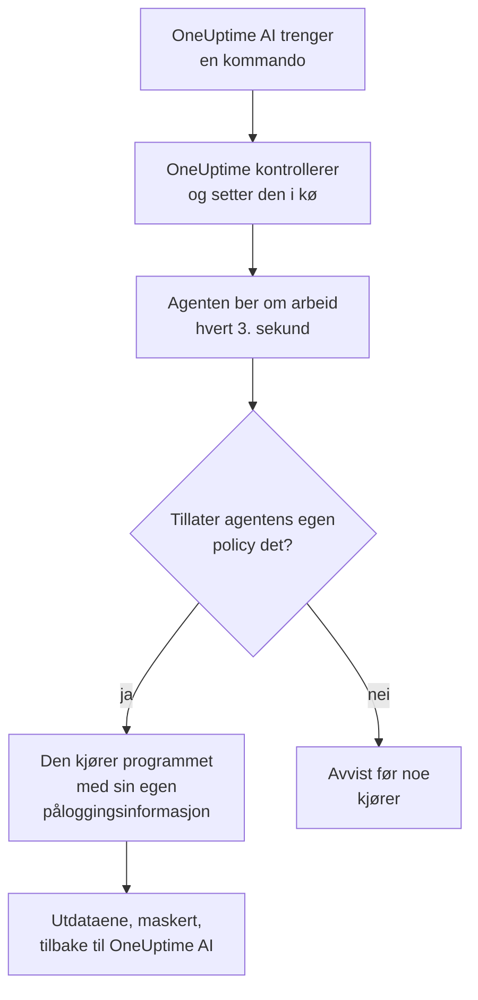

# AI-agenter for infrastrukturen

OneUptime AI kan se på mer enn telemetrien din mens den undersøker en hendelse eller et varsel. En liten agent som er installert ved siden av en av ressursene dine (en Docker- eller Podman-vert, en Docker Swarm-klynge, en Proxmox-klynge, et VMware vCenter, en Ceph-klynge, en databaseserver eller en Linux-vert), kjører de skrivebeskyttede kommandoene OneUptime AI ber om, for eksempel `docker logs --tail 200 web`, `pvesh get /cluster/status`, `ceph health detail`, `db long-queries --min-seconds 30` eller `journalctl -u nginx -n 200 --no-pager`, og sender utdataene tilbake, slik at rotårsaksanalysen siterer det ressursen selv sier. Hvis du tillater det, bruker den samme agenten også rettelser (starter en container på nytt, starter en VM, markerer en OSD som in igjen), hver av dem plassert i et nivå av en kommandopolicy og, med mindre du velger noe annet, godkjent av et menneske først. Spør AI, åpnet på ressursens side, kjører de samme skrivebeskyttede kommandoene når du ber om det (se [Spør AI](/docs/ai/ask-ai)).

En AWS-konto, et Azure-abonnement eller et Google Cloud-prosjekt trenger ingen agent for å bli undersøkt: OneUptime leser det direkte, gjennom den skrivebeskyttede tilkoblingen det ble koblet til med. Bare rettelsene trenger en agent, Sky-AI-agenten, som kjører i selve kontoen og settes opp med én kommando fra kontoens side (se [I en skykonto](#i-en-skykonto)).

Disse agentene er **ressurs-AI-agentene**. Hver ressurs side i dashbordet har en **KI**-seksjon med tre sider:

- **Innsikt**: det OneUptime AI har funnet ut om ressursen de siste 30 dagene, altså problemene som stadig kommer tilbake og hvorfor, med det KI-en fant og trinnet den foreslår, delene av ressursen som står bak de fleste av dem, rettelser som ikke hjalp eller som venter på godkjenning, det KI-en rettet på egen hånd, og risikoene som ble oppdaget før noen ble varslet, med det KI-en selv gjorde der som fotnote. Den fungerer som en klynges; se [Hva KI-en har lært på en klynge](/docs/ai/ai-sre#hva-ki-en-har-lært-på-en-klynge).
- **Logger**: alt OneUptime AI har gjort på ressursen, nyeste først: hver undersøkelse med hendelsen eller varselet og sammendraget, hver rettelse den foreslo eller kjørte, og hver kommando den sendte gjennom agenten. (Denne siden het tidligere Innsikt.)
- **AI-agent**: om agenten er tilkoblet, hva KI-en kan gjøre på ressursen (undersøke, og hvordan rettelser kjører), alt som trenger oppmerksomhet med trinnet som løser det, og i menyen **⋯** ved siden av agentens status **Test tilkoblingen** og **Tilbakestill agenten**.

Ressursens **Oversikt** slutter med et **AI-agent**-kort som oppsummerer AI-agentens side: om agenten er tilkoblet, om undersøkelse er slått på, hvordan rettelser kjører (**Av**, **Be om godkjenning**, **Automatisk** eller **Hopp over godkjenning**), og hva som trenger oppmerksomhet, med en lenke til AI-agentens side, der de endres.

:::cards
- [Støttede ressurser](#støttede-ressurser): Elleve typer ressurser, ett image.
- [Installer en AI-agent](#installer-en-ai-agent): Ved siden av en collector du allerede kjører, på en Linux-vert eller i en skykonto med én kommando.
- [Slik fungerer rettelser](#slik-fungerer-rettelser): Hva som kan kjøre av seg selv, hva som venter på et menneske, og hva som aldri kjører.
- [Sikkerhetsmodell](#sikkerhetsmodell): Tre kontroller av hver kommando, og ingen påloggingsinformasjon fra OneUptime.
:::

## Slik fungerer det

Agenten venter aldri på en tilkobling fra OneUptime: den kontakter selv OneUptime, ber om arbeid og kjører bare det dens egen kopi av kommandopolicyen tillater, med påloggingsinformasjonen den allerede har.



## Forholdet til Kubernetes-AI-agenten

Kubernetes-klynger har sin egen agent, Kubernetes-AI-agenten, som installeres av Kubernetes-agentens Helm-chart; se [Klyngetilgang: la OneUptime AI kjøre kubectl](/docs/ai/ai-sre#klyngetilgang-la-oneuptime-ai-kjøre-kubectl). Ingenting på denne siden endrer den. Ressurs-AI-agentene følger samme utforming:

- **De samme nivåene og modusene.** Hver kommando er **Read**, **SafeWrite**, **RiskyWrite** eller **Denied**, og rettelser er **Av**, **Be om godkjenning**, **Automatisk** eller **Hopp over godkjenning**, med samme betydning som på en klynge.
- **De samme tre kontrollene.** Den samme kommandopolicyen håndheves av OneUptimes KI-verktøy, igjen når OneUptime setter kommandoen i kø, og igjen av agenten før den kjører noe.
- **Den samme regelen om påloggingsinformasjon.** Agenten bruker bare det dens eget miljø og dens monteringer gir den. OneUptime sender den aldri påloggingsinformasjon.
- **De samme standardene.** KI-undersøkelser er slått på som standard: en ressurs starter med undersøkelse slått på og rettelser slått av, akkurat som en klynge, så OneUptime AI undersøker med agenten sin så snart den kobler til, og endrer ingenting før noen tillater rettelser (se [Koble til OneUptime](#koble-til-oneuptime)).

Hva som er annerledes:

- **Ett image for alle ressurser.** `oneuptime/resource-ai-agent` betjener alle elleve ressurstypene, og `ONEUPTIME_AI_AGENT_RESOURCE_TYPE` sier hvilken en agent betjener. Den kjører ved siden av ressursens collector som én container til, eller i skykontoen den betjener, ikke fra et Helm-chart.
- **Skrivetilgang er en miljøvariabel.** Først `ONEUPTIME_AI_ALLOW_WRITES=true` på agenten lar den bruke rettelser i det hele tatt, og `ONEUPTIME_AI_WRITE_TARGETS` begrenser hvilke containere, tjenester, VM-er, OSD-er, økter eller units de kan røre. På en klynge gjør chartets RBAC og `aiAgent.remediation.namespaces` dette.

I likhet med Kubernetes-AI-agenten er en ressurs-AI-agent ikke en Runner. Den vises aldri under Runbooks → Runbook-agenter, og den brukes aldri som Bash- eller SSH-vert for runbooks.

## Støttede ressurser

| Ressurs | `ONEUPTIME_AI_AGENT_RESOURCE_TYPE` | Agent | Registrerer seg som (collectorens variabel) | Kjører | Når ressursen via |
| -------------------- | ---------------------------------- | --------------------- | ----------------------------------------------------------------------------------------------- | -------------------------------------------------------------------------------------------------------------------------------------------------- | -------------------------------------------------------------------------- |
| Docker-vert | `docker` | Docker-AI-agent | `DOCKER_HOST_NAME` | `docker` | Docker-socketen, `/var/run/docker.sock` |
| Podman-vert | `podman` | Podman-AI-agent | `PODMAN_HOST_NAME` | `docker`, gjennom Podmans Docker-kompatible API | Podman-socketen, `/run/podman/podman.sock` |
| Docker Swarm-klynge | `docker-swarm` (eller `swarm`) | Docker Swarm-AI-agent | `DOCKER_SWARM_CLUSTER_NAME` | `docker` | Docker-socketen på en managernode |
| Proxmox-klynge | `proxmox` | Proxmox-AI-agent | `PROXMOX_CLUSTER_NAME` | `pvesh`-kommandoer, sendt til Proxmox VE-API-et (det finnes ingen `pvesh`-binærfil i agenten) | `https://PVE_HOST:8006/api2/json`, med et Proxmox-API-token |
| VMware vCenter | `vmware` (eller `vcenter`) | VMware-AI-agent | `VMWARE_VCENTER_NAME` | `govc` | vCenters API, med en vSphere-bruker |
| Ceph-klynge | `ceph` | Ceph-AI-agent | `CEPH_CLUSTER_NAME` | `ceph` | monitorene, med en `ceph.conf` og keyringen til agentens egen klient |
| Databaseserver | `database` (eller `db`) | Database-AI-agent | `DATABASE_SERVER_ID`, eller `DATABASE_SYSTEM` + `DATABASE_SERVER_ADDRESS` + `DATABASE_SERVER_PORT` | `db`: én operasjon fra en fast diagnostisk katalog, aldri SQL | databasens egen driver, med en databasepålogging |
| Vert | `host` | Verts-AI-agent | `HOST_NAME` (tom: vertens eget vertsnavn) | `systemctl`, `journalctl`, `df`, `free`, `uptime`, `ps`, `ss`, `ip`, `dmesg`, `lsblk`, `cat`, `top`, `uname`, `hostnamectl`, `timedatectl`, `kill` | `nsenter` inn i vertens navnerom, fra en privilegert container |
| AWS-konto | `aws` | Sky-AI-agent | `AWS_ACCOUNT_ID` (tom: kontoen den kjører i) | `cloud`: én operasjon fra en fast katalog, aldri en `aws`-kommando | AWS-API-ene, med egne IAM-roller |
| Azure-abonnement | `azure` | Sky-AI-agent | `AZURE_SUBSCRIPTION_ID` (oppsettkommandoen setter den) | `cloud`: én operasjon fra en fast katalog, aldri en `az`-kommando | Azure Resource Manager, som den administrerte identiteten til Container App-en |
| Google Cloud-prosjekt | `gcp` (eller `google-cloud`) | Sky-AI-agent | `GOOGLE_CLOUD_PROJECT` (tom: prosjektet den kjører i) | `cloud`: én operasjon fra en fast katalog, aldri en `gcloud`-kommando | Google Cloud-API-ene, som en egen tjenestekonto |

Databaseservere: Database-AI-agenten har diagnostikk for PostgreSQL, MySQL (og MariaDB og Percona Server), Redis (og Valkey, KeyDB og Dragonfly) og MongoDB. For alle andre motorer kjører den ingenting og sier det på databasens AI-agent-side.

**Test tilkoblingen**, i menyen **⋯** ved siden av agentens status på AI-agentens side, kjører disse skrivebeskyttede kommandoene gjennom agenten og viser utdataene i agentens kort:

| Ressurs | Hva Test tilkoblingen kjører |
| -------------------- | ---------------------------------------------------- |
| Docker-vert | `docker version`, `docker info` |
| Podman-vert | `docker version`, `docker info` |
| Docker Swarm-klynge | `docker version`, `docker node ls` |
| Proxmox-klynge | `pvesh get /version`, `pvesh get /cluster/status` |
| VMware vCenter | `govc about` |
| Ceph-klynge | `ceph health`, `ceph versions` |
| Databaseserver | `db ping`, `db version` |
| Vert | `uptime`, `systemctl list-units --failed --no-pager` |
| AWS-konto | `cloud whoami` |
| Azure-abonnement | `cloud whoami` |
| Google Cloud-prosjekt | `cloud whoami` |

På en Docker Swarm-worker feiler `docker node ls`: Docker Swarm-AI-agenten må kjøre på en managernode. En agent som startes på en worker, registrerer seg ikke for klyngen før noden dens er en manager, og Docker Swarm-installasjonsprogrammet utelater den på en node som ikke er manager.

På en skykonto viser `cloud whoami` kontoen Sky-AI-agenten handler i og hvem den er logget på som, om den kan endre noe, endringene den kan gjøre, og taggen den krever, hvis den krever en.

## Installer en AI-agent

Hver ressurs-AI-agent er det samme imaget, `oneuptime/resource-ai-agent:release`. Ved siden av en collector eller på en vert trenger den ingenting i dashbordet: så snart den kjører, registrerer den seg hos OneUptime og dukker opp på ressursens AI-agent-side innen ett minutt. Agenten for en skykonto kjører i kontoen, fra én kommando som kontoens side skriver for den (se [I en skykonto](#i-en-skykonto)).

### Ved siden av en collector

For Docker, Podman, Docker Swarm, Proxmox, VMware, Ceph og databaseservere kjører agenten ved siden av collectoren du allerede bruker for den ressursen, og deler dens `.env`: den har allerede `ONEUPTIME_URL`, inntaksnøkkelen og ressursens navn. Hver collectors `docker-compose.yml` leverer agenten som én tjeneste til, og dens `install.sh` starter den.

| Ressurs | Collector | AI-agentens tjeneste (og container) | Hvor den settes opp |
| -------------------- | ----------------------------------------------------------- | --------------------------------- | ------------------------------------------------------------------------------------- |
| Docker-vert | [Docker-agent](/docs/telemetry/docker-host#ai-agent) | `oneuptime-docker-ai-agent` | `agents/DockerAgent/docker-compose.yml`; `install.sh` starter den som en andre container |
| Podman-vert | [Podman-agent](/docs/telemetry/podman-host#ai-agent) | `oneuptime-podman-ai-agent` | `agents/PodmanAgent/docker-compose.yml`; `install.sh` starter den som en andre container |
| Docker Swarm-klynge | [Docker Swarm-agent](/docs/telemetry/docker-swarm#ai-agent) | `oneuptime-docker-swarm-ai-agent` | `agents/DockerSwarmAgent/docker-compose.yml`, på en managernode |
| Proxmox-klynge | [Proxmox-agent](/docs/telemetry/proxmox#ai-agent) | `oneuptime-proxmox-ai-agent` | `agents/ProxmoxAgent/docker-compose.yml` |
| VMware vCenter | [VMware-agent](/docs/telemetry/vmware#ai-agent) | `oneuptime-vmware-ai-agent` | `agents/VMwareAgent/docker-compose.yml` |
| Ceph-klynge | [Ceph-agent](/docs/telemetry/ceph#ai-agent) | `oneuptime-ceph-ai-agent` | `agents/CephAgent/docker-compose.yml`, med agentens egen Ceph-klient i `./ceph` |
| Databaseserver | [Database-agent](/docs/telemetry/databases#ai-agent) | `oneuptime-database-ai-agent` | `agents/DatabaseAgent/docker-compose.yml` |

En collector som ble installert før AI-agenten fantes, kjører den ikke ennå. Kjør `install.sh` for den på nytt: den starter nå også AI-agenten (installasjonsprogrammene for Proxmox, VMware, Ceph, databaser og Docker Swarm laster ned den gjeldende `docker-compose.yml`, som har AI-agentens tjeneste). Hvis du styrer filene selv, legger du tjenesten fra collectorens `docker-compose.yml` til i din egen og kjører `docker compose up -d`. Ressursens AI-agent-side viser den nøyaktige tjenesten for den ressursen, med navnet allerede fylt ut.

Uten installasjonsprogrammene er Docker-AI-agenten én `docker run`:

```bash
docker run -d \
  --name oneuptime-docker-ai-agent \
  --user 0:0 \
  --restart unless-stopped \
  --read-only --tmpfs /tmp \
  -v /var/run/docker.sock:/var/run/docker.sock:ro \
  -e ONEUPTIME_URL="https://oneuptime.com" \
  -e ONEUPTIME_SERVICE_TOKEN="YOUR_TELEMETRY_INGESTION_TOKEN" \
  -e ONEUPTIME_AI_AGENT_RESOURCE_TYPE=docker \
  -e DOCKER_HOST_NAME="my-docker-host" \
  oneuptime/resource-ai-agent:release
```

`DOCKER_HOST_NAME` må være navnet Docker-agenten rapporterer. Installasjonsprogrammene for Docker og Podman tar `--no-ai-agent` (eller `ONEUPTIME_INSTALL_AI_AGENT=false`) for å utelate AI-agenten, og det gjør også Docker Swarm-installasjonsprogrammet. For å kjøre en collector uten den senere, sletter du AI-agent-tjenesten dens fra `docker-compose.yml`, eller fjerner containeren dens med `docker rm -f`.

### Verts-AI-agent

En Linux-vert som rapporterer gjennom [OpenTelemetry-collector på verten](/docs/telemetry/host-otel-collector), har ingen OneUptime-container å stå ved siden av, så Verts-AI-agenten kommer med sitt eget installasjonsprogram (`agents/HostAIAgent`):

```bash
curl -fsSL https://raw.githubusercontent.com/OneUptime/oneuptime/master/agents/HostAIAgent/install.sh -o install.sh
sudo bash install.sh
```

Det ber om OneUptime-URL-en din, prosjektets telemetri-inntaksnøkkel og vertens navn, skriver `/opt/oneuptime-host-ai-agent/.env` og `docker-compose.yml` og starter containeren `oneuptime-host-ai-agent`. Legg til `--systemd` for i stedet å kjøre den under systemd-uniten `oneuptime-host-ai-agent`. Den trenger Docker (systemmotoren, ikke rootless Docker) med Compose-pluginen; rootful Podman kan kjøre den samme containeren.

Verts-AI-agenten kjører **vertens egne** programmer: hver kommando kjører som `nsenter --target 1 --mount --uts --ipc --net --pid -- PROGRAM ARGS`, som går inn i navnerommene til vertens init. Det krever `pid: host`, `privileged: true` og root; se [Docker-socketen og Verts-AI-agenten er root på verten](#docker-socketen-og-verts-ai-agenten-er-root-på-verten). La `HOST_NAME` være tom for å bruke maskinens vertsnavn, som er det collectoren rapporterer som `host.name` med mindre du har endret det; ellers setter du det til navnet som vises under **Verter**.

### I en skykonto

En AWS-konto, et Azure-abonnement eller et Google Cloud-prosjekt har ingen collector en agent kan kjøre ved siden av, og OneUptime leser det uten en agent (se [Skykontoer](#skykontoer)). Sky-AI-agenten, som gjør rettelsene, kjører i selve kontoen og settes opp fra kontoens side med én kommando, uten compose-fil og uten `.env`:

1. Under Sky → Kontoer åpner du kontoen og velger **La AI rette problemer** på kortet **AI-agent** i **Oversikt** for kontoen.
2. Svar på det ene spørsmålet, **Hvor langt kan AI gå?**: **Spør meg først**, standarden, setter **Rettelser** til **Be om godkjenning**, og **Rett trygge problemer på egen hånd** setter dem til **Automatisk**. **Flere felt** inneholder resten: hvilke endringer AI kan gjøre, ressursene den aldri må endre, å endre bare ressurser med taggen `oneuptime-ai=allow`, **Hopp over godkjenning**, lesing av kontoens logger og agentens variabler for å kjøre den et annet sted.
3. Kjør kommandoen som vises, i skyens eget skall, logget på den kontoen. Den skriver agentens rolle ut fra endringene som er slått på, og starter agenten, som kobler til av seg selv innen noen få minutter: det er ingenting å lime inn tilbake. Hvis den ikke kobler til, sier loggen dens hvorfor (se [Logger og status](#logger-og-status)).

| Sky | Kjør den i | Hva kommandoen oppretter |
| -------------------- | ------------------ | ------------------------------------------------------------------------------------------------------------------------------------------------------------------------------------------------------------------ |
| AWS-konto | AWS CloudShell | En CloudFormation-stakk, `oneuptime-ai-agent`, som kjører én ECS Fargate-oppgave. Oppgaverollen kan bare påta seg skriverollen `OneUptimeAiAgentWrite`, som har tillatelsene til endringene som er slått på. |
| Azure-abonnement | Azure Cloud Shell | En Container App, `oneuptime-ai-agent`, i ressursgruppen `oneuptime-ai-agent`. Den administrerte identiteten har en egendefinert rolle på abonnementet med tillatelsene til endringene som er slått på. |
| Google Cloud-prosjekt | Google Cloud Shell | En Cloud Run-tjeneste, `oneuptime-ai-agent`, med CPU alltid tildelt, som kjører som tjenestekontoen `oneuptime-ai-agent`, som har en egendefinert rolle på prosjektet med tillatelsene til endringene som er slått på. |

Kommandoen fungerer bare i kontoen den ble skrevet for: på AWS oppretter den ingenting i et skall som er logget på en annen konto, og kommandoene for Azure og Google Cloud navngir abonnementet eller prosjektet sitt i hvert kall. Den setter `ONEUPTIME_AI_INVESTIGATION=true`, `ONEUPTIME_AI_FIXES` ut fra svaret ditt, `ONEUPTIME_AI_ALLOW_WRITES=true` og `ONEUPTIME_AI_CLOUD_ACCOUNT_ID` til kontoen den ble skrevet for. Agenten registrerer seg som kontoen skyen sier at den er i, og legger aldri til en konto i OneUptime: startet i en annen konto enn kommandoens blir den avvist, og kontoen kommandoen ble skrevet for, sier hvorfor på siden sin; startet i en konto som ingen tilkobling i prosjektet leser, blir den også avvist, og loggen dens sier det.

For å endre noe kjører du kommandoen på nytt: åpne **La AI rette problemer** igjen, eller velg **Endre** på kontoens **AI-agent**-side, og kjør kommandoen den skriver. Rollen har alltid bare endringene som er slått på. **KI**-seksjonen for en skykonto har to sider, **AI-agent** og **Logger**, og hva agenten koster, står på [Koble til en skykonto](/docs/telemetry/cloud-accounts#la-ai-rette-problemer). Under **Aktivitet** registrerer kontoens **Feed** når agenten kobler til eller tilbakestilles, og hver endring i hva OneUptime AI kan gjøre der, med hvem som gjorde den.

### Koble til OneUptime

Agenten registrerer seg med **den samme identiteten som collectoren rapporterer** (`DOCKER_HOST_NAME`, `PROXMOX_CLUSTER_NAME`, `CEPH_CLUSTER_NAME`, …; `ONEUPTIME_AI_AGENT_RESOURCE_NAME` overstyrer den), slik at den betjener nøyaktig den ressursen collectorens telemetri opprettet. Når OneUptime ennå ikke har noen ressurs med det navnet, oppretter registreringen den, så et navn som avviker fra collectorens, gir deg en ny, tom ressurs i stedet for en feil. En database registrerer seg med `DATABASE_SERVER_ID` når den er satt, ellers med motor, adresse og port; en `DATABASE_SERVER_ID` som ikke er en database i dette prosjektet, avvises.

Hvis collectoren fortsatt bruker standardnavnet sitt (`docker-host`, `podman-host`, `docker-swarm`, `proxmox-cluster`, `vmware-vcenter`, `ceph`), rapporterer hver ressurs som er installert med den standarden, til den samme ressursen i OneUptime, og kommandoer for den kan nå hvilken som helst av dem. Agenten advarer om dette i loggen sin; gi hver ressurs et unikt navn, både på collectoren og på agenten.

Den autentiserer seg med prosjektets telemetri-inntaksnøkkel (den første som er satt av `ONEUPTIME_API_KEY`, `ONEUPTIME_TELEMETRY_INGESTION_KEY` og `ONEUPTIME_SERVICE_TOKEN`, som collectorene allerede setter) og får sin egen nøkkel. Alle kallene dens er HTTPS-`POST`-er til `<ONEUPTIME_URL>/resource-ai-agent-ingest/…`: den registrerer seg én gang ved oppstart, sender et heartbeat hvert 30. sekund (den regnes som tilkoblet i 5 minutter etter det siste), ber om arbeid hvert 3. sekund og melder seg av når den stopper. En annen agent med samme identitet avvises så lenge den første er tilkoblet: en container som stopper ryddig, melder seg av, slik at erstatningen slippes inn med en gang, og etter et krasj eller en kill tar erstatningen over så snart den gamle ikke har sendt noe på 40 sekunder etter den første avvisningen. Avvises den fortsatt etter 10 minutter, bruker en annen aktiv agent samme identitet: agenten logger en feil som sier det, og spør bare hvert 5. minutt til du gir hver ressurs sitt eget navn eller stopper den andre agenten. Et prosjekt har plass til høyst 250 ressurs-AI-agenter, og høyst 30 nye registrerer seg per time. Når de 250 er nådd, fjernes agenter som ikke har latt høre fra seg på 7 dager, for å gi plass til en ny (ressursen beholder KI-innstillingene sine, og en slik agent som kommer tilbake, registrerer seg ganske enkelt på nytt).

**Undersøkelse** er slått på for hver ressurs fra starten, så OneUptime AI undersøker med agenten så snart den kobler til. Utover det er det KI-en kan gjøre på ressursen, agentens egen innstilling (se [Hva KI-en kan gjøre, satt av agenten](#hva-ki-en-kan-gjøre-satt-av-agenten)). En agent som ikke nevner noen av de to innstillingene, bruker standardene sine: den slår på **undersøkelse** for ressursen sin og setter, hvis den tillater skriving (`ONEUPTIME_AI_ALLOW_WRITES=true`), **Rettelser** til **Be om godkjenning**, ellers til **Av**. Standardene gjelder bare for en ressurs der ingen har valgt KI-innstillingene på AI-agentens side: innstillinger noen har lagret der, forblir som de er til agentens konfigurasjon nevner dem, så en ressurs der noen har slått av **Undersøke**-bryteren, forblir av. En agent som er eldre enn disse innstillingene, rapporterer ingen av dem, og AI-agentens side setter dem som før.

**Tilbakestill agenten**, i den samme menyen **⋯** på AI-agentens side, får OneUptime til å glemme agentens nøkkel når du bekrefter; den som hadde den, er låst ute, og den ekte agenten registrerer seg på nytt innen noen få minutter. Agenten trenger en OneUptime-server med samme versjon som imaget sitt, eller nyere.

### Hva KI-en kan gjøre, satt av agenten

Undersøkelse og rettelser settes der agenten kjører (i `.env`-filen den deler med collectoren, eller i containerens miljø), og OneUptime følger dem:

| Variabel | Standard | Hva den gjør |
| ---------------------------- | ------- | ----------------------------------------------------------------------------------------------------------------------------------------------------------------------------------------------------------------------------------------------------- |
| `ONEUPTIME_AI_INVESTIGATION` | tom | `true` lar KI-en kjøre de skrivebeskyttede kommandoene nedenfor mens den undersøker; `false` holder den til dataene OneUptime allerede har. Tom: på. |
| `ONEUPTIME_AI_FIXES` | tom | Hvordan KI-en kan bruke en rettelse: `off`, `ask-for-approval`, `automatic` eller `bypass-approval` (se [Rettelsesmoduser](#rettelsesmoduser)). Alle moduser unntatt `off` trenger også `ONEUPTIME_AI_ALLOW_WRITES=true`, og `off` holder agenten skrivebeskyttet selv med den. Tom: `ask-for-approval` når agenten tillater skriving, ellers `off`. |

For eksempel for å la KI-en bruke rettelser der et menneske godkjenner hver enkelt:

```bash
ONEUPTIME_AI_INVESTIGATION=true
ONEUPTIME_AI_FIXES=ask-for-approval
ONEUPTIME_AI_ALLOW_WRITES=true
```

Start deretter agenten på nytt (`docker compose up -d`, eller kjør collectorens `install.sh` på nytt med disse satt for en Docker- eller Podman-vert). Agenten rapporterer begge når den registrerer seg og med hvert heartbeat, og OneUptime bruker dem på ressursen med en gang. Ressursens AI-agent-side viser dem da skrivebeskyttet: **Endre** viser disse linjene for alternativet du velger i stedet for å lagre noe, og OneUptime avviser en endring som gjøres andre steder (API-et, Terraform, en master-administrator) så lenge agenten setter dem. Listen over tillatte kommandoer blir på siden. En verdi agenten ikke kan lese, holder den innstillingen av, og agenten logger hvilken.

## Hva en undersøkelse kan kjøre

En undersøkelse kjører bare **Read**-kommandoer: de ser på ressursen og endrer ingenting. OneUptime AI ser ressursene som er koblet til hendelsen eller varselet (gjennom monitorene og telemetrien deres, høyst 10 per signal) der AI-agenten er tilkoblet (en skykonto trenger ingen) og **Undersøke**-bryteren er på, og kjører så mange kommandoer som undersøkelsen trenger (opptil 200 per undersøkelse, et vern mot en løpsk løkke), hver sitert som ethvert annet bevis. Hver kommando er ett program med argumentene sine, aldri gjennom et skall, så pipes, omdirigeringer, `;`, `&&`, `$(…)` og `sudo` avvises med en melding som sier det. En kommando får 30 sekunder som standard og høyst 2 minutter, og utdataene er begrenset til 1024 KB på agenten. Ingenting av de utdataene kuttes før OneUptime AI ser dem: lange utdata vises én side om gangen (de første 40 000 tegnene, deretter resten på forespørsel). Hvis en agent ikke henter en kommando, slutter OneUptime AI å sende kommandoer til den ressursen resten av undersøkelsen.

Hva hver ressurstype kan lese, står nedenfor. Det er den samme listen KI-en selv får; alt som ikke står på den, avvises.

### Docker- og Podman-verter

- Containere: `docker ps -a` (også `-q`, `-n`, `-l`, `-s`, `--no-trunc`, `--filter`, `--format json`), `docker container inspect web`, `docker inspect --type container web`, `docker top web`, `docker port web`, `docker diff web`. Miljøverdier i inspect-utdata kommer maskert tilbake.
- Logger og aktivitet: `docker logs --tail 200 web` eller `docker logs --since 30m web`; en `--tail` på høyst 2000 eller en `--since` er påkrevd (uten `--tail` må `--since` være en varighet på høyst 24h), og `-f` er aldri tillatt; `docker stats --no-stream`; `docker events --since 30m --until 0s` (begge grensene er påkrevd, `--until` som varighet, slik at vinduet alltid lukkes i fortiden).
- Motoren: `docker info`, `docker version`, `docker system df` (`-v` bare som tabell: `-v --format json` skriver ut kommandolinjen for hvert byggetrinn), `docker images`, `docker image inspect nginx:1.27`, `docker network ls`, `docker network inspect bridge`, `docker volume ls`, `docker volume inspect data`.
- Bare `--format json` (eller `table` for lister), aldri en Go-mal, og ingen av dockers globale flagg (`-H`, `--context`, `--config`, …): de ville peke CLI-et mot en annen motor.

En Podman-vert kjører det samme `docker`-CLI-et og den samme policyen gjennom Podmans Docker-kompatible API.

### Docker Swarm-klynger

- Noder: `docker node ls`, `docker node ps node-1`, `docker node inspect node-1 --pretty`.
- Tjenester: `docker service ls`, `docker service ps web --no-trunc`, `docker service inspect web --pretty` (miljøverdier kommer maskert tilbake), `docker service logs --tail 200 web` (en `--tail` på høyst 2000 eller en `--since` er påkrevd, og alene må den være en varighet på høyst 24h; aldri `-f`).
- Stakker: `docker stack ls`, `docker stack ps shop`, `docker stack services shop`.
- Managerens egen motor: `docker ps -a`, `docker container inspect web`, `docker logs --tail 200 web`, `docker stats --no-stream`, `docker info`, `docker version`, `docker network ls` og resten av en Docker-verts lesinger.

### Proxmox-klynger

Det finnes ingen `pvesh` i agenten. En kommando skrives i `pvesh`-grammatikk (`get` eller `ls` og en API-sti, med alternativer som `--name value`), og agenten gjør den om til nøyaktig én `GET` til Proxmox VE-API-et med sitt eget token. `--output-format json|json-pretty|text` velger utdataene; spørrestrenger godtas ikke, og en skriving må nevne noden sin (aldri `localhost`).

- Klyngen: `pvesh get /version`, `pvesh get /cluster/status`, `pvesh get /cluster/resources --type vm`, `pvesh get /cluster/ha/status/current`, `pvesh get /cluster/log --max 50`, `pvesh get /cluster/tasks`, `pvesh get /nodes` og listene over replikering, sikkerhetskopier, pools og lagring.
- En node: `pvesh get /nodes/pve1/status`, `pvesh get /nodes/pve1/services`, `pvesh get /nodes/pve1/storage`, `pvesh get /nodes/pve1/disks/list`, `pvesh get /nodes/pve1/rrddata --timeframe hour`, pluss nettverket, replikeringen, APT-oppdateringene og Ceph-statusen dens.
- Oppgaver og logger: `pvesh get /nodes/pve1/tasks --errors 1 --limit 20`, en oppgaves status og logg, `pvesh get /nodes/pve1/syslog --limit 200`, `pvesh get /nodes/pve1/journal --lastentries 200`.
- Gjester (`qemu` for VM-er, `lxc` for containere): `pvesh get /nodes/pve1/qemu`, `pvesh get /nodes/pve1/lxc`, `pvesh get /nodes/pve1/qemu/101/status/current`, `pvesh get /nodes/pve1/qemu/101/config` (hemmeligheter som cloud-init-passord kommer maskert tilbake), ventende endringer, øyeblikksbilder, `pvesh get /nodes/pve1/qemu/101/rrddata --timeframe hour` og informasjon fra QEMU-gjesteagenten som `pvesh get /nodes/pve1/qemu/101/agent/get-fsinfo`.
- Aldri: noe under `/access` (brukere, API-tokener, ACL-er), konsoller (`vncproxy`, `termproxy`, `spiceproxy`), QEMU-monitoren, gjesteagentens exec- og filkall.

### VMware vCenter

Kommandoen kommer først, så flaggene, og deretter navn eller inventarstier (govc ignorerer flagg som står etter et argument); `-dc DATACENTER` velger et datasenter.

- `govc about`, `govc datacenter.info`, `govc ls /DC/vm`, `govc find . -type m -runtime.powerState poweredOff`: vCenterets versjon og inventar (`find` filtrerer bare på navn, typer, helse og kjøretidsegenskaper; `ls -json` avvises fordi den laster inn alle egenskapene til hvert objekt den lister).
- `govc vm.info web-01`, `govc host.info esx-01`, `govc datastore.info datastore1`, `govc pool.info /DC/host/cluster1/Resources`: strømtilstand, vert, gjeste-OS, IP-adresse, VMware Tools, kapasitet. `vm.info` er bare tekst: `-json` og `-e` avvises fordi de skriver ut VM-ens `extraConfig`, der cloud-init-data og passord ligger.
- `govc events -n 50 /DC/vm/web-01`, `govc tasks -n 50`: nylige hendelser og oppgaver (høyst 500, aldri `-f`).
- `govc metric.sample -n 12 /DC/vm/web-01 cpu.usage.average`, `govc metric.ls /DC/vm/web-01`, `govc object.collect -s /DC/vm/web-01 runtime.powerState` (bare kjøretids- og helseegenskaper), `govc host.service.ls -host esx-01`, `govc host.date.info -host esx-01`, `govc tags.ls`.
- Aldri: flaggene for tilkobling, påloggingsinformasjon, TLS og feilsøking (`-u`, `-k`, `-cert`, `-debug`, `-dump`, …), gjesteoperasjoner (`guest.*`), filtilgang til datastores, `esxcli`, `env` og alle kommandoer som ikke står på listen.

### Ceph-klynger

- Klyngen: `ceph status` (eller `ceph -s`), `ceph health detail`, `ceph df detail`, `ceph versions`, `ceph progress`, `ceph quorum_status`, `ceph log last 100`.
- OSD-er: `ceph osd tree`, `ceph osd df`, `ceph osd perf`, `ceph osd stat`, `ceph osd dump`, `ceph osd blocked-by`, `ceph osd find 3`, `ceph osd metadata 3`, `ceph osd ok-to-stop 3`, `ceph osd safe-to-destroy 3`.
- Pools og placement groups: `ceph osd pool ls detail`, `ceph osd pool stats`, `ceph osd pool get rbd size`, `ceph pg stat`, `ceph pg dump_stuck`, `ceph pg 1.2f query`, `ceph pg ls-by-osd 3`.
- Daemoner, krasj og cephadm: `ceph mon stat`, `ceph mgr services`, `ceph mgr module ls`, `ceph fs status`, `ceph mds stat`, `ceph balancer status`, `ceph crash ls`, `ceph crash stat`, `ceph orch ps`, `ceph orch ls`, `ceph orch host ls`, `ceph orch device ls`.
- Legg til `--format json` (eller `-f json`, `json-pretty`, `plain`) for strukturerte utdata. Ingen andre alternativer godtas (aldri `-c`, `--keyring`, `--id`, `--admin-daemon`, `-i`, `-o` eller `-w`), og `auth`, `config-key`, `config`, `tell` og `daemon` kjører aldri.

### Databaseservere

`db` er ikke et program: det navngir én operasjon fra en fast diagnostisk katalog, som agenten kjører gjennom databasens egen driver i en skrivebeskyttet økt, med en tidsgrense på hver setning. OneUptime AI skriver aldri SQL, en Redis-kommando eller MongoDB-skallkode. Flagg finnes bare i lang form (`--limit 20` eller `--limit=20`).

- `db ping`, `db version`: om serveren svarer, versjonen og oppetiden.
- `db sessions --limit 20` (også `--state active`, `--user`, `--database`; `db current-ops` er det samme): øktene og hva hver av dem kjører.
- `db long-queries --min-seconds 30`, `db blocking`, `db locks`: trege setninger, og hvem som venter på en lås og hvem som holder den.
- `db replication`, `db connections`, `db database-sizes`, `db table-sizes --limit 20`, `db top-statements --limit 10`: replikeringsforsinkelse, tilkoblinger målt mot grensen, hvor plassen og tiden går.
- `db settings work_mem` (eller alle innstillinger): aldri en innstilling med påloggingsinformasjon som `requirepass`.
- Motorrapporter: `db slowlog`, `db info memory`, `db innodb-status`, `db memory`, `db keyspace`.

Spørringstekst i utdataene normaliseres (hver streng- og tall-literal blir til `?`), slik at kundenes data i en setning aldri når OneUptime.

### Verter

- Tjenester: `systemctl status nginx --no-pager -n 50`, `systemctl is-active nginx`, `systemctl list-units --failed --no-pager`, `systemctl list-timers --all`, `systemctl show nginx -p ActiveState,SubState,Result,NRestarts` (`-p` er påkrevd, og bare egenskaper for unit-tilstanden er tillatt: aldri `Environment` og aldri en unit-fil).
- Logger: `journalctl -u nginx -n 200 --no-pager`; hver lesing trenger `-n` (høyst 2000) eller `--since`, aldri `-f`; også `-p err`, `-k`, `-b`, `--until`, `-g`, `-t`, `-o short-iso|json`; `journalctl --list-boots`, `journalctl --disk-usage`.
- Ressurser: `uptime`, `free -m`, `df -h`, `df -i`, `lsblk -f`, `uname -a`, `hostnamectl`, `timedatectl`, `dmesg -T --level=err,warn`.
- Prosesser: `ps aux --sort=-%cpu`, `top -b -n 1 -o %MEM`. Passord på kommandolinjer kommer maskert tilbake.
- Nettverk: `ss -tulpn`, `ss -s`, `ip -br addr`, `ip route`, `ip route get 1.1.1.1`.
- Kjernetellere: `cat /proc/loadavg`, `cat /proc/meminfo`, `cat /proc/pressure/memory`, `cat /etc/os-release`; `cat` leser bare en kort liste over `/proc`-filer og `/etc/os-release`, ingenting annet.
- Ett program per kommando, navngitt uten sti: aldri et skall, `sudo` eller noe annet program.

### Skykontoer

OneUptime leser selv en AWS-konto, et Azure-abonnement eller et Google Cloud-prosjekt, direkte, gjennom kontoens skrivebeskyttede tilkobling (se [Koble til en skykonto](/docs/telemetry/cloud-accounts)): disse lesingene kjører på OneUptime og trenger ingen agent, så en undersøkelse leser en koblet konto enten en Sky-AI-agent kjører i den eller ikke. En kommando er `cloud`, én operasjon fra en fast katalog og ID-en til én ressurs, nøyaktig slik kontoens inventar lister den: en ARN som `arn:aws:ecs:us-east-1:123456789012:service/prod/web`, en Azure-ressurs-ID som `/subscriptions/00000000-0000-0000-0000-000000000000/resourceGroups/prod/providers/Microsoft.Web/sites/web` eller et fullt Google Cloud-ressursnavn som `//run.googleapis.com/projects/my-project/locations/us-central1/services/web`. Det finnes aldri en `aws`-, `az`- eller `gcloud`-kommando, og flagg er bare lange, og hvert oppgis én gang.

- `cloud describe RESOURCE`: ressursens innstillinger og status i sanntid. På AWS leses en ressurs som ikke er en ECS-tjeneste, EC2-instans, RDS-instans, Aurora-klynge, Auto Scaling-gruppe, Lambda-funksjon, Lambda-alias, SQS-kø, målgruppe eller lastbalanserer, fra kopien OneUptime har av kontoens siste lesing, merket NOT LIVE.
- `cloud recent-events RESOURCE [--hours N] [--limit N]`: hva plattformen har gjort med ressursen i det siste, for eksempel utrullinger og tjenestehendelser, RDS-hendelser, skaleringsaktiviteter, ressurshelse og oppføringer i aktivitetsloggen (`--hours` er 6 som standard, opptil 72).
- `cloud target-health RESOURCE`: bare på AWS, hvilke backends en målgruppe eller lastbalanserer regner som friske, og hvorfor de andre ikke er det.
- `cloud quota-usage RESOURCE [--limit N]`: kontoens bruk sett opp mot grensene for ressursens tjeneste, i ressursens region.
- `cloud read-logs RESOURCE [--filter TEXT] [--minutes N] [--limit N]`: ressursens logglinjer, de nyeste først, bare de som inneholder `--filter` når den er oppgitt (`--minutes` er 60 som standard, opptil 1440). Logglinjer kan inneholde kundedata, så denne lesingen er av til noen slår på **La AI lese loggene til denne kontoen under undersøkelser**, under **Flere felt** i **La AI rette problemer**, som lagres med en gang, uten at noen kommando må kjøres.
- `cloud whoami`: en lesing som kjører på Sky-AI-agenten, med kontoen den handler i, om den kan endre noe, og hvilke endringer. **Test tilkoblingen**, i menyen **⋯** ved siden av agentens status, kjører den.
- `cloud dry-run CHANGE RESOURCE [--flag value]`: den andre lesingen som kjører på Sky-AI-agenten, en endring skrevet nøyaktig slik den ville kjøre, og kontrollert uten å bli gjort. Agenten kontrollerer den slik den ville gjort før endringen (skrivetilgangen sin, endringene den kan gjøre, kontoen, den påkrevde taggen, ressursens tilstand og grensene for en skalering), leser verdien den ville erstattet, og stopper før kallet som ville gjort den. Den svarer om endringen ville kjørt, hva den ville erstattet og hvordan den ville blitt angret, eller hvorfor den ville blitt avvist.

`--limit` er 50 rader som standard, høyst 200. Svaret på en lesing kuttes ved 64 KB, ved et linjeskift, og en konto tar høyst 30 direkte lesinger i minuttet. Spør AI, åpnet på siden til en skyressurs, kjører disse lesingene på ressursens konto.

## Slik fungerer rettelser

Rettelser er slått av til du slår dem på, og det krever to innstillinger på agenten: `ONEUPTIME_AI_FIXES` satt til en annen modus enn `off` (se [Hva KI-en kan gjøre, satt av agenten](#hva-ki-en-kan-gjøre-satt-av-agenten)) og `ONEUPTIME_AI_ALLOW_WRITES=true` (se [Skrivetilgang på agenten](#skrivetilgang-på-agenten)). Én av dem alene endrer ingenting. En agent som er eldre enn `ONEUPTIME_AI_FIXES`, henter i stedet **Rettelser** fra ressursens AI-agent-side. Rettelser krever også at KI er aktivert for prosjektet (**Aktiver AI** under Prosjektinnstillinger → KI → AI Features), noe den er med mindre noen har slått den av. Slår du den av, stopper det med en gang hver kommando OneUptime AI sender, også neste kommando i en godkjent plan og en tilbakerulling; bare **Test tilkoblingen**, i menyen **⋯** ved siden av agentens status, kjører fortsatt.

### Rettelsesmoduser

Rettelser har de samme fire modusene som på en Kubernetes-klynge; `ONEUPTIME_AI_FIXES` skriver dem som `off`, `ask-for-approval`, `automatic` og `bypass-approval`:

- **Av**: KI-en undersøker bare.
- **Be om godkjenning**: etter rotårsaksanalysen stiller OneUptime AI en diagnose med lesekommandoer og setter sammen den minste planen som tar tak i årsaken, for eksempel `docker restart web`. Planen vises på hendelsen eller varselet med begrunnelse, forventet effekt og tilbakerulling; et menneske godkjenner den med ett klikk, og OneUptime kjører nøyaktig de kommandoene.
- **Automatisk**: sikre endringer (**SafeWrite**) kjører av seg selv; en mer risikabel endring (**RiskyWrite**) foreslås for godkjenning, med mindre ressursens liste over tillatte kommandoer nevner den nøyaktige formen.
- **Hopp over godkjenning**: hver endring policyen tillater, også de mer risikable, kjører av seg selv. Det som alltid trenger et menneske, venter fortsatt på et.

Etter at en rettelse har kjørt, følger OneUptime med på monitorene til hendelsen eller varselet. Hvis de ikke kommer seg, kjører planens tilbakerulling, og OneUptime AI setter sammen én plan til, med det mislykkede forsøket foran seg: høyst to runder per hendelse eller varsel. I modusen **Automatisk** ber den andre runden om godkjenning; med **Hopp over godkjenning** kjører også den av seg selv. Uovervåkede rettelser har en sikring på tre per ressurs per time: utover det, eller mens en annen uovervåket runde fra OneUptime AI fortsatt endrer eller verifiserer den samme ressursen, foreslår en runde planen sin for godkjenning i stedet for å kjøre den.

En hendelse eller et varsel får ett KI-rettelsesspor. Når det er koblet til en Kubernetes-klynge med rettelser slått på, kjører klyngens runde og ingen ressursrunde. Ellers får den første koblede ressursen med rettelser slått på og en klar agent runden, i denne rekkefølgen: Docker-vert, Podman-vert, Docker Swarm-klynge, Proxmox-klynge, VMware vCenter, Ceph-klynge, databaseserver, vert, AWS-konto, Azure-abonnement, Google Cloud-prosjekt. Runden endrer bare den ressursen.

### Sikker, mer risikabel og aldri

| Nivå | Hva det betyr | Kjører |
| -------------- | ------------------------------------------------------------------------------------------------------------------------------------- | ------------------------------------------------------------------------------------------------------------ |
| **Read** | Ser på ressursen og endrer ingenting | I undersøkelser og rettelsesrunder, alltid |
| **SafeWrite** | En reversibel endring av nøyaktig ett navngitt objekt: start én container på nytt, start én VM, marker én OSD som in, start én unit på nytt | Av seg selv i **Automatisk** og **Hopp over godkjenning**; etter godkjenning i **Be om godkjenning** |
| **RiskyWrite** | En endring som kan ta noe ned eller endre det som kjører: stoppe, drepe, slå av, skalere til null, et nytt image, flere objekter samtidig | Av seg selv i **Hopp over godkjenning**, eller i **Automatisk** når listen over tillatte kommandoer nevner den; ellers etter godkjenning |
| **Denied** | Alt annet, fremfor alt alt som kjører kode, sletter data, leser påloggingsinformasjon eller som policyen ikke kjenner | Aldri, heller ikke når et menneske godkjenner det |

Noen mer risikable endringer **trenger alltid et menneske** i alle moduser, også Hopp over godkjenning, og ingen oppføring på listen over tillatte kommandoer endrer det; de er merket som det i tabellene nedenfor.

### Rettelser på Docker- og Podman-verter

| | Kommandoer |
| ------------------- | ----------------------------------------------------------------------------------------------------------------------------------------------------------------------------------------------------------------------------------------------------------------------------------------------------- |
| **Sikker** | `docker restart web` (`-t 30` går fint), `docker start web`, `docker unpause web`: én container |
| **Mer risikabel** | `docker stop web`, `docker kill -s TERM web` (TERM, INT, HUP, QUIT, USR1, USR2 eller KILL), `docker pause web`, `docker update --memory 1g web` (også `--memory-swap`, `--memory-reservation`, `--cpus`, `--cpu-shares`, `--restart`, `--pids-limit`) og `docker restart web api` (flere containere) |
| **Alltid et menneske** | — |
| **Aldri** | `docker exec web sh`, `docker run nginx`, `docker rm web`, `docker system prune`, `docker cp web:/etc/passwd .`, `docker compose up -d`, create, build, pull, push, login, commit, save, load, endringer av nettverk og volumer, swarm-kommandoer og alle andre `update`-flagg |

### Rettelser på Docker Swarm-klynger

| | Kommandoer |
| ------------------- | --------------------------------------------------------------------------------------------------------------------------------------------------------------------------------------------------------------------------------------------------------------------------------------------------------------------------------------- |
| **Sikker** | `docker service update --force web` (en rullerende omstart), `docker service rollback web`, `docker service scale web=3` (til 1 eller flere): én tjeneste |
| **Mer risikabel** | `docker service scale web=0`, `docker service update --image nginx:1.27 web`, `docker service update --replicas 5 web`, `docker service update --limit-memory 1g web` (også CPU-grenser, reservasjoner og oppdateringspolicyen), `docker node update --availability active node-1` |
| **Alltid et menneske** | `docker node update --availability drain node-1`, `docker node update --availability pause node-1` |
| **Aldri** | `docker service rm web`, `docker stack deploy -c stack.yml shop`, `docker secret ls`, `docker node rm node-1`, `docker service update --env-add A=b web` (miljø, monteringer, secrets, nettverk, porter, bruker), configs, forfremmelse og etiketter på noder, og `docker restart web`: å endre én container på manageren er ingen Swarm-rettelse |

Rett før en endring kjører, slår AI-agentene for Docker, Podman og Docker Swarm opp målet i motoren og avviser en endring der målet gjør den til mer enn nivået sier: å stoppe eller drepe en container som er startet med `--rm` (docker ville slette den og de anonyme volumene dens), å starte en stoppet engangscontainer laget av `docker compose run` (jobben dens ville kjøre på nytt), og enhver oppdatering, skalering eller tilbakerulling av en Swarm-jobbtjeneste (`replicated-job` eller `global-job`: hver av dem kjører jobben på nytt). En slik endring overlates til et menneske, uansett hvem som godkjente den.

### Rettelser på Proxmox-klynger

En rettelse er `create` og en API-sti: én `POST` til Proxmox VE-API-et. `{type}` er `qemu` for en VM og `lxc` for en container. Agenten følger oppgaven en rettelse starter til den stopper, så en gjest som ikke starter, rapporteres som en mislykket rettelse, med oppgavens logg.

| | Kommandoer |
| ------------------- | -------------------------------------------------------------------------------------------------------------------------------------------------------------------------------------------------------------------------------------------------------------------------------------------------------------------------------------------------------------------------------------------------------------------------------------------------------------------------------------------------------------------------- |
| **Sikker** | `pvesh create /nodes/pve1/qemu/101/status/start`, `pvesh create /nodes/pve1/lxc/102/status/start`, `pvesh create /nodes/pve1/qemu/101/status/resume`, `pvesh create /nodes/pve1/qemu/101/status/reboot`: én gjest |
| **Mer risikabel** | `pvesh create /nodes/pve1/qemu/101/status/shutdown`, `pvesh create /nodes/pve1/qemu/101/status/stop`, `pvesh create /nodes/pve1/qemu/101/status/suspend`, `pvesh create /nodes/pve1/qemu/101/status/reset` og `pvesh create /nodes/pve1/services/pveproxy/restart` (start, omstart eller ny innlasting av pveproxy, pvedaemon, pvestatd, pve-ha-lrm, pve-ha-crm, spiceproxy, pvescheduler, pve-firewall, chrony, cron eller postfix) |
| **Alltid et menneske** | `pvesh create /nodes/pve1/qemu/101/migrate --target pve2`, `pvesh create /nodes/pve1/services/corosync/restart` (og start, omstart eller ny innlasting av `pve-cluster`) |
| **Aldri** | `pvesh set /nodes/pve1/qemu/101/config --memory 4096` (enhver konfigurasjonsendring), `pvesh delete /nodes/pve1/qemu/101`, `pvesh create /nodes/pve1/services/pveproxy/stop` (stopp av en nodetjeneste), `pvesh create /nodes/pve1/status --command reboot` (omstart eller avslåing av noden), `pvesh create /nodes/pve1/stopall`, `pvesh create /nodes/pve1/qemu/101/snapshot --snapname before`, `pvesh get /access/users`, `pvesh create /nodes/pve1/qemu/101/vncproxy`, `pvesh create /nodes/pve1/qemu/101/agent/exec --command ls` |

### Rettelser på VMware vCenter

Hver VM navngis nøyaktig (helst med den fullstendige inventarstien, siden govc bruker et bart navn på hver VM som har det, i hvilken som helst mappe) og hver ESXi-vert bare med navnet, siden en sti kan navngi en hel klynge. Ingen jokertegn og ingen referanser til administrerte objekter (`vm-42`), og flaggene står før navnene.

| | Kommandoer |
| ------------------- | -------------------------------------------------------------------------------------------------------------------------------------------------------------------------------------------------------------------------------------------------------------------------------------------------------------------------------------------------------------- |
| **Sikker** | `govc vm.power -on /DC/vm/web-01`, `govc vm.power -r /DC/vm/web-01` (en ryddig omstart av gjesten gjennom VMware Tools): én VM, navngitt med inventarstien |
| **Mer risikabel** | `govc vm.power -s web-01` (avslåing av gjesten), `govc vm.power -off web-01`, `govc vm.power -reset web-01`, `govc vm.power -suspend web-01` (`-force` bare med `-off` eller `-reset`), `govc vm.power -on web-01 web-02` (flere VM-er), `govc vm.power -on web-01` (et bart navn: hver VM som heter web-01), `govc host.maintenance.exit esx-01` |
| **Alltid et menneske** | `govc vm.migrate -host esx-02 web-01`, `govc host.maintenance.enter esx-01` |
| **Aldri** | `govc vm.destroy web-01` (og create, clone, change, register), `govc snapshot.create -vm web-01 before`, `govc guest.run -vm web-01 ls`, `govc vm.info -e web-01`, `govc env`, `govc host.esxcli -host esx-01 system version get`, enheter og disker, filtilgang til datastores, å legge til, fjerne, starte på nytt og slå av verter, tillatelser, roller, økter og lisenser |

### Rettelser på Ceph-klynger

Hver rettelse navngir én OSD (`3` eller `osd.3`), PG (`1.2f`), daemon (slik `ceph orch ps` lister den), tjeneste eller krasjrapport.

| | Kommandoer |
| ------------------- | -------------------------------------------------------------------------------------------------------------------------------------------------------------------------------------------------------------------------------------------------------------------------------------------------------------------------------------------- |
| **Sikker** | `ceph osd in 3`, `ceph osd unset noout` (også norebalance, nobackfill, norecover, noscrub, nodeep-scrub, pause), `ceph orch daemon restart osd.3`, `ceph pg scrub 1.2f`, `ceph pg deep-scrub 1.2f` og arkivering av én krasjrapport |
| **Mer risikabel** | `ceph osd out 3`, `ceph osd down 3`, `ceph osd set noout`, `ceph osd reweight 3 0.8`, `ceph pg repair 1.2f`, `ceph mgr fail`, `ceph orch daemon stop osd.3`, `ceph orch restart rgw.default`, `ceph crash archive-all`, `ceph balancer on` |
| **Alltid et menneske** | `ceph osd set pause` (den stopper all klient-I/O), `ceph osd pool set rbd size 3` (og `min_size`) |
| **Aldri** | `ceph osd purge 3` (og destroy, rm, lost, endringer av CRUSH-kartet), `ceph osd pool delete rbd` (og oppretting, omdøping eller enhver annen pool-innstilling), `ceph auth ls`, `ceph config-key ls`, `ceph tell osd.3 injectargs --debug-osd 20`, `ceph --id admin status`, `config`, `daemon`, endringer av fs og mon, `mgr module enable`, `orch apply`, `crash rm` |

### Rettelser på databaseservere

`12345` nedenfor er en økt-ID slik `db sessions` skriver den ut: PostgreSQL-pid-en, MySQL-processlist-ID-en, Redis-klient-ID-en eller MongoDB-opid-en. Agenten slår først opp økten og rører aldri sin egen tilkobling, en server- eller replikeringstråd eller en økt som ikke finnes.

| | Kommandoer |
| ------------------- | ----------------------------------------------------------------------------------------------------------------------------------------------------------------------------------------------------- |
| **Sikker** | `db cancel-query 12345`: avbryter setningen én økt kjører; økten forblir tilkoblet (PostgreSQL, MySQL/MariaDB, MongoDB) |
| **Mer risikabel** | `db terminate-session 12345`: kobler fra én økt og ruller tilbake den åpne transaksjonen dens (PostgreSQL, MySQL/MariaDB, Redis) |
| **Alltid et menneske** | — |
| **Aldri** | `db query "SELECT 1"`, `db sql DROP TABLE users`: ingen SQL, ingen endringer av innstillinger (`ALTER SYSTEM`, `SET GLOBAL`, `CONFIG SET`), ingen `FLUSHALL`, ingen `SHUTDOWN`, ingen endring av skjema, data, brukere eller replikering |

### Rettelser på verter

Units navngis med fullt navn: `systemctl restart nginx` starter `nginx.service` på nytt.

| | Kommandoer |
| ------------------- | -------------------------------------------------------------------------------------------------------------------------------------------------------------------------------------------------------------------------------------------------------------------------------------------------------------------------------------------------------------------- |
| **Sikker** | `systemctl restart nginx`, `systemctl start nginx`, `systemctl reload nginx`, `systemctl reset-failed nginx` (også `try-restart` og `reload-or-restart`): én service-, socket-, timer- eller path-unit |
| **Mer risikabel** | `systemctl stop nginx`, `systemctl restart nginx php-fpm` (flere units), `journalctl --vacuum-size=500M` (også `--vacuum-time`, `--vacuum-files`) og `systemctl reset-failed` uten en unit |
| **Alltid et menneske** | `systemctl restart sshd` og enhver annen endring av en beskyttet unit (ssh, `systemd-*`, udev, dbus, polkit, NetworkManager, networking, getty og autovt, docker, containerd, podman, kubelet, brannmuren, `user@` og pakkeoppgraderings-units som `apt-daily-upgrade` og `unattended-upgrades`), `systemctl restart docker`, `systemctl restart local-fs.target` (enhver `.target`-, `.mount`-, `.automount`- eller `.swap`-unit), `kill -TERM 4242` (å sende et signal til en prosess) |
| **Aldri** | `systemctl enable nginx` (og disable, mask, edit), `systemctl daemon-reload`, `systemctl reboot` (og poweroff, halt, suspend, rescue og units for dem som `reboot.target` og `runlevel6.target`), `systemctl start debug-shell` (et root-skall uten passord), `systemctl cat nginx`, `systemctl show nginx -p Environment`, `journalctl -f -u nginx`, `ip link set eth0 down`, `kill -9 1`, `cat /etc/shadow`, `bash -c uptime`, `sudo systemctl restart nginx`, `dmesg --clear`, `ss -K` |

### Rettelser på skykontoer

En endring navngir én ressurs med ID-en, slik en lesing gjør, og kjører bare på en ressurs som kontoens inventar lister, så OneUptime AI endrer aldri noe OneUptime ikke vet at finnes. Før agenten gjør en endring, leser den verdien endringen erstatter, for eksempel antallet før en skalering eller versjonen før en tilbakerulling, og OneUptime skriver angringen av endringen ut fra den verdien, så en rettelse som ikke hjalp, settes nøyaktig tilbake. En ressurs der taggene sier at kode erklærer den (en CloudFormation-stakk, Terraform, Pulumi og lignende), får bare rettelsen sin foreslått for godkjenning, i alle moduser, fordi neste apply ville sette den gamle verdien tilbake; planen navngir koden som eier den. Nivået til en endring avhenger av hvilken type ressurs den endrer:

| Endring | AWS | Azure | Google Cloud |
| -------------------- | --------------------------------------------- | --------------------------------------------------------------------------- | -------------------------------------------------- |
| `restart-service` | Sikker: ECS-tjeneste | Mer risikabel: App Service eller Function App, Container App | — |
| `start-instance` | Sikker: EC2-instans, RDS-instans | Sikker: virtuell maskin | Sikker: Compute Engine-VM |
| `scale-out` | Sikker: ECS-tjeneste, Auto Scaling-gruppe | Sikker: App Service-plan, VM-skaleringssett | Sikker: Cloud Run-tjeneste, administrert instansgruppe |
| `scale-in` | Mer risikabel: ECS-tjeneste, Auto Scaling-gruppe | Mer risikabel: App Service-plan, VM-skaleringssett | Mer risikabel: Cloud Run-tjeneste, administrert instansgruppe |
| `reboot-instance` | Mer risikabel: EC2-instans, RDS-instans | Mer risikabel: virtuell maskin, fleksibel PostgreSQL-server, fleksibel MySQL-server | Mer risikabel: Compute Engine-VM, Cloud SQL-instans |
| `roll-back-service` | Mer risikabel: ECS-tjeneste, Lambda-alias | Mer risikabel: App Service eller Function App, Container App | Mer risikabel: Cloud Run-tjeneste |
| `set-concurrency` | Mer risikabel: Lambda-funksjon | — | Mer risikabel: Cloud Run-tjeneste |
| `fail-over-database` | Alltid et menneske: Aurora-klynge, RDS-instans | Alltid et menneske: SQL-failovergruppe | Alltid et menneske: Cloud SQL-instans |
| `stop-instance` | Alltid et menneske: EC2-instans | Alltid et menneske: virtuell maskin | Alltid et menneske: Compute Engine-VM |
| `redrive-queue` | Alltid et menneske: SQS-kø | — | — |

`scale-out` holder seg innenfor gruppens maksimum, og dobler høyst antallet der plattformen ikke setter noe; `scale-in` går aldri under minimum eller til null. `roll-back-service` går til versjonen som kjørte før, eller til den `--to` navngir; på en App Service bytter den et utrullingsspor (`--slot`) tilbake. Skrevet ut ser en endring slik ut: `cloud scale-out arn:aws:ecs:us-east-1:123456789012:service/prod/web --count 4`.

**Aldri**, heller ikke når et menneske godkjenner det: sletting eller avslutting av noe som helst, IAM, sikkerhetsgrupper og brannmurregler, hemmeligheter og nøkler, innhold i lagring og databaser, instanstyper, øyeblikksbilder og gjenopprettinger, tømming av en kø, minimum eller maksimum for en gruppe og alt som ikke står i tabellen.

Før noen godkjenner en rettelse som endrer en skykonto, gjør OneUptime en prøvekjøring av hver endring den foreslår, og rettelsens kort på hendelsen eller varselet viser svaret under endringen: den ville kjørt, med kallet den ville gjort og hvordan den angres; den ville blitt avvist, og hvorfor; eller prøvekjøringen kunne ikke fullføres. **Gjenta prøvekjøring** kontrollerer på nytt. En prøvekjøring endrer ingenting: agenten stopper før kallet som ville gjort endringen, og på AWS kan økten av skriverollen den bruker, bare lese.

### Listen over tillatte kommandoer

I modusen **Automatisk** lar ressursens **Tillatte kommandoer** på AI-agentens side de mer risikable kommandoene du nevner, kjøre uten godkjenning. Listen sammenlignes ord for ord med kommandoen, ikke som tekst:

- `*` står for nøyaktig **ett helt ord** (et navn, en ID, en verdi), aldri en del av et ord og aldri ekstra ord eller flagg. `docker update --memory * web` tillater enhver minnegrense for `web`; `docker stop web-*` samsvarer ikke med noe, fordi `*` aldri står for en del av et ord.
- Hvert ord i kommandoen må stå i oppføringen, flagg inkludert, og oppføringen må ha minst to ord etter programmet. `*` kan ikke stå for verbet: `docker *` og `docker * web` avvises når du lagrer dem.
- En oppføring som aldri kan forhåndsgodkjenne en endring, avvises: en skrivebeskyttet kommando (lesinger trenger aldri godkjenning), en kommando policyen nekter, eller en for en annen ressurstype. En liste har høyst 50 oppføringer på høyst 500 tegn.
- En oppføring med en `*` der målet står (`docker stop *` forhåndsgodkjenner å stoppe **hver** container), ber deg bekrefte før den lagres.
- En Proxmox-sti er ett ord, så den kan ikke inneholde en `*`: skriv én oppføring per gjest, for eksempel `pvesh create /nodes/pve1/qemu/100/status/shutdown`.
- Ingenting på listen overstyrer en endring som alltid trenger et menneske, eller en kommando policyen nekter.

Én gyldig oppføring per ressurs: `docker stop web` (Docker og Podman), `docker service update --image nginx:1.27 web` (Docker Swarm), `pvesh create /nodes/pve1/qemu/100/status/shutdown` (Proxmox), `govc vm.power -off web-01` (VMware), `ceph osd out 3` (Ceph), `db terminate-session 12345` (databaser), `systemctl stop nginx` (verter), `cloud scale-in arn:aws:ecs:us-east-1:123456789012:service/prod/web --count 2` (AWS), `cloud restart-service /subscriptions/00000000-0000-0000-0000-000000000000/resourceGroups/prod/providers/Microsoft.Web/sites/web` (Azure), `cloud reboot-instance //compute.googleapis.com/projects/my-project/zones/us-central1-a/instances/web-1` (Google Cloud).

### Hvem som kan endre den

Så lenge agenten setter undersøkelse og rettelser, endres de der den kjører, uansett hvem du er, og det som følger, gjelder bare listen over tillatte kommandoer. For en agent som er eldre enn disse innstillingene og overlater dem til AI-agentens side: å slå på rettelser (enhver overgang fra **Av**, også til **Be om godkjenning**) og å løsne dem (bytte til **Automatisk** eller **Hopp over godkjenning**, eller legge til en oppføring på listen) krever en Project Owner, en Project Admin eller tillatelsen **Edit AI Rule**, de samme personene som kan opprette en AI-regel som retter uten å spørre. **Tilbakestill agenten** krever de samme personene. Å stramme inn (**Av**, en mindre autonom modus, å fjerne oppføringer fra listen) og **Undersøke**-bryteren er åpne for alle som kan redigere ressursen, og det samme gjelder **Test tilkoblingen** og å godkjenne en rettelse som OneUptime AI foreslår for den. Alt dette krever tillatelse til å redigere nettopp den ressursen: en tillatelse som er begrenset til bestemte etiketter, eller til ressursene du eller teamene dine eier, når bare de ressursene, og en blokkeringsoppføring med etiketter fjerner ressursene som bærer dem.

## Skrivetilgang på agenten

Uansett hva AI-agentens side sier, avviser agenten selv alle endringer med mindre den ble startet med skrivetilgang. Miljøet dens bestemmer:

| Variabel | Standard | Hva den gjør |
| -------------------------------- | ------- | -------------------------------------------------------------------------------------------------------------------------------------------------------------------------------------------------------------------------------------------------- |
| `ONEUPTIME_AI_ALLOW_WRITES` | `false` | Først `true` lar agenten kjøre endringer i det hele tatt. Alt annet (ikke satt, `false`, en skrivefeil, `yes`) holder den skrivebeskyttet, og agenten logger en advarsel for en verdi som verken er `true` eller `false`. |
| `ONEUPTIME_AI_WRITE_TARGETS` | tom | Kommaseparerte globs over målene en endring kan røre; `*` samsvarer med en hvilken som helst rekke tegn, og samsvaret skiller mellom store og små bokstaver. Tom betyr ethvert mål unntatt de beskyttede. Når den er satt, avvises en endring som ikke navngir målene sine. |
| `ONEUPTIME_AI_PROTECTED_TARGETS` | tom | Kommaseparerte globs over mål OneUptime AI aldri skal endre, i tillegg til dem agenten beskytter selv. Sammenlignes uten å skille mellom store og små bokstaver. |
| `ONEUPTIME_AI_CLOUD_OPERATIONS` | tom | Bare for en Sky-AI-agent: de kommaseparerte endringene den kan gjøre, for eksempel `restart-service,scale-out`. Tom: alle endringene i katalogen, hver med sitt nivå. Et navn agenten ikke kjenner, utelates, med en advarsel i loggen. |
| `ONEUPTIME_AI_CLOUD_REQUIRED_TAG` | tom | Bare for en Sky-AI-agent: en tagg som `key=value`, for eksempel `oneuptime-ai=allow`. Agenten endrer da bare ressurser som har taggen (som en etikett på Google Cloud), og på AWS tillater skriverollen endringene bare på de ressursene. En verdi som ikke er `key=value`, avviser alle endringer. |

Sett dem i `.env`-filen agenten deler med collectoren (eller i containerens miljø), og start den på nytt med `docker compose up -d`. En liste med mer enn 64 oppføringer, eller med en oppføring på mer enn 256 tegn, holder agenten skrivebeskyttet til den er rettet. For en Sky-AI-agent kommer de fra oppsettkommandoen, slik **Hvilke endringer AI kan gjøre (risikonivåene deres gjelder fortsatt)**, **Ressurser som AI aldri må endre** og taggen under **Flere felt** i **La AI rette problemer** setter dem: kjør kommandoen på nytt for å endre dem.

Agenten rapporterer disse innstillingene til OneUptime med hvert heartbeat, så OneUptime avviser allerede en rettelse utenfor dem når OneUptime AI foreslår den, og igjen når noen godkjenner den; den når aldri agenten som en mislykket rettelse. Agenten avviser den også, før den kjører noe.

### Skrivemål per ressurs

| Ressurs | Målene for en endring, slik `ONEUPTIME_AI_WRITE_TARGETS` ser dem | Eksempel |
| ----------------------- | ---------------------------------------------------------------------------------------------------------------------------------------------------------------------------------------------------- | ----------------------- |
| Docker- og Podman-verter | containernavn eller -ID-er, slik kommandoen skriver dem | `web-*,api-*` |
| Docker Swarm-klynger | tjenestenavn (`web`, ikke `web=3`) og nodenavn | `web_*,api_*` |
| Proxmox-klynger | en gjests VMID (`101`); en nodetjeneste som `<node>/<service>` (`pve1/pveproxy`) | `100,101,pve1/pveproxy` |
| VMware vCenter | VM- og vertsnavn eller inventarstier, nøyaktig slik kommandoen skriver dem; oppgi begge formene hvis du bruker stier | `web-*,/DC/vm/web/*` |
| Ceph-klynger | `osd.3` (uansett om kommandoen skrev `3` eller `osd.3`), et poolnavn, en PG-ID, et daemonnavn, et tjenestenavn, `mgr.NAME`, `crash/ID` og `cluster` for klyngeomfattende endringer som `ceph osd set noout` | `osd.*,cluster` |
| Databaseservere | `session:<id>` | `session:*` |
| Verter | fullstendige unit-navn (`nginx.service`), `pid:<pid>` for en prosess, `journal` for opprydding i journalen | `nginx.service,app-*` |
| Skykontoer | ressursens ID: en ARN, en Azure-ressurs-ID med små bokstaver eller et fullt Google Cloud-ressursnavn | `arn:aws:ecs:*:123456789012:service/prod/*` |

### Hva agenten beskytter selv

OneUptime AI endrer aldri agenten selv eller det den kjører i, uansett hva `ONEUPTIME_AI_WRITE_TARGETS` sier:

- **Docker, Podman og Docker Swarm:** agentens egen container (etter navn og ID) og Swarm-tjenesten dens, og containerne til OneUptimes Docker-, Podman- og Docker Swarm-agenter, altså collectorene, Swarm-inventarpolleren og AI-agentene deres. Til agenten har funnet sin egen container, avviser den alle endringer.
- **VMware vCenter:** VM-en som er oppkalt etter verten i `VCENTER_ENDPOINT` (og kortnavnet dens), normalt selve vCenter-appliansen, uansett hvilken inventarsti en kommando navngir den med. Agenten kjenner appliansen bare under det navnet: når `VCENTER_ENDPOINT` er en IP-adresse (agenten advarer da ved oppstart), eller appliansens VM har et annet navn, setter du den VM-en i `ONEUPTIME_AI_PROTECTED_TARGETS`.
- **Databaseservere:** agentens egen økt.
- **Verter:** hver OneUptime-unit (`oneuptime-*`, inkludert Verts-AI-agentens egen), OpenTelemetry-collectoren (`otelcol-contrib.service`, `otelcol.service`), Docker-motoren den kjører i (`docker.service`, `docker.socket`, `containerd.service`), og agentens egen prosess og prosessene over den.
- **Proxmox:** agenten kan ikke se hvilken gjest den kjører i. Hvis den kjører i en VM eller container i den samme klyngen, setter du den VMID-en i `ONEUPTIME_AI_PROTECTED_TARGETS`; gjør det samme med agentens VM på VMware.
- **Skykontoer:** alt oppsettkommandoen opprettet: på AWS stakken `oneuptime-ai-agent`, ECS-klyngen og ECS-tjenesten dens og rollene `OneUptimeAiAgentTask` og `OneUptimeAiAgentWrite`; på Azure ressursgruppen `oneuptime-ai-agent`; på Google Cloud Cloud Run-tjenesten og tjenestekontoen `oneuptime-ai-agent`.

## Påloggingsinformasjon og minste rettighet

Agenten bruker bare påloggingsinformasjonen i sitt eget miljø og sine monteringer, for det meste collectorens, fra den samme `.env`. En jobb som har med seg påloggingsinformasjon, avvises: OneUptime sender aldri noe slikt. Uansett hva kommandopolicyen tillater, lar ressursen selv bare agenten gjøre det den påloggingsinformasjonen har lov til, så påloggingsinformasjonen er den harde grensen. Gi undersøkelser en skrivebeskyttet identitet, og rettelser en egen identitet med nøyaktig de rettighetene de trenger.

| Ressurs | Hva agenten bruker | For undersøkelser | For rettelser |
| ---------------------------- | --------------------------------------------------------------------------------------------------------------------------------------------------------------------------------------------------------------------------------------- | --------------------------------------------------------------------- | ---------------------------------------------------------------------------------------------------------------------------------------------------------------------------------------------------------------------------- |
| Docker, Podman, Docker Swarm | Motorens socket, montert inn i containeren (`DOCKER_HOST` overstyrer hvor den er) | Det finnes ingen skrivebeskyttet socket: la `ONEUPTIME_AI_ALLOW_WRITES` være usatt | `ONEUPTIME_AI_WRITE_TARGETS` satt til containerne eller tjenestene KI-en kan endre |
| Proxmox-klynge | `PVE_API_TOKEN_ID` / `PVE_API_TOKEN_SECRET` (collectorens token), eller `ONEUPTIME_AI_PVE_API_TOKEN_ID` / `ONEUPTIME_AI_PVE_API_TOKEN_SECRET` når de er satt; `PVE_HOST`, `PVE_PORT`, `PVE_VERIFY_SSL`, `PVE_CA_FILE` | Collectorens `PVEAuditor`-token | Et eget token for agenten med `VM.PowerMgmt` (for eksempel rollen `PVEVMUser`) på `/vms`, eller bedre på en pool eller enkelte VMID-er; `Sys.Modify` på en node bare hvis KI-en kan starte nodetjenester på nytt |
| VMware vCenter | `VCENTER_USERNAME` / `VCENTER_PASSWORD` (collectorens bruker), eller `ONEUPTIME_AI_VCENTER_USERNAME` / `ONEUPTIME_AI_VCENTER_PASSWORD` når de er satt; `VCENTER_ENDPOINT`, `VCENTER_INSECURE_SKIP_VERIFY`, `VCENTER_CA_FILE`, `GOVC_DATACENTER` | Collectorens bruker med rollen **Read-Only** | En egen bruker for agenten med `VirtualMachine.Interact.PowerOn`, `PowerOff`, `Reset` og `Suspend`, tildelt bare på mappene KI-en kan rette; `Host.Config.Maintenance` og migreringsrettigheter bare hvis du vil ha de rettelsene |
| Ceph-klynge | Keyringen til sin egen klient, `client.oneuptime-ai`, og en minimal `ceph.conf`, montert på `/etc/ceph` (`CEPH_CLIENT_ID`, `CEPH_CONF`, `CEPH_KEYRING`) | `mon 'allow r' mgr 'allow r' osd 'allow r'`, aldri admin-keyringen | Lese-caps pluss `allow command`-oppføringer for nøyaktig rettelsene (Ceph-agentens README lister dem) |
| Databaseserver | `DATABASE_USERNAME` / `DATABASE_PASSWORD` (collectorens pålogging), eller `ONEUPTIME_AI_DATABASE_USERNAME` / `ONEUPTIME_AI_DATABASE_PASSWORD` når de er satt; `DATABASE_ENDPOINT` og TLS-innstillingene | Collectorens overvåkingspålogging (`pg_monitor` på PostgreSQL) | En egen pålogging for agenten som kan sende signaler til andre økter: `pg_signal_backend` (PostgreSQL), `CONNECTION_ADMIN` (MySQL 8), `+client\|kill` (Redis-ACL), handlingen `killop` (MongoDB) |
| Vert | Ingenting: den kjører privilegert som root i vertens navnerom | La `ONEUPTIME_AI_ALLOW_WRITES` være usatt | `ONEUPTIME_AI_WRITE_TARGETS` satt til unitene KI-en kan endre |
| Skykontoer | Identiteten der den kjører: på AWS rollen til ECS-oppgaven, som bare kan påta seg skriverollen i `ONEUPTIME_AI_AWS_WRITE_ROLE_ARN`; på Azure den administrerte identiteten til Container App-en; på Google Cloud tjenestekontoen til Cloud Run-tjenesten | Ingenting: OneUptime leser kontoen gjennom den skrivebeskyttede tilkoblingen | Rollen oppsettkommandoen skriver: tillatelsene til endringene som er slått på, og lesingene de trenger, ingenting annet. På AWS påtar hver endring seg `OneUptimeAiAgentWrite` med en øktpolicy for akkurat den ene endringen på den ene ressursen |

Collectorenes README-er har de nøyaktige kommandoene: `pveum`-kommandoene for et Proxmox-token for rettelser ([ProxmoxAgent](https://github.com/OneUptime/oneuptime/tree/master/agents/ProxmoxAgent)), vSphere-rollen for rettelser ([VMwareAgent](https://github.com/OneUptime/oneuptime/tree/master/agents/VMwareAgent)), Ceph-capsene for lesing og rettelser ([CephAgent](https://github.com/OneUptime/oneuptime/tree/master/agents/CephAgent)) og databaserettighetene per motor ([DatabaseAgent](https://github.com/OneUptime/oneuptime/tree/master/agents/DatabaseAgent)). Rollen til en Sky-AI-agent skrives av oppsettkommandoen: slå av en endring og kjør kommandoen på nytt, så forsvinner tillatelsene for den fra rollen.

## Sikkerhetsmodell

### Tre håndhevingspunkter

Hver kommando er en argumentliste, aldri en skallinje, og den samme kommandopolicyen (én kopi i OneUptime, en byte-identisk kopi i agenten) avgjør nivået dens på tre punkter:

1. **OneUptime AIs verktøy.** Undersøkelsesverktøyet avviser alt annet enn en Read; rettelsesverktøyene avviser Denied-kommandoer, bruker modusen, listen over tillatte kommandoer og agentens rapporterte skrivetilgang, og sender en endring som trenger et menneske, til godkjenning.
2. **Når OneUptime setter den i kø.** Hver kommando kontrolleres på nytt: **Aktiver AI** må fortsatt være på (og leses på nytt når agenten henter kommandoen), en Denied-kommando avvises, en undersøkelse kan bare sette Reads i kø, ressursen må tilhøre dette prosjektet og agenten dens være tilkoblet, bryteren for undersøkelse eller rettelser må være på, jobben kan ikke ha med seg påloggingsinformasjon, og en endring må passe til agentens rapporterte skrivetilgang. Et prosjekt kan sette høyst 240 undersøkelseskommandoer, 30 rettelseskommandoer og 60 skyprøvekjøringer i kø per time.
3. **På agenten, før noe kjører.** Agenten avviser en jobb som ikke er en KI-kommando for dens egen ressurs (identiteten den registrerte seg med, og OneUptime-ID-en dens), et program ressursen ikke kjører, en kommando dens egen policy nekter eller plasserer høyere enn nivået OneUptime sendte, alt annet enn en Read i en undersøkelse, og en endring så lenge `ONEUPTIME_AI_ALLOW_WRITES` ikke er `true`, eller utenfor skrivemålene.

### Slik kjører en kommando

- Ett program, som en argumentliste, aldri gjennom et skall: pipes, omdirigeringer, `;`, `&&` og `$(…)` avvises før noe kjører, og det samme gjør `sudo`.
- Et miljø som bygges for den ene kommandoen: ingenting av agentens eget (verken inntaksnøkkelen eller proxyinnstillingene) når programmet, og `docker`, `govc` og `ceph` får en privat, tom hjemmekatalog under `/tmp` for den ene kommandoen. `docker`-CLI-et får en tom privat `DOCKER_CONFIG`, så ingen kontekst eller credential helper kan endre hvor den peker; `govc` får påloggingsinformasjonen i miljøet sitt, aldri på kommandolinjen; `ceph` får agentens egne `--conf`, `--keyring` og `--id`, og en kommando kan ikke velge andre.
- En tidsgrense (høyst 2 minutter), deretter drepes programmet; utdata begrenset til 50 KB.
- Hemmeligheter i utdataene (miljøverdier i `docker inspect`, Proxmox' cloud-init-passord, nøkler, tokener og passord i logger og kommandolinjer) maskeres på agenten før utdataene forlater den, og igjen av OneUptime før de lagres eller vises for modellen.
- Containerne kjører med et skrivebeskyttet rotfilsystem. AI-agentene for Proxmox, VMware, Ceph og databaser kjører som UID 1000 uten capabilities.
- En Sky-AI-agent starter ikke noe program i det hele tatt: `cloud` navngir én operasjon i katalogen, som agenten utfører som det ene API-kallet den tilsvarer, med påloggingsinformasjonen der den kjører. Lesingene kjører på OneUptime, gjennom kontoens skrivebeskyttede tilkobling.

### Docker-socketen og Verts-AI-agenten er root på verten

Vær klar over hva to av disse agentene har i hendene:

- **Docker- og Podman-socketen er root på verten.** Den som kan snakke med den, kan starte en privilegert container som monterer vertens filsystem. Å montere den skrivebeskyttet (`:ro`) endrer ikke det: en prosess kan fortsatt koble til en socket på en skrivebeskyttet montering, og hvert API-kall går gjennom. På en Docker Swarm-manager styrer socketen hele swarmen. AI-agentene for Docker, Podman og Docker Swarm kjører som root fordi socketen eies av root.
- **Verts-AI-agenten er root på verten.** Den kjører privilegert, som root, i vertens pid-navnerom, og går inn i vertens navnerom for hver kommando.

Det finnes ingen mer finkornet påloggingsinformasjon for noen av dem, så for disse fire agentene er kommandopolicyen, `ONEUPTIME_AI_ALLOW_WRITES` og `ONEUPTIME_AI_WRITE_TARGETS` grensen, ikke kontoen. Policyen kjører aldri `exec`, `run`, `rm`, `prune`, et skall eller et program utenfor listen sin, og agenten endrer aldri seg selv eller collectoren sin. Hvis det er mer tillit enn du vil gi den, lar du `ONEUPTIME_AI_ALLOW_WRITES` være usatt (undersøkelser fungerer fortsatt), eller lar være å kjøre agenten på den verten.

### Hva OneUptime aldri sender

OneUptime sender en agent en kommando (programmet, argumentene og nivået) og ingenting annet. Den sender aldri et passord, et token, en nøkkel eller en tilkoblingsinnstilling; en jobb som har med seg noe slikt, avvises når den settes i kø, når agenten henter den, og av agenten selv. Agentens egen nøkkel utstedes ved registreringen, og bare hashen av den lagres. OneUptimes API viser en agent bare til personer som kan lese ressursen dens.

## Feilsøking

### Logger og status

Begynn med agentens logg, deretter statusen. Hver agent svarer på port `3877` (Kubernetes-AI-agenten bruker 3876, så begge kan kjøre på én maskin), bare på `127.0.0.1` i sitt eget nettverk (`ONEUPTIME_AI_AGENT_HEALTH_HOST=0.0.0.0` tilbyr den på alle grensesnitt, for å publisere porten), med `/status/live`, `/status/ready` (ingen av dem venter på OneUptime) og `/status`: om den har registrert seg, ressursen den betjener, siste heartbeat og feil, om den når ressursen og hvorfor ikke, og om OneUptime-en din er for gammel for den:

```bash
docker logs --tail 100 oneuptime-docker-ai-agent
docker exec oneuptime-docker-ai-agent wget -qO- http://127.0.0.1:3877/status
```

Bruk containernavnet for ressursen din: `oneuptime-docker-ai-agent`, `oneuptime-podman-ai-agent` (med `podman` i stedet for `docker`), `oneuptime-docker-swarm-ai-agent`, `oneuptime-proxmox-ai-agent`, `oneuptime-vmware-ai-agent`, `oneuptime-ceph-ai-agent`, `oneuptime-host-ai-agent`. Database-agentens tjeneste har ikke noe fast containernavn, så bruk `docker compose logs --tail=100 oneuptime-database-ai-agent` og `docker compose exec oneuptime-database-ai-agent wget -qO- http://127.0.0.1:3877/status` i `/opt/oneuptime-database-agent`. Verts-AI-agenten bruker vertens nettverk, så `curl -s http://127.0.0.1:3877/status` fungerer på selve verten.

En Sky-AI-agent kjører i skyen sin, uten noen container å gå inn i med `exec`: les loggen i skyens skall med `aws logs tail /oneuptime/oneuptime-ai-agent --since 30m`, `az containerapp logs show --name oneuptime-ai-agent --resource-group oneuptime-ai-agent --tail 100` eller `gcloud run services logs read oneuptime-ai-agent --region "$(gcloud run services list --filter "metadata.name=oneuptime-ai-agent" --format "value(region)" | head -1)" --limit 100`, og statusen på kontoens **AI-agent**-side, som viser den samme kommandoen.

En manglende innstilling får ikke agenten til å krasje: den holder seg oppe og frisk, sier hva som mangler i loggen sin og i `/status`, og gjør ikke noe annet, så containeren aldri starter på nytt i en løkke.

### Vanlige feil

| Hva du ser | Hva du gjør |
| ------------------------------------------------------------------------------------- | --------------------------------------------------------------------------------------------------------------------------------------------------------------------------- |
| `ONEUPTIME_AI_AGENT_RESOURCE_TYPE is not set` (eller en annen påkrevd innstilling) | Sett den i `.env`-filen agenten deler med collectoren, og kjør deretter `docker compose up -d`. |
| `This OneUptime server does not have the resource AI agent API` | Oppgrader OneUptime, eller kjør den versjonen av agentens image som passer til serveren din. Agenten sjekker igjen hvert 5. minutt. |
| `OneUptime refused the agent's API key` | Bruk en telemetri-inntaksnøkkel fra prosjektet som ikke er festet. |
| `OneUptime refused the registration: …` | Les resten av linjen: en ukjent ressurstype, en identitet som er tom eller for lang, en `DATABASE_SERVER_ID` fra et annet prosjekt, eller prosjektets grense for agenter. En Sky-AI-agent avvises også i en konto som ingen tilkobling i prosjektet leser, eller i en annen konto enn kommandoens. |
| `Waiting for this …'s previous AI agent to go offline` | Den gamle containeren meldte seg ikke av (et krasj eller en kill), så den nye tar over så snart den gamle ikke har sendt noe på 40 sekunder. Varer det lenger, bruker en annen agent denne identiteten. |
| En advarsel om at navnet er collectorens standardnavn | Gi ressursen et unikt navn på collectoren og agenten. |
| `The agent cannot reach this … right now` | Sjekk socket-monteringen, adressen, påloggingsinformasjonen eller keyringen meldingen nevner. AI-agentens side viser samme årsak. |
| `Refused by the …: … this agent is read-only` | Sett `ONEUPTIME_AI_ALLOW_WRITES=true` og `ONEUPTIME_AI_FIXES` til en annen modus enn `off`, og start agenten på nytt. |
| `ONEUPTIME_AI_FIXES="…" is not one of …, so AI fixes stay off` | Bruk `off`, `ask-for-approval`, `automatic` eller `bypass-approval` (og `true` eller `false` for `ONEUPTIME_AI_INVESTIGATION`); inntil da forblir den innstillingen av. |
| `ONEUPTIME_AI_FIXES=…, but … is not "true": the agent stays read-only` | Sett også `ONEUPTIME_AI_ALLOW_WRITES=true`, eller `ONEUPTIME_AI_FIXES=off`. |
| En lagring som ble avvist fordi agenten setter hva OneUptime AI kan gjøre | Agenten setter undersøkelse og rettelser: endre dem der den kjører. **Endre** på AI-agentens side viser linjene for hvert alternativ. |
| En rettelse som ble avvist som `outside the targets`, eller fordi agenten beskytter et mål (`protects`) | Juster `ONEUPTIME_AI_WRITE_TARGETS` eller `ONEUPTIME_AI_PROTECTED_TARGETS`, eller overlat den endringen til et menneske. |
| `OneUptime sent … as …, but this agent's policy reads it as …` | Agenten og OneUptime kjører forskjellige versjoner: kjør den versjonen av agentens image som passer til serveren din. |
| `pipes and redirects are not supported; run one command` | Forventet: kommandoer kjører aldri gjennom et skall. Avvisningen ber OneUptime AI kjøre én kommando om gangen. |
| `Killed (timeout …)` | Ressursen svarte ikke i tide; helt uten utdata kan ikke agenten nå den: sjekk nettverket mellom dem. |
| En feil fra Proxmox, vCenter, Ceph eller databasen som sier at en rettighet, rolle eller cap mangler | Påloggingsinformasjonen er den harde grensen: gi det meldingen nevner (se [Påloggingsinformasjon og minste rettighet](#påloggingsinformasjon-og-minste-rettighet)), eller overlat den endringen til et menneske. |
| `The Cloud AI agent could not check its cloud: …` | Rollen, den administrerte identiteten eller tjenestekontoen er borte eller mangler en tillatelse, eller den når ikke skyens API-er: kjør oppsettkommandoen på nytt fra kontoens side. |
| `cloud … is not one of the changes this agent may make` | Slå på endringen under **Flere felt** i **La AI rette problemer** og kjør kommandoen på nytt: den gir også agentens rolle tillatelsene til den endringen. |
| `the agent only changes resources that carry the …` | Gi ressursen taggen `oneuptime-ai=allow` (en etikett på Google Cloud), eller sett opp agenten på nytt uten taggen. |

README-ene for agentene for [Proxmox](https://github.com/OneUptime/oneuptime/tree/master/agents/ProxmoxAgent), [VMware](https://github.com/OneUptime/oneuptime/tree/master/agents/VMwareAgent), [Ceph](https://github.com/OneUptime/oneuptime/tree/master/agents/CephAgent) og [databaser](https://github.com/OneUptime/oneuptime/tree/master/agents/DatabaseAgent), og for [Verts-AI-agenten](https://github.com/OneUptime/oneuptime/tree/master/agents/HostAIAgent), har en feilsøkingstabell for sine egne tilkoblingsfeil.

## Hva som ikke er dekket

Kubernetes-klynger bruker Kubernetes-AI-agenten. Én Sky-AI-agent betjener én AWS-konto, ett Azure-abonnement eller ett Google Cloud-prosjekt, og det finnes ingen agent for en hel AWS Organization: en tilkobling som leser en organisasjon eller en tenant, trenger en agent i hver konto, hvert abonnement eller hvert prosjekt KI-en skal rette. En rettelse til en ressurs som er erklært som kode, forblir et forslag: OneUptime AI åpner ingen pull request mot den koden. IoT-flåter og nettverksenheter har ingen AI-agent: å handle på dem krever påloggingsinformasjon for enheten, som OneUptime AI bare bruker gjennom en Runner du kjører selv.

## Neste steg

:::cards
- [AI SRE](/docs/ai/ai-sre): Hva OneUptime AI gjør med en hendelse, og hvordan rettelser blir bestemt.
- [Docker-agent](/docs/telemetry/docker-host): Installer collectoren Docker-AI-agenten kjører ved siden av.
- [OpenTelemetry-collector på verten](/docs/telemetry/host-otel-collector): La en Linux-vert rapportere, og legg deretter til Verts-AI-agenten.
- [Koble til en skykonto](/docs/telemetry/cloud-accounts): Koble til kontoen en Sky-AI-agent betjener, og la deretter AI rette problemer i den.
:::
