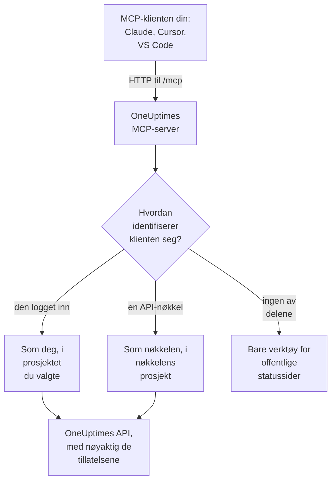

# MCP-server

OneUptimes MCP-server lar en AI-assistent jobbe direkte med OneUptime-prosjektet ditt. Koble til Claude, Cursor, VS Code med GitHub Copilot eller en annen klient for Model Context Protocol (MCP), og be den se på en hendelse, spørre etter logger og spor, kvittere for et varsel eller sette opp en monitor: den kaller OneUptimes verktøy med dine tillatelser, eller med en API-nøkkels.

:::cards
- [Koble til en klient](#koble-til-en-klient): Gi klienten serverens adresse, og logg inn.
- [Logg inn med OneUptime](#logg-inn-med-oneuptime): Hva en tilkoblet klient kan gjøre, og hvordan du kobler den fra.
- [Skaff API-nøkkelen din](#skaff-api-nøkkelen-din): For en agent som kjører uten tilsyn.
- [Feilsøking](#feilsøking): Problemer med innlogging, tillatelser og tilkobling.
:::

## Slik fungerer det

MCP-serveren er en del av hver OneUptime-instans, på `/mcp` på samme adresse som dashbordet, og bruker transporten streamable HTTP. Det er ingenting å installere.

- **OneUptime Cloud**: `https://oneuptime.com/mcp`
- **Selvhostet**: `https://your-oneuptime-domain.com/mcp`



Serveren er tilstandsløs: den utsteder ingen økt-ID-er, og hver forespørsel står på egne ben, så den fungerer bak lastbalanserere og med flere replikaer.

## Hva verktøyene dekker

- **Monitorer**: opprett og konfigurer monitorer, sjekk statusen deres og se historikken deres.
- **Hendelseshåndtering**: opprett, kvitter for og løs hendelser, legg til interne eller offentlige notater, og følg dem til de er løst.
- **Varsler**: kvitter for og løs varsler, legg til notater, og administrer tilstander og alvorlighetsgrader for varsler.
- **Team og vakt**: administrer team og vaktpolicyer.
- **Statussider**: administrer statussider og publiser kunngjøringer.
- **Planlagt vedlikehold**: opprett og administrer vedlikeholdshendelser.
- **Telemetri**: spør etter logger, målinger, spor, unntak, monitorlogger, sikkerhetshendelser og mer, kun lesing.

Det finnes verktøy for å opprette, hente, liste, oppdatere, slette og telle for 30 typer poster, verktøy for å liste og telle for 9 typer telemetri, og verktøy laget for hendelseshåndtering. Skrivebeskyttede verktøy har `readOnlyHint`, alle verktøy som endrer noe, har `destructiveHint`, og bare verktøyene for offentlige statussider har `openWorldHint`, så en klient kan kjøre skrivebeskyttede kall selv og spørre deg før enhver endring. Et mislykket verktøykall kommer tilbake som et verktøyresultat (`isError: true`) med en `statusCode`, detaljene og et forslag, ikke som en MCP-protokollfeil, så agenten kan lese feilen og rette seg selv.

## Før du begynner

- En OneUptime-instans: OneUptime Cloud eller selvhostet.
- En MCP-klient, for eksempel Claude Code, Claude, VS Code med GitHub Copilot eller Cursor.
- En OneUptime-konto å logge inn med, eller en OneUptime API-nøkkel for en agent som kjører uten tilsyn. Verktøyene for offentlige statussider trenger ingen av delene.
- På OneUptime Cloud Growth-planen eller høyere: å koble til en MCP-klient er tilgjengelig på de samme planene som API-nøkler.

## Koble til en klient

Gi klienten serverens adresse og ingenting annet. Første gang den trenger dataene dine, åpner den OneUptime i nettleseren din så du kan logge inn (se [Logg inn med OneUptime](#logg-inn-med-oneuptime)). På en selvhostet instans bruker du `https://your-oneuptime-domain.com/mcp` i stedet for `https://oneuptime.com/mcp`.

:::tabs
@tab Claude Code
```bash
claude mcp add --transport http oneuptime https://oneuptime.com/mcp
```
Kjør deretter `/mcp` i Claude Code og velg **oneuptime** for å logge inn.
@tab Claude
I Claude åpner du **Customize → Connectors**, velger **Add custom connector** og skriver inn `https://oneuptime.com/mcp`. Claude ber deg logge inn på OneUptime første gang den trenger dataene dine.
@tab VS Code
Legg dette til i MCP-konfigurasjonen din (se [VS Code med GitHub Copilot](#vs-code-med-github-copilot) for hvor den ligger). VS Code åpner OneUptime så du kan logge inn når du starter serveren:
```json
{
  "servers": {
    "oneuptime": {
      "type": "http",
      "url": "https://oneuptime.com/mcp"
    }
  }
}
```
@tab Cursor
```json
{
  "mcpServers": {
    "oneuptime": {
      "url": "https://oneuptime.com/mcp"
    }
  }
}
```
:::

Enhver annen klient som støtter MCP-autorisasjon, fungerer på samme måte: gi den adressen, så finner den resten selv. Se [Logg inn (OAuth 2.1)](#logg-inn-oauth-21) for protokollen.

Dashbordet har også disse stegene, med instansens adresse fylt inn: **Prosjektinnstillinger → KI → MCP-server**. Og fra enhver ressurs (en monitor, en hendelse, en statusside og så videre) utvider du **Utvikler** i sidemenyen og velger **AI-assistenter**: den siden foreslår også prompter som nevner ressursen og ID-en, så assistenten finner den med en gang. For en ressurs som MCP-serveren ennå ikke har verktøy for, for eksempel en arbeidsflyt, viser siden hvordan en assistent som kan kjøre kommandoer, i stedet kan jobbe med den gjennom REST-API-et.

## Logg inn med OneUptime

Den enkleste måten å koble til på er å gi MCP-klienten serverens adresse og ingenting annet. Første gang klienten trenger dataene dine, åpner den en OneUptime-side i nettleseren din:

:::steps
1. Logg inn på OneUptime, hvis du ikke allerede er innlogget.
2. Velg prosjektet klienten skal jobbe i.
3. Velg **Lese- og skrivetilgang** eller **Kun lesetilgang**.
4. Klikk **Godkjenn**.
:::

Klienten handler deretter som deg i det prosjektet. Det finnes ingen API-nøkkel å opprette, kopiere eller rotere, og ingenting hemmelig lagres i en konfigurasjonsfil.

Hva en tilkoblet klient kan gjøre:

- **Den har dine tillatelser, og aldri flere.** Det teamene dine lar deg gjøre i prosjektet, er det klienten kan gjøre. Hvis rollen din endres eller du forlater prosjektet, gjelder det fra klientens neste forespørsel. Å forlate prosjektet kobler også fra klienten: autorisasjonen slettes, og du kobler den til igjen hvis du blir med i prosjektet på nytt.
- **Kun lesing betyr kun lesing.** En klient som er godkjent for kun lesing, kan bruke verktøyene `get_`, `list_` og `count_`. Verktøy som oppretter, oppdaterer, sletter, kvitterer eller løser, avvises av MCP-serveren og av OneUptime-API-et bak den. Du kan aldri gi en klient mer tilgang enn den ba om.
- **Den gjelder ett prosjekt.** For å bruke et annet prosjekt kobler du til klienten på nytt og velger det prosjektet.
- **Den fungerer bare gjennom MCP-serveren.** Klientens tilgangstoken godtas av MCP-endepunktet og ingen andre steder. Det kan ikke brukes til å kalle OneUptimes REST-API direkte.
- **Instansadministratorer får ingen særbehandling.** En klient som en masteradmin har koblet til, har det personens team gir i prosjektet, ikke tilgang til hele instansen.

### Administrer tilkoblede klienter

Hver klient som er koblet til ved innlogging, står på **Prosjektinnstillinger → KI → MCP-server**, under **Tilkoblede MCP-klienter**, med hvem som koblet den til, hva den kan gjøre og når den sist ble brukt. Du ser klientene du har koblet til; prosjektets eiere og administratorer ser alles.

Klikk **Koble fra** for å logge ut en klient. Den slutter å virke med en gang.

En klient forblir tilkoblet så lenge den brukes. En klient som ikke er brukt på 30 dager, må logge inn på nytt.

### Styr hvem som kan koble til klienter

Som standard kan alle prosjektmedlemmer koble til en MCP-klient. For å hindre medlemmene i et team i det åpner du teamets side **Tillatelser**, åpner **Flere innstillinger** nederst og legger til tillatelsen **Authorize MCP Client** under **Blokker tillatelser**. Klienter som disse medlemmene allerede har koblet til, slutter å virke med en gang.

Hvis prosjektet krever enkel pålogging, logger du inn på prosjektet med SSO i nettleseren før du godkjenner en klient. Klientens tilkobling varer like lenge som den SSO-innloggingen; når den utløper, eller SSO-leverandøren du logget inn med, slås av eller slettes, kobler du til klienten på nytt.

På OneUptime Cloud er tilkobling av en MCP-klient tilgjengelig på de samme planene som API-nøkler (Growth og høyere).

I Enterprise Edition registreres hver endring en tilkoblet klient gjør, i revisjonsloggen under personen som koblet den til, med klientens navn. Endringer gjort med en API-nøkkel viser nøkkelens navn.

## Skaff API-nøkkelen din

Bruk en API-nøkkel for en agent som kjører uten tilsyn, for eksempel en planlagt jobb eller en CI-pipeline, der ingen er til stede for å logge inn.

:::steps
### Opprett nøkkelen

Gå til **Prosjektinnstillinger → Avansert → API-nøkler** og klikk **Opprett API-nøkkel**. Gi den et navn, for eksempel "MCP Server".

### Velg hva den kan gjøre

Under **Tilgang** velger du **Leser** for en agent som bare leser, eller **Prosjektadministrator** for en som også oppretter, oppdaterer og sletter (se [Tillatelser for API-nøkler](#tillatelser-for-api-nøkler)).

### Kopier nøkkelen

Klikk **Opprett API-nøkkel**: nøkkelens side åpnes. Kopier nøkkelen derfra.
:::

API-nøkler hører til ett prosjekt: MCP-serveren tar prosjektet fra nøkkelen, så opprettingsverktøy trenger aldri et `projectId`-argument.

> [!WARNING]
> Gi aldri en AI-agent en masternøkkel. En OneUptime master-API-nøkkel godtas også i denne headeren og gir administratortilgang til hele instansen. Bruk alltid en prosjekt-API-nøkkel med det minste agenten trenger: en skrivebeskyttet nøkkel er nok for alle verktøyene `get_`, `list_` og `count_`.

## Koble til med en API-nøkkel

Send nøkkelen i headeren `x-api-key`. En forespørsel som har med en API-nøkkel, blir aldri bedt om å logge inn. På en selvhostet instans bruker du ditt eget domene i stedet for `oneuptime.com`.

:::tabs
@tab Claude Code
```bash
claude mcp add --transport http oneuptime https://oneuptime.com/mcp --header "x-api-key: your-api-key-here"
```
@tab Claude Desktop
Legg dette til i `claude_desktop_config.json`, i `~/Library/Application Support/Claude/` på macOS, `%APPDATA%\Claude\` på Windows eller `~/.config/Claude/` på Linux:
```json
{
  "mcpServers": {
    "oneuptime": {
      "transport": "streamable-http",
      "url": "https://oneuptime.com/mcp",
      "headers": {
        "x-api-key": "your-api-key-here"
      }
    }
  }
}
```
@tab VS Code
Inputvariabelen med `"password": true` spør etter nøkkelen når serveren starter, i stedet for å lagre den i klartekst:
```json
{
  "servers": {
    "oneuptime": {
      "type": "http",
      "url": "https://oneuptime.com/mcp",
      "headers": {
        "x-api-key": "${input:oneuptime-api-key}"
      }
    }
  },
  "inputs": [
    {
      "type": "promptString",
      "id": "oneuptime-api-key",
      "description": "OneUptime API Key",
      "password": true
    }
  ]
}
```
@tab Cursor
```json
{
  "mcpServers": {
    "oneuptime": {
      "url": "https://oneuptime.com/mcp",
      "headers": {
        "x-api-key": "your-api-key-here"
      }
    }
  }
}
```
:::

## VS Code med GitHub Copilot

VS Code 1.99 og nyere støtter MCP-servere direkte i GitHub Copilot Chat.

:::steps
### Sjekk hva du trenger

VS Code 1.99 eller nyere, med GitHub Copilot-utvidelsen installert og innlogget, og GitHub Copilot Chat slått på.

### Åpne MCP-konfigurasjonen

Trykk `Ctrl+Shift+P` (`Cmd+Shift+P` på macOS), skriv "MCP: Open User Configuration" og trykk Enter. Det åpner, eller oppretter, filen `mcp.json`. For bare ett arbeidsområde oppretter du i stedet `.vscode/mcp.json` i det.

### Legg til OneUptime

Lim inn VS Code-konfigurasjonen over: den uten nøkkel for å logge inn, eller den med en API-nøkkel.

### Start serveren

Trykk `Ctrl+Shift+P` (`Cmd+Shift+P` på macOS), skriv "MCP: List Servers" og velg **oneuptime** for å starte den. VS Code ber deg første gang om å stole på serveren, og deretter om å logge inn eller skrive inn API-nøkkelen din.

### Spør Copilot

Åpne GitHub Copilot Chat i agentmodus og spør for eksempel "Hvilke monitorer har jeg i OneUptime?", "Vis meg nylige hendelser" eller "Opprett en ny monitor for https://example.com".
:::

## Autentisering

MCP-serveren fungerer på tre måter.

### Offentlige verktøy (ingen autentisering kreves)

Uten en API-nøkkel eller en innlogging kan en klient bruke de offentlige verktøyene:

- **`oneuptime_help`**: hjelp og veiledning om OneUptimes MCP-verktøy
- **`oneuptime_list_resources`**: ressursene og hva du kan gjøre med hver av dem
- **`get_public_status_page_overview`**: oversikten over en offentlig statusside
- **`get_public_status_page_incidents`**: hendelsene på en offentlig statusside
- **`get_public_status_page_scheduled_maintenance`**: de planlagte vedlikeholdshendelsene dens
- **`get_public_status_page_announcements`**: kunngjøringene dens

Verktøyene for offentlige statussider tar en statussides ID (en UUID) eller domenenavnet dens. For å bruke bare disse kobler du til med adressen og uten påloggingsdetaljer:

```json
{
  "mcpServers": {
    "oneuptime": {
      "transport": "streamable-http",
      "url": "https://oneuptime.com/mcp"
    }
  }
}
```

En statussides eiere kan slå av MCP-tilgang for den siden: på statussiden åpner du **MCP** i delen **KI** i sidemenyen og slår av **Aktiver MCP-server**. Bryteren lagres så snart den slås om. MCP-tilgang er på som standard. Mens den er av, returnerer de fire verktøyene `get_public_status_page_*` en feil for den statussiden; statussidens nettsted, RSS-feeden og det offentlige JSON-API-et påvirkes ikke, og statussideverktøyene som krever innlogging (`get_status_page`, `list_status_pages` og så videre), fortsetter å virke for sidens eget prosjekt.

### Logg inn (OAuth 2.1)

Alle andre verktøy må vite hvem som kaller. En klient som ikke sender påloggingsdetaljer og kaller et av dem, får `401 Unauthorized` med en `WWW-Authenticate`-header som peker til serverens metadata for beskyttet ressurs. Det er signalet en MCP-klient reagerer på for å logge deg inn; `initialize`, `tools/list` og de offentlige verktøyene ber aldri om det.

Serveren implementerer [MCP-autorisasjonsspesifikasjonen](https://modelcontextprotocol.io/specification/latest/basic/authorization):

- **Flyt**: OAuth 2.1 authorization code med PKCE (bare `S256`). Tilgangstokener sendes som `Authorization: Bearer`.
- **Oppdagelse**: metadata for beskyttet ressurs (RFC 9728) og metadata for autorisasjonsserver (RFC 8414). Utsteder og ressurs er begge `https://<host>/mcp`.
- **Klientidentitet**: et Client ID Metadata Document (klient-ID-en er en `https`-URL som serveren henter), eller dynamisk klientregistrering (RFC 7591). Ingen klient trenger å registreres av en administrator.
- **Omfang**: `mcp:read` for verktøyene `get_`, `list_` og `count_`; `mcp:write` legger til alle verktøy som endrer noe, og inkluderer `mcp:read`. Et skrivebeskyttet token som kaller et skriveverktøy, får `403` med `error="insufficient_scope"`.
- **Levetid for tokener**: et tilgangstoken varer én time. Et oppdateringstoken varer 30 dager og byttes ut hver gang det brukes; å bruke et oppdateringstoken som allerede er byttet ut, avslutter tilkoblingen.
- **Ressursindikatorer** (RFC 8707): et token utstedes for `https://<host>/mcp` og godtas ingen andre steder.
- **Tilbakekalling** (RFC 7009): å tilbakekalle et av de to tokenene avslutter tilkoblingen.

### API-nøkkel

En agent som kjører uten tilsyn, sender en OneUptime API-nøkkel i en av disse headerne:

- `x-api-key`: OneUptime API-nøkkelen din
- `Authorization`: et bearer-token med API-nøkkelen din (f.eks. `Bearer your-api-key-here`)

Skjemaet `Bearer` skiller ikke mellom store og små bokstaver. En forespørsel som har med en API-nøkkel, blir aldri bedt om å logge inn.

På OneUptime Cloud virker API-nøkler bare mens prosjektet er på **Growth** eller høyere. Under det svarer alle verktøy som trenger nøkkelen, `402` med en melding som nevner planen, og agenten får beskjed om ikke å prøve igjen. Ingenting slettes: nøkkelen virker igjen som den er så snart prosjektet er tilbake på Growth, uten at noe må kobles til på nytt. En klient som er koblet til ved innlogging, handler som en person og fortsetter å virke ([API-nøkler og SCIM under planen sin](/docs/api-reference/api-reference#api-nøkler-og-scim-under-abonnementet-sitt)).

## Tilgjengelige endepunkter

| Endepunkt | Metode | Beskrivelse |
| --- | --- | --- |
| `/mcp` | POST | JSON-RPC-forespørsler for verktøykall og andre operasjoner |
| `/mcp` | GET | Uten en SSE-`Accept`-header: en kort JSON-beskrivelse av serveren. Med en: `405`, fordi den tilstandsløse serveren ikke tilbyr en frittstående SSE-strøm (klienter som følger spesifikasjonen, fortsetter uten den) |
| `/mcp` | DELETE | Gjør ingenting: serveren er tilstandsløs, så det finnes ingen økt å avslutte |
| `/mcp/health` | GET | Helsesjekk |
| `/mcp/tools` | GET | Listen over verktøy, som vanlig REST |

MCP-klienter som logger inn, bruker også OAuth-endepunktene nedenfor. En klient finner dem selv; de er listet for folk som skriver en klient eller setter opp en proxy.

| Endepunkt | Metode | Beskrivelse |
| --- | --- | --- |
| `/mcp/.well-known/oauth-protected-resource` | GET | Metadata for beskyttet ressurs (RFC 9728). Også på `/.well-known/oauth-protected-resource/mcp` |
| `/.well-known/oauth-authorization-server/mcp` | GET | Metadata for autorisasjonsserver (RFC 8414). Også på `/mcp/.well-known/oauth-authorization-server` |
| `/mcp/oauth/authorize` | GET | Autorisasjonsendepunkt: der klienten sender nettleseren din for å logge inn |
| `/mcp/oauth/token` | POST | Token-endepunkt: veksler inn en autorisasjonskode eller et oppdateringstoken |
| `/mcp/oauth/register` | POST | Dynamisk klientregistrering (RFC 7591) |
| `/mcp/oauth/revoke` | POST | Tilbakekalling av tokener (RFC 7009) |

For å sjekke at serveren kjører, og liste verktøyene dens:

```bash
curl https://oneuptime.com/mcp/health
curl https://oneuptime.com/mcp/tools
```

## Verktøy for hendelseshåndtering

Ved siden av verktøyene for hver type post har serveren verktøy laget for å håndtere hendelser og varsler:

- **`acknowledge_incident`** / **`resolve_incident`**: flytt en hendelse til prosjektets tilstand Acknowledged eller Resolved, slik dashbordets knapp gjør
- **`acknowledge_alert`** / **`resolve_alert`**: det samme for varsler
- **`add_incident_note`**: legg til et notat på en hendelse med `visibility: "internal"` (bare teamet, standard) eller `visibility: "public"` (publisert på statussiden). Markdown støttes
- **`add_alert_note`**: legg til et internt notat på et varsel

En typisk sløyfe: `list_incidents` → `acknowledge_incident` → undersøk med `list_logs` → `add_incident_note` (offentlig) → `resolve_incident`.

Verktøyet **`oneuptime_whoami`** returnerer prosjektet påloggingsdetaljene dine hører til (ID og navn). For en klient som logget inn, sier det også hvem den er logget inn som, og om den kan gjøre endringer. Det er et godt første kall for at en agent skal finne fotfeste, og siden opprettingsverktøy tar `projectId` fra påloggingsdetaljene, trenger agenten aldri å sende en prosjekt-ID.

## Spørre etter telemetri

Logger, målinger, spor (spans), unntak, monitorlogger og de andre typene telemetri kommer som skrivebeskyttede verktøy `list_` og `count_` (`list_logs`, `list_metrics`, `list_spans`, `list_exception_instances`, `list_monitor_logs` og `count_`-tvillingene deres). Telemetri kommer inn gjennom OpenTelemetry, så det finnes ingen opprettingsverktøy.

Spør alltid etter telemetri med et tidsrom. Et spørrefelt tar en verdi, eller et operatorobjekt:

```json
{
  "query": {
    "time": { "_type": "GreaterThan", "value": "2026-07-04T00:00:00.000Z" }
  },
  "sort": { "time": "DESC" },
  "limit": 50
}
```

Operatorene er `EqualTo`, `NotEqual`, `IsNull`, `NotNull`, `EqualToOrNull`, `GreaterThan`, `LessThan`, `GreaterThanOrEqual`, `LessThanOrEqual`, `InBetween`, `Search` og `Includes`. Sorteringsverdier er `"ASC"` eller `"DESC"`.

## Feltvalg og paginering

Verktøyene `get_` og `list_` tar en valgfri `select`-matrise med feltnavn. Som standard kommer alle lesbare felt tilbake unntatt de tunge (JSON, svært lang tekst og HTML-kolonner), som må bes om i `select`.

Listeverktøy blar med `limit` (10 som standard, maks 100) og `skip`, og hvert listesvar sier nøyaktig hva det returnerte:

```json
{
  "returnedCount": 10,
  "totalCount": 42,
  "skip": 0,
  "limit": 10,
  "hasMore": true,
  "data": ["..."]
}
```

## Brukseksempler

### Hverdagsspørsmål

```text
"What's the current status of all my monitors?"
"Show me incidents from the last 24 hours"
"List the teams in this project"
"Show me our on-call policies"
```

### Monitorer og hendelser

```text
"Create a new website monitor for https://example.com that checks every 5 minutes"
"Set up an API monitor for https://api.example.com/health with a 30-second timeout"
"Disable the monitor for staging.example.com while we're doing maintenance"
"Create a high-priority incident for the database outage affecting user authentication"
"Add a note to incident #123 saying 'Database connection restored, monitoring for stability'"
"Mark incident #456 as resolved"
```

### Statussider

```text
"Update our status page to show 'Investigating Payment Issues' for the payment service"
"Create a status page announcement about scheduled maintenance this weekend"
```

### Spørringer mot offentlige statussider (ingen API-nøkkel kreves)

Disse fungerer uten påloggingsdetaljer, med bare verktøyene for offentlige statussider:

```text
"What's the current status of status.example.com?"
"Show me recent incidents from the OneUptime status page"
"Are there any scheduled maintenance events on status.acme.com?"
"Get the latest announcements from my public status page with ID abc123-..."
```

### Flere steg på en gang

```text
"Create a scheduled maintenance window for Saturday 2-4 AM, disable all monitors for api.example.com during that time, and update the status page"
"Show me all monitors that have been down in the last hour, create incidents for any that don't already have one"
```

## Tillatelser for API-nøkler

| Hva agenten gjør | Velg under **Tilgang** |
| --- | --- |
| Leser bare | **Leser**, eller legg til lesetillatelser på nøkkelens side |
| Oppretter, oppdaterer og sletter også | **Prosjektadministrator**, eller legg til rollen Project Admin på nøkkelens side |

Gi hver nøkkel det minste den trenger, roter nøkler jevnlig, ha en egen nøkkel for hvert miljø, og følg med på hva hver nøkkel gjør i OneUptime.

## Konfigurasjon ved selvhosting

Innlogging fungerer rett ut av boksen på en selvhostet instans. To innstillinger endrer det:

| Miljøvariabel | Helm-verdi | Hva den gjør |
| --- | --- | --- |
| `DISABLE_MCP_OAUTH` | `mcpOAuth.disabled` | Sett til `true` for å slå av innlogging. OAuth-endepunktene leveres ikke lenger, og MCP-serveren godtar bare API-nøkler. Ingenting slettes; tilkoblede klienter virker igjen når det slås på igjen. |
| `DISABLE_MCP_OAUTH_CLIENT_ID_METADATA_DOCUMENTS` | `mcpOAuth.disableClientIdMetadataDocuments` | Sett til `true` på en instans som ikke kan nå internett. En klient kan identifisere seg med en URL som OneUptime henter; med denne innstillingen registrerer klienter seg i stedet direkte hos instansen din, noe som ikke krever noen utgående forespørsel. |

Hvis du kjører din egen omvendte proxy foran OneUptime, sender du `/.well-known/oauth-protected-resource` og `/.well-known/oauth-authorization-server` (og alt under dem) videre til OneUptime sammen med `/mcp`. Den medfølgende ingressen gjør det allerede.

Serveren bygger hver OAuth-URL fra innstillingene `HOST` og `HTTP_PROTOCOL`, så de må samsvare med adressen folk bruker for å nå instansen din.

## Feilsøking

### Problemer med innlogging

- **Klienten ber meg aldri om å logge inn**: klienten støtter kanskje ikke MCP-autorisasjon, eller den er konfigurert med en API-nøkkel-header, som har forrang. Fjern headeren for å logge inn i stedet.
- **Prosjektet mitt er grått på autorisasjonssiden**: siden sier hvorfor ved siden av prosjektnavnet: prosjektets plan inkluderer ikke tilkobling av MCP-klienter, prosjektet krever SSO og denne nettleseren har ikke logget inn på det med SSO, eller teamet ditt er blokkert fra å koble til klienter.
- **Et verktøy avvises som "read-only"**: klienten ble godkjent for kun lesing. Koble den til på nytt og velg **Lese- og skrivetilgang**.
- **Klienten sluttet å virke**: den ble koblet fra, ble ikke brukt på 30 dager, du ble fjernet fra prosjektet, eller prosjektets SSO-innlogging utløp eller leverandøren ble slått av. Koble den til på nytt.
- **Selvhostet - klienten sier at den ikke finner autorisasjonsserveren**: sjekk at `HOST` og `HTTP_PROTOCOL` samsvarer med den offentlige adressen din, og at proxyen din sender stiene `/.well-known/oauth-*` videre.

### Tillatelsesfeil

API-nøkkelen, eller for en klient som logget inn din egen konto, trenger de riktige tillatelsene: lesetilgang for å liste poster, skrivetilgang for å opprette og oppdatere dem, og slettetilgang for å fjerne dem.

### Tilkoblingsproblemer

Sjekk at OneUptime-adressen er riktig og kan nås, at API-nøkkelen er gyldig, og at helseendepunktet svarer (se [Tilgjengelige endepunkter](#tilgjengelige-endepunkter)).

### Ugyldig API-nøkkel

- Sjekk API-nøkkelen i OneUptime-innstillingene dine, uten ekstra mellomrom eller tegn
- Sjekk at nøkkelen ikke er utløpt
- På OneUptime Cloud betyr en `402` som sier at API-nøkler krever Growth-planen, at prosjektet ligger under den: oppgrader prosjektet under **Prosjektinnstillinger → Fakturering og fakturaer → Fakturering**, så virker den samme nøkkelen igjen

### Øktfeil

MCP-serveren er tilstandsløs: den verken utsteder eller sporer økt-ID-er, så hver forespørsel virker mot enhver replika. En klient som sender en `mcp-session-id`-header fra en eldre serverversjon, kan utelate den; den ignoreres. Oppdater en eldre klientkonfigurasjon som forventer at serveren returnerer en økt-ID.

## Tilgjengelige ressurser

| Område | Poster med verktøy for å opprette, hente, liste, oppdatere, slette og telle |
| --- | --- |
| Overvåking | Monitor, Monitor Status, Monitor Status Event |
| Hendelser | Incident, Incident State, Incident Severity, Incident State Timeline, Incident Public Note, Incident Internal Note, Incident Alert, Postmortem Status |
| Varsler | Alert, Alert State, Alert Severity, Alert State Timeline, Alert Internal Note |
| Statussider | Status Page, Status Page Announcement |
| Planlagt vedlikehold | Scheduled Maintenance Event, Scheduled Maintenance State, Scheduled Maintenance State Timeline |
| Team og vakt | Team, On-Call Policy |
| Etiketter | Label |
| Sikkerhet | Security Case, Security Case Note, Security Case Priority, Security Case Status, Security Detection, Security Playbook |

| Område | Telemetri med bare verktøy for å liste og telle |
| --- | --- |
| Observerbarhet | Log, Metric, Span, Exception Instance, Monitor Log |
| Sikkerhet | Security Event, Threat Intel Indicator |
| Endringer og kostnader | Change Event, Kubernetes Cost Allocation |

Verktøyene har navn i snake case: `create_incident`, `get_incident`, `list_incidents`, `update_incident`, `delete_incident` og `count_incidents`, eller `list_logs` og `count_spans` for telemetri.

## Neste steg

:::cards
- [Spør AI](/docs/ai/ask-ai): Spør heller om prosjektet ditt inne i OneUptime.
- [OneUptimes API-referanse](/docs/api-reference/api-reference): REST-API-et bak hvert verktøy.
- [Tillatelser](/docs/permissions/index): Hva en rolle, et team eller en API-nøkkel kan gjøre.
:::
