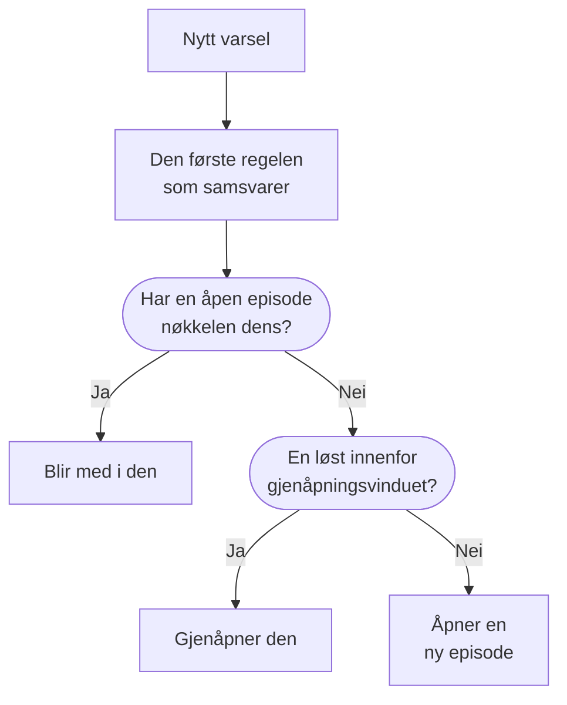

# Varselepisoder og grupperingsregler

Når en database går ned, kan tjue monitorer utløse tjue varsler i løpet av få minutter. En episode samler dem i én post som teamet ditt bekrefter og løser samlet, og en grupperingsregel avgjør hvilke varsler som hører hjemme i den. Denne siden viser hvordan gruppering fungerer, hvordan du setter opp en regel, og hvordan en episode oppfører seg når den er åpen.

:::cards
- [Slik fungerer gruppering](#slik-fungerer-gruppering): Regler, grupperingsnøkler og tidsvinduer.
- [Opprett en grupperingsregel](#opprett-en-grupperingsregel): Fra en mal med ett klikk, eller din egen.
- [Slik oppfører en episode seg](#slik-oppfører-en-episode-seg): Alvorlighetsgraden, tilstandene og når den løses.
- [Hvem en episode tilkaller](#hvem-en-episode-tilkaller): Regelens vaktpolicyer og varslenes egne.
:::

## Slik fungerer gruppering

Gruppering kjører én gang for hvert nytt varsel, rett etter at vaktpolicyene har kjørt. Varselet kontrolleres mot de aktiverte grupperingsreglene dine, ovenfra og ned i listen, og den første regelen som samsvarer, avgjør episoden. Et varsel som ingen regel samsvarer med, blir stående alene.



- **Regelens betingelser** avgjør hvilke varsler den gjelder for. En regel uten betingelser gjelder for hvert nytt varsel.
- **Grupperingsnøkkelen** avgjør hvilke varsler som deler en episode: de med samme monitor, samme alvorlighetsgrad, samme tittel eller den kombinasjonen regelen grupperer etter. En regel som ikke grupperer etter noe, legger hvert varsel den samsvarer med, i én episode.
- **Tidsvinduet** avgjør hvor lenge en episode fortsetter å ta imot varsler. Når det er slått på, blir et varsel bare med hvis det kommer innenfor vinduet etter episodens siste varsel. Når det er slått av, fortsetter samsvarende varsler å bli med til episoden er løst.

Gruppering skjer når et varsel opprettes. En regel du legger til i dag, grupperer varslene som opprettes etter den; den omgrupperer ikke dem som allerede finnes.

> [!NOTE]
> Et varsel som opprettes allerede bekreftet, kan bli med i en åpen episode, men åpner aldri en, og et varsel som opprettes løst, grupperes ikke i det hele tatt. Se [Opprettet allerede bekreftet eller løst](/docs/alerts/index#opprettet-allerede-bekreftet-eller-løst).

## Opprett en grupperingsregel

Gå til **Varsler → Regler → Grupperingsregler**. Seksjonen **Regler** i sidemenyen starter sammenfoldet, så fold den ut først.

### Start fra en mal

Et prosjekt uten grupperingsregler ser fire ferdige regler i stedet for en tom liste; når du har regler, åpner **Opprett fra mal** på kortet dem. **Legg til regel** lagrer en med ett klikk, aktivert, sist i listen og gjeldende for hvert nytt varsel. Rediger den etterpå som enhver annen regel.

| Mal                                           | Grupperer                                                                     | Tidsvindu   |
| --------------------------------------------- | ----------------------------------------------------------------------------- | ----------- |
| **Grupper varsler fra samme overvåking**      | Én episode per monitor                                                        | 30 minutter |
| **Grupper varsler som skjer samtidig**        | Én felles episode, uansett monitor                                            | 10 minutter |
| **Grupper varsler etter alvorlighetsgrad**    | Én episode per alvorlighetsgrad                                               | 30 minutter |
| **Grupper gjentakelser av samme varsel**      | Én episode per varseltittel, uten hensyn til tall og store/små bokstaver      | 1 time      |

### Opprett din egen

:::steps
#### Svar på hvordan det skal grupperes

Klikk på **Opprett egendefinert regel** under malene, eller på **Opprett grupperingsregel for varsler** på kortet når du har regler. På trinnet **Gruppering** stiller **Grupper varsler etter** ett spørsmål: **Overvåking**, **Alt samlet**, **Alvorlighetsgrad**, **Tittel** eller **Egendefinert**. **Navn** følger svaret ditt til du skriver ditt eget.

#### Angi tidsvinduet

**Grupper bare varsler som kommer tett etter hverandre** er slått på, med et vindu på 30 minutter. Endre minuttene, eller slå det av for å holde én episode åpen til den er løst.

#### Kombiner felt, for Egendefinert

**Egendefinert** legger til et trinn **Grupper etter** med fem brytere: **Grupper etter overvåking**, **Grupper etter varselalvorlighet**, **Grupper etter varseltittel**, **Grupper etter varseletiketter** og **Grupper etter overvåkingsetiketter**. Etiketter grupperer etter det nøyaktige settet sitt.

#### Avgrens den

Under **Hvilke varsler** grupperer **Alle varsler**, som en ny regel starter på, hvert nytt varsel. For å snevre inn regelen velger du **Bare varsler som oppfyller betingelsene** og legger til betingelser for monitorer, alvorlighetsgrader, etiketter, titler og beskrivelser. Klikk deretter på **Opprett grupperingsregel for varsler**.
:::

Alt annet en regel kan gjøre, er foldet sammen under **Flere felt** sist på trinnet **Gruppering**, i tre grupper. Sammenfoldet nevner overskriften hva den inneholder, og sier hva hver innstilling regelen bruker, er satt til, så det aldri skjules hva en regel gjør når du redigerer den.

| Gruppe                    | Innstillinger                                                                                              |
| ------------------------- | ---------------------------------------------------------------------------------------------------------- |
| **Vakt og eierskap**      | **Vaktpolicyer** som skal kjøre når regelen åpner en episode, og **Episodeeiere**.                         |
| **Episodens livssyklus**  | **Gjenåpne nylig løste episoder**, **Vent før en episode løses** og **Løs stille episoder**, hver en bryter med sine minutter. |
| **Detaljer**              | Regelens **Beskrivelse**, **Mal for episodetittel**, **Mal for episodebeskrivelse** og **Episodeetiketter**. |

Regler kontrolleres ovenfra og ned i listen, og det første samsvaret vinner: Dra en regel for å endre plassen. Sett spesifikke regler over brede. Listens kolonne **Gruppering** sier i én setning hva hver regel gjør, for eksempel "Én episode per overvåking".

## Episodetitler

Uten en mal får en episode navn etter monitoren til det første varselet, eller etter de første 50 tegnene i varselets tittel når det ikke har noen monitor. Med en **Mal for episodetittel** eller en **Mal for episodebeskrivelse** fylles disse variablene ut. Skriv `{{` i et av feltene for å velge en.

| Variabel               | Fylles ut med                                                                                   |
| ---------------------- | ----------------------------------------------------------------------------------------------- |
| `{{alertTitle}}`       | Tittelen til det første varselet.                                                               |
| `{{alertDescription}}` | Beskrivelsen til det første varselet.                                                           |
| `{{alertSeverity}}`    | Alvorlighetsgraden til det første varselet.                                                     |
| `{{monitorName}}`      | Navnet på monitoren til det første varselet.                                                    |
| `{{alertCount}}`       | Hvor mange varsler episoden inneholder, skrevet på nytt når varsler blir med eller forlater den. |

En variabel som det første varselet ikke har noen verdi for, eller en som ikke står på denne listen, utelates. Når det første varselet er privat, står det "Private alert" i `{{alertTitle}}` og `{{alertDescription}}`, fordi episoden ikke er privat.

## Slik oppfører en episode seg

En episode går gjennom varseltilstandene dine, den samme listen som varsler bruker, og har egne eiere, notater, rotårsak og utbedringsnotater.

- **Alvorlighetsgraden stiger med varslene.** Den starter med alvorlighetsgraden til det første varselet og tar over alvorlighetsgraden fra ethvert mer alvorlig varsel som blir med, der "mer alvorlig" betyr høyere oppe under **Varsler → Innstillinger → Varselsalvor**.
- **Tilstanden flytter varslene.** Bekreft eller løs en episode, eller flytt den til en egen tilstand, og hvert varsel i den flyttes med, unntatt et varsel som allerede er i den tilstanden eller etter den.
- **Den løser seg selv** når hvert varsel i den er løst. **Vent før en episode løses** holder den åpen i så mange minutter først, i tilfelle et varsel kommer tilbake.
- **Den kan gjenåpnes.** Med **Gjenåpne nylig løste episoder** slått på gjenåpner et samsvarende varsel som kommer innenfor minuttene etter at episoden ble løst, den i stedet for å åpne en ny. Det er den eneste endringen tilbake opp i listen over tilstander, og den gjenåpner ikke episodens varsler.

> [!WARNING]
> **Løs stille episoder** løser en episode når ingen nye varsler har blitt med i den i det antallet minutter du har satt, og løser også hvert varsel som fortsatt er åpent i den. Bruk det for støy du er sikker på ikke trenger svar.

## Hvem en episode tilkaller

Et varsels egne vaktpolicyer kjører når det opprettes, før gruppering, uansett om det blir med i en episode. En episode legger til sine egne:

```mermaid title="Et varsel som åpner en episode, tilkaller to ganger; et som blir med, én gang"
flowchart TB
    alert["Nytt varsel"] --> own["Varselets egne<br/>policyer kjører"]
    own --> grouped{"Gruppering"}
    grouped -->|"Åpner en episode"| ep["Episodens policyer<br/>kjører også"]
    grouped -->|"Blir med i en episode"| none["Ingenting mer kjører"]
```

- **En ny episode** kjører regelens **Vaktpolicyer** pluss dem fra enhver samsvarende regel på fanen **Episode Rules** under **Varsler → Regler → Vaktregler**.
- **Et varsel som blir med i en åpen episode**, kjører bare sine egne policyer. Episodens kjører ikke på nytt.
- **Svarer noen på en episodes tilkalling**, bekreftes episoden og dermed hvert varsel i den.

> [!TIP]
> For å tilkalle én gang per problem i stedet for én gang per varsel legger du vaktpolicyer på grupperingsreglene dine og lar dem være borte fra varslene: fra monitorens kriterier, opprettelsesskjemaet og vaktreglene dine for varsler.

Episodens eiere får også vite om det: **Varselepisode opprettet**, **Tilstand for varselepisode endret** og **Varsel lagt til i varselepisode** er slått på via e-post som standard under **Brukerinnstillinger → Varselinnstillinger** på fanen **Varsler**. Regelens **Episodeeiere** blir eiere av hver episode den åpner, og får beskjed som enhver annen eier.

## Opprett en episode manuelt

:::steps
### Åpne skjemaet

Gå til **Varsler → Alle episoder**, og klikk på **Opprett episode**. Skjemaet **Opprett ny varselepisode** åpnes.

### Beskriv episoden

På **Episodedetaljer** fyller du ut **Tittel** og, hvis du vil, en **Varselsalvor** og en **Beskrivelse**. **Innledende tilstand** og **Etiketter** venter under **Flere felt**.

### Velg hvem som tilkalles, og hvem som eier den

På **Vakt og eiere** velger du en **Vaktpolicy** som skal kjøre når episoden opprettes, og **Eiere**. Klikk deretter på **Opprett episode**.

Hvert team du er medlem av, er bare ett klikk unna under **Eiere**, og sammendraget nevner eierreglene som legger til flere.

### Legg til varslene

Åpne episodens side **Medlemsvarsler**, klikk **Legg til varsler**, og huk av varslene som hører til den, så mange du trenger på én gang. Vil du heller starte fra varslene, velger du dem i listen **Varsler** og velger **Legg til i ny episode** under **Massehandlinger** (se [Episoder](/docs/incidents/episodes)).
:::

En episode du oppretter, har ingen grupperingsregel, så listen viser **Grupperingsregel** som **Manual**, og ingen livssyklusinnstilling gjelder for den. Den løser seg likevel selv når hvert varsel i den er løst.

## Hva hver side av en episode viser

| Seksjon i sidemenyen | Sider                                                                       |
| -------------------- | --------------------------------------------------------------------------- |
| **Oversikt** | **Oversikt**, **Tilstandstidslinje** |
| **Undersøkelse** | **Beskrivelse**, **Rotårsak**, **Utbedringsnotater** |
| **Team** | **Eiere** |
| **Varsler** | **Medlemsvarsler** |
| **Notater** | **Private notater** |
| **Utvikler** | **Terraform**, **API**, **AI-assistenter** |
| **Avansert** | **Revisjonslogger**, **Slett episode** |

**Utvikler** og **Avansert** starter sammenfoldet. På **Oversikt** nevner toppen episodens **Eiere**, team først, og den første ruten, **Opprettet**, sier når episoden ble opprettet — **Automatisk**, når en grupperingsregel åpnet den. Kortet **Hva som skjedde** står øverst på siden — episodens beskrivelse og **Rotårsak** — deretter **Alerts in this episode** og **Episodefeed**, ved siden av kortet **Episodedetaljer**: nummer, tilstand, alvorlighetsgrad, antall varsler, grupperingsregel og vaktpolicyer. Toppen har **Bekreft** og **Løs**, og **Flytt episode til** i menyen **⋯**.

**Varsler → Aktive episoder** viser episodene som ikke er løst ennå, og merket ved siden av teller dem.

## Feilsøking

:::details Et nytt varsel ble ikke med i episoden jeg forventet
Kontroller i denne rekkefølgen: Regelen er aktivert; ingen regel over den samsvarte med varselet først; varselet samsvarer med regelens betingelser; det har samme grupperingsnøkkel som episodens varsler, for eksempel samme monitor; og med tidsvinduet slått på kom det innenfor vinduet etter episodens siste varsel. Et varsel som opprettes allerede bekreftet, åpner aldri en episode, og et som opprettes løst, grupperes aldri.
:::

:::details Vi ble tilkalt to ganger for ett problem
Varselets egen vaktpolicy kjørte, og den nye episodens policy kjørte også. Behold policyene på grupperingsregelen, og fjern dem fra varselets kriterier, skjema eller vaktregler.
:::

:::details En episode ble løst av seg selv
Hvert varsel i den var løst, så episoden ble løst da ventetiden var over. Når **Løs stille episoder** er slått på, løser den også en episode som ikke har tatt imot et nytt varsel på så lang tid.
:::

## Neste steg

:::cards
- [Varselregler og innstillinger](/docs/alerts/settings): De andre reglene som virker på nye varsler og episoder.
- [Varseltilstander og alvorlighetsgrader](/docs/alerts/states-and-severities): Tilstandene en episode går gjennom.
- [Eskaleringsregler](/docs/on-call/escalation-rules): Hvordan policyene en episode kjører, tilkaller mennesker.
- [Hendelsesinnstillinger og automatisering](/docs/incidents/settings): Grupperingsregler for hendelser.
:::
