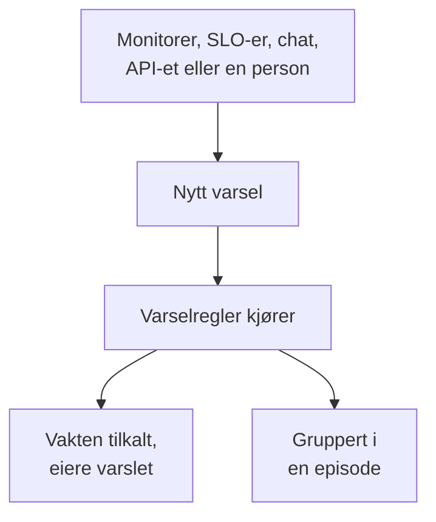

# Varsler – Oversikt

Et varsel gjør teamet ditt oppmerksom på et problem som bør undersøkes før brukerne dine merker det: en disk som holder på å bli full, et sertifikat som snart utløper, en feilrate som sniker seg oppover. Varselet kan tilkalle den som har vakt og gi eierne beskjed, men det vises aldri på en statusside og gir aldri abonnentene dine beskjed. Denne siden forklarer hvor varsler kommer fra, hvor de finnes i dashbordet, og hvordan teamet ditt jobber med dem.

:::cards
- [Varsler og hendelser](#varsler-og-hendelser): Hva et problem bør være, og hvordan de to henger sammen.
- [Hvor varsler kommer fra](#hvor-varsler-kommer-fra): Monitorer, SLO-er, chat, API-et eller manuelt.
- [Opprett et varsel manuelt](#opprett-et-varsel-manuelt): To trinn i dashbordet.
- [Svar på et varsel](#svar-på-et-varsel): Bekreft det, løs det eller erklær en hendelse.
:::

## Slik fungerer det

De fleste varsler utløses av en monitor der kriteriene samsvarer. Noen kommer fra en SLO som bruker opp feilbudsjettet sitt, en sikkerhetsregel, en tilkalling sendt fra Slack eller Microsoft Teams, eller en person. Uansett hvordan det kommer inn, er et varsel den samme posten, og de samme reglene kjører på det.

- **Regler former det.** Personvern-, eier-, etikett- og vaktregler kjører i det øyeblikket et varsel opprettes, og runbook-regler starter prosedyrene som samsvarer. Se [Varselregler og innstillinger](/docs/alerts/settings).
- **Vaktpolicyer tilkaller mennesker.** Policyene varselet nevner, pluss dem vaktreglene legger til, tilkaller personene sine til noen bekrefter varselet.
- **Episoder samler støyen.** En grupperingsregel samler relaterte varsler i én episode, slik at tjue varsler fra ett avbrudd blir én oppgave. Se [Varselepisoder og grupperingsregler](/docs/alerts/episodes).

## Varsler og hendelser

Begge registrerer et problem, og begge kan tilkalle den som har vakt. Forskjellen er hvem problemet rammer.

|                              | Varsel                                                 | Hendelse                                          |
| ---------------------------- | ------------------------------------------------------ | ------------------------------------------------- |
| **Hva det er**               | Et problem teamet ditt bør undersøke før brukerne rammes | Et problem som rammer brukerne dine, som et avbrudd |
| **På statussider**           | Aldri                                                  | Kan vises og gir abonnenter beskjed               |
| **Notater**                  | Private notater, bare for teamet ditt                  | Offentlige notater for kunder og private notater  |
| **Starttilstander**          | **Identifisert**, **Bekreftet**, **Løst**                | **Identifisert**, **Bekreftet**, **Løst**           |
| **Startalvorlighetsgrader**  | **Høy**, **Lav**                                      | Critical Incident, Major Incident, Minor Incident |
| **Numre i et nytt prosjekt** | `ALT-42` og `AE-42` for episoder                       | `INC-42` og `IE-42` for episoder                  |

Utløs et varsel når teamet ditt bør se på noe før noen utenfor merker det, og erklær en hendelse når brukerne rammes. Viser det seg at et varsel er en del av et avbrudd, kan du erklære en hendelse fra det eller knytte det til hendelsen som forklarer det: se [Koblede varsler](/docs/incidents/linked-alerts).

## Hvor varsler kommer fra

- **Kriteriene til en monitor.** Under **Handlinger** for et kriterium slår du på **Når filtre samsvarer, opprett et varsel.** og fyller ut varselet det oppretter: **Varseltittel** og **Alvorlighetsgrad**, deretter, hver for seg sammenfoldet, **Beskrivelse**, **Eierskap og etiketter**, **Vakt** og **Flere felt**, som inneholder **Løs varsel automatisk**, **Privat varsel** og **Utbedringsnotater**. Et kriterium holder ett åpent varsel om gangen, ett per serie på en monitor som grupperer etter et felt, og **Løs varsel automatisk** løser det når kriteriet slutter å samsvare. Se [Opprett en monitor](/docs/monitor/create-monitor) og [Hendelse- og varslingsmaler](/docs/monitor/incident-alert-templating).
- **Manuelt.** Klikk på **Opprett varsel** i varsellisten, eller på fanen **Varsler** for en monitor, en vert, en nettverksenhet eller en annen ressurs, som velger den ressursen for deg. Se [Opprett et varsel manuelt](#opprett-et-varsel-manuelt).
- **Forbruksraten til en SLO.** En forbruksrateregel kan opprette et varsel når en SLO bruker feilbudsjettet sitt for raskt. Se [Forbruksratevarsler og -hendelser](/docs/slo/burn-rate-alerts).
- **Nettverkslokasjoner og sikkerhetshendelser.** En nettverkslokasjon som er satt til å varsle når den er usunn, åpner et varsel når den samlede helsestatusen ikke lenger er operativ, og deteksjonsreglene dine for sikkerhetshendelser åpner også varsler. Se [Nettverkslokasjoner (samlet helsestatus og oppetid)](/docs/monitor/network-sites) og [Sikkerhetshendelser (SIEM)](/docs/telemetry/security-events).
- **En tilkalling.** `/oneuptime page` i Slack eller Microsoft Teams, overalt unntatt i en hendelses eller et varsels egen kanal, åpner et varsel med meldingen din som tittel og tilkaller personene du nevner. Tilkallingsblokkene i en arbeidsflyt gjør det samme med tittelen og meldingen du gir dem. Se [Tilkall noen fra Slack](/docs/workspace-connections/slack#tilkall-noen-fra-slack) og [Paging](/docs/workflows/components#paging).
- **API-et, Terraform og arbeidsflyter.** Varsler er en vanlig ressurs: `/api/alert`, Terraform-ressursen `oneuptime_alert` og trinnet **Create One Alert** i en arbeidsflyt.

## Hvor varsler finnes i dashbordet

Åpne **Varsler** fra menyen **Produkter** i topplinjen. Varsellisten ligger på `/dashboard/{projectId}/alerts`, og sidemenyen inneholder alt om varsler:

| Seksjon           | Hva du gjør der                                                                                                           |
| ----------------- | ------------------------------------------------------------------------------------------------------------------------- |
| **Varsler**       | **Alle varsler** og **Aktive varsler**, der det røde merket teller varslene som ikke er løst ennå.                          |
| **Episoder** | **Alle episoder** og **Aktive episoder**: relaterte varsler samlet i ett problem å jobbe med. |
| **KI**            | **Innsikt**, **Logger** og **Innstillinger**: hva OneUptime AI har lært av varslene dine, alt den har gjort, og hva den har lov til. |
| **Arbeidsområde** | **Slack** og **Microsoft Teams**, avhengig av hva prosjektet har koblet til, eller **Koble til Slack eller Teams** når det ikke har noen av dem. |
| **Regler**        | **Grupperingsregler**, **Vaktregler**, **Eierregler**, **Runbook-regler**, **Personvernregler**, **Etikettregler**, **Reminder Rules**. |
| **Innstillinger** | **Varselsstatus**, **Varselsalvor**, **Notatmaler**, **Egendefinerte felt**, **Målinger**, **Medlemskap i episoder**, **Nummerering**.               |

**Varsler** og **Episoder** er åpne; **KI**, **Arbeidsområde**, **Regler**, **Innstillinger** og **Utvikler** starter sammenfoldet, og en seksjon åpner seg selv når du er på en av sidene i den. Konfigurasjonen av varsler ligger her, ikke i **Prosjektinnstillinger**.

Listen viser **Varselnummer**, **Tittel**, **Tilstand**, **Alvorlighetsgrad**, **Berørte ressurser** (varselets monitor først), **Opprettet**, **Varighet**, **Etiketter** og **Eiere**. Velg varsler for å handle på flere samtidig: **Bekreft**, **Løs**, **Endre tilstand**, **Endre alvorlighetsgrad**, **Tildel til meg**, **Legg til eier**, **Fjern eier**, **Legg til etiketter**, **Fjern etiketter**, **Knytt til en hendelse**, **Erklær hendelse** eller slett dem.

Menyen **⋯** på slutten av raden til hvert varsel gjør det samme for bare det varselet: **Bekreft** og **Løs** så lenge varselet kan ta det steget, **Endre tilstand**, **Endre alvorlighetsgrad**, **Tildel til meg** til du eier det, og **Legg til eier** for å gi det videre til noen andre.

## Opprett et varsel manuelt

:::steps
### Åpne skjemaet

Gå til **Varsler → Alle varsler**, og klikk på **Opprett varsel**. Skjemaet **Opprett nytt varsel** åpner på det første trinnet, **Varseldetaljer**.

### Beskriv varselet

Fyll ut **Tittel**, og velg en **Varselsalvor**; begge er påkrevd. Legg til en **Beskrivelse** hvis det hjelper. Under **Flere felt**, sammenfoldet, kan du velge en **Innledende tilstand**, legge til **Etiketter** eller slå på **Privat varsel**. Der venter også **Eiere**: du blir uansett eier av varselet du oppretter, og hvert team du er medlem av, er bare ett klikk unna under velgeren. En master-admin, som driver hele installasjonen, er det eneste unntaket: vedkommende blir ikke eier av det vedkommende oppretter.

### Velg hva det berører, og hvem som tilkalles

Klikk på **Neste** for å komme til **Ressurser og vakt**. Velg **Overvåking** det gjelder, og eventuelle **Andre berørte ressurser**, som verter, nettverksenheter, Kubernetes-klynger eller tjenester. Under **Vaktpolicy** velger du policyene som skal kjøre når varselet opprettes.

### Opprett det

Klikk på **Neste** for å se gjennom sammendraget og deretter på **Opprett varsel**. Varselets egen side åpnes, og reglene begynner å kjøre. I sammendraget nevner raden **Eiere** hver eierregel som vil legge til noen, og hvem: se [Hvem som eier den](/docs/incidents/declaring-incidents#hvem-som-eier-den).
:::

Lar du **Innledende tilstand** stå tom, starter varselet der alle nye varsler gjør: i opprettelsestilstanden din, **Identifisert** i et nytt prosjekt. Velger du en senere tilstand, registrerer du et varsel som noen allerede håndterer, eller som allerede er over; se [Opprettet allerede bekreftet eller løst](#opprettet-allerede-bekreftet-eller-løst).

## Hva som skjer når et varsel opprettes

I det øyeblikket et varsel opprettes, går OneUptime gjennom disse trinnene, i denne rekkefølgen:

1. **Det får et nummer og en tilstand.** Varselnummeret kommer fra en teller per prosjekt og vises med prefikset ditt (`ALT-42`). Varselet starter i opprettelsestilstanden din, med mindre skjemaet, API-et eller en arbeidsflyt valgte en annen.
2. **Personvernregler kjører først**, slik at alt etter dem vet om varselet er privat.
3. **Feeden og chatverktøyene dine får vite om det.** En oppføring **Varsel opprettet** skrives i **Varsel Feed**, og kanalene som Slack- og Microsoft Teams-reglene dine nevner, får beskjed; en regel kan opprette en kanal for varselet.
4. **Eiere og etiketter legges til**: de som monitorens kriterier eller forespørselen nevner, deretter de fra samsvarende eier- og etikettregler.
5. **Vaktregler legger til policyene sine**, deretter starter runbook-regler de samsvarende runbookene.
6. **Vaktpolicyer kjører.** Hver policy på varselet tilkaller personene sine parallelt; at én feiler, stopper ikke de andre.
7. **Grupperingsregler legger det i en episode**, når en av dem samsvarer. Se [Varselepisoder og grupperingsregler](/docs/alerts/episodes).
8. **Påminnelser planlegges**, når en påminnelsesregel samsvarer, og **OneUptime AI** undersøker varselet når **Undersøk nye varsler** er slått på under **Varsler → KI → Innstillinger**, og retter det når **Rett nye varsler automatisk** er slått på. Se [AI SRE](/docs/ai/ai-sre).

En bakgrunnsjobb gir varselets eiere beskjed innen ett minutt, og arbeidsflytutløseren **On Create Alert** starter alle arbeidsflyter som bygger på den.

### Opprettet allerede bekreftet eller løst

Et varsel som starter i en senere tilstand, registrerer et problem som noen allerede tar seg av, så det behandles ikke som en ny nødsituasjon:

- **I eller etter bekreftet-tilstanden din** kjører ingen vaktpolicy. Varselet beholder policyene sine, og feeden sier på én linje hvorfor ingen ble tilkalt. Det kan bli med i en åpen episode, men åpner aldri en, for det ville tilkalle via episodens policyer.
- **I eller etter løst-tilstanden din** er varselet over: Det grupperes ikke i en episode, ingen runbook eller automatisk utbedring virker på det, OneUptime AI undersøker det ikke, og ingen Slack- eller Microsoft Teams-kanal opprettes for det.

Reglene, eierne, feeden og den første tilstanden skjer likevel i begge tilfeller. Hendelser følger samme regel: se [Erklært allerede bekreftet eller løst](/docs/incidents/declaring-incidents#erklært-allerede-bekreftet-eller-løst).

## Svar på et varsel

Åpne varselet. Toppen viser tilstanden, alvorlighetsgraden, hvor lenge det har vart, eierne og monitoren og episoden det hører til, med knappene neste steg trenger:

- **Bekreft** sier at noen tar seg av det. Det hindrer varselets vaktpolicyer i å tilkalle neste nivå.
- **Løs** lukker det. Varselet forlater **Aktive varsler**, og påminnelsene stopper.
- **Endre tilstand til**, i menyen **⋯** ved siden av, flytter det til en egen tilstand, som "Under undersøkelse".
- **Erklær hendelse** åpner en ny hendelse, forhåndsutfylt fra varselet, når det viser seg at problemet rammer brukerne. Se [Koblede varsler](/docs/incidents/linked-alerts).

Et bytte til en annen tilstand ber deg bekrefte, med et valgfritt privat notat sammenfoldet under **Legg til et privat notat**. Hva hver tilstand gjør, står på [Varseltilstander og alvorlighetsgrader](/docs/alerts/states-and-severities).

Mens du jobber med det, skriver du ned det du lærer som **Private notater**, fyller ut sidene **Rotårsak** og **Utbedring** og legger til **Eiere**. Menyen **Handlinger** i **Varsel Feed** kjører også en runbook med **Execute Runbook**, eller tilkaller flere personer med **Kjør vakttjenesteretningslinje**.

## Hva hver side av et varsel viser

| Seksjon i sidemenyen | Sider                                                                                                       |
| -------------------- | ----------------------------------------------------------------------------------------------------------- |
| **Oversikt** | **Oversikt** og **Tilstandstidslinje** |
| **Undersøkelse** | **Beskrivelse**, **Rotårsak**, **Utbedring**, **Runbooks**, **Tilknyttede hendelser** |
| **Team** | **Vaktutførelser** og **Eiere**: hvem som ble tilkalt for varselet, og hvem som eier det |
| **Varsler**           | **Varsellogger** og **AI-logger**: hver melding som er sendt om varselet, og alt AI har gjort for det      |
| **Notater**    | **Private notater**                                                                                         |
| **Utvikler**         | **Terraform**, **API** og **AI-assistenter**: varselet styrt fra kode                                       |
| **Avansert** | **Egendefinerte felt**, **Innstillinger**, **Revisjonslogger**, **Slett varsel** |

**Oversikt**, **Undersøkelse**, **Team** og **Notater** er åpne; de andre seksjonene er sammenfoldet til du klikker på dem.

- **Oversikt** — toppen nevner varselets **Eiere**, team først, ved siden av monitoren og episoden. Ruten **Opprettet** viser når og av hva varselet ble opprettet, to andre hvor lang tid det tok å bekrefte og løse det; hvor lenge det har vart, står først i toppen. Kortet **Hva som skjedde** står øverst på siden — varselets beskrivelse og **Rotårsak** — deretter kortet **OneUptime AI** med **Ask OneUptime AI** nederst, og **Varsel Feed** registrerer alt som skjedde med varselet. Ved siden av står kortet **Berørte ressurser**, kortet **Varseldetaljer** og varselets målinger.
- **Tilstandstidslinje** — hver tilstand varselet har vært i, når og hvor lenge. Se [Tilstandstidslinjen](/docs/alerts/states-and-severities#tilstandstidslinjen).
- **Tilknyttede hendelser** — hendelsene varselet er en del av, med **Knytt til hendelsen** og **Erklær hendelse**.
- **Innstillinger** — **Hvem kan se dette varselet** med bryteren **Privat varsel**, og **Påminnelser** med **Send påminnelser**. Hver bryter lagrer i det øyeblikket du slår den om.

## Private varsler

Et privat varsel ses bare av eierne, det vil si eierbrukerne og medlemmene av eierteamene, og av prosjektets administratorer og eiere. Ingen andre i prosjektet kan åpne det.

Gjør et varsel privat med **Privat varsel** under **Flere felt** i opprettelsesskjemaet eller i kriteriene til en monitor, med **Varsler → Regler → Personvernregler**, eller senere på siden **Innstillinger**, som spør **Gjøre dette varselet privat?** før varselet skjules. Er du ikke en av disse personene, mister du også selv tilgangen.

En episode som et privat varsel åpner, er ikke privat, så den viser aldri varselets tittel eller beskrivelse: Der tittelen eller beskrivelsen ville inneholdt dem, står det "Private alert".

## Hvem som får vite om et varsel

- **Vakten.** Varselets vaktpolicyer tilkaller personene sine, hver på den måten de har satt det opp under **Brukerinnstillinger → Vaktregler** på fanen **Varsler**. Den som svarer på tilkallingen, bekrefter varselet, og tilkallingen stopper.
- **Eierne.** På e-post, med mindre de har valgt andre kanaler under **Brukerinnstillinger → Varselinnstillinger** på fanen **Varsler**: **Varsel opprettet**, **Varseltilstand endret** og **Alert reminder** er slått på som standard, og **Varselnotat publisert** og **Lagt til som varseleier** er slått av til noen slår dem på. Et varsel uten eiere gir i stedet prosjektets eiere beskjed.
- **Chatverktøyene dine.** **Varsler → Arbeidsområde** inneholder Slack- og Microsoft Teams-reglene som legger ut varsler og episoder i kanaler. Se [Slack](/docs/workspace-connections/slack) og [Microsoft Teams](/docs/workspace-connections/microsoft-teams).

## Feilsøking

:::details Ingen ble tilkalt for et nytt varsel
Åpne varselets side **Vaktutførelser**. Er den tom, hadde varselet ingen vaktpolicy: Ingen ble valgt i skjemaet eller i monitorens kriterier, og ingen vaktregel samsvarte. Ble varselet opprettet allerede bekreftet eller løst, sier feeden at ingen ble tilkalt, og hvorfor.
:::

:::details Monitoren feiler fortsatt, men det kommer ikke noe nytt varsel
Et kriterium holder ett åpent varsel om gangen. Til det varselet er løst, legger monitoren ikke til noe nytt for det samme kriteriet. Løs det, eller slå på **Løs varsel automatisk** slik at monitoren løser det når kriteriet slutter å samsvare.
:::

:::details En kollega kan åpne et varsel som jeg ikke finner
Varselet er sannsynligvis privat. Be en prosjektadministrator om å legge deg til som eier eller slå av **Privat varsel** på varselets side **Innstillinger**.
:::

## Neste steg

:::cards
- [Varseltilstander og alvorlighetsgrader](/docs/alerts/states-and-severities): Hva bekreftelse og løsning gjør, og hvordan du legger til egne tilstander.
- [Varselepisoder og grupperingsregler](/docs/alerts/episodes): Gjør en flom av varsler til én oppgave.
- [Varselregler og innstillinger](/docs/alerts/settings): Tilkall, tildel eiere, sett etiketter og minn på automatisk.
- [Koblede varsler](/docs/incidents/linked-alerts): Knytt varsler til hendelsen som forklarer dem.
:::
