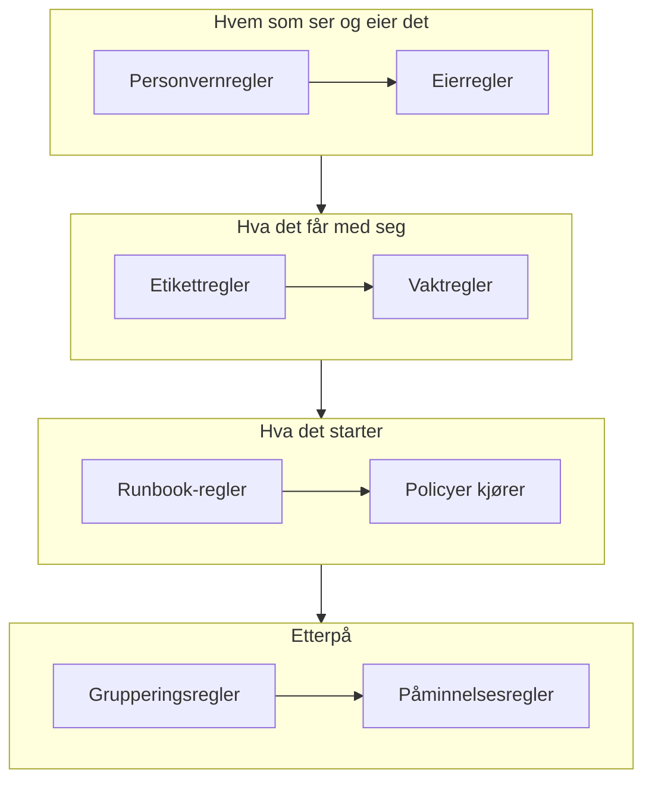

# Varselregler og innstillinger

Konfigurasjonen av varsler ligger under **Varsler**, ikke i **Prosjektinnstillinger**: reglene som virker på hvert nytt varsel, og innstillingene som former hvert varsel i prosjektet. Denne siden er oppslagsverket for hver av dem og for det som kjører av seg selv når et varsel opprettes.

:::cards
- [Reglene et nytt varsel går gjennom](#reglene-et-nytt-varsel-går-gjennom): I rekkefølge, og hva hver av dem gjør.
- [Vaktregler](#vaktregler): Tilkall de riktige personene uten å velge en policy hver gang.
- [Påminnelsesregler](#påminnelsesregler): Minn eiere på varselet så lenge det er åpent.
- [Innstillinger](#innstillinger): Notatmaler, egendefinerte felt, målinger, medlemskap i episoder og nummerering.
:::

## Hvor varselinnstillingene ligger

Åpne **Varsler** fra menyen **Produkter** i topplinjen. Seksjonene **Regler** og **Innstillinger** i sidemenyen starter sammenfoldet, så fold dem ut først. Hver side her gjelder hele prosjektet, på adresser som begynner med `/dashboard/{projectId}/alerts/settings/`.

| Regelside             | Hva den gjør                                                                                   |
| --------------------- | ---------------------------------------------------------------------------------------------- |
| **Grupperingsregler** | Samler relaterte varsler i episoder. Se [Varselepisoder og grupperingsregler](/docs/alerts/episodes). |
| **Vaktregler**        | Kjører vaktpolicyer for samsvarende varsler og episoder.                                       |
| **Eierregler**        | Legger til eiere på samsvarende varsler og episoder.                                           |
| **Runbook-regler**    | Starter runbooks for samsvarende varsler.                                                      |
| **Personvernregler**  | Gjør samsvarende varsler og episoder private.                                                  |
| **Etikettregler**     | Legger til etiketter på samsvarende varsler og episoder.                                       |
| **Reminder Rules**    | Minner eiere på med et intervall så lenge et varsel er åpent.                                  |

Seksjonen **Innstillinger** inneholder **Varselsstatus** og **Varselsalvor**, som er beskrevet på [Varseltilstander og alvorlighetsgrader](/docs/alerts/states-and-severities), og deretter **Notatmaler**, **Egendefinerte felt**, **Målinger**, **Medlemskap i episoder** og **Nummerering**, som er beskrevet nedenfor.

To andre seksjoner virker på varsler. **Varsler → KI → Innstillinger** avgjør hva OneUptime AI gjør på egen hånd: **Undersøk nye varsler**, slått på for nye prosjekter, og **Rett nye varsler automatisk**, slått av til du slår det på. Se [AI SRE](/docs/ai/ai-sre). **Varsler → Arbeidsområde** inneholder Slack- og Microsoft Teams-reglene som legger ut varsler og episoder i kanaler, og fanen **Sammendrag**. Se [Slack](/docs/workspace-connections/slack).

## Reglene et nytt varsel går gjennom

Reglene skiller seg i hvordan flere samsvar avgjøres:

- **Grupperingsregler** og **Reminder Rules** kontrolleres ovenfra og ned i listen sin, og det første samsvaret vinner. Dra en regel for å endre plassen; en ny regel havner sist.
- **Vaktregler**, **Eierregler**, **Etikettregler**, **Personvernregler** og **Runbook-regler** virker alle når de samsvarer. Vaktpolicyer, eiere og etiketter som flere regler legger til, legges til én gang.

**Vaktregler**, **Eierregler**, **Etikettregler** og **Personvernregler** har to faner: **Alert Rules** for varsler og **Episode Rules**, som virker på samme måte på hver ny varselepisode. En ny regel starter aktivert; slå av **Aktivert** i redigeringsskjemaet for å sette den på pause, og listen viser en grønn **Aktivert** eller en rød **Deaktivert** for hver regel.

De fleste regler virker på varsler og episoder som opprettes etter at du har lagret dem. For å bruke en eier-, etikett- eller personvernregel på dem du allerede har, bruker du **Kjør nå**: se [Kjøre regler på eksisterende ressurser](/docs/configuration/run-rules-now). Påminnelsesregler er unntaket: Når du lagrer en, samsvares hvert åpent varsel på nytt.

### Betingelser

Betingelsene i en regel avgjør hvilke varsler den virker på, og leses som setninger: "Hvis **Varseltittel** inneholder `database`", "Og **Overvåkingsetiketter** har en av *Production*". En regel uten betingelser samsvarer med hvert varsel.

| Betingelse                                                    | Sammenligner med                                                                                               |
| ------------------------------------------------------------- | -------------------------------------------------------------------------------------------------------------- |
| **Monitorer**, **Varsel Alvorligheter**, **Varseletiketter**, **Overvåkingsetiketter** | **Har en av**, **Har alle** eller **Har ingen av** verdiene du velger.                         |
| **Varseltittel**, **Varselbeskrivelse**, **Overvåkingsnavn**, **Overvåkingsbeskrivelse** | **Inneholder**, **Inneholder ikke**, **Er lik**, **Er ikke lik**, **Starter med**, **Slutter med**, uten hensyn til store og små bokstaver, eller **Samsvarer med mønster** og **Samsvarer ikke med mønster** for et regulært uttrykk eller et `*`-jokertegn. |

Med to eller flere betingelser velger du **Samsvar med alle**, der hver må stemme, eller **Samsvar med én**, der én er nok. Episoderegler samsvarer i stedet med en episodes alvorlighetsgrad, etiketter, tittel og beskrivelse.

## Vaktregler

**Varsler → Regler → Vaktregler** gjør tilkalling automatisk. Hver samsvarende regel legger til policyene sine på det nye varselet, og varselet kjører dem sammen med policyene det allerede hadde, hver én gang.

:::steps
### Velg varslene

Klikk på **Opprett Alert On-Call Rule**. Under **Treff** samsvarer **Alle varsler**, som en ny regel starter på, med hvert nytt varsel. For å snevre inn regelen velger du **Bare varsler som oppfyller betingelsene** og legger til betingelsene et varsel må oppfylle.

### Velg policyene

Under **Vaktretningslinjer** velger du **Vaktpolicyer** regelen tilkaller. **Navn** følger dem, for eksempel "Tilkall Platform on-call", til du skriver inn ditt eget, og en **Beskrivelse** venter under **Flere felt**. Opprett deretter regelen.
:::

En alvorlighetsgrad tilkaller ingen på egen hånd: En vaktregel som samsvarer på **Varsel Alvorligheter**, er måten å sette opp "tilkall databaseteamet for hvert High-varsel" på. For å se hva som kjørte for ett varsel, åpner du siden **Vaktutførelser**. Hver person nås deretter på den måten de har satt opp under **Brukerinnstillinger → Vaktregler** på fanen **Varsler**; se [Eskaleringsregler](/docs/on-call/escalation-rules).

En regel tilkaller så snart et varsel samsvarer med den. For å la den vente på arbeidstiden i stedet, svarer du **Bare i arbeidstiden** på **Når skal denne regelen tilkalle?** under **Flere felt**. **Arbeidstid** starter som mandag til fredag, 09:00 til 17:00, i din egen tidssone: velg andre dager, et annet **Starttidspunkt** eller **Sluttidspunkt** eller en annen **Tidssone**, og en setning under valget forteller hva som skjer. I listen viser regelen arbeidstiden under navnet. Et varsel som samsvarer utenfor disse tidene, får en kjøring som venter og ikke tilkaller noen; når arbeidstiden begynner, tilkaller retningslinjen sin første eskaleringsregel og eskalerer som vanlig. Blir varselet bekreftet eller løst først, blir ingen tilkalt. Endrer varselet seg mens det venter, slik at det nå samsvarer med en regel som tilkaller med en gang, for eksempel fordi alvorlighetsgraden heves, begynner kjøringen å tilkalle straks, og feeden til varselet forteller hvorfor. To regler som tilkaller den samme retningslinjen, tilkaller den så snart en av dem tillater det: en regel for de høyeste alvorlighetsgradene som tilkaller med en gang, ved siden av en regel for resten som venter på arbeidstiden, holder nettene rolige.

## Eier- og etikettregler

**Eierregler** legger til eierbrukere og -team på nye varsler som samsvarer, og **Etikettregler** legger til etiketter. Å opprette en tar to trinn: **Treff**, betingelsene, og deretter **Eiere** eller **Etiketter**, det regelen legger til. Regelens **Navn** følger det du velger, til du skriver ditt eget.

- **En regel kan arve.** Sammenfoldet under **Arv eiere** eller **Arv etiketter** gir seks brytere eierne eller etikettene videre fra varselets monitor, verter, Kubernetes-klynger, Docker-verter, Podman-verter og tjenester. Episoderegler har ingen slike brytere. En eierregels **Arv eiere** slutter med **Oppretterens team**: av teamene som står der, blir hvert team som personen som oppretter varselet, er med i, også eier.
- **En ny regel må legge til noe**: Velg minst én eier eller etikett, eller slå på en bryter. På en eierregel for hendelser eller varsler holder det også med et team under **Oppretterens team**.
- **Varsle eiere**, under **Flere felt** i en eierregel, avgjør om personene som legges til, får beskjed.

[Etikett- og eierregler](/docs/configuration/label-and-owner-rules) går gjennom skjemaet trinn for trinn for alle typer ressurser.

## Personvern- og runbook-regler

**Personvernregler** gjør nye varsler som samsvarer, private før noe annet kjører: Bare eierne deres og prosjektets administratorer og eiere kan se dem. En regel har to trinn: **Treff**, varslene den gjør private, og deretter **Navn**, allerede fylt ut som "Gjør varsler private". Se [Private varsler](/docs/alerts/index#private-varsler).

**Runbook-regler** starter en runbook når et nytt varsel samsvarer, med mindre varselet ble opprettet løst. Se [Runbook-regler](/docs/runbooks/rules).

## Påminnelsesregler

**Varsler → Regler → Reminder Rules** minner et varsels eiere på det så lenge det er åpent. Hvert nytt varsel får den første regelen som samsvarer, ovenfra og ned i listen.

:::steps
### Velg hvilke varsler det skal minnes om

Klikk på **Opprett Alert Reminder Rule**. Under **Treff** lar du **Alle varsler** være valgt for å minne om hvert varsel, eller du velger **Bare varsler som oppfyller betingelsene** og deretter **Varsel Alvorligheter** og **Etiketter** den gjelder for.

### Angi intervallet

Under **Påminnelser** angir du **Påminnelsesintervall (minutter)**, hvor ofte eierne minnes på, og **Stopp påminnelser når**: **Løst**, standarden, eller **Bekreftet**. **Navn** følger begge, for eksempel "Påminn hver 30 minutter til løst", til du skriver inn ditt eget. Opprett deretter regelen.
:::

Eiere får hver påminnelse som **Alert reminder**, som er slått på via e-post som standard. Et varsels regel samsvares på nytt når alvorlighetsgraden eller etikettene endres. For å stoppe påminnelsene for ett varsel slår du av **Send påminnelser** på siden **Innstillinger**; den lagrer i det øyeblikket du slår den om.

## Innstillinger

### Notatmaler

**Varsler → Innstillinger → Notatmaler** inneholder ferdig tekst for private notater. Kortet **Maler for private notater for varsler** viser dem; **Opprett Varsel Notat Mal** ber om **Malnavn**, **Malbeskrivelse** og **Notat**. En mal tilbys når noen skriver et privat notat på et varsel eller en episode, og når de bekrefter eller løser en, og teksten kan redigeres før den publiseres. Notatmaler for varsler er ren tekst: I motsetning til notatmaler for hendelser fyller de ikke ut noen variabler.

### Egendefinerte felt

**Varsler → Innstillinger → Egendefinerte felt** legger til dine egne felt på hvert varsel, for eksempel et kundenivå eller en sakshenvisning. Fyll dem ut på varselets side **Egendefinerte felt**, eller via API-et som `customFields`. Et felt kan kopiere verdien sin fra et egendefinert felt på en monitor i stedet for å skrives inn: se [Felt som kopieres fra en monitor](/docs/incidents/settings#felt-som-kopieres-fra-en-monitor), som fungerer på samme måte for varsler.

### Målinger

**Varsler → Innstillinger → Målinger** måler hvor lang tid ting tar for hvert varsel. Velg **Tid til bekreftelse** eller **Tid til løsning**, eller to egne tidspunkter, for eksempel når **Varselet blir opprettet**, og når det går inn i en tilstand du velger. Hver måling vises på varselets side og i diagrammer som `oneuptime.alert.measurement.<key>`. Se [Målinger](/docs/incidents/settings#målinger), som fungerer på samme måte for varsler.

**Tid til bekreftelse etter tilkalling** teller fra **Noen blir tilkalt for første gang**, når en vaktpolicy eller en direkte tilkalling første gang ga noen beskjed om varselet, i stedet for fra tidspunktet det ble opprettet: et varsel som oppstår om natten, men først fører til en tilkalling om morgenen, får ikke natten regnet med. Et varsel der ingen ble tilkalt, har ingen verdi. Se [Tid til bekreftelse etter tilkalling](/docs/incidents/settings#tid-til-bekreftelse-etter-tilkalling).

### Medlemskap i episoder

**Varsler → Innstillinger → Medlemskap i episoder** avgjør om et varsel kan være i mer enn én episode. Slå på **Et varsel kan bare være i én episode**, så blir et varsel som er i en episode, ikke lagt til i noen annen, verken fra dashbordet eller via API-et, en arbeidsflyt eller en grupperingsregel, før det er tatt ut av den episoden. Bryteren er slått av til du slår den på, og bare Project Owners og Project Admins kan endre den. Å slå den på tar ikke noe varsel ut av en episode. Se [Én episode per hendelse](/docs/incidents/episodes#én-episode-per-hendelse), som fungerer på samme måte for varsler.

### Nummerering

**Varsler → Innstillinger → Nummerering** angir teksten foran varsel- og episodenumre: `ALT-` og `AE-` i et nytt prosjekt, eller `#` uten prefiks. **Oppdater** åpner **Nummerprefiks for varsel** og **Nummerprefiks for varselepisode**, med en forhåndsvisning mens du skriver. Bare varsler og episoder som opprettes etterpå, får det nye prefikset. Reglene for et prefiks står under [Nummerprefikser](/docs/incidents/settings#nummerprefikser).

Kortet **Neste nummer** under setter nummeret det neste varselet og den neste episoden får, for å fortsette numrene fra et annet verktøy: **Oppdater** åpner **Neste varselnummer** og **Neste nummer for varselepisode**, hver høyere enn det høyeste så langt. Se [Neste numre](/docs/incidents/settings#neste-numre).

> [!NOTE]
> På OneUptime Cloud krever notatmaler og egendefinerte felt planen **Growth** eller høyere.

## Arbeidsflyter

Hver varselmodell har arbeidsflytutløsere og -handlinger oppkalt etter seg: **On Create Alert**, **On Update Alert**, **On Create or Update Alert** og **On Delete Alert**, det samme for **Varsel Episode**, **Varsel Tilstand Tidslinje** og de andre, og handlinger som **Create One Alert** og **Update One Alert**. Definisjonene av egendefinerte felt for varsler er det eneste unntaket: De har ingen arbeidsflytutløsere. Se [Oversikt over arbeidsflyter](/docs/workflows/index).

## Hvem som kan endre dem

Regler, egendefinerte felt og målinger krever en Project Owner eller Project Admin, eller en egendefinert rolle med regelens egen tillatelse. **Varselmedlem** jobber med varsler og episoder, notatene deres, eiere og tilstandstidslinjer og notatmaler, og **Varseladministrator** administrerer i tillegg varseltilstander og alvorlighetsgrader. Se [Brukere, team og tillatelser](/docs/permissions/index).

## Neste steg

:::cards
- [Varselepisoder og grupperingsregler](/docs/alerts/episodes): Grupperingsreglene i dybden.
- [Eskaleringsregler](/docs/on-call/escalation-rules): Hva som skjer når en vaktregel kjører en policy.
- [Etikett- og eierregler](/docs/configuration/label-and-owner-rules): Regelskjemaet trinn for trinn.
- [AI SRE](/docs/ai/ai-sre): Undersøk og rett nye varsler av seg selv.
:::
