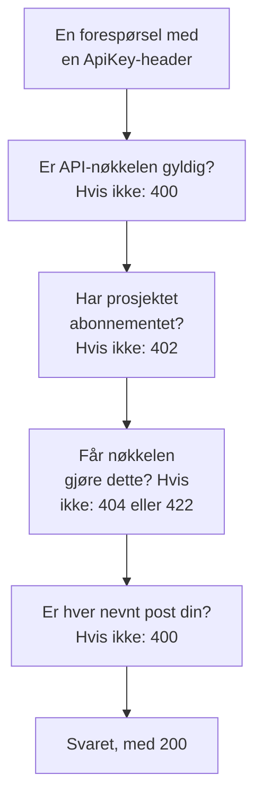

# OneUptime API-referanse

Alt du kan gjøre i OneUptime-dashbordet, kan du også gjøre via REST-API-et: automatisere gjentatt arbeid, koble OneUptime til de andre verktøyene dine eller bygge egne integrasjoner. Denne siden viser hvordan du gjør din første forespørsel, og reglene hver forespørsel følger. Hvert endepunkt og hvert felt står i den [fullstendige API-referansen](/reference).

:::cards
- [Gjør din første forespørsel](#gjør-din-første-forespørsel): En API-nøkkel, én header og en curl-kommando.
- [Forespørsler og svar](#forespørsler-og-svar): De seks forespørslene hver ressurs har, og hva hver statuskode betyr.
- [Abonnementer og API-et](#abonnementer-og-api-et): Hva et abonnement selger, og hva som fortsatt fungerer under det.
- [Navngi og skrive poster](#navngi-og-skrive-poster): ID-er, referanser, brytere og feltene OneUptime fyller ut.
- [Tilstander og episoder](#tilstander-og-episoder): Tilstanden en post starter i og går gjennom.
- [Hva en forespørsel kan nå](#hva-en-forespørsel-kan-nå): Lesing, endring og sletting, ett prosjekt om gangen.
:::

## Slik besvares en forespørsel

API-et er bygget etter REST: standard HTTP-metoder og -statuskoder, JSON inn og JSON ut. Hver forespørsel har med en API-nøkkel og går gjennom noen kontroller. Den første kontrollen den feiler, svarer med en statuskode og `{ "message": "..." }`, så meldingen sier hva som stoppet den.



## Gjør din første forespørsel

Alle API-forespørsler autentiseres med en API-nøkkel. En nøkkel hører til ett prosjekt og gjør det tillatelsene tillater.

:::steps
### Opprett en API-nøkkel

Åpne **Prosjektinnstillinger → Avansert → API-nøkler**, og klikk på **Opprett API-nøkkel**. Gi den et **Navn**, og velg under **Tilgang** hva den får gjøre: **Prosjektadministrator**, **Prosjektmedlem**, **Leser** eller **Velg tillatelser senere** for å legge til enkelttillatelser på nøkkelens side. Nøkkelen utløper om et år, med mindre du velger en annen dato under **Avansert**.

### Kopier nøkkelen

Nøkkelens side åpnes. Kopier **API-nøkkel** fra kortet **API-nøkkeldetaljer**, og hold den unna koden din:

```bash
export ONEUPTIME_API_KEY="your-api-key"
```

### Send en forespørsel

List opp de ti første monitorene. Nøkkelen leser sitt eget prosjekt, så forespørselen nevner ikke noe prosjekt:

```bash
curl -X POST 'https://oneuptime.com/api/monitor/get-list?skip=0&limit=10' \
  -H "ApiKey: $ONEUPTIME_API_KEY" \
  -H 'Content-Type: application/json' \
  -d '{ "select": { "name": true } }'
```

Svaret er `{ "data": [...], "count": ... }`: monitorene, og hvor mange det er totalt. På en selvdriftet installasjon bruker du din egen OneUptime-adresse i stedet for `https://oneuptime.com`.
:::

### Eksempler for hver ressurs

Hver ressurs i OneUptime-dashbordet har en seksjon **Utvikler** i sidemenyen, slått sammen til du åpner den. Siden **API** der har kjøreklare `curl`-kommandoer for den ressursen, rettet mot ditt OneUptime og fylt ut fra ditt eget prosjekt: les, endre og slett den fra ressursens egen side, eller list opp, tell og opprett fra en listeside (for eksempel **Monitorer**). Kommandoene leser API-nøkkelen din fra miljøvariabelen `ONEUPTIME_API_KEY`.

Eksemplene er skrevet for ressursen. På listen **Hendelser** viser for eksempel listeforespørselen svaret sitt med din første hendelse, filtrene finner hendelser som ikke er løst, av én alvorlighetsgrad, om én monitor eller fra de siste sju dagene, med dine egne tilstander, alvorlighetsgrader og monitorer, og opprettelsesforespørselen erklærer en hendelse med en av alvorlighetsgradene dine, med en linje om hva hvert felt er til. En hendelses egen side leser den med det faktiske svaret, flytter den til en annen av alvorlighetsgradene dine og har de vanlige oppgavene: kvitter for den og løs den (med prosjektets egne tilstander), og legg til interne eller offentlige notater. Hver API-side slutter med ressursens endepunkter.

## Forespørsler og svar

Hver ressurs har de samme forespørslene, under `https://oneuptime.com/api` og ressursens bane, som `/monitor` eller `/incident`:

| Forespørsel | Metode og bane | Hva bodyen inneholder |
| --- | --- | --- |
| List opp | `POST /api/<resource>/get-list` | `query`, `select` og `sort` |
| Tell | `POST /api/<resource>/count` | `query` |
| Les én | `POST /api/<resource>/<id>/get-item` | `select` |
| Opprett | `POST /api/<resource>` | `{ "data": { ... } }` |
| Endre én | `PUT /api/<resource>/<id>` | `{ "data": { ... } }`, feltene som skal endres |
| Slett én | `DELETE /api/<resource>/<id>` | Ingenting |

`POST /api/<resource>/<id>/update-item` og `POST /api/<resource>/<id>/delete-item` endrer og sletter også én post, for klienter som bare sender `POST`.

### Filtrer, sorter og bla

En liste eller en telling tar en `query`. Et felt med en verdi matcher den verdien; et objekt med en `_type` sammenligner:

| `_type` | Matcher |
| --- | --- |
| `Search` | Tekst som inneholder `value` |
| `NotEqual` | Alt unntatt `value` |
| `GreaterThan`, `LessThan` | Senere datoer eller større tall, eller tidligere og mindre |
| `InBetween` | Datoer eller tall mellom `startValue` og `endValue` |
| `Includes` | En av verdiene i `value` |
| `IsNull`, `NotNull` | Ingen verdi, eller en hvilken som helst verdi |

Et felt i en post som ressursen nevner, filtreres under relasjonen: `"user": { "name": { "_type": "Search", "value": "ada" } }` finner teammedlemmene der brukerens navn inneholder «ada». Å filtrere på et felt krever tillatelse til å lese det, gjennom en relasjon som på selve ressursen: et filter på et felt du ikke har lov til å lese, avvises med en `422` som nevner feltet.

En ressurs med eiere - en monitor, en hendelse, en vaktpolicy og enhver annen med bruker- og teameiere - filtreres også etter hvem som eier den, under `owners`: `"owners": { "_type": "OwnedBy", "userIds": ["..."], "teamIds": ["..."] }` finner postene som én eller flere av de personene og teamene eier. `match` er `AnyOf` med mindre du setter den: `NoneOf` finner postene som ingen av dem eier, også poster uten eiere, og `AnyOwner` og `NoOwner` finner postene med en eier eller uten, uten å nevne noen. Medlemmene i et team er ikke eiere av det teamet eier. Ett filter nevner høyst 1 000 personer og team til sammen, en ressurs uten eiere avviser det med en `400`, og å filtrere etter eiere uten tillatelse til å lese dem avvises med en `422`.

`select` nevner feltene som skal returneres, og `_id` kommer alltid med. `sort` ordner dem, `ASC` eller `DESC`; uten sortering kommer de nyeste først. En liste returnerer 10 poster med mindre du setter `limit`, opptil 10 000, og `skip` hopper først over så mange: fortsett å øke `skip` med `limit` til du har `count` av dem. Legg til `?output-type=csv` i en listeforespørsel for å få CSV i stedet for JSON.

For eksempel monitorene der navnet inneholder «checkout», opprettet siden starten av 2026, de nyeste først:

```bash
curl -X POST 'https://oneuptime.com/api/monitor/get-list' \
  -H "ApiKey: $ONEUPTIME_API_KEY" \
  -H 'Content-Type: application/json' \
  -d '{
    "query": {
      "name": { "_type": "Search", "value": "checkout" },
      "createdAt": { "_type": "GreaterThan", "value": "2026-01-01T00:00:00.000Z" }
    },
    "select": { "name": true, "createdAt": true },
    "sort": { "createdAt": "DESC" },
    "limit": 100
  }'
```

Datoer og ID-er utenom `_id` kommer pakket inn, som `{ "_type": "DateTime", "value": "..." }` og `{ "_type": "ObjectID", "value": "..." }`: les dem fra `value`.

Hver ID en forespørsel filtrerer etter eller skriver - `_id`, et felt som `monitorId` og hver post en relasjon lister opp, som `"labels": [{ "_id": "..." }]` - er en UUID, sendt som tekst eller pakket inn slik den kommer tilbake. Alt annet, som tekst som ikke er en UUID, eller et objekt i stedet for en ID, avvises med en `400` som navngir feltet og sier om det sto i `query` eller i `data`, og ingenting blir lest eller skrevet:

```text
Invalid ID for "currentIncidentStateId" in the query: "resolved". An ID is a UUID, such as "550e8400-e29b-41d4-a716-446655440000".
```

### Statuskoder

| Kode | Hva den betyr | Les mer |
| --- | --- | --- |
| `200` | Den gikk gjennom. En liste eller en telling svarer med postene du får lese, ingen når det ikke finnes noen. | [Les én post ut fra ID-en](#les-én-post-ut-fra-id-en) |
| `400` | Forespørselen er feil: API-nøkkelen er ugyldig, en verdi er ikke tillatt, et felt kan ikke skrives, en nevnt post er ikke din, eller den endrer flere prosjekter samtidig. Meldingen sier hva som er galt. | [Poster en forespørsel nevner](#poster-en-forespørsel-nevner) |
| `402` | Prosjektets abonnement inneholder ikke det forespørselen bruker. Meldingen nevner abonnementet. | [Funksjoner abonnementet ditt ikke inneholder](#funksjoner-abonnementet-ditt-ikke-inneholder) |
| `404` | Posten finnes ikke, ligger i et annet prosjekt eller er en du ikke får lese: samme svar i hvert tilfelle. | [Endre eller slette en post du ikke får lese](#endre-eller-slette-en-post-du-ikke-får-lese) |
| `422` | Du får ikke gjøre dette: API-nøkkelen har ingen tillatelse for denne typen post, du får lese posten, men ikke endre den, eller etikettene til en tillatelse utelukker den. Meldingen sier hvorfor. | [Endre eller slette en post du ikke får lese](#endre-eller-slette-en-post-du-ikke-får-lese) |
| `500` | Noe feilet på serveren. Når eieren av en ny post ikke kan skrives, fjernes posten igjen, så opprettelsen kan prøves på nytt. | [Poster en forespørsel nevner](#poster-en-forespørsel-nevner) |

## Abonnementer og API-et

### Funksjoner abonnementet ditt ikke inneholder

I OneUptime Cloud selges noen ressurser i et abonnement: single sign-on-leverandører og SCIM-tilkoblinger i **Scale**; API-nøkler, vaktplaner og varslingsregler og sammendrag for Slack og Microsoft Teams i **Growth**, blant andre. Å opprette en, endre den eller slå den på krever det abonnementet. Under det avvises forespørselen med `402 Payment Required`, og meldingen nevner abonnementet.

Noen innstillinger for en ressurs selges i et abonnement på samme måte. For eksempel: en statusside som er privat, som skjuler en av listene sine, eller som har egendefinert HTML, CSS eller JavaScript, e-postrapporter, abonnenter via SMS, Slack, Microsoft Teams eller webhook, eller en IP-tillatelsesliste; et dashbord som deles offentlig, eller IP-tillatelseslisten til det; IP-tillatelseslisten til et skjema; revisjonsloggene til et prosjekt. Veiledningen for hver av dem, og dashbordet ved siden av innstillingen, nevner abonnementet den krever. En slik innstilling krever abonnementet sitt hver gang den skrives - når ressursen opprettes med den, som når den endres senere -, så en opprettelse som slår en av dem på under abonnementet, også avvises med `402`. En innstilling som står på standardverdien, eller settes tilbake til den, fungerer på alle abonnementer: en opprettelse som lar disse innstillingene være, går gjennom, og det samme gjør en Terraform-konfigurasjon som ikke setter dem.

Det et prosjekt allerede har, kan fortsatt administreres uansett abonnement, for eksempel når en prøveperiode slutter eller abonnementet går ned:

- du kan slette de postene;
- du kan slå en av, på en ressurs med et felt `isEnabled`, ved å sende `"isEnabled": false` og ingenting annet;
- du kan liste opp og lese dem et prosjekt må finne etter at abonnementet har gått ned - for å slå dem av, eller for å se hva som har stoppet: single sign-on-leverandører, SCIM-tilkoblinger, API-nøkler og tillatelsene deres, vaktplaner og varslingsregler og sammendrag for Slack og Microsoft Teams.

De vanlige tillatelsene avgjør fortsatt hvem som får gjøre hva, akkurat som på abonnementet. Å lese de andre ressursene et abonnement selger, som maler, egendefinerte felt, monitorgrupper, vaktlogger og skjemainnsendinger, krever fortsatt abonnementet: å lese dem er å bruke funksjonen. En API-nøkkels tillatelser slettes ikke én og én under **Growth**, fordi sletting av en blokkeringstillatelse ville gitt nøkkelen mer tilgang; slett nøkkelen i stedet.

### API-nøkler og SCIM under abonnementet sitt

I OneUptime Cloud fungerer et prosjekts API-nøkler bare mens prosjektet er på **Growth** eller høyere, og SCIM-tilkoblingene - prosjektets egne og statussidenes - fungerer bare fullt ut mens det er på **Scale** eller høyere. Når prosjektet kommer under det abonnementet:

- Hver forespørsel som gjøres med en av prosjektets API-nøkler, avvises med `402 Payment Required`, uansett hva den ber om: REST-API-et og alt som kaller det med en API-nøkkel - Terraform, `oneuptime`-CLI-en, MCP-klienter som er koblet til med en API-nøkkel, arbeidsflyter som sender en i en forespørselsheader, og dine egne skript. Meldingen nevner abonnementet: `API keys need the Growth plan. This project's plan does not include them, so its API keys stopped working. The keys are kept: upgrade the project to Growth in Project Settings > Billing and Invoices > Billing and they work again.`
- SCIM-tilkoblingene fjerner bare personer. Å deaktivere og slette personer, og fjerne dem fra grupper, fungerer fortsatt, så alle som slutter, mister fortsatt tilgangen sin; hver SCIM-forespørsel som ville lagt til eller endret personer eller grupper, avvises med `402` i SCIM-feilformatet, slik at identitetsleverandøren din viser hvorfor ([SCIM under abonnementet Scale](/docs/identity/scim#under-planen-scale)).

Ingenting slettes eller slås av. Nøklene og tilkoblingene beholdes, og de fungerer fullt ut igjen, slik de er, så snart prosjektet er tilbake på abonnementet: ingen nye nøkler å lage, ingenting å sette opp igjen i identitetsleverandøren. En abonnementsendring trer i kraft innen et minutt.

Under **Growth** viser **Prosjektinnstillinger** > **Avansert** > **API-nøkler** nøklene prosjektet fortsatt har, og sier at de har stoppet, så hvem som helst av dem kan slettes (tilbakekalles) på alle abonnementer. Å opprette eller endre nøkler krever **Growth**. **Prosjektinnstillinger** > **Fakturering og fakturaer** > **Fakturering** oppgir hvor mange API-nøkler et lavere abonnement stopper og hvor mange SCIM-tilkoblinger det begrenser, på hvert abonnement du kan velge, og hva prosjektets abonnement har stoppet; prosjektets eiere får en e-post når en abonnementsendring stopper dem. Eierne av prosjekter som allerede lå under disse abonnementene da dette begynte, får én e-post som sier hva som har stoppet, og hvordan det slås på igjen.

Bare et prosjekts API-nøkler og SCIM-tilkoblinger berøres. Personer berøres ikke: innlogging i dashbordet, og MCP-klienter som er koblet til ved innlogging, fungerer som før. Inntaksnøkler for telemetri, probenøkler og agentnøkler er ikke API-nøkler og fortsetter å fungere. Selvdriftede installasjoner har ingen abonnementer, så for dem endres ingenting.

## Navngi og skrive poster

### Finn ID-en til en ressurs

Forespørsler som leser, endrer eller sletter én ressurs, nevner den med ID-en, en UUID. På ressursens egen side slutter detaljkortet med en liten linje **ID** som viser begynnelsen av ID-en: klikk på ID-en, eller på kopieringsknappen ved siden av, for å kopiere hele ID-en. Lister som tilbyr det, har **Vis ID** i menyen **⋯** for en rad, og ID-en er også den siste delen av sidens adresse. Prosjektets ID er det første på kortet **Prosjektdetaljer** under **Prosjektinnstillinger → Prosjekt**.

### Poster en forespørsel nevner

Mange ressurser nevner andre poster: en monitor etikettene og probene sine, en abonnent på en statusside statussiden sin, en nettverksenhet stedet sitt, et medlem av en hendelse hendelsen og rollen. Hver regel nedenfor gjelder likt for API-et, Terraform og arbeidsflyter:

| Når en forespørsel | må den | Ellers |
| --- | --- | --- |
| nevner en post med ID-en | nevne en post i prosjektet ditt | `400` |
| oppretter en post som leses via en annen, som et notat | opprette den under en du får lese | `400`, eller `422` uten tillatelse til å lese den typen post |
| flytter en post inn under en annen | flytte den inn under en du får lese | `400` |
| lister opp poster, eller nevner en i et eget felt | nevne poster lesetillatelsen din når | `400` |
| nevner en innstilling som inneholder legitimasjon | komme fra noen som får lese den typen innstilling | `400` |
| oppretter eller gir en post nye etiketter med en tillatelse som er begrenset til etiketter | gi posten en av de etikettene | `422` |
| nevner én post på to måter | nevne den samme posten begge gangene | `400` |

#### Hver ID må høre til prosjektet ditt

Hver ID du sender for en post som en ressurs nevner, må være en post i prosjektet ditt — dashbordets velgere tilbyr ikke noe annet — og forespørsler fra Terraform og arbeidsflyter holdes til det samme. En ID for en post i et annet prosjekt og en ID som ikke finnes, avvises likt, med en `400` som nevner feltet og ID-en:

```text
This network device references records that are not in this project: Network Site "…". Please pick values from this project and try again.
```

Personer kontrolleres ut fra medlemskap: en som ikke er medlem av prosjektet, avvises på samme måte. En global probe, som alle prosjekter kan bruke, regnes som prosjektets. En endring av en ressurs kontrollerer bare ID-ene endringen legger til, så en ressurs som nevner noe som senere har forsvunnet, kan fortsatt lagres.

#### Poster som leses via en annen

En post som leses via en annen - notatene og tilstandstidslinjen til en hendelse eller et varsel, kunngjøringene, domenene og gruppene til en statusside - må også nevne en du får lese, etter regelen lesingen av den følger: en hendelse utenfor etikettene eller eierne tillatelsen din til å lese hendelser når, med en etikett som en blokkering av lesing av hendelser fjerner, eller merket som privat uten at du er blant eierne, direkte eller via et team (prosjekteiere og -administratorer ser hver privat hendelse, hvert private varsel og hver private episode), avvises med samme `400`, og ingenting skrives. Hver statusside en kunngjøring nevner, må være en du får lese, og en nøkkel der tillatelsen til å lese statussider bare når noen av dem, må nevne minst én. En tillatelse til å opprette en slik post krever en tillatelse til å lese posten den opprettes under; uten den avvises opprettelsen med en `422` som nevner tillatelsene som ville sluppet den gjennom:

```text
You do not have permissions to create Incident Internal Note. It is read through its Incident, and you need one of these permissions to read Incidents: …
```

En endring som flytter en slik post, følger samme regel: hver post den legger til som overordnet - en annen statusside for en kunngjøring, en annen tjeneste for en post som leses via tjenesten sin - må være en du får lese, ellers avvises endringen med samme `400`, og ingenting skrives. De overordnede postene en post allerede har, kontrolleres ikke på nytt, og en endring som etterlater den under ingen, krever en tillatelse til å lese den typen post som når alle sammen, slik som en opprettelse som ikke nevner noen.

#### Eiere

Eierne av en ressurs - bruker- og teameierpostene for en monitor, en vaktpolicy, et dashbord og enhver annen ressurs med eiere - leses på samme måte via ressursen de eier: å liste opp, lese, legge til og fjerne dem krever en tillatelse til å lese den ressursen, under etikettene og eierne dens, og en eierpost for en ressurs du ikke får lese, besvares som om den ikke fantes. Å legge dem til og fjerne dem holder seg også til omfanget av tillatelsen som gir lov til det: en med omfanget `Owned` når bare eierne av ressurser som du eller et av teamene dine eier, og å legge til en eier på en hvilken som helst annen ressurs avvises med en `422` som sier det.

#### Poster en skriving lister opp eller nevner

Postene en opprettelse eller endring lister opp - en hendelses monitorer og vaktpolicyer, et varsels tjenester, statussidene til en planlagt vedlikeholdshendelse, en regels runbooks - holder seg til tillatelsen din til å lese den typen post når du har en, og i alle tilfeller til en blokkering med etiketter av lesingen: en post utenfor dem avvises med samme `400`. En endring kontrollerer bare postene den legger til i en liste, så de som listen allerede har, blir værende.

Den ene posten en opprettelse eller endring nevner i et eget felt - et varsels monitor, monitoren en statussideressurs viser, et kostnadsbudsjetts tjeneste, hendelsen en runbook-kjøring er knyttet til - følger samme regel, under begge navnene sine: en post utenfor tillatelsen din til å lese den typen post, eller med en etikett som en blokkering av lesingen fjerner, avvises med samme `400`. En endring kontrollerer den bare når den nevner en annen post enn den feltet allerede har. OneUptimes globale prober og AI-agenter, som alle prosjekter kan bruke, er fortsatt åpne for alle prosjekter. Postene en mal fyller ut for deg, kontrolleres på samme måte når de er fylt ut, før noe lagres: monitorene, statussidene og vaktpolicyene en hendelsesmal legger til en hendelse som erklæres fra den, må være poster du får lese, som om du hadde valgt dem selv.

#### Innstillinger som inneholder legitimasjon

En innstilling som inneholder legitimasjon - en SMTP-server, en leverandør av anrop og SMS, SNMP-legitimasjon, en videosamtaletilkobling, en API-nøkkel, en ekstern MCP-server - nevnes bare av noen som får lese den typen innstilling: en statussides `smtpConfig` og `callSmsConfig`, en policy for innkommende anrops `projectCallSMSConfig`, en nettverksenhets eller et steds `snmpCredentialProfile`, videosamtaletilkoblingen `videoCallConnection` til en hendelse eller et varsel, en API-nøkkeltillatelses `apiKey` og `externalMcpServers` i en AI-regel. Å nevne en uten tillatelse til å lese den typen innstilling - eller med en som en blokkering uten etiketter fjerner - avvises med samme `400`, under begge navnene; en endring som beholder innstillingen en post allerede nevner, blir ikke spurt. Nummersøket og listen over egne numre i en policy for innkommende anrop krever samme lesing av anrops- og SMS-konfigurasjonen de nevner.

#### Etiketter og eiere ved opprettelse

En opprettelsestillatelse som er begrenset til etiketter, oppretter bare poster som har en av etikettene - for en post uten egne etiketter: poster under en som har en -, med mindre en annen tillatelse til å opprette den typen post når hele prosjektet, og en blokkering med etiketter på en opprettelsestillatelse avviser en post som har en av etikettene. En opprettelse utenfor dem avvises med en `422` som nevner etikettene:

```text
Your access lets you create Status Pages only with one of these labels: Production. Add one of them and try again.
```

En opprettelsestillatelse med omfanget **Owned** oppretter en monitor, en statusside eller en annen post med egne eiere bare for en person, som blir en av eierne, og et notat eller en annen post som tar eierne sine fra posten den hører til, bare under en som du eller et av teamene dine eier.

Den som oppretter, gjøres til eier rett etter at posten er lagret, før noe annet skjer med den. Hvis eierraden ikke kan skrives, fjernes posten igjen, og opprettelsen avvises med en `500`, så ingen post blir liggende igjen som den som opprettet den, ikke når.

#### En endring av etiketter

En endring av etikettene en post har - de egne etikettene, eller for en post uten egne etiketter postene den nevner - holder seg på samme måte til tillatelsen din til å endre den typen post: med en som er begrenset til etiketter, beholder posten minst én av dem, med mindre en annen tillatelse til å endre den når hele prosjektet, og en blokkering med etiketter på en endringstillatelse avviser å gi den en av etikettene. En slik endring avvises med en `422` som nevner etikettene:

```text
Your access lets you change Monitors only with one of these labels: Production. Keep one of them and try again.
```

#### Nevn en post på to måter

En post kan nevnes på to måter: med ID-feltet (`monitorId`), eller med relasjonen (`"monitor": { "_id": "…" }`), som er det dashbordets skjemaer sender. Send en av dem. Hvis en forespørsel sender begge, må de nevne den samme posten: en forespørsel der de to ikke stemmer overens — to forskjellige ID-er, eller en ID og en tom verdi — avvises med en `400` som nevner begge feltene:

```text
Conflicting Monitor references were provided. monitorId and monitor are names for the same field and must hold the same value: send only one of them, or the same id in each.
```

Begge navnene kontrolleres på samme måte. Reglene for posten du nevner, gjelder uansett hvilket navn du sender den under: den overordnede gruppen til en statussidegruppe må ligge på samme statusside, en statusside tar høyst tre headerlenker, og navnet på en gruppe må være unikt på statussiden.

### Brytere

Et felt som er på eller av - `isEnabled`, `isVisibleOnStatusPage`, `isArchived` og alle andre `true`- eller `false`-felt - tar `true` eller `false`. Tekst og tall som databasen leser som en av dem, tas som den verdien, på samme måte for API-et, Terraform og arbeidsflyter: `"true"`, `"yes"`, `"on"`, `"1"` og `1` er `true`, og `"false"`, `"no"`, `"off"`, `"0"` og `0` er `false`, uansett store og små bokstaver. Alt OneUptime gjør med posten, behandler den også som den verdien: en planlagt vedlikeholdshendelse som sendes med `"isVisibleOnStatusPage": "true"`, viser bildene sine på statussiden, og `"isEnabled": "false"` slår av en ressurs under abonnementet slik `false` gjør. Enhver annen verdi, som `"maybe"`, `""` eller `2`, avvises med en `400` som nevner feltet:

```text
isVisibleOnStatusPage must be true or false.
```

En oppdatering som skriver en posts verdier slik de allerede er, endrer ingenting: den starter ikke postens **On Update**-arbeidsflyter, sender ikke liveoppdateringer og legger ikke til en oppføring i revisjonsloggen. `false` skrevet over `false` regnes som samme verdi, og det samme gjør `"false"` skrevet over `false`, et tall skrevet som tekst, et tidspunkt skrevet som samme øyeblikk i et annet format og etiketter skrevet som de samme etikettene i vilkårlig rekkefølge. Når en oppdatering endrer noen verdier og skriver andre tilbake slik de er, viser revisjonsloggoppføringen bare verdiene som ble endret, og en arbeidsflyts **Fields to watch** hører bare dem.

### Hvor et prosjekt ble kjøpt

Et prosjekts forhandler, forhandlerabonnement og forhandlerlisens (`resellerId`, `resellerPlanId`, `resellerLicenseId`, og relasjonene `reseller` og `resellerPlan`) settes av OneUptime alene: når et prosjekt opprettes med en forhandlers kampanjekode, og når forhandleren endrer abonnementet. En opprettelse eller endring av et prosjekt som sender en av dem, avvises med en `400` som nevner feltet, uansett hvem som sender den:

```text
User is not allowed to create on resellerId column of Project. No permission allows it: the column is set by the server, not by a request.
```

### Hvem som opprettet en post

OneUptime registrerer hvem som opprettet en post — og hvem som arkiverte den, løste den, kvitterte for den eller utløste den — ut fra selve forespørselen: personen som er logget inn, eller ingen når forespørselen kommer med en API-nøkkel eller fra en arbeidsflyt. Disse feltene (`createdByUserId` og de andre feltene som slutter på `ByUserId`, med relasjonene deres som `createdByUser`) er skrivebeskyttede, og det samme er tidspunktet en post ble arkivert eller løst (`archivedAt`, `markedAsResolvedAt`, `markedAsArchivedAt`): å slå på `isArchived` eller `isResolved` registrerer hvem som gjorde det og når, og å slå det av fjerner begge. Å sende en bryter slik den allerede står, beholder hvem som slo den om, og når.

API-referansen merker disse feltene som skrivebeskyttede. En verdi en forespørsel sender for et av dem ved siden av andre endringer, ignoreres, så resten av endringen går gjennom; en oppdatering som ikke sender noe annet, avvises med en melding som nevner feltene. Poster som OneUptime selv oppretter på vegne av noen — et notat som er sendt fra Slack eller Microsoft Teams, en konto som er opprettet via en invitasjon — nevner den personen.

## Tilstander og episoder

### Tilstanden en ny post starter i

En hendelse, et varsel, en hendelsesepisode og en varselsepisode kan opprettes i en hvilken som helst av prosjektets tilstander, slik feltet **Innledende tilstand** i opprettelsesskjemaene deres gjør: send `currentIncidentStateId` (hendelser og hendelsesepisoder) eller `currentAlertStateId` (varsler og varselsepisoder), eller relasjonen. Posten starter i den tilstanden, og tilstandstidslinjen begynner med den. Utelater du den, starter den i prosjektets opprettelsestilstand, den som er merket med `isCreatedState` — eller, for en hendelse som erklæres fra en mal med en innledende tilstand, i malens. En tilstand fra et annet prosjekt avvises som enhver annen post. Terraforms `current_incident_state_id` og `current_alert_state_id` fungerer på samme måte. En post som opprettes i kvittert-tilstanden din eller senere, varsler ingen, og en som opprettes løst, blir i tillegg verken gruppert, utbedret automatisk eller undersøkt av AI, og får ingen kanal i Slack eller Microsoft Teams — se [Erklært allerede kvittert eller løst](/docs/incidents/declaring-incidents#erklært-allerede-bekreftet-eller-løst).

### Endre en posts tilstand

En posts tilstand endres med en rad i tilstandstidslinjen - `POST /api/incident-state-timeline`, `/api/alert-state-timeline`, `/api/incident-episode-state-timeline`, `/api/alert-episode-state-timeline` eller `/api/scheduled-maintenance-state-timeline` - eller med en oppdatering som skriver den gjeldende tilstanden (`currentIncidentStateId`, `currentAlertStateId`, `currentScheduledMaintenanceStateId`, eller relasjonen), som registrerer samme rad. Uansett gjelder én regel for overgangen, for en episode som for en hendelse, et varsel eller en planlagt vedlikeholdshendelse: en tilstand som ligger før postens gjeldende tilstand i prosjektets rekkefølge, avvises før noe lagres, og det samme gjør tilstanden den allerede er i:

```text
Episode cannot transition to Acknowledged state from Resolved state because Acknowledged is before Resolved in the order of incident states.
```

En tilstand som er satt ved en feil, rettes ved å slette raden fra postens tilstandstidslinje. Se [Rekkefølgen er en reell begrensning](/docs/incidents/states-and-severities#rekkefølgen-er-en-reell-begrensning-ikke-en-visningspreferanse).

### Episoden en hendelse eller et varsel er i

En hendelses `incidentEpisodeId` og et varsels `alertEpisodeId` — og relasjonene `incidentEpisode` og `alertEpisode` — nevner den siste episoden den ble lagt til og fortsatt er medlem av, eller ingenting. De er skrivebeskyttede: OneUptime setter dem ut fra episodens medlemmer. For å sette en hendelse inn i en episode oppretter du et Incident Episode Member (`POST /api/incident-episode-member` med `incidentEpisodeId` og `incidentId`); for å ta den ut sletter du det medlemmet, og hendelsen nevner da den siste episoden den fortsatt er i, eller ingen. Varsler fungerer på samme måte via Alert Episode Members (`/api/alert-episode-member`, med `alertEpisodeId` og `alertId`). Grupperingsregler legger hendelser og varsler til episoder på samme måte. En opprettelse eller oppdatering av en hendelse eller et varsel som sender episoden, avvises, uansett hvem som sender den — API-et, Terraform, MCP-verktøyene eller en arbeidsflyt. I Terraform kan `incident_episode_id` og `alert_episode_id` leses, men ikke settes; ressursene `oneuptime_incident_episode_member` og `oneuptime_alert_episode_member` styrer medlemskapet.

## Hva en forespørsel kan nå

### Endre eller slette en post du ikke får lese

En endring eller sletting når bare postene API-nøkkelen - eller personen som er logget inn - får lese. En post utenfor etikettene eller eierne, bak en blokkering av lesing, eller lest via en annen post den ikke får lese (en hendelses notat, en statussides kunngjøring), kan heller ikke endres eller slettes. En tillatelse til å endre eller slette en type post fungerer sammen med tillatelsen til å lese den, og en tillatelse til å endre en hendelses notater sammen med en til å lese hendelser.

En forespørsel som endrer eller sletter én post ut fra ID-en - `PUT /api/<resource>/<id>` eller `POST /api/<resource>/<id>/update-item`, `DELETE /api/<resource>/<id>` eller `POST /api/<resource>/<id>/delete-item` - og ikke når noe, svarer:

- `404` når posten ikke finnes, ligger i et annet prosjekt eller er en du ikke får lese - samme svar i hvert tilfelle:

```text
Incident not found.
```

- `422` når du får lese posten, men ikke endre eller slette den, med begrunnelsen:

```text
You do not have permission to update this incident.
```

En sletting som ikke nådde noe, svarte tidligere `200`. Oppdateringer og slettinger via spørring, som en arbeidsflyts oppdaterings- og slettetrinn, svarer med hvor mange poster de endret, `0` når de ikke nådde noen. Terraform leser en `404` ved `terraform destroy` som en ressurs som allerede er borte.

Telemetri følger samme regel. En sletting av logger, traces, målinger, unntak, profiler eller øktopptak når radene for ressursene - tjenester, verter, klynger og lignende - som du både får lese og slette telemetrien til, og gjøres i ett prosjekt om gangen: en forespørsel på tvers av alle prosjektene dine avvises. En sletting av én rad ut fra ID-en som ikke når noe, svarer `404` eller `422` som ovenfor.

### Endringer gjøres i ett prosjekt om gangen

En oppdatering eller sletting av et prosjekts poster gjøres i prosjektet forespørselen nevner: headeren `tenantid`, eller for en API-nøkkel nøkkelens eget prosjekt. En oppdatering eller sletting fra en innlogget bruker som ikke nevner noe prosjekt, eller som spør på tvers av alle brukerens prosjekter med headeren `is-multi-tenant-query`, avvises med `400`:

```text
Changes to incidents are made in one project at a time. Please pass the project ID in the 'tenantid' header.
```

En slik forespørsel feilet tidligere med `500`. Lesing kan fortsatt spørre på tvers av alle prosjektene dine.

### Les én post ut fra ID-en

En lesing av én post ut fra ID-en - `POST /api/<resource>/<id>/get-item` - svarer `404` når posten ikke finnes, ligger i et annet prosjekt eller er en du ikke får lese, samme svar i hvert tilfelle:

```text
Incident not found.
```

Tidligere svarte den `200` med en tom body. En liste (`get-list`) og en telling svarer fortsatt `200` med postene du får lese, ingen når det ikke finnes noen. Terraform-leverandøren leser en `404` ved oppdatering som en ressurs som er borte, og fjerner den fra state, så neste plan oppretter den på nytt: gi API-nøkkelen den bruker tillatelsene, og etikettene, til å lese hver ressurs den styrer. MCP-verktøyene svarer på en `404` med en feil som peker på det tilsvarende listeverktøyet, og CLI-en avslutter med koden `3`.

## Den fullstendige endepunktreferansen

Hver ressurs, hvert endepunkt og hvert felt står i [OneUptime API-referansen](/reference). Den finnes på flere språk: språket ditt hentes fra nettleseren, og du kan bytte når som helst med velgeren øverst på siden.

## Feilsøking

:::details Hver forespørsel svarer 400 Invalid API Key
Headeren `ApiKey` er tom, er ikke en nøkkel, eller nevner en nøkkel som har utløpt eller er tilbakestilt. Kopier nøkkelen på nytt fra siden dens under **Prosjektinnstillinger → Avansert → API-nøkler**, der datoen under **Utløper** også står.
:::

:::details Hver forespørsel svarer 402 Payment Required
I OneUptime Cloud fungerer API-nøkler bare mens prosjektet er på abonnementet **Growth** eller høyere. Nøklene beholdes og fungerer igjen slik de er så snart prosjektet er tilbake på abonnementet: se [API-nøkler og SCIM under abonnementet sitt](#api-nøkler-og-scim-under-abonnementet-sitt).
:::

:::details Hver forespørsel svarer 422 You do not have permissions
API-nøkkelen har ingen tillatelse for den typen post. En nøkkel opprettet med **Velg tillatelser senere** kan ingenting før den får en: åpne den under **Prosjektinnstillinger → Avansert → API-nøkler**, og klikk deretter på **Legg til rolle** eller **Legg til tillatelse**. Meldingen nevner tillatelsene som ville sluppet forespørselen gjennom.
:::

:::details En post jeg ser i dashbordet, svarer 404
API-nøkkelen leser bare det tillatelsene og etikettene deres når, og en nøkkel kan nå mindre enn din egen konto. Gi nøkkelen en tillatelse som når posten: se [Les én post ut fra ID-en](#les-én-post-ut-fra-id-en).
:::

:::details En oppdatering svarer 400 Invalid request body
En oppdatering sender feltene som skal endres, inne i `data`, som `{ "data": { "name": "New name" } }`. En body uten det avvises i stedet for å svare `200` og ikke endre noe:

```text
Invalid request body. The update payload should be an object of the form { "data": { ...fields to update... } }.
```
:::

:::details En skriving svarer 400 og nevner et felt og en ID
ID-en nevner en post i et annet prosjekt, en som ikke finnes, eller en tillatelsene dine ikke når. Se [Poster en forespørsel nevner](#poster-en-forespørsel-nevner).
:::

## Neste steg

:::cards
- [Brukere, team og tillatelser](/docs/permissions/index): Hva en API-nøkkels tillatelser og etiketter når.
- [Terraform-leverandør](/docs/terraform/index): Styr OneUptime-ressurser som kode via det samme API-et.
- [OneUptime-CLI](/docs/cli/index): Kall API-et fra terminalen og skriptene dine.
- [MCP-server](/docs/ai/mcp-server): La AI-assistenter jobbe med prosjektet ditt.
:::
