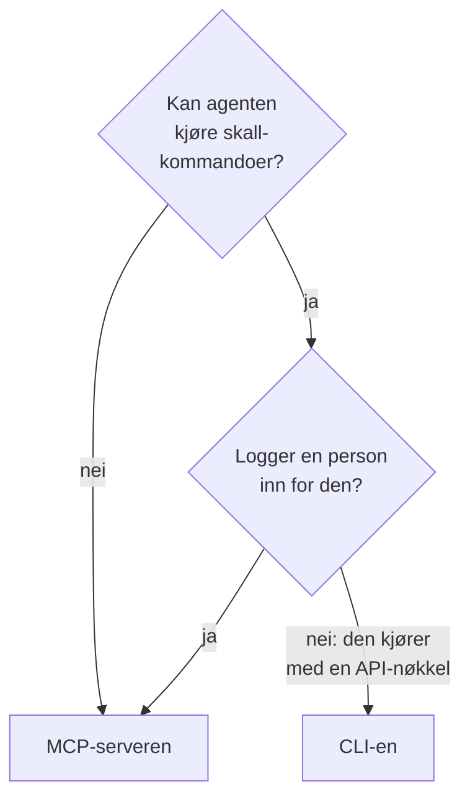

# CLI for AI-agenter

En AI-agent som kan kjøre skallkommandoer, for eksempel en kodeagent i editoren din eller en jobb i pipelinen din, kan jobbe med OneUptime gjennom CLI-en i stedet for [MCP-serveren](/docs/ai/mcp-server). Denne siden sier når hva passer, og hvordan en agent installerer CLI-en, finner frem og leser svarene.

:::cards
- [CLI-en eller MCP-serveren](#cli-en-eller-mcp-serveren): Hva en agent bør bruke.
- [Sett den opp for en agent](#sett-den-opp-for-en-agent): Installer den, og gi den en nøkkel i miljøet.
- [Slik finner en agent frem](#slik-finner-en-agent-frem): Ressursene, feltene deres og hjelpen.
- [Les svarene](#les-svarene): JSON fra hver kommando, feil inkludert.
:::

## CLI-en eller MCP-serveren

Begge når OneUptime-API-et og gjør det påloggingsinformasjonen deres tillater. De er ulike i hva agenten trenger for å nå dem:



| | CLI-en | MCP-serveren |
| --- | --- | --- |
| Agenten trenger | Et skall og Node.js 22 eller nyere | En MCP-klient, for eksempel Claude eller Cursor |
| Den logger inn med | En API-nøkkel til prosjektet i `ONEUPTIME_API_KEY` | OneUptime-kontoen din eller en API-nøkkel |
| Den når | Hver ressurs i API-et, 450 og flere | Postene og telemetrien den har verktøy for, og verktøy for hendelseshåndtering |
| Den passer til | Skript agenten skriver som folk skal beholde, sjekker i en pipeline og arbeid med mange poster | En samtale: å undersøke en hendelse, å sette opp en monitor |

Bruk CLI-en når agenten allerede kjører kommandoer, slik en kodeagent gjør, eller når det den bygger, skal fortsette å kjøre uten den: et skript i et repository, et trinn i en pipeline. Bruk MCP-serveren når en person snakker med agenten i en chatklient, slik at agenten jobber med personens tillatelser og klienten spør før en endring.

## Sett den opp for en agent

Hver OneUptime tilbyr installasjonsskriptet til CLI-en for sin egen utgivelse: kommandoene nedenfor laster det ned fra `https://oneuptime.com`, så på en selvhostet OneUptime bytter du den ut med din URL. Skriptet lagres først som `install.sh`, slik at du kan lese det før du kjører det:

```bash
curl -fsSL https://oneuptime.com/install/cli -o install.sh
ONEUPTIME_URL=https://oneuptime.com bash install.sh
```

Gi agenten en API-nøkkel til prosjektet med bare tilgangen arbeidet krever, i miljøet i stedet for på kommandolinjen, og la den sjekke nøkkelen først:

```bash
export ONEUPTIME_API_KEY="your-api-key"
export ONEUPTIME_URL=https://oneuptime.com
oneuptime whoami --check -o json
```

Opprett nøkkelen under **Prosjektinnstillinger → Avansert → API-nøkler**: se [Opprett en API-nøkkel](/docs/api-reference/api-reference#opprett-en-api-nøkkel). En nøkkel som bare kan lese, lar agenten se og ingenting annet.

## Slik finner en agent frem

CLI-en sier hva den kan, uten API-nøkkel og uten forespørsel:

| Kommando | Hva den svarer |
| --- | --- |
| `oneuptime resources -o json` | Hver ressurs: kommandoen, navnene, API-banen, operasjonene og handlingene |
| `oneuptime incident fields -o json` | Feltene til en ressurs: hva hvert er til, typen, om en opprettelse trenger det, og flagget |
| `oneuptime incident create --help` | Argumentene og flaggene til en kommando |

Et felt som inneholder en ID, sier hvilken ressurs ID-en kommer fra, så agenten lister den ressursen først: `incidentSeverityId` tar en ID fra `oneuptime incident-severity list`. Et felt som nevner en person, tar også personens e-postadresse, for eksempel med `--user-email`.

## Les svarene

La agenten legge `-o json` eller `--json` til hver kommando. Da svarer hver kommando med JSON, også de der svaret er en setning, og en feil er ett JSON-objekt på standard feil:

```bash
oneuptime incident acknowledge 6f1c2a40-3b1e-4c55-9a0b-3e2f8d7c1a11 -o json
```

```json
{
  "_id": "6f1c2a40-3b1e-4c55-9a0b-3e2f8d7c1a11",
  "action": "acknowledge",
  "changed": true,
  "state": {
    "_id": "0b7d5e2c-8f4a-4d1b-9c3e-5a6f7b8c9d0e",
    "name": "Acknowledged"
  }
}
```

Avslutningskoden sier hva som skjedde: `0` når det lyktes, `1` når det mislyktes, `2` når API-nøkkelen mangler eller avvises, og `3` når posten ikke finnes. JSON-en til en feil har den samme koden i `exitCode`, og i `hint` hva du gjør videre. Se [Utdataformater](/docs/cli/output-formats#json) og [Avslutningskoder](/docs/cli/scripting#avslutningskoder).

## Neste steg

:::cards
- [Ressursoperasjoner](/docs/cli/resource-operations): Hver operasjon, med flaggene og filtrene sine.
- [Kommandoreferanse](/docs/cli/command-reference): Hver kommando, hvert alternativ og hver standardverdi.
- [MCP-server](/docs/ai/mcp-server): Koble heller en chatklient til OneUptime.
:::
