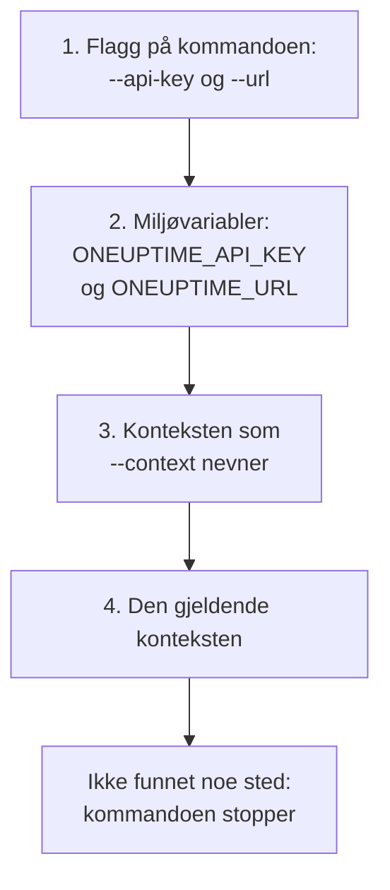

# Autentisering

Hver forespørsel CLI-en sender, bærer en API-nøkkel til prosjektet ditt. Lagre nøkler én gang med `oneuptime login`, én kontekst for hvert miljø, eller gi dem til en kommando i flagg eller miljøvariabler, slik skript gjør. Denne siden viser hver måte, og hvilken en kommando bruker når det er flere.

:::cards
- [Logg inn](#logg-inn): Lagre en API-nøkkel og adressen til OneUptime-en din.
- [Kontekster](#kontekster): En lagret innlogging for hvert prosjekt eller miljø, og bytte mellom dem.
- [Hvilken legitimasjon en kommando bruker](#hvilken-legitimasjon-en-kommando-bruker): Først flagg, så miljøvariabler, så kontekster.
- [Feilsøking](#feilsøking): Ingen legitimasjon funnet, ugyldige nøkler og avvisninger.
:::

## Før du begynner

Du trenger en API-nøkkel til prosjektet ditt. Opprett en under **Prosjektinnstillinger → Avansert → API-nøkler** med **Opprett API-nøkkel**, og gi den tilgangen kommandoene dine trenger: se [Opprett en API-nøkkel](/docs/api-reference/api-reference#opprett-en-api-nøkkel). En nøkkel gjør det tillatelsene dens tillater: en nøkkel som bare kan lese poster, kan liste og lese dem, men ikke endre dem.

På OneUptime Cloud virker API-nøkler bare mens prosjektet har abonnementet **Growth** eller høyere. Under det svarer hver kommando med `API error (402)` og en melding som nevner abonnementet, til prosjektet oppgraderes; da virker den samme nøkkelen igjen. Se [API-nøkler og SCIM under abonnementet sitt](/docs/api-reference/api-reference#api-nøkler-og-scim-under-abonnementet-sitt).

## Logg inn

`oneuptime login` lagrer en API-nøkkel og adressen til OneUptime-en din som en kontekst, og gjør den til den gjeldende konteksten:

```bash
oneuptime login <api-key> <instance-url> [--context-name <name>]
```

| Argument eller alternativ | Hva det er |
| --- | --- |
| `<api-key>` | En API-nøkkel til prosjektet ditt |
| `<instance-url>` | Adressen til OneUptime-en din: `https://oneuptime.com`, eller adressen til din egen server, for eksempel `https://oneuptime.example.com` |
| `--context-name <name>` | Navnet konteksten lagres under. Standard: `default` |

For eksempel en kontekst med navnet `production`:

```bash
oneuptime login <api-key> https://oneuptime.com --context-name production
```

Den svarer `Logged in successfully. Context "production" is now active.` En skråstrek på slutten av adressen fjernes, og en ny innlogging under samme navn erstatter den konteksten.

> [!NOTE]
> `login` lagrer nøkkelen uten å spørre OneUptime om den. Kjør en kommando, for eksempel `oneuptime incident count`, for å se at nøkkelen virker.

## Kontekster

En kontekst er en lagret innlogging: et navn, en adresse og en API-nøkkel. Lagre én for hvert prosjekt eller miljø, og velg så én for alle kommandoene som følger, eller for én enkelt kommando.

:::steps
### Lagre en kontekst for hvert miljø

```bash
oneuptime login <production-api-key> https://oneuptime.com --context-name production
oneuptime login <staging-api-key> https://oneuptime.example.com --context-name staging
```

Hver innlogging gjør konteksten sin til den gjeldende, så nå er `staging` den gjeldende.

### List dem

```bash
oneuptime context list
```

```text
┌───┬────────────┬───────────────────────────────┐
│   │ Name       │ URL                           │
├───┼────────────┼───────────────────────────────┤
│   │ production │ https://oneuptime.com         │
├───┼────────────┼───────────────────────────────┤
│ * │ staging    │ https://oneuptime.example.com │
└───┴────────────┴───────────────────────────────┘
```

`*` markerer den gjeldende konteksten. API-nøkler listes aldri.

### Bytt til en annen kontekst

```bash
oneuptime context use production
```

Den svarer `Switched to context "production".` og kommandoene som følger, bruker den.

### Bruk en kontekst for én kommando

```bash
oneuptime incident list --context staging
```

Den gjeldende konteksten forblir som den var.
:::

| Kommando | Hva den gjør |
| --- | --- |
| `oneuptime context list` | Lister de lagrede kontekstene; `*` markerer den gjeldende. Med `-o json` hver konteksts `name`, `apiUrl` og `isCurrent`, aldri nøkkelen |
| `oneuptime context use <name>` | Gjør en lagret kontekst til den gjeldende |
| `oneuptime context current` | Viser navnet, URL-en og API-nøkkelen til den gjeldende konteksten, med nøkkelen skjult bortsett fra de fire første og fire siste tegnene |
| `oneuptime context delete <name>` | Sletter en lagret kontekst. Var det den gjeldende, blir den første gjenværende konteksten gjeldende |

## Hvilken legitimasjon en kommando bruker

En kommando trenger en API-nøkkel og en URL. Den henter hver av de to fra det første av disse stedene som har den:



Du kan altså blande dem: for eksempel en API-nøkkel fra en miljøvariabel med URL-en til den gjeldende konteksten. Miljøvariabler passer for skript og CI-jobber, som ikke har lagrede kontekster:

:::tabs
@tab Linux
```bash
export ONEUPTIME_API_KEY=<api-key>
export ONEUPTIME_URL=https://oneuptime.com
oneuptime incident list
```
@tab macOS
```bash
export ONEUPTIME_API_KEY=<api-key>
export ONEUPTIME_URL=https://oneuptime.com
oneuptime incident list
```
@tab Windows
```powershell
$env:ONEUPTIME_API_KEY = "<api-key>"
$env:ONEUPTIME_URL = "https://oneuptime.com"
oneuptime incident list
```
:::

Flagg går foran alt annet, for én kommando:

```bash
oneuptime --api-key <api-key> --url https://oneuptime.com incident list
```

> [!WARNING]
> En nøkkel som gis som flagg, havner i shell-historikken din, og andre brukere av maskinen kan se den i prosesslisten. På en delt maskin bør du heller bruke en kontekst eller en miljøvariabel.

## Sjekk hva CLI-en vil bruke

`oneuptime whoami` viser URL-en og API-nøkkelen som neste kommando vil bruke, og konteksten de kommer fra:

```bash
oneuptime whoami
```

```text
URL:     https://oneuptime.com
API Key: 4f1c****0a13
Context: production
```

Bare de fire første og de fire siste tegnene i nøkkelen vises. Linjen `Context` vises bare når URL-en og nøkkelen er kontekstens egne, ikke verdier som et flagg eller en miljøvariabel har erstattet. `whoami` leser innstillingene dine uten å kalle OneUptime: den viser hva en kommando vil sende, ikke om OneUptime godtar det. Er ingenting lagret eller satt, svarer den:

```text
Not authenticated. Run `oneuptime login` to authenticate.
```

## Konfigurasjonsfilen

`oneuptime login` lagrer kontekster i `~/.oneuptime/config.json`, i hjemmemappen din (`%USERPROFILE%\.oneuptime\config.json` på Windows). CLI-en oppretter den slik at bare brukeren din kan lese og skrive den (modus `0600`):

```json title="~/.oneuptime/config.json"
{
  "currentContext": "production",
  "contexts": {
    "production": {
      "name": "production",
      "apiUrl": "https://oneuptime.com",
      "apiKey": "<api-key>"
    },
    "staging": {
      "name": "staging",
      "apiUrl": "https://oneuptime.example.com",
      "apiKey": "<api-key>"
    }
  }
}
```

Filen inneholder API-nøklene som de er: hold den unna delte mapper, sikkerhetskopier og repositorier. For å logge ut av én kontekst sletter du den med `oneuptime context delete <name>`; for å logge ut av alle sletter du filen. En nøkkel som kan ha lekket, er gyldig til du sletter den i OneUptime, under **Prosjektinnstillinger → Avansert → API-nøkler**.

Utdataformater og listestørrelser lagres ikke her: gi `-o` og `--limit` til hver kommando.

## Feilsøking

:::details Meldingen «No credentials found»
`Authentication error: No credentials found.` betyr at ingen flagg, miljøvariabel eller lagret kontekst ga kommandoen API-nøkkelen og URL-en dens. Kjør `oneuptime login`, eller sett både `ONEUPTIME_API_KEY` og `ONEUPTIME_URL`. Kommandoen avslutter med koden `2`.
:::

:::details Meldingen «API error (400): Invalid API Key»
Nøkkelen er ikke en API-nøkkel til OneUptime, har utløpt eller er tilbakestilt. Kopier den på nytt fra siden dens under **Prosjektinnstillinger → Avansert → API-nøkler**, der også datoen dens står under **Utløper**, og logg inn på nytt under samme kontekstnavn. Kommandoen avslutter med koden `2`.
:::

:::details Meldingen «API error (402): API keys need the Growth plan»
På OneUptime Cloud er prosjektet under abonnementet **Growth**, så API-nøklene dets sluttet å virke. Oppgrader prosjektet, så virker den samme nøkkelen igjen: ingenting å endre i CLI-en.
:::

:::details Meldingen «API error (422): You do not have permissions»
Nøkkelens tillatelser rekker ikke til det kommandoen ber om. Gi nøkkelen en rolle eller en tillatelse på siden dens under **Prosjektinnstillinger → Avansert → API-nøkler**: meldingen nevner tillatelsene som ville sluppet forespørselen gjennom.
:::

:::details Meldingen «Context "staging" does not exist»
Ingen kontekst med det navnet er lagret. `oneuptime context list` viser navnene som finnes.
:::

:::details whoami viser en annen URL eller nøkkel enn konteksten har
En miljøvariabel eller et flagg erstatter kontekstens verdi. `env | grep ONEUPTIME` viser variablene som er satt, og `unset ONEUPTIME_API_KEY ONEUPTIME_URL` fører deg tilbake til kontekstene dine.
:::

:::details Forespørselen til adressen mislykkes
`Error: Request failed to https://...` betyr at CLI-en ikke nådde OneUptime på den adressen. Sjekk URL-en med `oneuptime whoami`: det er adressen du åpner OneUptime på, med `https://`, for eksempel `https://oneuptime.com`.
:::

## Neste steg

:::cards
- [Ressursoperasjoner](/docs/cli/resource-operations): List, les, opprett, endre, slett og tell poster.
- [Skripting og CI/CD](/docs/cli/scripting): Gi en pipeline nøkkelen sin i miljøvariabler.
- [OneUptime API-referanse](/docs/api-reference/api-reference): Hva en API-nøkkel kan gjøre, og hva hvert svar betyr.
:::
